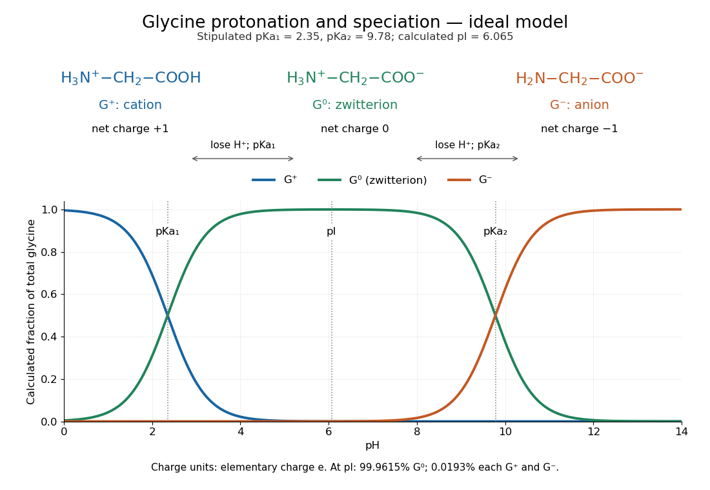

# Glycine protonation

↑ **Parent:** [Alpha-amino acid](alpha-amino-acid.md)

The three principal aqueous [glycine](glycine.md) forms differ by loss of one [proton](proton.md) at each step:

$$
\begin{aligned}
\mathrm{H_3N^+{-}CH_2{-}COOH}+\mathrm H_2\mathrm O&\rightleftharpoons\mathrm{H_3N^+{-}CH_2{-}COO^-}+\mathrm H_3\mathrm O^+,\\
\mathrm{H_3N^+{-}CH_2{-}COO^-}+\mathrm H_2\mathrm O&\rightleftharpoons\mathrm{H_2N{-}CH_2{-}COO^-}+\mathrm H_3\mathrm O^+.
\end{aligned}
$$

Call these [glycine](glycine.md) forms $G^+$, $G^0$ and $G^-$, respectively: a [cation](cation.md), a [zwitterion](zwitterion.md) and an [anion](anion.md), with net [electric charges](electric-charge.md) $+e$, $0$ and $-e$, where $e$ is the [elementary charge](elementary-charge.md). $G^0$ specifically denotes the [zwitterion](zwitterion.md), not an uncharged amino/carboxyl drawing. The first dissociation removes the carboxyl [proton](proton.md); the second removes a [proton](proton.md) from the positively charged [nitrogen](nitrogen.md). The [chemical equilibrium](chemical-equilibrium.md) changes are reversible, not three permanently separate kinds of [glycine](glycine.md). [§26.1, aqueous zwitterion protonation/deprotonation; §26.2, two successive amino-acid dissociations](organic-chemistry-by-john-mcmurry.md)

For all calculations and both diagrams here, explicitly stipulate the [pKa](pka.md) values $\mathrm pK_{a1}=2.35$ and $\mathrm pK_{a2}=9.78$. These are illustrative model inputs, not measurements from the [glycine titration experiment](glycine-titration-experiment.md) or a claim of universal constants. Actual [acid dissociation constants](acid-dissociation-constant.md) depend on [temperature](temperature.md) and on the convention used for [thermodynamic activity](thermodynamic-activity.md); apparent [concentration](concentration.md)-based values also depend on [ionic strength](ionic-strength.md). For comparison, the inspected textbook tabulates $2.34$ and $9.60$ for [glycine](glycine.md), which would give a different [isoelectric point](isoelectric-point.md). [§26.1, Table 26.1, glycine row: pKa 2.34, 9.60 and pI 5.97](organic-chemistry-by-john-mcmurry.md)

**[Figure 81](#image-glycine-protonation-and-calculated-chemical-species-fractions). Glycine protonation and calculated chemical species fractions**. Original three-state ideal [glycine speciation model](glycine-speciation-model.md), with stipulated [pKa](pka.md) values $2.35$ and $9.78$. The structures show net [electric charges](electric-charge.md) $+1$, $0$ and $-1$ in units of the [elementary charge](elementary-charge.md). Curves are calculated fractions, not measured populations. The vertical markers locate the two [pKa](pka.md) values and the model [isoelectric point](isoelectric-point.md) $6.065$.

**Table of contents**

- [Glycine speciation model](glycine-speciation-model.md)
- [Glycine titration](glycine-titration.md)
  - [Glycine titration experiment](glycine-titration-experiment.md)

## ↑ Ancestors (7)

1. [Alpha-amino acid](alpha-amino-acid.md)
2. [Amino acid](amino-acid.md)
3. [Carboxylic acid](carboxylic-acid.md)
4. [Organic acid](organic-acid.md)
5. [Chemical substance](chemical-substance.md)
6. [Chemistry](chemistry-split.md)
7. [Codex Wiki](split.md)

## ← Incoming links (3)

- [Amino acid](amino-acid.md)
- [Glycine protonation](glycine-protonation.md)
- [Glycine titration](glycine-titration.md)
