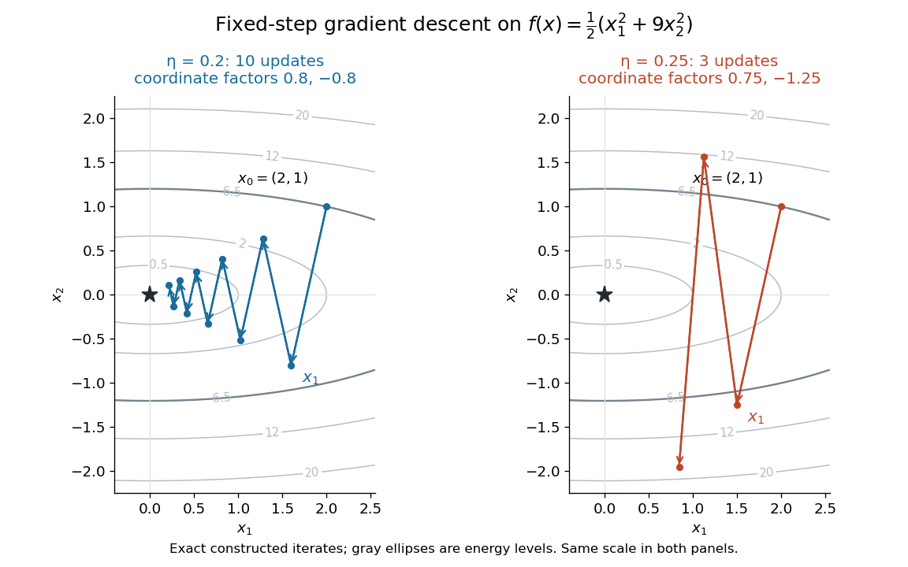
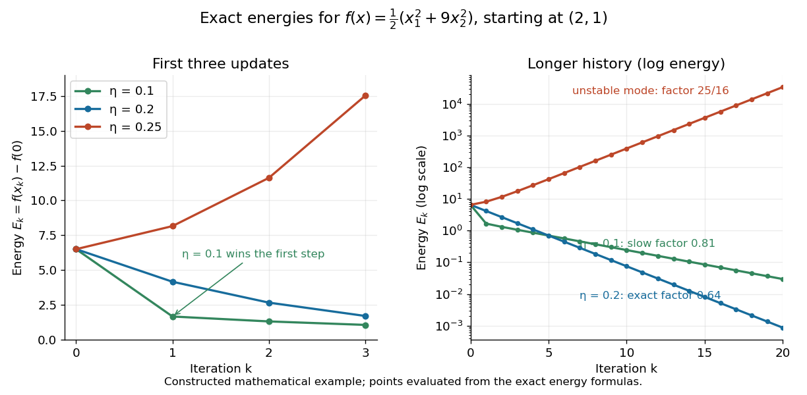

# Gradient descent

↑ **Parent:** [Numerical analysis](numerical-analysis.md)  
ⓦ [Wiki](https://en.wikipedia.org/wiki/Gradient_descent)

[Gradient descent](gradient-descent.md) is an [iterative method](numerical-analysis.md#iterative-method) for minimizing a [differentiable function](analysis.md#differentiable-function) $f$: choose an initial [vector](vector-space.md#vector) $x_0$ and repeatedly move opposite its [gradient](multivariable-calculus.md#gradient).[§9.3, p. 466, Algorithm 9.3: negative-gradient direction and a separately chosen step size](mathematics-bibliography.md#convex-optimization-by-stephen-boyd-and-lieven-vandenberghe)

With a fixed positive [step size](convex-optimization.md#step-size) $\eta$, the update is

$$
x_{k+1}=x_k-\eta\nabla f(x_k),\qquad k=0,1,2,\ldots.
$$

The direction and the [step size](convex-optimization.md#step-size) play different roles: the [gradient](multivariable-calculus.md#gradient) supplies local information about increase, while $\eta$ determines how far that information is trusted. A varying [step size](convex-optimization.md#step-size) gives $\eta_k$ instead; [exact line search for a positive-definite quadratic](#exact-line-search-for-a-positive-definite-quadratic) chooses it by minimizing along the current direction.

Why is this the steepest direction? For a unit [vector](vector-space.md#vector) $v$ in the [Euclidean norm](normed-vector-space.md#euclidean-norm), the [directional derivative](multivariable-calculus.md#directional-derivative) is $\langle\nabla f(x),v\rangle$. The [Cauchy-Schwarz inequality](probability-and-statistics.md#cauchy-schwarz-inequality) bounds it below by $-\|\nabla f(x)\|_2$, attained by $v=-\nabla f(x)/\|\nabla f(x)\|_2$ when the [gradient](multivariable-calculus.md#gradient) is nonzero. This is steepest descent relative to the [Euclidean norm](normed-vector-space.md#euclidean-norm); changing the [norm](normed-vector-space.md#norm) can change the steepest direction. A finite step need not decrease $f$, because a [directional derivative](multivariable-calculus.md#directional-derivative) describes infinitesimal motion.

For the [quadratic form](quadratic-form.md) with linear term $F(x)=x^TAx/2-b^Tx$, assuming $A$ is a [symmetric matrix](linear-algebra.md#symmetric-matrix), the negative [gradient](multivariable-calculus.md#gradient) is the [linear-system residual](#linear-system-residual) $r=b-Ax$. Thus [gradient descent](gradient-descent.md) turns the [linear system](linear-algebra.md#system-of-linear-equations) $Ax=b$ into repeated residual corrections; a [positive-definite matrix](quadratic-form.md#positive-definite-matrix) makes its solution the unique [global minimum](analysis.md#global-minimum). This is useful when applying the [linear map](vector-space.md#linear-map) $x\mapsto Ax$ is affordable but directly solving the [linear system](linear-algebra.md#system-of-linear-equations) is costly.

The attraction is that a [gradient](multivariable-calculus.md#gradient) evaluation gives an entire update without solving a new [linear system](linear-algebra.md#system-of-linear-equations). The difficulty is choosing a [step size](convex-optimization.md#step-size) that progresses along gently curved directions without overshooting steep ones. [Fixed-step gradient descent on a positive-definite quadratic](#fixed-step-gradient-descent-on-a-positive-definite-quadratic) makes this tension exact: every [eigenvector](linear-operator-theory.md#eigenvector) direction has its own multiplier, determined by its [eigenvalue](linear-operator-theory.md#eigenvalue). The resulting [condition number](quadratic-form.md#condition-number) dependence explains why a narrow valley can slow even an inexpensive [iterative method](numerical-analysis.md#iterative-method).

The simplicity of the [gradient](multivariable-calculus.md#gradient) update and its sensitivity to the [condition number](quadratic-form.md#condition-number) of the [Hessian matrix](multivariable-calculus.md#hessian-matrix) are central practical features.[§9.3.1, pp. 466–468, and §9.3.2, p. 475, Conclusions: convergence and conditioning](mathematics-bibliography.md#convex-optimization-by-stephen-boyd-and-lieven-vandenberghe)

**Table of contents**

- [Fixed-step gradient descent on a positive-definite quadratic](#fixed-step-gradient-descent-on-a-positive-definite-quadratic)
  - [Optimal fixed step for quadratic gradient descent](#optimal-fixed-step-for-quadratic-gradient-descent)
- [Gradient ascent](#gradient-ascent)
- [Stochastic gradient descent](#stochastic-gradient-descent)
  - [Projected stochastic gradient descent](#projected-stochastic-gradient-descent)
  - [Unbiased stochastic gradient](#unbiased-stochastic-gradient)
- [Lipschitz gradient](#lipschitz-gradient)
  - [Descent lemma](#descent-lemma)
- [Exact line search for a positive-definite quadratic](#exact-line-search-for-a-positive-definite-quadratic)
- [Conjugate gradient method](#conjugate-gradient-method)
  - [Linear-system residual](#linear-system-residual)
  - [Conjugate-gradient residual orthogonality](#conjugate-gradient-residual-orthogonality)
  - [Preconditioned conjugate gradient method](#preconditioned-conjugate-gradient-method)
    - [Exact inverse-square-root preconditioner](#exact-inverse-square-root-preconditioner)
  - [Krylov subspace](#krylov-subspace)
    - [Krylov dimension from spectral components](#krylov-dimension-from-spectral-components)
  - [Finite termination of the conjugate gradient method](#finite-termination-of-the-conjugate-gradient-method)
- [Heavy-ball method](#heavy-ball-method)
  - [Heavy-ball residual recurrence](#heavy-ball-residual-recurrence)
  - [Heavy-ball error propagation matrix](#heavy-ball-error-propagation-matrix)
    - [Heavy-ball rate for a two-eigenvalue diagonal quadratic](#heavy-ball-rate-for-a-two-eigenvalue-diagonal-quadratic)

## Fixed-step gradient descent on a positive-definite quadratic

↑ **Parent:** [Gradient descent](gradient-descent.md)

Consider the original two-dimensional example

$$
f(x_1,x_2)=\frac12(x_1^2+9x_2^2),\qquad x_0=(2,1)^T,\qquad \nabla f(x)=(x_1,9x_2)^T.
$$

The [Hessian matrix](multivariable-calculus.md#hessian-matrix) is $A=\operatorname{diag}(1,9)$, a [symmetric matrix](linear-algebra.md#symmetric-matrix) and [positive-definite matrix](quadratic-form.md#positive-definite-matrix). Its [eigenvectors](linear-operator-theory.md#eigenvector) are the coordinate directions, its [eigenvalues](linear-operator-theory.md#eigenvalue) are $1$ and $9$, and its [Euclidean norm](normed-vector-space.md#euclidean-norm) [condition number](quadratic-form.md#condition-number) is $9$. The unique [global minimum](analysis.md#global-minimum) is $x_*=0$, so the error $e_k=x_k-x_*$ equals $x_k$. The [linear map](vector-space.md#linear-map) $I-\eta A$, with $I$ the [identity matrix](vector-space.md#identity-matrix), gives

$$
x_{1,k}=2(1-\eta)^k,\qquad x_{2,k}=(1-9\eta)^k.
$$

For $\eta=1/5=0.2$, the two coordinate error multipliers are $0.8$ and $-0.8$. Consequently $x_1=(1.6,-0.8)^T$, $x_2=(1.28,0.64)^T$, and the second coordinate changes sign at every step while both shrink. The [Euclidean norm](normed-vector-space.md#euclidean-norm) of the error contracts by $0.8$ each step. The objective gap, which we call the quadratic energy, contracts by its square:

$$
E_k=f(x_k)-f(x_*)=\frac{13}{2}\left(\frac{16}{25}\right)^k,\qquad E_0=6.5,\quad E_1=4.16,\quad E_2=2.6624.
$$

The [level sets](topology.md#level-set) of $f$ are [ellipses](euclidean-geometry.md#ellipse). Oscillation across their narrow direction is compatible with strictly decreasing energy.

**[Figure 1](#image-original-gradient-descent-iterates-on-f-x-1-2-plus-9x-2-2-2-step-size-0-2-contracts-both-directions-whereas-0-25-expands-the-second). Original gradient descent iterates on $f=(x_1^2+9x_2^2)/2$: step size $0.2$ contracts both directions, whereas $0.25$ expands the second**.

For $\eta=1/4=0.25$, the coordinate error multipliers become $0.75$ and $-1.25$, giving $x_1=(1.5,-1.25)^T$. The first coordinate still tends to zero, but the second alternates and grows. Direct substitution gives

$$
E_k=2\left(\frac9{16}\right)^k+\frac92\left(\frac{25}{16}\right)^k,\qquad E_1=\frac{261}{32}=8.15625.
$$

Thus a larger positive [step size](convex-optimization.md#step-size) can turn a strictly [convex function](real-analysis.md#convex-function) into a divergent iteration. Energy and error are different quantities: coordinate errors carry signed multipliers, while each coordinate's contribution to energy carries the squared multiplier.

**[Figure 2](#image-exact-constructed-quadratic-energy-histories-from-2-1-step-sizes-0-1-and-0-2-converge-while-0-25-diverges). Exact constructed quadratic-energy histories from $(2,1)$: step sizes $0.1$ and $0.2$ converge, while $0.25$ diverges**.

For the general [quadratic form](quadratic-form.md) with linear term

$$
f(x)=\frac12x^TAx-b^Tx,\qquad A=A^T>0,\qquad x_*=A^{-1}b,
$$

the error obeys the same [linear map](vector-space.md#linear-map) $e_{k+1}=(I-\eta A)e_k$. The [spectral theorem for real symmetric matrices](linear-algebra.md#spectral-theorem-for-real-symmetric-matrices) supplies an [orthonormal basis](inner-product.md#orthonormal-basis) of [eigenvectors](linear-operator-theory.md#eigenvector) $q_i$ with positive [eigenvalues](linear-operator-theory.md#eigenvalue) $\lambda_i$. Writing $e_0=\sum_i c_iq_i$ gives the exact solution and energy identity

$$
e_k=\sum_i c_i(1-\eta\lambda_i)^kq_i,\qquad
E_k=\frac12\sum_i\lambda_i c_i^2(1-\eta\lambda_i)^{2k}.
$$

Therefore convergence from every initial [vector](vector-space.md#vector) is equivalent to

$$
|1-\eta\lambda_i|<1\quad\text{for every }i,
\qquad\text{or equivalently}\qquad 0<\eta<\frac2{\lambda_{\max}}.
$$

At $\eta=2/\lambda_{\max}$, a nonzero error component along a largest-[eigenvalue](linear-operator-theory.md#eigenvalue) [eigenvector](linear-operator-theory.md#eigenvector) flips sign without shrinking. Above that threshold it grows. A particular start can still converge if it has zero components in every unstable direction; the interval is the condition for all starts. If $\rho=\max_i|1-\eta\lambda_i|<1$, then $\|e_k\|_2\leq\rho^k\|e_0\|_2$ and $E_k\leq\rho^{2k}E_0$. These bounds follow by summing the squared components in the [orthonormal basis](inner-product.md#orthonormal-basis).

### Optimal fixed step for quadratic gradient descent

↑ **Parent:** [Fixed-step gradient descent on a positive-definite quadratic](#fixed-step-gradient-descent-on-a-positive-definite-quadratic)

For a fixed [symmetric matrix](linear-algebra.md#symmetric-matrix) and [positive-definite matrix](quadratic-form.md#positive-definite-matrix) $A$, what positive [step size](convex-optimization.md#step-size) minimizes the largest coordinate error multiplier over all [eigenvector](linear-operator-theory.md#eigenvector) directions? Let $m=\lambda_{\min}>0$ and $L=\lambda_{\max}$. Since $|1-\eta\lambda|$ is a [convex function](real-analysis.md#convex-function) of $\lambda$, its maximum over the [eigenvalues](linear-operator-theory.md#eigenvalue) occurs at an endpoint:

$$
\rho(\eta)=\max\{|1-\eta m|,|1-\eta L|\}.
$$

Balance the two extremes by solving $1-\eta m=-(1-\eta L)$:

$$
\eta_* = \frac2{m+L},\qquad \rho_* = \frac{L-m}{L+m}=\frac{\kappa-1}{\kappa+1},\qquad \kappa=\frac Lm.
$$

Here $\kappa$ is the [Euclidean norm](normed-vector-space.md#euclidean-norm) [condition number](quadratic-form.md#condition-number) of $A$. This balance is optimal: for $\eta<\eta_*$ the endpoint $1-\eta m$ exceeds $\rho_*$, and for $\eta>\eta_*$ the endpoint $\eta L-1$ exceeds $\rho_*$. The optimal worst-case energy factor is $\rho_*^2$, rather than $\rho_*$. This optimizes a uniform one-step bound; a particular initial error supported on fewer [eigenvectors](linear-operator-theory.md#eigenvector) can have a different best [step size](convex-optimization.md#step-size).

In the example $m=1$, $L=9$, so $\eta_*=0.2$ and $\rho_*^2=0.64$. Both [eigenvalue](linear-operator-theory.md#eigenvalue) directions attain that energy factor, making the displayed history exact. The smaller [step size](convex-optimization.md#step-size) $0.1$ instead gives

$$
E_k=2(0.81)^k+\frac92(0.01)^k.
$$

Its first step reaches $E_1=1.665$, below $4.16$ for $\eta=0.2$, but subsequent progress is limited by the first direction's energy factor $0.81$. By $k=5$, the energies are approximately $0.69736$ and $0.69793$, respectively; by $k=6$, the $0.2$ iteration is ahead. A better first step need not yield a faster long-run history.

As the [condition number](quadratic-form.md#condition-number) grows, $\rho_*$ approaches one: stability in the direction of the largest [eigenvalue](linear-operator-theory.md#eigenvalue) forces small movement along the smallest-[eigenvalue](linear-operator-theory.md#eigenvalue) direction. This is a precise reason to improve scaling or use a method such as the [Conjugate gradient method](#conjugate-gradient-method), rather than merely increasing the [step size](convex-optimization.md#step-size). When $m=L$, choosing $\eta=1/m$ eliminates every error component in one step.

## Gradient ascent

↑ **Parent:** [Gradient descent](gradient-descent.md)

[Gradient ascent](#gradient-ascent) seeks a maximum by stepping along the [gradient](multivariable-calculus.md#gradient) of a differentiable objective. It is [gradient descent](gradient-descent.md) applied to $-J$. Taylor expansion gives $J(x+\eta\nabla J)=J(x)+\eta\|\nabla J\|^2+O(\eta^2)$, so sufficiently small positive steps improve the objective when the [gradient](multivariable-calculus.md#gradient) is nonzero. Line search, projection onto admissible controls, and noise-aware [gradient](multivariable-calculus.md#gradient) estimates are common practical modifications; a local stationary result need not be globally optimal.

## Stochastic gradient descent

↑ **Parent:** [Gradient descent](gradient-descent.md)  
ⓦ [Wiki](https://en.wikipedia.org/wiki/Stochastic_gradient_descent)

Stochastic gradient descent updates parameters using an unbiased or approximate gradient computed from one observation or a mini-batch rather than the complete data set.

### Projected stochastic gradient descent

↑ **Parent:** [Stochastic gradient descent](#stochastic-gradient-descent)

Projected stochastic gradient descent takes a stochastic-gradient step and then projects the result onto a closed feasible set. For a convex set $C$ it has the form $x_{s+1}=\Pi_C(x_s-\eta_sG_s)$.

### Unbiased stochastic gradient

↑ **Parent:** [Stochastic gradient descent](#stochastic-gradient-descent)

A random vector $G_s$ is an unbiased stochastic gradient at $x_s$ when $\mathbb E[G_s\mid x_s]=\nabla f(x_s)$.

## Lipschitz gradient

↑ **Parent:** [Gradient descent](gradient-descent.md)

A [differentiable function](analysis.md#differentiable-function) has a $\beta$-[Lipschitz gradient](#lipschitz-gradient) on a set $D$ if its [gradient](multivariable-calculus.md#gradient) satisfies [Lipschitz continuity](real-analysis.md#lipschitz-continuity) there:

$$
\|\nabla f(x)-\nabla f(y)\|_2\leq\beta\|x-y\|_2\qquad(x,y\in D),\quad \beta\geq0.
$$

All [norms](normed-vector-space.md#norm) here are the [Euclidean norm](normed-vector-space.md#euclidean-norm). The constant limits how fast the [gradient](multivariable-calculus.md#gradient) changes; it is not a bound on the magnitude of the [gradient](multivariable-calculus.md#gradient). For $f(x)=(x_1^2+9x_2^2)/2$, the [gradient](multivariable-calculus.md#gradient) is the [linear map](vector-space.md#linear-map) $x\mapsto\operatorname{diag}(1,9)x$. Its [operator norm](continuous-dual-space.md#operator-norm) is $9$, so $\beta=9$ works globally and is sharp by taking $x-y=(0,1)^T$. The [gradient](multivariable-calculus.md#gradient) itself is unbounded on the whole [Euclidean space](normed-vector-space.md#euclidean-norm).

If $f$ has a continuous [Hessian matrix](multivariable-calculus.md#hessian-matrix) on an open [convex set](convex-set.md) $D$ and $\|\nabla^2f(z)\|_2\leq\beta$ throughout $D$, integrate that [linear map](vector-space.md#linear-map) along the [line segment](convex-set.md#line-segment) from $x$ to $y$:

$$
\nabla f(y)-\nabla f(x)=\int_0^1\nabla^2f(x+t(y-x))(y-x)\,dt.
$$

The [operator norm](continuous-dual-space.md#operator-norm) bound proves the displayed [Lipschitz continuity](real-analysis.md#lipschitz-continuity). Convexity of the domain keeps the entire [line segment](convex-set.md#line-segment) inside it. Bounding the [Hessian matrix](multivariable-calculus.md#hessian-matrix) only at the endpoints is insufficient.

### Descent lemma

↑ **Parent:** [Lipschitz gradient](#lipschitz-gradient)

Suppose $f$ is a [differentiable function](analysis.md#differentiable-function) on an open [convex set](convex-set.md) $D\subseteq\mathbb R^n$ and has an $L$-[Lipschitz gradient](#lipschitz-gradient) there, in the [Euclidean norm](normed-vector-space.md#euclidean-norm). For $u,v\in D$, the [descent lemma](#descent-lemma) states

$$
f(v)\leq f(u)+\langle\nabla f(u),v-u\rangle+\frac L2\|v-u\|_2^2.
$$

A bounded continuous [Hessian matrix](multivariable-calculus.md#hessian-matrix) gives one sufficient route to this estimate.[§9.1.2, p. 461, equation (9.13): Hessian upper bound and quadratic upper estimate; §9.3.1, p. 466, equation (9.17): substitution of a negative-gradient step](mathematics-bibliography.md#convex-optimization-by-stephen-boyd-and-lieven-vandenberghe)

For a short proof, put $d=v-u$. The [fundamental theorem of calculus](calculus.md#fundamental-theorem-of-calculus) along the [line segment](convex-set.md#line-segment) gives

$$
f(v)-f(u)-\langle\nabla f(u),d\rangle
=\int_0^1\langle\nabla f(u+td)-\nabla f(u),d\rangle\,dt.
$$

The [Cauchy-Schwarz inequality](probability-and-statistics.md#cauchy-schwarz-inequality) and the [Lipschitz gradient](#lipschitz-gradient) bound make the [integrand](integral.md#integrand) at most $Lt\|d\|_2^2$; its [integral](integral.md) is $L\|d\|_2^2/2$. This proof needs no assumption that $f$ is a [convex function](real-analysis.md#convex-function).

For the [gradient descent](gradient-descent.md) update $v=u-\eta\nabla f(u)$, provided $v\in D$, substitution yields

$$
f(v)\leq f(u)-\eta\left(1-\frac{L\eta}{2}\right)\|\nabla f(u)\|_2^2.
$$

For $L>0$ and $0<\eta<2/L$, this ensures strict decrease whenever the [gradient](multivariable-calculus.md#gradient) is nonzero. At $\eta=2/L$ it guarantees only nonincrease; the quadratic example has a nonshrinking alternating component at this endpoint. At $\eta=1/L$ the guaranteed decrease is $\|\nabla f(u)\|_2^2/(2L)$. A bound valid only on $D$ cannot justify a step leaving $D$.

If a fixed admissible [step size](convex-optimization.md#step-size) is used forever, every iterate stays in $D$, and $f(x_k)$ has a finite lower bound, summing this inequality shows $\sum_k\|\nabla f(x_k)\|_2^2<\infty$, hence $\nabla f(x_k)\to0$. That conclusion alone gives neither convergence of the iterates nor a [global minimum](analysis.md#global-minimum). For example, the smooth [polynomial](polynomial.md) $f(x)=x^4-x^2$ has $f'(0)=0$ and $f''(0)=-2$: [gradient descent](gradient-descent.md) started at zero never moves, although $f(1/\sqrt2)=-1/4<0$. On $D=(-1,1)$, $|f''(x)|\leq10$, so the [Lipschitz gradient](#lipschitz-gradient) hypothesis holds on this domain. [Convex functions](real-analysis.md#convex-function) and [strongly convex functions](real-analysis.md#strongly-convex-function) provide additional structure; the exact quadratic convergence result above uses a [positive-definite matrix](quadratic-form.md#positive-definite-matrix).

## Exact line search for a positive-definite quadratic

↑ **Parent:** [Gradient descent](gradient-descent.md)

For $f(x)=x^TAx/2-b^Tx$ with $A$ positive definite and residual $r=b-Ax$, exact line search along $r$ uses

$$
t=\frac{r^Tr}{r^TAr}.
$$

The objective error contracts by

$$
1-\frac{(r^Tr)^2}{(r^TA^{-1}r)(r^TAr)}
\leq 1-\frac{\lambda_{\min}(A)}{\lambda_{\max}(A)}.
$$

## Conjugate gradient method

↑ **Parent:** [Gradient descent](gradient-descent.md)  
ⓦ [Wiki](https://en.wikipedia.org/wiki/Conjugate_gradient_method)

For a [positive-definite matrix](quadratic-form.md#positive-definite-matrix) $A$, the conjugate gradient method chooses mutually $A$-conjugate search directions. Starting with $r_0=b-Ax_0$ and $p_0=r_0$, it uses

$$
\alpha_k=\frac{r_k^Tr_k}{p_k^TAp_k},\quad
x_{k+1}=x_k+\alpha_kp_k,\quad
r_{k+1}=r_k-\alpha_kAp_k,
$$

and $p_{k+1}=r_{k+1}+\beta_kp_k$ with  
$\beta_k=r_{k+1}^Tr_{k+1}/(r_k^Tr_k)$.

### Linear-system residual

↑ **Parent:** [Conjugate gradient method](#conjugate-gradient-method)

The residual of an approximate solution $x$ of $Ax=b$ is $r=b-Ax$. It is the unbalanced right-hand side, while the solution error is $x_*-x=A^{-1}r$. The [Conjugate gradient method](#conjugate-gradient-method) makes residuals orthogonal to successive [Krylov subspaces](#krylov-subspace).

### Conjugate-gradient residual orthogonality

↑ **Parent:** [Conjugate gradient method](#conjugate-gradient-method)

At iteration $m$ of the conjugate gradient method,

$$
x_m-x_0\in\mathcal K_m(A,r_0),
\qquad
r_m\perp\mathcal K_m(A,r_0),
$$

and $r_m$ itself lies in $\mathcal K_{m+1}(A,r_0)$. These Galerkin conditions imply finite termination once the Krylov subspace becomes invariant under $A$.

### Preconditioned conjugate gradient method

↑ **Parent:** [Conjugate gradient method](#conjugate-gradient-method)

A symmetric preconditioner transforms $Ax=b$ into

$$
PAP^T\widehat x=Pb,\qquad x=P^T\widehat x.
$$

The aim is to make the transformed positive-definite matrix have clustered eigenvalues while keeping application of $P$ inexpensive.

#### Exact inverse-square-root preconditioner

↑ **Parent:** [Preconditioned conjugate gradient method](#preconditioned-conjugate-gradient-method)

For a positive-definite matrix $A$, choosing $P=A^{-1/2}$ gives $PAP^T=I$, so conjugate gradients terminates in one step. Constructing or applying the exact inverse square root is generally as expensive as solving the original system.

### Krylov subspace

↑ **Parent:** [Conjugate gradient method](#conjugate-gradient-method)  
ⓦ [Wiki](https://en.wikipedia.org/wiki/Krylov_subspace)

The order-$k$ Krylov subspace generated by $A$ and $b$ is

$$
\mathcal K_k(A,b)=\operatorname{span}\{b,Ab,\ldots,A^{k-1}b\}.
$$

#### Krylov dimension from spectral components

↑ **Parent:** [Krylov subspace](#krylov-subspace)

For a [diagonalizable](linear-operator-theory.md#diagonalizable-matrix) finite-dimensional operator, write $v=\sum_j u_j$ with nonzero $u_j$ in distinct [eigenspaces](linear-operator-theory.md#eigenspace) of eigenvalues $\lambda_j$. Then $A^rv=\sum_j\lambda_j^ru_j$. The [Vandermonde matrix](galois-theory.md#vandermonde-matrix) of the first $k$ powers is invertible for $k$ distinct eigenvalues, so these powers span exactly the $k$ independent components $u_j$. Thus the stabilized [Krylov subspace](#krylov-subspace) dimension is $k$. It counts distinct spectral components, not the number of nonzero coefficients in an arbitrary eigenbasis: $A=I$, $v=e_1+e_2$ has Krylov dimension one. Equivalently it is the minimum number of eigenvectors needed when those vectors may be chosen freely.

### Finite termination of the conjugate gradient method

↑ **Parent:** [Conjugate gradient method](#conjugate-gradient-method)

In exact arithmetic, conjugate gradients reaches the exact solution in at most the number of distinct eigenvalues of $A$, and therefore in at most $n$ steps for an $n$-dimensional system.

## Heavy-ball method

↑ **Parent:** [Gradient descent](gradient-descent.md)

The heavy-ball iteration adds momentum to gradient descent:

$$
x_{k+1}=x_k-\alpha\nabla F(x_k)+\beta(x_k-x_{k-1}).
$$

### Heavy-ball residual recurrence

↑ **Parent:** [Heavy-ball method](#heavy-ball-method)

For $F(x)=x^TAx/2-b^Tx$ and $r_k=b-Ax_k$,

$$
r_{k+1}=((1+\beta)I-\alpha A)r_k-\beta r_{k-1}.
$$

Thus $r_k$ is a polynomial in $A$ applied to the initial residual and lies in the corresponding [Krylov subspace](#krylov-subspace).

### Heavy-ball error propagation matrix

↑ **Parent:** [Heavy-ball method](#heavy-ball-method)

For $e_k=x^*-x_k$,

$$
\binom{e_{k+1}}{e_k}
=
\begin{pmatrix}
(1+\beta)I-\alpha A&-\beta I\\
I&0
\end{pmatrix}
\binom{e_k}{e_{k-1}}.
$$

If $A$ is diagonal with entries $\lambda_i$, a coordinate permutation turns this matrix into blocks

$$
\begin{pmatrix}1+\beta-\alpha\lambda_i&-\beta\\1&0\end{pmatrix}.
$$

#### Heavy-ball rate for a two-eigenvalue diagonal quadratic

↑ **Parent:** [Heavy-ball error propagation matrix](#heavy-ball-error-propagation-matrix)

For $A=\operatorname{diag}(1,\gamma)$, $\alpha=1/\gamma$, and $\beta=(1-\gamma^{-1/2})^2$, every error-propagation block has spectral radius at most $1-\gamma^{-1/2}$, and equality occurs.

## ↑ Ancestors (5)

1. [Numerical analysis](numerical-analysis.md)
2. [Analysis](analysis.md)
3. [Area of mathematics](mathematics.md#area-of-mathematics)
4. [Mathematics](mathematics.md)
5. [Codex Wiki](README.md)

## ← Incoming links (21)

- [Derivative](calculus.md#derivative)
- [Descent lemma](#descent-lemma)
- [Fixed-step gradient descent on a positive-definite quadratic](#fixed-step-gradient-descent-on-a-positive-definite-quadratic)
- [Gradient](multivariable-calculus.md#gradient)
- [Gradient ascent](#gradient-ascent)
- [Gradient descent](gradient-descent.md)
- [Nesterov accelerated gradient method](convex-optimization.md#nesterov-accelerated-gradient-method)
- [Nonlinear programming](mathematical-optimization.md#nonlinear-programming)
- [Solution](past-exam-of-the-chemistry-course-of-the-year-4-of-the-natural-sciences-course-of-the-university-of-cambridge/2022/paper-1.md#15/d/solution)
- [Solution](past-exam-of-the-mathematics-course-of-the-university-of-cambridge/2006/iii/paper-84.md#2/a/solution)
- [Solution](past-exam-of-the-mathematics-course-of-the-university-of-cambridge/2010/iii/paper-50.md#1/d/solution)
- [Solution](past-exam-of-the-mathematics-course-of-the-university-of-cambridge/2016/iii/paper-325.md#1/iv/solution)
- [Solution](past-exam-of-the-mathematics-course-of-the-university-of-cambridge/2018/iii/paper-335.md#3/ii/solution)
- [Solution](past-exam-of-the-mathematics-course-of-the-university-of-cambridge/2019/iii/paper-335.md#3/iii/solution)
- [Solution](past-exam-of-the-mathematics-course-of-the-university-of-cambridge/2022/ib/paper-1.md#7h/solution)
- [Solution](past-exam-of-the-mathematics-course-of-the-university-of-cambridge/2022/ii/paper-1.md#41c/c/solution)
- [Solution](past-exam-of-the-mathematics-course-of-the-university-of-cambridge/2022/iii/paper-339.md#1/c/iii/solution)
- [Solution](past-exam-of-the-mathematics-course-of-the-university-of-cambridge/2024/iii/paper-335.md#3/iii/solution)
- [Solution](past-exam-of-the-mathematics-course-of-the-university-of-cambridge/2026/ib/paper-3.md#19h/solution)
- [Squared-error backpropagation](statistical-learning.md#squared-error-backpropagation)
- [Symmetric preconditioning as energy geometry](numerical-linear-algebra.md#symmetric-preconditioning-as-energy-geometry)
