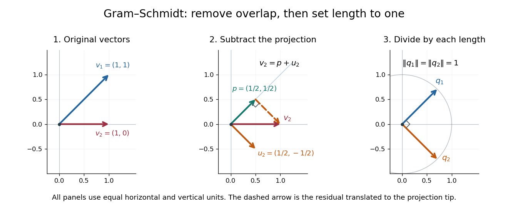

# Gram-Schmidt process

↑ **Parent:** [Inner product](inner-product-split.md)  
ⓦ [Wiki](https://en.wikipedia.org/wiki/Gram–Schmidt_process)

The [Gram-Schmidt process](gram-schmidt-process.md) turns a finite ordered family of [linearly independent](linear-independence.md) [vectors](vector.md) $v_1,\ldots,v_k$ in an [inner product space](inner-product-space.md) over the [real numbers](real-number.md) into an [orthonormal basis](orthonormal-basis.md) $q_1,\ldots,q_k$ of their [linear span](linear-span.md). It keeps every successive [linear span](linear-span.md), so the first $j$ new [vectors](vector.md) describe exactly the same directions as the first $j$ inputs. Its idea is geometric: remove the [orthogonal projection](orthogonal-projection.md) onto directions already found, then divide the remaining [vector](vector.md) by its [norm](norm.md). This makes a complicated [basis](basis.md) easier to use without changing the [vector subspace](vector-subspace.md) it describes.[MIT 18.06SC, Orthogonal matrices and Gram-Schmidt, pp. 1–3](https://ocw.mit.edu/courses/18-06sc-linear-algebra-fall-2011/7ac32be444c25e48590f47573833ccc6_MIT18_06SCF11_Ses2.4sum.pdf)

Start with $u_1=v_1$ and $q_1=v_1/\|v_1\|$. At step $j$, use the previously obtained [orthonormal set](orthonormal-set.md) to define

$$
u_j=v_j-\sum_{i=1}^{j-1}\langle v_j,q_i\rangle q_i,
\qquad q_j=\frac{u_j}{\|u_j\|},
\qquad \|u_j\|=\sqrt{\langle u_j,u_j\rangle}.
$$

The sum is the [orthogonal projection onto a finite-dimensional subspace](orthogonal-projection-onto-a-finite-dimensional-subspace.md) $W_{j-1}=\operatorname{span}(q_1,\ldots,q_{j-1})$, and $u_j$ is the [orthogonal projection residual](orthogonal-projection-residual.md). [Linear independence](linear-independence.md) ensures $u_j\ne0$: otherwise $v_j$ would already be a [linear combination](linear-combination.md) of earlier inputs. If the input family is [linearly dependent](linear-dependence.md), use only the retained [orthonormal](orthonormal-set.md) [vectors](vector.md) in the sum and omit an input whenever its remainder is the [zero vector](zero-vector.md); do not divide by zero. The retained outputs still form an [orthonormal basis](orthonormal-basis.md) of the original [linear span](linear-span.md), but their number can be smaller than $k$.

For a short verification, [orthonormality](orthonormal-set.md) makes every earlier [inner product](inner-product-split.md) vanish:

$$
\langle u_j,q_\ell\rangle
=\langle v_j,q_\ell\rangle-\sum_{i<j}\langle v_j,q_i\rangle\langle q_i,q_\ell\rangle=0
\quad(\ell<j).
$$

Also $u_j$ is $v_j$ minus a [linear combination](linear-combination.md) of earlier [vectors](vector.md), while $v_j$ is $u_j$ plus that same [linear combination](linear-combination.md). These two inclusions, followed by division by a nonzero [norm](norm.md), give

$$
\operatorname{span}(q_1,\ldots,q_j)=\operatorname{span}(v_1,\ldots,v_j).
$$

The argument also works in an [inner product space](inner-product-space.md) over the [complex numbers](complex-number.md) with the existing [inner product](inner-product-split.md) convention, linear in the first argument: the [coefficients](coefficient.md) remain $\langle v_j,q_i\rangle$. With the convention linear in the second argument, write $\langle q_i,v_j\rangle$ instead.

For a first picture, take $v_1=(1,1)^T$ and $v_2=(1,0)^T$ in $\mathbb R^2$ with the ordinary [dot product](dot-product.md). Then

$$
q_1=\frac{(1,1)^T}{\sqrt2},\qquad
\langle v_2,q_1\rangle q_1=\frac12(1,1)^T,\qquad
u_2=\frac12(1,-1)^T,\qquad
q_2=\frac{(1,-1)^T}{\sqrt2}.
$$

Subtracting the diagonal component leaves an [orthogonal](orthogonal-vectors.md) direction; dividing by its [norm](norm.md) $1/\sqrt2$ makes its length one. If the second input were $(2,2)^T$ instead, its [orthogonal projection](orthogonal-projection.md) would be the entire input and $u_2=0$, revealing [linear dependence](linear-dependence.md).

**[Figure 5](#image-gram-schmidt-orthogonalization-in-mathbb-r-2-input-vectors-subtraction-of-an-orthogonal-projection-and-an-orthonormal-basis). Gram-Schmidt orthogonalization in $\mathbb R^2$: input vectors, subtraction of an orthogonal projection, and an orthonormal basis**.

For a full three-dimensional calculation, use the ordinary [dot product](dot-product.md) and the input [vectors](vector.md)

$$
v_1=(1,1,0)^T,\qquad v_2=(1,0,1)^T,\qquad v_3=(0,1,1)^T.
$$

The first two steps give

$$
q_1=\frac{(1,1,0)^T}{\sqrt2},\qquad
\langle v_2,q_1\rangle=\frac1{\sqrt2},\qquad
u_2=(1/2,-1/2,1)^T,
$$

$$
\|u_2\|^2=\frac32,\qquad
q_2=\frac{(1,-1,2)^T}{\sqrt6}.
$$

At the third step, the [inner products](inner-product-split.md) are $\langle v_3,q_1\rangle=1/\sqrt2$ and $\langle v_3,q_2\rangle=1/\sqrt6$. Consequently

$$
u_3=(0,1,1)^T-\frac12(1,1,0)^T-\frac16(1,-1,2)^T
=\left(-\frac23,\frac23,\frac23\right)^T,
$$

$$
\|u_3\|^2=\frac43,\qquad
q_3=\frac{(-1,1,1)^T}{\sqrt3}.
$$

The three numerator [vectors](vector.md) have pairwise [dot products](dot-product.md) $0$ and squared [Euclidean norms](euclidean-norm.md) $2,6,3$. Thus the displayed outputs are indeed an [orthonormal basis](orthonormal-basis.md), and the three nonzero remainders also confirm [linear independence](linear-independence.md) of the inputs. Keeping the removed [coefficients](coefficient.md) produces the [QR decomposition](qr-decomposition.md) below.

An immediate reward is a reusable [orthogonal projection](orthogonal-projection.md): once an [orthonormal basis](orthonormal-basis.md) of a [vector subspace](vector-subspace.md) $W$ is known, any [vector](vector.md) $b$ has

$$
P_Wb=\sum_i\langle b,q_i\rangle q_i.
$$

For the [linear span](linear-span.md) of just the first two inputs in the three-dimensional example, $b=(0,0,1)^T$ gives $P_Wb=(1/3,-1/3,2/3)^T$. Its [orthogonal projection residual](orthogonal-projection-residual.md) is $(-1/3,1/3,1/3)^T=q_3/\sqrt3$, visibly in the missing [orthogonal](orthogonal-vectors.md) direction. This is the geometry behind the [linear least-squares problem](linear-least-squares-problem.md).

The formulas above describe exact arithmetic. With [floating-point arithmetic](floating-point-arithmetic-split.md), subtracting an [orthogonal projection](orthogonal-projection.md) nearly equal to the input can leave a small remainder; dividing by its small [norm](norm.md) can magnify existing [roundoff error](round-off-error.md). The [Classical Gram-Schmidt](classical-gram-schmidt.md) and [Modified Gram-Schmidt](modified-gram-schmidt.md) arrangements agree in exact arithmetic but can give different rounded results. Exact [linear dependence](linear-dependence.md) and a small computed remainder therefore require different judgments in a numerical implementation.[Higham, The Test Matrix Toolbox for Matlab, §8, p. 22](https://nhigham.com/wp-content/uploads/2023/10/high95m.pdf)

**Table of contents**

- [Classical Gram-Schmidt](classical-gram-schmidt.md)
- [Modified Gram-Schmidt](modified-gram-schmidt.md)
- [QR decomposition](qr-decomposition.md)
  - [Positive-diagonal QR decomposition preserves a complex structure](positive-diagonal-qr-decomposition-preserves-a-complex-structure.md)
  - [Thin QR factorization from Cholesky decomposition](thin-qr-factorization-from-cholesky-decomposition.md)
  - [Orthogonal coordinate reduction of a subspace](orthogonal-coordinate-reduction-of-a-subspace.md)
  - [Linear least-squares problem](linear-least-squares-problem.md)
- [Gram-Schmidt orthogonalization for a symmetric bilinear form](gram-schmidt-orthogonalization-for-a-symmetric-bilinear-form.md)

## ↑ Ancestors (6)

1. [Inner product](inner-product-split.md)
2. [Linear algebra](linear-algebra-split.md)
3. [Algebra](algebra-split.md)
4. [Area of mathematics](area-of-mathematics.md)
5. [Mathematics](mathematics-split.md)
6. [Codex Wiki](split.md)

## ← Incoming links (39)

- [Classical Gram-Schmidt](classical-gram-schmidt.md)
- [Euclidean orthonormal frame](euclidean-orthonormal-frame.md)
- [Gram-Schmidt process](gram-schmidt-process.md)
- [Hadamard determinant inequality](hadamard-determinant-inequality.md)
- [Orthogonal diagonalization of a real symmetric matrix](orthogonal-diagonalization-of-a-real-symmetric-matrix.md)
- [Orthogonal polynomial](orthogonal-polynomial-split.md)
- [Orthogonal projection onto a finite-dimensional subspace](orthogonal-projection-onto-a-finite-dimensional-subspace.md)
- [Orthogonal projection residual](orthogonal-projection-residual.md)
- [Orthogonal structure on a real vector bundle](orthogonal-structure-on-a-real-vector-bundle.md)
- [Solution](past-exam-of-the-mathematics-course-of-the-university-of-cambridge/2001/ib/paper-3/19b/solution.md)
- [Solution](past-exam-of-the-mathematics-course-of-the-university-of-cambridge/2002/ib/paper-2/5b/solution.md)
- [Solution](past-exam-of-the-mathematics-course-of-the-university-of-cambridge/2003/ib/paper-2/8g/solution.md)
- [Solution](past-exam-of-the-mathematics-course-of-the-university-of-cambridge/2003/iii/paper-14/3/solution.md)
- [Solution](past-exam-of-the-mathematics-course-of-the-university-of-cambridge/2005/ib/paper-4/10b/i/solution.md)
- [Solution](past-exam-of-the-mathematics-course-of-the-university-of-cambridge/2005/iii/paper-15/3/solution.md)
- [Solution](past-exam-of-the-mathematics-course-of-the-university-of-cambridge/2005/iii/paper-18/1/solution.md)
- [Solution](past-exam-of-the-mathematics-course-of-the-university-of-cambridge/2007/iii/paper-15/2/c/solution.md)
- [Solution](past-exam-of-the-mathematics-course-of-the-university-of-cambridge/2008/iii/paper-65/3/solution.md)
- [Solution](past-exam-of-the-mathematics-course-of-the-university-of-cambridge/2009/iii/paper-16/6/solution.md)
- [Solution](past-exam-of-the-mathematics-course-of-the-university-of-cambridge/2010/iii/paper-17/5/solution.md)
- [Solution](past-exam-of-the-mathematics-course-of-the-university-of-cambridge/2010/iii/paper-55/4/solution.md)
- [Solution](past-exam-of-the-mathematics-course-of-the-university-of-cambridge/2014/ia/paper-1/6a/i/solution.md)
- [Solution](past-exam-of-the-mathematics-course-of-the-university-of-cambridge/2014/ib/paper-4/1g/solution.md)
- [Solution](past-exam-of-the-mathematics-course-of-the-university-of-cambridge/2014/iii/paper-17/5/solution.md)
- [Solution](past-exam-of-the-mathematics-course-of-the-university-of-cambridge/2015/ia/paper-1/8a/a/v/solution.md)
- [Solution](past-exam-of-the-mathematics-course-of-the-university-of-cambridge/2015/iii/paper-5/2/1/solution.md)
- [Solution](past-exam-of-the-mathematics-course-of-the-university-of-cambridge/2017/ib/paper-4/1f/solution.md)
- [Solution](past-exam-of-the-mathematics-course-of-the-university-of-cambridge/2018/ib/paper-2/19d/solution.md)
- [Solution](past-exam-of-the-mathematics-course-of-the-university-of-cambridge/2018/iii/paper-340/6/solution.md)
- [Solution](past-exam-of-the-mathematics-course-of-the-university-of-cambridge/2019/ib/paper-2/19c/solution.md)
- [Solution](past-exam-of-the-mathematics-course-of-the-university-of-cambridge/2019/iii/paper-309/2/solution.md)
- [Solution](past-exam-of-the-mathematics-course-of-the-university-of-cambridge/2021/ii/paper-2/11h/b/solution.md)
- [Solution](past-exam-of-the-mathematics-course-of-the-university-of-cambridge/2022/ib/paper-1/5c/solution.md)
- [Solution](past-exam-of-the-mathematics-course-of-the-year-2-of-the-natural-sciences-course-of-the-university-of-cambridge/2001/paper-1/4/b/solution.md)
- [Solution](past-exam-of-the-mathematics-course-of-the-year-2-of-the-natural-sciences-course-of-the-university-of-cambridge/2023/paper-1/6/a/solution.md)
- [Solution](past-exam-of-the-mathematics-course-of-the-year-2-of-the-natural-sciences-course-of-the-university-of-cambridge/2024/paper-1/6/a/solution.md)
- [QR decomposition](qr-decomposition.md)
- [Smooth unitary frame for a Hermitian connection](smooth-unitary-frame-for-a-hermitian-connection.md)
- [Special orthogonal sphere fibration](special-orthogonal-sphere-fibration.md)
