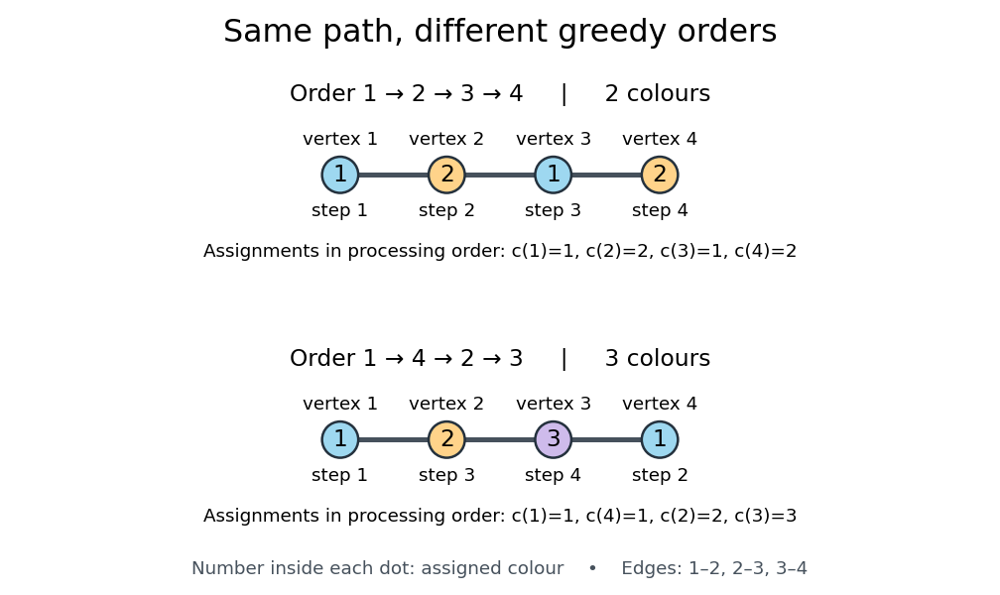
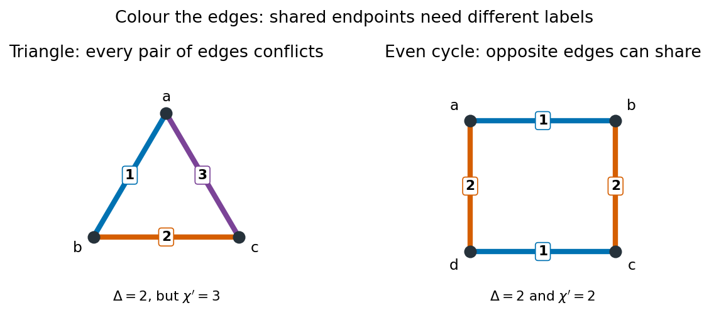
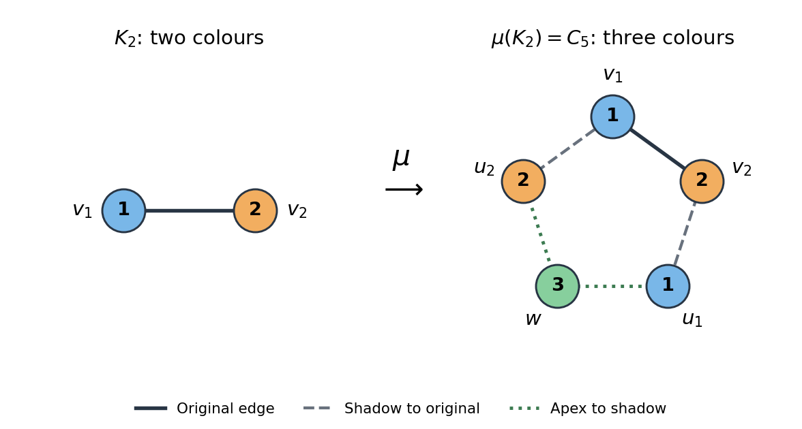
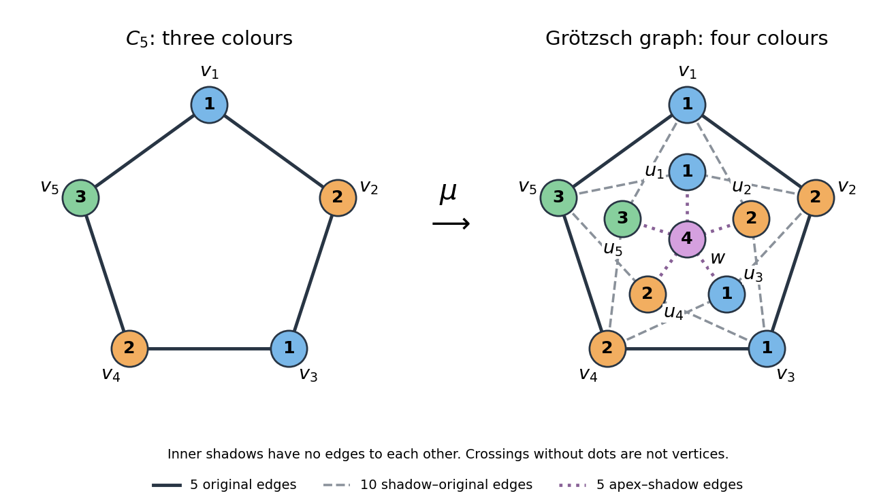
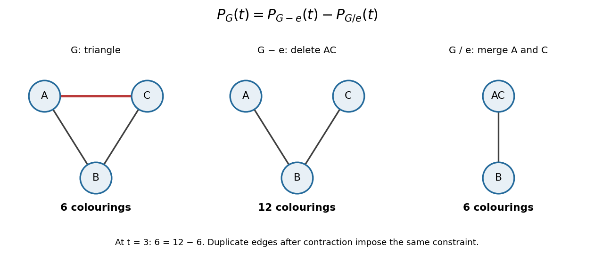

# Graph coloring

↑ **Parent:** [Graph theory](graph-theory.md)  
ⓦ [Wiki](https://en.wikipedia.org/wiki/Graph_coloring)

A [graph coloring](graph-coloring.md) assigns labels called colours to elements of a [graph](graph.md), subject to specified constraints. Here we focus on [proper vertex colouring](#proper-vertex-coloring) of a [simple graph](graph.md#simple-graph) $G=(V,E)$: it is an [undirected graph](graph-theory.md#undirected-graph) with a [finite set](set.md#finite-set) of [vertices](graph.md#vertex-graph-theory), and a colouring with at most $k$ colours is a [function](function.md)

$$
c:V\to\{1,\ldots,k\},\qquad \{u,v\}\in E\Longrightarrow c(u)\ne c(v).
$$

The colour labels need not be visual colours: they can represent time slots or resources. Unused labels are allowed. Properness concerns [graph adjacency](graph.md#graph-adjacency), so moving [vertices](graph.md#vertex-graph-theory) in a drawing does not change whether the [graph coloring](graph-coloring.md) is valid.[MIT, Graphs and Coloring, Section 2.1](https://ocw.mit.edu/courses/6-1200j-mathematics-for-computer-science-spring-2024/mit6_1200j_s24_lec11.pdf)

Each [colour class](ramsey-theory.md#colour-class) $c^{-1}(i)$ is an [independent set](graph-theory.md#independent-set-graph-theory): no [edge](graph-theory.md#edge-of-a-graph) has both endpoints in it. Conversely, a [set partition](combinatorics.md#set-partition) of $V$ into [independent sets](graph-theory.md#independent-set-graph-theory) gives a proper [graph coloring](graph-coloring.md) by assigning one colour to each part. Thus [graph coloring](graph-coloring.md) groups mutually compatible objects, and its [chromatic number](#chromatic-number) asks for the fewest such groups.

For an illustrative scheduling model, let each [vertex](graph.md#vertex-graph-theory) represent an activity of equal duration and each [edge](graph-theory.md#edge-of-a-graph) represent a pair that cannot occur in the same time slot. A proper [graph coloring](graph-coloring.md) is then a schedule respecting those pairwise conflicts. If the conflicts form a [cycle graph](graph-theory.md#cycle-graph) $C_4$ with [edges](graph-theory.md#edge-of-a-graph) $12,23,34,41$, activities $1,3$ can share one slot and $2,4$ another. This model assumes interchangeable slots and includes only the pairwise conflicts encoded by the [graph](graph.md).[Leighton, MIT Graph Theory and Coloring, transcript pages 8–10](https://ocw.mit.edu/courses/6-042j-mathematics-for-computer-science-fall-2010/1ccaf180bcd244fddd32e60789fa922f_h9wxtqoa1jY.pdf)

The word "colouring" also occurs in [edge coloring](#edge-coloring), which requires different colours on [edges](graph-theory.md#edge-of-a-graph) sharing an endpoint. The [chromatic number](#chromatic-number) discussed here always refers to [proper vertex colouring](#proper-vertex-coloring).

**Table of contents**

- [Two-coloring](#two-coloring)
- [Proper vertex coloring](#proper-vertex-coloring)
- [Semi-random palette refinement for triangle-free colouring](#semi-random-palette-refinement-for-triangle-free-colouring)
- [Colour savings from sparse neighbourhoods](#colour-savings-from-sparse-neighbourhoods)
- [Coloring entropy weight](#coloring-entropy-weight)
  - [Entropy weight of a graph cover](#entropy-weight-of-a-graph-cover)
- [Greedy coloring](#greedy-coloring)
  - [Extension of a partial colouring by neighbour-colour savings](#extension-of-a-partial-colouring-by-neighbour-colour-savings)
    - [Neighbour-colour saving](#neighbour-colour-saving)
- [Three-colourability problem](#three-colourability-problem)
- [Three-colour clause gadget](#three-colour-clause-gadget)
- [Boolean-pair colouring gadget](#boolean-pair-colouring-gadget)
- [Greedy colouring by removing independent sets](#greedy-colouring-by-removing-independent-sets)
- [Lovász number](#lovasz-number)
  - [Orthonormal representation of a graph](#orthonormal-representation-of-a-graph)
    - [Tensor-product capacity bound from an orthonormal representation](#tensor-product-capacity-bound-from-an-orthonormal-representation)
  - [Complement theta number](#complement-theta-number)
- [Vector coloring](#vector-coloring)
  - [Strict vector coloring](#strict-vector-coloring)
  - [Random hyperplane rounding](#random-hyperplane-rounding)
- [Semicoloring](#semicoloring)
  - [Semicoloring by independent hyperplanes](#semicoloring-by-independent-hyperplanes)
- [Edge coloring](#edge-coloring)
  - [Proper edge coloring](#proper-edge-coloring)
    - [Edge coloring as scheduling](#edge-coloring-as-scheduling)
  - [List edge coloring](#list-edge-coloring)
    - [List-chromatic index](#list-chromatic-index)
      - [Galvin theorem for bipartite list edge coloring](#galvin-theorem-for-bipartite-list-edge-coloring)
  - [Chromatic index](#chromatic-index)
    - [Chromatic index bounds](#chromatic-index-bounds)
  - [Tait coloring](#tait-coloring)
- [Chromatic number](#chromatic-number)
  - [Chromatic number of Euclidean space](#chromatic-number-of-euclidean-space)
  - [Colour-critical vertex](#colour-critical-vertex)
  - [Mycielskian](#mycielskian)
    - [Grötzsch graph](#grotzsch-graph)
    - [Mycielski shadow vertex](#mycielski-shadow-vertex)
    - [Mycielski apex](#mycielski-apex)
    - [Mycielskian chromatic increase](#mycielskian-chromatic-increase)
    - [Mycielskian triangle preservation](#mycielskian-triangle-preservation)
    - [Triangle-free graphs with arbitrarily large chromatic number](#triangle-free-graphs-with-arbitrarily-large-chromatic-number)
  - [Graphs of arbitrarily high girth and chromatic number](#graphs-of-arbitrarily-high-girth-and-chromatic-number)
  - [Brooks' theorem](#brooks-theorem)
- [Edge chromatic number](#edge-chromatic-number)
  - [Vizing's theorem](#vizing-s-theorem)
    - [Vizing fan lemma](#vizing-fan-lemma)
- [Kempe chain](#kempe-chain)
- [Chromatic polynomial](#chromatic-polynomial)
  - [Chromatic polynomial determines a Turán graph](#chromatic-polynomial-determines-a-turan-graph)
  - [Deletion-contraction recurrence for the chromatic polynomial](#deletion-contraction-recurrence-for-the-chromatic-polynomial)
  - [Chromatic polynomial after attaching a leaf](#chromatic-polynomial-after-attaching-a-leaf)

## Two-coloring

↑ **Parent:** [Graph coloring](graph-coloring.md)

A [graph coloring](graph-coloring.md) with two available colors in which adjacent vertices receive different colors. A graph admits a two-coloring exactly when it is a [bipartite graph](bipartite-graph.md). Every nonempty connected bipartite graph has two such colorings when the two color names are distinguished.

## Proper vertex coloring

↑ **Parent:** [Graph coloring](graph-coloring.md)

A proper vertex coloring assigns labels to the [vertices](graph.md#vertex-graph-theory) of a [graph](graph.md) so that [vertices](graph.md#vertex-graph-theory) joined by an [edge](graph-theory.md#edge-of-a-graph) have different labels. Each [colour class](ramsey-theory.md#colour-class) is an [independent set](graph-theory.md#independent-set-graph-theory). The [chromatic number](#chromatic-number) is the least number of labels needed for this form of [graph coloring](graph-coloring.md).

## Semi-random palette refinement for triangle-free colouring

↑ **Parent:** [Graph coloring](graph-coloring.md)

Maintain lists of available colours, tentatively colour small random portions, erase conflicts and prune colours used by neighbours. In a [triangle-free graph](graph.md#triangle-free-graph), a vertex's neighbours form an [independent set](graph-theory.md#independent-set-graph-theory), which enables local estimates. Track list size and average remaining neighbour congestion per colour; prune unusually congested colours before the next round. Concentration and the [Lovász local lemma](probabilistic-combinatorics.md#lovasz-local-lemma) preserve these invariants until lists have enough slack for completion. Tracking averages matters because triangle-free graphs can still contain many four-cycles and need not have uniform per-colour congestion.

## Colour savings from sparse neighbourhoods

↑ **Parent:** [Graph coloring](graph-coloring.md)

If each neighbourhood misses a fixed positive fraction of the possible pairs at a large degree bound, randomly assign about half that many colours and erase vertices with monochromatic incident edges. A nonadjacent neighbour pair can share a retained colour, giving a [neighbour-colour saving](#neighbour-colour-saving). Write the number of successful repeated colours as a difference of two [certifiable functions](probability-inequality.md#certifiable-function): colours with a nonadjacent pair, minus those for which a neighbour loses that colour. Both change by at most two under one-coordinate changes and have constant-size certificates. [Talagrand's convex distance inequality](probability-inequality.md#talagrand-s-convex-distance-inequality) and the [Lovász local lemma](probabilistic-combinatorics.md#lovasz-local-lemma) make their linear expected saving simultaneous at all high-degree vertices; low-degree vertices have slack already. This yields a colouring using a fixed positive fraction fewer than the degree bound.

## Coloring entropy weight

↑ **Parent:** [Graph coloring](graph-coloring.md)

For a uniformly chosen vertex $Z$, minimize the [information entropy](information-entropy.md) of its color over proper colorings. Multiply by the number of vertices to define this weight. Minimizing the color entropy gives the strongest contribution from that graph in the [entropy weight of a graph cover](#entropy-weight-of-a-graph-cover) inequality.

### Entropy weight of a graph cover

↑ **Parent:** [Coloring entropy weight](#coloring-entropy-weight)

If graphs $G_i$ cover the edges of an $n$-vertex graph with [independence number](graph-theory.md#independence-number) at most $\alpha$, their coloring entropy weights satisfy the displayed bound. A random vertex's color is recorded in every covering graph containing it; independent dummy colors with matching marginal laws fill the other positions. Conditional on all recorded colors, compatible vertices form an [independent set](graph-theory.md#independent-set-graph-theory), leaving conditional entropy at most $\log_2\alpha$. The [mutual information](information-theory.md#mutual-information) carried by the colors is at most $n^{-1}\sum_iw(G_i)$, proving the bound.

## Greedy coloring

↑ **Parent:** [Graph coloring](graph-coloring.md)  
ⓦ [Wiki](https://en.wikipedia.org/wiki/Greedy_coloring)

For a finite [simple graph](graph.md#simple-graph), choose an order of its [vertices](graph.md#vertex-graph-theory) and process them one at a time. Give each [vertex](graph.md#vertex-graph-theory) the smallest positive colour label not already used by its coloured neighbours, and keep all earlier assignments. This is [greedy coloring](#greedy-coloring): each step makes a locally available choice. The resulting [graph coloring](graph-coloring.md) is proper because, for each [edge](graph-theory.md#edge-of-a-graph), its later endpoint avoids the colour of its earlier endpoint.[Leighton, MIT Graph Theory and Coloring, transcript pages 12–13](https://ocw.mit.edu/courses/6-042j-mathematics-for-computer-science-fall-2010/1ccaf180bcd244fddd32e60789fa922f_h9wxtqoa1jY.pdf)

If the [maximum degree of a graph](graph-theory.md#maximum-degree-of-a-graph) is $\Delta(G)$, a [vertex](graph.md#vertex-graph-theory) has at most $\Delta(G)$ previously coloured neighbours, forbidding at most that many distinct colours. At least one label among $1,\ldots,\Delta(G)+1$ remains available. Consequently every order gives

$$
\chi(G)\leq\text{number of colours used by greedy colouring}\leq\Delta(G)+1.
$$

This is an upper bound, not a promise that [greedy coloring](#greedy-coloring) attains the [chromatic number](#chromatic-number).[MIT, Graphs and Coloring, Theorem 2](https://ocw.mit.edu/courses/6-1200j-mathematics-for-computer-science-spring-2024/mit6_1200j_s24_lec11.pdf)

**[Figure 1](#image-two-orders-for-greedy-coloring-of-the-same-path-graph-p-4). Two orders for greedy coloring of the same path graph $P_4$**. The [edges](graph-theory.md#edge-of-a-graph) are $12,23,34$ in both drawings. Each dot shows its assigned colour number, with the [vertex](graph.md#vertex-graph-theory) label above and its processing step below. The order $1,2,3,4$ uses two colours; the order $1,4,2,3$ uses three.

Consider the [path graph](graph-theory.md#path-graph) $P_4$ with [edges](graph-theory.md#edge-of-a-graph) $12,23,34$. In the order $1,2,3,4$, [greedy coloring](#greedy-coloring) assigns the colours $1,2,1,2$ respectively. In the order $1,4,2,3$, it assigns colours $1,1,2,3$ in processing order: [vertices](graph.md#vertex-graph-theory) $1,4$ both get colour $1$, then [vertex](graph.md#vertex-graph-theory) $2$ gets colour $2$, and finally [vertex](graph.md#vertex-graph-theory) $3$ sees colours $2$ and $1$ at its two neighbours and must take colour $3$. Written in [vertex](graph.md#vertex-graph-theory) order $1,2,3,4$, this second colouring is $1,2,3,1$.

The [path graph](graph-theory.md#path-graph) has [chromatic number](#chromatic-number) two: the first assignment achieves two colours, and any [edge](graph-theory.md#edge-of-a-graph) rules out one. Its [maximum degree of a graph](graph-theory.md#maximum-degree-of-a-graph) is two, so three colours in the second assignment still satisfy the bound. The extra colour comes entirely from the processing order. The [crown graph](bipartite-graph.md#crown-graph) gives a larger family where a poor order can make [greedy coloring](#greedy-coloring) use arbitrarily many colours although the [chromatic number](#chromatic-number) remains two.

### Extension of a partial colouring by neighbour-colour savings

↑ **Parent:** [Greedy coloring](#greedy-coloring)

In a proper partial [graph coloring](graph-coloring.md), let $R_v$ count coloured neighbours and $D_v$ count their distinct colours. The saving $S_v=R_v-D_v$ leaves $K-D_v$ available colours for only $d(v)-R_v$ initially uncoloured neighbours. If the displayed inequality holds at every vertex, ordinary greedy completion succeeds. Each additionally coloured neighbour removes at most one available colour while also reducing the number of uncoloured neighbours by one.

#### Neighbour-colour saving

↑ **Parent:** [Extension of a partial colouring by neighbour-colour savings](#extension-of-a-partial-colouring-by-neighbour-colour-savings)

The number of coloured neighbours of $v$ minus the number of distinct colours on those neighbours. Repeated colours among pairwise nonadjacent neighbours reduce the number of unavailable colours without increasing the number of neighbours still to colour.

## Three-colourability problem

↑ **Parent:** [Graph coloring](graph-coloring.md)

This [decision problem](theoretical-computer-science.md#decision-problem) asks whether a finite [undirected graph](graph-theory.md#undirected-graph) has a [graph colouring](graph-coloring.md) with three colours. It is [NP-complete](theoretical-computer-science.md#np-completeness): a colouring certifies membership in [NP](theoretical-computer-science.md#np-complexity), while [3-SAT](theoretical-computer-science.md#3-sat) reduces using [Boolean-pair colouring gadgets](#boolean-pair-colouring-gadget) and [three-colour clause gadgets](#three-colour-clause-gadget).

## Three-colour clause gadget

↑ **Parent:** [Graph coloring](graph-coloring.md)

Take auxiliary [graph triangles](graph.md#triangle-in-a-graph) $a,b,c$ and $d,t,e$, join $a$ to $d$, and add edges $bx,cy,ez$. When $t$ has colour $T$ and the inputs $x,y,z$ have colours in $\{T,F\}$, this graph admits an extension to a [graph colouring](graph-coloring.md) with three colours exactly when at least one input is $T$. All-false inputs force $a=d=F$, contradicting their edge. Conversely, use $(a,b,c,d,e)=(T,F,B,F,B)$ if $x=T$, $(T,B,F,F,B)$ if $x=F,y=T$, and $(F,T,B,B,F)$ if $x=y=F,z=T$. The extension property is necessary for both directions of a [polynomial-time many-one reduction](theoretical-computer-science.md#polynomial-time-many-one-reduction).

## Boolean-pair colouring gadget

↑ **Parent:** [Graph coloring](graph-coloring.md)

Two [graph triangles](graph.md#triangle-in-a-graph) sharing a vertex $B$ force their two opposite edges to use the same two colours in a [graph colouring](graph-coloring.md) with three colours. A palette [graph triangle](graph.md#triangle-in-a-graph) $T,F,B$ and another [graph triangle](graph.md#triangle-in-a-graph) $u,\bar u,B$ therefore force the literal pair to have opposite Boolean colours. This gadget is used in a reduction from [3-SAT](theoretical-computer-science.md#3-sat) to the [three-colourability problem](#three-colourability-problem).

## Greedy colouring by removing independent sets

↑ **Parent:** [Graph coloring](graph-coloring.md)

If every [vertex](graph.md#vertex-graph-theory) subset of size at least $m$ contains an [independent set](graph-theory.md#independent-set-graph-theory) of size $r$, repeatedly colour and remove an $r$-element [independent set](graph-theory.md#independent-set-graph-theory) while at least $m$ [vertices](graph.md#vertex-graph-theory) remain. Giving each remaining [vertex](graph.md#vertex-graph-theory) its own colour uses at most $|V|/r+m$ colours.

<h2 id="lovasz-number">Lovász number</h2>

↑ **Parent:** [Graph coloring](graph-coloring.md)  
ⓦ [Wiki](https://en.wikipedia.org/wiki/Lovász_number)

The Lovász number of a finite simple [graph](graph.md) is the [semidefinite program](convex-optimization.md#semidefinite-programming) value

$$
\vartheta(G)=\max\{\operatorname{tr}(JB):B\succeq0,\ \operatorname{tr}B=1,\ B_{ij}=0\text{ for }ij\in E(G)\},
$$

where $J$ is the [all-ones matrix](vector-space.md#all-ones-matrix). Its value on the [complement graph](graph-theory.md#complement-graph) gives a lower bound for the [chromatic number](#chromatic-number).

### Orthonormal representation of a graph

↑ **Parent:** [Lovász number](#lovasz-number)

Assign a real unit vector $u_v$ to each graph vertex, with $u_v\perp u_w$ whenever distinct vertices are nonadjacent. A handle is a further unit vector $h$. In the handle formulation of the [Lovász number](#lovasz-number), one minimizes $\max_v|h\cdot u_v|^{-2}$ over representations and handles. Orthonormal here does not mean every pair of assigned vectors is orthogonal.

#### Tensor-product capacity bound from an orthonormal representation

↑ **Parent:** [Orthonormal representation of a graph](#orthonormal-representation-of-a-graph)

Tensor products of the assigned vectors represent strong graph powers, and tensor products of the handle have squared inner products equal to products of the original ones. The vectors assigned to an independent set are orthonormal. [Bessel inequality](hilbert-space.md#bessel-s-inequality) then bounds its size by the largest inverse squared handle inner product. Taking roots and minimizing proves $c(G)\leq\vartheta(G)$.

### Complement theta number

↑ **Parent:** [Lovász number](#lovasz-number)

For a finite simple [graph](graph.md) with at least one vertex, the complement theta number has the equivalent [semidefinite program](convex-optimization.md#semidefinite-programming) formulations

$$
\bar\vartheta(G)=\min\left\{t:
\begin{pmatrix}t&\mathbf1^T\\\mathbf1&Z\end{pmatrix}\succeq0,
\ Z_{ii}=1,\ Z_{ij}=0\text{ for }ij\in E(G)\right\}
$$

and

$$
\bar\vartheta(G)=\min\{t:U\succeq0,\ U_{ii}=t-1,\ U_{ij}=-1\text{ for }ij\in E(G)\}.
$$

The [Schur complement](linear-algebra.md#schur-complement) and $U=tZ-J$ prove the equivalence; any feasible $t$ is at least one, so division by $t$ is valid. For a [graph](graph.md) with an edge, $U/(t-1)$ is the [Gram matrix](inner-product.md#gram-matrix) of a [strict vector coloring](#strict-vector-coloring). Consequently $\bar\vartheta(G)$ is the strict vector chromatic number, and an ordinary $k$-[graph colouring](graph-coloring.md) gives $\bar\vartheta(G)\leq k$ by assigning the colors the vertices of a [regular simplex](algebraic-topology.md#regular-simplex).

## Vector coloring

↑ **Parent:** [Graph coloring](graph-coloring.md)

A vector $k$-coloring, for $k>1$, assigns a [unit vector](vector-space.md#unit-vector) $v_i$ to each [vertex](graph.md#vertex-graph-theory) of a [graph](graph.md), such that $\langle v_i,v_j\rangle\leq-1/(k-1)$ on every [edge](graph-theory.md#edge-of-a-graph). A [graph colouring](graph-coloring.md) with $k$ colors gives a vector $k$-coloring by placing the colors at the vertices of a [regular simplex](algebraic-topology.md#regular-simplex). The [Gram matrix](inner-product.md#gram-matrix) of these [vectors](vector-space.md#vector) allows [semidefinite programming](convex-optimization.md#semidefinite-programming) to search for such a representation.

### Strict vector coloring

↑ **Parent:** [Vector coloring](#vector-coloring)

A strict vector $k$-coloring requires equality $\langle v_i,v_j\rangle=-1/(k-1)$ on every [edge](graph-theory.md#edge-of-a-graph). The least admissible $k$ is the [complement theta number](#complement-theta-number) for a [graph](graph.md) with an edge. Allowing merely an inequality defines the potentially smaller vector chromatic number.

### Random hyperplane rounding

↑ **Parent:** [Vector coloring](#vector-coloring)

For [unit vectors](vector-space.md#unit-vector) $u,v$ and a random normal $a$ with independent [standard normal distribution](probability-distribution.md#standard-normal-distribution) coordinates,

$$
\mathbb P\{\operatorname{sign}\langle a,u\rangle\ne\operatorname{sign}\langle a,v\rangle\}
=\frac{\arccos\langle u,v\rangle}{\pi}.
$$

The [Gaussian distribution](probability-distribution.md#normal-distribution) is invariant under [orthogonal transformations](linear-algebra.md#orthogonal-transformation). Projecting onto the [plane](geometry-and-topology.md#plane) spanned by $u,v$ therefore gives a uniformly distributed direction. If the angle between $u,v$ is $\theta$, the sign-disagreement directions form two sectors of total angle $2\theta$ out of $2\pi$. The endpoint cases $u=v$ and $u=-v$ give probabilities zero and one directly.

## Semicoloring

↑ **Parent:** [Graph coloring](graph-coloring.md)

A $k$-semicoloring of a finite [graph](graph.md) assigns one of $k$ colors to every [vertex](graph.md#vertex-graph-theory) and is a proper [graph colouring](graph-coloring.md) on an [induced subgraph](graph-theory.md#induced-subgraph) containing at least half the [vertices](graph.md#vertex-graph-theory). This is weaker than a proper coloring of the whole [graph](graph.md), and is useful as an intermediate step in a [randomized algorithm](algorithm.md#randomized-algorithm).

### Semicoloring by independent hyperplanes

↑ **Parent:** [Semicoloring](#semicoloring)

Suppose a [graph](graph.md) with $n$ [vertices](graph.md#vertex-graph-theory) and $m>0$ [edges](graph-theory.md#edge-of-a-graph) has a [vector coloring](#vector-coloring) with adjacent inner products at most $-1/2$. Take $r$ independent copies of [random hyperplane rounding](#random-hyperplane-rounding) and use the $r$ signs as a color. Each [edge](graph-theory.md#edge-of-a-graph) remains monochromatic with probability at most $3^{-r}$, so the expected number $B$ of monochromatic [edges](graph-theory.md#edge-of-a-graph) is at most $m3^{-r}$ by [linearity of expectation](expected-value.md#linearity-of-expectation).

Choose $r=\max\{0,\lceil\log_3(4m/n)\rceil\}$. Then [Markov inequality](probability-inequality.md#markov-s-inequality) gives $\mathbb P(B>n/2)\leq1/2$. On success, delete one endpoint of every monochromatic [edge](graph-theory.md#edge-of-a-graph). This [random alteration method](probabilistic-combinatorics.md#random-alteration-method) leaves at least $n/2$ [vertices](graph.md#vertex-graph-theory) properly colored with

$$
k=2^r=O\left(\max\{1,(m/n)^{\log_3 2}\}\right)=O(n^{\log_3 2}).
$$

The removed [vertices](graph.md#vertex-graph-theory) can retain their original colors, as the [semicoloring](#semicoloring) only requires the retained [induced subgraph](graph-theory.md#induced-subgraph) to be proper. A failed draw can be detected and repeated, with at most two trials on average. The case $m=0$ needs just one color. This is the elementary independent-hyperplane construction in [Karger, Motwani and Sudan's paper on approximate graph coloring](https://arxiv.org/abs/cs/9812008).

## Edge coloring

↑ **Parent:** [Graph coloring](graph-coloring.md)  
ⓦ [Wiki](https://en.wikipedia.org/wiki/Edge_coloring)

An [edge colouring](#edge-coloring) assigns a label called a colour to every [edge of a graph](graph-theory.md#edge-of-a-graph): it is a [function](function.md) $c:E(G)\to\{1,\ldots,k\}$. Here this definition allows arbitrary assignments. Two [edges](graph-theory.md#edge-of-a-graph) sharing a [vertex](graph.md#vertex-graph-theory) may receive the same colour. A [proper edge colouring](#proper-edge-coloring) imposes the additional condition that such [edges](graph-theory.md#edge-of-a-graph) receive different colours. Some textbooks use "[edge colouring](#edge-coloring)" as shorthand for this proper version; check the convention before applying a theorem.[Line graphs and edge coloring, slide 1: arbitrary labeling versus proper edge coloring](mathematics-bibliography.md#line-graphs-and-edge-coloring)

The distinction matters in [Ramsey theory](ramsey-theory.md). In a red-blue [edge colouring](#edge-coloring) of a [complete graph](graph-theory.md#complete-graph), a [triangle in a graph](graph.md#triangle-in-a-graph) is monochromatic when its three [edges](graph-theory.md#edge-of-a-graph) have the same colour. These are arbitrary [edge colourings](#edge-coloring): forbidding equal colours on [edges](graph-theory.md#edge-of-a-graph) sharing a [vertex](graph.md#vertex-graph-theory) would forbid the very monochromatic [triangles in a graph](graph.md#triangle-in-a-graph) being sought. For example, assigning red to every [edge](graph-theory.md#edge-of-a-graph) of $K_3$ is a valid arbitrary [edge colouring](#edge-coloring), although it is not a [proper edge colouring](#proper-edge-coloring). Colour labels can also stand for time slots: then [proper edge colouring](#proper-edge-coloring) turns incompatible jobs into separate rounds.

### Proper edge coloring

↑ **Parent:** [Edge coloring](#edge-coloring)

A [proper edge colouring](#proper-edge-coloring) gives different labels to any two distinct [edges](graph-theory.md#edge-of-a-graph) sharing a [vertex](graph.md#vertex-graph-theory). We work with finite [undirected graphs](graph-theory.md#undirected-graph) without [self-loops](graph.md#loop-graph-theory); distinct parallel [edges](graph-theory.md#edge-of-a-graph) in a [multigraph](graph.md#multigraph) must also have different colours. For a [simple graph](graph.md#simple-graph), whose [edges](graph-theory.md#edge-of-a-graph) are two-element [sets](set.md), the condition is

$$
e\ne f,\quad e\cap f\ne\varnothing\quad\Longrightarrow\quad c(e)\ne c(f).
$$

Every [colour class](ramsey-theory.md#colour-class) $M_i=\{e\in E(G):c(e)=i\}$ is a [matching in a graph](matching-graph-theory.md). Conversely, a [set partition](combinatorics.md#set-partition) of the [edges](graph-theory.md#edge-of-a-graph) into [matchings in a graph](matching-graph-theory.md) supplies a [proper edge colouring](#proper-edge-coloring). Thus minimizing colours means grouping all the [edges](graph-theory.md#edge-of-a-graph) into as few [matchings in a graph](matching-graph-theory.md) as possible.

The [line graph](graph-theory.md#line-graph) makes the relationship with [proper vertex colouring](#proper-vertex-coloring) explicit: replace each original [edge](graph-theory.md#edge-of-a-graph) by a [vertex](graph.md#vertex-graph-theory), joining two new [vertices](graph.md#vertex-graph-theory) exactly when their original [edges](graph-theory.md#edge-of-a-graph) share an endpoint. A [proper edge colouring](#proper-edge-coloring) of $G$ becomes a [proper vertex colouring](#proper-vertex-coloring) of its [line graph](graph-theory.md#line-graph) $L(G)$, so $\chi\prime(G)=\chi(L(G))$. For a [multigraph](graph.md#multigraph), retain a distinct new [vertex](graph.md#vertex-graph-theory) for each parallel [edge](graph-theory.md#edge-of-a-graph).[Line graphs and edge coloring, slide 1: line graph identity](mathematics-bibliography.md#line-graphs-and-edge-coloring)

#### Edge coloring as scheduling

↑ **Parent:** [Proper edge coloring](#proper-edge-coloring)

Suppose each job occupies two distinct resources for one whole slot, and each resource can serve at most one job in that slot. Make resources [vertices](graph.md#vertex-graph-theory) and jobs [edges](graph-theory.md#edge-of-a-graph). Two jobs conflict exactly when their [edges](graph-theory.md#edge-of-a-graph) share a [vertex](graph.md#vertex-graph-theory), so a valid schedule is a [proper edge colouring](#proper-edge-coloring). Each slot is a [matching in a graph](matching-graph-theory.md); the [chromatic index](#chromatic-index) is the minimum number of slots. The colour labels specify the slots, rather than physical colours. This model assumes all jobs are available initially, with equal duration, interchangeable slots and no additional conflicts. The school-timetable motivation in [Graph Theory by Reinhard Diestel](mathematics-bibliography.md#graph-theory-by-reinhard-diestel) (author-hosted Colouring preview, opening paragraphs, pp. 123–124) uses this resource-pair interpretation.

Here is a complete example. Two technicians $A,B$ must each use three instruments $X,Y,Z$ once. Each job needs its technician and its instrument simultaneously. The six jobs are the [edges](graph-theory.md#edge-of-a-graph) of the [complete bipartite graph](bipartite-graph.md#complete-bipartite-graph) $K_{2,3}$:

$$
E=\{AX,AY,AZ,BX,BY,BZ\},\qquad
M_1=\{AX,BY\},\quad M_2=\{AY,BZ\},\quad M_3=\{AZ,BX\}.
$$

Within each $M_i$, the two jobs use different technicians and different instruments, so $M_i$ is a [matching in a graph](matching-graph-theory.md). The three [matchings in a graph](matching-graph-theory.md) together cover every job exactly once. Technician $A$ has three jobs, so fewer than three slots cannot suffice; the displayed schedule uses three. This is an optimal [proper edge colouring](#proper-edge-coloring) with [chromatic index](#chromatic-index) three, witnessed by both a schedule and a resource-workload lower bound.

**[Figure 2](#image-six-jobs-on-a-complete-bipartite-graph-become-three-scheduling-slots-each-a-matching-in-a-graph). Six jobs on a complete bipartite graph become three scheduling slots, each a matching in a graph**. The [vertices](graph.md#vertex-graph-theory) are resources, and each numbered [edge](graph-theory.md#edge-of-a-graph) is one job. The slot table uses the same colour labels as the [proper edge colouring](#proper-edge-coloring). A technician or instrument appears at most once within a column. Crossings of drawn [edges](graph-theory.md#edge-of-a-graph) introduce no resource and no conflict.

Repeated jobs requiring the same resource pair become distinct parallel [edges](graph-theory.md#edge-of-a-graph) of a [multigraph](graph.md#multigraph), rather than one [edge](graph-theory.md#edge-of-a-graph). Additional restrictions change the problem: prescribed allowed slots lead to [list edge coloring](#list-edge-coloring), while unequal durations, deadlines, or jobs needing more than two resources require a richer [scheduling](mathematical-optimization.md#scheduling) model. Selecting a largest [matching in a graph](matching-graph-theory.md) solves a single-round question; a shortest complete schedule must organize all jobs across rounds.

### List edge coloring

↑ **Parent:** [Edge coloring](#edge-coloring)

Each [edge](graph-theory.md#edge-of-a-graph) has a list of allowed colors; a list edge coloring chooses an allowed color on each edge, giving different colors to incident edges. The [list-chromatic index](#list-chromatic-index) is the uniform list-size threshold guaranteeing success.

#### List-chromatic index

↑ **Parent:** [List edge coloring](#list-edge-coloring)

The list-chromatic index is the least integer $q$ such that every assignment of at least $q$ allowed colors to each [edge](graph-theory.md#edge-of-a-graph) admits a [list edge coloring](#list-edge-coloring). Uniform identical lists show it is at least the [chromatic index](#chromatic-index). The [Galvin theorem for bipartite list edge coloring](#galvin-theorem-for-bipartite-list-edge-coloring) gives equality for [bipartite graphs](bipartite-graph.md).

##### Galvin theorem for bipartite list edge coloring

↑ **Parent:** [List-chromatic index](#list-chromatic-index)

A [bipartite graph](bipartite-graph.md) has equal [list-chromatic index](#list-chromatic-index), [chromatic index](#chromatic-index) and [maximum degree of a graph](graph-theory.md#maximum-degree-of-a-graph) $\Delta$. Start with a proper $\Delta$-[edge coloring](#edge-coloring). Orient its [line graph](graph-theory.md#line-graph) toward smaller colors at one part and toward larger colors at the other. An edge of color $c$ has at most $(c-1)+(\Delta-c)=\Delta-1$ outgoing neighbours. Every induced orientation has a [digraph kernel](graph-theory.md#kernel-of-a-directed-graph) obtained from a [stable matching in a bipartite graph](matching-graph-theory.md#stable-matching-in-a-bipartite-graph) with those preferences. Apply the [kernel list-coloring lemma](graph-theory.md#kernel-list-coloring-lemma).

### Chromatic index

↑ **Parent:** [Edge coloring](#edge-coloring)

The [chromatic index](#chromatic-index) $\chi\prime(G)$, also called the [edge chromatic number](#edge-chromatic-number), is the least number of labels in a [proper edge colouring](#proper-edge-coloring) of a finite [undirected graph](graph-theory.md#undirected-graph) without [self-loops](graph.md#loop-graph-theory). Equivalently, it is the smallest number of [matchings in a graph](matching-graph-theory.md) whose [set partition](combinatorics.md#set-partition) covers all the [edges](graph-theory.md#edge-of-a-graph). We take $\chi\prime(G)=0$ when there are no [edges](graph-theory.md#edge-of-a-graph). For an arbitrary [edge colouring](#edge-coloring), one colour always suffices whenever an [edge](graph-theory.md#edge-of-a-graph) exists, so properness is essential to this definition. The [chromatic number](#chromatic-number) $\chi(G)$ instead colours [vertices](graph.md#vertex-graph-theory).[Colouring, author-hosted chapter preview, p. 124: chromatic index and line graph](mathematics-bibliography.md#graph-theory-by-reinhard-diestel)

To establish an exact [chromatic index](#chromatic-index), supply both a [proper edge colouring](#proper-edge-coloring) and a reason that fewer colours cannot work. Every [edge](graph-theory.md#edge-of-a-graph) at a fixed [vertex](graph.md#vertex-graph-theory) must have its own colour, giving the lower bound $\chi\prime(G)\geq\Delta(G)$, where $\Delta(G)$ is the [maximum degree of a graph](graph-theory.md#maximum-degree-of-a-graph). The bound need not be attained: it counts a single resource's workload, while conflicts can also accumulate around a [graph cycle](graph-theory.md#cycle-in-a-graph).

**[Figure 3](#image-worked-proper-edge-colourings-a-triangle-in-a-graph-needs-three-colours-while-an-even-cycle-graph-needs-two). Worked proper edge colourings: a triangle in a graph needs three colours, while an even cycle graph needs two**. Numbers beside [edges](graph-theory.md#edge-of-a-graph) are colour labels; letters at dots are [vertices](graph.md#vertex-graph-theory). Both [graphs](graph.md) have [maximum degree of a graph](graph-theory.md#maximum-degree-of-a-graph) two. The [triangle in a graph](graph.md#triangle-in-a-graph) has three pairwise conflicting [edges](graph-theory.md#edge-of-a-graph), while opposite [edges](graph-theory.md#edge-of-a-graph) of the square can share a colour.

For the [triangle in a graph](graph.md#triangle-in-a-graph) $K_3$ with [edges](graph-theory.md#edge-of-a-graph) $ab,bc,ca$, every pair of [edges](graph-theory.md#edge-of-a-graph) shares a [vertex](graph.md#vertex-graph-theory), so all three require different labels. The assignment $c(ab)=1,c(bc)=2,c(ca)=3$ works, proving $\chi\prime(K_3)=3$ although $\Delta(K_3)=2$. In its [line graph](graph-theory.md#line-graph), those three [edges](graph-theory.md#edge-of-a-graph) become a three-[vertex](graph.md#vertex-graph-theory) [clique](graph-theory.md#clique-graph-theory). Treating this as three pair-resource jobs makes the obstruction tangible: each resource has only two jobs, but every pair of jobs conflicts, so no slot can contain two jobs.

For the square [cycle graph](graph-theory.md#cycle-graph) $C_4$ with [edges](graph-theory.md#edge-of-a-graph) $ab,bc,cd,da$, use $c(ab)=c(cd)=1$ and $c(bc)=c(da)=2$. Each [colour class](ramsey-theory.md#colour-class) is a [matching in a graph](matching-graph-theory.md), and each [vertex](graph.md#vertex-graph-theory) has one [edge](graph-theory.md#edge-of-a-graph) of each colour. Since $\Delta(C_4)=2$, this proves $\chi\prime(C_4)=2$. More generally, alternation closes on any even [cycle graph](graph-theory.md#cycle-graph) $C_{2m}$, $m\geq2$. On an [odd cycle](graph-theory.md#odd-cycle) $C_{2m+1}$, $m\geq1$, two-colour alternation would make the last and first [edges](graph-theory.md#edge-of-a-graph) share a colour at their common [vertex](graph.md#vertex-graph-theory); a third colour on the last [edge](graph-theory.md#edge-of-a-graph) suffices. Thus even [cycle graphs](graph-theory.md#cycle-graph) have [chromatic index](#chromatic-index) two and odd [cycle graphs](graph-theory.md#cycle-graph) have [chromatic index](#chromatic-index) three. These exact examples show why [maximum degree of a graph](graph-theory.md#maximum-degree-of-a-graph) alone does not determine the answer.

#### Chromatic index bounds

↑ **Parent:** [Chromatic index](#chromatic-index)

For every finite [simple graph](graph.md#simple-graph), [Vizing's theorem](#vizing-s-theorem) gives

$$
\Delta(G)\leq\chi\prime(G)\leq\Delta(G)+1.
$$

Here $\Delta(G)$ is the [maximum degree of a graph](graph-theory.md#maximum-degree-of-a-graph), taken as zero when there are no [vertices](graph.md#vertex-graph-theory). A [bipartite graph](bipartite-graph.md) has the stronger equality $\chi\prime(G)=\Delta(G)$. The six-job [complete bipartite graph](bipartite-graph.md#complete-bipartite-graph) above attains this lower bound, while the [triangle in a graph](graph.md#triangle-in-a-graph) attains the extra-colour alternative. The simple-[graph](graph.md) restriction in the upper bound matters.[Colouring, author-hosted chapter preview, §5.3, p. 132: Proposition 5.3.1 and Theorem 5.3.2](mathematics-bibliography.md#graph-theory-by-reinhard-diestel)

The [bipartite graph](bipartite-graph.md) equality still holds for finite loopless [multigraphs](graph.md#multigraph), with parallel [edges](graph-theory.md#edge-of-a-graph) counted separately in each [vertex degree](graph-theory.md#degree-graph-theory). For instance, $r$ parallel jobs between two resources need exactly $r$ slots: every pair conflicts, and $\Delta=\chi\prime=r$. For a general finite loopless [multigraph](graph.md#multigraph), however, the [simple graph](graph.md#simple-graph) upper bound can fail. Put two parallel [edges](graph-theory.md#edge-of-a-graph) on each side of a [triangle in a graph](graph.md#triangle-in-a-graph). All six [edges](graph-theory.md#edge-of-a-graph) pairwise share a [vertex](graph.md#vertex-graph-theory), so each needs its own colour; every [vertex](graph.md#vertex-graph-theory) has [degree of a vertex](graph-theory.md#degree-graph-theory) four. Consequently $\chi\prime=6>\Delta+1=5$. A multiplicity-aware bound is $\chi\prime(G)\leq\Delta(G)+\mu(G)$, where $\mu(G)$ is the largest number of parallel [edges](graph-theory.md#edge-of-a-graph) between a pair of [vertices](graph.md#vertex-graph-theory). The doubled [triangle in a graph](graph.md#triangle-in-a-graph) has $\mu=2$ and attains that bound. These statements exclude [self-loops](graph.md#loop-graph-theory); the two-distinct-resource scheduling model excludes them too.[Line graphs and edge coloring, slide 2: bipartite multigraph equality, multiplicity bound and fat triangle](mathematics-bibliography.md#line-graphs-and-edge-coloring)

For historical orientation, [Graph Theory by Reinhard Diestel](mathematics-bibliography.md#graph-theory-by-reinhard-diestel) (Colouring preview, §5.3, p. 132) dates the bipartite equality to 1916 and [Vizing's theorem](#vizing-s-theorem) to 1964. These are textbook attributions; the original papers have not been inspected here. The results state existence of optimal or nearly optimal [proper edge colourings](#proper-edge-coloring), rather than saying that arbitrary greedy choices will find them. The [list-chromatic index](#list-chromatic-index) asks the further question of success for every sufficiently large family of allowed-colour lists.

### Tait coloring

↑ **Parent:** [Edge coloring](#edge-coloring)

A proper three-color [edge coloring](#edge-coloring) of a [cubic graph](graph.md#cubic-graph). Label its colors by the nonzero elements of $\mathbb F_2^2$: the incident colors at each [vertex](graph.md#vertex-graph-theory) then sum to zero. On a planar map without [bridges in a graph](graph.md#bridge-graph-theory), integrating these labels on the [dual graph](graph.md#dual-graph) gives a four-color face coloring. On a [torus](topological-surface.md#torus), a nonzero period can obstruct this integration.

## Chromatic number

↑ **Parent:** [Graph coloring](graph-coloring.md)  
ⓦ [Wiki](https://en.wikipedia.org/wiki/Chromatic_number)

For a nonempty finite [simple graph](graph.md#simple-graph) $G$, the [chromatic number](#chromatic-number) $\chi(G)$ is the least positive [integer](integer.md) $k$ for which $G$ has a proper vertex [graph coloring](graph-coloring.md) with at most $k$ colours. To establish an exact [chromatic number](#chromatic-number), give a colouring using that many colours and explain why fewer cannot suffice. A colouring alone gives only an upper bound.[Lehman, Leighton and Meyer, Mathematics for Computer Science, Definition 11.7.1](mathematics-bibliography.md#mathematics-for-computer-science-by-eric-lehman-and-others)

**[Figure 4](#image-optimal-graph-colorings-of-the-cycle-graphs-c-3-c-4-c-5). Optimal graph colorings of the cycle graphs $C_3,C_4,C_5$**. Numbers inside dots are colour labels, and labels outside are [vertices](graph.md#vertex-graph-theory). The [cycle graph](graph-theory.md#cycle-graph) $C_4$ alternates two colours. The [odd cycles](graph-theory.md#odd-cycle) $C_3,C_5$ need three, although $C_5$ is a [triangle-free graph](graph.md#triangle-free-graph).

These small [graphs](graph.md) show why the [chromatic number](#chromatic-number) measures more than the presence of [triangles in a graph](graph.md#triangle-in-a-graph):

- The [cycle graph](graph-theory.md#cycle-graph) $C_3$, also the [complete graph](graph-theory.md#complete-graph) $K_3$, has [chromatic number](#chromatic-number) three. Every pair of [vertices](graph.md#vertex-graph-theory) is adjacent, so three distinct colours are necessary and sufficient.
- The [cycle graph](graph-theory.md#cycle-graph) $C_4$ has [chromatic number](#chromatic-number) two. Around the [graph cycle](graph-theory.md#cycle-in-a-graph), the assignment $1,2,1,2$ is proper, and a single colour would violate every [edge](graph-theory.md#edge-of-a-graph).
- The [cycle graph](graph-theory.md#cycle-graph) $C_5$ has [chromatic number](#chromatic-number) three. With two colours, alternation around the [graph cycle](graph-theory.md#cycle-in-a-graph) would force the first and fifth [vertices](graph.md#vertex-graph-theory) to have the same colour despite their joining [edge](graph-theory.md#edge-of-a-graph). The assignment $1,2,1,2,3$ works. Thus a [triangle-free graph](graph.md#triangle-free-graph) can still require more than two colours.
- The [complete graph](graph-theory.md#complete-graph) $K_n$ has [chromatic number](#chromatic-number) $n$: all $n$ [vertices](graph.md#vertex-graph-theory) are pairwise adjacent, so each must have its own colour.[Meyer, MIT Graph Coloring, slides 18–19](https://ocw.mit.edu/courses/6-042j-mathematics-for-computer-science-fall-2005/5926091844fc3d60fa18eb75c9a2bc03_slides5w.pdf)

For a [cycle graph](graph-theory.md#cycle-graph) of even length, alternating two colours closes consistently; for an [odd cycle](graph-theory.md#odd-cycle), it does not, and a third colour on the final [vertex](graph.md#vertex-graph-theory) suffices. More generally, the [two-colourability criterion for bipartite graphs](bipartite-graph.md#two-colourability-criterion-for-bipartite-graphs) says that $\chi(G)\leq2$ exactly when $G$ is a [bipartite graph](bipartite-graph.md), and the [odd-cycle characterization of bipartite graphs](bipartite-graph.md#odd-cycle-characterization-of-bipartite-graphs) identifies the obstruction as an [odd cycle](graph-theory.md#odd-cycle). A nonempty [graph](graph.md) with no [edges](graph-theory.md#edge-of-a-graph) has [chromatic number](#chromatic-number) one; a [bipartite graph](bipartite-graph.md) with at least one [edge](graph-theory.md#edge-of-a-graph) has [chromatic number](#chromatic-number) exactly two.

In the pairwise-conflict scheduling model of [graph coloring](graph-coloring.md), $\chi(G)$ is the least number of interchangeable slots needed. This turns a drawing into an optimization question: how many groups of compatible activities are unavoidable? [Greedy coloring](#greedy-coloring) constructs a valid grouping quickly, but its number of colours can exceed the [chromatic number](#chromatic-number).

### Chromatic number of Euclidean space

↑ **Parent:** [Chromatic number](#chromatic-number)

This is the least number of colors needed to color all points of [Euclidean space](normed-vector-space.md#euclidean-norm) so that points at [Euclidean distance](topological-analysis.md#euclidean-distance) one receive different colors. Any finite unit-distance graph embedded in the space gives a lower bound. If $p$ is prime, the characteristic vectors of all $(2p-1)$-subsets of $[4p-1]$, divided by $\sqrt{2p}$, give such a graph: its edges are exactly pairs intersecting in $p-1$ points. The [prime-power modular intersection bound](extremal-set-theory.md#prime-power-modular-intersection-bound) bounds an independent set by $\binom{4p-1}{p-1}$, and hence gives $\chi(\mathbb R^{4p-1})\geq\binom{4p-1}{2p-1}/\binom{4p-1}{p-1}$.

### Colour-critical vertex

↑ **Parent:** [Chromatic number](#chromatic-number)

A vertex $v$ is colour-critical if deleting it lowers the [chromatic number](#chromatic-number) by one. If $\chi(F)=r+1$ and $\chi(F-v)=r$, an embedding of $F-v$ into a complete $r$-partite graph inside one neighbourhood extends to an embedding of $F$. This supplies maximum-degree obstructions in [extremal graph theory](extremal-graph-theory.md).

### Mycielskian

↑ **Parent:** [Chromatic number](#chromatic-number)  
ⓦ [Wiki](https://en.wikipedia.org/wiki/Mycielskian)

The Mycielski construction replaces a graph $G$ with a graph $\mu(G)$ having one shadow vertex for each original vertex and one further vertex adjacent to every shadow. It satisfies

$$
\chi(\mu(G))=\chi(G)+1
$$

and preserves triangle-freeness. Iterating it from the five-cycle gives triangle-free graphs of arbitrarily large chromatic number.

Here $G$ is a finite [simple graph](graph.md#simple-graph) with at least one [vertex](graph.md#vertex-graph-theory); it need not have an [edge](graph-theory.md#edge-of-a-graph). The [Mycielskian](#mycielskian) separates two ways of needing many colours: a large [clique](graph-theory.md#clique-graph-theory) forces distinct colours immediately, but a [triangle-free graph](graph.md#triangle-free-graph) can impose incompatible choices through its whole pattern of [graph adjacency](graph.md#graph-adjacency). The [Mycielski construction](#mycielskian) increases that global constraint while preserving the absence of [triangles in a graph](graph.md#triangle-in-a-graph).

Write the [vertex set](graph.md#vertex-set) of $G$ as $\{v_1,\ldots,v_n\}$, with $n\geq1$. Keep these [vertices](graph.md#vertex-graph-theory), add distinct [Mycielski shadow vertices](#mycielski-shadow-vertex) $u_1,\ldots,u_n$, and add a [Mycielski apex](#mycielski-apex) $w$. The [vertex set](graph.md#vertex-set) and complete list of [edges](graph-theory.md#edge-of-a-graph) are

$$
\begin{aligned}
V(\mu(G))&=\{v_1,\ldots,v_n,u_1,\ldots,u_n,w\},\\
E(\mu(G))&=E(G)\cup\{\{u_i,v_j\},\{u_j,v_i\}:\{v_i,v_j\}\in E(G)\}\cup\{\{w,u_i\}:1\leq i\leq n\}.
\end{aligned}
$$

There are no other [edges](graph-theory.md#edge-of-a-graph): the [Mycielski shadow vertices](#mycielski-shadow-vertex) form an [independent set](graph-theory.md#independent-set-graph-theory), $w$ has no original [vertex](graph.md#vertex-graph-theory) as a neighbour, and $u_i$ is not adjacent to $v_i$. Each [Mycielski shadow vertex](#mycielski-shadow-vertex) copies its original [vertex](graph.md#vertex-graph-theory)'s [graph neighbourhood](graph-theory.md#graph-neighbourhood) within the original [vertex set](graph.md#vertex-set), not its position in the drawing. This is the construction in the inspected research paper.[§4.1, manuscript pp. 5–6, construction steps 1–3](mathematics-bibliography.md#mycielski-graphs-and-pr-proofs-by-emre-yolcu-and-others)

For $n$ original [vertices](graph.md#vertex-graph-theory) and $m$ original [edges](graph-theory.md#edge-of-a-graph), direct counting gives $2n+1$ [vertices](graph.md#vertex-graph-theory) and $3m+n$ [edges](graph-theory.md#edge-of-a-graph). The original [vertices](graph.md#vertex-graph-theory) induce a copy of $G$, so no original [graph adjacency](graph.md#graph-adjacency) is lost. A drawing crossing is not an extra [vertex](graph.md#vertex-graph-theory).

Start with the [complete graph](graph-theory.md#complete-graph) $K_2$, whose only [edge](graph-theory.md#edge-of-a-graph) is $v_1v_2$, abbreviating $\{v_1,v_2\}$. Its [Mycielskian](#mycielskian) has exactly the [edges](graph-theory.md#edge-of-a-graph) $v_1v_2,u_1v_2,u_2v_1,wu_1,wu_2$. Reading them as $v_1,v_2,u_1,w,u_2,v_1$ gives the [cycle graph](graph-theory.md#cycle-graph) $C_5$. A [proper vertex colouring](#proper-vertex-coloring) gives $v_1,u_1$ colour 1, $v_2,u_2$ colour 2, and $w$ colour 3. Two colours cannot close an [odd cycle](graph-theory.md#odd-cycle), so its [chromatic number](#chromatic-number) is exactly three.

**[Figure 5](#image-the-mycielski-construction-turns-the-complete-graph-k-2-into-the-cycle-graph-c-5). The Mycielski construction turns the complete graph $K_2$ into the cycle graph $C_5$**. Numbers inside the [vertices](graph.md#vertex-graph-theory) are colours. Solid, dashed and dotted [edges](graph-theory.md#edge-of-a-graph) distinguish the original connection, copied neighbour constraints and [Mycielski apex](#mycielski-apex) connections. The second drawing is a single [odd cycle](graph-theory.md#odd-cycle), with no [triangles in a graph](graph.md#triangle-in-a-graph).

<h4 id="grotzsch-graph">Grötzsch graph</h4>

↑ **Parent:** [Mycielskian](#mycielskian)  
ⓦ [Wiki](https://en.wikipedia.org/wiki/Grötzsch_graph)

The [Grötzsch graph](#grotzsch-graph) is the [Mycielskian](#mycielskian) of the five-[vertex](graph.md#vertex-graph-theory) [cycle graph](graph-theory.md#cycle-graph). Take original [edges](graph-theory.md#edge-of-a-graph) $v_iv_{i+1}$, with indices interpreted modulo five; add $u_iv_{i-1},u_iv_{i+1}$ and $wu_i$ for every $i$. There are eleven [vertices](graph.md#vertex-graph-theory) and twenty [edges](graph-theory.md#edge-of-a-graph): five original, ten between originals and [Mycielski shadow vertices](#mycielski-shadow-vertex), and five from the [Mycielski apex](#mycielski-apex).

Give $v_1,\ldots,v_5$ colours $(1,2,1,2,3)$, give each $u_i$ the colour of $v_i$, and give $w$ colour 4. This is a [proper vertex colouring](#proper-vertex-coloring). The [Mycielskian chromatic increase](#mycielskian-chromatic-increase) proves that three colours are impossible, so the [chromatic number](#chromatic-number) is exactly four. The [Mycielskian triangle preservation](#mycielskian-triangle-preservation) proves that this is a [triangle-free graph](graph.md#triangle-free-graph). In particular its [clique number](graph-theory.md#clique-number) is only two, even though its [chromatic number](#chromatic-number) is four.

**[Figure 6](#image-from-a-three-colour-cycle-graph-to-the-four-colour-grotzsch-graph). From a three-colour cycle graph to the four-colour Grötzsch graph**. The outer pentagon on the right retains the original [vertices](graph.md#vertex-graph-theory); the inner ring contains [Mycielski shadow vertices](#mycielski-shadow-vertex) and has no ring [edges](graph-theory.md#edge-of-a-graph). The central [Mycielski apex](#mycielski-apex) receives colour 4. Numbers identify colours independently of the fills, and labels identify the [vertices](graph.md#vertex-graph-theory). Crossings without dots are not [vertices](graph.md#vertex-graph-theory).

The [Mycielski apex](#mycielski-apex) has an [independent set](graph-theory.md#independent-set-graph-theory) as its [graph neighbourhood](graph-theory.md#graph-neighbourhood), yet all three old colours are needed there in any three-colour [proper vertex colouring](#proper-vertex-coloring) of the [subgraph](graph-theory.md#subgraph) obtained by deleting it. Thus a locally easy group of mutually nonadjacent neighbours can carry globally incompatible colour requirements. Absence of [triangles in a graph](graph.md#triangle-in-a-graph) alone cannot bound the [chromatic number](#chromatic-number).

#### Mycielski shadow vertex

↑ **Parent:** [Mycielskian](#mycielskian)

A [Mycielski shadow vertex](#mycielski-shadow-vertex) $u_i$ has [graph neighbourhood](graph-theory.md#graph-neighbourhood) $N_G(v_i)\cup\{w\}$ in $\mu(G)$. Its neighbours other than the [Mycielski apex](#mycielski-apex) are original [vertices](graph.md#vertex-graph-theory). All [Mycielski shadow vertices](#mycielski-shadow-vertex) form an [independent set](graph-theory.md#independent-set-graph-theory).

#### Mycielski apex

↑ **Parent:** [Mycielskian](#mycielskian)

The [Mycielski apex](#mycielski-apex) is the added [vertex](graph.md#vertex-graph-theory) adjacent to every [Mycielski shadow vertex](#mycielski-shadow-vertex) and to no original [vertex](graph.md#vertex-graph-theory). Its [graph neighbourhood](graph-theory.md#graph-neighbourhood) is precisely $\{u_1,\ldots,u_n\}$.

#### Mycielskian chromatic increase

↑ **Parent:** [Mycielskian](#mycielskian)

For a nonempty finite [simple graph](graph.md#simple-graph), the upper bound copies an optimal [proper vertex colouring](#proper-vertex-coloring) to its [Mycielski shadow vertices](#mycielski-shadow-vertex) and gives the [Mycielski apex](#mycielski-apex) a fresh colour. For the lower bound, suppose $\mu(G)$ uses $k=\chi(G)$ colours, with $w$ coloured $k$. Shadows avoid $k$. Replace colour $k$ at each original $v_i$ by $u_i$'s colour. Changed originals form an [independent set](graph-theory.md#independent-set-graph-theory); unchanged neighbours differ because $u_iv_j$ is an [edge](graph-theory.md#edge-of-a-graph). This [proper vertex colouring](#proper-vertex-coloring) of $G$ uses $k-1$ colours, contradicting its [chromatic number](#chromatic-number).[§4.1, Proposition 1 and proof, manuscript pp. 6–7](mathematics-bibliography.md#mycielski-graphs-and-pr-proofs-by-emre-yolcu-and-others)

The nonempty condition means $V(G)\ne\varnothing$, not $E(G)\ne\varnothing$. An edgeless $n$-[vertex](graph.md#vertex-graph-theory) [graph](graph.md) with $n\geq1$ has [chromatic number](#chromatic-number) one; its [Mycielskian](#mycielskian) is a [star graph](bipartite-graph.md#star-graph-theory) on $w,u_1,\ldots,u_n$ together with $n$ [isolated vertices](random-graph.md#isolated-vertex), and needs two colours. If $G$ has no [vertices](graph.md#vertex-graph-theory), $\mu(G)$ is a single [vertex](graph.md#vertex-graph-theory), so the same formula also holds with the convention $\chi(G)=0$.

#### Mycielskian triangle preservation

↑ **Parent:** [Mycielskian](#mycielskian)

A finite [simple graph](graph.md#simple-graph) $G$ is a [triangle-free graph](graph.md#triangle-free-graph) if and only if its [Mycielskian](#mycielskian) is a [triangle-free graph](graph.md#triangle-free-graph). No [triangle in a graph](graph.md#triangle-in-a-graph) can contain the [Mycielski apex](#mycielski-apex), whose neighbours are an [independent set](graph-theory.md#independent-set-graph-theory), or two [Mycielski shadow vertices](#mycielski-shadow-vertex). A [triangle in a graph](graph.md#triangle-in-a-graph) containing one shadow $u_i$ and two originals $v_j,v_\ell$ requires all three original [edges](graph-theory.md#edge-of-a-graph) $v_iv_j,v_iv_\ell,v_jv_\ell$, hence an original [triangle in a graph](graph.md#triangle-in-a-graph). Conversely every original [triangle in a graph](graph.md#triangle-in-a-graph) remains. In fact each original [triangle in a graph](graph.md#triangle-in-a-graph) gives four in $\mu(G)$: itself and the three choices of replacing one of its [vertices](graph.md#vertex-graph-theory) by its shadow. Thus triangle-freeness is preserved, but a positive [triangle count](graph.md#triangle-count) is multiplied by four.

#### Triangle-free graphs with arbitrarily large chromatic number

↑ **Parent:** [Mycielskian](#mycielskian)

Define $M_2=K_2$ and $M_{k+1}=\mu(M_k)$ for $k\geq2$. By the [Mycielskian chromatic increase](#mycielskian-chromatic-increase) and [Mycielskian triangle preservation](#mycielskian-triangle-preservation), each $M_k$ is a finite [triangle-free graph](graph.md#triangle-free-graph) with [chromatic number](#chromatic-number) $k$. The first steps are $K_2,C_5$, the [Grötzsch graph](#grotzsch-graph), and then a 23-[vertex](graph.md#vertex-graph-theory) [graph](graph.md) needing five colours. The [vertex](graph.md#vertex-graph-theory) recurrence $n_{k+1}=2n_k+1$ gives $n_k=3\cdot2^{k-2}-1$. These explicit examples show how arbitrarily strong [graph coloring](graph-coloring.md) constraints can accumulate without any three-[vertex](graph.md#vertex-graph-theory) [clique](graph-theory.md#clique-graph-theory).

### Graphs of arbitrarily high girth and chromatic number

↑ **Parent:** [Chromatic number](#chromatic-number)

For every $g,k\geq3$, there is a finite graph with no cycle of length at most $g$ and with chromatic number at least $k$. A probabilistic proof samples a sparse binomial random graph, observes that it has few short cycles and no large independent set, and deletes one vertex from every short cycle.

### Brooks' theorem

↑ **Parent:** [Chromatic number](#chromatic-number)  
ⓦ [Wiki](https://en.wikipedia.org/wiki/Brooks'_theorem)

A connected graph of maximum degree $\Delta$ has chromatic number at most $\Delta$ unless it is a complete graph or an odd cycle.

## Edge chromatic number

↑ **Parent:** [Graph coloring](graph-coloring.md)

The edge chromatic number is the least number of colours required to colour edges so that incident edges receive different colours.

<h3 id="vizing-s-theorem">Vizing's theorem</h3>

↑ **Parent:** [Edge chromatic number](#edge-chromatic-number)  
ⓦ [Wiki](https://en.wikipedia.org/wiki/Vizing's_theorem)

Every finite simple graph of maximum degree $\Delta$ has edge chromatic number $\Delta$ or $\Delta+1$.

#### Vizing fan lemma

↑ **Parent:** [Vizing's theorem](#vizing-s-theorem)

In a partial proper edge colouring with one uncoloured edge incident with a vertex $x$, a Vizing fan is a sequence of neighbours of $x$ whose incident edge colours are missing at earlier fan vertices. With one more colour than the maximum degree, fan rotations and a two-colour [Kempe chain](#kempe-chain) free one common colour at the endpoints of the uncoloured edge.

## Kempe chain

↑ **Parent:** [Graph coloring](graph-coloring.md)  
ⓦ [Wiki](https://en.wikipedia.org/wiki/Kempe_chain)

For two colours in a proper graph colouring, a Kempe chain is a connected component of the subgraph using only those colours. Interchanging the two colours throughout one component preserves properness.

## Chromatic polynomial

↑ **Parent:** [Graph coloring](graph-coloring.md)  
ⓦ [Wiki](https://en.wikipedia.org/wiki/Chromatic_polynomial)

The chromatic polynomial turns a [graph coloring](graph-coloring.md) problem into a counting problem: **how many choices remain when adjacent [vertices](graph.md#vertex-graph-theory) must have different colours?** For a finite [simple graph](graph.md#simple-graph) $G$ and a positive [integer](integer.md) $t$, $P_G(t)$ is the number of [proper vertex colorings](#proper-vertex-coloring) using a fixed, distinguished palette of $t$ colours. A colouring need not use every available colour, and exchanging two palette colours generally gives a different colouring. Although $P_G$ is a [polynomial](polynomial.md), its values at arbitrary noninteger arguments are not counts of colourings.

Consider the three-vertex [path graph](graph-theory.md#path-graph) $A$--$B$--$C$. Choose $A$ in $t$ ways, then $B$ in $t-1$ ways, then $C$ in $t-1$ ways: $A$ and $C$ may agree because they are not adjacent. The [multiplication principle](combinatorics.md#rule-of-product) gives

$$
P_{P_3}(t)=t(t-1)^2=t^3-2t^2+t.
$$

Adding the [edge](graph-theory.md#edge-of-a-graph) $AC$ makes the three-vertex [complete graph](graph-theory.md#complete-graph) $K_3$. Now $C$ must avoid both preceding colours, so

$$
P_{K_3}(t)=t(t-1)(t-2)=t^3-3t^2+2t.
$$

With three available colours, the [path graph](graph-theory.md#path-graph) has **12 colourings**, whereas the triangle has **6**. With two colours the counts are $2$ and $0$: the extra constraint makes the triangle impossible to colour.

**[Figure 7](#image-all-twelve-proper-colourings-of-a-three-vertex-path-using-a-three-colour-palette). All twelve proper colourings of a three-vertex path using a three-colour palette**.

For a nonempty [graph](graph.md), the [chromatic number](#chromatic-number) records only the first positive [integer](integer.md) $t$ for which $P_G(t)>0$. The [chromatic polynomial](#chromatic-polynomial) also counts the choices for every larger palette. For the path the [chromatic number](#chromatic-number) is $2$, and for the triangle it is $3$. Counting assignments also gives a useful interpretation for scheduling: if adjacent [vertices](graph.md#vertex-graph-theory) represent tasks that must use different slots, the [chromatic polynomial](#chromatic-polynomial) counts the valid assignments to $t$ named slots. Adding a conflict [edge](graph-theory.md#edge-of-a-graph) can only remove assignments.

The [chromatic polynomial](#chromatic-polynomial) also remembers some of the graph's structure. For a [simple graph](graph.md#simple-graph) with $n\geq 1$ [vertices](graph.md#vertex-graph-theory) and $m$ [edges](graph-theory.md#edge-of-a-graph), its leading terms are $t^n-mt^{n-1}$; its [degree of a polynomial](polynomial.md#degree-of-a-polynomial) gives the number of [vertices](graph.md#vertex-graph-theory), and its next coefficient gives the number of [edges](graph-theory.md#edge-of-a-graph). It does not determine the graph completely. A four-vertex [path graph](graph-theory.md#path-graph) and a four-vertex [star graph](bipartite-graph.md#star-graph-theory) are not related by a [graph isomorphism](graph.md#graph-isomorphism), but both are [trees](tree-graph-theory.md) and have [chromatic polynomial](#chromatic-polynomial) $t(t-1)^3$.

The early connection to map colouring appears in George D. Birkhoff's article [A Determinant Formula for the Number of Ways of Coloring a Map, Annals of Mathematics 14 (1912–1913), pp. 42–46](https://www.jstor.org/stable/1967597). For a derivation of the counting recurrence and its leading coefficients, see [Paul Johnson's MAS 341 lecture on chromatic polynomials](https://ptwiddle.github.io/MAS341-Graph-Theory-2017/lecturenotes/lecturex9.html).

<h3 id="chromatic-polynomial-determines-a-turan-graph">Chromatic polynomial determines a Turán graph</h3>

↑ **Parent:** [Chromatic polynomial](#chromatic-polynomial)

If a simple graph has the same [chromatic polynomial](#chromatic-polynomial) as the [Turán graph](extremal-graph-theory.md#turan-graph) $T_r(n)$, it has the same number of vertices and edges, and the same [chromatic number](#chromatic-number) $r$. It is therefore $K_{r+1}$-free and attains equality in [Turán's theorem](extremal-graph-theory.md#turan-s-theorem). The equality case forces it to be isomorphic to $T_r(n)$.

### Deletion-contraction recurrence for the chromatic polynomial

↑ **Parent:** [Chromatic polynomial](#chromatic-polynomial)

Deleting an edge removes one colour constraint. [Edge contraction](graph-minor.md#edge-contraction) describes exactly the newly admitted colourings that violate that constraint. If $e$ joins distinct [vertices](graph.md#vertex-graph-theory) $u,v$ of a [simple graph](graph.md#simple-graph) $G$, write $G-e$ for the [graph](graph.md) with that [edge](graph-theory.md#edge-of-a-graph) deleted and $G/e$ for the [graph](graph.md) with $u,v$ identified and $e$ removed. Parallel edges produced by the contraction may be reduced to one edge, since they impose the same condition on a [proper vertex coloring](#proper-vertex-coloring). Then

$$
P_G(t)=P_{G-e}(t)-P_{G/e}(t).
$$

To see why, divide the [proper vertex colorings](#proper-vertex-coloring) of $G-e$ into two classes. Those with different colours at $u,v$ are exactly the colourings of $G$. Those with equal colours at $u,v$ correspond one-to-one to colourings of $G/e$: the merged [vertex](graph.md#vertex-graph-theory) receives their common colour. Subtracting the second class leaves the first.

For the triangle, delete $AC$ to get a three-vertex [path graph](graph-theory.md#path-graph), or contract $AC$ to get two [vertices](graph.md#vertex-graph-theory) joined by an [edge](graph-theory.md#edge-of-a-graph) after removing the redundant parallel edge. Consequently,

$$
P_{K_3}(t)=t(t-1)^2-t(t-1)=t(t-1)(t-2).
$$

At $t=3$, this says **$6=12-6$**. Of the twelve path colourings pictured above, six give $A,C$ the same colour; these are precisely the ones ruled out when we restore $AC$.

**[Figure 8](#image-deleting-and-contracting-a-triangle-edge-separates-the-allowed-and-newly-forbidden-colourings). Deleting and contracting a triangle edge separates the allowed and newly forbidden colourings**.

This recurrence is useful because it reduces a constrained counting problem to smaller [graphs](graph.md). A [graph](graph.md) on $n$ [vertices](graph.md#vertex-graph-theory) with no [edges](graph-theory.md#edge-of-a-graph) has $P_G(t)=t^n$, since every [vertex](graph.md#vertex-graph-theory) chooses its colour independently. Repeated [edge](graph-theory.md#edge-of-a-graph) deletion and [edge contraction](graph-minor.md#edge-contraction) reduce to this case and show that the counting function is a [polynomial](polynomial.md). The same recurrence gives its leading coefficients. The method is conceptually simple, although the number of recursive cases can still grow rapidly.

### Chromatic polynomial after attaching a leaf

↑ **Parent:** [Chromatic polynomial](#chromatic-polynomial)

Attaching a new [vertex](graph.md#vertex-graph-theory) that is a [leaf of a graph](graph-theory.md#leaf-of-a-graph) multiplies the [chromatic polynomial](#chromatic-polynomial) by $t-1$: after colouring the old graph, the new [vertex](graph.md#vertex-graph-theory) may receive any colour except its neighbour's. Starting with one [vertex](graph.md#vertex-graph-theory) and repeatedly adding a [leaf of a graph](graph-theory.md#leaf-of-a-graph) constructs any finite [tree](tree-graph-theory.md). Thus a [tree](tree-graph-theory.md) with $n\geq 1$ [vertices](graph.md#vertex-graph-theory) has

$$
P_T(t)=t(t-1)^{n-1}.
$$

In contrast, every pair of [vertices](graph.md#vertex-graph-theory) in a [complete graph](graph-theory.md#complete-graph) must receive different colours, so the [multiplication principle](combinatorics.md#rule-of-product) gives the [falling factorial](combinatorics.md#falling-factorial)

$$
P_{K_n}(t)=t(t-1)\cdots(t-n+1).
$$

For positive [integers](integer.md) $t<n$ this product vanishes, expressing the impossibility of assigning distinct colours to all $n$ [vertices](graph.md#vertex-graph-theory).

## ↑ Ancestors (5)

1. [Graph theory](graph-theory.md)
2. [Foundations of mathematics](foundations-of-mathematics.md)
3. [Area of mathematics](mathematics.md#area-of-mathematics)
4. [Mathematics](mathematics.md)
5. [Codex Wiki](README.md)

## ← Incoming links (16)

- [Chromatic number](#chromatic-number)
- [Chromatic polynomial](#chromatic-polynomial)
- [Complete graph](graph-theory.md#complete-graph)
- [Extension of a partial colouring by neighbour-colour savings](#extension-of-a-partial-colouring-by-neighbour-colour-savings)
- [Graph](graph.md)
- [Graph coloring](graph-coloring.md)
- [Greedy coloring](#greedy-coloring)
- [Independent set (graph theory)](graph-theory.md#independent-set-graph-theory)
- [Kernel list-coloring lemma](graph-theory.md#kernel-list-coloring-lemma)
- [Solution](past-exam-of-the-mathematics-course-of-the-university-of-cambridge/2001/iii/paper-11.md#5/solution)
- [Solution](past-exam-of-the-mathematics-course-of-the-university-of-cambridge/2015/iii/paper-13.md#3/i/solution)
- [Perfect elimination ordering](graph-theory.md#perfect-elimination-ordering)
- [Proper vertex coloring](#proper-vertex-coloring)
- [Second-order logic](mathematical-logic.md#second-order-logic)
- [Triangle-free graphs with arbitrarily large chromatic number](#triangle-free-graphs-with-arbitrarily-large-chromatic-number)
- [Two-coloring](#two-coloring)
