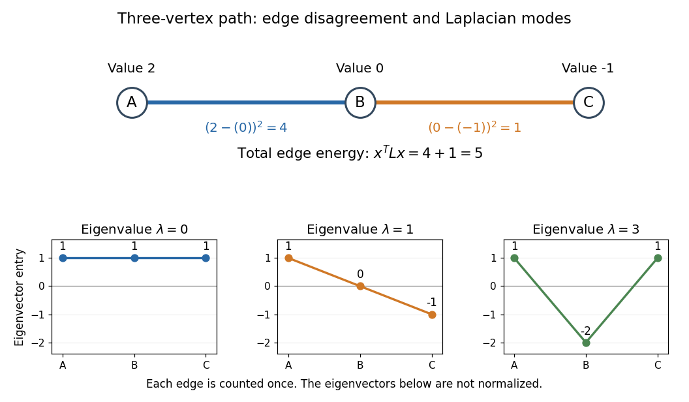

# Graph Laplacian quadratic form

↑ **Parent:** [Laplacian matrix](laplacian-matrix.md)

Assign a real value $x_i$ to each [vertex](vertex-graph-theory.md). The [Graph Laplacian quadratic form](graph-laplacian-quadratic-form.md) measures disagreement across [edges](edge-of-a-graph.md):

$$
x^TLx=\sum_{\{i,j\}\in E}(x_i-x_j)^2\geq0.
$$

This makes the [Graph Laplacian](laplacian-matrix.md) a [positive semidefinite matrix](positive-semidefinite-matrix.md). The [energy](energy.md) is small when neighbours have similar values, even if distant [vertices](vertex-graph-theory.md) have very different values; it depends on connections rather than where the [graph](graph-split.md) is drawn. In the three-[vertex](vertex-graph-theory.md) [path graph](path-graph.md), take $x=(2,0,-1)^T$. Then

$$
Lx=(2,-1,-1)^T,\qquad
x^TLx=2\cdot2+0\cdot(-1)+(-1)\cdot(-1)=5,
$$

and the two [edges](edge-of-a-graph.md) contribute $(2-0)^2=4$ and $(0-(-1))^2=1$.

**[Figure 24](#image-edge-disagreement-and-eigenvectors-of-the-three-vertex-path-laplacian). Edge disagreement and eigenvectors of the three-vertex path Laplacian**.

For a short proof, expand $x^T(D-A)x$. Each [edge](edge-of-a-graph.md) contributes $x_i^2+x_j^2$ through the [degree matrix](degree-matrix.md) and $-2x_ix_j$ through the [adjacency matrix](adjacency-matrix.md), yielding $(x_i-x_j)^2$. The sum over unordered [edges](edge-of-a-graph.md) has no factor $1/2$; a sum over all ordered pairs does:

$$
x^TLx=\frac12\sum_{i,j}A_{ij}(x_i-x_j)^2.
$$

Equivalently, let $B$ be an [oriented incidence matrix](oriented-incidence-matrix.md), with one row per [edge](edge-of-a-graph.md). Then $Bx$ records endpoint differences and $L=B^TB$, independently of the chosen orientations. This translates a local comparison into a global [quadratic form](quadratic-form.md) and makes its nonnegativity visible.

## ↑ Ancestors (6)

1. [Laplacian matrix](laplacian-matrix.md)
2. [Graph theory](graph-theory-split.md)
3. [Foundations of mathematics](foundations-of-mathematics-split.md)
4. [Area of mathematics](area-of-mathematics.md)
5. [Mathematics](mathematics-split.md)
6. [Codex Wiki](split.md)

## ← Incoming links (3)

- [Graph Laplacian quadratic form](graph-laplacian-quadratic-form.md)
- [Kernel of a graph Laplacian](kernel-of-a-graph-laplacian.md)
- [Laplacian matrix](laplacian-matrix.md)
