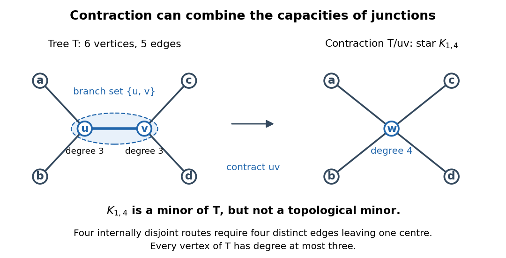
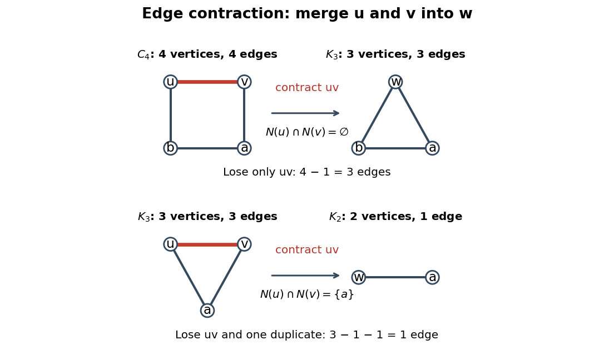

# Graph minor

↑ **Parent:** [Graph theory](graph-theory.md)  
ⓦ [Wiki](https://en.wikipedia.org/wiki/Graph_minor)

A [graph minor](graph-minor.md) compresses connected regions of a [graph](graph.md) into single [vertices](graph.md#vertex-graph-theory) while retaining selected connections between them. For finite [simple graphs](graph.md#simple-graph), $H\preccurlyeq G$ means that some sequence of deleting [vertices](graph.md#vertex-graph-theory), deleting [edges](graph-theory.md#edge-of-a-graph), and performing [edge contractions](#edge-contraction) produces $H$ up to [graph isomorphism](graph.md#graph-isomorphism). Deleting a [vertex](graph.md#vertex-graph-theory) also deletes all its incident [edges](graph-theory.md#edge-of-a-graph); deleting an [edge](graph-theory.md#edge-of-a-graph) leaves its endpoints. The [edge contraction](#edge-contraction) convention here removes resulting [self-loops](graph.md#loop-graph-theory) and duplicate [edges](graph-theory.md#edge-of-a-graph).[The Basics (author-hosted chapter preview)](mathematics-bibliography.md#graph-theory-by-reinhard-diestel/the-basics-author-hosted-chapter-preview)

For an exact small example, let $G$ be the [cycle graph](graph-theory.md#cycle-graph) $C_4$ with [vertices](graph.md#vertex-graph-theory) $u,v,a,b$ and [edges](graph-theory.md#edge-of-a-graph) $uv,va,ab,bu$. Contract $uv$ to a new [vertex](graph.md#vertex-graph-theory) $w$. The surviving [edges](graph-theory.md#edge-of-a-graph) are $wa,ab,bw$, giving the [complete graph](graph-theory.md#complete-graph) $K_3$. Thus $K_3\preccurlyeq C_4$, although $C_4$ has no [triangle in a graph](graph.md#triangle-in-a-graph) as a [subgraph](graph-theory.md#subgraph). The [branch sets of a graph minor](#branch-set-of-a-graph-minor) are $\{u,v\},\{a\},\{b\}$, with the original [edges](graph-theory.md#edge-of-a-graph) $va,ab,bu$ witnessing all three required adjacencies. The first panel of the [edge contraction](#edge-contraction) diagram shows this operation.

A [subgraph](graph-theory.md#subgraph) uses existing [vertices](graph.md#vertex-graph-theory) and [edges](graph-theory.md#edge-of-a-graph); a [topological minor](#topological-minor) permits a [graph subdivision](graph-theory.md#graph-subdivision) of the target as a [subgraph](graph-theory.md#subgraph), so target [edges](graph-theory.md#edge-of-a-graph) become [graph paths](graph-theory.md#path-in-a-graph) with mutually disjoint interiors and no target [vertex](graph.md#vertex-graph-theory) in an interior. An ordinary [graph minor](graph-minor.md) permits whole connected [branch sets of a graph minor](#branch-set-of-a-graph-minor) in place of target [vertices](graph.md#vertex-graph-theory). Every [topological minor](#topological-minor) is a [graph minor](graph-minor.md), by contracting the replacement [graph paths](graph-theory.md#path-in-a-graph).[Proposition 1.7.3(i)](mathematics-bibliography.md#graph-theory-by-reinhard-diestel/the-basics-author-hosted-chapter-preview)

The converse fails. Take the [tree](tree-graph-theory.md) with [edges](graph-theory.md#edge-of-a-graph) $uv,ua,ub,vc,vd$. Contracting $uv$ gives the [star graph](bipartite-graph.md#star-graph-theory) $K_{1,4}$. Yet the original [tree](tree-graph-theory.md) has [maximum degree](graph-theory.md#maximum-degree) three, whereas every [graph subdivision](graph-theory.md#graph-subdivision) of $K_{1,4}$ retains a centre of [degree of a vertex](graph-theory.md#degree-graph-theory) four. Hence $K_{1,4}$ is a [graph minor](graph-minor.md) but not a [topological minor](#topological-minor) of this [tree](tree-graph-theory.md). The difference is that a connected [branch set of a graph minor](#branch-set-of-a-graph-minor) may gather connections incident to several original [vertices](graph.md#vertex-graph-theory).

The counts of [vertices](graph.md#vertex-graph-theory) and [edges](graph-theory.md#edge-of-a-graph) never increase under these operations. However, the $C_4$ example shows that being a [bipartite graph](bipartite-graph.md) is not preserved: its [graph minor](graph-minor.md) $K_3$ contains an [odd cycle](graph-theory.md#odd-cycle). Its [chromatic number](graph-coloring.md#chromatic-number) also increases from two to three. A [connected graph](graph.md#connected-graph) stays connected under an [edge contraction](#edge-contraction), because the image of each [graph path](graph-theory.md#path-in-a-graph) still connects its endpoints, but deletion can disconnect it. Thus one must check the particular [graph property](graph-theory.md#graph-property) before treating it as preserved by taking [graph minors](graph-minor.md).

Being a [planar graph](planar-graph.md) is preserved: in a crossing-free drawing, shrink a contracted [edge](graph-theory.md#edge-of-a-graph) and bring its incident [edges](graph-theory.md#edge-of-a-graph) into the merged [vertex](graph.md#vertex-graph-theory); deletion merely removes parts of the drawing. This makes a nonplanar [graph minor](graph-minor.md) a certificate that the original [graph](graph.md) is nonplanar. More strongly, for a finite [simple graph](graph.md#simple-graph), being a [planar graph](planar-graph.md) is equivalent to having neither the [complete graph](graph-theory.md#complete-graph) $K_5$ nor the [complete bipartite graph](bipartite-graph.md#complete-bipartite-graph) $K_{3,3}$ as a [graph minor](graph-minor.md). Finding the corresponding [branch sets of a graph minor](#branch-set-of-a-graph-minor) settles nonplanarity even when no literal $K_5$ or $K_{3,3}$ [subgraph](graph-theory.md#subgraph) is present. The converse is a substantial theorem, rather than a consequence of preservation alone.[Theorem 4.4.6, equivalence of planarity and exclusion of K5 and K3,3 minors](mathematics-bibliography.md#graph-theory-by-reinhard-diestel/planar-graphs-author-hosted-chapter-preview)

**Table of contents**

- [Topological minor](#topological-minor)
- [Rooted branch-set reduction](#rooted-branch-set-reduction)
- [Complete graph minor density threshold](#complete-graph-minor-density-threshold)
  - [Dense minor with bounded order and high minimum degree](#dense-minor-with-bounded-order-and-high-minimum-degree)
- [Branch set of a graph minor](#branch-set-of-a-graph-minor)
  - [Random branch-set construction of a complete graph minor](#random-branch-set-construction-of-a-complete-graph-minor)
- [Edge contraction](#edge-contraction)

## Topological minor

↑ **Parent:** [Graph minor](graph-minor.md)

A [topological minor](#topological-minor) records a network pattern whose [vertices](graph.md#vertex-graph-theory) remain individual junctions but whose [edges](graph-theory.md#edge-of-a-graph) may become longer routes. For finite [simple graphs](graph.md#simple-graph), $H\preccurlyeq_{\mathrm{top}}G$ means that $G$ contains a [subgraph](graph-theory.md#subgraph) that is a [graph subdivision](graph-theory.md#graph-subdivision) of $H$ up to [graph isomorphism](graph.md#graph-isomorphism). Equivalently, choose distinct [branch vertices of a graph subdivision](graph-theory.md#branch-vertex-of-a-graph-subdivision) $b_v\in V(G)$ for $v\in V(H)$ and a [graph path](graph-theory.md#path-in-a-graph) $P_{uv}$ from $b_u$ to $b_v$ for every $uv\in E(H)$. These are [internally vertex-disjoint paths](graph-theory.md#internally-vertex-disjoint-paths), and no internal [vertex](graph.md#vertex-graph-theory) of any $P_{uv}$ is a [branch vertex of a graph subdivision](graph-theory.md#branch-vertex-of-a-graph-subdivision). Only endpoints corresponding to a shared target [vertex](graph.md#vertex-graph-theory) may be shared.[§1.7, printed p. 18: subdivisions; printed p. 21: topological-minor embeddings](mathematics-bibliography.md#graph-theory-by-reinhard-diestel/the-basics-author-hosted-chapter-preview)

The [graph subdivision](graph-theory.md#graph-subdivision) example below replaces two [edges](graph-theory.md#edge-of-a-graph) of a [triangle in a graph](graph.md#triangle-in-a-graph) by routes of two and three [edges](graph-theory.md#edge-of-a-graph) while retaining its attached [leaf of a graph](graph-theory.md#leaf-of-a-graph). If the host [graph](graph.md) also contains an extra [edge](graph-theory.md#edge-of-a-graph) $BD$, the same routes still witness a [topological minor](#topological-minor): delete $BD$ when selecting the [subgraph](graph-theory.md#subgraph). An [induced subgraph](graph-theory.md#induced-subgraph) is not required. However, routes that merely connect the right pairs are insufficient: using a [branch vertex of a graph subdivision](graph-theory.md#branch-vertex-of-a-graph-subdivision) as an intermediate junction, or making two routes share an internal [vertex](graph.md#vertex-graph-theory), can change the local network structure.

Every [topological minor](#topological-minor) is a [graph minor](graph-minor.md). In each [branch path of a graph subdivision](graph-theory.md#branch-path-of-a-graph-subdivision), contract all but one [edge](graph-theory.md#edge-of-a-graph); the disjoint interiors let this shorten each route without merging distinct [branch vertices of a graph subdivision](graph-theory.md#branch-vertex-of-a-graph-subdivision). This recovers $H$ after deleting unused [vertices](graph.md#vertex-graph-theory) and [edges](graph-theory.md#edge-of-a-graph).[Proposition 1.7.3(i), printed p. 21](mathematics-bibliography.md#graph-theory-by-reinhard-diestel/the-basics-author-hosted-chapter-preview) The converse fails because an ordinary [branch set of a graph minor](#branch-set-of-a-graph-minor) can gather several junctions into one.

For the [tree](tree-graph-theory.md) $T$ with [vertices](graph.md#vertex-graph-theory) $u,v,a,b,c,d$ and [edges](graph-theory.md#edge-of-a-graph) $uv,ua,ub,vc,vd$, contracting $uv$ produces a [star graph](bipartite-graph.md#star-graph-theory) $K_{1,4}$: the [branch sets of a graph minor](#branch-set-of-a-graph-minor) are $\{u,v\},\{a\},\{b\},\{c\},\{d\}$. Both $u,v$ have [degree of a vertex](graph-theory.md#degree-graph-theory) three; each of the other four [vertices](graph.md#vertex-graph-theory) is a [leaf of a graph](graph-theory.md#leaf-of-a-graph) with [degree of a vertex](graph-theory.md#degree-graph-theory) one. The new centre $w$ has four distinct [graph neighbours](graph-theory.md#neighbour-of-a-vertex) $a,b,c,d$; its [degree of a vertex](graph-theory.md#degree-graph-theory) is $3+3-2=4$, in agreement with the [edge contraction](#edge-contraction) formula.

**[Figure 1](#image-a-graph-minor-can-combine-two-junctions-contracting-uv-creates-a-star-graph-with-a-centre-of-degree-of-a-vertex-four). A graph minor can combine two junctions: contracting $uv$ creates a star graph with a centre of degree of a vertex four**.

Yet $K_{1,4}$ is not a [topological minor](#topological-minor) of $T$. In a [graph subdivision](graph-theory.md#graph-subdivision) of $K_{1,4}$, four [branch paths of a graph subdivision](graph-theory.md#branch-path-of-a-graph-subdivision) must leave the centre through four different [edges](graph-theory.md#edge-of-a-graph); sharing their first internal [vertex](graph.md#vertex-graph-theory) would violate internal disjointness. Thus any host needs a [vertex](graph.md#vertex-graph-theory) of [degree of a vertex](graph-theory.md#degree-graph-theory) at least four, whereas $\Delta(T)=3$. More generally, $H\preccurlyeq_{\mathrm{top}}G$ implies $\Delta(H)\leq\Delta(G)$, where $\Delta$ is the [maximum degree of a graph](graph-theory.md#maximum-degree-of-a-graph). This bound concerns the host [graph](graph.md); extra unused [edges](graph-theory.md#edge-of-a-graph) may make its [branch vertices of a graph subdivision](graph-theory.md#branch-vertex-of-a-graph-subdivision) have larger [degrees of vertices](graph-theory.md#degree-graph-theory) than their target counterparts.

This distinction matters when a network's individual junctions have a limited number of connections: replacing a connection by a route preserves the number of routes meeting at each chosen junction, while contracting a connected region can combine connections from separate junctions. It also explains why a small nonplanar pattern can hide inside long routes. By [Kuratowski's theorem](planar-graph.md#kuratowski-s-theorem), a finite [simple graph](graph.md#simple-graph) is a [planar graph](planar-graph.md) exactly when it has neither the [complete graph](graph-theory.md#complete-graph) $K_5$ nor the [complete bipartite graph](bipartite-graph.md#complete-bipartite-graph) $K_{3,3}$ as a [topological minor](#topological-minor). The obstruction is a [graph subdivision](graph-theory.md#graph-subdivision) inside the network, regardless of the number of intermediate [vertices](graph.md#vertex-graph-theory).

## Rooted branch-set reduction

↑ **Parent:** [Graph minor](graph-minor.md)

Let $q\ge2$ be even, let $S=\{x_1,\ldots,x_q\}$, and suppose a [graph](graph.md) has $h$ disjoint nonempty [vertex](graph.md#vertex-graph-theory) [sets](set.md) $C_1,\ldots,C_h$, where $h\ge d+3q/2$. Suppose each $G[C_i]$ is connected or every one of its [graph components](graph.md#component-graph-theory) meets $S$, and each $C_i$ is adjacent to all but at most $d$ of the other $C_j$ not meeting $S$. Assume also that no [rooted separation of a graph](graph-theory.md#rooted-separation-of-a-graph) of order below $q$ avoids $d+1$ of these [sets](set.md). Then there are $m=h-q/2$ disjoint connected [vertex](graph.md#vertex-graph-theory) [sets](set.md) $D_1,\ldots,D_m$ such that $x_i\in D_i$ for $1\le i\le q$ and each of these first $q$ [sets](set.md) is adjacent to all but at most $d$ of $D_{q+1},\ldots,D_m$.

Here adjacency of [sets](set.md) means existence of an [edge](graph-theory.md#edge-of-a-graph) between them. A [rooted separation of a graph](graph-theory.md#rooted-separation-of-a-graph) is $(A,B)$ with $A\cup B=V(G)$, $S\subseteq A$, no [edges](graph-theory.md#edge-of-a-graph) between $A\setminus B$ and $B\setminus A$, and order $|A\cap B|$. It avoids $C_i$ when $A\cap C_i=\varnothing$. We prove the reduction by [induction](foundations-of-mathematics.md#mathematical-induction), first on the [vertex](graph.md#vertex-graph-theory) count and then on the [edge](graph-theory.md#edge-of-a-graph) count; any counterexample chosen minimal in this ordering will be impossible.

We may delete [edges](graph-theory.md#edge-of-a-graph) joining two [vertices](graph.md#vertex-graph-theory) of $S$. They cannot affect [rooted separations of a graph](graph-theory.md#rooted-separation-of-a-graph), since $S$ lies wholly on the first side. Within a branch [set](set.md), their deletion can only split a [graph component](graph.md#component-graph-theory) into [graph components](graph.md#component-graph-theory) each containing an endpoint in $S$, so the branch-set hypothesis also persists. An isolated [vertex](graph.md#vertex-graph-theory) outside $S$ and all branch [sets](set.md) can be deleted. An isolated [vertex](graph.md#vertex-graph-theory) $v\in S$ is also impossible, since $(S,V(G)\setminus\{v\})$ has order $q-1$ and avoids at least $h-q\ge d+q/2\ge d+1$ [sets](set.md). Thus in a minimal counterexample $S$ is independent, and every isolated [vertex](graph.md#vertex-graph-theory) outside $S$ belongs to a singleton branch [set](set.md).

Consider a [rooted separation of a graph](graph-theory.md#rooted-separation-of-a-graph) $(A,B)$ of order exactly $q$ avoiding at least $d+1$ branch [sets](set.md), and put $S'=A\cap B$. Restrict to $G'=G[B]-E(G[S'])$ and $C'_i=C_i\cap B$. Each $C'_i$ is nonempty: any $C_i$ not itself avoided is adjacent to at least one of the $d+1$ avoided [sets](set.md), and the endpoint of such an [edge](graph-theory.md#edge-of-a-graph) in $C_i$ must lie in $B$. If a [graph component](graph.md#component-graph-theory) of $G'[C'_i]$ misses $S'$, it lies in $B\setminus A$ and is a whole [graph component](graph.md#component-graph-theory) of $G[C_i]$, with no [vertex](graph.md#vertex-graph-theory) of $S$. The original hypothesis then forces $G[C_i]$ to be connected and $C'_i=C_i$, entirely outside $A$. Thus each restricted [set](set.md) is connected or all its [graph components](graph.md#component-graph-theory) meet $S'$. In particular every $C'_j$ missing $S'$ equals an original [set](set.md) outside $A$, so all its required adjacencies from $C'_i$ persist.

A [rooted separation of a graph](graph-theory.md#rooted-separation-of-a-graph) $(A',B')$ of $G'$ avoiding $d+1$ restricted [sets](set.md) lifts to $(A\cup A',B')$ in $G$, of the same order: an avoided restricted [set](set.md) misses $S'$, hence is an original [set](set.md) outside $A$. The [edges](graph-theory.md#edge-of-a-graph) removed inside $S'$ do not obstruct lifting, since $S'\subseteq A'$. This proves the required separation hypothesis for $G'$. If $G'$ is smaller, [induction](foundations-of-mathematics.md#mathematical-induction) gives the desired connected [sets](set.md) rooted at $S'$. Moreover $G[A]$ has $q$ disjoint [graph paths](graph-theory.md#path-in-a-graph) from $S$ to $S'$, by the [Menger theorem](graph-theory.md#menger-theorem). Indeed a separator of smaller order between these [sets](set.md) would give a [rooted separation of a graph](graph-theory.md#rooted-separation-of-a-graph) of $G$ of smaller order still avoiding those $d+1$ original [sets](set.md). Truncate the [graph paths](graph-theory.md#path-in-a-graph) at their first visits to $S'$, label their endpoints accordingly, and adjoin each [graph path](graph-theory.md#path-in-a-graph) to the corresponding rooted connected [set](set.md). They meet $B$ only in their distinct endpoints, so this gives the desired [sets](set.md) for $G$, a contradiction. Consequently in a minimal counterexample every such separation of order $q$ has $B=V(G)$ and $A=S$, an [independent set](graph-theory.md#independent-set-graph-theory).

Now contract any [edge](graph-theory.md#edge-of-a-graph) whose endpoints do not belong to two different branch [sets](set.md). Its endpoints cannot both lie in $S$, so the image of $S$ still has size $q$. The branch-set conditions persist. If the contraction created a forbidden [rooted separation of a graph](graph-theory.md#rooted-separation-of-a-graph) of order below $q$, its lift would have order below $q$, except possibly when the contracted [vertex](graph.md#vertex-graph-theory) lies in its separator. In that case the lifted order increases by one and is at most $q$. Equality would put the contracted [edge](graph-theory.md#edge-of-a-graph) inside $A$, contradicting the just-proved independence of $A$ for an order-$q$ separation avoiding $d+1$ [sets](set.md). Thus the separation hypothesis also persists. Applying [induction](foundations-of-mathematics.md#mathematical-induction) in the contracted [graph](graph.md) and expanding the contracted [vertex](graph.md#vertex-graph-theory) would produce the required disjoint connected [sets](set.md). Hence **every [edge](graph-theory.md#edge-of-a-graph) in a minimal counterexample joins two different branch [sets](set.md)**.

Every [vertex](graph.md#vertex-graph-theory) outside the branch [sets](set.md) would be isolated, since every [edge](graph-theory.md#edge-of-a-graph) joins two branch [sets](set.md); such an isolated [vertex](graph.md#vertex-graph-theory) could be deleted. Thus the branch [sets](set.md) cover the [graph](graph.md). Each nonsingleton branch [set](set.md) is therefore an [independent set](graph-theory.md#independent-set-graph-theory), and all its [vertices](graph.md#vertex-graph-theory) belong to $S$, because each of its singleton [graph components](graph.md#component-graph-theory) must meet $S$. Let $C$ be the union of the nonsingleton branch [sets](set.md), and write $c=|C|\le q$. There is a [matching in a graph](matching-graph-theory.md) from $C$ into $V(G)\setminus S$. Otherwise the [Hall marriage theorem](matching-graph-theory.md#hall-s-marriage-theorem) gives $X\subseteq C$ with neighbourhood $Y\subseteq V(G)\setminus S$ satisfying $|Y|<|X|$. Since $S$ is independent, $(S\cup Y,V(G)\setminus X)$ is a [rooted separation of a graph](graph-theory.md#rooted-separation-of-a-graph) of order $q-|X|+|Y|<q$. It avoids every singleton branch [set](set.md) outside $S\cup Y$, of which there are at least

$$
|V(G)|-q-|Y|\ge |V(G)|-q-c+1\ge h-\frac c2-q+1\ge h-\frac{3q}2+1\ge d+1.
$$

The penultimate counting bound uses that the nonsingleton [sets](set.md) number at most $c/2$, so $|V(G)|-c\ge h-c/2$. This contradicts the separation hypothesis.

Use that [matching in a graph](matching-graph-theory.md) to make a two-vertex connected [set](set.md) for each terminal in $C$; terminals outside $C$ remain singleton [sets](set.md). There are at least

$$
|V(G)|-q-c\ge h-\frac{3q}2=m-q
$$

unused [vertices](graph.md#vertex-graph-theory), all singleton original branch [sets](set.md). Choose $m-q$ of them for the remaining $D_i$. Every rooted $D_i$ contains a singleton original branch [set](set.md): either its terminal, or its terminal's matched [neighbour](graph-theory.md#neighbour-of-a-vertex). That singleton misses at most $d$ of the selected nonterminal singleton [sets](set.md). This constructs the desired family and completes the proof.

## Complete graph minor density threshold

↑ **Parent:** [Graph minor](graph-minor.md)

The complete graph minor density threshold is

$$
c(t)=\inf\{c:\text{every nonempty finite graph }G\text{ with }e(G)\geq c|G|\text{ has a }K_t\text{ minor}\}.
$$

The density here is [edge](graph-theory.md#edge-of-a-graph) count divided by order, half the average [degree of a vertex](graph-theory.md#degree-graph-theory). For large $t$, this threshold has order $t\sqrt{\log t}$, with the logarithm taken to base $e$.

### Dense minor with bounded order and high minimum degree

↑ **Parent:** [Complete graph minor density threshold](#complete-graph-minor-density-threshold)

For each positive integer $k$, a nonempty [graph](graph.md) satisfying $e(G)\geq11k|G|$ has a [graph minor](graph-minor.md) $H$ satisfying

$$
|H|\leq11k+2,\qquad 2\delta(H)\geq |H|+4k-1.
$$

The density hypothesis is a lower bound. Reversing its inequality would be false for an edgeless [graph](graph.md). This auxiliary lemma can be used to establish a $7t\sqrt{\log t}$ upper bound for the [complete graph minor density threshold](#complete-graph-minor-density-threshold).

## Branch set of a graph minor

↑ **Parent:** [Graph minor](graph-minor.md)

A [branch set of a graph minor](#branch-set-of-a-graph-minor) is the connected region representing one target [vertex](graph.md#vertex-graph-theory). For finite [simple graphs](graph.md#simple-graph) $G$ and $H$, a witness to $H\preccurlyeq G$ assigns a nonempty [set](set.md) $B_x\subseteq V(G)$ to each $x\in V(H)$, such that the [sets](set.md) are pairwise disjoint, each [induced subgraph](graph-theory.md#induced-subgraph) $G[B_x]$ is a [connected graph](graph.md#connected-graph), and every $xy\in E(H)$ has a witnessing [edge](graph-theory.md#edge-of-a-graph) of $G$ between $B_x$ and $B_y$. Extra [edges](graph-theory.md#edge-of-a-graph) between [branch sets of a graph minor](#branch-set-of-a-graph-minor) are allowed: they can be deleted. Unused [vertices](graph.md#vertex-graph-theory) are also allowed.[Minor Containment and Disjoint Paths in almost-linear time by Tuukka Korhonen and others](mathematics-bibliography.md#minor-containment-and-disjoint-paths-in-almost-linear-time-by-tuukka-korhonen-and-others)

**[Figure 2](#image-connected-branch-sets-of-a-graph-minor-and-their-witnessing-edges-with-an-optional-edge-deletion). Connected branch sets of a graph minor and their witnessing edges, with an optional edge deletion**.

In the diagram, the host [graph](graph.md) has [vertex set](graph.md#vertex-set) $\{1,2,3,4,5,6\}$ and [edges](graph-theory.md#edge-of-a-graph)

$$
12,\ 34,\ 56,\ 23,\ 45,\ 61,\ 24.
$$

Choose $B_A=\{1,2\}$, $B_B=\{3,4\}$, and $B_C=\{5,6\}$. Their internal [edges](graph-theory.md#edge-of-a-graph) $12,34,56$ establish connectedness. The [edges](graph-theory.md#edge-of-a-graph) $23,45,61$ witness $AB,BC,CA$, respectively, so they form a model of the [complete graph](graph-theory.md#complete-graph) $K_3$. The additional [edge](graph-theory.md#edge-of-a-graph) $24$ also joins $B_A$ to $B_B$; it supplies another witness for the same target [edge](graph-theory.md#edge-of-a-graph), not a fourth target [edge](graph-theory.md#edge-of-a-graph). Contracting $12,34,56$ and merging duplicate [edges](graph-theory.md#edge-of-a-graph) gives exactly $\{AB,BC,CA\}$.

The same [branch sets of a graph minor](#branch-set-of-a-graph-minor) also witness the [path graph](graph-theory.md#path-graph) $A,B,C$: retain the witnesses $23,45$, and delete $61$ to remove the unwanted $AC$ adjacency. This demonstrates why the definition requires an [edge](graph-theory.md#edge-of-a-graph) for every target adjacency, without forbidding other adjacencies in the host [graph](graph.md). For a [complete graph](graph-theory.md#complete-graph) $K_t$, there are no unwanted pairs: its model consists of $t$ disjoint connected [branch sets of a graph minor](#branch-set-of-a-graph-minor) with an [edge](graph-theory.md#edge-of-a-graph) between every pair.

To turn a model into an operation sequence, keep a [spanning tree](tree-graph-theory.md#spanning-tree) inside each $G[B_x]$, keep one witnessing [edge](graph-theory.md#edge-of-a-graph) for each [edge](graph-theory.md#edge-of-a-graph) of $H$, and delete all other [edges](graph-theory.md#edge-of-a-graph) and unused [vertices](graph.md#vertex-graph-theory). Contract each chosen [spanning tree](tree-graph-theory.md#spanning-tree) to one [vertex](graph.md#vertex-graph-theory). Disjointness prevents two target [vertices](graph.md#vertex-graph-theory) from merging; connectedness provides the [edge contractions](#edge-contraction) that merge each individual region. Conversely, track the original [vertices](graph.md#vertex-graph-theory) merged into every surviving [vertex](graph.md#vertex-graph-theory) during a deletion-and-[edge contraction](#edge-contraction) sequence. They form disjoint connected [branch sets of a graph minor](#branch-set-of-a-graph-minor), and each surviving [edge](graph-theory.md#edge-of-a-graph) comes from an original [edge](graph-theory.md#edge-of-a-graph) between its two regions. A list of these regions, their connecting [trees](tree-graph-theory.md), and their witnessing [edges](graph-theory.md#edge-of-a-graph) therefore gives a directly checkable certificate.

### Random branch-set construction of a complete graph minor

↑ **Parent:** [Branch set of a graph minor](#branch-set-of-a-graph-minor)

In a dense [graph](graph.md) with many [common neighbours](graph-theory.md#common-neighbour) for every pair of [vertices](graph.md#vertex-graph-theory), choose disjoint random small sets. A set is good if few [vertices](graph.md#vertex-graph-theory) have no neighbour in it. The [Markov inequality](probability-inequality.md#markov-s-inequality) controls the number of bad sets, and random sampling makes almost every pair of good sets adjacent. Add unused [common neighbours](graph-theory.md#common-neighbour) to connect each set and to repair the remaining missing adjacencies. If the number of used [vertices](graph.md#vertex-graph-theory) stays below every common-neighbour count, this constructs disjoint [branch sets of a graph minor](#branch-set-of-a-graph-minor) representing a large [complete graph](graph-theory.md#complete-graph).

## Edge contraction

↑ **Parent:** [Graph minor](graph-minor.md)  
ⓦ [Wiki](https://en.wikipedia.org/wiki/Edge_contraction)

An [edge contraction](#edge-contraction) merges the two endpoints of an existing [edge](graph-theory.md#edge-of-a-graph). For a finite [simple graph](graph.md#simple-graph) $G$ and $e=uv$, replace $u,v$ by a new [vertex](graph.md#vertex-graph-theory) $w$. Retain every [edge](graph-theory.md#edge-of-a-graph) with neither endpoint in $\{u,v\}$, and join $w$ to every member of

$$
N_{G/e}(w)=(N_G(u)\cup N_G(v))\setminus\{u,v\}.
$$

Here $N_G(u)$ and $N_G(v)$ denote the original open [graph neighbourhoods](graph-theory.md#graph-neighbourhood), and $N_{G/e}(w)$ is the new [graph neighbourhood](graph-theory.md#graph-neighbourhood). Remove the [self-loop](graph.md#loop-graph-theory) arising from $uv$ and merge duplicate [edges](graph-theory.md#edge-of-a-graph), so the result $G/e$ is again a [simple graph](graph.md#simple-graph). This is not deletion of $uv$, which keeps both original [vertices](graph.md#vertex-graph-theory).[The Basics (author-hosted chapter preview)](mathematics-bibliography.md#graph-theory-by-reinhard-diestel/the-basics-author-hosted-chapter-preview)

**[Figure 3](#image-edge-contraction-of-a-four-cycle-and-a-triangle-in-a-graph-common-neighbours-determine-the-lost-edge-count). Edge contraction of a four-cycle and a triangle in a graph: common neighbours determine the lost edge count**.

The left example contracts $uv$ in the [cycle graph](graph-theory.md#cycle-graph) $C_4$ to give $\{wa,ab,bw\}$. Its endpoints have no [common neighbours](graph-theory.md#common-neighbour), so four [edges](graph-theory.md#edge-of-a-graph) become three. The right example contracts $uv$ in the [triangle in a graph](graph.md#triangle-in-a-graph) with [edges](graph-theory.md#edge-of-a-graph) $uv,ua,va$. Its endpoints have the single [common neighbour](graph-theory.md#common-neighbour) $a$, so the two [edges](graph-theory.md#edge-of-a-graph) $ua,va$ become one [edge](graph-theory.md#edge-of-a-graph) $wa$: three [edges](graph-theory.md#edge-of-a-graph) become one.

For any such [edge contraction](#edge-contraction), the exact counts are

$$
|V(G/e)|=|V(G)|-1,\qquad |E(G/e)|=|E(G)|-1-|N_G(u)\cap N_G(v)|.
$$

The contracted [edge](graph-theory.md#edge-of-a-graph) accounts for one loss. Each [common neighbour](graph-theory.md#common-neighbour) $z$ contributes exactly one further loss, since $uz,vz$ become a single [edge](graph-theory.md#edge-of-a-graph) $wz$. All other [edges](graph-theory.md#edge-of-a-graph) correspond one-to-one to surviving [edges](graph-theory.md#edge-of-a-graph). In particular the new [degree of a vertex](graph-theory.md#degree-graph-theory) is

$$
\deg_{G/e}(w)=\deg_G(u)+\deg_G(v)-2-|N_G(u)\cap N_G(v)|.
$$

These formulas depend on simplifying to a [simple graph](graph.md#simple-graph); a [multigraph](graph.md#multigraph) convention that retains duplicate [edges](graph-theory.md#edge-of-a-graph) has different counts. In the six-[vertex](graph.md#vertex-graph-theory) [branch set of a graph minor](#branch-set-of-a-graph-minor) diagram, contracting $12$ loses one [edge](graph-theory.md#edge-of-a-graph), contracting the resulting $34$ loses two because of its [common neighbour](graph-theory.md#common-neighbour) $A$, and contracting $56$ loses one. Hence its seven [edges](graph-theory.md#edge-of-a-graph) become the three [edges](graph-theory.md#edge-of-a-graph) of $K_3$: $7-1-2-1=3$.

An [edge contraction](#edge-contraction) can increase a [degree of a vertex](graph-theory.md#degree-graph-theory) even while decreasing both total counts. For example, contracting $uv$ in the [tree](tree-graph-theory.md) with [edges](graph-theory.md#edge-of-a-graph) $uv,ua,ub,vc,vd$ merges two [vertices](graph.md#vertex-graph-theory) of [degree of a vertex](graph-theory.md#degree-graph-theory) three into one of [degree of a vertex](graph-theory.md#degree-graph-theory) four. This is the mechanism behind the distinction between a [graph minor](graph-minor.md) and a [topological minor](#topological-minor).

## ↑ Ancestors (5)

1. [Graph theory](graph-theory.md)
2. [Foundations of mathematics](foundations-of-mathematics.md)
3. [Area of mathematics](mathematics.md#area-of-mathematics)
4. [Mathematics](mathematics.md)
5. [Codex Wiki](README.md)

## ← Incoming links (9)

- [Dense minor with bounded order and high minimum degree](#dense-minor-with-bounded-order-and-high-minimum-degree)
- [Edge contraction](#edge-contraction)
- [Graph minor](graph-minor.md)
- [Kuratowski's theorem](planar-graph.md#kuratowski-s-theorem)
- [Solution](past-exam-of-the-mathematics-course-of-the-university-of-cambridge/2002/iii/paper-9.md#3/solution)
- [Solution](past-exam-of-the-mathematics-course-of-the-university-of-cambridge/2018/iii/paper-110.md#4/solution)
- [Rooted dense minor linkage](graph-theory.md#rooted-dense-minor-linkage)
- [Topological minor](#topological-minor)
- [Wheel graph](graph-theory.md#wheel-graph)
