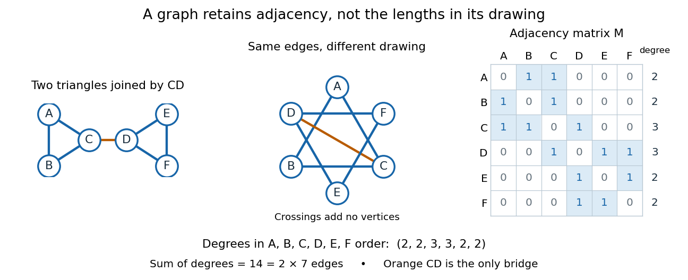

# Graph

↑ **Parent:** [Graph theory](graph-theory-split.md)  
ⓦ [Wiki](https://en.wikipedia.org/wiki/Graph_(discrete_mathematics))

**[Figure 1](#image-two-drawings-of-the-same-six-vertex-graph-and-its-adjacency-matrix). Two drawings of the same six-vertex graph and its adjacency matrix**.

A graph describes objects, called [vertices](vertex-graph-theory.md), and pairwise connections, called [edges](edge-of-a-graph.md). Its [vertex set](vertex-set.md) $V$ tells us what the objects are; $E$ records their connections. The basic abstraction retains [graph adjacency](graph-adjacency.md) while discarding positions, angles and [Euclidean distances](euclidean-distance.md): moving the dots in a drawing changes none of the [edges](edge-of-a-graph.md). A crossing of two drawn lines is not an extra [vertex](vertex-graph-theory.md) unless explicitly designated as one. Even the labels can change: a [graph isomorphism](graph-isomorphism.md) is a relabelling that preserves [graph adjacency](graph-adjacency.md) in both directions.[The Basics (author-hosted chapter preview)](graph-theory-by-reinhard-diestel/the-basics-author-hosted-chapter-preview.md)

This makes [graphs](graph-split.md) useful when the question concerns possible connections rather than physical shape. For example, model locations by [vertices](vertex-graph-theory.md) and direct links by [edges](edge-of-a-graph.md); a [graph path](path-in-a-graph.md) answers whether one location can reach another. Alternatively, let [vertices](vertex-graph-theory.md) be activities and [edges](edge-of-a-graph.md) represent conflicts: a [graph coloring](graph-coloring-split.md) then assigns compatible time slots. These are mathematical models, so one must decide which pairwise relationship an [edge](edge-of-a-graph.md) means before applying [graph theory](graph-theory-split.md).[MIT, Graphs and Coloring, Sections 1.3 and 2.1](https://ocw.mit.edu/courses/6-1200j-mathematics-for-computer-science-spring-2024/mit6_1200j_s24_lec11.pdf)

Our running [simple graph](simple-graph.md) has

$$
V=\{A,B,C,D,E,F\},\qquad E=\{AB,AC,BC,CD,DE,DF,EF\},
$$

where $AB$ abbreviates the [unordered pair](unordered-pair.md) $\{A,B\}$. It consists of two [triangles in a graph](triangle-in-a-graph.md), $ABC$ and $DEF$, joined by $CD$. The two drawings above have identical [graph adjacency](graph-adjacency.md), even though their apparent lengths differ. What counts is that $C$ and $D$ are adjacent, whereas $A$ and $F$ are not.

Route questions require precise vocabulary. A [walk](walk-in-a-graph.md) is a [sequence](sequence.md) of consecutive adjacent [vertices](vertex-graph-theory.md), permitting repetitions; its length counts traversed [edges](edge-of-a-graph.md). A [trail](trail-in-a-graph.md) is a [walk](walk-in-a-graph.md) that repeats no [edge](edge-of-a-graph.md); a [graph path](path-in-a-graph.md) repeats no [vertex](vertex-graph-theory.md). For a [multigraph](multigraph.md), the [walk](walk-in-a-graph.md) must also specify which parallel [edge](edge-of-a-graph.md) each step uses. For instance, $A,B,A,C,D,F$ is a length-five [walk](walk-in-a-graph.md) but not a [trail](trail-in-a-graph.md), since it uses $AB$ twice. The length-three [graph path](path-in-a-graph.md) $A,C,D,F$ is a shortest route: crossing between the two [triangles in a graph](triangle-in-a-graph.md) requires $CD$, with at least one [edge](edge-of-a-graph.md) before it and one after it. Thus $d(A,F)=3$ in [graph distance](distance-graph-theory.md), regardless of the drawing.[MIT, Connectivity and Trees, Section 1](https://ocw.mit.edu/courses/6-1200j-mathematics-for-computer-science-spring-2024/mit6_1200j_s24_lec13.pdf)

An [Eulerian trail](eulerian-trail.md) uses every [edge](edge-of-a-graph.md) exactly once, allowing repeated [vertices](vertex-graph-theory.md); a [Hamiltonian path](hamiltonian-path.md) visits every [vertex](vertex-graph-theory.md) exactly once, without needing every [edge](edge-of-a-graph.md). Here $C,A,B,C,D,E,F,D$ is an [Eulerian trail](eulerian-trail.md) of length seven, whereas $A,B,C,D,E,F$ is a [Hamiltonian path](hamiltonian-path.md) of length five. The first repeats $C,D$; the second omits $AC,DF$. Calling an [Eulerian trail](eulerian-trail.md) an "[Eulerian path](eulerian-trail.md)" must not be taken to impose our [graph path](path-in-a-graph.md) convention.[MIT, Connectivity and Trees, Section 3](https://ocw.mit.edu/courses/6-1200j-mathematics-for-computer-science-spring-2024/mit6_1200j_s24_lec13.pdf)

The classic historical example is Euler's Königsberg bridge problem: represent the four land regions by [vertices](vertex-graph-theory.md) and the seven bridges by distinct [edges](edge-of-a-graph.md), giving a [multigraph](multigraph.md). Their [degrees of vertices](degree-graph-theory.md) are $3,3,3,5$. In a [trail](trail-in-a-graph.md) using every [edge](edge-of-a-graph.md), arrivals and departures pair at every internal [vertex](vertex-graph-theory.md), so at most the two endpoints can have odd [vertex degree](degree-graph-theory.md). Four odd [degrees of vertices](degree-graph-theory.md) therefore rule out such a route. This early foundational example of [graph theory](graph-theory-split.md) needs neither bridge lengths nor a geographical map. Euler's paper is conventionally associated with 1736, the volume's nominal year; the Euler Archive records its writing in 1735 and publication in 1741.[Euler Archive, E53: Solutio problematis ad geometriam situs pertinentis](euler-archive-e53-solutio-problematis-ad-geometriam-situs-pertinentis.md)[Euler, original Latin text and edition details](https://la.wikisource.org/wiki/Solutio_problematis_ad_geometriam_situs_pertinentis)

**Table of contents**

- [Edge set](edge-set.md)
- [Monotone threshold activation](monotone-threshold-activation.md)
  - [Closure dominance for asynchronous threshold switching](closure-dominance-for-asynchronous-threshold-switching.md)
- [Edge weight](edge-weight.md)
- [2-factor](2-factor.md)
- [Sparse graph](sparse-graph.md)
- [Graph adjacency](graph-adjacency.md)
- [Simple graph](simple-graph.md)
- [Loop (graph theory)](loop-graph-theory.md)
- [Torus graph](torus-graph.md)
- [Dual graph](dual-graph.md)
- [Cubic graph](cubic-graph.md)
  - [Three-edge path decomposition from a perfect matching](three-edge-path-decomposition-from-a-perfect-matching.md)
  - [Perfect matching theorem for a cubic graph with at most two bridges](perfect-matching-theorem-for-a-cubic-graph-with-at-most-two-bridges.md)
  - [Heawood graph](heawood-graph.md)
    - [Heawood torus map](heawood-torus-map.md)
- [Strong product of graphs](strong-product-of-graphs.md)
  - [Strong graph power](strong-graph-power.md)
    - [Shannon capacity of a graph](shannon-capacity-of-a-graph.md)
      - [Haemers rank bound](haemers-rank-bound.md)
        - [Polynomial representation of a graph](polynomial-representation-of-a-graph.md)
      - [Complement-pair capacity gain](complement-pair-capacity-gain.md)
        - [Nonadditivity of Shannon capacity](nonadditivity-of-shannon-capacity.md)
      - [Pentagon capacity code](pentagon-capacity-code.md)
- [Incidence matrix](incidence-matrix.md)
- [Amenable graph](amenable-graph.md)
  - [Følner set](folner-set.md)
- [Multigraph](multigraph.md)
  - [Bouquet graph](bouquet-graph.md)
- [Distance-transitive graph](distance-transitive-graph.md)
  - [Distance-transitive action on a graph](distance-transitive-action-on-a-graph.md)
  - [Symplectic dual polar graph](symplectic-dual-polar-graph.md)
- [Vertex-transitive graph](vertex-transitive-graph.md)
- [Triangular lattice](triangular-lattice.md)
- [False twin](false-twin.md)
  - [False-twin class](false-twin-class.md)
- [Graph power](graph-power.md)
  - [Square of a cycle](square-of-a-cycle.md)
- [Graph cut](graph-cut.md)
  - [Balanced component cut](balanced-component-cut.md)
- [Oriented incidence matrix](oriented-incidence-matrix.md)
  - [Incidence pseudoinverse decomposition](incidence-pseudoinverse-decomposition.md)
- [Cartesian product of graphs](cartesian-product-of-graphs.md)
- [Ladder graph](ladder-graph.md)
  - [Doubly infinite ladder graph](doubly-infinite-ladder-graph.md)
- [Cubic lattice](cubic-lattice.md)
  - [Amenable boundary growth of lattice boxes](amenable-boundary-growth-of-lattice-boxes.md)
- [Vertex set](vertex-set.md)
- [Graph blow-up](graph-blow-up.md)
  - [Dense clique family blow-up lemma](dense-clique-family-blow-up-lemma.md)
  - [Vertex cloning in a graph](vertex-cloning-in-a-graph.md)
- [Multipartite graph](multipartite-graph.md)
- [Reachability in a graph](reachability-in-a-graph.md)
- [Graph search](graph-search.md)
  - [Best-first search](best-first-search.md)
    - [Uniform-cost search](uniform-cost-search.md)
    - [Greedy best-first search](greedy-best-first-search.md)
      - [Greedy perfect-heuristic descent](greedy-perfect-heuristic-descent.md)
    - [A-star search](a-star-search.md)
      - [Numerical upper-bound pruning without a solution witness](numerical-upper-bound-pruning-without-a-solution-witness.md)
- [Tripartite graph](tripartite-graph.md)
  - [Tripartite graph encoding of a grid](tripartite-graph-encoding-of-a-grid.md)
- [Graph automorphism](graph-automorphism.md)
  - [Quasi-transitive graph](quasi-transitive-graph.md)
- [Bridge (graph theory)](bridge-graph-theory.md)
- [Hypercube graph](hypercube-graph.md)
  - [Hypercube subdivision of the utility graph](hypercube-subdivision-of-the-utility-graph.md)
  - [Gray code](gray-code.md)
- [Square lattice](square-lattice.md)
- [Connectivity (graph theory)](connectivity-graph-theory.md)
  - [Connected graph](connected-graph.md)
    - [Component (graph theory)](component-graph-theory.md)
      - [Supermodularity of graph component count](supermodularity-of-graph-component-count.md)
      - [Tree component](tree-component.md)
      - [Largest component of a graph](largest-component-of-a-graph.md)
- [Vertex (graph theory)](vertex-graph-theory.md)
- [Graph isomorphism](graph-isomorphism.md)
- [Triangle in a graph](triangle-in-a-graph.md)
  - [Edge-disjoint triangles](edge-disjoint-triangles.md)
  - [Triangle count](triangle-count.md)
  - [Triangle-free graph](triangle-free-graph.md)
    - [Triangle-free chromatic lower bound at bounded maximum degree](triangle-free-chromatic-lower-bound-at-bounded-maximum-degree.md)
  - [Edge-triangle incidence bound](edge-triangle-incidence-bound.md)
- [Vertex neighbourhood](vertex-neighbourhood.md)

## ↑ Ancestors (5)

1. [Graph theory](graph-theory-split.md)
2. [Foundations of mathematics](foundations-of-mathematics-split.md)
3. [Area of mathematics](area-of-mathematics.md)
4. [Mathematics](mathematics-split.md)
5. [Codex Wiki](split.md)

## ← Incoming links (547)

- [2-core of a graph](2-core-of-a-graph.md)
- [A cycle and a transposition generate the symmetric group exactly at coprime separation](a-cycle-and-a-transposition-generate-the-symmetric-group-exactly-at-coprime-separation.md)
- [Adjacency list](adjacency-list.md)
- [Adjacency list storage and query costs](adjacency-list-storage-and-query-costs.md)
- [Admissible crystallographic Coxeter graph](admissible-crystallographic-coxeter-graph.md)
- [Aldous spectral gap theorem](aldous-spectral-gap-theorem.md)
- [Alternating count of common-center graphs](alternating-count-of-common-center-graphs.md)
- [Amenable graph](amenable-graph.md)
- [Arc consistency](arc-consistency.md)
- [Average degree of a graph](average-degree-of-a-graph.md)
- [Avoiding short repetitions in an edge coloring](avoiding-short-repetitions-in-an-edge-coloring.md)
- [Balanced complete multipartite blow-up](balanced-complete-multipartite-blow-up.md)
- [Beer-Lambert calibration model](beer-lambert-calibration-model.md)
- [Bellman-Ford negative-cycle detection](bellman-ford-negative-cycle-detection.md)
- [Bellman inequalities](bellman-inequalities.md)
- [Berge's theorem](berge-s-theorem.md)
- [Bernoulli invariant laws of finite symmetric exclusion](bernoulli-invariant-laws-of-finite-symmetric-exclusion.md)
- [Bipartite graph](bipartite-graph-split.md)
- [Bipartite stability from few odd cycles](bipartite-stability-from-few-odd-cycles.md)
- [Bipartition of a graph](bipartition-of-a-graph.md)
- [Bond percolation](bond-percolation-split.md)
- [Branch set of a graph minor](branch-set-of-a-graph-minor.md)
- [Breadth-first search](breadth-first-search.md)
- [Bridges and connectivity in the 2-core](bridges-and-connectivity-in-the-2-core.md)
- [Canonical paths for the weighted matching chain](canonical-paths-for-the-weighted-matching-chain.md)
- [Caro-Wei bound](caro-wei-bound.md)
- [Cartesian product of graphs](cartesian-product-of-graphs.md)
- [Cayley graph](cayley-graph.md)
- [Cayley graphs of the integers](cayley-graphs-of-the-integers.md)
- [Chordal graph](chordal-graph.md)
- [Chromatic index](chromatic-index.md)
- [Chromatic index bounds](chromatic-index-bounds.md)
- [Chromatic number](chromatic-number.md)
- [Chromatic number from acyclic longest paths](chromatic-number-from-acyclic-longest-paths.md)
- [Chromatic polynomial](chromatic-polynomial.md)
- [Chromatic polynomial product over components](chromatic-polynomial-product-over-components.md)
- [Clique conflict graph](clique-conflict-graph.md)
- [Clique (graph theory)](clique-graph-theory.md)
- [Clique number](clique-number.md)
- [Clique removal lemma](clique-removal-lemma.md)
- [Closed walk](closed-walk.md)
- [Colouring number of a hereditary graph property](colouring-number-of-a-hereditary-graph-property.md)
- [Combinatorics](combinatorics-split.md)
- [Common-center graph property](common-center-graph-property.md)
- [Complement theta number](complement-theta-number.md)
- [Complete graph](complete-graph.md)
- [Conditional expectations algorithm cost](conditional-expectations-algorithm-cost.md)
- [Connected graph](connected-graph.md)
- [Connected vertex cover](connected-vertex-cover.md)
- [Connectedness of adjacent-level incidence in a Boolean lattice](connectedness-of-adjacent-level-incidence-in-a-boolean-lattice.md)
- [Connectivity of random k-out graphs](connectivity-of-random-k-out-graphs.md)
- [Cubic graph](cubic-graph.md)
- [Cut vertex](cut-vertex.md)
- [Cyclic successor colorings of regular graphs](cyclic-successor-colorings-of-regular-graphs.md)
- [De Bruijn graph](de-bruijn-graph.md)
- [Degree sequence](degree-sequence.md)
- [Deletion-contraction recurrence for the chromatic polynomial](deletion-contraction-recurrence-for-the-chromatic-polynomial.md)
- [Dense clique family blow-up lemma](dense-clique-family-blow-up-lemma.md)
- [Dense minor with bounded order and high minimum degree](dense-minor-with-bounded-order-and-high-minimum-degree.md)
- [Depth-first search](depth-first-search.md)
- [DFS discovery time](dfs-discovery-time.md)
- [DFS edge classification](dfs-edge-classification.md)
- [DFS lowpoint](dfs-lowpoint.md)
- [Diameter bound for a fixed-density binomial random graph](diameter-bound-for-a-fixed-density-binomial-random-graph.md)
- [Differential sky map monopole degeneracy](differential-sky-map-monopole-degeneracy.md)
- [Diffusion on a graph](diffusion-on-a-graph.md)
- [Dijkstra algorithm](dijkstra-algorithm.md)
- [Directed edge occupation in a random-walk commute](directed-edge-occupation-in-a-random-walk-commute.md)
- [Disjoint-set forest](disjoint-set-forest.md)
- [Dominating set](dominating-set.md)
- [Dual graph](dual-graph.md)
- [Edge cover](edge-cover.md)
- [Edge cover and matching identity](edge-cover-and-matching-identity.md)
- [Edge of a graph](edge-of-a-graph.md)
- [Edge relaxation](edge-relaxation.md)
- [Edge set](edge-set.md)
- [Edge-triangle symmetrization](edge-triangle-symmetrization.md)
- [Edge weight](edge-weight.md)
- [Edit-distance stability for clique-free graphs](edit-distance-stability-for-clique-free-graphs.md)
- [Entropy bound for graphs with isolated-vertex-free intersections](entropy-bound-for-graphs-with-isolated-vertex-free-intersections.md)
- [Enumeration of subgraph-closed graph properties](enumeration-of-subgraph-closed-graph-properties.md)
- [Equitable regularity energy](equitable-regularity-energy.md)
- [Euler characteristic and holes](euler-characteristic-and-holes.md)
- [Euler formula for a connected planar graph](euler-formula-for-a-connected-planar-graph.md)
- [Eulerian cycle](eulerian-cycle.md)
- [Eulerian graph](eulerian-graph.md)
- [Even-length directed reachability](even-length-directed-reachability.md)
- [Expander mixing lemma](expander-mixing-lemma.md)
- [Extremal graph for disjoint cliques](extremal-graph-for-disjoint-cliques.md)
- [Fill-path criterion for symmetric elimination](fill-path-criterion-for-symmetric-elimination.md)
- [Finite lattice approximation for monotone clique circuits](finite-lattice-approximation-for-monotone-clique-circuits.md)
- [Følner set](folner-set.md)
- [Forced merging of large components](forced-merging-of-large-components.md)
- [Forest polytope](forest-polytope.md)
- [Forward state-space planning](forward-state-space-planning.md)
- [Foster's theorem](foster-s-theorem.md)
- [Four-cycle counting by common neighbours](four-cycle-counting-by-common-neighbours.md)
- [Four-tile mixed-boundary transplantation between a disk and a nonorientable surface](four-tile-mixed-boundary-transplantation-between-a-disk-and-a-nonorientable-surface.md)
- [Global survival threshold of the contact process](global-survival-threshold-of-the-contact-process.md)
- [Graph](graph-split.md)
- [Graph adjacency](graph-adjacency.md)
- [Graph blow-up](graph-blow-up.md)
- [Graph coloring](graph-coloring-split.md)
- [Graph drawing](graph-drawing.md)
- [Graph exhaustion](graph-exhaustion.md)
- [Graph intersection](graph-intersection.md)
- [Graph Laplacian eigenvalue](graph-laplacian-eigenvalue.md)
- [Graph Laplacian quadratic form](graph-laplacian-quadratic-form.md)
- [Graph minor](graph-minor-split.md)
- [Graph of a function](graph-of-a-function.md)
- [Graph power](graph-power.md)
- [Graph property](graph-property.md)
- [Graph search](graph-search.md)
- [Graph structure lifted through a covering map](graph-structure-lifted-through-a-covering-map.md)
- [Graph subdivision](graph-subdivision.md)
- [Graph theory](graph-theory-split.md)
- [Graph total variation denoising](graph-total-variation-denoising.md)
- [Greedy best-first search](greedy-best-first-search.md)
- [Greedy colouring with two precoloured neighbours](greedy-colouring-with-two-precoloured-neighbours.md)
- [Greedy matching](greedy-matching.md)
- [Greedy two-approximation for maximum-weight matching](greedy-two-approximation-for-maximum-weight-matching.md)
- [Hall's marriage theorem](hall-s-marriage-theorem.md)
- [Hamilton cycle](hamilton-cycle.md)
- [Hamiltonian graph](hamiltonian-graph.md)
- [Harris-Kesten theorem](harris-kesten-theorem.md)
- [Hereditary graph enumeration theorem](hereditary-graph-enumeration-theorem.md)
- [Hereditary graph property](hereditary-graph-property.md)
- [High-minimum-degree multipartite stability subgraph](high-minimum-degree-multipartite-stability-subgraph.md)
- [Homogeneous mixing](homogeneous-mixing.md)
- [Hypergraph](hypergraph-split.md)
- [Hypergraph independent set](hypergraph-independent-set.md)
- [Hypergraph link graph](hypergraph-link-graph.md)
- [Incidence matrix](incidence-matrix.md)
- [Independence digraph of events](independence-digraph-of-events.md)
- [Independence number](independence-number.md)
- [Independent set (graph theory)](independent-set-graph-theory.md)
- [Independent sets in every large subset of a dense random graph](independent-sets-in-every-large-subset-of-a-dense-random-graph.md)
- [Independent transversal](independent-transversal.md)
- [Independent vertex cover](independent-vertex-cover.md)
- [Induced-edge discrepancy criterion for regular vertex pairs](induced-edge-discrepancy-criterion-for-regular-vertex-pairs.md)
- [Interchange process](interchange-process.md)
- [Irregular pair of vertex sets](irregular-pair-of-vertex-sets.md)
- [Ising model](ising-model.md)
- [Isoperimetric number of a graph](isoperimetric-number-of-a-graph.md)
- [K-core of a graph](k-core-of-a-graph.md)
- [Kernel cover of a real projective plane wedged with a circle](kernel-cover-of-a-real-projective-plane-wedged-with-a-circle.md)
- [Kernel of a graph Laplacian](kernel-of-a-graph-laplacian.md)
- [Killed-walk occupation voltage](killed-walk-occupation-voltage.md)
- [Kirchhoff's theorem](kirchhoff-s-theorem.md)
- [Kneser graph](kneser-graph.md)
- [Kruskal's algorithm worked example](kruskal-s-algorithm-worked-example.md)
- [Kruskal safe edge](kruskal-safe-edge.md)
- [Leaf pruning for the 2-core](leaf-pruning-for-the-2-core.md)
- [Lévy family of graphs](levy-family-of-graphs.md)
- [Linear step-growth molecule count](linear-step-growth-molecule-count.md)
- [Local survival threshold of the contact process](local-survival-threshold-of-the-contact-process.md)
- [Logarithmic Erdős-Stone theorem](logarithmic-erdos-stone-theorem.md)
- [Longest path](longest-path.md)
- [Loop (graph theory)](loop-graph-theory.md)
- [Lovász number](lovasz-number.md)
- [Mantel theorem](mantel-theorem.md)
- [Matching number](matching-number.md)
- [Matrix graph](matrix-graph.md)
- [Max-TSP](max-tsp.md)
- [Maximum cardinality matching](maximum-cardinality-matching.md)
- [Maximum cardinality search](maximum-cardinality-search.md)
- [Maximum clique](maximum-clique.md)
- [Maximum degree](maximum-degree.md)
- [Maximum independent set](maximum-independent-set.md)
- [Mayer f-function](mayer-f-function.md)
- [Memoized Fibonacci evaluation](memoized-fibonacci-evaluation.md)
- [Minimax search](minimax-search.md)
- [Minimum degree algorithm](minimum-degree-algorithm.md)
- [Minimum degree of an extremal forbidden-subgraph graph](minimum-degree-of-an-extremal-forbidden-subgraph-graph.md)
- [Minimum-weight edge cover by matching savings](minimum-weight-edge-cover-by-matching-savings.md)
- [Modular intersection graph](modular-intersection-graph.md)
- [Monochromatic line-graph percolation counterexample](monochromatic-line-graph-percolation-counterexample.md)
- [Monotone threshold activation](monotone-threshold-activation.md)
- [Mycielskian chromatic increase](mycielskian-chromatic-increase.md)
- [Near-perfect matching](near-perfect-matching.md)
- [Necessary conditions for a Hamilton cycle](necessary-conditions-for-a-hamilton-cycle.md)
- [Neighbour of a vertex](neighbour-of-a-vertex.md)
- [Network meta-analysis](network-meta-analysis.md)
- [Network modularity](network-modularity.md)
- [Octahedral graph](octahedral-graph.md)
- [Odd-cycle copies from positive triangle density](odd-cycle-copies-from-positive-triangle-density.md)
- [Ore's theorem](ore-s-theorem.md)
- [Orientation of a graph](orientation-of-a-graph.md)
- [Oriented incidence matrix](oriented-incidence-matrix.md)
- [Outdegree orientation criterion](outdegree-orientation-criterion.md)
- [Pairwise intersections need not give a common intersection](pairwise-intersections-need-not-give-a-common-intersection.md)
- [Parameterized complexity](parameterized-complexity.md)
- [Solution](past-exam-of-the-chemistry-course-of-the-year-4-of-the-natural-sciences-course-of-the-university-of-cambridge/2022/paper-1/15/a/solution.md)
- [Solution](past-exam-of-the-computer-science-course-of-the-university-of-oxford/2015/computational-complexity/1/e/solution.md)
- [Solution](past-exam-of-the-computer-science-course-of-the-university-of-oxford/2015/computational-complexity/2/e/solution.md)
- [Solution](past-exam-of-the-computer-science-course-of-the-university-of-oxford/2015/computational-complexity/2/f/solution.md)
- [Solution](past-exam-of-the-computer-science-course-of-the-university-of-oxford/2015/computational-complexity/3/e/solution.md)
- [Solution](past-exam-of-the-computer-science-course-of-the-university-of-oxford/2015/intelligent-systems/1/e/solution.md)
- [Solution](past-exam-of-the-computer-science-course-of-the-university-of-oxford/2015/intelligent-systems/3/c/iv/solution.md)
- [Solution](past-exam-of-the-computer-science-course-of-the-university-of-oxford/2015/logic-and-proof/1/d/solution.md)
- [Solution](past-exam-of-the-computer-science-course-of-the-university-of-oxford/2018/algorithms/3/b/solution.md)
- [Solution](past-exam-of-the-computer-science-course-of-the-university-of-oxford/2018/algorithms/3/c/solution.md)
- [Solution](past-exam-of-the-computer-science-course-of-the-university-of-oxford/2020/artificial-intelligence/1/a/solution.md)
- [Solution](past-exam-of-the-computer-science-course-of-the-university-of-oxford/2021/artificial-intelligence/1/j/solution.md)
- [Solution](past-exam-of-the-computer-science-course-of-the-university-of-oxford/2021/artificial-intelligence/2/d/solution.md)
- [Solution](past-exam-of-the-computer-science-course-of-the-university-of-oxford/2021/artificial-intelligence/2/e/solution.md)
- [Solution](past-exam-of-the-computer-science-course-of-the-university-of-oxford/2022/artificial-intelligence/2/i/solution.md)
- [Combinatorial optimisation](past-exam-of-the-computer-science-course-of-the-university-of-oxford/2023/combinatorial-optimisation-split.md)
- [Solution](past-exam-of-the-computer-science-course-of-the-university-of-oxford/2023/combinatorial-optimisation/3/b/i/solution.md)
- [Solution](past-exam-of-the-computer-science-course-of-the-university-of-oxford/2023/combinatorial-optimisation/3/b/ii/solution.md)
- [Solution](past-exam-of-the-computer-science-course-of-the-university-of-oxford/2023/combinatorial-optimisation/3/c/ii/solution.md)
- [Solution](past-exam-of-the-computer-science-course-of-the-university-of-oxford/2023/combinatorial-optimisation/3/d/ii/solution.md)
- [Solution](past-exam-of-the-computer-science-course-of-the-university-of-oxford/2023/combinatorial-optimisation/3/d/iii/solution.md)
- [Solution](past-exam-of-the-graph-theory-and-probabilistic-combinatorics-course-of-the-university-of-oxford/2007/a/1/c/solution.md)
- [Solution](past-exam-of-the-graph-theory-and-probabilistic-combinatorics-course-of-the-university-of-oxford/2007/a/2/b/solution.md)
- [Solution](past-exam-of-the-graph-theory-and-probabilistic-combinatorics-course-of-the-university-of-oxford/2007/a/3/a/solution.md)
- [Solution](past-exam-of-the-graph-theory-and-probabilistic-combinatorics-course-of-the-university-of-oxford/2007/a/3/b/solution.md)
- [Solution](past-exam-of-the-graph-theory-and-probabilistic-combinatorics-course-of-the-university-of-oxford/2007/a/3/c/solution.md)
- [Solution](past-exam-of-the-graph-theory-and-probabilistic-combinatorics-course-of-the-university-of-oxford/2007/a/3/d/solution.md)
- [Solution](past-exam-of-the-graph-theory-and-probabilistic-combinatorics-course-of-the-university-of-oxford/2007/a/4/a/solution.md)
- [Solution](past-exam-of-the-graph-theory-and-probabilistic-combinatorics-course-of-the-university-of-oxford/2007/b/5/a/solution.md)
- [Solution](past-exam-of-the-graph-theory-and-probabilistic-combinatorics-course-of-the-university-of-oxford/2007/b/5/c/solution.md)
- [Solution](past-exam-of-the-graph-theory-and-probabilistic-combinatorics-course-of-the-university-of-oxford/2007/b/6/d/solution.md)
- [Solution](past-exam-of-the-graph-theory-and-probabilistic-combinatorics-course-of-the-university-of-oxford/2008/a/1/a/solution.md)
- [Solution](past-exam-of-the-graph-theory-and-probabilistic-combinatorics-course-of-the-university-of-oxford/2008/a/1/c/solution.md)
- [Solution](past-exam-of-the-graph-theory-and-probabilistic-combinatorics-course-of-the-university-of-oxford/2008/a/2/a/solution.md)
- [Solution](past-exam-of-the-graph-theory-and-probabilistic-combinatorics-course-of-the-university-of-oxford/2008/a/2/b/solution.md)
- [Solution](past-exam-of-the-graph-theory-and-probabilistic-combinatorics-course-of-the-university-of-oxford/2008/a/2/c/solution.md)
- [Solution](past-exam-of-the-graph-theory-and-probabilistic-combinatorics-course-of-the-university-of-oxford/2008/a/2/d/solution.md)
- [Solution](past-exam-of-the-graph-theory-and-probabilistic-combinatorics-course-of-the-university-of-oxford/2008/a/3/a/solution.md)
- [Solution](past-exam-of-the-graph-theory-and-probabilistic-combinatorics-course-of-the-university-of-oxford/2008/a/3/b/solution.md)
- [Solution](past-exam-of-the-graph-theory-and-probabilistic-combinatorics-course-of-the-university-of-oxford/2008/a/3/c/solution.md)
- [Solution](past-exam-of-the-graph-theory-and-probabilistic-combinatorics-course-of-the-university-of-oxford/2008/a/3/d/solution.md)
- [Solution](past-exam-of-the-graph-theory-and-probabilistic-combinatorics-course-of-the-university-of-oxford/2008/a/4/b/solution.md)
- [Solution](past-exam-of-the-graph-theory-and-probabilistic-combinatorics-course-of-the-university-of-oxford/2008/a/4/c/solution.md)
- [Solution](past-exam-of-the-graph-theory-and-probabilistic-combinatorics-course-of-the-university-of-oxford/2008/b/7/a/solution.md)
- [Solution](past-exam-of-the-graph-theory-and-probabilistic-combinatorics-course-of-the-university-of-oxford/2008/b/7/b/ii/solution.md)
- [Solution](past-exam-of-the-graph-theory-and-probabilistic-combinatorics-course-of-the-university-of-oxford/2009/a/2/a/solution.md)
- [Solution](past-exam-of-the-graph-theory-and-probabilistic-combinatorics-course-of-the-university-of-oxford/2009/a/2/b/solution.md)
- [Solution](past-exam-of-the-graph-theory-and-probabilistic-combinatorics-course-of-the-university-of-oxford/2009/a/2/d/solution.md)
- [Solution](past-exam-of-the-graph-theory-and-probabilistic-combinatorics-course-of-the-university-of-oxford/2009/a/3/b/solution.md)
- [Solution](past-exam-of-the-graph-theory-and-probabilistic-combinatorics-course-of-the-university-of-oxford/2009/b/6/a/i/solution.md)
- [Solution](past-exam-of-the-graph-theory-and-probabilistic-combinatorics-course-of-the-university-of-oxford/2009/b/6/b/i/solution.md)
- [Solution](past-exam-of-the-graph-theory-and-probabilistic-combinatorics-course-of-the-university-of-oxford/2010/a/1/a/solution.md)
- [Solution](past-exam-of-the-graph-theory-and-probabilistic-combinatorics-course-of-the-university-of-oxford/2010/a/1/b/solution.md)
- [Solution](past-exam-of-the-graph-theory-and-probabilistic-combinatorics-course-of-the-university-of-oxford/2010/a/1/c/solution.md)
- [Solution](past-exam-of-the-graph-theory-and-probabilistic-combinatorics-course-of-the-university-of-oxford/2010/a/2/a/solution.md)
- [Solution](past-exam-of-the-graph-theory-and-probabilistic-combinatorics-course-of-the-university-of-oxford/2010/a/3/a/solution.md)
- [Solution](past-exam-of-the-graph-theory-and-probabilistic-combinatorics-course-of-the-university-of-oxford/2010/b/5/solution.md)
- [Solution](past-exam-of-the-graph-theory-and-probabilistic-combinatorics-course-of-the-university-of-oxford/2011/a/1/a/solution.md)
- [Solution](past-exam-of-the-graph-theory-and-probabilistic-combinatorics-course-of-the-university-of-oxford/2011/a/1/b/i/solution.md)
- [Solution](past-exam-of-the-graph-theory-and-probabilistic-combinatorics-course-of-the-university-of-oxford/2011/a/1/b/ii/solution.md)
- [Solution](past-exam-of-the-graph-theory-and-probabilistic-combinatorics-course-of-the-university-of-oxford/2011/a/2/a/i/solution.md)
- [Solution](past-exam-of-the-graph-theory-and-probabilistic-combinatorics-course-of-the-university-of-oxford/2011/a/2/a/ii/solution.md)
- [Solution](past-exam-of-the-graph-theory-and-probabilistic-combinatorics-course-of-the-university-of-oxford/2011/a/2/c/solution.md)
- [Solution](past-exam-of-the-graph-theory-and-probabilistic-combinatorics-course-of-the-university-of-oxford/2011/a/3/a/solution.md)
- [Solution](past-exam-of-the-graph-theory-and-probabilistic-combinatorics-course-of-the-university-of-oxford/2011/a/3/d/solution.md)
- [Solution](past-exam-of-the-graph-theory-and-probabilistic-combinatorics-course-of-the-university-of-oxford/2011/b/5/c/solution.md)
- [Solution](past-exam-of-the-graph-theory-course-of-the-university-of-oxford/2011/1/a/solution.md)
- [Solution](past-exam-of-the-graph-theory-course-of-the-university-of-oxford/2011/1/b/i/solution.md)
- [Solution](past-exam-of-the-graph-theory-course-of-the-university-of-oxford/2011/1/b/ii/solution.md)
- [Solution](past-exam-of-the-graph-theory-course-of-the-university-of-oxford/2011/2/a/i/solution.md)
- [Solution](past-exam-of-the-graph-theory-course-of-the-university-of-oxford/2011/2/a/ii/solution.md)
- [Solution](past-exam-of-the-graph-theory-course-of-the-university-of-oxford/2011/2/c/solution.md)
- [Solution](past-exam-of-the-graph-theory-course-of-the-university-of-oxford/2011/3/a/solution.md)
- [Solution](past-exam-of-the-graph-theory-course-of-the-university-of-oxford/2011/3/d/solution.md)
- [2023](past-exam-of-the-graph-theory-course-of-the-university-of-oxford/2023-split.md)
- [Solution](past-exam-of-the-graph-theory-course-of-the-university-of-oxford/2023/1/a/solution.md)
- [Solution](past-exam-of-the-graph-theory-course-of-the-university-of-oxford/2023/1/b/iii/solution.md)
- [Solution](past-exam-of-the-graph-theory-course-of-the-university-of-oxford/2023/1/c/solution.md)
- [Solution](past-exam-of-the-graph-theory-course-of-the-university-of-oxford/2023/2/a/solution.md)
- [Solution](past-exam-of-the-graph-theory-course-of-the-university-of-oxford/2023/2/b/solution.md)
- [Solution](past-exam-of-the-graph-theory-course-of-the-university-of-oxford/2023/2/d/solution.md)
- [Solution](past-exam-of-the-graph-theory-course-of-the-university-of-oxford/2023/3/a/solution.md)
- [Solution](past-exam-of-the-graph-theory-course-of-the-university-of-oxford/2023/3/b/solution.md)
- [Solution](past-exam-of-the-integer-programming-course-of-the-university-of-oxford/2011/1/d/solution.md)
- [Solution](past-exam-of-the-integer-programming-course-of-the-university-of-oxford/2011/3/a/solution.md)
- [Solution](past-exam-of-the-mathematical-and-computational-biology-course-of-the-university-of-cambridge/2024/paper-1/d6/a/solution.md)
- [Solution](past-exam-of-the-mathematical-and-computational-biology-course-of-the-university-of-cambridge/2024/paper-1/d6/b/i/solution.md)
- [Solution](past-exam-of-the-mathematical-and-computational-biology-course-of-the-university-of-cambridge/2024/paper-1/d6/b/iii/solution.md)
- [Solution](past-exam-of-the-mathematical-and-computational-biology-course-of-the-university-of-cambridge/2024/paper-2/d12/solution.md)
- [Solution](past-exam-of-the-mathematical-and-computational-biology-course-of-the-university-of-cambridge/2025/paper-2/6/b/solution.md)
- [Solution](past-exam-of-the-mathematical-and-computational-biology-course-of-the-university-of-cambridge/2025/paper-2/6/f/solution.md)
- [Solution](past-exam-of-the-mathematics-course-of-the-university-of-cambridge/2001/iii/paper-11/1/i/solution.md)
- [Solution](past-exam-of-the-mathematics-course-of-the-university-of-cambridge/2001/iii/paper-11/5/solution.md)
- [Solution](past-exam-of-the-mathematics-course-of-the-university-of-cambridge/2001/iii/paper-31/4/solution.md)
- [Solution](past-exam-of-the-mathematics-course-of-the-university-of-cambridge/2001/iii/paper-57/4/solution.md)
- [Solution](past-exam-of-the-mathematics-course-of-the-university-of-cambridge/2002/iii/paper-11/2/solution.md)
- [Solution](past-exam-of-the-mathematics-course-of-the-university-of-cambridge/2002/iii/paper-11/3/i/solution.md)
- [Solution](past-exam-of-the-mathematics-course-of-the-university-of-cambridge/2002/iii/paper-28/2/solution.md)
- [Solution](past-exam-of-the-mathematics-course-of-the-university-of-cambridge/2002/iii/paper-28/4/solution.md)
- [Solution](past-exam-of-the-mathematics-course-of-the-university-of-cambridge/2002/iii/paper-60/6/solution.md)
- [Solution](past-exam-of-the-mathematics-course-of-the-university-of-cambridge/2002/iii/paper-9/1/solution.md)
- [Solution](past-exam-of-the-mathematics-course-of-the-university-of-cambridge/2002/iii/paper-9/2/solution.md)
- [Solution](past-exam-of-the-mathematics-course-of-the-university-of-cambridge/2002/iii/paper-9/3/solution.md)
- [Solution](past-exam-of-the-mathematics-course-of-the-university-of-cambridge/2002/iii/paper-9/4/solution.md)
- [Solution](past-exam-of-the-mathematics-course-of-the-university-of-cambridge/2003/iii/paper-12/2/solution.md)
- [Solution](past-exam-of-the-mathematics-course-of-the-university-of-cambridge/2003/iii/paper-30/2/solution.md)
- [Solution](past-exam-of-the-mathematics-course-of-the-university-of-cambridge/2003/iii/paper-30/5/solution.md)
- [Solution](past-exam-of-the-mathematics-course-of-the-university-of-cambridge/2004/iii/paper-11/4/solution.md)
- [Solution](past-exam-of-the-mathematics-course-of-the-university-of-cambridge/2004/iii/paper-11/6/solution.md)
- [Solution](past-exam-of-the-mathematics-course-of-the-university-of-cambridge/2004/iii/paper-13/1/solution.md)
- [Solution](past-exam-of-the-mathematics-course-of-the-university-of-cambridge/2004/iii/paper-13/2/solution.md)
- [Solution](past-exam-of-the-mathematics-course-of-the-university-of-cambridge/2004/iii/paper-13/4/solution.md)
- [Solution](past-exam-of-the-mathematics-course-of-the-university-of-cambridge/2004/iii/paper-13/5/solution.md)
- [Solution](past-exam-of-the-mathematics-course-of-the-university-of-cambridge/2004/iii/paper-33/3/solution.md)
- [Solution](past-exam-of-the-mathematics-course-of-the-university-of-cambridge/2004/iii/paper-33/4/solution.md)
- [Solution](past-exam-of-the-mathematics-course-of-the-university-of-cambridge/2005/iii/paper-11/1/solution.md)
- [Solution](past-exam-of-the-mathematics-course-of-the-university-of-cambridge/2005/iii/paper-11/2/solution.md)
- [Solution](past-exam-of-the-mathematics-course-of-the-university-of-cambridge/2005/iii/paper-11/3/solution.md)
- [Solution](past-exam-of-the-mathematics-course-of-the-university-of-cambridge/2005/iii/paper-12/2/solution.md)
- [Solution](past-exam-of-the-mathematics-course-of-the-university-of-cambridge/2005/iii/paper-12/3/b/solution.md)
- [Solution](past-exam-of-the-mathematics-course-of-the-university-of-cambridge/2005/iii/paper-12/6/a/solution.md)
- [Solution](past-exam-of-the-mathematics-course-of-the-university-of-cambridge/2005/iii/paper-12/6/c/solution.md)
- [Solution](past-exam-of-the-mathematics-course-of-the-university-of-cambridge/2005/iii/paper-12/6/solution.md)
- [Solution](past-exam-of-the-mathematics-course-of-the-university-of-cambridge/2006/ii/paper-1/17f/solution.md)
- [Solution](past-exam-of-the-mathematics-course-of-the-university-of-cambridge/2006/ii/paper-1/18h/solution.md)
- [Solution](past-exam-of-the-mathematics-course-of-the-university-of-cambridge/2006/iii/paper-12/1/i/solution.md)
- [Solution](past-exam-of-the-mathematics-course-of-the-university-of-cambridge/2006/iii/paper-13/2/solution.md)
- [Solution](past-exam-of-the-mathematics-course-of-the-university-of-cambridge/2006/iii/paper-14/4/c/solution.md)
- [Solution](past-exam-of-the-mathematics-course-of-the-university-of-cambridge/2006/iii/paper-14/5/ii/solution.md)
- [Solution](past-exam-of-the-mathematics-course-of-the-university-of-cambridge/2006/iii/paper-14/5/solution.md)
- [Solution](past-exam-of-the-mathematics-course-of-the-university-of-cambridge/2006/iii/paper-14/6/solution.md)
- [Solution](past-exam-of-the-mathematics-course-of-the-university-of-cambridge/2006/iii/paper-36/2/a/solution.md)
- [Solution](past-exam-of-the-mathematics-course-of-the-university-of-cambridge/2006/iii/paper-36/2/b/iii/solution.md)
- [Solution](past-exam-of-the-mathematics-course-of-the-university-of-cambridge/2006/iii/paper-37/1/a/solution.md)
- [Solution](past-exam-of-the-mathematics-course-of-the-university-of-cambridge/2006/iii/paper-37/1/b/solution.md)
- [Solution](past-exam-of-the-mathematics-course-of-the-university-of-cambridge/2006/iii/paper-37/3/solution.md)
- [Solution](past-exam-of-the-mathematics-course-of-the-university-of-cambridge/2007/iii/paper-88/3/i/solution.md)
- [Solution](past-exam-of-the-mathematics-course-of-the-university-of-cambridge/2007/iii/paper-88/3/ii/solution.md)
- [Solution](past-exam-of-the-mathematics-course-of-the-university-of-cambridge/2008/iii/paper-14/3/solution.md)
- [Solution](past-exam-of-the-mathematics-course-of-the-university-of-cambridge/2008/iii/paper-14/4/solution.md)
- [Solution](past-exam-of-the-mathematics-course-of-the-university-of-cambridge/2008/iii/paper-16/2/i/solution.md)
- [Solution](past-exam-of-the-mathematics-course-of-the-university-of-cambridge/2008/iii/paper-3/4/ii/solution.md)
- [Solution](past-exam-of-the-mathematics-course-of-the-university-of-cambridge/2008/iii/paper-38/4/solution.md)
- [Solution](past-exam-of-the-mathematics-course-of-the-university-of-cambridge/2008/iii/paper-38/5/solution.md)
- [Solution](past-exam-of-the-mathematics-course-of-the-university-of-cambridge/2009/ii/paper-2/17f/i/solution.md)
- [Solution](past-exam-of-the-mathematics-course-of-the-university-of-cambridge/2009/ii/paper-2/17f/ii/solution.md)
- [Solution](past-exam-of-the-mathematics-course-of-the-university-of-cambridge/2009/ii/paper-2/21g/solution.md)
- [Solution](past-exam-of-the-mathematics-course-of-the-university-of-cambridge/2009/ii/paper-3/17f/a/solution.md)
- [Solution](past-exam-of-the-mathematics-course-of-the-university-of-cambridge/2009/ii/paper-3/17f/b/solution.md)
- [Solution](past-exam-of-the-mathematics-course-of-the-university-of-cambridge/2009/iii/paper-22/2/solution.md)
- [Solution](past-exam-of-the-mathematics-course-of-the-university-of-cambridge/2010/ii/paper-3/3f/solution.md)
- [Solution](past-exam-of-the-mathematics-course-of-the-university-of-cambridge/2010/iii/paper-10/1/solution.md)
- [Solution](past-exam-of-the-mathematics-course-of-the-university-of-cambridge/2010/iii/paper-11/2/i/solution.md)
- [Solution](past-exam-of-the-mathematics-course-of-the-university-of-cambridge/2010/iii/paper-19/2/solution.md)
- [Solution](past-exam-of-the-mathematics-course-of-the-university-of-cambridge/2010/iii/paper-4/1/iv/solution.md)
- [Solution](past-exam-of-the-mathematics-course-of-the-university-of-cambridge/2012/iii/paper-9/2/ii/solution.md)
- [Solution](past-exam-of-the-mathematics-course-of-the-university-of-cambridge/2012/iii/paper-9/5/i/solution.md)
- [Solution](past-exam-of-the-mathematics-course-of-the-university-of-cambridge/2013/iii/paper-10/3/solution.md)
- [Solution](past-exam-of-the-mathematics-course-of-the-university-of-cambridge/2013/iii/paper-12/1/solution.md)
- [Solution](past-exam-of-the-mathematics-course-of-the-university-of-cambridge/2013/iii/paper-12/2/solution.md)
- [Solution](past-exam-of-the-mathematics-course-of-the-university-of-cambridge/2013/iii/paper-12/3/solution.md)
- [Solution](past-exam-of-the-mathematics-course-of-the-university-of-cambridge/2013/iii/paper-12/4/solution.md)
- [Solution](past-exam-of-the-mathematics-course-of-the-university-of-cambridge/2013/iii/paper-12/5/solution.md)
- [Solution](past-exam-of-the-mathematics-course-of-the-university-of-cambridge/2013/iii/paper-26/1/i/solution.md)
- [Solution](past-exam-of-the-mathematics-course-of-the-university-of-cambridge/2013/iii/paper-26/1/iv/solution.md)
- [Solution](past-exam-of-the-mathematics-course-of-the-university-of-cambridge/2013/iii/paper-26/2/solution.md)
- [Solution](past-exam-of-the-mathematics-course-of-the-university-of-cambridge/2013/iii/paper-26/4/solution.md)
- [Solution](past-exam-of-the-mathematics-course-of-the-university-of-cambridge/2013/iii/paper-59/2/b/solution.md)
- [Solution](past-exam-of-the-mathematics-course-of-the-university-of-cambridge/2013/iii/paper-59/4/b/solution.md)
- [Solution](past-exam-of-the-mathematics-course-of-the-university-of-cambridge/2013/iii/paper-59/4/c/solution.md)
- [Solution](past-exam-of-the-mathematics-course-of-the-university-of-cambridge/2014/iii/paper-28/4/solution.md)
- [Solution](past-exam-of-the-mathematics-course-of-the-university-of-cambridge/2015/ii/paper-2/14i/a/solution.md)
- [Solution](past-exam-of-the-mathematics-course-of-the-university-of-cambridge/2015/ii/paper-2/14i/b/solution.md)
- [Solution](past-exam-of-the-mathematics-course-of-the-university-of-cambridge/2015/ii/paper-2/14i/c/solution.md)
- [Solution](past-exam-of-the-mathematics-course-of-the-university-of-cambridge/2015/iii/paper-12/4/solution.md)
- [Solution](past-exam-of-the-mathematics-course-of-the-university-of-cambridge/2015/iii/paper-13/2/iii/solution.md)
- [Solution](past-exam-of-the-mathematics-course-of-the-university-of-cambridge/2015/iii/paper-13/3/iii/solution.md)
- [Solution](past-exam-of-the-mathematics-course-of-the-university-of-cambridge/2016/iii/paper-109/1/solution.md)
- [Solution](past-exam-of-the-mathematics-course-of-the-university-of-cambridge/2016/iii/paper-110/1/solution.md)
- [Solution](past-exam-of-the-mathematics-course-of-the-university-of-cambridge/2016/iii/paper-110/2/solution.md)
- [Solution](past-exam-of-the-mathematics-course-of-the-university-of-cambridge/2016/iii/paper-110/3/solution.md)
- [Solution](past-exam-of-the-mathematics-course-of-the-university-of-cambridge/2016/iii/paper-111/2/ii/solution.md)
- [Solution](past-exam-of-the-mathematics-course-of-the-university-of-cambridge/2016/iii/paper-204/1/b/solution.md)
- [Solution](past-exam-of-the-mathematics-course-of-the-university-of-cambridge/2016/iii/paper-204/2/a/solution.md)
- [Solution](past-exam-of-the-mathematics-course-of-the-university-of-cambridge/2017/ia/paper-3/8e/b/solution.md)
- [Solution](past-exam-of-the-mathematics-course-of-the-university-of-cambridge/2017/ii/paper-1/16h/solution.md)
- [Solution](past-exam-of-the-mathematics-course-of-the-university-of-cambridge/2017/ii/paper-2/15h/solution.md)
- [Solution](past-exam-of-the-mathematics-course-of-the-university-of-cambridge/2017/ii/paper-2/19i/c/ii/solution.md)
- [Solution](past-exam-of-the-mathematics-course-of-the-university-of-cambridge/2017/ii/paper-2/19i/c/iii/solution.md)
- [Solution](past-exam-of-the-mathematics-course-of-the-university-of-cambridge/2017/ii/paper-3/15h/solution.md)
- [Solution](past-exam-of-the-mathematics-course-of-the-university-of-cambridge/2017/ii/paper-4/16h/i/solution.md)
- [Solution](past-exam-of-the-mathematics-course-of-the-university-of-cambridge/2017/ii/paper-4/16h/ii/solution.md)
- [Solution](past-exam-of-the-mathematics-course-of-the-university-of-cambridge/2017/ii/paper-4/16h/iii/solution.md)
- [Solution](past-exam-of-the-mathematics-course-of-the-university-of-cambridge/2017/iii/paper-129/2/solution.md)
- [Solution](past-exam-of-the-mathematics-course-of-the-university-of-cambridge/2017/iii/paper-214/2/a/solution.md)
- [Solution](past-exam-of-the-mathematics-course-of-the-university-of-cambridge/2017/iii/paper-214/2/b/solution.md)
- [Solution](past-exam-of-the-mathematics-course-of-the-university-of-cambridge/2017/iii/paper-214/3/a/solution.md)
- [Solution](past-exam-of-the-mathematics-course-of-the-university-of-cambridge/2017/iii/paper-214/3/b/solution.md)
- [Solution](past-exam-of-the-mathematics-course-of-the-university-of-cambridge/2017/iii/paper-214/3/c/solution.md)
- [Solution](past-exam-of-the-mathematics-course-of-the-university-of-cambridge/2017/iii/paper-214/4/a/solution.md)
- [Solution](past-exam-of-the-mathematics-course-of-the-university-of-cambridge/2017/iii/paper-214/4/b/solution.md)
- [Solution](past-exam-of-the-mathematics-course-of-the-university-of-cambridge/2017/iii/paper-214/4/c/solution.md)
- [Solution](past-exam-of-the-mathematics-course-of-the-university-of-cambridge/2017/iii/paper-215/1/c/solution.md)
- [Solution](past-exam-of-the-mathematics-course-of-the-university-of-cambridge/2017/iii/paper-215/4/b/solution.md)
- [Solution](past-exam-of-the-mathematics-course-of-the-university-of-cambridge/2018/ii/paper-1/17i/a/solution.md)
- [Solution](past-exam-of-the-mathematics-course-of-the-university-of-cambridge/2018/iii/paper-110/1/solution.md)
- [Solution](past-exam-of-the-mathematics-course-of-the-university-of-cambridge/2018/iii/paper-110/2/solution.md)
- [Solution](past-exam-of-the-mathematics-course-of-the-university-of-cambridge/2018/iii/paper-110/3/solution.md)
- [Solution](past-exam-of-the-mathematics-course-of-the-university-of-cambridge/2018/iii/paper-110/4/solution.md)
- [Solution](past-exam-of-the-mathematics-course-of-the-university-of-cambridge/2018/iii/paper-214/3/b/solution.md)
- [Solution](past-exam-of-the-mathematics-course-of-the-university-of-cambridge/2018/iii/paper-214/4/a/solution.md)
- [Solution](past-exam-of-the-mathematics-course-of-the-university-of-cambridge/2018/iii/paper-214/4/b/solution.md)
- [Solution](past-exam-of-the-mathematics-course-of-the-university-of-cambridge/2019/ii/paper-3/17g/a/solution.md)
- [Solution](past-exam-of-the-mathematics-course-of-the-university-of-cambridge/2019/iii/paper-339/2/c/i/solution.md)
- [Solution](past-exam-of-the-mathematics-course-of-the-university-of-cambridge/2019/iii/paper-339/2/c/iv/solution.md)
- [Solution](past-exam-of-the-mathematics-course-of-the-university-of-cambridge/2020/ii/paper-4/17g/solution.md)
- [Solution](past-exam-of-the-mathematics-course-of-the-university-of-cambridge/2022/ii/paper-2/17f/a/solution.md)
- [Solution](past-exam-of-the-mathematics-course-of-the-university-of-cambridge/2022/ii/paper-2/17f/d/solution.md)
- [Solution](past-exam-of-the-mathematics-course-of-the-university-of-cambridge/2024/iii/paper-134/1/a/solution.md)
- [Solution](past-exam-of-the-options-i-course-of-the-university-of-oxford/2007/f/f1/solution.md)
- [Solution](past-exam-of-the-options-ii-course-of-the-university-of-oxford/2007/g/g2/iii/solution.md)
- [Solution](past-exam-of-the-philosophy-of-science-supplementary-subject-of-the-university-of-oxford/2021/2/b/solution.md)
- [Solution](past-exam-of-the-probability-statistics-and-options-ii-course-of-the-university-of-oxford/2007/r/2/i/solution.md)
- [Solution](past-exam-of-the-probability-statistics-and-options-ii-course-of-the-university-of-oxford/2007/r/2/ii/solution.md)
- [Solution](past-exam-of-the-probability-statistics-and-options-ii-course-of-the-university-of-oxford/2007/r/2/iv/a/solution.md)
- [Solution](past-exam-of-the-probability-statistics-and-options-ii-course-of-the-university-of-oxford/2007/r/2/iv/b/solution.md)
- [Solution](past-exam-of-the-probability-statistics-and-options-ii-course-of-the-university-of-oxford/2007/r/2/solution.md)
- [Solution](past-exam-of-the-probability-statistics-and-options-ii-course-of-the-university-of-oxford/2008/r/2/i/a/solution.md)
- [Solution](past-exam-of-the-probability-statistics-and-options-ii-course-of-the-university-of-oxford/2008/r/2/i/b/solution.md)
- [Solution](past-exam-of-the-probability-statistics-and-options-ii-course-of-the-university-of-oxford/2008/r/2/iv/a/solution.md)
- [Solution](past-exam-of-the-probability-statistics-and-options-ii-course-of-the-university-of-oxford/2011/g/g2/solution.md)
- [Solution](past-exam-of-the-probability-statistics-and-options-ii-course-of-the-university-of-oxford/2011/r/r2/a/i/solution.md)
- [Solution](past-exam-of-the-probability-statistics-and-options-ii-course-of-the-university-of-oxford/2011/r/r2/a/ii/solution.md)
- [Solution](past-exam-of-the-probability-statistics-and-options-ii-course-of-the-university-of-oxford/2011/r/r2/b/solution.md)
- [Solution](past-exam-of-the-probability-statistics-and-options-ii-course-of-the-university-of-oxford/2011/r/r2/c/solution.md)
- [Solution](past-exam-of-the-short-options-course-of-the-university-of-oxford/2014/6/a/i/solution.md)
- [Solution](past-exam-of-the-short-options-course-of-the-university-of-oxford/2014/6/a/ii/solution.md)
- [Solution](past-exam-of-the-short-options-course-of-the-university-of-oxford/2014/6/b/i/solution.md)
- [Solution](past-exam-of-the-short-options-course-of-the-university-of-oxford/2015/7/a/ii/solution.md)
- [Solution](past-exam-of-the-short-options-course-of-the-university-of-oxford/2015/7/b/ii/solution.md)
- [Solution](past-exam-of-the-short-options-course-of-the-university-of-oxford/2017/7/a/i/solution.md)
- [Solution](past-exam-of-the-short-options-course-of-the-university-of-oxford/2021/7/b/solution.md)
- [Solution](past-exam-of-the-short-options-course-of-the-university-of-oxford/2021/7/c/i/solution.md)
- [Solution](past-exam-of-the-short-options-course-of-the-university-of-oxford/2023/7/a/i/solution.md)
- [Solution](past-exam-of-the-systems-biology-course-of-the-university-of-cambridge/2024/paper-1/section-ii/2-1/solution.md)
- [Solution](past-exam-of-the-topology-and-groups-and-algebraic-topology-course-of-the-university-of-oxford/2007/a/1/solution.md)
- [Solution](past-exam-of-the-topology-and-groups-and-algebraic-topology-course-of-the-university-of-oxford/2007/a/4/ii/solution.md)
- [Solution](past-exam-of-the-topology-and-groups-course-of-the-university-of-oxford/2010/2/solution.md)
- [Solution](past-exam-of-the-topology-and-groups-course-of-the-university-of-oxford/2010/3/solution.md)
- [Solution](past-exam-of-the-topology-and-groups-course-of-the-university-of-oxford/2023/3/b/i/solution.md)
- [Solution](past-exam-of-the-topology-course-of-the-university-of-oxford/2021/3/c/ii/solution.md)
- [Solution](past-exam-of-the-year-1-of-the-computer-science-course-of-the-university-of-oxford/2003/functional-programming-data-structures-and-algorithms-procedural-programming-and-digital-hardware/5/b/solution.md)
- [Solution](past-exam-of-the-year-1-of-the-computer-science-course-of-the-university-of-oxford/2003/functional-programming-data-structures-and-algorithms-procedural-programming-and-digital-hardware/7/b/solution.md)
- [Solution](past-exam-of-the-year-1-of-the-computer-science-course-of-the-university-of-oxford/2019/functional-programming-design-and-analysis-of-algorithms/7/c/i/solution.md)
- [Solution](past-exam-of-the-year-1-of-the-computer-science-course-of-the-university-of-oxford/2019/functional-programming-design-and-analysis-of-algorithms/8/a/solution.md)
- [Solution](past-exam-of-the-year-1-of-the-computer-science-course-of-the-university-of-oxford/2019/functional-programming-design-and-analysis-of-algorithms/8/b/solution.md)
- [Solution](past-exam-of-the-year-1-of-the-computer-science-course-of-the-university-of-oxford/2019/functional-programming-design-and-analysis-of-algorithms/8/c/i/solution.md)
- [Solution](past-exam-of-the-year-1-of-the-computer-science-course-of-the-university-of-oxford/2019/functional-programming-design-and-analysis-of-algorithms/8/c/ii/solution.md)
- [Solution](past-exam-of-the-year-1-of-the-computer-science-course-of-the-university-of-oxford/2021/functional-programming-design-and-analysis-of-algorithms-resit/7/c/solution.md)
- [Solution](past-exam-of-the-year-1-of-the-computer-science-course-of-the-university-of-oxford/2021/functional-programming-design-and-analysis-of-algorithms-resit/7/d/solution.md)
- [Digital systems, linear algebra and introduction to formal proof](past-exam-of-the-year-1-of-the-computer-science-course-of-the-university-of-oxford/2023/digital-systems-linear-algebra-and-introduction-to-formal-proof-split.md)
- [Solution](past-exam-of-the-year-1-of-the-computer-science-course-of-the-university-of-oxford/2023/digital-systems-linear-algebra-and-introduction-to-formal-proof/8/a/solution.md)
- [Percolation critical probability](percolation-critical-probability.md)
- [Percolation probability](percolation-probability.md)
- [Percolation theory](percolation-theory-split.md)
- [Perfect elimination ordering](perfect-elimination-ordering.md)
- [Perfect matching](perfect-matching.md)
- [Petersen graph](petersen-graph.md)
- [Planar graph](planar-graph-split.md)
- [Plane graph](plane-graph.md)
- [Positive clique error of a truncated lattice meet](positive-clique-error-of-a-truncated-lattice-meet.md)
- [Potts model](potts-model.md)
- [Power set](power-set.md)
- [Prim's algorithm](prim-s-algorithm.md)
- [Primal graph](primal-graph.md)
- [Prime-degree transposition criterion](prime-degree-transposition-criterion.md)
- [Prime-regular subgraph from Boolean polynomial constraints](prime-regular-subgraph-from-boolean-polynomial-constraints.md)
- [Proper vertex coloring](proper-vertex-coloring.md)
- [Prüfer sequence](prufer-sequence.md)
- [Quasi-transitive graph](quasi-transitive-graph.md)
- [Rado graph](rado-graph.md)
- [Ramsey number](ramsey-number.md)
- [Ramsey theory](ramsey-theory-split.md)
- [Random branch-set construction of a complete graph minor](random-branch-set-construction-of-a-complete-graph-minor.md)
- [Random k-out graph](random-k-out-graph.md)
- [Reachability game](reachability-game.md)
- [Reachability in a graph](reachability-in-a-graph.md)
- [Reaction complex](reaction-complex.md)
- [Refinement of a set partition](refinement-of-a-set-partition.md)
- [Refinement variance identity for regularity energy](refinement-variance-identity-for-regularity-energy.md)
- [Resolvent bound for a discrete SIR epidemic](resolvent-bound-for-a-discrete-sir-epidemic.md)
- [Reverse-delete algorithm](reverse-delete-algorithm.md)
- [Right-angled Artin group](right-angled-artin-group.md)
- [Robbins' theorem](robbins-theorem.md)
- [Root-moment bound for open self-avoiding walks](root-moment-bound-for-open-self-avoiding-walks.md)
- [Rooted branch-set reduction](rooted-branch-set-reduction.md)
- [Rooted dense minor linkage](rooted-dense-minor-linkage.md)
- [Second-order logic](second-order-logic.md)
- [Self-avoiding walk](self-avoiding-walk.md)
- [Semicoloring](semicoloring.md)
- [Semicoloring by independent hyperplanes](semicoloring-by-independent-hyperplanes.md)
- [Set](set-split.md)
- [Shortest-path tree](shortest-path-tree.md)
- [Simple graph](simple-graph.md)
- [Simplicial vertex (graph theory)](simplicial-vertex-graph-theory.md)
- [Simultaneous giant for fixed random-edge choice](simultaneous-giant-for-fixed-random-edge-choice.md)
- [Site percolation](site-percolation-split.md)
- [Spanning tree](spanning-tree.md)
- [Sparse Gaussian elimination](sparse-gaussian-elimination.md)
- [Sparse graph](sparse-graph.md)
- [Spectral graph theory](spectral-graph-theory.md)
- [Speed of a graph property](speed-of-a-graph-property.md)
- [Square of a cycle](square-of-a-cycle.md)
- [Squaring and zig-zag iteration yields bounded-degree expanders](squaring-and-zig-zag-iteration-yields-bounded-degree-expanders.md)
- [Strict vector coloring](strict-vector-coloring.md)
- [Strictly balanced graph](strictly-balanced-graph.md)
- [Strong NP-completeness](strong-np-completeness.md)
- [Strong product of graphs](strong-product-of-graphs.md)
- [Subgraph-closed graph property](subgraph-closed-graph-property.md)
- [Symmetry group](symmetry-group.md)
- [Tentative distance](tentative-distance.md)
- [Topological minor](topological-minor.md)
- [Topology of disk tiles glued along disjoint boundary arcs](topology-of-disk-tiles-glued-along-disjoint-boundary-arcs.md)
- [Trail in a graph](trail-in-a-graph.md)
- [Tree component](tree-component.md)
- [Tree decomposition](tree-decomposition.md)
- [Triangle count](triangle-count.md)
- [Triangle-free graphs with arbitrarily large chromatic number](triangle-free-graphs-with-arbitrarily-large-chromatic-number.md)
- [Triangle removal lemma](triangle-removal-lemma.md)
- [Triangle support line between bipartite and tripartite Turan graphs](triangle-support-line-between-bipartite-and-tripartite-turan-graphs.md)
- [Triangular lattice](triangular-lattice.md)
- [Triangulation of an undirected graph](triangulation-of-an-undirected-graph.md)
- [Trifurcation boundary-counting lemma](trifurcation-boundary-counting-lemma.md)
- [Tripartite graph](tripartite-graph.md)
- [Turán density](turan-density.md)
- [Turán's theorem](turan-s-theorem.md)
- [Tutte's theorem on perfect matchings](tutte-s-theorem-on-perfect-matchings.md)
- [Two-component spanning forest](two-component-spanning-forest.md)
- [Undirected graph](undirected-graph.md)
- [Uniform hypergraph](uniform-hypergraph.md)
- [Uniform random graph process](uniform-random-graph-process.md)
- [Uniform-spanning-tree path representation of loop-erased random walk](uniform-spanning-tree-path-representation-of-loop-erased-random-walk.md)
- [Union of two matchings](union-of-two-matchings.md)
- [Vector coloring](vector-coloring.md)
- [Vertex cover](vertex-cover.md)
- [Vertex cover decision problem](vertex-cover-decision-problem.md)
- [Vertex cycle cover](vertex-cycle-cover.md)
- [Vertex exposure for chromatic number](vertex-exposure-for-chromatic-number.md)
- [Vertex link in a polygonal schema](vertex-link-in-a-polygonal-schema.md)
- [Vertex of a polyhedron](vertex-of-a-polyhedron.md)
- [Vertex set](vertex-set.md)
- [Vertex-transitive graph](vertex-transitive-graph.md)
- [Walk in a graph](walk-in-a-graph.md)
- [Weighted Szemerédi regularity lemma](weighted-szemeredi-regularity-lemma.md)
- [Zig-zag product](zig-zag-product.md)
