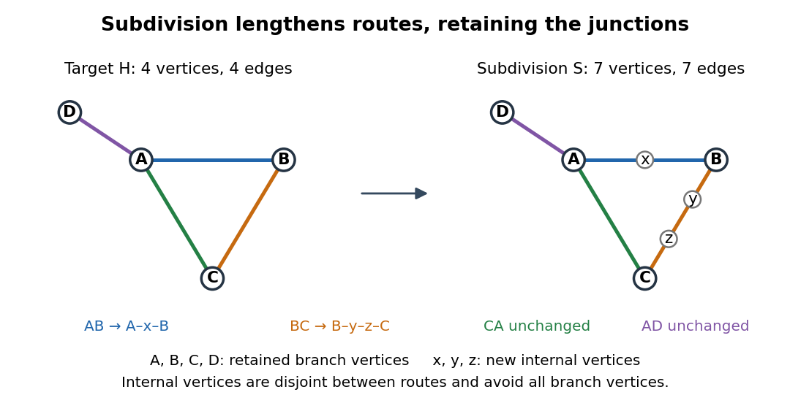

# Graph subdivision

↑ **Parent:** [Graph theory](graph-theory-split.md)

A [graph subdivision](graph-subdivision.md) $TH$ replaces each [edge](edge-of-a-graph.md) $uv$ of a [simple graph](simple-graph.md) $H$ by a [graph path](path-in-a-graph.md) of at least one [edge](edge-of-a-graph.md) joining its original endpoints. The original [vertices](vertex-graph-theory.md) are [branch vertices of a graph subdivision](branch-vertex-of-a-graph-subdivision.md). The replacement [graph paths](path-in-a-graph.md) have pairwise disjoint interiors, contain no [branch vertices of a graph subdivision](branch-vertex-of-a-graph-subdivision.md) internally, and together make up the entire new [graph](graph-split.md). Leaving an [edge](edge-of-a-graph.md) unchanged is allowed.[§1.7, printed p. 18: subdivision, branch vertices and subdividing vertices](graph-theory-by-reinhard-diestel/the-basics-author-hosted-chapter-preview.md)

For an explicit example, take $H$ with [vertex set](vertex-set.md) $\{A,B,C,D\}$ and [edges](edge-of-a-graph.md) $AB,BC,CA,AD$: a [triangle in a graph](triangle-in-a-graph.md) with one attached [leaf of a graph](leaf-of-a-graph.md). Replace its [edges](edge-of-a-graph.md) by the following [branch paths of a graph subdivision](branch-path-of-a-graph-subdivision.md):

$$
P_{AB}=(A,x,B),\qquad P_{BC}=(B,y,z,C),\qquad P_{CA}=(C,A),\qquad P_{AD}=(A,D).
$$

The resulting [graph subdivision](graph-subdivision.md) $S$ has [vertex set](vertex-set.md) $\{A,B,C,D,x,y,z\}$ and [edges](edge-of-a-graph.md) $Ax,xB,By,yz,zC,CA,AD$. The internal [vertex](vertex-graph-theory.md) sets are $\{x\},\{y,z\},\varnothing,\varnothing$, so disjointness is explicit. The [degrees of vertices](degree-graph-theory.md) of $A,B,C,D$ remain $3,2,2,1$, respectively; the three new internal [vertices](vertex-graph-theory.md) each have [degree of a vertex](degree-graph-theory.md) two.

**[Figure 21](#image-a-graph-subdivision-of-a-triangle-in-a-graph-with-an-attached-leaf-of-a-graph-colours-track-the-four-branch-paths-of-a-graph-subdivision). A graph subdivision of a triangle in a graph with an attached leaf of a graph: colours track the four branch paths of a graph subdivision**.

Adding $m$ internal [vertices](vertex-graph-theory.md) to a finite [graph](graph-split.md) increases both its [vertex](vertex-graph-theory.md) count and its [edge](edge-of-a-graph.md) count by $m$. Here $m=3$, so four [vertices](vertex-graph-theory.md) and four [edges](edge-of-a-graph.md) become seven of each; the [graph excess](graph-excess.md) is unchanged. Each replacement [graph path](path-in-a-graph.md) remains a route between the same junctions. Thus [graph subdivision](graph-subdivision.md) preserves whether a [graph](graph-split.md) is a [planar graph](planar-graph-split.md): insert intermediate [vertices](vertex-graph-theory.md) along a crossing-free drawing, or trace each replacement [graph path](path-in-a-graph.md) as one [edge](edge-of-a-graph.md) to recover a drawing of the original [graph](graph-split.md). Travel times or capacities are separate modelling choices and are not determined by this adjacency construction.

**Table of contents**

- [Branch vertex of a graph subdivision](branch-vertex-of-a-graph-subdivision.md)
- [Branch path of a graph subdivision](branch-path-of-a-graph-subdivision.md)
- [Complete graph subdivision](complete-graph-subdivision.md)

## ↑ Ancestors (5)

1. [Graph theory](graph-theory-split.md)
2. [Foundations of mathematics](foundations-of-mathematics-split.md)
3. [Area of mathematics](area-of-mathematics.md)
4. [Mathematics](mathematics-split.md)
5. [Codex Wiki](split.md)

## ← Incoming links (10)

- [Branch path of a graph subdivision](branch-path-of-a-graph-subdivision.md)
- [Branch vertex of a graph subdivision](branch-vertex-of-a-graph-subdivision.md)
- [Graph kernel](graph-kernel.md)
- [Graph minor](graph-minor-split.md)
- [Graph subdivision](graph-subdivision.md)
- [Kuratowski's theorem](kuratowski-s-theorem.md)
- [Nonplanarity by edge counts](nonplanarity-by-edge-counts.md)
- [Solution](past-exam-of-the-mathematics-course-of-the-university-of-cambridge/2003/iii/paper-12/4/ii/solution.md)
- [Solution](past-exam-of-the-mathematics-course-of-the-university-of-cambridge/2020/ii/paper-2/17g/ii/solution.md)
- [Topological minor](topological-minor.md)
