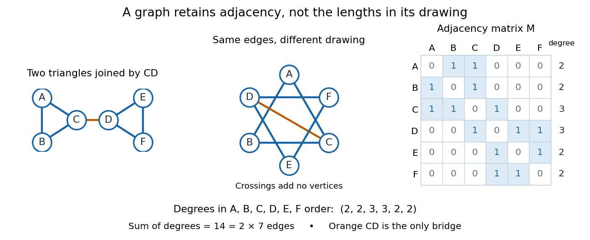

# Graph

↑ **Parent:** [Graph theory](graph-theory.md)  
ⓦ [Wiki](https://en.wikipedia.org/wiki/Graph_(discrete_mathematics))

**[Figure 1](#image-two-drawings-of-the-same-six-vertex-graph-and-its-adjacency-matrix). Two drawings of the same six-vertex graph and its adjacency matrix**.

A graph describes objects, called [vertices](#vertex-graph-theory), and pairwise connections, called [edges](graph-theory.md#edge-of-a-graph). Its [vertex set](#vertex-set) $V$ tells us what the objects are; $E$ records their connections. The basic abstraction retains [graph adjacency](#graph-adjacency) while discarding positions, angles and [Euclidean distances](topological-analysis.md#euclidean-distance): moving the dots in a drawing changes none of the [edges](graph-theory.md#edge-of-a-graph). A crossing of two drawn lines is not an extra [vertex](#vertex-graph-theory) unless explicitly designated as one. Even the labels can change: a [graph isomorphism](#graph-isomorphism) is a relabelling that preserves [graph adjacency](#graph-adjacency) in both directions.[The Basics (author-hosted chapter preview)](mathematics-bibliography.md#graph-theory-by-reinhard-diestel/the-basics-author-hosted-chapter-preview)

This makes [graphs](graph.md) useful when the question concerns possible connections rather than physical shape. For example, model locations by [vertices](#vertex-graph-theory) and direct links by [edges](graph-theory.md#edge-of-a-graph); a [graph path](graph-theory.md#path-in-a-graph) answers whether one location can reach another. Alternatively, let [vertices](#vertex-graph-theory) be activities and [edges](graph-theory.md#edge-of-a-graph) represent conflicts: a [graph coloring](graph-coloring.md) then assigns compatible time slots. These are mathematical models, so one must decide which pairwise relationship an [edge](graph-theory.md#edge-of-a-graph) means before applying [graph theory](graph-theory.md).[MIT, Graphs and Coloring, Sections 1.3 and 2.1](https://ocw.mit.edu/courses/6-1200j-mathematics-for-computer-science-spring-2024/mit6_1200j_s24_lec11.pdf)

Our running [simple graph](#simple-graph) has

$$
V=\{A,B,C,D,E,F\},\qquad E=\{AB,AC,BC,CD,DE,DF,EF\},
$$

where $AB$ abbreviates the [unordered pair](set.md#unordered-pair) $\{A,B\}$. It consists of two [triangles in a graph](#triangle-in-a-graph), $ABC$ and $DEF$, joined by $CD$. The two drawings above have identical [graph adjacency](#graph-adjacency), even though their apparent lengths differ. What counts is that $C$ and $D$ are adjacent, whereas $A$ and $F$ are not.

Route questions require precise vocabulary. A [walk](graph-theory.md#walk-in-a-graph) is a [sequence](sequence-and-series.md#sequence) of consecutive adjacent [vertices](#vertex-graph-theory), permitting repetitions; its length counts traversed [edges](graph-theory.md#edge-of-a-graph). A [trail](graph-theory.md#trail-in-a-graph) is a [walk](graph-theory.md#walk-in-a-graph) that repeats no [edge](graph-theory.md#edge-of-a-graph); a [graph path](graph-theory.md#path-in-a-graph) repeats no [vertex](#vertex-graph-theory). For a [multigraph](#multigraph), the [walk](graph-theory.md#walk-in-a-graph) must also specify which parallel [edge](graph-theory.md#edge-of-a-graph) each step uses. For instance, $A,B,A,C,D,F$ is a length-five [walk](graph-theory.md#walk-in-a-graph) but not a [trail](graph-theory.md#trail-in-a-graph), since it uses $AB$ twice. The length-three [graph path](graph-theory.md#path-in-a-graph) $A,C,D,F$ is a shortest route: crossing between the two [triangles in a graph](#triangle-in-a-graph) requires $CD$, with at least one [edge](graph-theory.md#edge-of-a-graph) before it and one after it. Thus $d(A,F)=3$ in [graph distance](graph-theory.md#distance-graph-theory), regardless of the drawing.[MIT, Connectivity and Trees, Section 1](https://ocw.mit.edu/courses/6-1200j-mathematics-for-computer-science-spring-2024/mit6_1200j_s24_lec13.pdf)

An [Eulerian trail](graph-theory.md#eulerian-trail) uses every [edge](graph-theory.md#edge-of-a-graph) exactly once, allowing repeated [vertices](#vertex-graph-theory); a [Hamiltonian path](graph-theory.md#hamiltonian-path) visits every [vertex](#vertex-graph-theory) exactly once, without needing every [edge](graph-theory.md#edge-of-a-graph). Here $C,A,B,C,D,E,F,D$ is an [Eulerian trail](graph-theory.md#eulerian-trail) of length seven, whereas $A,B,C,D,E,F$ is a [Hamiltonian path](graph-theory.md#hamiltonian-path) of length five. The first repeats $C,D$; the second omits $AC,DF$. Calling an [Eulerian trail](graph-theory.md#eulerian-trail) an "[Eulerian path](graph-theory.md#eulerian-trail)" must not be taken to impose our [graph path](graph-theory.md#path-in-a-graph) convention.[MIT, Connectivity and Trees, Section 3](https://ocw.mit.edu/courses/6-1200j-mathematics-for-computer-science-spring-2024/mit6_1200j_s24_lec13.pdf)

The classic historical example is Euler's Königsberg bridge problem: represent the four land regions by [vertices](#vertex-graph-theory) and the seven bridges by distinct [edges](graph-theory.md#edge-of-a-graph), giving a [multigraph](#multigraph). Their [degrees of vertices](graph-theory.md#degree-graph-theory) are $3,3,3,5$. In a [trail](graph-theory.md#trail-in-a-graph) using every [edge](graph-theory.md#edge-of-a-graph), arrivals and departures pair at every internal [vertex](#vertex-graph-theory), so at most the two endpoints can have odd [vertex degree](graph-theory.md#degree-graph-theory). Four odd [degrees of vertices](graph-theory.md#degree-graph-theory) therefore rule out such a route. This early foundational example of [graph theory](graph-theory.md) needs neither bridge lengths nor a geographical map. Euler's paper is conventionally associated with 1736, the volume's nominal year; the Euler Archive records its writing in 1735 and publication in 1741.[Euler Archive, E53: Solutio problematis ad geometriam situs pertinentis](mathematics-bibliography.md#euler-archive-e53-solutio-problematis-ad-geometriam-situs-pertinentis)[Euler, original Latin text and edition details](https://la.wikisource.org/wiki/Solutio_problematis_ad_geometriam_situs_pertinentis)

**Table of contents**

- [Sparse graph](#sparse-graph)
- [Graph adjacency](#graph-adjacency)
- [Simple graph](#simple-graph)
- [Loop (graph theory)](#loop-graph-theory)
- [Torus graph](#torus-graph)
- [Dual graph](#dual-graph)
- [Cubic graph](#cubic-graph)
  - [Heawood graph](#heawood-graph)
    - [Heawood torus map](#heawood-torus-map)
- [Strong product of graphs](#strong-product-of-graphs)
  - [Strong graph power](#strong-graph-power)
    - [Shannon capacity of a graph](#shannon-capacity-of-a-graph)
      - [Haemers rank bound](#haemers-rank-bound)
        - [Polynomial representation of a graph](#polynomial-representation-of-a-graph)
      - [Complement-pair capacity gain](#complement-pair-capacity-gain)
        - [Nonadditivity of Shannon capacity](#nonadditivity-of-shannon-capacity)
      - [Pentagon capacity code](#pentagon-capacity-code)
- [Incidence matrix](#incidence-matrix)
- [Amenable graph](#amenable-graph)
  - [Følner set](#folner-set)
- [Multigraph](#multigraph)
  - [Bouquet graph](#bouquet-graph)
- [Distance-transitive graph](#distance-transitive-graph)
  - [Distance-transitive action on a graph](#distance-transitive-action-on-a-graph)
  - [Symplectic dual polar graph](#symplectic-dual-polar-graph)
- [Vertex-transitive graph](#vertex-transitive-graph)
- [Triangular lattice](#triangular-lattice)
- [False twin](#false-twin)
  - [False-twin class](#false-twin-class)
- [Graph power](#graph-power)
  - [Square of a cycle](#square-of-a-cycle)
- [Graph cut](#graph-cut)
  - [Balanced component cut](#balanced-component-cut)
- [Oriented incidence matrix](#oriented-incidence-matrix)
  - [Incidence pseudoinverse decomposition](#incidence-pseudoinverse-decomposition)
- [Cartesian product of graphs](#cartesian-product-of-graphs)
- [Ladder graph](#ladder-graph)
  - [Doubly infinite ladder graph](#doubly-infinite-ladder-graph)
- [Cubic lattice](#cubic-lattice)
  - [Amenable boundary growth of lattice boxes](#amenable-boundary-growth-of-lattice-boxes)
- [Vertex set](#vertex-set)
- [Graph blow-up](#graph-blow-up)
  - [Dense clique family blow-up lemma](#dense-clique-family-blow-up-lemma)
  - [Vertex cloning in a graph](#vertex-cloning-in-a-graph)
- [Multipartite graph](#multipartite-graph)
- [Reachability in a graph](#reachability-in-a-graph)
- [Graph search](#graph-search)
  - [Best-first search](#best-first-search)
- [Tripartite graph](#tripartite-graph)
  - [Tripartite graph encoding of a grid](#tripartite-graph-encoding-of-a-grid)
- [Graph automorphism](#graph-automorphism)
  - [Quasi-transitive graph](#quasi-transitive-graph)
- [Bridge (graph theory)](#bridge-graph-theory)
- [Hypercube graph](#hypercube-graph)
  - [Gray code](#gray-code)
- [Square lattice](#square-lattice)
- [Connectivity (graph theory)](#connectivity-graph-theory)
  - [Connected graph](#connected-graph)
    - [Component (graph theory)](#component-graph-theory)
      - [Supermodularity of graph component count](#supermodularity-of-graph-component-count)
      - [Tree component](#tree-component)
      - [Largest component of a graph](#largest-component-of-a-graph)
- [Vertex (graph theory)](#vertex-graph-theory)
- [Graph isomorphism](#graph-isomorphism)
- [Triangle in a graph](#triangle-in-a-graph)
  - [Edge-disjoint triangles](#edge-disjoint-triangles)
  - [Triangle count](#triangle-count)
  - [Triangle-free graph](#triangle-free-graph)
    - [Triangle-free chromatic lower bound at bounded maximum degree](#triangle-free-chromatic-lower-bound-at-bounded-maximum-degree)
  - [Edge-triangle incidence bound](#edge-triangle-incidence-bound)
- [Vertex neighbourhood](#vertex-neighbourhood)

## Sparse graph

↑ **Parent:** [Graph](graph.md)

A family of [graphs](graph.md) is sparse when its [edge](graph-theory.md#edge-of-a-graph) count grows substantially more slowly than the square of its [vertex](#vertex-graph-theory) count; a common convention is that $m=O(n)$, where $n$ and $m$ count [vertices](#vertex-graph-theory) and [edges](graph-theory.md#edge-of-a-graph). State the intended asymptotic convention explicitly. An [adjacency list](data-structure.md#adjacency-list) then uses fewer storage entries than an [adjacency matrix](graph-theory.md#adjacency-matrix).

## Graph adjacency

↑ **Parent:** [Graph](graph.md)

Two [vertices](#vertex-graph-theory) of a [graph](graph.md) are adjacent if an [edge](graph-theory.md#edge-of-a-graph) joins them. A [graph automorphism](#graph-automorphism) preserves this relation in both directions. In an intersection graph, adjacency can be defined by a prescribed dimension or cardinality of an intersection, so any ambient symmetry preserving that statistic acts by [graph automorphisms](#graph-automorphism).

## Simple graph

↑ **Parent:** [Graph](graph.md)

An undirected simple [graph](graph.md) is exactly a pair of [sets](set.md)

$$
G=(V,E),\qquad E\subseteq\{\{u,v\}:u,v\in V,\ u\ne v\}.
$$

Thus every [edge](graph-theory.md#edge-of-a-graph) is a two-element [set](set.md) of distinct [vertices](#vertex-graph-theory). The [unordered pair](set.md#unordered-pair) $\{u,v\}$ equals $\{v,u\}$, so there is no direction. The distinctness condition excludes [self-loops](#loop-graph-theory), and using a [set](set.md) of [edges](graph-theory.md#edge-of-a-graph) excludes parallel copies. A [simple graph](#simple-graph) may have [vertices](#vertex-graph-theory) with no incident [edges](graph-theory.md#edge-of-a-graph); $E$ does not by itself determine $V$. For example, $(\{A,B\},\{AB\})$ and $(\{A,B,C\},\{AB\})$ have the same [edge](graph-theory.md#edge-of-a-graph) [set](set.md) but different [vertex sets](#vertex-set).[MIT, Graphs and Coloring, Section 1.1](https://ocw.mit.edu/courses/6-1200j-mathematics-for-computer-science-spring-2024/mit6_1200j_s24_lec11.pdf)

In the six-[vertex](#vertex-graph-theory) example, the [vertex neighbourhood](#vertex-neighbourhood) of $C$ is $\Gamma(C)=\{A,B,D\}$, so its [degree of a vertex](graph-theory.md#degree-graph-theory) is $\deg(C)=3$. In label order $A,B,C,D,E,F$, the [degree sequence](graph-theory.md#degree-sequence) is

$$
(2,2,3,3,2,2),\qquad \sum_{v\in V}\deg(v)=14=2\cdot7=2|E|.
$$

This is the [handshaking lemma](combinatorics.md#degree-sum-formula): count each [edge](graph-theory.md#edge-of-a-graph) once at each of its two endpoints. The [average degree of a graph](graph-theory.md#average-degree-of-a-graph) here is $14/6=7/3$. The [degree sequence](graph-theory.md#degree-sequence) is a compact consistency check on an [edge](graph-theory.md#edge-of-a-graph) list; an odd sum could not describe any finite undirected [graph](graph.md). It also forces the number of odd [degrees of vertices](graph-theory.md#degree-graph-theory) to be even, since the even terms do not affect the parity of the sum.

The [adjacency matrix](graph-theory.md#adjacency-matrix) in the figure uses label order $A,B,C,D,E,F$. Its entry $M_{uv}$ is one exactly when $\{u,v\}\in E$, and zero otherwise. It is a [symmetric matrix](linear-algebra.md#symmetric-matrix) with zero diagonal, and each row sum gives the corresponding [vertex degree](graph-theory.md#degree-graph-theory). For example, row $C$ is $(1,1,0,1,0,0)$. The fourteen ones count both directions of the seven undirected [edges](graph-theory.md#edge-of-a-graph); they do not indicate fourteen different [edges](graph-theory.md#edge-of-a-graph). This translates a picture into a representation suitable for calculation.

The restrictions matter. A [directed graph](graph-theory.md#directed-graph) uses an [ordered pair](set.md#ordered-pair) to distinguish $u\to v$ from $v\to u$, so [reachability](#reachability-in-a-graph) can depend on direction. A [multigraph](#multigraph) can contain several distinct [edges](graph-theory.md#edge-of-a-graph) between the same [vertices](#vertex-graph-theory); adding another $CD$ would raise $\deg(C)$ and $\deg(D)$ to four without adding a new neighbour. A [self-loop](#loop-graph-theory) at $A$ contributes two to its undirected [vertex degree](graph-theory.md#degree-graph-theory), making it four, because both endpoints lie at $A$. Specify whether [self-loops](#loop-graph-theory) are allowed in a [multigraph](#multigraph). Finally, a [weighted graph](random-walk.md#weighted-graph) attaches numerical information to [edges](graph-theory.md#edge-of-a-graph): if links carry travel times, minimizing the number of [edges](graph-theory.md#edge-of-a-graph) need not minimize total time. These are changes to the model, rather than changes to how the same [simple graph](#simple-graph) is drawn.

## Loop (graph theory)

↑ **Parent:** [Graph](graph.md)  
ⓦ [Wiki](https://en.wikipedia.org/wiki/Loop_(graph_theory))

A self-loop is an [edge](graph-theory.md#edge-of-a-graph) whose two endpoints are the same [vertex](#vertex-graph-theory). In undirected total-degree counting it contributes two to the [degree of a vertex](graph-theory.md#degree-graph-theory), since both endpoints are incident to that [vertex](#vertex-graph-theory). Simple [graphs](graph.md) exclude self-loops; the [linearized chord diagram model](random-graph.md#linearized-chord-diagram-model) retains them and starts from one self-loop.

## Torus graph

↑ **Parent:** [Graph](graph.md)

For $N\geq3$, the square torus graph has vertex set $(\mathbb Z/N\mathbb Z)^2$ and joins vertices differing by one in exactly one coordinate. It has $N^2$ vertices and $2N^2$ bonds. Translations act transitively on vertices; translations together with a quarter turn act transitively on bonds. A rectangle of side lengths at most $N-2$ has the same induced subgraph as its planar [square lattice](#square-lattice) counterpart.

## Dual graph

↑ **Parent:** [Graph](graph.md)  
ⓦ [Wiki](https://en.wikipedia.org/wiki/Dual_graph)

For a [graph](graph.md) with a cellular embedding on a surface, the dual has one vertex for each face and an edge crossing each original edge between its adjacent faces. Each edge is counted, including a loop when the two incident faces coincide. The [planar dual graph](planar-graph.md#planar-dual-graph) is the case of a planar embedding.

## Cubic graph

↑ **Parent:** [Graph](graph.md)  
ⓦ [Wiki](https://en.wikipedia.org/wiki/Cubic_graph)

A [graph](graph.md) whose every [vertex](#vertex-graph-theory) has [degree of a vertex](graph-theory.md#degree-graph-theory) three.

### Heawood graph

↑ **Parent:** [Cubic graph](#cubic-graph)  
ⓦ [Wiki](https://en.wikipedia.org/wiki/Heawood_graph)

The bipartite [cubic graph](#cubic-graph) with vertices $A_i,B_i$, $i\in\mathbb Z/7\mathbb Z$, and edges $A_iB_i,A_iB_{i+1},A_iB_{i-2}$. The three offsets give a [Tait coloring](graph-coloring.md#tait-coloring).

#### Heawood torus map

↑ **Parent:** [Heawood graph](#heawood-graph)

Triangulate a [torus](topological-surface.md#torus) using the seven vertices of the [complete graph](graph-theory.md#complete-graph) $K_7$ and oriented triangles $(i,i+1,i+3)$ and $(i,i+3,i+2)$, with indices modulo seven. Every edge occurs twice with opposite orientations; each vertex has a cyclic link. The [Euler characteristic](homology.md#euler-characteristic) is $7-21+14=0$. Its [dual graph](#dual-graph) is the [Heawood graph](#heawood-graph). This dual map has seven disc faces, each adjacent to all the others, so it needs seven face colors although its edges have a [Tait coloring](graph-coloring.md#tait-coloring).

## Strong product of graphs

↑ **Parent:** [Graph](graph.md)  
ⓦ [Wiki](https://en.wikipedia.org/wiki/Strong_product_of_graphs)

Its vertices are pairs of vertices. Two distinct pairs are adjacent exactly when, in each coordinate, their entries are equal or adjacent in the corresponding [graph](graph.md). Cartesian products of independent sets are independent, giving supermultiplicativity of the [independence number](graph-theory.md#independence-number).

### Strong graph power

↑ **Parent:** [Strong product of graphs](#strong-product-of-graphs)

An iterated [strong graph product](#strong-product-of-graphs) has vertices that are words of length $m$ in the graph's vertex set. Distinct words are nonadjacent exactly when some coordinate contains distinct nonadjacent entries. This differs from the distance-based [graph power](#graph-power).

#### Shannon capacity of a graph

↑ **Parent:** [Strong graph power](#strong-graph-power)  
ⓦ [Wiki](https://en.wikipedia.org/wiki/Shannon_capacity_of_a_graph)

The capacity is the exponential growth rate of the independence numbers of strong graph powers. Products of independent sets make these numbers supermultiplicative, and [Fekete lemma](sequence-and-series.md#fekete-s-lemma) gives the limit and its equality to the supremum. Passing to every second power gives $c(G\boxtimes G)=c(G)^2$.

##### Haemers rank bound

↑ **Parent:** [Shannon capacity of a graph](#shannon-capacity-of-a-graph)

A fitting matrix over a field has nonzero diagonal entries and zero entries at distinct nonadjacent vertices. Its tensor powers fit strong graph powers. On an independent set the restricted matrix is diagonal and nonsingular, so its cardinality is at most the matrix rank. This yields the capacity upper bound over every field.

###### Polynomial representation of a graph

↑ **Parent:** [Haemers rank bound](#haemers-rank-bound)

Choose points $a_v\in F^r$ and polynomials $f_v$ in a finite-dimensional polynomial space $M$, with $f_v(a_v)\ne0$ and $f_v(a_w)=0$ for distinct nonadjacent vertices. Evaluation produces a fitting matrix of rank at most $\dim_F M$. Equivalently, tensoring the polynomial spaces gives linearly independent polynomials for every independent code in a strong power, proving $c(G)\leq\dim_F M$.

##### Complement-pair capacity gain

↑ **Parent:** [Shannon capacity of a graph](#shannon-capacity-of-a-graph)

In each word pattern with equally many $G$ and complement coordinates, pair the coordinates of the two types and put the same vertex label in each pair. Distinct labels are separated in one of the two graphs, making an independent code of size $n^m$ for a pattern of length $2m$. Distinct patterns lie in different graph components, so their codes combine to an independent set of size $\binom{2m}m n^m$. Taking $2m$th roots gives the displayed bound.

###### Nonadditivity of Shannon capacity

↑ **Parent:** [Complement-pair capacity gain](#complement-pair-capacity-gain)

Capacity of a disjoint union can strictly exceed the sum of the capacities. On the five-element subsets of a twenty-point set, join distinct sets when their intersection is odd. Linear polynomials over $\mathbb F_2$ bound its capacity by twenty; squarefree quadratic polynomials over $\mathbb F_3$ bound its complement's capacity by $\binom{20}2=190$. The complement-pair lower bound is $2\sqrt{\binom{20}5}>210$, establishing strict nonadditivity.

##### Pentagon capacity code

↑ **Parent:** [Shannon capacity of a graph](#shannon-capacity-of-a-graph)

These five words are independent in the strong square of the [cycle graph](graph-theory.md#cycle-graph) $C_5$: a nonzero difference is a nonedge in the first or the second coordinate. A three-dimensional orthonormal representation with common vertical squared component $1/\sqrt5$ proves the matching upper bound. Consequently $c(C_5)=\vartheta(C_5)=\sqrt5$.

## Incidence matrix

↑ **Parent:** [Graph](graph.md)

A vertex-edge incidence matrix records which [vertices](#vertex-graph-theory) are endpoints of each [edge](graph-theory.md#edge-of-a-graph) of a [graph](graph.md). The unsigned convention uses entries one at the endpoints, with a convention for loops. Choosing an orientation gives the [oriented incidence matrix](#oriented-incidence-matrix), with minus one at the initial endpoint and plus one at the terminal endpoint. These are different conventions and should be specified when using the matrix in a computation.

## Amenable graph

↑ **Parent:** [Graph](graph.md)

A bounded-degree infinite [graph](graph.md) is amenable when there are finite nonempty vertex sets $W_n$ such that $|\partial^+W_n|/|W_n|\to0$, where $\partial^+W_n$ is the set of vertices outside $W_n$ adjacent to it. These are graph [Følner sets](#folner-set). Amenability makes surface contributions negligible compared with volume. The square lattice and any periodic finite decoration of it are examples.

<h3 id="folner-set">Følner set</h3>

↑ **Parent:** [Amenable graph](#amenable-graph)

A finite nonempty vertex set in an [amenable graph](#amenable-graph) is a Følner set with tolerance $\varepsilon$ if its external boundary has size at most $\varepsilon$ times its volume. A graph [Følner sequence](geometric-group-theory.md#folner-sequence) consists of such sets with tolerances tending to zero. For a bounded-degree [graph](graph.md), every fixed-thickness boundary layer also has negligible relative volume along this sequence.

## Multigraph

↑ **Parent:** [Graph](graph.md)  
ⓦ [Wiki](https://en.wikipedia.org/wiki/Multigraph)

A multigraph permits distinct [edges](graph-theory.md#edge-of-a-graph) with the same pair of endpoints. Whether loops are also allowed is a convention that must be specified for a particular result. Counting edges with multiplicity differs from counting adjacent vertices.

### Bouquet graph

↑ **Parent:** [Multigraph](#multigraph)

A bouquet graph consists of one vertex and $j$ [self-loops](#loop-graph-theory). Its vertex has degree $2j$, and its [graph excess](graph-theory.md#graph-excess) is $j-1$. The two-loop bouquet is one of the three possible kernels of a [bicyclic graph](graph-theory.md#bicyclic-graph); in a simple subdivision, each loop must expand to a cycle of length at least three.

## Distance-transitive graph

↑ **Parent:** [Graph](graph.md)  
ⓦ [Wiki](https://en.wikipedia.org/wiki/Distance-transitive_graph)

An automorphism group is transitive on ordered pairs of vertices at every fixed distance. [Grassmann graphs](differential-geometry.md#grassmann-graph) provide examples with the finite general linear group as a distance-transitive automorphism group.

### Distance-transitive action on a graph

↑ **Parent:** [Distance-transitive graph](#distance-transitive-graph)

A subgroup of the [graph automorphism](#graph-automorphism) group acts distance-transitively when it is [transitive](set-theory.md#transitive-relation) on the [ordered pairs](set.md#ordered-pair) of [vertices](#vertex-graph-theory) at each fixed [graph distance](graph-theory.md#distance-graph-theory). Thus two vertex pairs at the same distance can be matched by one automorphism from that subgroup. Existence of such a subgroup implies that the full automorphism group has the same property, making the graph a [distance-transitive graph](#distance-transitive-graph). The specified subgroup need not be the entire automorphism group.

### Symplectic dual polar graph

↑ **Parent:** [Distance-transitive graph](#distance-transitive-graph)

Vertices are [Lagrangian subspaces](symplectic-geometry.md#lagrangian-subspace) of a $2m$-dimensional [symplectic vector space](bilinear-form.md#symplectic-vector-space), joined when they intersect in codimension one. A pair with intersection dimension $m-r$ admits a [symplectic basis](bilinear-form.md#symplectic-basis) in which $U=\langle e_1,\ldots,e_m\rangle$ and $W=\langle f_1,\ldots,f_r,e_{r+1},\ldots,e_m\rangle$. Replacing $e_i$ successively by $f_i$ gives an isotropic path of length $r$, while one edge can increase intersection dimension with a fixed target by at most one. Equal-distance ordered pairs have the same adapted form, so the [symplectic group](symplectic-geometry.md#symplectic-group) acts [distance-transitively](#distance-transitive-action-on-a-graph).

## Vertex-transitive graph

↑ **Parent:** [Graph](graph.md)

A [graph](graph.md) whose automorphisms act transitively on its vertices: any chosen [vertex of a graph](#vertex-graph-theory) can be carried to any other by a symmetry preserving adjacency. Consequently rooted [self-avoiding walk](combinatorics.md#self-avoiding-walk) counts are independent of the chosen root.

## Triangular lattice

↑ **Parent:** [Graph](graph.md)

The planar [graph](graph.md) with vertices $\{a(1,0)+b(1/2,\sqrt3/2):a,b\in\mathbb Z\}$ and [edges](graph-theory.md#edge-of-a-graph) between vertices at Euclidean distance one. Every [vertex of a graph](#vertex-graph-theory) has six neighbors. Its [site percolation](site-percolation.md) model is a particularly tractable setting for [conformal invariance of planar percolation](percolation-theory.md#conformal-invariance-of-planar-percolation).

## False twin

↑ **Parent:** [Graph](graph.md)

Distinct [vertices](#vertex-graph-theory) with equal open neighbourhoods are false twins. They are nonadjacent: adjacency would put one [vertex](#vertex-graph-theory) in the other's open neighbourhood but not its own. Equal open neighbourhoods define [false-twin classes](#false-twin-class), which are independent sets and have uniform adjacency to every other such class.

### False-twin class

↑ **Parent:** [False twin](#false-twin)

A false-twin class is an equivalence class of [vertices](#vertex-graph-theory) with identical open neighbourhoods. In [edge-triangle symmetrization](extremal-graph-theory.md#edge-triangle-symmetrization), merging nonadjacent false-twin classes by cloning the better local score never decreases the objective. A secondary maximization of squared class sizes forces all distinct classes to be adjacent, giving a [complete multipartite graph](graph-theory.md#complete-multipartite-graph).

## Graph power

↑ **Parent:** [Graph](graph.md)

The $j$th power of a [graph](graph.md) joins distinct [vertices](#vertex-graph-theory) whenever their distance in the original [graph](graph.md) is at most $j$. For example, the [square of a cycle](#square-of-a-cycle) adds [edges](graph-theory.md#edge-of-a-graph) connecting [vertices](#vertex-graph-theory) two steps apart. Graph powers turn constraints on short paths into adjacency constraints.

### Square of a cycle

↑ **Parent:** [Graph power](#graph-power)

In a cycle square, each triple of consecutive [vertices](#vertex-graph-theory) is a [clique](graph-theory.md#clique-graph-theory). A proper three-colouring therefore repeats with period three and closes exactly when the length is divisible by three. For all other cycle lengths at least four colours are needed; the five-cycle square is a complete five-vertex [graph](graph.md).

## Graph cut

↑ **Parent:** [Graph](graph.md)

A graph cut consists of the [edges](graph-theory.md#edge-of-a-graph) joining a vertex subset to its complement. In a two-group [stochastic block model](generalized-linear-model.md#stochastic-block-model), crossing and within-group [edges](graph-theory.md#edge-of-a-graph) have different [Bernoulli distributions](discrete-probability-distribution.md#bernoulli-distribution). The [Kullback-Leibler divergence](f-divergence.md#kullback-leibler-divergence) between two such models is the sum of the changed-edge divergences, with their order determined by which partition regards the [edge](graph-theory.md#edge-of-a-graph) as crossing.

### Balanced component cut

↑ **Parent:** [Graph cut](#graph-cut)

If every [graph component](#component-graph-theory) has at most $(k+1)n/[k(2k+1)]$ [vertices](#vertex-graph-theory), assigning whole [graph components](#component-graph-theory) to two sides gives an empty [graph cut](#graph-cut) with the displayed bound. To prove it, maximize the smaller side's weight $S\leq n/2$. If $S<kn/(2k+1)$, every component on the larger side has weight at least $n-2S$, because moving a smaller one would improve the smaller side. There are at least $k+1$ such components, since their total exceeds $k$ times the permitted maximum weight. Thus $n-S\geq(k+1)(n-2S)$, a contradiction. The proof also works for arbitrary positive weights.

## Oriented incidence matrix

↑ **Parent:** [Graph](graph.md)

An oriented incidence matrix records an arbitrarily chosen orientation of each [edge](graph-theory.md#edge-of-a-graph) of a [graph](graph.md). Use one row per [edge](graph-theory.md#edge-of-a-graph), with $+1$ and $-1$ at its endpoints and zeros elsewhere; the transpose convention is also common. The product $D\theta$ records endpoint differences. For a [connected graph](#connected-graph), $\ker D=\operatorname{span}\{\mathbf1\}$, since zero difference propagates along every [graph path](graph-theory.md#path-in-a-graph).

### Incidence pseudoinverse decomposition

↑ **Parent:** [Oriented incidence matrix](#oriented-incidence-matrix)

For a [connected graph](#connected-graph), the [Moore-Penrose inverse](matrix-inverse.md#moore-penrose-inverse) of its [oriented incidence matrix](#oriented-incidence-matrix) satisfies $D^\dagger D=I-\Pi_1$, because this product is the [orthogonal projection](hilbert-space.md#orthogonal-projection) onto $(\ker D)^\perp$. Thus every signal decomposes into its constant mean and $D^\dagger D\theta$. Writing $L=\max_e\|(D^\dagger)_{\cdot,e}\|_2$, a [sub-Gaussian random vector](probability-and-statistics.md#sub-gaussian-random-vector) noise gives a simultaneous bound on $\|(D^\dagger)^\top z\|_\infty$ with scale $L\sqrt{\log(m/\delta)}$.

## Cartesian product of graphs

↑ **Parent:** [Graph](graph.md)

For two [graphs](graph.md) $G,H$, their [Cartesian product of graphs](#cartesian-product-of-graphs) has [graph vertices](#vertex-graph-theory) $(g,h)\in V(G)\times V(H)$. Two [graph vertices](#vertex-graph-theory) are adjacent if either their $G$ coordinates agree and their $H$ coordinates are adjacent, or conversely their $H$ coordinates agree and their $G$ coordinates are adjacent. The [ladder graph](#ladder-graph) is the product of a [graph path](graph-theory.md#path-in-a-graph) with $K_2$.

## Ladder graph

↑ **Parent:** [Graph](graph.md)

A [ladder graph](#ladder-graph) is the [Cartesian product of graphs](#cartesian-product-of-graphs) of a [graph path](graph-theory.md#path-in-a-graph) with the two-vertex [complete graph](graph-theory.md#complete-graph) $K_2$. Its two parallel rails are joined by a rung at each position. The [doubly infinite ladder graph](#doubly-infinite-ladder-graph) uses an infinite rail indexed by $\mathbb Z$.

### Doubly infinite ladder graph

↑ **Parent:** [Ladder graph](#ladder-graph)

The [doubly infinite ladder graph](#doubly-infinite-ladder-graph) has [graph vertices](#vertex-graph-theory) $\mathbb Z\times\{0,1\}$, horizontal [edges](graph-theory.md#edge-of-a-graph) $\{(j,s),(j+1,s)\}$, and vertical [edges](graph-theory.md#edge-of-a-graph) $\{(j,0),(j,1)\}$.

## Cubic lattice

↑ **Parent:** [Graph](graph.md)

The [cubic lattice](#cubic-lattice) in dimension $d$ has [graph vertex](#vertex-graph-theory) [set](set.md) $\mathbb Z^d$ and an [edge](graph-theory.md#edge-of-a-graph) between $x,y$ exactly when $\sum_i|x_i-y_i|=1$. For $d=2$ it is the [square lattice](#square-lattice). Every [graph vertex](#vertex-graph-theory) has $2d$ [graph neighbours](graph-theory.md#neighbour-of-a-vertex), so it is a [locally finite graph](graph-theory.md#locally-finite-graph).

### Amenable boundary growth of lattice boxes

↑ **Parent:** [Cubic lattice](#cubic-lattice)

For the nearest-neighbour graph on $\mathbb Z^d$, a box $B_n=[-n,n]^d\cap\mathbb Z^d$ has $(2n+1)^d$ [graph vertices](#vertex-graph-theory) and outer [graph vertex](#vertex-graph-theory) boundary of size $2d(2n+1)^{d-1}$. Thus $|\partial^+B_n|/|B_n|\to0$. This boundary-to-volume property is the geometric mechanism that contradicts a positive volume density of trifurcation points in the uniqueness proof. It realizes the boundary-growth property of the translation [amenable group](geometric-group-theory.md#amenable-group) on the lattice.

## Vertex set

↑ **Parent:** [Graph](graph.md)

The vertex set is the underlying [set](set.md) $V$ of a [graph](graph.md) or [hypergraph](hypergraph.md). In a hypergraph, its hyperedges are subsets of this set; in a simple graph, edges are two-element subsets.

## Graph blow-up

↑ **Parent:** [Graph](graph.md)

A blow-up replaces each vertex of a [graph](graph.md) by an [independent set](graph-theory.md#independent-set-graph-theory), and each original edge by all edges between the corresponding two sets. Replacing every vertex of $K_r$ by $t$ vertices gives the [balanced complete multipartite blow-up](graph-theory.md#balanced-complete-multipartite-blow-up) $K_r(t)$.

### Dense clique family blow-up lemma

↑ **Parent:** [Graph blow-up](#graph-blow-up)

A family of positively many $s$-cliques forces a logarithmic balanced [graph blow-up](#graph-blow-up), which can also contain a matching of that many members of the family. To induct on $s$, prune faces with few extensions, apply induction to the remaining $(s-1)$-faces, and use a matching of those faces as one side of a bipartite incidence [graph](graph.md). The [common neighbourhood from bipartite density](bipartite-graph.md#common-neighbourhood-from-bipartite-density) estimate selects logarithmically many disjoint faces with polynomially many common extension [vertices](#vertex-graph-theory).

### Vertex cloning in a graph

↑ **Parent:** [Graph blow-up](#graph-blow-up)

Cloning a vertex replaces it by several nonadjacent vertices with identical neighbourhoods. In [homomorphism density](graph-theory.md#homomorphism-density), conditioning on the images of all other vertices reduces cloning to the inequality $\mathbb E p^t\ge(\mathbb E p)^t$ from the [Jensen inequality](real-analysis.md#jensen-s-inequality). Iterated cloning shows that positive clique homomorphism density forces any fixed complete multipartite blow-up.

## Multipartite graph

↑ **Parent:** [Graph](graph.md)

A graph is $r$-partite when its vertices can be partitioned into $r$ classes, each an [independent set](graph-theory.md#independent-set-graph-theory). Edges may be missing between different classes. If all possible edges between different classes occur, it is a [complete multipartite graph](graph-theory.md#complete-multipartite-graph).

## Reachability in a graph

↑ **Parent:** [Graph](graph.md)

A vertex $v$ is reachable from $u$ if a finite path leads from $u$ to $v$, respecting edge directions in a directed [graph](graph.md). For a finite graph, [graph search](#graph-search) decides [reachability](#reachability-in-a-graph) by maintaining the [set](set.md) of discovered vertices; every step discovers a new vertex or examines an edge, so the procedure terminates.

## Graph search

↑ **Parent:** [Graph](graph.md)

A [graph search](#graph-search) explores vertices through incident edges while recording visited vertices. On a finite [graph](graph.md), depth-first or breadth-first exploration terminates and decides [reachability](#reachability-in-a-graph); recording predecessors also gives a path. Restricting to vertices reachable from a start and able to reach an accepting vertex identifies the productive part of a [deterministic finite automaton](foundations-of-mathematics.md#deterministic-finite-automaton).

### Best-first search

↑ **Parent:** [Graph search](#graph-search)

Maintain a frontier of partial states in a [priority queue](data-structure.md#priority-queue) and expand the state with the best current priority. Correctness of a particular stopping rule depends on what the priority bounds. If every descendant has smaller priority than its ancestor, the frontier maximum also bounds the priority of every unseen descendant.

## Tripartite graph

↑ **Parent:** [Graph](graph.md)

A tripartite [graph](graph.md) has a [set partition](combinatorics.md#set-partition) of its [vertices](#vertex-graph-theory) into three classes, with every [edge](graph-theory.md#edge-of-a-graph) joining different classes. Each pair of classes induces a [bipartite graph](bipartite-graph.md), and every [triangle in a graph](#triangle-in-a-graph) uses one [vertex](#vertex-graph-theory) from each class.

### Tripartite graph encoding of a grid

↑ **Parent:** [Tripartite graph](#tripartite-graph)

For $A\subseteq[n]^2$, use three disjoint labelled [vertex](#vertex-graph-theory) classes $X=[n]$, $Y=[n]$, $Z=[2n]$. Each $(x,y)\in A$ inserts the three [edges](graph-theory.md#edge-of-a-graph) $xy,x(x+y),y(x+y)$, producing pairwise [edge-disjoint triangles](#edge-disjoint-triangles). Every [triangle in a graph](#triangle-in-a-graph) with labels $(x,y,z)$ corresponds to the three points $(x,y),(x,z-x),(z-y,y)$ of $A$. It is canonical when $z=x+y$; otherwise it gives a [corner in an integer grid](additive-combinatorics.md#corner-in-an-integer-grid) with nonzero displacement $z-x-y$.

## Graph automorphism

↑ **Parent:** [Graph](graph.md)  
ⓦ [Wiki](https://en.wikipedia.org/wiki/Graph_automorphism)

A graph automorphism is a bijection of the vertex set that preserves adjacency. It preserves graph distances and transports simple random-walk hitting problems between vertices.

### Quasi-transitive graph

↑ **Parent:** [Graph automorphism](#graph-automorphism)

A [graph](graph.md) is quasi-transitive if some group of [graph automorphisms](#graph-automorphism) has finitely many vertex orbits. This is also called a graph of finite type. A [connected graph](#connected-graph) that is infinite and a [locally finite graph](graph-theory.md#locally-finite-graph) then has uniformly bounded degrees. Every orbit is infinite: a finite invariant orbit would have finite neighborhoods, and finitely many orbit types would put the entire graph in one such neighborhood. This permits finite sets to be moved arbitrarily far apart by [graph automorphisms](#graph-automorphism).

## Bridge (graph theory)

↑ **Parent:** [Graph](graph.md)  
ⓦ [Wiki](https://en.wikipedia.org/wiki/Bridge_(graph_theory))

A bridge is an edge whose deletion increases the number of components of a graph. Equivalently, it belongs to no cycle; within its original component, deleting it makes the [connected graph](#connected-graph) disconnected.

## Hypercube graph

↑ **Parent:** [Graph](graph.md)  
ⓦ [Wiki](https://en.wikipedia.org/wiki/Hypercube_graph)

The $d$-dimensional hypercube graph has vertex set $\{0,1\}^d$ and joins two vertices exactly when they differ in one coordinate. It is a $d$-regular [bipartite graph](bipartite-graph.md) on $2^d$ vertices.

### Gray code

↑ **Parent:** [Hypercube graph](#hypercube-graph)  
ⓦ [Wiki](https://en.wikipedia.org/wiki/Gray_code)

A Gray code orders binary strings so that successive strings differ in exactly one bit. Consequently it describes a path in a [hypercube graph](#hypercube-graph); a cyclic Gray code describes a cycle.

## Square lattice

↑ **Parent:** [Graph](graph.md)  
ⓦ [Wiki](https://en.wikipedia.org/wiki/Square_lattice)

The square lattice has vertex set $\mathbb Z^2$ and joins vertices whose Euclidean distance is one.

## Connectivity (graph theory)

↑ **Parent:** [Graph](graph.md)  
ⓦ [Wiki](https://en.wikipedia.org/wiki/Connectivity_(graph_theory))

Connectivity studies the existence of paths between [vertices of a graph](#vertex-graph-theory) and the persistence of paths after vertex or edge deletions. A [connected graph](#connected-graph) is the basic case in which every pair of vertices is linked by a path.

### Connected graph

↑ **Parent:** [Connectivity (graph theory)](#connectivity-graph-theory)

An undirected [graph](graph.md) is connected when every pair $u,v$ of [vertices](#vertex-graph-theory) is joined by a finite [graph path](graph-theory.md#path-in-a-graph). The length-zero [graph path](graph-theory.md#path-in-a-graph) consisting of $u$ alone is allowed, so a single-[vertex](#vertex-graph-theory) [graph](graph.md) is connected. We use the term here for nonempty [graphs](graph.md); conventions for the [graph](graph.md) with no [vertices](#vertex-graph-theory) vary. Adjacent [vertices](#vertex-graph-theory) are connected, but connected [vertices](#vertex-graph-theory) need not be adjacent: in our six-[vertex](#vertex-graph-theory) example, $A$ reaches $F$ along $A,C,D,F$, although $AF$ is absent.

Allowing [walks](graph-theory.md#walk-in-a-graph) instead of [graph paths](graph-theory.md#path-in-a-graph) gives the same test for a [connected graph](#connected-graph). Whenever a finite [walk](graph-theory.md#walk-in-a-graph) revisits a [vertex](#vertex-graph-theory), delete the intervening closed portion; repeating this leaves a [graph path](graph-theory.md#path-in-a-graph) with the same endpoints. This simple shortening argument explains why revisiting locations cannot help decide [reachability](#reachability-in-a-graph).[MIT, Connectivity and Trees, Theorem 1](https://ocw.mit.edu/courses/6-1200j-mathematics-for-computer-science-spring-2024/mit6_1200j_s24_lec13.pdf)

Connectivity can conceal fragile connections. Removing $CD$ from our [graph](graph.md) produces two [connected components of a graph](#component-graph-theory), on $\{A,B,C\}$ and $\{D,E,F\}$: $CD$ is a [bridge in a graph](#bridge-graph-theory). Removing $AB$ instead preserves connectivity, because $A,C,B$ supplies an alternative [graph path](graph-theory.md#path-in-a-graph). If [edges](graph-theory.md#edge-of-a-graph) represent communication links, this calculation says precisely which single link failure separates the two groups. It is a conclusion about this model, independent of the lengths in its drawing.

A [tree](tree-graph-theory.md) is a nonempty [connected graph](#connected-graph) without a [graph cycle](graph-theory.md#cycle-in-a-graph); equivalently, each pair of [vertices](#vertex-graph-theory) has exactly one [graph path](graph-theory.md#path-in-a-graph) between them. Delete $BC$ and $EF$ from our example. The remaining [edges](graph-theory.md#edge-of-a-graph)

$$
\{AB,AC,CD,DE,DF\}
$$

form a [spanning tree](tree-graph-theory.md#spanning-tree): all six [vertices](#vertex-graph-theory) remain, with $6-1=5$ [edges](graph-theory.md#edge-of-a-graph). The [graph path](graph-theory.md#path-in-a-graph) $A,C,D,F$ is now unique, and every remaining [edge](graph-theory.md#edge-of-a-graph) is a [bridge in a graph](#bridge-graph-theory). Adding $BC$ back creates exactly one [graph cycle](graph-theory.md#cycle-in-a-graph), $B,A,C,B$. Thus [graph cycles](graph-theory.md#cycle-in-a-graph) express alternative routes, while a [tree](tree-graph-theory.md) retains just enough connections for [reachability](#reachability-in-a-graph). More generally, a finite [connected graph](#connected-graph) on $n\geq1$ [vertices](#vertex-graph-theory) has at least $n-1$ [edges](graph-theory.md#edge-of-a-graph), with equality exactly for a [tree](tree-graph-theory.md). One proof repeatedly removes an [edge](graph-theory.md#edge-of-a-graph) on a [graph cycle](graph-theory.md#cycle-in-a-graph), preserving connectivity, until a [spanning tree](tree-graph-theory.md#spanning-tree) remains.[The Basics (author-hosted chapter preview)](mathematics-bibliography.md#graph-theory-by-reinhard-diestel/the-basics-author-hosted-chapter-preview)

For a finite [graph](graph.md), [breadth-first search](tree-graph-theory.md#breadth-first-search) tests connectivity by starting at one [vertex](#vertex-graph-theory) and discovering neighbours in successive layers. Starting at $A$, the layers in our example are $\{A\}$, $\{B,C\}$, $\{D\}$, $\{E,F\}$. Every [vertex](#vertex-graph-theory) is discovered, and the layer numbers give [graph distances](graph-theory.md#distance-graph-theory) from $A$. Recording one discovery [edge](graph-theory.md#edge-of-a-graph) for each new [vertex](#vertex-graph-theory) constructs a [spanning tree](tree-graph-theory.md#spanning-tree). This turns an existence question into both a concrete route and a certificate of connectivity.

#### Component (graph theory)

↑ **Parent:** [Connected graph](#connected-graph)  
ⓦ [Wiki](https://en.wikipedia.org/wiki/Component_(graph_theory))

A connected component is a maximal connected subgraph.

##### Supermodularity of graph component count

↑ **Parent:** [Component (graph theory)](#component-graph-theory)

For open-edge sets $S,T$ in a fixed finite graph, including isolated [graph vertices](#vertex-graph-theory) in $k$, one has $k(S\cap T)+k(S\cup T)\ge k(S)+k(T)$. Incidence-vector spans have rank $r(S)=|V|-k(S)$; their union span is the sum of the two spans, while the intersection-edge span is contained in the intersection of spans. The vector-space [dimension formula for a sum of subspaces](vector-space.md#dimension-formula-for-a-sum-of-subspaces) proves submodularity of $r$, equivalently supermodularity of $k$.

##### Tree component

↑ **Parent:** [Component (graph theory)](#component-graph-theory)

A tree component is a [graph component](#component-graph-theory) whose induced [graph](graph.md) is a [tree](tree-graph-theory.md). A [tree component](#tree-component) with $j$ [vertices](#vertex-graph-theory) has exactly $j-1$ [edges](graph-theory.md#edge-of-a-graph).

##### Largest component of a graph

↑ **Parent:** [Component (graph theory)](#component-graph-theory)

The largest [graph component](#component-graph-theory) is one with the most [vertices](#vertex-graph-theory). Ties may be broken arbitrarily; $L_1$ records the order, which is unaffected by the tie. For a sequence of [random graphs](random-graph.md), the size of its [giant component](random-graph.md#giant-component) is a central observable.

## Vertex (graph theory)

↑ **Parent:** [Graph](graph.md)  
ⓦ [Wiki](https://en.wikipedia.org/wiki/Vertex_(graph_theory))

A vertex is one of the objects joined by the [edges](graph-theory.md#edge-of-a-graph) of a graph.

## Graph isomorphism

↑ **Parent:** [Graph](graph.md)  
ⓦ [Wiki](https://en.wikipedia.org/wiki/Graph_isomorphism)

Two graphs are isomorphic when a [bijection](function.md#bijection) between their vertex sets preserves adjacency.

## Triangle in a graph

↑ **Parent:** [Graph](graph.md)

A triangle is a set of three vertices joined by all three possible edges, equivalently a copy of $K_3$.

### Edge-disjoint triangles

↑ **Parent:** [Triangle in a graph](#triangle-in-a-graph)

A family of [triangles in a graph](#triangle-in-a-graph) is edge-disjoint if no [edge](graph-theory.md#edge-of-a-graph) belongs to two members. Any deletion of [edges](graph-theory.md#edge-of-a-graph) producing a [triangle-free graph](#triangle-free-graph) must remove at least one distinct [edge](graph-theory.md#edge-of-a-graph) for each member. The [triangles in a graph](#triangle-in-a-graph) may share [vertices](#vertex-graph-theory).

### Triangle count

↑ **Parent:** [Triangle in a graph](#triangle-in-a-graph)

The triangle count of a finite simple [graph](graph.md) is the number of unordered triples of [vertices](#vertex-graph-theory) inducing a [triangle in a graph](#triangle-in-a-graph). In a [tripartite graph](#tripartite-graph) with parts $X,Y,Z$ and adjacency [indicator functions](measure-theory.md#indicator-function) $g_{XY},g_{YZ},g_{XZ}$, it equals $|X||Y||Z|\mathbb E_{x,y,z}g_{XY}(x,y)g_{YZ}(y,z)g_{XZ}(x,z)$, using uniform [expectations](expected-value.md) on nonempty parts.

### Triangle-free graph

↑ **Parent:** [Triangle in a graph](#triangle-in-a-graph)  
ⓦ [Wiki](https://en.wikipedia.org/wiki/Triangle-free_graph)

A triangle-free graph contains no [triangle](#triangle-in-a-graph).

#### Triangle-free chromatic lower bound at bounded maximum degree

↑ **Parent:** [Triangle-free graph](#triangle-free-graph)

Choose $n=d^7$ and a [binomial random graph](graph-theory.md#binomial-random-graph) of edge probability $d/n$. With high probability its maximum degree is at most $2d$, it has $o(n)$ triangles, and every [independent set](graph-theory.md#independent-set-graph-theory) has size at most $4n\log d/d$. Delete one vertex per triangle. The resulting [triangle-free graph](#triangle-free-graph) has chromatic number at least $d/(8\log d)$. Appending a disjoint star of degree $2d$, if necessary, makes the maximum degree exactly $2d$ without lowering the chromatic number. Thus the order $\Delta/\log\Delta$ is unavoidable.

### Edge-triangle incidence bound

↑ **Parent:** [Triangle in a graph](#triangle-in-a-graph)

If every edge of a graph lies in at least one triangle, then the number of triangles is at least one third of the number of edges. Count edge-triangle incidences: each edge contributes at least one and each triangle contributes three.

## Vertex neighbourhood

↑ **Parent:** [Graph](graph.md)

The neighbourhood $\Gamma(v)$ of a vertex $v$ is the set of vertices adjacent to $v$.

## ↑ Ancestors (5)

1. [Graph theory](graph-theory.md)
2. [Foundations of mathematics](foundations-of-mathematics.md)
3. [Area of mathematics](mathematics.md#area-of-mathematics)
4. [Mathematics](mathematics.md)
5. [Codex Wiki](README.md)

## ← Incoming links (381)

- [2-core of a graph](graph-theory.md#2-core-of-a-graph)
- [A cycle and a transposition generate the symmetric group exactly at coprime separation](finite-group-theory.md#a-cycle-and-a-transposition-generate-the-symmetric-group-exactly-at-coprime-separation)
- [Adjacency list](data-structure.md#adjacency-list)
- [Adjacency list storage and query costs](data-structure.md#adjacency-list-storage-and-query-costs)
- [Admissible crystallographic Coxeter graph](lie-theory.md#admissible-crystallographic-coxeter-graph)
- [Aldous spectral gap theorem](continuous-time-markov-chain.md#aldous-spectral-gap-theorem)
- [Alternating count of common-center graphs](graph-theory.md#alternating-count-of-common-center-graphs)
- [Amenable graph](#amenable-graph)
- [Average degree of a graph](graph-theory.md#average-degree-of-a-graph)
- [Balanced complete multipartite blow-up](graph-theory.md#balanced-complete-multipartite-blow-up)
- [Beer-Lambert calibration model](physical-chemistry.md#beer-lambert-calibration-model)
- [Bellman-Ford negative-cycle detection](shortest-path-problem.md#bellman-ford-negative-cycle-detection)
- [Bellman inequalities](shortest-path-problem.md#bellman-inequalities)
- [Berge's theorem](matching-graph-theory.md#berge-s-theorem)
- [Bernoulli invariant laws of finite symmetric exclusion](stochastic-process.md#bernoulli-invariant-laws-of-finite-symmetric-exclusion)
- [Bipartite graph](bipartite-graph.md)
- [Bipartite stability from few odd cycles](extremal-graph-theory.md#bipartite-stability-from-few-odd-cycles)
- [Bond percolation](bond-percolation.md)
- [Branch set of a graph minor](graph-minor.md#branch-set-of-a-graph-minor)
- [Breadth-first search](tree-graph-theory.md#breadth-first-search)
- [Bridges and connectivity in the 2-core](graph-theory.md#bridges-and-connectivity-in-the-2-core)
- [Canonical paths for the weighted matching chain](markov-chain.md#canonical-paths-for-the-weighted-matching-chain)
- [Caro-Wei bound](graph-theory.md#caro-wei-bound)
- [Cartesian product of graphs](#cartesian-product-of-graphs)
- [Cayley graph](geometric-group-theory.md#cayley-graph)
- [Cayley graphs of the integers](geometric-group-theory.md#cayley-graphs-of-the-integers)
- [Chordal graph](graph-theory.md#chordal-graph)
- [Chromatic index](graph-coloring.md#chromatic-index)
- [Chromatic index bounds](graph-coloring.md#chromatic-index-bounds)
- [Chromatic number](graph-coloring.md#chromatic-number)
- [Chromatic polynomial](graph-coloring.md#chromatic-polynomial)
- [Clique conflict graph](graph-theory.md#clique-conflict-graph)
- [Clique (graph theory)](graph-theory.md#clique-graph-theory)
- [Clique number](graph-theory.md#clique-number)
- [Clique removal lemma](probabilistic-combinatorics.md#clique-removal-lemma)
- [Closed walk](graph-theory.md#closed-walk)
- [Colouring number of a hereditary graph property](graph-theory.md#colouring-number-of-a-hereditary-graph-property)
- [Combinatorics](combinatorics.md)
- [Common-center graph property](graph-theory.md#common-center-graph-property)
- [Complement theta number](graph-coloring.md#complement-theta-number)
- [Complete graph](graph-theory.md#complete-graph)
- [Conditional expectations algorithm cost](algorithm.md#conditional-expectations-algorithm-cost)
- [Connected graph](#connected-graph)
- [Connectedness of adjacent-level incidence in a Boolean lattice](extremal-set-theory.md#connectedness-of-adjacent-level-incidence-in-a-boolean-lattice)
- [Connectivity of random k-out graphs](random-graph.md#connectivity-of-random-k-out-graphs)
- [Cubic graph](#cubic-graph)
- [Cut vertex](graph-theory.md#cut-vertex)
- [De Bruijn graph](graph-theory.md#de-bruijn-graph)
- [Degree sequence](graph-theory.md#degree-sequence)
- [Deletion-contraction recurrence for the chromatic polynomial](graph-coloring.md#deletion-contraction-recurrence-for-the-chromatic-polynomial)
- [Dense clique family blow-up lemma](#dense-clique-family-blow-up-lemma)
- [Dense minor with bounded order and high minimum degree](graph-minor.md#dense-minor-with-bounded-order-and-high-minimum-degree)
- [Depth-first search](algorithm.md#depth-first-search)
- [DFS discovery time](graph-theory.md#dfs-discovery-time)
- [DFS lowpoint](graph-theory.md#dfs-lowpoint)
- [Diameter bound for a fixed-density binomial random graph](graph-theory.md#diameter-bound-for-a-fixed-density-binomial-random-graph)
- [Differential sky map monopole degeneracy](cosmic-microwave-background-anisotropy.md#differential-sky-map-monopole-degeneracy)
- [Diffusion on a graph](graph-theory.md#diffusion-on-a-graph)
- [Dijkstra algorithm](shortest-path-problem.md#dijkstra-algorithm)
- [Directed edge occupation in a random-walk commute](random-walk.md#directed-edge-occupation-in-a-random-walk-commute)
- [Disjoint-set forest](data-structure.md#disjoint-set-forest)
- [Dual graph](#dual-graph)
- [Edge of a graph](graph-theory.md#edge-of-a-graph)
- [Edge relaxation](shortest-path-problem.md#edge-relaxation)
- [Edge-triangle symmetrization](extremal-graph-theory.md#edge-triangle-symmetrization)
- [Edit-distance stability for clique-free graphs](extremal-graph-theory.md#edit-distance-stability-for-clique-free-graphs)
- [Entropy bound for graphs with isolated-vertex-free intersections](information-theory.md#entropy-bound-for-graphs-with-isolated-vertex-free-intersections)
- [Enumeration of subgraph-closed graph properties](graph-theory.md#enumeration-of-subgraph-closed-graph-properties)
- [Equitable regularity energy](probabilistic-combinatorics.md#equitable-regularity-energy)
- [Euler characteristic and holes](homology.md#euler-characteristic-and-holes)
- [Euler formula for a connected planar graph](planar-graph.md#euler-formula-for-a-connected-planar-graph)
- [Eulerian cycle](graph-theory.md#eulerian-cycle)
- [Eulerian graph](graph-theory.md#eulerian-graph)
- [Expander mixing lemma](graph-theory.md#expander-mixing-lemma)
- [Extremal graph for disjoint cliques](extremal-graph-theory.md#extremal-graph-for-disjoint-cliques)
- [Fill-path criterion for symmetric elimination](numerical-linear-algebra.md#fill-path-criterion-for-symmetric-elimination)
- [Finite lattice approximation for monotone clique circuits](theoretical-computer-science.md#finite-lattice-approximation-for-monotone-clique-circuits)
- [Følner set](#folner-set)
- [Forced merging of large components](random-graph.md#forced-merging-of-large-components)
- [Foster's theorem](random-walk.md#foster-s-theorem)
- [Four-cycle counting by common neighbours](graph-theory.md#four-cycle-counting-by-common-neighbours)
- [Four-tile mixed-boundary transplantation between a disk and a nonorientable surface](riemannian-geometry.md#four-tile-mixed-boundary-transplantation-between-a-disk-and-a-nonorientable-surface)
- [Global survival threshold of the contact process](stochastic-process.md#global-survival-threshold-of-the-contact-process)
- [Graph](graph.md)
- [Graph adjacency](#graph-adjacency)
- [Graph blow-up](#graph-blow-up)
- [Graph coloring](graph-coloring.md)
- [Graph drawing](graph-theory.md#graph-drawing)
- [Graph exhaustion](graph-theory.md#graph-exhaustion)
- [Graph intersection](graph-theory.md#graph-intersection)
- [Graph Laplacian eigenvalue](graph-theory.md#graph-laplacian-eigenvalue)
- [Graph Laplacian quadratic form](graph-theory.md#graph-laplacian-quadratic-form)
- [Graph minor](graph-minor.md)
- [Graph of a function](function.md#graph-of-a-function)
- [Graph power](#graph-power)
- [Graph property](graph-theory.md#graph-property)
- [Graph search](#graph-search)
- [Graph subdivision](graph-theory.md#graph-subdivision)
- [Graph theory](graph-theory.md)
- [Graph total variation denoising](inverse-problem.md#graph-total-variation-denoising)
- [Greedy matching](matching-graph-theory.md#greedy-matching)
- [Hall's marriage theorem](matching-graph-theory.md#hall-s-marriage-theorem)
- [Hamilton cycle](graph-theory.md#hamilton-cycle)
- [Hamiltonian graph](graph-theory.md#hamiltonian-graph)
- [Harris-Kesten theorem](percolation-theory.md#harris-kesten-theorem)
- [Hereditary graph enumeration theorem](graph-theory.md#hereditary-graph-enumeration-theorem)
- [Hereditary graph property](graph-theory.md#hereditary-graph-property)
- [High-minimum-degree multipartite stability subgraph](extremal-graph-theory.md#high-minimum-degree-multipartite-stability-subgraph)
- [Homogeneous mixing](mathematical-biology.md#homogeneous-mixing)
- [Hypergraph](hypergraph.md)
- [Hypergraph independent set](hypergraph.md#hypergraph-independent-set)
- [Hypergraph link graph](hypergraph.md#hypergraph-link-graph)
- [Incidence matrix](#incidence-matrix)
- [Independence digraph of events](probabilistic-combinatorics.md#independence-digraph-of-events)
- [Independence number](graph-theory.md#independence-number)
- [Independent set (graph theory)](graph-theory.md#independent-set-graph-theory)
- [Independent sets in every large subset of a dense random graph](graph-theory.md#independent-sets-in-every-large-subset-of-a-dense-random-graph)
- [Independent transversal](graph-theory.md#independent-transversal)
- [Interchange process](continuous-time-markov-chain.md#interchange-process)
- [Irregular pair of vertex sets](probabilistic-combinatorics.md#irregular-pair-of-vertex-sets)
- [Ising model](spin-model.md#ising-model)
- [Isoperimetric number of a graph](analysis-of-boolean-functions.md#isoperimetric-number-of-a-graph)
- [K-core of a graph](graph-theory.md#k-core-of-a-graph)
- [Kernel cover of a real projective plane wedged with a circle](algebraic-topology.md#kernel-cover-of-a-real-projective-plane-wedged-with-a-circle)
- [Kernel of a graph Laplacian](graph-theory.md#kernel-of-a-graph-laplacian)
- [Killed-walk occupation voltage](markov-chain.md#killed-walk-occupation-voltage)
- [Kirchhoff's theorem](tree-graph-theory.md#kirchhoff-s-theorem)
- [Kneser graph](graph-theory.md#kneser-graph)
- [Kruskal's algorithm worked example](tree-graph-theory.md#kruskal-s-algorithm-worked-example)
- [Kruskal safe edge](tree-graph-theory.md#kruskal-safe-edge)
- [Leaf pruning for the 2-core](graph-theory.md#leaf-pruning-for-the-2-core)
- [Lévy family of graphs](probability-theory.md#levy-family-of-graphs)
- [Linear step-growth molecule count](polymer.md#linear-step-growth-molecule-count)
- [Local survival threshold of the contact process](stochastic-process.md#local-survival-threshold-of-the-contact-process)
- [Logarithmic Erdős-Stone theorem](extremal-graph-theory.md#logarithmic-erdos-stone-theorem)
- [Loop (graph theory)](#loop-graph-theory)
- [Lovász number](graph-coloring.md#lovasz-number)
- [Mantel theorem](extremal-graph-theory.md#mantel-theorem)
- [Matching number](matching-graph-theory.md#matching-number)
- [Matrix graph](numerical-linear-algebra.md#matrix-graph)
- [Max-TSP](mathematical-optimization.md#max-tsp)
- [Maximum cardinality matching](matching-graph-theory.md#maximum-cardinality-matching)
- [Maximum cardinality search](graph-theory.md#maximum-cardinality-search)
- [Maximum clique](graph-theory.md#maximum-clique)
- [Maximum degree](graph-theory.md#maximum-degree)
- [Mayer f-function](statistical-physics.md#mayer-f-function)
- [Memoized Fibonacci evaluation](algorithm.md#memoized-fibonacci-evaluation)
- [Minimum degree algorithm](numerical-linear-algebra.md#minimum-degree-algorithm)
- [Minimum degree of an extremal forbidden-subgraph graph](extremal-graph-theory.md#minimum-degree-of-an-extremal-forbidden-subgraph-graph)
- [Modular intersection graph](extremal-set-theory.md#modular-intersection-graph)
- [Monochromatic line-graph percolation counterexample](site-percolation.md#monochromatic-line-graph-percolation-counterexample)
- [Mycielskian chromatic increase](graph-coloring.md#mycielskian-chromatic-increase)
- [Near-perfect matching](matching-graph-theory.md#near-perfect-matching)
- [Necessary conditions for a Hamilton cycle](graph-theory.md#necessary-conditions-for-a-hamilton-cycle)
- [Neighbour of a vertex](graph-theory.md#neighbour-of-a-vertex)
- [Network meta-analysis](statistical-inference.md#network-meta-analysis)
- [Network modularity](graph-theory.md#network-modularity)
- [Octahedral graph](graph-theory.md#octahedral-graph)
- [Odd-cycle copies from positive triangle density](probabilistic-combinatorics.md#odd-cycle-copies-from-positive-triangle-density)
- [Orientation of a graph](graph-theory.md#orientation-of-a-graph)
- [Oriented incidence matrix](#oriented-incidence-matrix)
- [Outdegree orientation criterion](graph-theory.md#outdegree-orientation-criterion)
- [Pairwise intersections need not give a common intersection](graph-theory.md#pairwise-intersections-need-not-give-a-common-intersection)
- [Solution](past-exam-of-the-chemistry-course-of-the-year-4-of-the-natural-sciences-course-of-the-university-of-cambridge/2022/paper-1.md#15/a/solution)
- [Solution](past-exam-of-the-mathematical-and-computational-biology-course-of-the-university-of-cambridge/2024/paper-1.md#d6/a/solution)
- [Solution](past-exam-of-the-mathematical-and-computational-biology-course-of-the-university-of-cambridge/2024/paper-1.md#d6/b/i/solution)
- [Solution](past-exam-of-the-mathematical-and-computational-biology-course-of-the-university-of-cambridge/2024/paper-1.md#d6/b/iii/solution)
- [Solution](past-exam-of-the-mathematical-and-computational-biology-course-of-the-university-of-cambridge/2024/paper-2.md#d12/solution)
- [Solution](past-exam-of-the-mathematical-and-computational-biology-course-of-the-university-of-cambridge/2025/paper-2.md#6/b/solution)
- [Solution](past-exam-of-the-mathematical-and-computational-biology-course-of-the-university-of-cambridge/2025/paper-2.md#6/f/solution)
- [Solution](past-exam-of-the-mathematics-course-of-the-university-of-cambridge/2001/iii/paper-11.md#1/i/solution)
- [Solution](past-exam-of-the-mathematics-course-of-the-university-of-cambridge/2001/iii/paper-11.md#5/solution)
- [Solution](past-exam-of-the-mathematics-course-of-the-university-of-cambridge/2001/iii/paper-31.md#4/solution)
- [Solution](past-exam-of-the-mathematics-course-of-the-university-of-cambridge/2001/iii/paper-57.md#4/solution)
- [Solution](past-exam-of-the-mathematics-course-of-the-university-of-cambridge/2002/iii/paper-11.md#2/solution)
- [Solution](past-exam-of-the-mathematics-course-of-the-university-of-cambridge/2002/iii/paper-11.md#3/i/solution)
- [Solution](past-exam-of-the-mathematics-course-of-the-university-of-cambridge/2002/iii/paper-28.md#2/solution)
- [Solution](past-exam-of-the-mathematics-course-of-the-university-of-cambridge/2002/iii/paper-28.md#4/solution)
- [Solution](past-exam-of-the-mathematics-course-of-the-university-of-cambridge/2002/iii/paper-60.md#6/solution)
- [Solution](past-exam-of-the-mathematics-course-of-the-university-of-cambridge/2002/iii/paper-9.md#1/solution)
- [Solution](past-exam-of-the-mathematics-course-of-the-university-of-cambridge/2002/iii/paper-9.md#2/solution)
- [Solution](past-exam-of-the-mathematics-course-of-the-university-of-cambridge/2002/iii/paper-9.md#3/solution)
- [Solution](past-exam-of-the-mathematics-course-of-the-university-of-cambridge/2002/iii/paper-9.md#4/solution)
- [Solution](past-exam-of-the-mathematics-course-of-the-university-of-cambridge/2003/iii/paper-12.md#2/solution)
- [Solution](past-exam-of-the-mathematics-course-of-the-university-of-cambridge/2003/iii/paper-30.md#2/solution)
- [Solution](past-exam-of-the-mathematics-course-of-the-university-of-cambridge/2003/iii/paper-30.md#5/solution)
- [Solution](past-exam-of-the-mathematics-course-of-the-university-of-cambridge/2004/iii/paper-11.md#4/solution)
- [Solution](past-exam-of-the-mathematics-course-of-the-university-of-cambridge/2004/iii/paper-11.md#6/solution)
- [Solution](past-exam-of-the-mathematics-course-of-the-university-of-cambridge/2004/iii/paper-13.md#1/solution)
- [Solution](past-exam-of-the-mathematics-course-of-the-university-of-cambridge/2004/iii/paper-13.md#2/solution)
- [Solution](past-exam-of-the-mathematics-course-of-the-university-of-cambridge/2004/iii/paper-13.md#4/solution)
- [Solution](past-exam-of-the-mathematics-course-of-the-university-of-cambridge/2004/iii/paper-13.md#5/solution)
- [Solution](past-exam-of-the-mathematics-course-of-the-university-of-cambridge/2004/iii/paper-33.md#3/solution)
- [Solution](past-exam-of-the-mathematics-course-of-the-university-of-cambridge/2004/iii/paper-33.md#4/solution)
- [Solution](past-exam-of-the-mathematics-course-of-the-university-of-cambridge/2005/iii/paper-11.md#1/solution)
- [Solution](past-exam-of-the-mathematics-course-of-the-university-of-cambridge/2005/iii/paper-11.md#2/solution)
- [Solution](past-exam-of-the-mathematics-course-of-the-university-of-cambridge/2005/iii/paper-11.md#3/solution)
- [Solution](past-exam-of-the-mathematics-course-of-the-university-of-cambridge/2005/iii/paper-12.md#2/solution)
- [Solution](past-exam-of-the-mathematics-course-of-the-university-of-cambridge/2005/iii/paper-12.md#3/b/solution)
- [Solution](past-exam-of-the-mathematics-course-of-the-university-of-cambridge/2005/iii/paper-12.md#6/a/solution)
- [Solution](past-exam-of-the-mathematics-course-of-the-university-of-cambridge/2005/iii/paper-12.md#6/c/solution)
- [Solution](past-exam-of-the-mathematics-course-of-the-university-of-cambridge/2005/iii/paper-12.md#6/solution)
- [Solution](past-exam-of-the-mathematics-course-of-the-university-of-cambridge/2006/ii/paper-1.md#17f/solution)
- [Solution](past-exam-of-the-mathematics-course-of-the-university-of-cambridge/2006/ii/paper-1.md#18h/solution)
- [Solution](past-exam-of-the-mathematics-course-of-the-university-of-cambridge/2006/iii/paper-12.md#1/i/solution)
- [Solution](past-exam-of-the-mathematics-course-of-the-university-of-cambridge/2006/iii/paper-13.md#2/solution)
- [Solution](past-exam-of-the-mathematics-course-of-the-university-of-cambridge/2006/iii/paper-14.md#4/c/solution)
- [Solution](past-exam-of-the-mathematics-course-of-the-university-of-cambridge/2006/iii/paper-14.md#5/ii/solution)
- [Solution](past-exam-of-the-mathematics-course-of-the-university-of-cambridge/2006/iii/paper-14.md#5/solution)
- [Solution](past-exam-of-the-mathematics-course-of-the-university-of-cambridge/2006/iii/paper-14.md#6/solution)
- [Solution](past-exam-of-the-mathematics-course-of-the-university-of-cambridge/2006/iii/paper-36.md#2/a/solution)
- [Solution](past-exam-of-the-mathematics-course-of-the-university-of-cambridge/2006/iii/paper-36.md#2/b/iii/solution)
- [Solution](past-exam-of-the-mathematics-course-of-the-university-of-cambridge/2006/iii/paper-37.md#1/a/solution)
- [Solution](past-exam-of-the-mathematics-course-of-the-university-of-cambridge/2006/iii/paper-37.md#1/b/solution)
- [Solution](past-exam-of-the-mathematics-course-of-the-university-of-cambridge/2006/iii/paper-37.md#3/solution)
- [Solution](past-exam-of-the-mathematics-course-of-the-university-of-cambridge/2007/iii/paper-88.md#3/i/solution)
- [Solution](past-exam-of-the-mathematics-course-of-the-university-of-cambridge/2007/iii/paper-88.md#3/ii/solution)
- [Solution](past-exam-of-the-mathematics-course-of-the-university-of-cambridge/2008/iii/paper-14.md#3/solution)
- [Solution](past-exam-of-the-mathematics-course-of-the-university-of-cambridge/2008/iii/paper-14.md#4/solution)
- [Solution](past-exam-of-the-mathematics-course-of-the-university-of-cambridge/2008/iii/paper-16.md#2/i/solution)
- [Solution](past-exam-of-the-mathematics-course-of-the-university-of-cambridge/2008/iii/paper-3.md#4/ii/solution)
- [Solution](past-exam-of-the-mathematics-course-of-the-university-of-cambridge/2008/iii/paper-38.md#4/solution)
- [Solution](past-exam-of-the-mathematics-course-of-the-university-of-cambridge/2008/iii/paper-38.md#5/solution)
- [Solution](past-exam-of-the-mathematics-course-of-the-university-of-cambridge/2009/ii/paper-2.md#17f/i/solution)
- [Solution](past-exam-of-the-mathematics-course-of-the-university-of-cambridge/2009/ii/paper-2.md#17f/ii/solution)
- [Solution](past-exam-of-the-mathematics-course-of-the-university-of-cambridge/2009/ii/paper-2.md#21g/solution)
- [Solution](past-exam-of-the-mathematics-course-of-the-university-of-cambridge/2009/ii/paper-3.md#17f/a/solution)
- [Solution](past-exam-of-the-mathematics-course-of-the-university-of-cambridge/2009/ii/paper-3.md#17f/b/solution)
- [Solution](past-exam-of-the-mathematics-course-of-the-university-of-cambridge/2009/iii/paper-22.md#2/solution)
- [Solution](past-exam-of-the-mathematics-course-of-the-university-of-cambridge/2010/ii/paper-3.md#3f/solution)
- [Solution](past-exam-of-the-mathematics-course-of-the-university-of-cambridge/2010/iii/paper-10.md#1/solution)
- [Solution](past-exam-of-the-mathematics-course-of-the-university-of-cambridge/2010/iii/paper-11.md#2/i/solution)
- [Solution](past-exam-of-the-mathematics-course-of-the-university-of-cambridge/2010/iii/paper-19.md#2/solution)
- [Solution](past-exam-of-the-mathematics-course-of-the-university-of-cambridge/2010/iii/paper-4.md#1/iv/solution)
- [Solution](past-exam-of-the-mathematics-course-of-the-university-of-cambridge/2012/iii/paper-9.md#2/ii/solution)
- [Solution](past-exam-of-the-mathematics-course-of-the-university-of-cambridge/2012/iii/paper-9.md#5/i/solution)
- [Solution](past-exam-of-the-mathematics-course-of-the-university-of-cambridge/2013/iii/paper-10.md#3/solution)
- [Solution](past-exam-of-the-mathematics-course-of-the-university-of-cambridge/2013/iii/paper-12.md#1/solution)
- [Solution](past-exam-of-the-mathematics-course-of-the-university-of-cambridge/2013/iii/paper-12.md#2/solution)
- [Solution](past-exam-of-the-mathematics-course-of-the-university-of-cambridge/2013/iii/paper-12.md#3/solution)
- [Solution](past-exam-of-the-mathematics-course-of-the-university-of-cambridge/2013/iii/paper-12.md#4/solution)
- [Solution](past-exam-of-the-mathematics-course-of-the-university-of-cambridge/2013/iii/paper-12.md#5/solution)
- [Solution](past-exam-of-the-mathematics-course-of-the-university-of-cambridge/2013/iii/paper-26.md#1/i/solution)
- [Solution](past-exam-of-the-mathematics-course-of-the-university-of-cambridge/2013/iii/paper-26.md#1/iv/solution)
- [Solution](past-exam-of-the-mathematics-course-of-the-university-of-cambridge/2013/iii/paper-26.md#2/solution)
- [Solution](past-exam-of-the-mathematics-course-of-the-university-of-cambridge/2013/iii/paper-26.md#4/solution)
- [Solution](past-exam-of-the-mathematics-course-of-the-university-of-cambridge/2013/iii/paper-59.md#2/b/solution)
- [Solution](past-exam-of-the-mathematics-course-of-the-university-of-cambridge/2013/iii/paper-59.md#4/b/solution)
- [Solution](past-exam-of-the-mathematics-course-of-the-university-of-cambridge/2013/iii/paper-59.md#4/c/solution)
- [Solution](past-exam-of-the-mathematics-course-of-the-university-of-cambridge/2014/iii/paper-28.md#4/solution)
- [Solution](past-exam-of-the-mathematics-course-of-the-university-of-cambridge/2015/ii/paper-2.md#14i/a/solution)
- [Solution](past-exam-of-the-mathematics-course-of-the-university-of-cambridge/2015/ii/paper-2.md#14i/b/solution)
- [Solution](past-exam-of-the-mathematics-course-of-the-university-of-cambridge/2015/ii/paper-2.md#14i/c/solution)
- [Solution](past-exam-of-the-mathematics-course-of-the-university-of-cambridge/2015/iii/paper-12.md#4/solution)
- [Solution](past-exam-of-the-mathematics-course-of-the-university-of-cambridge/2015/iii/paper-13.md#2/iii/solution)
- [Solution](past-exam-of-the-mathematics-course-of-the-university-of-cambridge/2015/iii/paper-13.md#3/iii/solution)
- [Solution](past-exam-of-the-mathematics-course-of-the-university-of-cambridge/2016/iii/paper-109.md#1/solution)
- [Solution](past-exam-of-the-mathematics-course-of-the-university-of-cambridge/2016/iii/paper-110.md#1/solution)
- [Solution](past-exam-of-the-mathematics-course-of-the-university-of-cambridge/2016/iii/paper-110.md#2/solution)
- [Solution](past-exam-of-the-mathematics-course-of-the-university-of-cambridge/2016/iii/paper-110.md#3/solution)
- [Solution](past-exam-of-the-mathematics-course-of-the-university-of-cambridge/2016/iii/paper-111.md#2/ii/solution)
- [Solution](past-exam-of-the-mathematics-course-of-the-university-of-cambridge/2016/iii/paper-204.md#1/b/solution)
- [Solution](past-exam-of-the-mathematics-course-of-the-university-of-cambridge/2016/iii/paper-204.md#2/a/solution)
- [Solution](past-exam-of-the-mathematics-course-of-the-university-of-cambridge/2017/ia/paper-3.md#8e/b/solution)
- [Solution](past-exam-of-the-mathematics-course-of-the-university-of-cambridge/2017/ii/paper-1.md#16h/solution)
- [Solution](past-exam-of-the-mathematics-course-of-the-university-of-cambridge/2017/ii/paper-2.md#15h/solution)
- [Solution](past-exam-of-the-mathematics-course-of-the-university-of-cambridge/2017/ii/paper-2.md#19i/c/ii/solution)
- [Solution](past-exam-of-the-mathematics-course-of-the-university-of-cambridge/2017/ii/paper-2.md#19i/c/iii/solution)
- [Solution](past-exam-of-the-mathematics-course-of-the-university-of-cambridge/2017/ii/paper-3.md#15h/solution)
- [Solution](past-exam-of-the-mathematics-course-of-the-university-of-cambridge/2017/ii/paper-4.md#16h/i/solution)
- [Solution](past-exam-of-the-mathematics-course-of-the-university-of-cambridge/2017/ii/paper-4.md#16h/ii/solution)
- [Solution](past-exam-of-the-mathematics-course-of-the-university-of-cambridge/2017/ii/paper-4.md#16h/iii/solution)
- [Solution](past-exam-of-the-mathematics-course-of-the-university-of-cambridge/2017/iii/paper-129.md#2/solution)
- [Solution](past-exam-of-the-mathematics-course-of-the-university-of-cambridge/2017/iii/paper-214.md#2/a/solution)
- [Solution](past-exam-of-the-mathematics-course-of-the-university-of-cambridge/2017/iii/paper-214.md#2/b/solution)
- [Solution](past-exam-of-the-mathematics-course-of-the-university-of-cambridge/2017/iii/paper-214.md#3/a/solution)
- [Solution](past-exam-of-the-mathematics-course-of-the-university-of-cambridge/2017/iii/paper-214.md#3/b/solution)
- [Solution](past-exam-of-the-mathematics-course-of-the-university-of-cambridge/2017/iii/paper-214.md#3/c/solution)
- [Solution](past-exam-of-the-mathematics-course-of-the-university-of-cambridge/2017/iii/paper-214.md#4/a/solution)
- [Solution](past-exam-of-the-mathematics-course-of-the-university-of-cambridge/2017/iii/paper-214.md#4/b/solution)
- [Solution](past-exam-of-the-mathematics-course-of-the-university-of-cambridge/2017/iii/paper-214.md#4/c/solution)
- [Solution](past-exam-of-the-mathematics-course-of-the-university-of-cambridge/2017/iii/paper-215.md#1/c/solution)
- [Solution](past-exam-of-the-mathematics-course-of-the-university-of-cambridge/2017/iii/paper-215.md#4/b/solution)
- [Solution](past-exam-of-the-mathematics-course-of-the-university-of-cambridge/2018/ii/paper-1.md#17i/a/solution)
- [Solution](past-exam-of-the-mathematics-course-of-the-university-of-cambridge/2018/iii/paper-110.md#1/solution)
- [Solution](past-exam-of-the-mathematics-course-of-the-university-of-cambridge/2018/iii/paper-110.md#2/solution)
- [Solution](past-exam-of-the-mathematics-course-of-the-university-of-cambridge/2018/iii/paper-110.md#3/solution)
- [Solution](past-exam-of-the-mathematics-course-of-the-university-of-cambridge/2018/iii/paper-110.md#4/solution)
- [Solution](past-exam-of-the-mathematics-course-of-the-university-of-cambridge/2018/iii/paper-214.md#3/b/solution)
- [Solution](past-exam-of-the-mathematics-course-of-the-university-of-cambridge/2018/iii/paper-214.md#4/a/solution)
- [Solution](past-exam-of-the-mathematics-course-of-the-university-of-cambridge/2018/iii/paper-214.md#4/b/solution)
- [Solution](past-exam-of-the-mathematics-course-of-the-university-of-cambridge/2019/ii/paper-3.md#17g/a/solution)
- [Solution](past-exam-of-the-mathematics-course-of-the-university-of-cambridge/2019/iii/paper-339.md#2/c/i/solution)
- [Solution](past-exam-of-the-mathematics-course-of-the-university-of-cambridge/2019/iii/paper-339.md#2/c/iv/solution)
- [Solution](past-exam-of-the-mathematics-course-of-the-university-of-cambridge/2020/ii/paper-4.md#17g/solution)
- [Solution](past-exam-of-the-mathematics-course-of-the-university-of-cambridge/2022/ii/paper-2.md#17f/a/solution)
- [Solution](past-exam-of-the-mathematics-course-of-the-university-of-cambridge/2022/ii/paper-2.md#17f/d/solution)
- [Solution](past-exam-of-the-mathematics-course-of-the-university-of-cambridge/2024/iii/paper-134.md#1/a/solution)
- [Solution](past-exam-of-the-systems-biology-course-of-the-university-of-cambridge/2024/paper-1.md#section-ii/2-1/solution)
- [Percolation critical probability](percolation-theory.md#percolation-critical-probability)
- [Percolation probability](percolation-theory.md#percolation-probability)
- [Percolation theory](percolation-theory.md)
- [Perfect elimination ordering](graph-theory.md#perfect-elimination-ordering)
- [Perfect matching](matching-graph-theory.md#perfect-matching)
- [Petersen graph](graph-theory.md#petersen-graph)
- [Planar graph](planar-graph.md)
- [Plane graph](planar-graph.md#plane-graph)
- [Positive clique error of a truncated lattice meet](theoretical-computer-science.md#positive-clique-error-of-a-truncated-lattice-meet)
- [Potts model](spin-model.md#potts-model)
- [Power set](set.md#power-set)
- [Prim's algorithm](tree-graph-theory.md#prim-s-algorithm)
- [Prime-degree transposition criterion](group-action.md#prime-degree-transposition-criterion)
- [Prime-regular subgraph from Boolean polynomial constraints](combinatorics.md#prime-regular-subgraph-from-boolean-polynomial-constraints)
- [Proper vertex coloring](graph-coloring.md#proper-vertex-coloring)
- [Prüfer sequence](tree-graph-theory.md#prufer-sequence)
- [Quasi-transitive graph](#quasi-transitive-graph)
- [Rado graph](random-graph.md#rado-graph)
- [Ramsey number](ramsey-theory.md#ramsey-number)
- [Ramsey theory](ramsey-theory.md)
- [Random branch-set construction of a complete graph minor](graph-minor.md#random-branch-set-construction-of-a-complete-graph-minor)
- [Random k-out graph](random-graph.md#random-k-out-graph)
- [Reachability in a graph](#reachability-in-a-graph)
- [Refinement of a set partition](combinatorics.md#refinement-of-a-set-partition)
- [Refinement variance identity for regularity energy](probabilistic-combinatorics.md#refinement-variance-identity-for-regularity-energy)
- [Resolvent bound for a discrete SIR epidemic](mathematical-biology.md#resolvent-bound-for-a-discrete-sir-epidemic)
- [Reverse-delete algorithm](tree-graph-theory.md#reverse-delete-algorithm)
- [Right-angled Artin group](geometric-group-theory.md#right-angled-artin-group)
- [Robbins' theorem](graph-theory.md#robbins-theorem)
- [Root-moment bound for open self-avoiding walks](combinatorics.md#root-moment-bound-for-open-self-avoiding-walks)
- [Rooted branch-set reduction](graph-minor.md#rooted-branch-set-reduction)
- [Rooted dense minor linkage](graph-theory.md#rooted-dense-minor-linkage)
- [Second-order logic](mathematical-logic.md#second-order-logic)
- [Self-avoiding walk](combinatorics.md#self-avoiding-walk)
- [Semicoloring](graph-coloring.md#semicoloring)
- [Semicoloring by independent hyperplanes](graph-coloring.md#semicoloring-by-independent-hyperplanes)
- [Set](set.md)
- [Simple graph](#simple-graph)
- [Simplicial vertex (graph theory)](graph-theory.md#simplicial-vertex-graph-theory)
- [Simultaneous giant for fixed random-edge choice](random-graph.md#simultaneous-giant-for-fixed-random-edge-choice)
- [Site percolation](site-percolation.md)
- [Spanning tree](tree-graph-theory.md#spanning-tree)
- [Sparse Gaussian elimination](numerical-linear-algebra.md#sparse-gaussian-elimination)
- [Sparse graph](#sparse-graph)
- [Spectral graph theory](graph-theory.md#spectral-graph-theory)
- [Speed of a graph property](graph-theory.md#speed-of-a-graph-property)
- [Square of a cycle](#square-of-a-cycle)
- [Squaring and zig-zag iteration yields bounded-degree expanders](metric-embedding.md#squaring-and-zig-zag-iteration-yields-bounded-degree-expanders)
- [Strict vector coloring](graph-coloring.md#strict-vector-coloring)
- [Strictly balanced graph](graph-theory.md#strictly-balanced-graph)
- [Strong product of graphs](#strong-product-of-graphs)
- [Subgraph-closed graph property](graph-theory.md#subgraph-closed-graph-property)
- [Symmetry group](group-action.md#symmetry-group)
- [Tentative distance](shortest-path-problem.md#tentative-distance)
- [Topological minor](graph-minor.md#topological-minor)
- [Topology of disk tiles glued along disjoint boundary arcs](topological-surface.md#topology-of-disk-tiles-glued-along-disjoint-boundary-arcs)
- [Trail in a graph](graph-theory.md#trail-in-a-graph)
- [Tree component](#tree-component)
- [Triangle count](#triangle-count)
- [Triangle-free graphs with arbitrarily large chromatic number](graph-coloring.md#triangle-free-graphs-with-arbitrarily-large-chromatic-number)
- [Triangle removal lemma](probabilistic-combinatorics.md#triangle-removal-lemma)
- [Triangle support line between bipartite and tripartite Turan graphs](extremal-graph-theory.md#triangle-support-line-between-bipartite-and-tripartite-turan-graphs)
- [Triangular lattice](#triangular-lattice)
- [Triangulation of an undirected graph](graph-theory.md#triangulation-of-an-undirected-graph)
- [Trifurcation boundary-counting lemma](bond-percolation.md#trifurcation-boundary-counting-lemma)
- [Tripartite graph](#tripartite-graph)
- [Turán density](hypergraph.md#turan-density)
- [Turán's theorem](extremal-graph-theory.md#turan-s-theorem)
- [Two-component spanning forest](tree-graph-theory.md#two-component-spanning-forest)
- [Undirected graph](graph-theory.md#undirected-graph)
- [Uniform hypergraph](hypergraph.md#uniform-hypergraph)
- [Uniform random graph process](random-graph.md#uniform-random-graph-process)
- [Uniform-spanning-tree path representation of loop-erased random walk](random-walk.md#uniform-spanning-tree-path-representation-of-loop-erased-random-walk)
- [Vector coloring](graph-coloring.md#vector-coloring)
- [Vertex cover](graph-theory.md#vertex-cover)
- [Vertex cycle cover](graph-theory.md#vertex-cycle-cover)
- [Vertex exposure for chromatic number](graph-theory.md#vertex-exposure-for-chromatic-number)
- [Vertex set](#vertex-set)
- [Vertex-transitive graph](#vertex-transitive-graph)
- [Walk in a graph](graph-theory.md#walk-in-a-graph)
- [Weighted Szemerédi regularity lemma](probabilistic-combinatorics.md#weighted-szemeredi-regularity-lemma)
- [Zig-zag product](metric-embedding.md#zig-zag-product)
