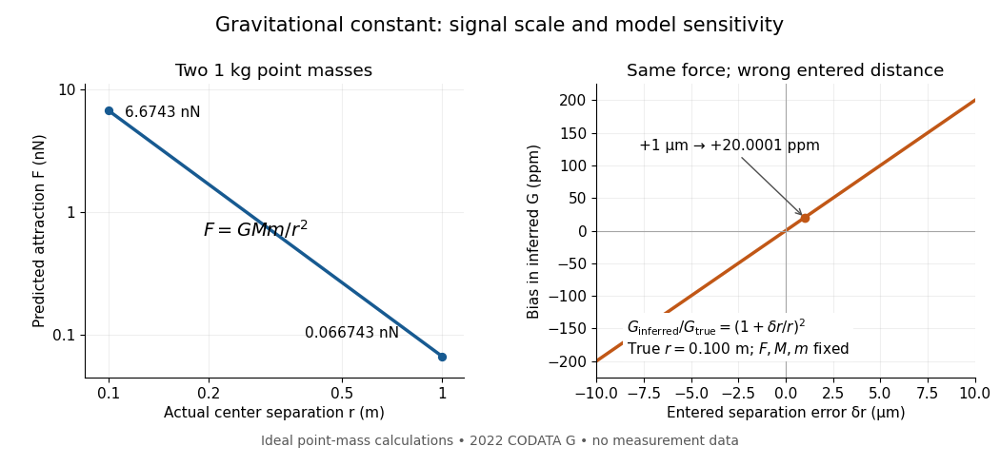

# Gravitational constant measurement sensitivity

↑ **Parent:** [Gravitational constant](gravitational-constant.md)

A laboratory determination of the [gravitational constant](gravitational-constant.md) must connect a sensor's reading to a gravitational signal from independently characterized [masses](mass.md). For an ideal two-[point mass](point-mass.md) [force](force-split.md) measurement, invert the model:

$$
G_{\mathrm{inferred}}=\frac{Fr^2}{Mm},\qquad \frac{\delta G}{G}\simeq\frac{\delta F}{F}+2\frac{\delta r}{r}-\frac{\delta M}{M}-\frac{\delta m}{m}.
$$

These are signed small changes obtained by taking the [logarithmic derivative](logarithmic-derivative.md), not an instruction to add [standard uncertainties](standard-uncertainty.md) with signs. For independent small input uncertainties, linear [propagation of uncertainty](propagation-of-uncertainty.md) instead gives

$$
\left(\frac{u(G)}G\right)^2\simeq\left(\frac{u(F)}F\right)^2+4\left(\frac{u(r)}r\right)^2+\left(\frac{u(M)}M\right)^2+\left(\frac{u(m)}m\right)^2.
$$

Correlated inputs require their [covariances](covariance.md) too. In particular, common geometric calibration errors must not be treated as independent simply because several distances were recorded.

For a concrete model check, hold the actual [force](force-split.md) and [masses](mass.md) fixed but overestimate a true $r=0.100\,\mathrm m$ by $1\,\mathrm{\mu m}$. The exact inferred ratio is

$$
\frac{G_{\mathrm{inferred}}}{G_{\mathrm{true}}}=(1+10^{-5})^2=1.0000200001.
$$

The resulting bias is $20.0001$ parts per million, already comparable with the relative [standard uncertainty](standard-uncertainty.md) of the recommended [gravitational constant](gravitational-constant.md). A sensor can resolve very small changes while its inferred answer remains limited by source geometry. The example concerns one idealized separation; it is not an uncertainty estimate for any actual experiment.

**[Figure 5](#image-weak-laboratory-attraction-and-the-geometric-sensitivity-of-an-inferred-gravitational-constant). Weak laboratory attraction and the geometric sensitivity of an inferred gravitational constant**. Left: ideal [force](force-split.md) between two stipulated $1\,\mathrm{kg}$ [point masses](point-mass.md) using the 2022 recommended [gravitational constant](gravitational-constant.md). Right: exact model bias when only the separation entered in the inference changes. These curves are calculations, not measurement data.

Making the source [mass](mass.md) larger or bringing it closer strengthens the signal, but also makes detailed [mass density](density.md) and geometry important. Nearby apparatus supplies its own [Newtonian gravitational field](newtonian-gravitational-field.md); electromagnetic shielding does not remove that attraction. Sensor offsets, changing [temperature](temperature-split.md), vibration and source motion can imitate or alter a signal. The [Cavendish experiment](cavendish-experiment.md) illustrates calibration of a [torsion constant](torsion-constant.md); a different sensor requires its own calibrated response and a full source model.

Repeating readings can reduce independent [measurement noise](measurement-noise.md), but a fixed scale error survives averaging. A useful experiment deliberately changes the source configuration, checks whether the signal follows the predicted change, and characterizes what moves with the source. A [systematic error](systematic-error.md) that changes with that configuration also survives background subtraction. Comparing methods with different sensors and different dominant errors is therefore valuable.

## ↑ Ancestors (7)

1. [Gravitational constant](gravitational-constant.md)
2. [Newtonian gravitational field](newtonian-gravitational-field.md)
3. [Newton's law of universal gravitation](newton-s-law-of-universal-gravitation-split.md)
4. [Classical mechanics](classical-mechanics-split.md)
5. [Branches of physics](branches-of-physics.md)
6. [Physics](physics-split.md)
7. [Codex Wiki](split.md)
