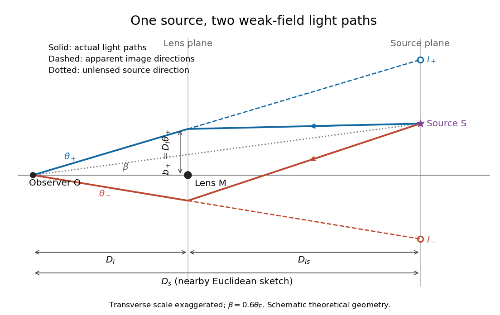
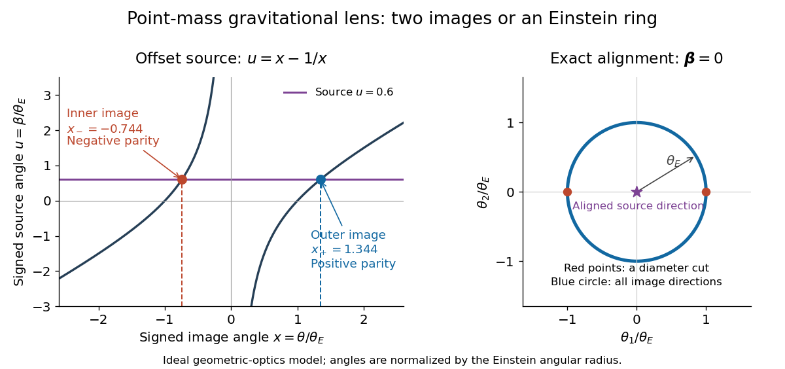

# Gravitational lensing

↑ **Parent:** [General relativity](general-relativity.md)  
ⓦ [Wiki](https://en.wikipedia.org/wiki/Gravitational_lensing)

Gravitational lensing is the deflection and focusing of light by spacetime curvature along the line of sight.

A useful first model is a [point-mass gravitational lens](#point-mass-gravitational-lens): one displaced source gives [two images of a point-mass lens](#two-images-of-a-point-mass-lens), while exact alignment gives an [Einstein ring](#einstein-ring). The [Einstein angular radius](#einstein-angular-radius) sets the angular scale, and [image parity in gravitational lensing](#image-parity-in-gravitational-lensing) explains why the two images have different handedness. The [spectroscopic test of the Twin Quasar lens](#spectroscopic-test-of-the-twin-quasar-lens) shows how [optical spectra](optics.md#optical-spectrum) can test whether two apparent [quasars](astrophysical-black-hole.md#quasar) represent one source.

**Table of contents**

- [Gravitational lensing by a galaxy cluster](#gravitational-lensing-by-a-galaxy-cluster)
- [Thin-lens approximation for gravitational lensing](#thin-lens-approximation-for-gravitational-lensing)
- [Bullet Cluster dark-matter separation](#bullet-cluster-dark-matter-separation)
- [Surface-brightness conservation in gravitational lensing](#surface-brightness-conservation-in-gravitational-lensing)
- [Mass-sheet degeneracy](#mass-sheet-degeneracy)
- [Gravitational lens](#gravitational-lens)
- [Lensing magnification](#lensing-magnification)
  - [Image parity in gravitational lensing](#image-parity-in-gravitational-lensing)
- [Thin gravitational lens equation](#thin-gravitational-lens-equation)
  - [Point-mass gravitational lens](#point-mass-gravitational-lens)
    - [Two images of a point-mass lens](#two-images-of-a-point-mass-lens)
    - [Point-mass lens deflection and focusing](#point-mass-lens-deflection-and-focusing)
  - [Softened isothermal lensing potential](#softened-isothermal-lensing-potential)
    - [Multiple-image caustic of a softened isothermal lensing potential](#multiple-image-caustic-of-a-softened-isothermal-lensing-potential)
- [Einstein radius](#einstein-radius)
  - [Einstein angular radius](#einstein-angular-radius)
- [Weak gravitational lensing](#weak-gravitational-lensing)
  - [Intrinsic galaxy alignment](#intrinsic-galaxy-alignment)
  - [Cosmic shear](#cosmic-shear)
  - [Lensing shear](#lensing-shear)
    - [Reduced shear](#reduced-shear)
    - [Reduced gravitational shear](#reduced-gravitational-shear)
  - [Lensing convergence](#lensing-convergence)
    - [Critical surface density for gravitational lensing](#critical-surface-density-for-gravitational-lensing)
  - [Angular deflection kernel for cosmological lensing](#angular-deflection-kernel-for-cosmological-lensing)
- [Born approximation in cosmological lensing](#born-approximation-in-cosmological-lensing)
- [Strong gravitational lensing](#strong-gravitational-lensing)
  - [Gravitational-lensing time delay](#gravitational-lensing-time-delay)
    - [Time-delay distance](#time-delay-distance)
  - [Spectroscopic test of the Twin Quasar lens](#spectroscopic-test-of-the-twin-quasar-lens)
  - [Gravitational-lensing critical curve](#gravitational-lensing-critical-curve)
    - [Radial critical curve of an axisymmetric lens](#radial-critical-curve-of-an-axisymmetric-lens)
    - [Tangential critical curve of an axisymmetric lens](#tangential-critical-curve-of-an-axisymmetric-lens)
    - [Gravitational-lensing caustic](#gravitational-lensing-caustic)
  - [Einstein ring](#einstein-ring)
- [Gravitational microlensing](#gravitational-microlensing)
  - [Microlensing optical depth](#microlensing-optical-depth)

## Gravitational lensing by a galaxy cluster

↑ **Parent:** [Gravitational lensing](gravitational-lensing.md)

The projected gravitational field of a [galaxy cluster](large-scale-structure-of-the-universe.md#galaxy-cluster) bends light from background sources, producing strong-lensing arcs and multiple images near critical curves, and weak coherent shape distortions farther out. Joint analysis probes total projected [mass](classical-mechanics.md#mass) rather than just luminous matter. Source [distances](geometry-and-topology.md#distance), shape calibration, line-of-sight structure and degeneracies in the [mass](classical-mechanics.md#mass) model limit inference; lensing alone does not identify a dark-matter particle.

## Thin-lens approximation for gravitational lensing

↑ **Parent:** [Gravitational lensing](gravitational-lensing.md)

The [gravitational lensing](gravitational-lensing.md) approximation in which deflection is concentrated in a plane whose thickness is small relative to the relevant observer-lens-source distances. The reduced angular deflection includes the distance ratio. A projected [surface mass density](fluid-mechanics.md#projected-surface-mass-density) then determines the lensing potential and the image-to-source mapping. This is distinct from a refracting thin optical lens.

## Bullet Cluster dark-matter separation

↑ **Parent:** [Gravitational lensing](gravitational-lensing.md)

The merger separates X-ray-emitting collisional gas from galaxies and lensing [mass](classical-mechanics.md#mass) concentrations. Comparing those observables provides evidence for a dominant less-collisional unseen gravitating component, without identifying its particle species.

## Surface-brightness conservation in gravitational lensing

↑ **Parent:** [Gravitational lensing](gravitational-lensing.md)

In [geometric optics](geometrical-optics.md) without absorption, phase-space conservation preserves $I_\nu/\nu^3$ along a ray. Relative images of the same source at a common [redshift](optics.md#redshift) therefore preserve [surface brightness](astrophysics.md#surface-brightness) while changing apparent angular area and integrated flux. Source structure and propagation effects can introduce observed wavelength dependence.

## Mass-sheet degeneracy

↑ **Parent:** [Gravitational lensing](gravitational-lensing.md)

For a single source plane, adding a uniform sheet and rescaling the original projected lens mass as shown leaves the reduced shear $g=\gamma/(1-\kappa)$ unchanged. Rescaling source coordinates by $\lambda$ also preserves the image positions and shapes. Thus image geometry alone need not determine absolute lens mass normalization. Absolute magnification, independently known source sizes, time-delay information with a fixed distance scale, or additional geometric/dynamical constraints can break or restrict this [mass-sheet degeneracy](#mass-sheet-degeneracy).

## Gravitational lens

↑ **Parent:** [Gravitational lensing](gravitational-lensing.md)  
ⓦ [Wiki](https://en.wikipedia.org/wiki/Gravitational_lens)

A gravitational lens is a foreground distribution of matter whose gravitational field deflects light from a background source. Its [projected surface mass density](fluid-mechanics.md#projected-surface-mass-density) determines the mapping in the thin-lens approximation. The lens is the deflecting object; [gravitational lensing](gravitational-lensing.md) is the resulting optical process.

## Lensing magnification

↑ **Parent:** [Gravitational lensing](gravitational-lensing.md)

The signed magnification is the reciprocal determinant of the [Jacobian matrix](multivariable-calculus.md#jacobian-matrix) of the [thin gravitational lens equation](#thin-gravitational-lens-equation). Its absolute value gives the flux and solid-angle amplification; its sign gives image parity. [Gravitational lensing](gravitational-lensing.md) preserves [surface brightness](astrophysics.md#surface-brightness) in the geometric-optics approximation.

### Image parity in gravitational lensing

↑ **Parent:** [Lensing magnification](#lensing-magnification)

[Image parity in gravitational lensing](#image-parity-in-gravitational-lensing) is the sign of the [determinant](multilinear-algebra.md#determinant) of the source-from-image [Jacobian matrix](multivariable-calculus.md#jacobian-matrix) $A=\partial\boldsymbol\beta/\partial\boldsymbol\theta$. A positive sign preserves the local handedness of a small source pattern; a negative sign reverses it. Negative signed [lensing magnification](#lensing-magnification) therefore means a reflected orientation, not negative received light. This is a two-dimensional property: the [derivative](calculus.md#derivative) of a signed radial equation alone does not determine it.

For a [point-mass gravitational lens](#point-mass-gravitational-lens), differentiate $\boldsymbol\beta=(1-\theta_E^2/r^2)\boldsymbol\theta$, where $r=|\boldsymbol\theta|$. The radial and tangential [eigenvalues](linear-operator-theory.md#eigenvalue) of $A$ are

$$
\lambda_r=1+\frac{\theta_E^2}{r^2},\qquad\lambda_t=1-\frac{\theta_E^2}{r^2},\qquad\det A=1-\frac{\theta_E^4}{r^4}.
$$

Consequently the outer member of the [two images of a point-mass lens](#two-images-of-a-point-mass-lens) has positive [image parity in gravitational lensing](#image-parity-in-gravitational-lensing); the inner member has negative [image parity in gravitational lensing](#image-parity-in-gravitational-lensing). At $r=\theta_E$ the tangential [eigenvalue](linear-operator-theory.md#eigenvalue) vanishes: this is the [tangential critical curve of an axisymmetric lens](#tangential-critical-curve-of-an-axisymmetric-lens), and its [gravitational-lensing caustic](#gravitational-lensing-caustic) is the aligned source point. The signed [lensing magnification](#lensing-magnification) is $\mu=1/\det A$, but measured total light uses $|\mu_+|+|\mu_-|$.

## Thin gravitational lens equation

↑ **Parent:** [Gravitational lensing](gravitational-lensing.md)

A thin lens maps apparent image angle $\boldsymbol\theta$ to unlensed source angle $\boldsymbol\beta$. In the usual outward reduced-deflection convention, $\boldsymbol\alpha=\nabla_\theta\psi$ for a projected lensing potential. For an axisymmetric lens its magnitude is $4GM_{\rm projected}(<D_d\theta)D_{ds}/(c^2D_dD_s\theta)$. The mass here is projected inside a cylinder, not the three-dimensional mass inside a sphere.

### Point-mass gravitational lens

↑ **Parent:** [Thin gravitational lens equation](#thin-gravitational-lens-equation)

A [point-mass gravitational lens](#point-mass-gravitational-lens) is the ideal [gravitational lens](#gravitational-lens) obtained by concentrating a positive [mass](classical-mechanics.md#mass) $M$ at one location. Use [geometrical optics](geometrical-optics.md), the [weak-field approximation](linearized-gravity.md#weak-field-approximation), small angles in [radians](geometry-and-topology.md#radian), and a stationary lens whose deflecting region is short compared with the observer-lens and lens-source distances. At [impact parameter](classical-mechanics.md#impact-parameter) $b$, require $b\gg r_s=2GM/c^2$, the [Schwarzschild radius](schwarzschild-spacetime.md#schwarzschild-radius), and a ray passing outside any opaque body. The physical bend has magnitude $\widehat\alpha=4GM/(c^2b)$ from [Schwarzschild light deflection](schwarzschild-spacetime.md#schwarzschild-light-deflection); $G$ is the [gravitational constant](newton-s-law-of-universal-gravitation.md#gravitational-constant) and $c$ the [speed of light](special-relativity.md#speed-of-light). Multiple images can occur within this [weak-field approximation](linearized-gravity.md#weak-field-approximation): [strong gravitational lensing](#strong-gravitational-lensing) does not require a ray to approach a [black hole](black-hole.md) closely.[Section 1.2, printed p. 2: geometrical optics, weak fields and slowly moving lenses; compact-object near-field propagation excluded](physics-bibliography.md#gravitational-lensing-by-matthias-bartelmann)

Let $D_l$, $D_s$ and $D_{ls}$ be [angular diameter distances](cosmology.md#angular-diameter-distance) from observer to lens, observer to source, and lens to source, respectively. They refer to the background geometry used in the [thin gravitational lens equation](#thin-gravitational-lens-equation). In nearby [Euclidean geometry](euclidean-geometry.md), $D_{ls}=D_s-D_l$; in [cosmology](cosmology.md), do not make that subtraction. The angular source coordinate $\boldsymbol\beta$ is the direction the source would have without this lens; the observed image coordinate is $\boldsymbol\theta$. Both are measured relative to the observer-lens [optical axis](geometrical-optics.md#optical-axis).[Section 2.1.3, pp. 8-9, equations (13)-(15), including the warning that lens-source angular diameter distance is not the difference of the observer distances](physics-bibliography.md#lectures-on-gravitational-lensing-by-ramesh-narayan-and-matthias-bartelmann)

For the flat sketch below, extend the observer-side [light ray](geometrical-optics.md#light-ray) backwards to the source plane. Its transverse position would be $D_s\boldsymbol\theta$, whereas the actual source is at $D_s\boldsymbol\beta$. Their separation is $D_{ls}\widehat{\boldsymbol\alpha}$. Here $\widehat{\boldsymbol\alpha}$ is defined outward along the lens-plane impact vector, as in the [thin gravitational lens equation](#thin-gravitational-lens-equation); the physical ray bends toward the [mass](classical-mechanics.md#mass). Substituting $\boldsymbol b=D_l\boldsymbol\theta$ gives

$$
\boldsymbol\beta=\boldsymbol\theta-\frac{D_{ls}}{D_s}\widehat{\boldsymbol\alpha},\qquad
\widehat{\boldsymbol\alpha}=\frac{4GM}{c^2D_l}\frac{\boldsymbol\theta}{|\boldsymbol\theta|^2},\qquad
\theta_E^2=\frac{4GM}{c^2}\frac{D_{ls}}{D_lD_s}.
$$

The same [thin gravitational lens equation](#thin-gravitational-lens-equation) uses [angular diameter distances](cosmology.md#angular-diameter-distance) in the cosmological setting. The factor $D_{ls}/D_s$ converts the physical bend into the reduced angular deflection; these are different angles.

**[Figure 1](#image-two-light-paths-and-their-apparent-directions-for-a-point-mass-gravitational-lens). Two light paths and their apparent directions for a point-mass gravitational lens**. Theoretical nearby Euclidean sketch, with transverse distances exaggerated. Solid paths connect the same source to the observer; dashed lines extend the observer-side rays to their apparent image positions. The dotted line marks the unlensed source direction.

#### Two images of a point-mass lens

↑ **Parent:** [Point-mass gravitational lens](#point-mass-gravitational-lens)

Choose a signed angular coordinate along the source-lens line. The [point-mass gravitational lens](#point-mass-gravitational-lens) becomes

$$
\beta=\theta-\frac{\theta_E^2}{\theta},\qquad\theta\ne0.
$$

For $\beta\ne0$, multiplication by $\theta$ gives the [quadratic equation](polynomial.md#quadratic-equation) $\theta^2-\beta\theta-\theta_E^2=0$. Its positive [discriminant](polynomial.md#discriminant) yields the two displayed roots. Their product is $\theta_+\theta_-=-\theta_E^2$, so they lie on opposite sides of the lens. With $\beta>0$, $\theta_+>\theta_E$ and $-\theta_E<\theta_-<0$: the outer image lies on the source side. For $\beta<0$, the outer image is instead the minus root. These are image directions seen by the observer, not two emitting objects.[Section 2.2, printed pp. 15-16, equations (100)-(110): point-mass model, two roots, critical circle and magnification](physics-bibliography.md#gravitational-lensing-by-matthias-bartelmann)

For a dimensionless example, set $u=\beta/\theta_E=0.6$ and $x=\theta/\theta_E$. Solving $u=x-1/x$ gives $x_+\simeq1.344$ and $x_-\simeq-0.744$, with separation $\sqrt{u^2+4}\simeq2.088$. The [lensing magnification](#lensing-magnification) follows from [image parity in gravitational lensing](#image-parity-in-gravitational-lensing): $\mu_+\simeq1.442$, $\mu_-\simeq-0.442$, and total amplification $\simeq1.884$. Changing $M$ or the distances rescales the angles through the [Einstein angular radius](#einstein-angular-radius), while these dimensionless values remain the same.

For $u\gg1$, the [quadratic equation](polynomial.md#quadratic-equation) gives $x_+\simeq u+1/u$ and $x_-\simeq-1/u$. Using $\mu=1/(1-x^{-4})$, the outer image tends to unit [lensing magnification](#lensing-magnification) and the inner image has $|\mu_-|\simeq u^{-4}$. Two mathematical images can therefore look like one at finite sensitivity or [angular resolution](astrophysics.md#angular-resolution). Furthermore, the inner [impact parameter](classical-mechanics.md#impact-parameter) eventually becomes too small for the stated [weak-field approximation](linearized-gravity.md#weak-field-approximation) or passes through the opaque lens: the ideal formula must then be replaced by an appropriate physical model.

**[Figure 2](#image-signed-point-mass-image-mapping-and-the-aligned-einstein-ring). Signed point-mass image mapping and the aligned Einstein ring**. Left: the horizontal source line u=0.6 intersects the two branches of u=x-1/x at images with opposite parity. Right: exact alignment gives a full circle of image directions, rather than only the two points visible in a one-dimensional cut. This is a theoretical diagram.

#### Point-mass lens deflection and focusing

↑ **Parent:** [Point-mass gravitational lens](#point-mass-gravitational-lens)

Deflection changes one [light ray](geometrical-optics.md#light-ray)'s direction; focusing concerns relative directions of neighboring [light rays](geometrical-optics.md#light-ray) and their bundle's cross section. To see the difference for a [point-mass gravitational lens](#point-mass-gravitational-lens), send parallel incident [light rays](geometrical-optics.md#light-ray) past the lens. A ray at [impact parameter](classical-mechanics.md#impact-parameter) $b$ meets the [optical axis](geometrical-optics.md#optical-axis) approximately $f(b)=b/\widehat\alpha=c^2b^2/(4GM)$ beyond the lens. Doubling $b$ quadruples this crossing distance. Thus the lens does not have a common [focal length](geometrical-optics.md#focal-length) for all rays, although it can produce [lensing magnification](#lensing-magnification) and an [Einstein ring](#einstein-ring) for a specified source-observer geometry.

The [point-mass gravitational lens](#point-mass-gravitational-lens) also illustrates why focusing must not be identified just with positive [lensing convergence](#lensing-convergence). Away from the central [mass](classical-mechanics.md#mass), differentiate the reduced deflection $\boldsymbol\alpha=\theta_E^2\boldsymbol\theta/r^2$: its two-dimensional [divergence](multivariable-calculus.md#divergence) is zero, so $\kappa=0$ there. Nevertheless its radial and tangential [derivatives](calculus.md#derivative) differ, giving [lensing shear](#lensing-shear) of magnitude $\theta_E^2/r^2$ and $\det A=1-\theta_E^4/r^4$. A vacuum ray bundle can be distorted and magnified. In the same ideal transparent [geometrical optics](geometrical-optics.md) model, [surface brightness](astrophysics.md#surface-brightness) is preserved; the larger apparent [solid angle](euclidean-geometry.md#solid-angle) supplies the increased received light.

### Softened isothermal lensing potential

↑ **Parent:** [Thin gravitational lens equation](#thin-gravitational-lens-equation)

This circular lensing potential has reduced deflection $\alpha(r)=\theta_Er/\sqrt{r^2+\theta_c^2}$, mean [lensing convergence](#lensing-convergence) $\bar\kappa=\theta_E/\sqrt{r^2+\theta_c^2}$ and local convergence $\kappa=\theta_E(\theta_c^2+r^2/2)/(r^2+\theta_c^2)^{3/2}$. Its central convergence is finite for $\theta_c>0$. As the core shrinks to zero, the deflection tends to that of a [singular isothermal sphere lens](galaxy.md#singular-isothermal-sphere-lens). This softening of the projected lensing potential must not be confused with replacing a three-dimensional density by a different cored profile.

#### Multiple-image caustic of a softened isothermal lensing potential

↑ **Parent:** [Softened isothermal lensing potential](#softened-isothermal-lensing-potential)

For $0<\theta_c<\theta_E$, the signed circular lens mapping $\beta=\theta[1-\theta_E/\sqrt{\theta^2+\theta_c^2}]$ has radial [stationary points](calculus-of-variations.md#stationary-point) at $\theta_r^2=(\theta_E\theta_c^2)^{2/3}-\theta_c^2$. Substituting them gives the displayed caustic radius. An offset [point-like astronomical source](astrophysics.md#point-like-astronomical-source) has three images when $0<|\beta|<\beta_c$, a merging pair plus a separate outer image on the fold, and one image outside. At alignment, the two off-centre images form a ring while a central image remains. For $\theta_c\geq\theta_E$ the mapping is monotone and there is no finite multiple-image region. The zero-core singular limit loses the central image and has a different image-count exception.

## Einstein radius

↑ **Parent:** [Gravitational lensing](gravitational-lensing.md)

For a point lens of [mass](classical-mechanics.md#mass) $m$ at observer distance $D_l$ and source distance $D_s$ in a nearby Euclidean geometry, the [Einstein radius](#einstein-radius) in the lens plane is $R_E=\sqrt{4GmD_l(D_s-D_l)/(c^2D_s)}$. Its angular version is $\theta_E=R_E/D_l$. This is the ring radius for perfect alignment and the characteristic transverse scale of a [gravitational microlensing](#gravitational-microlensing) event. A crossing timescale is $t_E=R_E/v_\perp$, proportional to the square root of lens mass at fixed geometry and speed.

### Einstein angular radius

↑ **Parent:** [Einstein radius](#einstein-radius)

The [Einstein angular radius](#einstein-angular-radius) is the angular form of the [Einstein radius](#einstein-radius): $R_E=D_l\theta_E$ in the lens plane. Its displayed value applies to a [point-mass gravitational lens](#point-mass-gravitational-lens) with the [angular diameter distances](cosmology.md#angular-diameter-distance) defined above. It depends on source distance as well as lens [mass](classical-mechanics.md#mass) and position. At fixed distances, multiplying $M$ by four doubles $\theta_E$.

At exact alignment, the vector [thin gravitational lens equation](#thin-gravitational-lens-equation) is $\boldsymbol0=(1-\theta_E^2/r^2)\boldsymbol\theta$. For a nonzero image direction it requires $r=\theta_E$ and leaves the direction unrestricted: all azimuths form an [Einstein ring](#einstein-ring). The signed equation's roots $\theta=\pm\theta_E$ are only a diameter cut through that circle. A source of finite angular size makes an annulus or arcs with finite received light; the infinite point-source [lensing magnification](#lensing-magnification) at alignment is an idealization. An [Einstein ring](#einstein-ring) expresses rotational symmetry and source alignment, not a circular arrangement of emitting stars.

## Weak gravitational lensing

↑ **Parent:** [Gravitational lensing](gravitational-lensing.md)

When [gravitational lensing](gravitational-lensing.md) gives small angular distortions without generic multiple imaging, its deflection field changes source positions, magnification and shear. Angular derivatives of the lensing potential determine these distortions. Ensemble galaxy-shape distortions and [cosmic microwave background](cosmic-microwave-background.md) remapping probe the foreground gravitational field.

### Intrinsic galaxy alignment

↑ **Parent:** [Weak gravitational lensing](#weak-gravitational-lensing)

A correlation of galaxy shapes caused by their formation environment or tidal fields rather than by the gravitational lensing of their light. It can contaminate a weak-shear correlation used to infer structure growth and [dark energy](cosmology.md#dark-energy). Redshift separation, population dependence and physically motivated modelling help distinguish it from a lensing contribution.

### Cosmic shear

↑ **Parent:** [Weak gravitational lensing](#weak-gravitational-lensing)  
ⓦ [Wiki](https://en.wikipedia.org/wiki/Cosmic_shear)

Cosmic shear is the statistically correlated [lensing shear](#lensing-shear) of distant [galaxies](galaxy.md) produced by the intervening large-scale matter distribution. Correlations across angle and source redshift constrain clustering, the growth of structure and distance geometry, thereby testing dark matter and dark energy. Intrinsic galaxy alignments and measurement errors must be separated from the lensing signal.

### Lensing shear

↑ **Parent:** [Weak gravitational lensing](#weak-gravitational-lensing)

The trace-free part of the angular lensing-potential Hessian stretches an image anisotropically. The source-image [Jacobian matrix](multivariable-calculus.md#jacobian-matrix) has eigenvalues $1-\kappa\pm|\gamma|$. Thus a circular source becomes an ellipse in the local linear approximation; the orientation follows the shear axes.

#### Reduced shear

↑ **Parent:** [Lensing shear](#lensing-shear)

The combination of [lensing shear](#lensing-shear) and [lensing convergence](#lensing-convergence) governing the local shape distortion of background sources. Galaxy ellipticities estimate it statistically under a specified ellipticity convention and intrinsic-orientation model. It is invariant under the [mass-sheet degeneracy](#mass-sheet-degeneracy), so shape information alone does not generally fix absolute projected [mass](classical-mechanics.md#mass) normalization.

#### Reduced gravitational shear

↑ **Parent:** [Lensing shear](#lensing-shear)

The shear-to-isotropic-focusing ratio inferred from background image shapes. The mass-sheet transformation rescales numerator and denominator equally, leaving this quantity unchanged.

### Lensing convergence

↑ **Parent:** [Weak gravitational lensing](#weak-gravitational-lensing)

The trace of the angular derivative of the reduced deflection defines convergence in the standard [thin gravitational lens equation](#thin-gravitational-lens-equation) convention. It equals projected [surface mass density](fluid-mechanics.md#projected-surface-mass-density) divided by the critical surface density, $\Sigma_{\rm crit}=c^2D_s/(4\pi GD_dD_{ds})$. If deflection is instead defined as source minus image angle, the divergence relation has a minus sign.

#### Critical surface density for gravitational lensing

↑ **Parent:** [Lensing convergence](#lensing-convergence)

The geometrical projected density scale converting a thin lens [surface mass density](fluid-mechanics.md#projected-surface-mass-density) into convergence. Its value depends on the angular-diameter distances to lens and source, not only on lens matter.

### Angular deflection kernel for cosmological lensing

↑ **Parent:** [Weak gravitational lensing](#weak-gravitational-lensing)

For a source at comoving distance $\chi_s$ in a spatially flat universe, define deflection as apparent minus unlensed source direction. The transverse [Weyl lensing potential](linear-cosmological-perturbation-theory.md#weyl-lensing-potential) gradient along the ray receives the distance weight $(\chi_s-\chi)/\chi_s$. Integrating the transverse photon acceleration twice and dividing the source displacement by $\chi_s$ gives the formula. Reversing the definition of the deflection reverses its sign. Its angular lensing potential is $2\int_0^{\chi_s}(\chi_s-\chi)\Psi/(\chi_s\chi)\,d\chi$.

## Born approximation in cosmological lensing

↑ **Parent:** [Gravitational lensing](gravitational-lensing.md)

In a first-order light-deflection calculation, evaluate the [Weyl lensing potential](linear-cosmological-perturbation-theory.md#weyl-lensing-potential) and its gradients on the unperturbed [null geodesic](special-relativity.md#null-geodesic). The position correction is first order, so inserting it into an already first-order potential produces a second-order correction. This approximation omits repeated deflection and lens-lens coupling.

## Strong gravitational lensing

↑ **Parent:** [Gravitational lensing](gravitational-lensing.md)  
ⓦ [Wiki](https://en.wikipedia.org/wiki/Strong_gravitational_lensing)

Strong gravitational lensing produces multiple resolved images, arcs, or rings when a sufficiently massive foreground lens lies close to the source's line of sight.

### Gravitational-lensing time delay

↑ **Parent:** [Strong gravitational lensing](#strong-gravitational-lensing)

For a thin lens, relative arrival times follow the difference of $\tfrac12|\theta-\beta|^2-\psi(\theta)$ between images, multiplied by $(1+z_l)D_lD_s/(cD_{ls})$. Both geometry and [gravitational potential](newton-s-law-of-universal-gravitation.md#newtonian-potential-of-a-point-mass) contribute; an additive delay common to all images is unobservable.

#### Time-delay distance

↑ **Parent:** [Gravitational-lensing time delay](#gravitational-lensing-time-delay)

The distance combination $D_{\Delta t}=(1+z_l)D_lD_s/D_{ls}$ converts a dimensionless thin-lens delay difference into an observed time delay. Inference from a variable lensed source also requires a mass model and control of external convergence.

### Spectroscopic test of the Twin Quasar lens

↑ **Parent:** [Strong gravitational lensing](#strong-gravitational-lensing)

The two resolved [quasar](astrophysical-black-hole.md#quasar) images of 0957+561 provide an observational question: are they separate sources, or different light paths from one source? In May 1979, [spectrophotometry](optical-instrument.md#spectrophotometry) used the McDonald Observatory 2.7 m [reflecting telescope](optical-instrument.md#reflecting-telescope), the UVITS [spectrograph](optical-instrument.md#spectrograph), and an intensified dissector scanner at the f/9 focus of the [Cassegrain reflector](optical-instrument.md#cassegrain-reflector). A 600-groove-per-millimetre [diffraction grating](physical-optics.md#diffraction-grating) produced 4100-7100 [ångström](physics.md#angstrom) scans sampled every 2 [ångströms](physics.md#angstrom), with about 7 [ångström](physics.md#angstrom) resolution over most of that range. Two [spectrograph slits](optical-instrument.md#optical-slit), about 52 arcseconds apart, recorded object and [sky background](astrophysics.md#sky-brightness) simultaneously for subtraction. Interleaving observations of the two images reduced instrumental and atmospheric gain changes.[Section II, printed p. 2: instrument, grating, sampling, resolution, two apertures, sky subtraction and interleaving](physics-bibliography.md#spectrophotometry-of-the-double-qso-0957-plus-561-by-beverley-j-wills-and-d-wills)

The readout was received light versus [wavelength](wave-equation.md#wavelength) for each image. Closely matching [absorption line](stellar-astrophysics.md#absorption-line) [redshifts](optics.md#redshift) supported a common source and absorber; differences in continua and line strengths motivated differential [interstellar extinction](galaxy.md#interstellar-extinction). Spectral agreement supplied evidence for [gravitational lensing](gravitational-lensing.md), rather than proving the [point-mass gravitational lens](#point-mass-gravitational-lens) model. The authors discussed a physical double and discrepant optical and radio light ratios. Their note added in proof attributed the redder spectrum to foreground [galaxy](galaxy.md) contamination and emphasized an extended [mass](classical-mechanics.md#mass) distribution.[Abstract, printed p. 1; section III, pp. 4-5; section IV, pp. 6-7; note added in proof, p. 7, and Figure 3, p. 8: spectral agreement, model limitations and updated galaxy-contamination interpretation](physics-bibliography.md#spectrophotometry-of-the-double-qso-0957-plus-561-by-beverley-j-wills-and-d-wills)

### Gravitational-lensing critical curve

↑ **Parent:** [Strong gravitational lensing](#strong-gravitational-lensing)

A critical curve is a locus in the image plane where the [Jacobian matrix](multivariable-calculus.md#jacobian-matrix) of the [thin gravitational lens equation](#thin-gravitational-lens-equation) becomes singular. Its formal point-source [lensing magnification](#lensing-magnification) diverges, while finite source size regularizes the measured flux. Its mapped locus in the source plane is a [gravitational-lensing caustic](#gravitational-lensing-caustic).

#### Radial critical curve of an axisymmetric lens

↑ **Parent:** [Gravitational-lensing critical curve](#gravitational-lensing-critical-curve)

The local and mean [lensing convergence](#lensing-convergence) obey $2\kappa=2\bar\kappa+r\bar\kappa'$. Hence the radial [derivative](calculus.md#derivative) of the lens mapping is $1-\alpha'(r)=1-2\kappa+\bar\kappa$. Its zeros are radial [gravitational-lensing critical curves](#gravitational-lensing-critical-curve), where radial stretching diverges and images merge on crossing the mapped [gravitational-lensing caustic](#gravitational-lensing-caustic).

#### Tangential critical curve of an axisymmetric lens

↑ **Parent:** [Gravitational-lensing critical curve](#gravitational-lensing-critical-curve)

For circular reduced deflection $\alpha(r)=r\bar\kappa(r)$, a displacement perpendicular to the radial direction is multiplied by $1-\bar\kappa$. Vanishing of this [eigenvalue](linear-operator-theory.md#eigenvalue) gives a tangential [gravitational-lensing critical curve](#gravitational-lensing-critical-curve). Its source position is $\beta=r-\alpha(r)=0$, so its caustic is the origin in the circular model. Near it, images are stretched tangentially into arcs or an [Einstein ring](#einstein-ring).

#### Gravitational-lensing caustic

↑ **Parent:** [Gravitational-lensing critical curve](#gravitational-lensing-critical-curve)

A caustic is the source-plane image of a [gravitational-lensing critical curve](#gravitational-lensing-critical-curve). Crossing a generic fold caustic creates or destroys a pair of images of opposite parity. For a circular lens, a tangential critical circle maps to an aligned-source point, while a radial critical circle can map to a finite source-plane circle. Critical curves and caustics consequently occupy different planes and must not be identified as the same angular locus.

### Einstein ring

↑ **Parent:** [Strong gravitational lensing](#strong-gravitational-lensing)  
ⓦ [Wiki](https://en.wikipedia.org/wiki/Einstein_ring)

An aligned source behind an axisymmetric [gravitational lens](#gravitational-lens) produces a circular image at an [Einstein radius](#einstein-radius). Its angular radius satisfies $\theta_E^2=4GM_{\rm projected}(<D_d\theta_E)D_{ds}/(c^2D_dD_s)$. Exact alignment gives a ring; displaced sources generally give arcs or distinct images rather than a complete ring.

## Gravitational microlensing

↑ **Parent:** [Gravitational lensing](gravitational-lensing.md)  
ⓦ [Wiki](https://en.wikipedia.org/wiki/Gravitational_microlensing)

Gravitational microlensing is lensing by compact masses whose individual image splitting is unresolved, so their motion is observed through time-dependent magnification.

### Microlensing optical depth

↑ **Parent:** [Gravitational microlensing](#gravitational-microlensing)

The [microlensing optical depth](#microlensing-optical-depth) is the probability, when small, that a source lies within one [Einstein radius](#einstein-radius) of a foreground lens. For point lenses and compact-object [mass density](fluid-mechanics.md#density) $\rho_l$ in nearby Euclidean geometry,

$$
\tau=\frac{4\pi G}{c^2}\int_0^{D_s}\rho_l(D_l)\frac{D_l(D_s-D_l)}{D_s}\,dD_l.
$$

The individual lens mass cancels because $n_l=\rho_l/m$ and $R_E^2\propto m$. Detection efficiencies and event durations still depend on individual masses and survey cadence.

## ↑ Ancestors (4)

1. [General relativity](general-relativity.md)
2. [Branches of physics](physics.md#branches-of-physics)
3. [Physics](physics.md)
4. [Codex Wiki](README.md)

## ← Incoming links (28)

- [Cluster gravitational-lensing mass estimate](large-scale-structure-of-the-universe.md#cluster-gravitational-lensing-mass-estimate)
- [Gravitational lens](#gravitational-lens)
- [Lensing magnification](#lensing-magnification)
- [Solution](past-exam-of-the-frontiers-of-observational-astrophysics-course-of-the-university-of-cambridge/2016/paper-1.md#2/d/solution)
- [Solution](past-exam-of-the-mathematics-course-of-the-university-of-cambridge/2001/iii/paper-41.md#4/ii/solution)
- [Solution](past-exam-of-the-mathematics-course-of-the-university-of-cambridge/2003/iii/paper-66.md#1/e/solution)
- [Solution](past-exam-of-the-mathematics-course-of-the-university-of-cambridge/2003/iii/paper-66.md#4/a/iii/solution)
- [Solution](past-exam-of-the-mathematics-course-of-the-university-of-cambridge/2006/iii/paper-72.md#3/iii/solution)
- [Solution](past-exam-of-the-mathematics-course-of-the-university-of-cambridge/2006/iii/paper-72.md#4/ii/b/solution)
- [Solution](past-exam-of-the-mathematics-course-of-the-university-of-cambridge/2007/iii/paper-67.md#4/iii/solution)
- [Solution](past-exam-of-the-mathematics-course-of-the-university-of-cambridge/2007/iii/paper-67.md#4/iv/solution)
- [Solution](past-exam-of-the-mathematics-course-of-the-university-of-cambridge/2010/ii/paper-4.md#36b/solution)
- [Solution](past-exam-of-the-mathematics-course-of-the-university-of-cambridge/2010/iii/paper-52.md#1/c/solution)
- [Solution](past-exam-of-the-mathematics-course-of-the-university-of-cambridge/2012/iii/paper-53.md#3/solution)
- [Solution](past-exam-of-the-mathematics-course-of-the-university-of-cambridge/2019/iii/paper-310.md#3/e/solution)
- [Solution](past-exam-of-the-particle-and-nuclear-physics-course-of-the-university-of-cambridge/2016/paper-1.md#2/c/solution)
- [Solution](past-exam-of-the-particle-astrophysics-course-of-the-university-of-cambridge/2013/paper-1.md#2/d/solution)
- [Solution](past-exam-of-the-particle-astrophysics-course-of-the-university-of-cambridge/2015/paper-1.md#3/a/solution)
- [Solution](past-exam-of-the-particle-astrophysics-course-of-the-university-of-cambridge/2016/paper-1.md#3/a/solution)
- [Solution](past-exam-of-the-relativistic-astrophysics-and-cosmology-course-of-the-university-of-cambridge/2014/paper-1.md#3/b/solution)
- [Solution](past-exam-of-the-relativistic-astrophysics-and-cosmology-course-of-the-university-of-cambridge/2015/paper-1.md#3/d/solution)
- [Solution](past-exam-of-the-relativistic-astrophysics-and-cosmology-course-of-the-university-of-cambridge/2016/paper-1.md#3/b/solution)
- [Solution](past-exam-of-the-relativity-course-of-the-university-of-cambridge/2013/paper-1.md#4/solution)
- [Point-like astronomical source](astrophysics.md#point-like-astronomical-source)
- [Spectroscopic test of the Twin Quasar lens](#spectroscopic-test-of-the-twin-quasar-lens)
- [Thin-lens approximation for gravitational lensing](#thin-lens-approximation-for-gravitational-lensing)
- [Weak gravitational lensing](#weak-gravitational-lensing)
- [Weyl lensing potential](linear-cosmological-perturbation-theory.md#weyl-lensing-potential)
