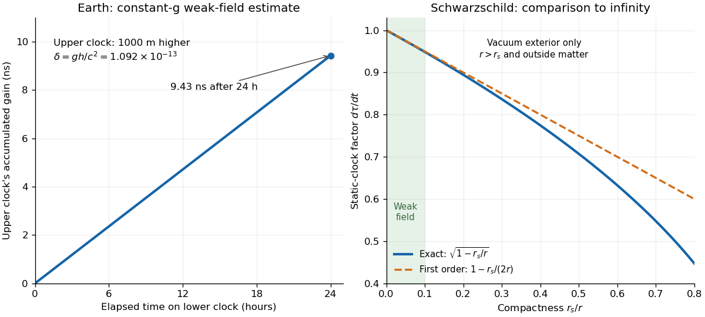

# Gravitational time dilation

↑ **Parent:** [Gravitational redshift](gravitational-redshift.md)  
ⓦ [Wiki](https://en.wikipedia.org/wiki/Gravitational_time_dilation)

In a static [spacetime](spacetime.md), a clock held at a fixed position records [proper time](proper-time.md) $d\tau=N\,dt$ for metric time component $-N^2c^2dt^2$. Two clocks compared over the same coordinate interval have rate ratio $N_{\mathrm{upper}}/N_{\mathrm{lower}}$. Each clock ticks normally in its own laboratory; the difference appears when their readings or transmitted frequencies are compared. For a weak [Newtonian gravitational potential](newtonian-gravitational-potential.md), $N\simeq1+\Phi/c^2$, so the fractional excess of the upper rate is $\delta\simeq(\Phi_{\mathrm{upper}}-\Phi_{\mathrm{lower}})/c^2$.

Take two clocks maintained at rest above [Earth](earth.md), separated vertically by $h=1000\,\mathrm m$. Approximate the local [gravitational acceleration](gravitational-acceleration.md) as constant, $g=9.81\,\mathrm{m\,s^{-2}}$, neglect rotation, and use the exact [speed of light](speed-of-light.md) $c=299792458\,\mathrm{m\,s^{-1}}$ from [NIST's constants database](https://physics.nist.gov/cgi-bin/cuu/Value?c). Then $\Delta\Phi\simeq gh=9810\,\mathrm{m^2\,s^{-2}}$ and

$$
\delta\simeq\frac{gh}{c^2}=1.09151\times10^{-13},\qquad
\Delta\tau\simeq\delta(86400\,\mathrm s)=9.43064\times10^{-9}\,\mathrm s.
$$

The upper clock gains about $9.4$ nanoseconds during one $86400$-second interval on the lower clock. This is a leading weak-field estimate with $h\ll R_\oplus$, not a precision prediction for a particular mountain: [Earth](earth.md)'s rotation and actual [gravitational potential](newtonian-potential-of-a-point-mass.md) matter in accurate comparisons. The effect is experimentally accessible. Chou, Hume, Rosenband and Wineland raised an optical clock by $0.33\,\mathrm m$ and measured a fractional rate change $(4.1\pm1.6)\times10^{-17}$; the same formula with $g=9.80\,\mathrm{m\,s^{-2}}$ predicts $3.60\times10^{-17}$. See their [2010 paper, Optical Clocks and Relativity, equation (2) and figure 3](https://tsapps.nist.gov/publication/get_pdf.cfm?pub_id=905055). Such comparisons make clocks probes of [gravitational potential](newtonian-potential-of-a-point-mass.md) as well as instruments for timekeeping.

For the ideal spherical, nonrotating [Schwarzschild spacetime](schwarzschild-spacetime.md), the exact static-clock factor relative to time at infinity is $N(r)=\sqrt{1-r_s/r}$, where $r_s=2GM/c^2$ is the [Schwarzschild radius](schwarzschild-radius.md). Its weak-field expansion is $1-r_s/(2r)$. The figure compares these factors only in a vacuum exterior with $r>r_s$; for a material body, the radius must also exceed its surface radius. It does not extend the exterior formula through the body's interior. See [Tong's lecture notes, section 6.1 on Schwarzschild exterior geometry](https://davidtong.org/pdfs/teaching/general-relativity/gr.pdf#page=240).

**[Figure 1](#image-clock-gain-at-1-km-above-earth-and-exact-versus-weak-field-schwarzschild-exterior-clock-factors). Clock gain at 1 km above Earth and exact versus weak-field Schwarzschild exterior clock factors**.

## ↑ Ancestors (5)

1. [Gravitational redshift](gravitational-redshift.md)
2. [General relativity](general-relativity-split.md)
3. [Branches of physics](branches-of-physics.md)
4. [Physics](physics-split.md)
5. [Codex Wiki](split.md)

## ← Incoming links (3)

- [General relativity](general-relativity-split.md)
- [Gravitational redshift](gravitational-redshift.md)
- [Twin paradox clock experiments](twin-paradox-clock-experiments.md)
