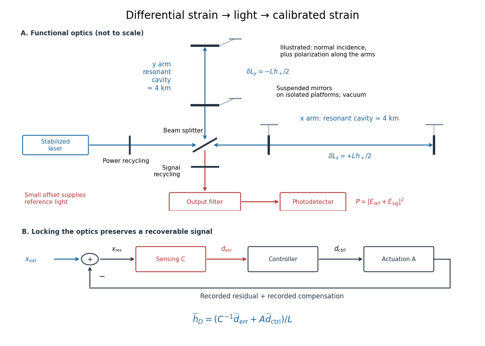
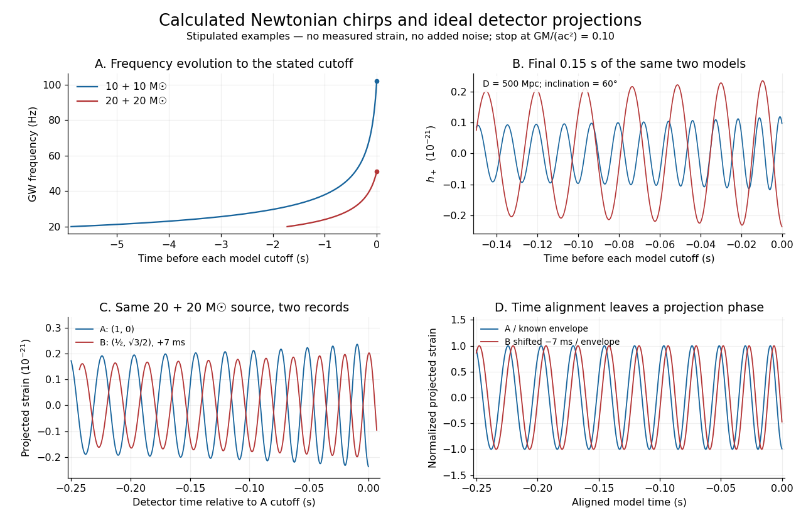

# Gravitational wave

↑ **Parent:** [General relativity](general-relativity.md)  
ⓦ [Wiki](https://en.wikipedia.org/wiki/Gravitational_wave)

A [gravitational wave](gravitational-wave.md) is a propagating disturbance of [spacetime](special-relativity.md#spacetime) [curvature](differential-geometry.md#curvature) produced by changing [mass](classical-mechanics.md#mass)-[energy](energy.md) multipole moments. In [general relativity](general-relativity.md), its two transverse [gravitational wave polarizations](linearized-gravity.md#gravitational-wave-polarization) alternately stretch and squeeze freely falling separations. The leading radiation from a slowly moving source is governed by its [mass quadrupole moment](#mass-quadrupole-moment), rather than by its total [mass](classical-mechanics.md#mass) alone.

The experimental breakthrough was [GW150914](#gw150914): observed on 14 September 2015 and published on 11 February 2016. The [LIGO Scientific Collaboration](physics.md#ligo-scientific-collaboration) and [Virgo Collaboration](physics.md#virgo-collaboration) reported a merging pair of [black holes](black-hole.md), using the two [LIGO](physics.md#ligo) detectors at Hanford and Livingston; Virgo was being upgraded and did not observe this event.[Abstract; II Observation, pp. 1–3; received and publication dates on p. 1](physics-bibliography.md#observation-of-gravitational-waves-from-a-binary-black-hole-merger-by-b-p-abbott-and-others)

The 2017 [Nobel Prize in Physics](nobel-prize-in-physics.md) recognized [Rainer Weiss](physicist.md#rainer-weiss), [Barry C. Barish](physicist.md#barry-c-barish) and [Kip S. Thorne](physicist.md#kip-s-thorne) for contributions to [LIGO](physics.md#ligo) and [gravitational wave](gravitational-wave.md) observation. [Rainer Weiss](physicist.md#rainer-weiss) developed interferometric detection and its noise analysis; [Barry C. Barish](physicist.md#barry-c-barish) led the project into construction and operation; [Kip S. Thorne](physicist.md#kip-s-thorne) developed its theoretical and astrophysical foundations. The experiment depended on a large collaboration.[3 October 2017 announcement, laureates and account of their complementary contributions](physics-bibliography.md#press-release-the-nobel-prize-in-physics-2017-by-royal-swedish-academy-of-sciences)

**Table of contents**

- [GW150914](#gw150914)
  - [LIGO differential strain measurement](#ligo-differential-strain-measurement)
    - [LIGO displacement readout and control](#ligo-displacement-readout-and-control)
  - [Coincidence and noise controls for GW150914](#coincidence-and-noise-controls-for-gw150914)
  - [Inferring a binary from a detector network](#inferring-a-binary-from-a-detector-network)
- [Newtonian binary chirp](#newtonian-binary-chirp)
  - [Chirp mass](#chirp-mass)
  - [Stipulated chirps and detector projections](#stipulated-chirps-and-detector-projections)
- [Averaged stress-energy of transverse gravitational waves](#averaged-stress-energy-of-transverse-gravitational-waves)
- [Axisymmetric radiation carries no axial angular momentum](#axisymmetric-radiation-carries-no-axial-angular-momentum)
- [Gravitational-wave frequency](#gravitational-wave-frequency)
- [Mass quadrupole moment](#mass-quadrupole-moment)
  - [Stress-energy quadrupole identity](#stress-energy-quadrupole-identity)
  - [Second mass moment tensor](#second-mass-moment-tensor)
    - [Scalar second mass moment](#scalar-second-mass-moment)
  - [Quadrupole formula](#quadrupole-formula)
    - [Far-zone quadrupole strain](#far-zone-quadrupole-strain)
      - [Quadrupole strain scaling of a weak self-gravitating source](#quadrupole-strain-scaling-of-a-weak-self-gravitating-source)
      - [Circular-binary quadrupole radiation](#circular-binary-quadrupole-radiation)
    - [Orbital compactness](#orbital-compactness)
    - [Equal-mass circular-binary quadrupole luminosity](#equal-mass-circular-binary-quadrupole-luminosity)
    - [Head-on quadrupole radiation from equal masses](#head-on-quadrupole-radiation-from-equal-masses)
    - [Quadrupole radiation from a harmonically oscillating point mass](#quadrupole-radiation-from-a-harmonically-oscillating-point-mass)
    - [Gravitational-wave energy and angular-momentum balance](#gravitational-wave-energy-and-angular-momentum-balance)
    - [Instantaneous quadrupole luminosity of a Kepler binary](#instantaneous-quadrupole-luminosity-of-a-kepler-binary)
    - [Gravitational radiation from a rotating triaxial body](#gravitational-radiation-from-a-rotating-triaxial-body)
- [Gravitational-wave energy flux](#gravitational-wave-energy-flux)
- [Newman-Penrose formalism](#newman-penrose-formalism)
  - [Complex null tetrad](#complex-null-tetrad)
  - [Newman--Penrose scalar Psi4](#newman-penrose-scalar-psi4)
- [Plane-fronted gravitational wave](#plane-fronted-gravitational-wave)
  - [Ricci tensor of a Brinkmann plane wave](#ricci-tensor-of-a-brinkmann-plane-wave)
  - [Homogeneous wavefront of a plane gravitational wave](#homogeneous-wavefront-of-a-plane-gravitational-wave)
  - [Rosen coordinates for a plane gravitational wave](#rosen-coordinates-for-a-plane-gravitational-wave)
    - [Curvature of a diagonal plane wave in Rosen coordinates](#curvature-of-a-diagonal-plane-wave-in-rosen-coordinates)
  - [Gravitational-wave pulse](#gravitational-wave-pulse)
    - [Gravitational-wave memory effect](#gravitational-wave-memory-effect)
      - [Displacement memory](#displacement-memory)
      - [Velocity memory](#velocity-memory)

## GW150914

↑ **Parent:** [Gravitational wave](gravitational-wave.md)  
ⓦ [Wiki](https://en.wikipedia.org/wiki/GW150914)

[GW150914](#gw150914) is the first directly detected [gravitational wave](gravitational-wave.md), interpreted as a [binary black hole](astrophysical-black-hole.md#binary-black-hole) inspiral, merger and ringdown. Its discovery paper reports a peak projected [gravitational wave](gravitational-wave.md) strain of approximately $10^{-21}$ and a combined [matched filter](electrical-engineering.md#matched-filter) [signal-to-noise ratio](electrical-engineering.md#signal-to-noise-ratio) of 24. The inferred source-frame component [masses](classical-mechanics.md#mass) were $36^{+5}_{-4}$ and $29^{+4}_{-4}$ [solar masses](stellar-astrophysics.md#solar-mass), with 90 percent [credible intervals](bayesian-statistics.md#credible-interval). These are model-dependent estimates from a detector network.[Abstract; II Observation; VI Source discussion, Table I](physics-bibliography.md#observation-of-gravitational-waves-from-a-binary-black-hole-merger-by-b-p-abbott-and-others)

The interesting measurement is a chain: [curvature](differential-geometry.md#curvature) changes relative light travel times, [wave interference](physical-optics.md#interference-wave-propagation) turns those changes into a [photodetector](optical-instrument.md#photodetector) signal, calibrated records from separate sites constrain a common source, and [statistical inference](statistical-inference.md) tests competing explanations. The following original models explain that chain; the plotted time series are stipulated calculations, never measured [GW150914](#gw150914) data.

### LIGO differential strain measurement

↑ **Parent:** [GW150914](#gw150914)

Each [LIGO](physics.md#ligo) instrument is a [Michelson interferometer](physical-optics.md#michelson-interferometer) with approximately $4\,\mathrm{km}$ arms containing [Fabry–Pérot interferometers](optical-instrument.md#fabry-perot-interferometer). A stabilized $1064\,\mathrm{nm}$ [laser](laser.md) illuminates suspended $40\,\mathrm{kg}$ fused-silica mirrors in [vacuum](physics.md#vacuum). Four-stage suspensions and active isolation suppress ground motion; low-loss materials reduce [thermal noise](electrical-engineering.md#thermal-noise). Power recycling increases circulating [power](energy.md#power); signal recycling shapes the response to the [gravitational wave](gravitational-wave.md).[Sections 2–2.3, Table 1; 4.4 Test mass suspensions, Fig. 8; 4.5 Seismic isolation](physics-bibliography.md#advanced-ligo-by-j-aasi-and-others)

Why measure two perpendicular arms? In the long-[wavelength](wave-equation.md#wavelength) limit, take a [gravitational wave](gravitational-wave.md) with [plus polarization](linearized-gravity.md#plus-polarization) normally incident on ideal perpendicular arms. Its [transverse-traceless tensor](linearized-gravity.md#transverse-traceless-tensor) has $h_{xx}=h_+$ and $h_{yy}=-h_+$. Expanding each proper length to first order gives

$$
\frac{\delta L_x}{L}=\frac{h_+}{2},\qquad
\frac{\delta L_y}{L}=-\frac{h_+}{2},\qquad
\Delta L=\delta L_x-\delta L_y=Lh_+.
$$

Here $h_+$ is dimensionless, whereas $\Delta L$ is a [length](physics.md#length). A stipulated $h_+=10^{-21}$ and $L=4000\,\mathrm m$ imply $\Delta L=4\times10^{-18}\,\mathrm m$, with individual arm changes of opposite sign and magnitude $2\times10^{-18}\,\mathrm m$. These are equivalent differential arm-length changes, not a photograph of mirrors moving against a rigid external ruler. The observable compares returning light phases; [coordinate systems](geometry-and-topology.md#coordinate-system) can distribute the description between mirror coordinates and light propagation.

For unit arm directions $\mathbf u,\mathbf v$, define the detector [tensor](multilinear-algebra.md#tensor) $D^{ij}=(u^iu^j-v^iv^j)/2$. If $e^+_{ij},e^\times_{ij}$ are the transverse polarization tensors, then

$$
h_D=D^{ij}h^{\rm TT}_{ij}=F_+h_++F_\times h_\times,\qquad
F_A=D^{ij}e^A_{ij}.
$$

The dimensionless factors $F_A$ encode sky direction and the polarization basis. Thus even identical sources can have different observed [amplitudes](wave.md#wave-amplitude) and [wave phases](wave.md#phase-waves). Motion changing both arms equally cancels in this ideal differential observable, although real asymmetries can couple common disturbances into it.

Suspension supplies an inertial reference above its resonances. For example, a single ideal [harmonic oscillator](classical-mechanics.md#simple-harmonic-motion) with support motion $y$ obeys $\ddot x+\omega_0^2(x-y)=0$. Its response at [angular frequency](lagrangian-mechanics.md#angular-frequency) $\omega$ is $x/y=\omega_0^2/(\omega_0^2-\omega^2)$, which decreases in magnitude as $(\omega_0/\omega)^2$ well above resonance. The mirror follows slow support drift but approximately free motion in the high-frequency limit. Real multistage suspensions also require damping and alignment control; resonant frequencies are not regions of good isolation.

[Rainer Weiss](physicist.md#rainer-weiss)'s 1972 report proposed suspended masses, multiple-pass optical delay lines, and a servo holding an interference fringe. Its noise analysis separately treats photon-counting fluctuations, [laser](laser.md) frequency instability, mechanical [thermal noise](electrical-engineering.md#thermal-noise), [radiation pressure](pressure.md#radiation-pressure) and ground motion. Those delay lines should be distinguished from the resonant arm cavities of Advanced [LIGO](physics.md#ligo).[Typeset transcription of 1972 report, sections 4–5.5, Fig. 1; original scan is linked from DCC record P720002](physics-bibliography.md#electromagnetically-coupled-broadband-gravitational-antenna-by-rainer-weiss)

#### LIGO displacement readout and control

↑ **Parent:** [LIGO differential strain measurement](#ligo-differential-strain-measurement)

An ideal single-round-trip [Michelson interferometer](physical-optics.md#michelson-interferometer) converts differential [length](physics.md#length) into [phase difference](wave.md#phase-difference) $\delta\phi=4\pi\Delta L/\lambda$. If its dark-port [power](energy.md#power) scale is $P_0$ and its static phase offset is $\phi_0$, then

$$
P_{\rm out}=P_0\sin^2\!\left(\frac{\phi_0+\delta\phi}{2}\right),\qquad
\delta P=\frac{P_0}{2}\sin\phi_0\,\delta\phi+O(\delta\phi^2).
$$

Exactly at a dark fringe, $\phi_0=0$, [power](energy.md#power) is quadratic in small [displacement](classical-mechanics.md#displacement) and loses its sign. A deliberate offset supplies an optical reference field: interference with the small signal field produces a linear term. Equivalently, $|E_{\rm ref}+E_{\rm sig}|^2$ contains $2\operatorname{Re}(E_{\rm ref}^*E_{\rm sig})$. The [photodetector](optical-instrument.md#photodetector) measures [power](energy.md#power), not a signed [displacement](classical-mechanics.md#displacement) directly.

Advanced [LIGO](physics.md#ligo) uses this DC homodyne principle with a small differential arm offset and an output mode cleaner. Its [feedback control](control-theory.md#closed-loop-control) maintains optical resonance and alignment, using actuation distributed over the suspension stages.[2.3 Gravitational wave readout; 4.4.2 Quadruple pendulum design; 4.8 Interferometer sensing and control](physics-bibliography.md#advanced-ligo-by-j-aasi-and-others) The simple formula above omits resonant storage: arm and recycling cavities give a frequency-dependent optical gain and delay, so no constant pass-count multiplier describes the entire observing band.

To see why a locked detector can still measure a disturbance, use a linear [feedback control](control-theory.md#closed-loop-control) model. Let $x_{\rm ext}$ be the external differential [displacement](classical-mechanics.md#displacement), $d_{\rm err}$ the residual readout, $d_{\rm ctrl}$ the recorded control command, $C(f)$ the sensing response and $A(f)$ the actuation response. With the convention $x_{\rm res}=x_{\rm ext}-A d_{\rm ctrl}$, reconstruction gives

$$
\widetilde x_{\rm ext}=C^{-1}\widetilde d_{\rm err}+A\widetilde d_{\rm ctrl},\qquad
\widetilde h_D=\widetilde x_{\rm ext}/L.
$$

Here tildes denote [Fourier transforms](fourier-transform.md); $C$ has readout units per metre and $A$ metres per command unit. Feedback suppresses residual motion but records the compensating command. Omitting that command would suppress the reconstructed low-frequency signal too. In the actual [GW150914](#gw150914) experiment, a modulated auxiliary [laser](laser.md) exerted calibrated [radiation pressure](pressure.md#radiation-pressure) on a mirror to measure the response; periodic excitations monitored calibration.[II Control loop, equations (1)–(4); IV Photon calibrator; VII Time-dependent systematic errors](physics-bibliography.md#calibration-of-the-advanced-ligo-detectors-for-the-discovery-of-the-binary-black-hole-merger-gw150914-by-b-p-abbott-and-others)

**[Figure 1](#image-from-differential-arm-length-to-optical-power-and-reconstructed-gravitational-wave-strain). From differential arm length to optical power and reconstructed gravitational wave strain**. Original functional schematic, not a scale drawing. Upper panel: instrument components. Lower panel: ideal linear feedback reconstruction from residual error and applied control.

### Coincidence and noise controls for GW150914

↑ **Parent:** [GW150914](#gw150914)

The modeled [matched filter](electrical-engineering.md#matched-filter) search found an arrival difference of about $7\,\mathrm{ms}$, within the roughly $10\,\mathrm{ms}$ intersite light travel time. Background events were obtained by shifting one detector's timestamps far beyond that time and repeating the coincidence analysis. The binary search bounded the [false alarm rate](statistical-hypothesis-test.md#false-alarm-rate) below one event per $203\,000$ years. That is an empirically estimated background rate, not a probability that the source interpretation is false.[Abstract; I Introduction; time-shift background analysis, Fig. 5](physics-bibliography.md#gw150914-first-results-from-the-search-for-binary-black-hole-coalescence-with-advanced-ligo-by-b-p-abbott-and-others)

The logic is to destroy a common astronomical arrival while retaining each instrument's real glitches. A [Poisson distribution](discrete-probability-distribution.md#poisson-distribution) approximation would turn a background rate $r$ into $1-e^{-rT}$ for at least one equally strong noise event during live time $T$, only after accounting for the search's ranking and trials. Repeated time slides reuse data; their accumulated background duration is not an equally long series of independent new observations. Correlated disturbances also require separate controls because shifting timestamps can erase them along with a true signal.

The dedicated noise study inspected auxiliary channels and deliberately applied magnetic, acoustic and mechanical disturbances to measure their coupling into strain. For [GW150914](#gw150914), checks included environmental coincidences, instrument state, and exclusion of an intentional hardware injection. It also examined potentially correlated global magnetic disturbances, which time slides alone cannot exclude.[2 Identifying noise sources, Fig. 2; 6 Validation of GW150914; Appendix B physical environment monitors](physics-bibliography.md#characterization-of-transient-noise-in-advanced-ligo-relevant-to-gravitational-wave-signal-gw150914-by-b-p-abbott-and-others) The point of an injection test is quantitative: a quiet environmental monitor is informative only if its sensitivity and coupling bound the disturbance needed to explain the candidate.

### Inferring a binary from a detector network

↑ **Parent:** [GW150914](#gw150914)

For detector $k$, model the calibrated data as $d_k(t)=h_k(t;\theta)+n_k(t)$, with a shared source parameter vector $\theta$, separate detector responses, propagation delays and [noise](electrical-engineering.md#noise-signal-processing) $n_k$. Under an independent stationary [Gaussian process](gaussian-process.md) approximation with one-sided [power spectral density](electrical-engineering.md#power-spectral-density) $S_k(f)$, define the noise-weighted [inner product](inner-product.md) and [likelihood function](maximum-likelihood-estimation.md#likelihood-function)

$$
(a|b)_k=4\operatorname{Re}\int_{f_{\min}}^{f_{\max}}\frac{\widetilde a(f)^*\widetilde b(f)}{S_k(f)}\,df,\qquad
\log\mathcal L(\theta)=-\frac12\sum_k(d_k-h_k|d_k-h_k)_k+\mathrm{constant}.
$$

Strain [power spectral density](electrical-engineering.md#power-spectral-density) has units $\mathrm{Hz}^{-1}$; the displayed [inner product](inner-product.md) is dimensionless when the [Fourier transform](fourier-transform.md) integrates over seconds. A [matched filter](electrical-engineering.md#matched-filter) rewards agreement over the full evolving [wave phase](wave.md#phase-waves), weighting frequency bands by their noise. One conspicuous peak is insufficient: a candidate should also have the right distribution of signal across frequency bands and compatible projections in the network.

The parameter paper used coherent [Bayesian inference](bayesian-statistics.md), [numerical relativity](numerical-relativity.md)-informed inspiral–merger–ringdown models and explicit calibration uncertainties. It found a strong distance–inclination correlation; source-frame [masses](classical-mechanics.md#mass) additionally require converting the detector-frame masses by a cosmological [redshift](optics.md#redshift).[II Parameter estimation, equations (1)–(5), II.A waveform models; III Results, p. 7, Fig. 2](physics-bibliography.md#properties-of-the-binary-black-hole-merger-gw150914-by-b-p-abbott-and-others) Conceptually, multiply the [likelihood function](maximum-likelihood-estimation.md#likelihood-function) by a [prior distribution](bayesian-statistics.md#prior-probability) to obtain a [posterior distribution](bayesian-statistics.md#bayesian-posterior). Changes in waveform families, residual structure after subtraction, and checks with a generic transient reconstruction test parts of the modeling assumptions. Detection significance and parameter uncertainty answer different questions.

## Newtonian binary chirp

↑ **Parent:** [Gravitational wave](gravitational-wave.md)

A [Newtonian binary chirp](#newtonian-binary-chirp) is a leading-order model in which loss of orbital [energy](energy.md) to [gravitational radiation](gravitational-wave.md) makes an almost circular [binary system](celestial-mechanics.md#binary-system) shrink and its [gravitational-wave frequency](#gravitational-wave-frequency) rise. Here is a derivation with explicit SI units. Let the constant component [masses](classical-mechanics.md#mass) $m_1,m_2$ be in kilograms, $M=m_1+m_2$, $\mu=m_1m_2/M$, separation $a$ in metres, and orbital [angular frequency](lagrangian-mechanics.md#angular-frequency) $\Omega$ in radians per second. [Newtonian gravity](newton-s-law-of-universal-gravitation.md#gravitational-acceleration), circular motion and the [quadrupole formula](#quadrupole-formula) give

$$
\Omega^2=\frac{GM}{a^3},\qquad f=\frac{\Omega}{\pi},\qquad
E=-\frac{G\mu M}{2a},\qquad
P=\frac{32G^4\mu^2M^3}{5c^5a^5},\qquad \dot E=-P.
$$

The factor $\pi$ rather than $2\pi$ appears because the dominant [mass quadrupole moment](#mass-quadrupole-moment) repeats twice per orbit. Since $dE/da>0$, radiative [energy](energy.md) loss implies $\dot a<0$, hence

$$
\dot a=-\frac{64G^3\mu M^2}{5c^5a^3},\qquad
\dot f=Kf^{11/3},\qquad
K=\frac{96}{5}\pi^{8/3}\left(\frac{G\mathcal M}{c^3}\right)^{5/3},\qquad
\mathcal M=\mu^{3/5}M^{2/5}.
$$

The quantity $G\mathcal M/c^3$ is a time in seconds. Thus $K$ has units $\mathrm{s}^{5/3}$ and $Kf^{11/3}$ has units $\mathrm{s}^{-2}$, as required for [frequency](wave.md#frequency) change per second. This model assumes weak gravity, slow relative motion, negligible [eccentricity of a conic](euclidean-geometry.md#eccentricity-of-a-conic), no spin corrections and adiabatic evolution over an orbit. It does not describe merger or ringdown.

Separating variables gives a finite formal coalescence time $t_c$ and accumulated [wave phase](wave.md#phase-waves) $\Phi$:

$$
\tau(f)=t_c-t=\frac{3}{8K}f^{-8/3},\qquad
f(t)=\left[\frac{8K}{3}(t_c-t)\right]^{-3/8},\qquad
\Phi(f)-\Phi(f_0)=\frac{6\pi}{5K}\left(f_0^{-5/3}-f^{-5/3}\right).
$$

Indeed $d\Phi/dt=2\pi f$; the formal divergence at $t_c$ signals extrapolation outside the approximation. Over a finite frequency interval, the number of [gravitational wave](gravitational-wave.md) cycles is $N=3(f_0^{-5/3}-f_1^{-5/3})/(5K)$. This accumulated phase is why a [chirp mass](#chirp-mass) can be constrained even when distance and inclination remain entangled.

### Chirp mass

↑ **Parent:** [Newtonian binary chirp](#newtonian-binary-chirp)  
ⓦ [Wiki](https://en.wikipedia.org/wiki/Chirp_mass)

The [chirp mass](#chirp-mass) is the combination of two component [masses](classical-mechanics.md#mass) controlling the leading [Newtonian binary chirp](#newtonian-binary-chirp). Inverting its frequency equation gives

$$
\mathcal M=\frac{c^3}{G}\left[\frac{5}{96}\pi^{-8/3}f^{-11/3}\dot f\right]^{3/5}.
$$

Use $f$ in hertz and $\dot f$ in hertz per second to obtain kilograms. For equal component [masses](classical-mechanics.md#mass) $m$, $\mathcal M=m/2^{1/5}$. A stipulated $20+20$ [solar mass](stellar-astrophysics.md#solar-mass) system therefore has $\mathcal M\approx17.411$ [solar masses](stellar-astrophysics.md#solar-mass). In a cosmological observation the time and frequency measured at the detector instead yield $(1+z)\mathcal M_{\rm source}$, where $z$ is [redshift](optics.md#redshift); phase evolution alone does not independently determine the source [mass](classical-mechanics.md#mass) and [redshift](optics.md#redshift).

### Stipulated chirps and detector projections

↑ **Parent:** [Newtonian binary chirp](#newtonian-binary-chirp)

To construct an original example rather than imitate [GW150914](#gw150914), set $G=6.67430\times10^{-11}\,\mathrm{m^3\,kg^{-1}\,s^{-2}}$, $c=299\,792\,458\,\mathrm{m\,s^{-1}}$, and adopt the rounded [solar mass](stellar-astrophysics.md#solar-mass) $M_\odot=1.98847\times10^{30}\,\mathrm{kg}$. Compare $10+10$ and $20+20$ [solar mass](stellar-astrophysics.md#solar-mass) binaries starting at $20\,\mathrm{Hz}$. Stop each at the stipulated [orbital compactness](#orbital-compactness) threshold

$$
x=\frac{GM}{ac^2}=\left(\frac{\pi GMf}{c^3}\right)^{2/3}=0.10,\qquad
f_{\rm cut}=\frac{c^3}{\pi GM}(0.10)^{3/2}.
$$

This is a conservative pedagogical stopping rule, not a claimed error bound: the relative speed already reaches $\sqrt{0.10}\,c$. Higher-order corrections accumulate [wave phase](wave.md#phase-waves) well before merger, and precision inference requires better models. The two cutoffs are approximately $102.2$ and $51.1\,\mathrm{Hz}$ respectively; doubling the [chirp mass](#chirp-mass) multiplies $\dot f$ at fixed $f$ by $2^{5/3}$.

For a nearby stipulated source at distance $D$, neglect [redshift](optics.md#redshift) and define inclination $\iota$ as the angle between the orbital [angular momentum](momentum.md#angular-momentum) and the line of sight. The leading [quadrupole formula](#quadrupole-formula) yields

$$
A(f)=\frac{4(G\mathcal M)^{5/3}(\pi f)^{2/3}}{c^4D},\qquad
h_+=A(f)\frac{1+\cos^2\iota}{2}\cos\Phi,\qquad
h_\times=A(f)\cos\iota\sin\Phi.
$$

The numerator of $A$ has units $\mathrm{m^5\,s^{-4}}$, matching $c^4D$, so both polarizations are dimensionless. Its $f^{2/3}$ growth and the rising [frequency](wave.md#frequency) produce the tightening, strengthening oscillations. For face-on viewing the polarization components have equal magnitudes in [phase quadrature](wave.md#phase-quadrature); for edge-on viewing the cross component vanishes, agreeing with [circular-binary quadrupole radiation](#circular-binary-quadrupole-radiation).

**[Figure 2](#image-stipulated-newtonian-binary-chirps-and-two-ideal-detector-projections). Stipulated Newtonian binary chirps and two ideal detector projections**. Calculated examples only: no measured [LIGO](physics.md#ligo) strain or noise. Upper panels compare equal-mass binaries up to $x=0.10$. Lower panels use $20+20$ [solar masses](stellar-astrophysics.md#solar-mass), $D=500\,\mathrm{Mpc}$ and $\iota=60$ degrees. Ideal overhead detectors have $(F_+,F_\times)=(1,0)$ and $(1/2,\sqrt3/2)$; the second record has a stipulated $7\,\mathrm{ms}$ delay, then is shifted back for comparison. These geometries and delay are not fitted Hanford–Livingston responses.

Shifting an arrival time aligns the chirp evolution, but different polarization projections need not overlay after only a sign flip. The last panel divides the ideal projected records by their known envelope factors to expose this phase difference. A physical source model must jointly explain those differences, not erase them by arbitrary rescaling. Independent integration of the separation equation, the radiated [power](energy.md#power) and $d\Phi/dt=2\pi f$ checks the analytic chirp against orbital [energy](energy.md) balance over the entire stipulated interval.

## Averaged stress-energy of transverse gravitational waves

↑ **Parent:** [Gravitational wave](gravitational-wave.md)

In the weak-field, short-wavelength averaging regime, a [transverse-traceless tensor](linearized-gravity.md#transverse-traceless-tensor) strain $H_{ij}$ carries the displayed effective [stress-energy tensor](stress-energy-tensor.md) in units $c=1$. The average spans several wave periods while remaining small compared with the background [curvature](differential-geometry.md#curvature) scale. The stress is second order in amplitude, so it is absent from a first-order vacuum [Linearized Einstein equations](linearized-gravity.md#linearized-einstein-equations) calculation. For a plane wave, summing the two equal transverse diagonal contributions gives flux $(16\pi G)^{-1}\langle\dot H_+^2+\dot H_\times^2\rangle$. This effective averaged stress is not an arbitrary pointwise gravitational energy [tensor](multilinear-algebra.md#tensor).

## Axisymmetric radiation carries no axial angular momentum

↑ **Parent:** [Gravitational wave](gravitational-wave.md)

An exact axial [Killing vector field](killing-vector-field.md) makes [Komar angular momentum](killing-vector-field.md#komar-angular-momentum) independent of the surrounding vacuum surface. Therefore [gravitational waves](gravitational-wave.md) in a configuration with exact [axisymmetry](multivariable-calculus.md#axisymmetric-vector-field) carry no net [angular momentum](momentum.md#angular-momentum) about that symmetry axis, although they can carry [energy](energy.md). This is specific to axial [angular momentum](momentum.md#angular-momentum); it is not an absence of radiation.

## Gravitational-wave frequency

↑ **Parent:** [Gravitational wave](gravitational-wave.md)

The gravitational-wave frequency is the temporal oscillation frequency of a radiative metric perturbation. A rigid source rotating with angular frequency $\omega$ and invariant under a half-turn radiates dominantly at angular frequency $2\omega$.

## Mass quadrupole moment

↑ **Parent:** [Gravitational wave](gravitational-wave.md)

The trace-free mass quadrupole moment of a mass distribution is

$$
Q_{ij}=\int \rho(\mathbf x)
\left(x_ix_j-\frac13\delta_{ij}|\mathbf x|^2\right)d^3x.
$$

It is the leading time-dependent mass multipole that can radiate in [general relativity](general-relativity.md): mass conservation removes monopole radiation, while momentum conservation removes mass-dipole radiation.

### Stress-energy quadrupole identity

↑ **Parent:** [Mass quadrupole moment](#mass-quadrupole-moment)

For a symmetric [stress-energy tensor](stress-energy-tensor.md) with [compact support](function.md#compact-support) and $\partial_bT^{ab}=0$ in [Minkowski spacetime](special-relativity.md#minkowski-spacetime), let $I^{ij}=\int T^{00}x^ix^j\,d^3x$. Two integrations by parts give $\dot I^{ij}=\int(T^{0i}x^j+T^{0j}x^i)\,d^3x$ and the displayed identity. Compact support removes the boundary fluxes. The support should stay bounded over the time interval used when differentiating the integrals.

### Second mass moment tensor

↑ **Parent:** [Mass quadrupole moment](#mass-quadrupole-moment)

The second mass moment tensor records the quadratic spatial distribution of mass. Its trace-free part is the [mass quadrupole moment](#mass-quadrupole-moment) $Q_{ij}=I_{ij}-\delta_{ij}I_{kk}/3$. The mechanical moment-of-inertia tensor instead equals $J_{ij}=\delta_{ij}I_{kk}-I_{ij}$. A rigid rotation $L$ transforms the second mass moment tensor as $I(t)=L(t)I(0)L(t)^T$.

#### Scalar second mass moment

↑ **Parent:** [Second mass moment tensor](#second-mass-moment-tensor)

The scalar second mass moment is the [trace](linear-algebra.md#matrix-trace) of the [second mass moment tensor](#second-mass-moment-tensor). The [moment of inertia](rigid-body-dynamics.md#moment-of-inertia) about a specified axis instead integrates squared distance from that axis. For an isotropic distribution each axial [moment of inertia](rigid-body-dynamics.md#moment-of-inertia) is $2I/3$; the sum over three orthogonal axes is $2I$.

### Quadrupole formula

↑ **Parent:** [Mass quadrupole moment](#mass-quadrupole-moment)  
ⓦ [Wiki](https://en.wikipedia.org/wiki/Quadrupole_formula)

For a slowly moving isolated source, the leading gravitational-wave luminosity is

$$
P=\frac{G}{5c^5}\left\langle\dddot Q_{ij}\dddot Q_{ij}\right\rangle,
$$

where $Q_{ij}$ is the trace-free mass quadrupole moment.

#### Far-zone quadrupole strain

↑ **Parent:** [Quadrupole formula](#quadrupole-formula)

In units $c=1$, a slowly moving isolated source has trace-free [mass quadrupole moment](#mass-quadrupole-moment) $Q^{ij}=\int T^{00}(x^ix^j-\delta^{ij}|\mathbf x|^2/3)\,d^3x$. The retarded [linearized gravity](linearized-gravity.md) solution and the [stress-energy quadrupole identity](#stress-energy-quadrupole-identity) give the displayed physical spatial strain, with $\mathbf n=\mathbf x/r$ and the [transverse-traceless projector](linearized-gravity.md#transverse-traceless-projector) $\Lambda$. If the spatial metric is written $g_{ij}=-\delta_{ij}-2E_{ij}$ for [metric signature](topological-manifold.md#metric-signature) $(+---)$, its trace-free Lorenz-gauge coefficient before the transverse projection is $E_{ij}=G\ddot Q_{ij}(t-r)/r$. Thus $H^{\mathrm{TT}}=2E^{\mathrm{TT}}$. Far distance alone does not permit dropping source-dependent retardation: the quadrupole approximation also requires the source size to be small compared with the radiation wavelength.

##### Quadrupole strain scaling of a weak self-gravitating source

↑ **Parent:** [Far-zone quadrupole strain](#far-zone-quadrupole-strain)

For a weakly self-gravitating bound source of size $R$, mass $M$ and nonspherical dynamical [mass quadrupole moment](#mass-quadrupole-moment) $Q=O(MR^2)$, the [virial theorem](classical-mechanics.md#virial-theorem) gives $v^2=O(GM/R)=O(\epsilon)$. Its time scale is $R/v$, so $\ddot Q=O(Mv^2)$. The [far-zone quadrupole strain](#far-zone-quadrupole-strain) then has a spatial half-strain coefficient $E=O(GMv^2/r)=O(\epsilon^2R/r)$ in units $c=1$. The physical transverse-traceless strain is $2E^{\mathrm{TT}}$. Spherical or stationary sources can have zero radiation, so this is a characteristic scale for a changing nonspherical quadrupole, not a positive lower bound. The radiation zone also requires $r\gg R/v$.

##### Circular-binary quadrupole radiation

↑ **Parent:** [Far-zone quadrupole strain](#far-zone-quadrupole-strain)

Two equal masses $m$ orbiting their [centre of mass](classical-mechanics.md#center-of-mass) at radius $R$ have separation $2R$. [Newton's law of universal gravitation](newton-s-law-of-universal-gravitation.md) gives the displayed orbital frequency. Their [mass quadrupole moment](#mass-quadrupole-moment) varies at twice that frequency, producing [gravitational radiation](gravitational-wave.md) with two [gravitational wave polarizations](linearized-gravity.md#gravitational-wave-polarization). For inclination $\iota$, its leading plus and cross amplitudes are proportional to $1+\cos^2\iota$ and $2\cos\iota$, respectively. Face-on radiation is circularly polarized; edge-on radiation is linearly polarized.

#### Orbital compactness

↑ **Parent:** [Quadrupole formula](#quadrupole-formula)

The dimensionless ratio of gravitational radius to orbital scale measures how relativistic a bound orbit is. In an equal-mass circular binary with individual orbital radius $R$, the leading [quadrupole formula](#quadrupole-formula) gives $P=(2/5)(c^5/G)[GM/(Rc^2)]^5$. Compact objects permit smaller noncontact orbits than extended stars and hence larger orbital compactness; near merger the Newtonian approximation must be replaced.

#### Equal-mass circular-binary quadrupole luminosity

↑ **Parent:** [Quadrupole formula](#quadrupole-formula)

For two masses $M$ at opposite points of a circular orbit, each at radius $R$ from the centre of mass, $\Omega^2=GM/(4R^3)$. The trace-free [mass quadrupole moment](#mass-quadrupole-moment) oscillates at twice the orbital frequency, and its third-derivative squared contraction is $128M^2R^4\Omega^6$. The [quadrupole formula](#quadrupole-formula) gives the displayed phase-independent luminosity. Using separation $2R$ rather than individual radius $R$ avoids a factor-of-32 error.

#### Head-on quadrupole radiation from equal masses

↑ **Parent:** [Quadrupole formula](#quadrupole-formula)

For two equal [point masses](classical-mechanics.md#point-mass) at $\pm z$ falling from rest at $\pm z_0$ under [Newtonian gravity](newton-s-law-of-universal-gravitation.md#gravitational-acceleration), in [geometrized units](general-relativity.md#geometrized-units) one has $\ddot z=-m/(4z^2)$ and $\dot z=-\sqrt{m(1/z-1/z_0)/2}$. The only nonzero component of the [second mass moment tensor](#second-mass-moment-tensor) is $I_{zz}=2mz^2$, and its third derivative is $-m^2\dot z/z^2$. The trace-free [mass quadrupole moment](#mass-quadrupole-moment) and [quadrupole formula](#quadrupole-formula) give the displayed power. From infinity, integrating down to $z=z_c$ gives $E=2\sqrt2\,m^{9/2}/(105z_c^{7/2})$. Relative to the total initial mass $2m$ the fraction is $\sqrt2(m/z_c)^{7/2}/105$. The weak-field slow-motion approximation must be distinguished from its extrapolation to a compact endpoint.

#### Quadrupole radiation from a harmonically oscillating point mass

↑ **Parent:** [Quadrupole formula](#quadrupole-formula)

For a [point mass](classical-mechanics.md#point-mass) moving as $z=L\cos\omega t$ along one fixed axis, the trace-free [mass quadrupole moment](#mass-quadrupole-moment) is $mL^2\cos^2\omega t\,\operatorname{diag}(-1/3,-1/3,2/3)$. Its radiating component has twice the source [angular frequency](lagrangian-mechanics.md#angular-frequency). The [quadrupole formula](#quadrupole-formula) gives $\langle P\rangle=16Gm^2L^4\omega^6/(15c^5)$ for this contribution in the leading slow-motion [weak-field approximation](linearized-gravity.md#weak-field-approximation). Any physical driver or support has its own quadrupole contribution; this expression is for the prescribed mass alone.

#### Gravitational-wave energy and angular-momentum balance

↑ **Parent:** [Quadrupole formula](#quadrupole-formula)

For a slowly evolving circular [binary star](stellar-astrophysics.md#binary-star) with separation $a$, [reduced mass](classical-mechanics.md#reduced-mass) $\mu$ and orbital angular frequency $\Omega$, the leading [gravitational wave](gravitational-wave.md) losses satisfy $\dot E=\Omega\dot J$. One direct check uses the standard quadrupole angular-momentum loss law

$$
\dot J_i=-\frac{2G}{5c^5}\epsilon_{ijk}\left\langle\ddot Q_{j\ell}\dddot Q_{k\ell}\right\rangle,
$$

where $Q$ is the [mass quadrupole moment](#mass-quadrupole-moment) and $\epsilon_{ijk}$ is the [Levi-Civita symbol](multivariable-calculus.md#levi-civita-symbol). For $\mathbf r=a(\cos\Omega t,\sin\Omega t,0)$, put $A=\mu a^2$; then $Q_{xx}=A(1/6+\cos(2\Omega t)/2)$, $Q_{yy}=A(1/6-\cos(2\Omega t)/2)$, $Q_{xy}=A\sin(2\Omega t)/2$, and $Q_{zz}=-A/3$. Substitution gives $\dot J_z=-32GA^2\Omega^5/(5c^5)$ and the [quadrupole formula](#quadrupole-formula) gives $\dot E=-32GA^2\Omega^6/(5c^5)$. Their ratio proves the balance relation. The same relation follows from the rotating wave's angular harmonic number two and frequency $2\Omega$. The additional angular-momentum flux law, not the energy flux alone, is needed to justify preservation of secular circularity.

#### Instantaneous quadrupole luminosity of a Kepler binary

↑ **Parent:** [Quadrupole formula](#quadrupole-formula)

For a Newtonian [Kepler orbit](celestial-mechanics.md#kepler-orbit), let $M=M_1+M_2$ be the total [mass](classical-mechanics.md#mass) and $\mu=M_1M_2/M$ the [reduced mass](classical-mechanics.md#reduced-mass); put $k=GM$, $\mathbf n=\mathbf r/r$, $u=\dot r$ and $\mathbf v_\perp=\dot{\mathbf r}-u\mathbf n$, with $v^2=\dot{\mathbf r}\cdot\dot{\mathbf r}$. In the convention $q_{ij}=\mu(3r_ir_j-r^2\delta_{ij})/2$, differentiating the acceleration $\ddot{\mathbf r}=-k\mathbf r/r^3$ gives

$$
\dddot q_{ij}=\frac{\mu k}{r^2}\left[u(\delta_{ij}-3n_in_j)-6(n_iv_{\perp j}+v_{\perp i}n_j)\right].
$$

The two terms have zero cross [tensor contraction](multilinear-algebra.md#tensor-contraction), with squared norms $6u^2$ and $72v_\perp^2$. Therefore $\dddot q_{ij}\dddot q_{ij}=72\mu^2k^2(v^2-11u^2/12)/r^4$. Substitution into the [quadrupole formula](#quadrupole-formula) in this convention, $L=4G\dddot q_{ij}\dddot q_{ij}/(45c^5)$, proves the luminosity. It is nonnegative since $v^2-11u^2/12=v_\perp^2+u^2/12$. The formula uses a weak gravitational field, slow motion and leading radiation order; orbital averaging gives a secular luminosity.

#### Gravitational radiation from a rotating triaxial body

↑ **Parent:** [Quadrupole formula](#quadrupole-formula)

For a rigid body rotating around its third principal axis, the anisotropic part of its [second mass moment tensor](#second-mass-moment-tensor) oscillates at angular frequency $2\Omega$. The [quadrupole formula](#quadrupole-formula) gives the displayed luminosity. Equal transverse principal moments remove this rotating quadrupole and its leading [gravitational wave](gravitational-wave.md) emission.

## Gravitational-wave energy flux

↑ **Parent:** [Gravitational wave](gravitational-wave.md)

In the radiation zone, the time-averaged energy flux of a weak wave in [transverse-traceless gauge](linearized-gravity.md#transverse-traceless-gauge) is

$$
\frac{dP}{d\Omega}
=\frac{c^3r^2}{32\pi G}
\left\langle\dot h^{\rm TT}_{ij}\dot h^{\rm TT}_{ij}\right\rangle.
$$

Combining this with the far-zone quadrupole field and integrating over directions gives the [quadrupole formula](#quadrupole-formula).

## Newman-Penrose formalism

↑ **Parent:** [Gravitational wave](gravitational-wave.md)  
ⓦ [Wiki](https://en.wikipedia.org/wiki/Newman–Penrose_formalism)

The Newman--Penrose formalism resolves spacetime curvature into scalars by contracting the Weyl tensor with a complex null tetrad.

### Complex null tetrad

↑ **Parent:** [Newman-Penrose formalism](#newman-penrose-formalism)

A complex null tetrad consists of two real null vectors and a complex-conjugate transverse pair, normalized so that the metric is reconstructed from their pairwise products.

<h3 id="newman-penrose-scalar-psi4">Newman--Penrose scalar Psi4</h3>

↑ **Parent:** [Newman-Penrose formalism](#newman-penrose-formalism)

For a null tetrad $(\ell,k,m,\bar m)$, one common curvature-sign convention defines $\Psi_4=C_{\mu\nu\rho\sigma}k^\mu\bar m^\nu k^\rho\bar m^\sigma$. In an outgoing wave zone it encodes the two transverse [gravitational wave polarizations](linearized-gravity.md#gravitational-wave-polarization) as one complex scalar.

## Plane-fronted gravitational wave

↑ **Parent:** [Gravitational wave](gravitational-wave.md)

For

$$
ds^2=2\,du\,dv+dx^2+dy^2+H(u,x,y)\,du^2,
$$

the only potentially nonzero Ricci component is

$$
R_{uu}=-\frac12(H_{xx}+H_{yy}).
$$

The vacuum equation is therefore the transverse Laplace equation.

### Ricci tensor of a Brinkmann plane wave

↑ **Parent:** [Plane-fronted gravitational wave](#plane-fronted-gravitational-wave)

For $ds^2=-2du\,dv+dx^2+dy^2-2H(u,x,y)du^2$, the nonzero connections are $\Gamma^v_{uu}=H_u$, $\Gamma^v_{ux}=H_x$, $\Gamma^v_{uy}=H_y$, $\Gamma^x_{uu}=H_x$, and $\Gamma^y_{uu}=H_y$, with symmetric lower indices. Their traces and quadratic Ricci products vanish, leaving only the displayed Ricci component. Hence the vacuum equations require a harmonic transverse profile. The sign is tied to the metric's $-2Hdu^2$ convention.

### Homogeneous wavefront of a plane gravitational wave

↑ **Parent:** [Plane-fronted gravitational wave](#plane-fronted-gravitational-wave)

For a Brinkmann plane wave whose transverse profile is quadratic, Killing fields obtained from solutions of transverse oscillator equations act transitively on every constant-retarded-time wavefront. Each wavefront is therefore a homogeneous null hypersurface.

### Rosen coordinates for a plane gravitational wave

↑ **Parent:** [Plane-fronted gravitational wave](#plane-fronted-gravitational-wave)

Rosen coordinates put a plane wave into the transverse-metric form

$$
ds^2=-du\,dv+g_{AB}(u)dx^A dx^B.
$$

For diagonal $g_{AB}=\operatorname{diag}(f^2,g^2)$, the only potentially nonzero [Ricci tensor](riemann-curvature-tensor.md#ricci-tensor) component is $R_{uu}=-f''/f-g''/g$.

#### Curvature of a diagonal plane wave in Rosen coordinates

↑ **Parent:** [Rosen coordinates for a plane gravitational wave](#rosen-coordinates-for-a-plane-gravitational-wave)

For $g=-dt^2+A(u)^2dx^2+B(u)^2dy^2+dz^2$, $u=t-z$, with nowhere-zero smooth $A,B$, take $e^0=dt$, $e^1=A\,dx$, $e^2=B\,dy$, $e^3=dz$, $\ell=du$. In signature $(-,+,+,+)$, [Cartan's first structure equation](connection-1-form.md#cartan-s-first-structure-equation) and [metric compatibility](vector-bundle.md#metric-compatibility) give the lower-index [connection 1-forms](connection-1-form.md) $\omega_{01}=\omega_{13}=-(A'/A)e^1$ and $\omega_{02}=\omega_{23}=-(B'/B)e^2$. [Cartan's second structure equation](connection-1-form.md#cartan-s-second-structure-equation) gives $\Theta_{01}=\Theta_{13}=-(A''/A)\ell\wedge e^1$ and $\Theta_{02}=\Theta_{23}=-(B''/B)\ell\wedge e^2$. All other independent [curvature 2-forms](connection-1-form.md#curvature-2-form) vanish: in particular the $12$ component cancels between the time and longitudinal terms. Contracting $R^a{}_{bad}$ yields $\operatorname{Ric}=-(A''/A+B''/B)du\otimes du$. Thus the [Vacuum Einstein equations](einstein-field-equations.md#vacuum-einstein-equations) are $A''/A+B''/B=0$, while nonzero $A''/A=-B''/B$ gives opposite transverse tidal curvatures and [plus polarization](linearized-gravity.md#plus-polarization) relative to these axes.

### Gravitational-wave pulse

↑ **Parent:** [Plane-fronted gravitational wave](#plane-fronted-gravitational-wave)

A gravitational-wave pulse has curvature supported in a bounded interval of [retarded time](relativistic-electromagnetism.md#retarded-time). Spacetime can be flat both before and after the pulse even though freely falling bodies retain a displacement or relative velocity produced while the pulse passed.

#### Gravitational-wave memory effect

↑ **Parent:** [Gravitational-wave pulse](#gravitational-wave-pulse)  
ⓦ [Wiki](https://en.wikipedia.org/wiki/Gravitational-wave_memory_effect)

The gravitational-wave memory effect is a lasting change in the relative configuration of freely falling test bodies after a transient [gravitational wave](gravitational-wave.md) has passed.

##### Displacement memory

↑ **Parent:** [Gravitational-wave memory effect](#gravitational-wave-memory-effect)

Displacement memory is a persistent change in the separation of freely falling bodies after a [gravitational-wave pulse](#gravitational-wave-pulse).

##### Velocity memory

↑ **Parent:** [Gravitational-wave memory effect](#gravitational-wave-memory-effect)

Velocity memory is a persistent change in the relative velocity of freely falling bodies after a [gravitational-wave pulse](#gravitational-wave-pulse).

## ↑ Ancestors (4)

1. [General relativity](general-relativity.md)
2. [Branches of physics](physics.md#branches-of-physics)
3. [Physics](physics.md)
4. [Codex Wiki](README.md)

## ← Incoming links (40)

- [Angular momentum conservation in an axisymmetric vacuum region](killing-vector-field.md#angular-momentum-conservation-in-an-axisymmetric-vacuum-region)
- [Axisymmetric radiation carries no axial angular momentum](#axisymmetric-radiation-carries-no-axial-angular-momentum)
- [Barry C. Barish](physicist.md#barry-c-barish)
- [Gravitational radiation from a rotating triaxial body](#gravitational-radiation-from-a-rotating-triaxial-body)
- [Gravitational wave](gravitational-wave.md)
- [Gravitational-wave damping by free-streaming neutrinos](linear-cosmological-perturbation-theory.md#gravitational-wave-damping-by-free-streaming-neutrinos)
- [Gravitational-wave energy and angular-momentum balance](#gravitational-wave-energy-and-angular-momentum-balance)
- [Gravitational-wave memory effect](#gravitational-wave-memory-effect)
- [GW150914](#gw150914)
- [Kip S. Thorne](physicist.md#kip-s-thorne)
- [LIGO](physics.md#ligo)
- [LIGO differential strain measurement](#ligo-differential-strain-measurement)
- [LIGO displacement readout and control](#ligo-displacement-readout-and-control)
- [Newtonian binary chirp](#newtonian-binary-chirp)
- [Nobel Prize in Physics in 2017](nobel-prize-in-physics.md#nobel-prize-in-physics-in-2017)
- [Solution](past-exam-of-the-mathematics-course-of-the-university-of-cambridge/2004/iii/paper-63.md#3/solution)
- [Solution](past-exam-of-the-mathematics-course-of-the-university-of-cambridge/2005/iii/paper-60.md#2/solution)
- [Solution](past-exam-of-the-mathematics-course-of-the-university-of-cambridge/2007/iii/paper-61.md#3/solution)
- [Solution](past-exam-of-the-mathematics-course-of-the-university-of-cambridge/2009/iii/paper-54.md#2/solution)
- [Solution](past-exam-of-the-mathematics-course-of-the-university-of-cambridge/2013/iii/paper-49.md#2/a/solution)
- [Solution](past-exam-of-the-mathematics-course-of-the-university-of-cambridge/2013/iii/paper-49.md#2/c/solution)
- [Solution](past-exam-of-the-mathematics-course-of-the-university-of-cambridge/2013/iii/paper-56.md#3/solution)
- [Solution](past-exam-of-the-mathematics-course-of-the-university-of-cambridge/2014/iii/paper-52.md#3/a/solution)
- [Solution](past-exam-of-the-mathematics-course-of-the-university-of-cambridge/2016/iii/paper-309.md#4/iii/solution)
- [Solution](past-exam-of-the-mathematics-course-of-the-university-of-cambridge/2017/iii/paper-309.md#4/e/solution)
- [Solution](past-exam-of-the-mathematics-course-of-the-university-of-cambridge/2017/iii/paper-311.md#1/a/ii/solution)
- [Solution](past-exam-of-the-mathematics-course-of-the-university-of-cambridge/2018/iii/paper-309.md#3/b/ii/solution)
- [Solution](past-exam-of-the-mathematics-course-of-the-university-of-cambridge/2019/iii/paper-311.md#1/a/solution)
- [Solution](past-exam-of-the-particle-astrophysics-course-of-the-university-of-cambridge/2013/paper-1.md#2/c/solution)
- [Solution](past-exam-of-the-particle-astrophysics-course-of-the-university-of-cambridge/2013/paper-1.md#2/d/solution)
- [Solution](past-exam-of-the-particle-astrophysics-course-of-the-university-of-cambridge/2016/paper-1.md#3/c/solution)
- [Solution](past-exam-of-the-relativity-course-of-the-university-of-cambridge/2021.md#section-b/5/b/solution)
- [Plus polarization](linearized-gravity.md#plus-polarization)
- [Plus-polarized gravitational wave](linearized-gravity.md#plus-polarized-gravitational-wave)
- [Radiation boundary condition for linearized gravity](linearized-gravity.md#radiation-boundary-condition-for-linearized-gravity)
- [Rainer Weiss](physicist.md#rainer-weiss)
- [Retarded quadrupole field](linearized-gravity.md#retarded-quadrupole-field)
- [Sliding-bead gravitational wave detector](linearized-gravity.md#sliding-bead-gravitational-wave-detector)
- [Tensor cosmological perturbation](linear-cosmological-perturbation-theory.md#tensor-cosmological-perturbation)
- [Vacuum spacetime](einstein-field-equations.md#vacuum-spacetime)
