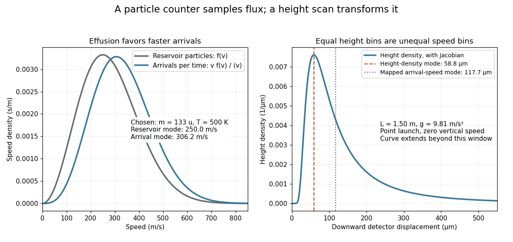

# Gravity deflection of an atomic beam

↑ **Parent:** [Molecular beam](molecular-beam.md)

[Immanuel Estermann](immanuel-estermann.md), [O. C. Simpson](oliver-cecil-simpson.md) and [Otto Stern](otto-stern.md) used gravitational deflection to measure atomic speeds. Stern describes scanning a hot-wire [surface ionization detector](surface-ionization-detector.md) through a [cesium](caesium.md) beam and recording [ion](ion.md) [electric current](electric-current.md).[The method of molecular rays, lecture 12 December 1946, pp. 9–11: collaborators, falling beam and ion-current readout](the-method-of-molecular-rays-by-otto-stern.md) Their 1947 paper reports [potassium](potassium.md) and [cesium](caesium.md) beams; a deficit of slow arrivals increased with oven [pressure](pressure-split.md), supporting a source-slit [collision](collision.md) explanation.[Estermann, Simpson and Stern, Physical Review 71 (15 February 1947), p. 238, abstract: gravity deflection, modified Maxwellian distribution and pressure-dependent slow-atom deficit](the-free-fall-of-atoms-and-the-measurement-of-the-velocity-distribution-in-a-molecular-beam-of-cesium-atoms-by-immanuel-estermann-oliver-cecil-simpson-and-otto-stern.md)

First consider an original point-launch model, with horizontal [speed](speed.md) $v>0$, zero initial vertical [velocity](velocity.md), flight distance $L$, and uniform [gravitational acceleration](gravitational-acceleration.md) $g$. Downward displacement $y$ follows from flight time $t=L/v$:

$$
y=\frac{gL^2}{2v^2}=\frac{C}{v^2},\qquad C=\frac{gL^2}{2}.
$$

Slow particles fall farther. However, a detector scan counts arrivals per interval of height, not per interval of [speed](speed.md). [Change of variables for probability densities](change-of-variables-for-probability-densities.md) supplies the [Jacobian determinant](jacobian-determinant.md):

$$
p_y(y)=g\!\left(\sqrt{C/y}\right)\frac{\sqrt C}{2y^{3/2}}
=\frac{b^2}{y^3}e^{-b/y},\qquad b=aC=\frac{mgL^2}{4k_BT},\qquad y>0.
$$

Here $g(v)$ denotes the [effusive beam speed distribution](effusive-beam-speed-distribution.md); the unadorned constant $g$ in $C$ denotes [gravitational acceleration](gravitational-acceleration.md). The [integral](integral-split.md) of $p_y$ is one: substituting $u=b/y$ reduces it to $\int_0^\infty ue^{-u}\,du=1$. Its [mode](mode-statistics.md) is $y=b/3$. Simply mapping the most probable arrival [speed](speed.md) into a fall distance instead gives $2b/3$. The peaks differ because equal height bins cover unequal speed intervals.

**[Figure 12](#image-effusion-changes-the-arrival-speed-distribution-and-a-detector-height-scan-requires-another-jacobian-determinant). Effusion changes the arrival speed distribution, and a detector-height scan requires another Jacobian determinant**. Original calculated distributions with chosen $m=133\,\mathrm u$, $T=500\,\mathrm K$, $L=1.50\,\mathrm m$ and $g=9.81\,\mathrm{m\,s^{-2}}$. These are not historical measurements.

For those chosen parameters, $b\simeq176.54\,\mu\mathrm m$, so the detector-height [probability density](probability-density.md) peaks near $58.85\,\mu\mathrm m$. A detector covering only $0<y<Y$ accepts the fraction

$$
F(Y)=\int_0^Yp_y(y)\,dy=e^{-b/Y}\left(1+\frac bY\right).
$$

At $Y=0.80\,\mathrm{mm}$ this is about $97.9\%$, even before allowing for imperfect detection. Discarding the remainder changes the observed normalization.

Real slits transmit a range of launch heights and vertical [velocities](velocity.md). Their geometrical response must be combined with the gravitational deflection and detector width; the point-launch formula is not an exact reduction of the historical apparatus. In the point-launch model, an initial vertical [velocity](velocity.md) $w$ would add $wL/v$ to $y$. Source [collisions](collision.md), detector efficiency and alignment can also distort a profile. Varying oven [pressure](pressure-split.md) helps distinguish such source losses from an incorrect thermal distribution; inferring a source [temperature](temperature-split.md) from the peak alone ignores both selection and the detector's coordinate transformation.

## ↑ Ancestors (4)

1. [Molecular beam](molecular-beam.md)
2. [Experimental apparatus](experimental-apparatus.md)
3. [Physics](physics-split.md)
4. [Codex Wiki](split.md)

## ← Incoming links (2)

- [Change of variables for probability densities](change-of-variables-for-probability-densities.md)
- [Molecular beam](molecular-beam.md)
