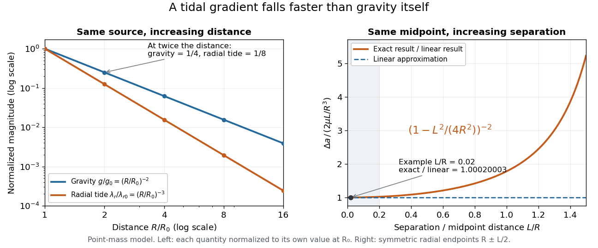

# Gravity magnitude versus tidal gradient

↑ **Parent:** [Tidal force](tidal-force.md)

For a fixed source [point mass](point-mass.md), the magnitude $g=\mu/R^2$ of the [gravitational acceleration](gravitational-acceleration.md) measures the local pull; the radial [eigenvalue](eigenvalue.md) $\lambda_r=2\mu/R^3$ of the [tidal tensor](tidal-tensor.md) measures how that pull changes across space. Doubling $R$ divides $g$ by four but $\lambda_r$ by eight. For a fixed small radial separation $L$, the linear relative [acceleration](acceleration.md) is $\Delta a\simeq\lambda_r L$, so

$$
\frac{\Delta a}{g}\simeq\frac{2L}{R}.
$$

A small body can therefore experience strong common [gravitational acceleration](gravitational-acceleration.md) with a comparatively small [tidal force](tidal-force.md). A measurement of $g$ alone does not determine the [tidal tensor](tidal-tensor.md): sources at different distances can have the same $g$ but different spatial variation.

**[Figure 4](#image-gravity-falls-as-inverse-distance-squared-while-point-mass-tidal-stretching-falls-as-inverse-distance-cubed). Gravity falls as inverse distance squared, while point-mass tidal stretching falls as inverse distance cubed**. The left panel compares independently normalized [gravitational acceleration](gravitational-acceleration.md) and radial [tidal tensor](tidal-tensor.md) [eigenvalue](eigenvalue.md) for a fixed source. The right panel compares exact and linear relative [accelerations](acceleration.md) for two radially separated [test particles](test-particle.md) at a fixed midpoint, showing the finite-separation correction as their separation grows.

The local stretching time scale is $\lambda_r^{-1/2}=\sqrt{R^3/(2\mu)}$: it marks when an initially resting separation could change by order itself if the [tidal tensor](tidal-tensor.md) stayed fixed. During [free fall](free-fall.md), $R$ changes, so this scale is not a complete trajectory or a universal disruption time. [Tidal disruption](tidal-disruption.md) additionally compares the [tidal force](tidal-force.md) with binding by [self-gravity](self-gravity.md) and material [forces](force-split.md); $g$ by itself supplies no such comparison.

## ↑ Ancestors (8)

1. [Tidal force](tidal-force.md)
2. [Tidal tensor](tidal-tensor.md)
3. [Newtonian gravitational field](newtonian-gravitational-field.md)
4. [Newton's law of universal gravitation](newton-s-law-of-universal-gravitation-split.md)
5. [Classical mechanics](classical-mechanics-split.md)
6. [Branches of physics](branches-of-physics.md)
7. [Physics](physics-split.md)
8. [Codex Wiki](split.md)
