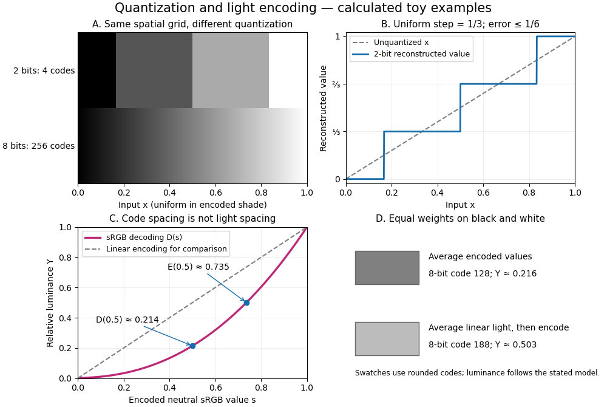

# Grayscale

↑ **Parent:** [Raster graphics](raster-graphics.md)  
ⓦ [Wiki](https://en.wikipedia.org/wiki/Grayscale)

A [grayscale](grayscale.md) image varies along shades from black to white rather than recording independent colour differences. A numerical [grayscale](grayscale.md) image assigns one shade sample to each [pixel](pixel.md); an encoding determines how that sample maps to a displayed shade. A colour [raster image](raster-graphics.md) can also look [grayscale](grayscale.md), for example when its three [sRGB](srgb.md) components are equal.

**[Figure 1](#image-toy-quantization-and-srgb-encoding-more-codes-and-more-light-are-different-questions). Toy quantization and sRGB encoding: more codes and more light are different questions**.

The convention in our [lossy block averaging](lossy-block-averaging.md) example is black at the [integer](integer.md) code 0 and white at 255. Its [arithmetic means](arithmetic-mean.md) act on those stored codes. This is a fully specified numerical experiment, but it does not claim that code 128 means half the physical light of code 255. [PNG](png.md) explicitly allows samples that are not proportional to light: its [grayscale](grayscale.md) interpretation depends on the indicated transfer curve, and can be device-dependent when that information is absent.[W3C, PNG Specification, Third Edition, section 6.1: colour types, grayscale interpretation and transfer curves](https://www.w3.org/TR/png-3/#6Colour-values)

Two different questions therefore need different operations. To average _stored codes_, average the [integers](integer.md). To average [relative luminance](relative-luminance.md) for neutral [sRGB](srgb.md) shades, decode the codes to linear light, average there, and encode the result again. Equal weights on black and white give encoded value $1/2$ by the first method, but approximately $0.73536$ by the second. Rounded to eight-[bit](bit.md) codes these are 128 and 188. This example concerns ideal neutral shades and the specified [sRGB](srgb.md) conversion; it does not assert a universal grayscale conversion for every colour encoding.

The upper panels hold the spatial grid fixed and change [sample depth](sample-depth.md): four levels produce broad constant bands, while 256 levels make smaller numerical steps. The lower panels hold the colour interpretation fixed and compare encoded [sRGB](srgb.md) values with [relative luminance](relative-luminance.md). All panels are calculated synthetic examples, not measured display data. [Grayscale](grayscale.md) is useful when shade structure is the quantity of interest: a synthetic scalar [image signal](image-signal.md) can be inspected without introducing separate colour components.

## ↑ Ancestors (4)

1. [Raster graphics](raster-graphics.md)
2. [Computer graphics](computer-graphics.md)
3. [Computer science](computer-science-split.md)
4. [Codex Wiki](split.md)

## ← Incoming links (8)

- [Grayscale](grayscale.md)
- [Lossy block averaging](lossy-block-averaging.md)
- [Lossy compression](lossy-compression.md)
- [Pixel](pixel.md)
- [Raster graphics](raster-graphics.md)
- [Relative luminance](relative-luminance.md)
- [Sample depth](sample-depth.md)
- [sRGB](srgb.md)
