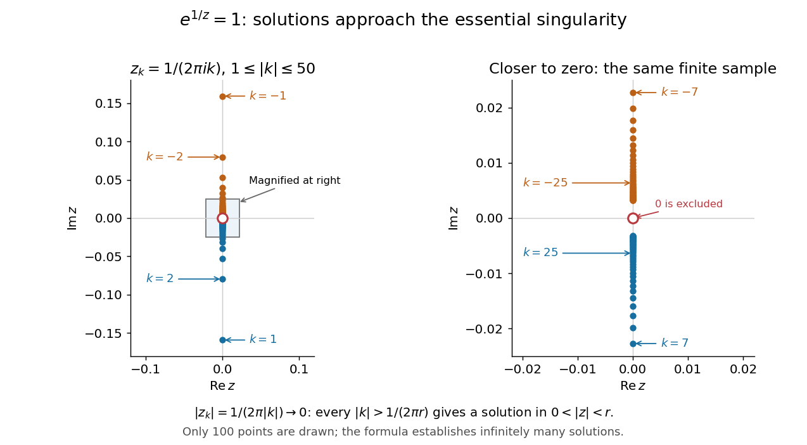

# Great Picard theorem

↑ **Parent:** [Little Picard theorem](little-picard-theorem.md)

Let $f$ be a [holomorphic function](holomorphic-function-split.md) on $0<|z-a|<R$, and suppose $a$ is an isolated [essential singularity](essential-singularity.md). There is a set $E\subseteq\mathbb C$ with at most one element such that, for every $w\notin E$ and every $0<r<R$, the equation $f(z)=w$ has infinitely many distinct solutions with $0<|z-a|<r$. Thus each nonexceptional value has [preimages](preimage.md) accumulating at $a$ in every punctured [neighbourhood](neighbourhood-mathematics.md). The same possible exception works for all these [neighbourhoods](neighbourhood-mathematics.md); it need not be a completely [omitted value](omitted-value.md), since it could be attained only finitely often near $a$. [Terence Tao, Math 246A Notes 4 (2016), Theorem 57 and the following discussion](https://terrytao.wordpress.com/2016/10/11/math-246a-notes-4-singularities-of-holomorphic-functions/)

The basic example is $f(z)=e^{1/z}$ at $a=0$. It is a [holomorphic function](holomorphic-function-split.md) for $z\ne0$, and its [Laurent series](laurent-series.md)

$$
e^{1/z}=\sum_{n=0}^{\infty}\frac{z^{-n}}{n!}
$$

has infinitely many nonzero negative-power terms, making zero an [essential singularity](essential-singularity.md). Its sole [omitted value](omitted-value.md) is zero. For the value one, its [preimages](preimage.md) are exactly

$$
z_k=\frac1{2\pi i k}=-\frac{i}{2\pi k},\qquad k\in\mathbb Z\setminus\{0\}.
$$

They satisfy $e^{1/z_k}=1$ and $|z_k|=1/(2\pi|k|)\to0$. For any $r>0$, every [integer](integer-split.md) $k$ with $|k|>1/(2\pi r)$ therefore supplies a distinct solution inside $0<|z|<r$.

**[Figure 7](#image-a-finite-sample-of-the-preimages-of-1-under-exp-1-z-with-a-magnified-view-of-their-accumulation-toward-the-excluded-origin). A finite sample of the preimages of 1 under exp(1/z), with a magnified view of their accumulation toward the excluded origin**.

The diagram displays only finitely many [preimages](preimage.md); the formula and its [limit](limit-of-a-function.md), rather than the finite picture, establish that infinitely many occur in every punctured [neighbourhood](neighbourhood-mathematics.md). More generally, for any $w\ne0$, choose an [argument](argument-complex-analysis.md) $\theta$ of $w$. All its [preimages](preimage.md) are

$$
z_k=\frac1{\ln|w|+i(\theta+2\pi k)},\qquad k\in\mathbb Z,
$$

with any zero denominator excluded. Such an exclusion occurs only for $w=1$, with exactly one excluded [integer](integer-split.md) $k$ for the chosen [argument](argument-complex-analysis.md). The remaining [preimages](preimage.md) are distinct and tend to zero as $|k|\to\infty$.

The isolated [essential singularity](essential-singularity.md) hypothesis is crucial. The [function](function-split.md) $f(z)=z^{-1}$ has a [pole](pole.md) at zero; on $0<|z|<r$ its [image](image-of-a-function.md) is only $\{w:|w|>1/r\}$. It omits every value in the closed disc $|w|\le1/r$, and each attained value has just one [preimage](preimage.md). A [pole](pole.md) therefore has entirely different local behaviour from an [essential singularity](essential-singularity.md).

The [Casorati-Weierstrass theorem](casorati-weierstrass-theorem.md) says that the [image](image-of-a-function.md) near an [essential singularity](essential-singularity.md) is a [dense subset](dense-set.md) of the [complex plane](complex-plane.md). The [Great Picard theorem](great-picard-theorem.md) replaces arbitrary approximation by exact attainment, and then repeats that attainment infinitely often. This is useful when a local restriction on the [image](image-of-a-function.md) can rule out an [essential singularity](essential-singularity.md) and reduce the possibilities to a [pole](pole.md) or a [removable singularity](removable-singularity.md). For a [meromorphic function](meromorphic-function.md) viewed as a [holomorphic map](holomorphic-map.md) into the [Riemann sphere](riemann-sphere.md), the corresponding statement has at most two exceptional sphere values, including infinity in the count; it applies when the map has an isolated [essential singularity](essential-singularity.md), even if [poles](pole.md) accumulate there. Picard's 1880 memoir proves the local result in section 15, treating the cases with and without accumulating [poles](pole.md) separately. [Picard, Mémoire sur les fonctions entières (1880), pp. 164-166](https://numdam.org/articles/10.24033/asens.187/)

The [Great Picard theorem](great-picard-theorem.md) also explains the [Little Picard theorem](little-picard-theorem.md). For a nonconstant [polynomial](polynomial-split.md), every value is attained by the [fundamental theorem of algebra](fundamental-theorem-of-algebra.md). For an [entire function](entire-function.md) which is not a [polynomial](polynomial-split.md), the [function](function-split.md) $g(\zeta)=f(1/\zeta)$ has an [essential singularity](essential-singularity.md) at zero: a [removable singularity](removable-singularity.md) would force $f$ to be constant by the [Liouville theorem](liouville-theorem.md), and a [pole](pole.md) would force $f$ to be a [polynomial](polynomial-split.md). Applying the [Great Picard theorem](great-picard-theorem.md) to $g$ leaves at most one finite [omitted value](omitted-value.md) for $f$.

## ↑ Ancestors (9)

1. [Little Picard theorem](little-picard-theorem.md)
2. [Picard theorem](picard-theorem.md)
3. [Entire function](entire-function.md)
4. [Holomorphic function](holomorphic-function-split.md)
5. [Complex analysis](complex-analysis-split.md)
6. [Analysis](analysis-split.md)
7. [Area of mathematics](area-of-mathematics.md)
8. [Mathematics](mathematics-split.md)
9. [Codex Wiki](split.md)

## ← Incoming links (7)

- [Finite spherical area criterion for an isolated singularity](finite-spherical-area-criterion-for-an-isolated-singularity.md)
- [Great Picard theorem](great-picard-theorem.md)
- [Solution](past-exam-of-the-mathematics-course-of-the-university-of-cambridge/2001/iii/paper-9/3/solution.md)
- [Solution](past-exam-of-the-mathematics-course-of-the-university-of-cambridge/2002/iii/paper-5/4/solution.md)
- [Solution](past-exam-of-the-mathematics-course-of-the-university-of-cambridge/2019/ii/paper-2/23f/d/solution.md)
- [Solution](past-exam-of-the-mathematics-course-of-the-university-of-cambridge/2023/ii/paper-3/23f/solution.md)
- [Picard theorem](picard-theorem.md)
