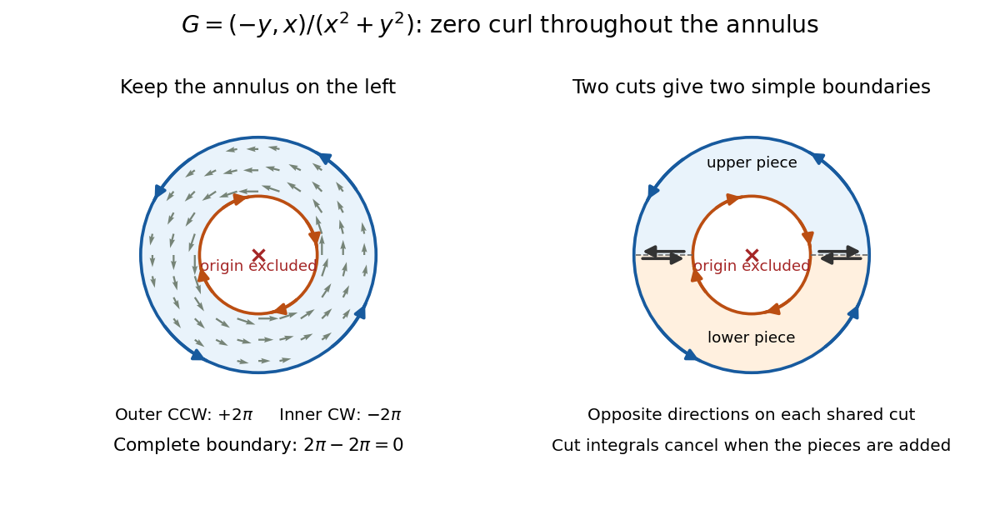

# Green theorem with holes

↑ **Parent:** [Green theorem](green-theorem.md)

On the [punctured plane](punctured-complex-plane.md) $\mathbb R^2\setminus\{(0,0)\}$, consider the [vector field](vector-field.md)

$$
G(x,y)=\left(-\frac{y}{x^2+y^2},\frac{x}{x^2+y^2}\right).
$$

With $r^2=x^2+y^2$, its [partial derivatives](partial-derivative.md) satisfy

$$
Q_x=\frac{y^2-x^2}{r^4},\qquad
P_y=\frac{y^2-x^2}{r^4},\qquad Q_x-P_y=0.
$$

Thus the field has zero scalar [curl](curl.md) everywhere it is defined. Nevertheless, on any counterclockwise [circle](circle.md) $\gamma_R(t)=(R\cos t,R\sin t)$ with $R>0$,

$$
G(\gamma_R(t))=\frac1R(-\sin t,\cos t),\qquad
\gamma_R'(t)=R(-\sin t,\cos t),\qquad
\oint_{\gamma_R}G\cdot d\mathbf r=\int_0^{2\pi}1\,dt=2\pi.
$$

The radius cancels exactly.

Applying [Green theorem](green-theorem.md) to the enclosed [disk](disk-mathematics.md) would be invalid: $G$ is undefined at the origin, inside that disk. Zero [curl](curl.md) on the path alone is insufficient.[18.02SC Multivariable Calculus, Fall 2010; V5. Simply-Connected Regions, pp. 1–2, §2: excluded origin prevents filling a closed curve within the field's domain](18-02sc-multivariable-calculus-fall-2010/v5-simply-connected-regions.md)

Now take the [annulus](annulus-mathematics.md) $A=\{(x,y):1\leq r\leq2\}$. Its positive [boundary orientation](boundary-orientation.md) is counterclockwise on the outer [circle](circle.md) and clockwise on the inner [circle](circle.md). The complete boundary [line integral](line-integral.md) is therefore

$$
\oint_{\partial A}G\cdot d\mathbf r
=\underbrace{2\pi}_{\text{outer boundary}}
+\underbrace{(-2\pi)}_{\text{inner boundary}}
=0
=\iint_A(Q_x-P_y)\,dA.
$$

Here [Green theorem](green-theorem.md) applies: an [open set](open-set.md) containing the closed [annulus](annulus-mathematics.md) can avoid the origin. The inner contribution remains $-2\pi$ even for an arbitrarily small positive inner radius. Decreasing the hole's [area](surface-area.md) does not decrease this [line integral](line-integral.md).

**[Figure 10](#image-zero-curl-away-from-an-excluded-origin-the-outer-circle-contributes-two-pi-the-clockwise-inner-circle-minus-two-pi-and-the-annulus-boundary-sum-is-zero). Zero curl away from an excluded origin: the outer circle contributes two pi, the clockwise inner circle minus two pi, and the annulus boundary sum is zero**.

The cancellation has a useful proof picture. Cut the [annulus](annulus-mathematics.md) along two radial segments into two half-annuli. Each piece has a single [simple closed curve](simple-closed-curve.md) as its boundary; along each cut, the two induced [boundary orientations](boundary-orientation.md) oppose, so those [line integrals](line-integral.md) cancel when the two applications of [Green theorem](green-theorem.md) are added. Only the outer and inner circles remain.[18.02SC Multivariable Calculus, Fall 2010; V5. Simply-Connected Regions, p. 1, §1, subdivision proof: integrals over cuts cancel in opposite directions](18-02sc-multivariable-calculus-fall-2010/v5-simply-connected-regions.md)

Locally, a choice of [angle](angle.md) $\theta$ in [polar coordinates](polar-coordinates.md) has [gradient](gradient.md) $\nabla\theta=G$. Globally, following a [circle](circle.md) once increases that angle by $2\pi$, so it cannot be a single-valued [potential of a conservative vector field](potential-of-a-conservative-vector-field.md) on the [punctured plane](punctured-complex-plane.md). The nonzero closed-path [line integral](line-integral.md) also rules out such a potential by the [fundamental theorem for line integrals](fundamental-theorem-for-line-integrals.md).

On a [simply connected](simply-connected-space.md) open region, a [continuously differentiable](continuously-differentiable-function.md) planar [vector field](vector-field.md) with zero scalar [curl](curl.md) does have a global potential. The hole is what separates the local [derivative](derivative.md) condition from the global conclusion.[18.02SC Multivariable Calculus, Fall 2010; V5. Simply-Connected Regions, pp. 2–3, theorem (3) and Curl Theorem: simply connected domain hypothesis for a global gradient field](18-02sc-multivariable-calculus-fall-2010/v5-simply-connected-regions.md)

## ↑ Ancestors (9)

1. [Green theorem](green-theorem.md)
2. [Vector calculus](vector-calculus.md)
3. [Multivariable calculus](multivariable-calculus-split.md)
4. [Calculus](calculus-split.md)
5. [Real analysis](real-analysis-split.md)
6. [Analysis](analysis-split.md)
7. [Area of mathematics](area-of-mathematics.md)
8. [Mathematics](mathematics-split.md)
9. [Codex Wiki](split.md)

## ← Incoming links (1)

- [Green theorem](green-theorem.md)
