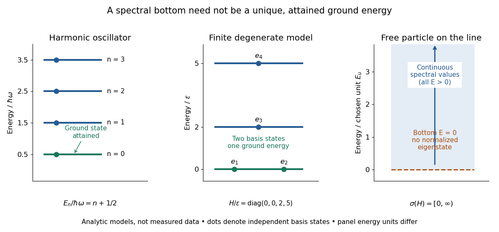

# Ground-state degeneracy

↑ **Parent:** [Ground state](ground-state.md)

When a [ground state](ground-state.md) exists, its ground-state degeneracy is the [dimension](dimension-vector-space.md) of the [ground-state subspace](ground-state-subspace.md):

$$
g_0=\dim\ker(H-E_0I),\qquad E_0=\inf\sigma(H).
$$

Here $I$ is the [identity operator](identity-operator.md), and the [kernel of a linear map](kernel-of-a-linear-map.md) is taken within the [operator domain](operator-domain.md) of the [Hamiltonian operator](hamiltonian-quantum-mechanics.md) $H$. The count concerns [linearly independent](linear-independence.md) [energy eigenstates](energy-eigenstate.md), rather than every normalized [quantum superposition](quantum-superposition.md) or every choice of [global phase](global-phase.md). Even a single [energy eigenspace](energy-eigenspace.md) contains infinitely many representing vectors; its [dimension](dimension-vector-space.md) measures independent freedom. [Ground-state degeneracy](ground-state-degeneracy.md) is the lowest-energy instance of [degenerate energy levels](degenerate-energy-levels.md).

For an exact finite model with [energy](energy.md) unit $\varepsilon>0$, let the [Hamiltonian operator](hamiltonian-quantum-mechanics.md) be the [diagonal matrix](diagonal-matrix.md)

$$
H_{\mathrm{toy}}=\varepsilon\operatorname{diag}(0,0,2,5).
$$

Its [ground-state energy](ground-state-energy.md) is zero and $g_0=2$: the first two coordinate [unit vectors](unit-vector.md) $e_1,e_2$ span the [ground-state subspace](ground-state-subspace.md). Every normalized $a e_1+b e_2$, with $|a|^2+|b|^2=1$, is a [ground state](ground-state.md), including $(e_1+e_2)/\sqrt2$. Its [energy measurement](energy-measurement.md) is certain to return zero, even though a measurement distinguishing $e_1$ from $e_2$ need not have a definite outcome. Under the unchanged [Hamiltonian operator](hamiltonian-quantum-mechanics.md), this [quantum superposition](quantum-superposition.md) is a [stationary state](stationary-state.md) because both components acquire the same [global phase](global-phase.md).

**[Figure 7](#image-attained-ground-energies-ground-state-degeneracy-and-an-unattained-spectral-bottom). Attained ground energies, ground-state degeneracy, and an unattained spectral bottom**. Exact analytic models, not measured data. The [quantum harmonic oscillator](quantum-harmonic-oscillator.md) has an attained [ground-state energy](ground-state-energy.md). The finite [diagonal matrix](diagonal-matrix.md) has two independent [ground states](ground-state.md) at one [energy eigenvalue](energy-eigenvalue.md). The whole-line [free particle](free-particle.md) has [continuous spectrum](continuous-spectrum.md) beginning at zero and no normalizable zero-energy [energy eigenstate](energy-eigenstate.md); the shaded interval denotes spectral values, not a collection of normalized [energy eigenstates](energy-eigenstate.md). Each panel uses its own stated [energy](energy.md) unit.

[Ground-state degeneracy](ground-state-degeneracy.md) matters when an interaction selects or splits previously equal [energy eigenvalues](energy-eigenvalue.md). In the finite model, adding $\varepsilon\operatorname{diag}(\delta,-\delta,0,0)$ with $0<\delta<2$ gives the formerly lowest pair the distinct energies $\pm\varepsilon\delta$, leaving a unique [ground state](ground-state.md). This direct calculation illustrates why [degenerate perturbation theory](degenerate-perturbation-theory.md) first examines the perturbation inside the whole [ground-state subspace](ground-state-subspace.md).

A classical continuous-symmetry model can instead have a [manifold](topological-manifold.md) of minimizing configurations, such as the sphere of orientations of a [Néel state](neel-state.md) in an isotropic [Heisenberg antiferromagnet](heisenberg-antiferromagnet.md). That geometric description does not by itself count the [dimension](dimension-vector-space.md) of a finite quantum [ground-state subspace](ground-state-subspace.md).

## ↑ Ancestors (5)

1. [Ground state](ground-state.md)
2. [Quantum mechanics](quantum-mechanics-split.md)
3. [Branches of physics](branches-of-physics.md)
4. [Physics](physics-split.md)
5. [Codex Wiki](split.md)

## ← Incoming links (4)

- [Energy eigenspace](energy-eigenspace.md)
- [Ground state](ground-state.md)
- [Ground-state degeneracy](ground-state-degeneracy.md)
- [Solution](past-exam-of-the-mathematics-course-of-the-university-of-cambridge/2015/iii/paper-81/1/a/solution.md)
