# Group action

↑ **Parent:** [Group theory](group-theory.md)  
ⓦ [Wiki](https://en.wikipedia.org/wiki/Group_action)

A left [group action](group-action.md) of a [group](group.md) $G$ on a [set](set.md) $X$ is a [function](function.md) $(g,x)\mapsto g\cdot x$ satisfying

$$
e\cdot x=x,\qquad (gh)\cdot x=g\cdot(h\cdot x)\qquad(g,h\in G,\ x\in X),
$$

where $e$ is the [identity element](algebraic-operation.md#identity-element) of $G$. The second rule means that $h$ moves the point first and $g$ moves it next. These rules let [group](group.md) multiplication describe consistent rearrangements of a [set](set.md); see [Ackerman's algebra notes, definition 0.4.1.1](https://people.math.harvard.edu/~nate/teaching/UPenn/2007/fall/math_371/lectures/week_1/lecture_1/lecture_1.pdf).

For each $g$, the [function](function.md) $x\mapsto g\cdot x$ is a [bijection](function.md#bijection): its inverse is $x\mapsto g^{-1}\cdot x$, using the [inverse element](algebraic-operation.md#inverse-element) of $g$. Equivalently, a [group action](group-action.md) is a [group homomorphism](group-theory.md#group-homomorphism) $\rho:G\to\operatorname{Sym}(X)$ into the [symmetric group](finite-group-theory.md#symmetric-group) of all [permutations](combinatorics.md#permutation) of $X$, with $\rho(g)(x)=g\cdot x$ and $\rho(gh)=\rho(g)\circ\rho(h)$. See [MIT's group-action notes, definition 23.1](https://ocw.mit.edu/courses/18-703-modern-algebra-spring-2013/96221ce2d5b1077b3e5d3c5e08c88afe_MIT18_703S13_pra_l_23.pdf).

For a concrete [group action](group-action.md), put the [vertices of a polygon](euclidean-geometry.md#vertex-of-a-polygon) of a [square](euclidean-geometry.md#square) at $A=(1,1)$, $B=(-1,1)$, $C=(-1,-1)$ and $D=(1,-1)$. Let $r(x,y)=(-y,x)$ be a counterclockwise quarter-turn [rotation](riemannian-geometry.md#rotation-mathematics) and let $s(x,y)=(y,x)$ be a [reflection](linear-algebra.md#reflection-mathematics). Their eight [permutations](combinatorics.md#permutation) of the [vertices of a polygon](euclidean-geometry.md#vertex-of-a-polygon) form the [dihedral group](finite-group-theory.md#dihedral-group)

$$
D_4=\{e,r,r^2,r^3,s,rs,r^2s,r^3s\},\qquad r^4=s^2=e,\quad srs=r^{-1}.
$$

Here $D_4$ means the [symmetry group](#symmetry-group) of a four-sided [polygon](euclidean-geometry.md#polygon), with [group order](group.md#order-of-a-finite-group) eight; the alternative convention calls this same [group](group.md) $D_8$. Products apply the rightmost operation first. For example, $s\cdot B=D$ and $(rs)\cdot B=r\cdot D=A$. The same [group](group.md) also has separate [group actions](group-action.md) on the [sides of a polygon](euclidean-geometry.md#side-of-a-polygon), the [diagonals of a polygon](euclidean-geometry.md#diagonal-of-a-polygon), and the [singleton set](set.md#singleton-mathematics) containing the [centroid](euclidean-geometry.md#centroid) of the [square](euclidean-geometry.md#square). Specifying $X$ matters: changing what is moved changes the [orbits of a group action](#orbit-group-theory) and the [stabilizer subgroups](#stabilizer-subgroup).

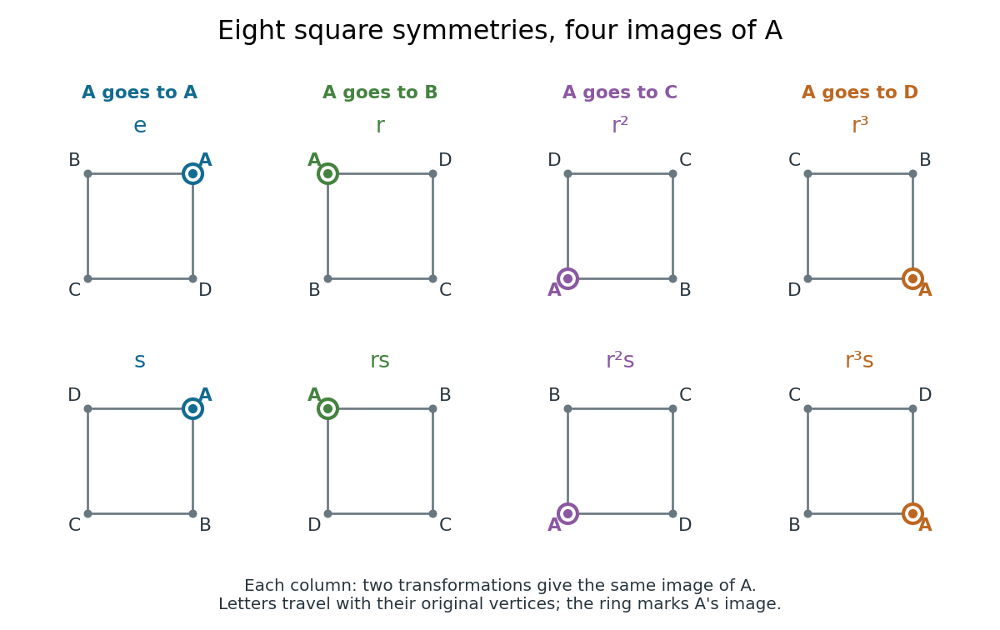

**[Figure 1](#image-eight-square-symmetry-group-elements-grouped-by-the-image-of-one-vertex-of-a-polygon). Eight square symmetry group elements grouped by the image of one vertex of a polygon**. The [group action](group-action.md) sends the marked [vertex of a polygon](euclidean-geometry.md#vertex-of-a-polygon) $A$ to four possible [vertices of a polygon](euclidean-geometry.md#vertex-of-a-polygon). Each column contains two [group](group.md) elements with the same image, giving a [group orbit](#orbit-group-theory) of size four and a [stabilizer subgroup](#stabilizer-subgroup) of [group order](group.md#order-of-a-finite-group) two. The labels show where every original [vertex of a polygon](euclidean-geometry.md#vertex-of-a-polygon) goes.

A [group action](group-action.md) need not be a [faithful group action](#faithful-group-action). For example, the [cyclic group](group.md#cyclic-group) $C_4=\mathbb Z/4\mathbb Z$ acts on $X=\{0,1\}$ by $k\cdot x=x+k\pmod2$, using [modular arithmetic](modular-arithmetic.md). Only the [parity](quantum-mechanics.md#parity) of $k$ matters: $0,2$ fix both points and $1,3$ exchange them. The associated [group homomorphism](group-theory.md#group-homomorphism) $C_4\to\operatorname{Sym}(X)$ has [group kernel](group-theory.md#kernel-of-a-group-homomorphism) $\{0,2\}$, of [group order](group.md#order-of-a-finite-group) two. Either point has a [group orbit](#orbit-group-theory) of size two and a [stabilizer subgroup](#stabilizer-subgroup) of [group order](group.md#order-of-a-finite-group) two, so the [orbit-stabilizer theorem](#orbit-stabilizer-theorem) gives $4=2\cdot2$.

The useful questions are which positions can be exchanged, and which transformations survive after imposing a constraint such as keeping one marked point fixed. An [orbit of a group action](#orbit-group-theory) answers the first question; a [stabilizer subgroup](#stabilizer-subgroup) answers the second. This turns a list of transformations into a count of distinct configurations, and explains why several transformations can produce the same configuration.

**Table of contents**

- [Column group action](#column-group-action)
- [Row group action](#row-group-action)
- [n-transitive group action](#n-transitive-group-action)
- [Symmetry enlargement under group translates](#symmetry-enlargement-under-group-translates)
- [Subgroup factorization from coset transitivity](#subgroup-factorization-from-coset-transitivity)
- [Circle action](#circle-action)
- [Symmetry group](#symmetry-group)
  - [Symmetry transformation](#symmetry-transformation)
  - [Symmetry depends on preserved structure](#symmetry-depends-on-preserved-structure)
  - [Colour-preserving symmetry group](#colour-preserving-symmetry-group)
- [Finite support in a permutation action](#finite-support-in-a-permutation-action)
- [Free action of a group](#free-action-of-a-group)
- [Free group action](#free-group-action)
  - [Finite groups cannot act freely on Euclidean space](#finite-groups-cannot-act-freely-on-euclidean-space)
  - [Free actions on even-dimensional spheres have order at most two](#free-actions-on-even-dimensional-spheres-have-order-at-most-two)
  - [Free sphere actions exclude elementary abelian subgroups of rank two](#free-sphere-actions-exclude-elementary-abelian-subgroups-of-rank-two)
- [Fundamental domain](#fundamental-domain)
- [Multiply transitive group action](#multiply-transitive-group-action)
  - [Three-transitive group action](#three-transitive-group-action)
- [Diagonal action on a centerless group](#diagonal-action-on-a-centerless-group)
- [Ring of invariants](#ring-of-invariants)
  - [Normality of a ring of invariants](#normality-of-a-ring-of-invariants)
- [Primitive group action](#primitive-group-action)
  - [Primitive group with a transposition](#primitive-group-with-a-transposition)
  - [Even primitive groups of safe-prime degree](#even-primitive-groups-of-safe-prime-degree)
  - [O'Nan–Scott theorem](#o-nan-scott-theorem)
    - [Diagonal primitive permutation group](#diagonal-primitive-permutation-group)
    - [Affine primitive permutation group](#affine-primitive-permutation-group)
      - [General affine group](#general-affine-group)
  - [Primitive three-cycle criterion](#primitive-three-cycle-criterion)
- [Variable-permutation action on polynomials](#variable-permutation-action-on-polynomials)
- [Fixed point of a group action](#fixed-point-of-a-group-action)
- [Left regular action](#left-regular-action)
- [Block system](#block-system)
  - [Uniform subdegrees force an imprimitive action to be Frobenius](#uniform-subdegrees-force-an-imprimitive-action-to-be-frobenius)
- [Transitive group action](#transitive-group-action)
  - [Simply transitive group action](#simply-transitive-group-action)
  - [Regular group action](#regular-group-action)
  - [Derangement in a transitive group action](#derangement-in-a-transitive-group-action)
    - [Derangement counting formula](#derangement-counting-formula)
  - [Rank of a transitive permutation group](#rank-of-a-transitive-permutation-group)
  - [Regular permutation subgroup](#regular-permutation-subgroup)
    - [Centralizer of a regular permutation subgroup](#centralizer-of-a-regular-permutation-subgroup)
  - [Sharp t-transitivity](#sharp-t-transitivity)
    - [Sharp three-transitivity](#sharp-three-transitivity)
    - [Sharp two-transitivity](#sharp-two-transitivity)
    - [Regular kernel of a finite sharply two-transitive group](#regular-kernel-of-a-finite-sharply-two-transitive-group)
  - [One-point extension of a permutation group](#one-point-extension-of-a-permutation-group)
    - [Double-coset criterion for a one-point extension](#double-coset-criterion-for-a-one-point-extension)
  - [Prime-degree transposition criterion](#prime-degree-transposition-criterion)
- [Two-transitive group action](#two-transitive-group-action)
  - [Elementary abelian regular kernels in doubly transitive groups](#elementary-abelian-regular-kernels-in-doubly-transitive-groups)
  - [Degree-ten partition action of S6](#degree-ten-partition-action-of-s6)
  - [Minimal normal subgroup dichotomy for two-transitive groups](#minimal-normal-subgroup-dichotomy-for-two-transitive-groups)
  - [Affine two-transitive group](#affine-two-transitive-group)
- [Orbit map](#orbit-map)
- [Equivariant map](#equivariant-map)
  - [Translation equivariance](#translation-equivariance)
- [Conjugation action](#conjugation-action)
  - [Conjugates of a proper subgroup do not cover a finite group](#conjugates-of-a-proper-subgroup-do-not-cover-a-finite-group)
  - [Conjugation](#conjugation)
    - [Conjugate subset](#conjugate-subset)
    - [Conjugate group elements](#conjugate-group-elements)
      - [Conjugate permutation](#conjugate-permutation)
  - [Conjugacy class](#conjugacy-class)
    - [Conjugacy classes of the symmetric group on three letters](#conjugacy-classes-of-the-symmetric-group-on-three-letters)
    - [Infinite conjugacy class group](#infinite-conjugacy-class-group)
    - [Torsion-freeness from one nonidentity conjugacy class](#torsion-freeness-from-one-nonidentity-conjugacy-class)
    - [Shortest conjugacy representative](#shortest-conjugacy-representative)
      - [Cyclic reduction of a shortest conjugacy representative](#cyclic-reduction-of-a-shortest-conjugacy-representative)
    - [Conjugacy class splitting in a prime-index normal subgroup](#conjugacy-class-splitting-in-a-prime-index-normal-subgroup)
      - [Alternating conjugacy class splitting criterion](#alternating-conjugacy-class-splitting-criterion)
        - [Inversion of an odd cycle in an alternating group](#inversion-of-an-odd-cycle-in-an-alternating-group)
    - [Class equation](#class-equation)
      - [Prime-to-p conjugacy class lemma](#prime-to-p-conjugacy-class-lemma)
  - [Centralizer and normalizer](#centralizer-and-normalizer)
    - [Centralizer](#centralizer)
      - [Centralizer of a subset](#centralizer-of-a-subset)
        - [Centralizer of a Hermitian matrix in SU(n)](#centralizer-of-a-hermitian-matrix-in-su-n)
      - [Centraliser of a fixed-point-free involution](#centraliser-of-a-fixed-point-free-involution)
      - [Centraliser of a transposition](#centraliser-of-a-transposition)
    - [Normalizer](#normalizer)
      - [Normalizer of a diagonal subgroup of GL2](#normalizer-of-a-diagonal-subgroup-of-gl2)
- [Orbit-stabilizer theorem](#orbit-stabilizer-theorem)
  - [Orbit dimension formula](#orbit-dimension-formula)
- [Symmetry group of a cube](#symmetry-group-of-a-cube)
  - [Body-diagonal stabilizer in the cube symmetry group](#body-diagonal-stabilizer-in-the-cube-symmetry-group)
  - [Axial isotropy types of the full cube symmetry group](#axial-isotropy-types-of-the-full-cube-symmetry-group)
  - [Axis stabilizer in the full octahedral symmetry group](#axis-stabilizer-in-the-full-octahedral-symmetry-group)
  - [Cube symmetry action on edges](#cube-symmetry-action-on-edges)
  - [Direct-product decomposition of the cube symmetry group](#direct-product-decomposition-of-the-cube-symmetry-group)
  - [Rotational symmetry group of a cube](#rotational-symmetry-group-of-a-cube)
    - [Tetrahedron stabilizer in the cube rotation group](#tetrahedron-stabilizer-in-the-cube-rotation-group)
    - [Kernel of the cube face-axis action](#kernel-of-the-cube-face-axis-action)
    - [Face-pair orbits of cube rotations](#face-pair-orbits-of-cube-rotations)
- [Faithful group action](#faithful-group-action)
  - [Nonfaithful coset action of the symmetric group on three letters](#nonfaithful-coset-action-of-the-symmetric-group-on-three-letters)
  - [Faithful quotient of a group action](#faithful-quotient-of-a-group-action)
  - [Normal subgroup orbits in a faithful prime-degree action](#normal-subgroup-orbits-in-a-faithful-prime-degree-action)
- [Orbit (group theory)](#orbit-group-theory)
  - [Equality-pattern orbits of ordered pairs](#equality-pattern-orbits-of-ordered-pairs)
  - [Real rotation orbits on a complex unit quadric](#real-rotation-orbits-on-a-complex-unit-quadric)
  - [Equality-pattern orbits of projective triples](#equality-pattern-orbits-of-projective-triples)
- [Stabilizer subgroup](#stabilizer-subgroup)
  - [Pointwise stabilizer](#pointwise-stabilizer)
  - [Axial subgroup](#axial-subgroup)
    - [Complex axial isotropy subgroup](#complex-axial-isotropy-subgroup)
- [Symmetric group action on subsets](#symmetric-group-action-on-subsets)
- [Coset action](#coset-action)
  - [Faithful coset action of the symmetric group on three letters](#faithful-coset-action-of-the-symmetric-group-on-three-letters)

## Column group action

↑ **Parent:** [Group action](group-action.md)

## Row group action

↑ **Parent:** [Group action](group-action.md)

## n-transitive group action

↑ **Parent:** [Group action](group-action.md)

A [group action](group-action.md) on a set is n-transitive when it can send any ordered tuple of $n$ distinct points to any other such tuple. Here ordered means a sequence of entries, not increasing in a [total order](set.md#total-order). For order-preserving actions the corresponding notion is [order n-transitivity](partially-ordered-group.md#order-n-transitivity).

## Symmetry enlargement under group translates

↑ **Parent:** [Group action](group-action.md)

For a [group](group.md) of [Euclidean isometries](riemannian-geometry.md#euclidean-isometry), every element preserves the displayed union of images of a [set](set.md), because left multiplication permutes its [group](group.md) indices. Its full setwise [isometry group](riemannian-geometry.md#isometry-group) can be larger even when $T$ itself has no nonidentity symmetry. Take $G$ to be the [integer](integer.md) [translations](geometry-and-topology.md#translation-geometry) of the plane and $T=\{(0,0),(1,0),(0,2)\}$. By [rigidity of a scalene triangle](riemannian-geometry.md#rigidity-of-a-scalene-triangle), $T$ has trivial [stabilizer subgroup](#stabilizer-subgroup). Yet $S=\mathbb Z^2$, whose quarter-turn about the origin is a symmetry outside the [translation](geometry-and-topology.md#translation-geometry) [group](group.md).

## Subgroup factorization from coset transitivity

↑ **Parent:** [Group action](group-action.md)

In the right multiplication action, the orbit of the coset $H$ under $K$ is $\{Hk:k\in K\}$. It is the whole right coset space exactly when every $g$ has form $hk$, proving the displayed criterion. The factorization need not be unique; for finite groups $|HK|=|H||K|/|H\cap K|$.

## Circle action

↑ **Parent:** [Group action](group-action.md)

A circle action is a [group action](group-action.md) by $S^1$. Hamiltonian circle actions are especially useful in [symplectic reduction](symplectic-geometry.md#symplectic-reduction).

## Symmetry group

↑ **Parent:** [Group action](group-action.md)  
ⓦ [Wiki](https://en.wikipedia.org/wiki/Symmetry_group)

A symmetry group collects [bijections](function.md#bijection) of an object to itself that preserve a specified structure in both directions, with [function composition](function.md#function-composition) as the operation. For a geometric object one may require [Euclidean distances](topological-analysis.md#euclidean-distance) to be preserved, giving an [isometry group](riemannian-geometry.md#isometry-group); for a [graph](graph.md), one preserves adjacency, giving a [graph automorphism](graph.md#graph-automorphism) [group](group.md). For an unstructured [finite set](set.md#finite-set), every [permutation](combinatorics.md#permutation) is allowed. **The structure to be preserved is part of the definition.**

For a [square](euclidean-geometry.md#square) with its usual geometric structure, the [symmetry group](#symmetry-group) consists of four [rotations](riemannian-geometry.md#rotation-mathematics) and four [reflections](linear-algebra.md#reflection-mathematics). These form the [dihedral group](finite-group-theory.md#dihedral-group) of [group order](group.md#order-of-a-finite-group) eight. The existing [group action](group-action.md) example shows how its eight elements move the [vertices of a polygon](euclidean-geometry.md#vertex-of-a-polygon); changing the object to its edges or a marked configuration changes the [group action](group-action.md) being studied.[§§1–2, Theorem 2.5, printed pp. 1–4: rigid motions, rotations, reflections and dihedral order conventions](mathematics-bibliography.md#dihedral-groups-by-keith-conrad)

Specifying the preserved data makes it possible to test a proposed symmetry exactly. After the preserved data are declared, [function composition](function.md#function-composition), the [identity map](function.md#identity-function), and [inverse maps](function.md#inverse-function) automatically preserve them too. [Symmetry transformations](#symmetry-transformation) therefore form a [group](group.md), and questions about equivalent configurations become questions about [group orbits](#orbit-group-theory), [stabilizer subgroups](#stabilizer-subgroup), and [group homomorphisms](group-theory.md#group-homomorphism). This supplies reusable mathematics for comparing many different kinds of objects.

### Symmetry transformation

↑ **Parent:** [Symmetry group](#symmetry-group)

A symmetry transformation is a [bijection](function.md#bijection) preserving the data that define the object's [symmetry group](#symmetry-group). Its individual [group elements](group.md#group-element) are [symmetry transformations](#symmetry-transformation); the [group operation](group.md#group-operation) combines them by [function composition](function.md#function-composition).

### Symmetry depends on preserved structure

↑ **Parent:** [Symmetry group](#symmetry-group)

Take the four-point [set](set.md)

$$
R=\{(2,1),(-2,1),(-2,-1),(2,-1)\},
$$

the [vertices of a polygon](euclidean-geometry.md#vertex-of-a-polygon) of a [rectangle](euclidean-geometry.md#rectangle) whose side lengths are four and two. Three choices of structure give three different [symmetry groups](#symmetry-group) on these same points.

As an unstructured [set](set.md), $R$ has all $4!=24$ [permutations](combinatorics.md#permutation) as symmetries, forming the [symmetric group](finite-group-theory.md#symmetric-group) $S_4$. If [Euclidean distance](topological-analysis.md#euclidean-distance) is part of the data, the allowed maps are only the identity, a half-turn [rotation](riemannian-geometry.md#rotation-mathematics), and the [reflections](linear-algebra.md#reflection-mathematics) across the two coordinate axes. They form a [Klein four-group](finite-group-theory.md#klein-four-group) of [group order](group.md#order-of-a-finite-group) four. To see that nothing is missing, fix the image of one [vertex of a polygon](euclidean-geometry.md#vertex-of-a-polygon): its three other distances, $2$, $4$, and $\sqrt{20}$, are distinct, so they uniquely determine the images of the remaining vertices.

Preserving affine structure permits more. The [affine map](geometry-and-topology.md#affine-map)

$$
T(x,y)=(-2y,x/2),\qquad
T=\begin{pmatrix}0&-2\\1/2&0\end{pmatrix}
$$

cycles all four points of $R$. It sends a horizontal side of length four to a vertical side of length two, so it is not an [isometry](riemannian-geometry.md#isometry). Yet it preserves the [rectangle](euclidean-geometry.md#rectangle)'s vertex [set](set.md) and all [affine combinations](geometry-and-topology.md#affine-combination) among those points.

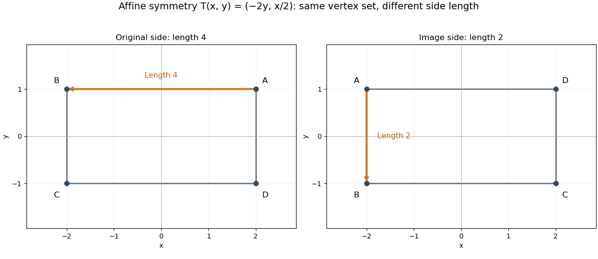

**[Figure 2](#image-an-affine-symmetry-preserves-these-four-points-while-changing-a-side-s-euclidean-length). An affine symmetry preserves these four points while changing a side's Euclidean length**. Original example $T(x,y)=(-2y,x/2)$. The orange side of length four on the left is sent to the orange side of length two on the right. The point labels track the map for this illustration; they are not additional fixed labels imposed on the underlying four-point object.

Let $A=\operatorname{diag}(2,1)$ and let $r(x,y)=(-y,x)$ be the [square](euclidean-geometry.md#square)'s quarter-turn [rotation](riemannian-geometry.md#rotation-mathematics). Then

$$
T=ArA^{-1}.
$$

Conjugating every [square](euclidean-geometry.md#square) symmetry by $A$ gives eight [affine maps](geometry-and-topology.md#affine-map) preserving $R$. This [group isomorphism](algebra.md#group-isomorphism) makes the affine [symmetry group](#symmetry-group) a [dihedral group](finite-group-theory.md#dihedral-group), although some of its maps do not preserve the original [Euclidean distances](topological-analysis.md#euclidean-distance). There are no further affine symmetries: an [affine map](geometry-and-topology.md#affine-map) preserves the common midpoint of the diagonals, so it must preserve opposite pairs. The image of one vertex has four choices and the image of an adjacent vertex has two; those choices determine the map through three noncollinear points.

Thus

$$
\boxed{G_{\rm metric}\subsetneq G_{\rm affine}\subsetneq G_{\rm set},\qquad
4<8<24.}
$$

An arbitrary [permutation](combinatorics.md#permutation) need not be an [affine map](geometry-and-topology.md#affine-map). For example, exchanging the two top vertices while fixing the two bottom vertices sends the common diagonal midpoint to two different points, which no single [affine map](geometry-and-topology.md#affine-map) can do. The phrase "the symmetry of these points" becomes unambiguous only after stating which structure matters.

### Colour-preserving symmetry group

↑ **Parent:** [Symmetry group](#symmetry-group)

Let a [group action](group-action.md) of $G$ on a [set](set.md) $X$ be given, and let a [function](function.md) $c:X\to C$ attach a colour label to each point. The colour-preserving subgroup of $G$ is

$$
G_c=\{g\in G:c(gx)=c(x)\text{ for every }x\in X\}.
$$

It is a [subgroup](group.md#subgroup): the [identity map](function.md#identity-function) preserves all labels, compositions of two preserving maps preserve them, and replacing $x$ by $g^{-1}x$ shows that [inverse maps](function.md#inverse-function) preserve them too. Extra object data restrict the allowable transformations; the labels are now part of the object rather than bookkeeping for a drawing.

For a geometric [square](euclidean-geometry.md#square), take $G=D_4$, of [group order](group.md#order-of-a-finite-group) eight. If all four vertices have the same colour, all eight maps remain. If two adjacent vertices are red and the others blue, only the identity and one [reflection](linear-algebra.md#reflection-mathematics) remain. Putting the two red vertices opposite one another instead leaves four maps: the identity, a half-turn [rotation](riemannian-geometry.md#rotation-mathematics), and the two diagonal [reflections](linear-algebra.md#reflection-mathematics). Giving all four vertices distinct colours leaves only the identity.

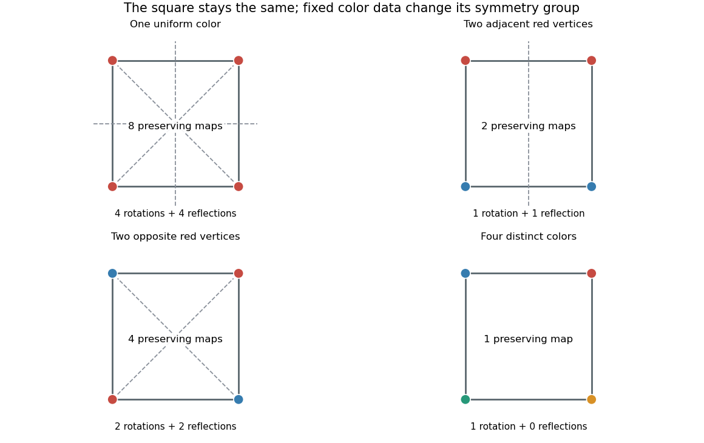

**[Figure 3](#image-fixed-vertex-colours-restrict-the-geometric-symmetry-group). Fixed vertex colours restrict the geometric symmetry group**. Original computed examples. Counts refer to Euclidean motions of the square that preserve each vertex colour. Two adjacent red vertices and two opposite red vertices have the same colour counts but different symmetry groups. Dashed lines show surviving reflection axes; the rotation labels count surviving rotations including the identity.

The count alone does not specify the pattern. Both two-red examples have the same number of red and blue vertices, but their [stabilizer subgroups](#stabilizer-subgroup) differ. For a single red vertex, the [orbit-stabilizer theorem](#orbit-stabilizer-theorem) gives a [group orbit](#orbit-group-theory) of size four and a [stabilizer subgroup](#stabilizer-subgroup) of [group order](group.md#order-of-a-finite-group) two, agreeing with the existing [group action](group-action.md) illustration. Such counts identify equivalent placements without treating each placement as a new geometric case.

## Finite support in a permutation action

↑ **Parent:** [Group action](group-action.md)

Suppose a permutation group $G$ acts on an underlying atom set $A$ and on a collection of objects built over it. A finite subset $S\subseteq A$ supports an object $x$ when every permutation fixing all members of $S$ fixes $x$. Pairing supported objects uses the union of their supports. A definable subset or functional image inherits a support from its domain and parameters. In a [hereditarily finite-supported Quine-atom model](set-theory.md#hereditarily-finite-supported-quine-atom-model), every member is recursively required to have such a support; symmetry then rules out a choice function on the pairs of atoms.

## Free action of a group

↑ **Parent:** [Group action](group-action.md)

A [group action](group-action.md) is free when only the identity fixes any given point, or equivalently every [stabilizer subgroup](#stabilizer-subgroup) is trivial. The trivial group acts freely on every space. A nontrivial [group](group.md) acting freely must act by a fixed-point-free map for each nonidentity element; the [fixed-point property of even-dimensional complex projective space](algebraic-topology.md#fixed-point-property-of-even-dimensional-complex-projective-space) obstructs such actions. For a [finite group](group.md#finite-group) acting freely on a Hausdorff [manifold](topological-manifold.md), the quotient map is a [covering map](algebraic-topology.md#covering-space).

## Free group action

↑ **Parent:** [Group action](group-action.md)

A [group action](group-action.md) is free if the only element of the [group](group.md) fixing any point is the [identity element](algebraic-operation.md#identity-element). Thus every [stabilizer subgroup](#stabilizer-subgroup) is trivial. This is a property of an action of any [group](group.md), not an assertion that the acting group is a [free group](geometric-group-theory.md#free-group).

Explicitly, for a left [group action](group-action.md) of a [group](group.md) $G$ on a [set](set.md) $X$ with [identity element](algebraic-operation.md#identity-element) $e$, freeness means

$$
g\cdot x=x\Longrightarrow g=e\qquad(g\in G,\ x\in X),\qquad G_x=\{e\}\quad(x\in X).
$$

Equivalently, for any $x,y\in X$ there is at most one $g\in G$ with $g\cdot x=y$. Indeed, if $g\cdot x=h\cdot x$, the [group action](group-action.md) rules give $(h^{-1}g)\cdot x=x$, so freeness forces $g=h$; conversely, take $y=x$, since the [identity element](algebraic-operation.md#identity-element) already sends $x$ to itself. Thus every [orbit map](#orbit-map) $g\mapsto g\cdot x$ is [injective](algebra.md#injective-function), even when its [image of a function](set-theory.md#image-of-a-function) is only part of $X$.

For a [permutation](combinatorics.md#permutation) example, let the [cyclic group](group.md#cyclic-group) $C_2=\{e,a\}$ act on the [set](set.md) $X=\{1,2,3,4\}$ by $a=(12)(34)$. The nonidentity element exchanges both pairs and fixes no point, so every [stabilizer subgroup](#stabilizer-subgroup) is $\{e\}$. Its two [group orbits](#orbit-group-theory) are $\{1,2\}$ and $\{3,4\}$. This is a [free group action](#free-group-action) but not a [transitive group action](#transitive-group-action): there is no [group](group.md) element sending $1$ to $3$. Each restriction to one [group orbit](#orbit-group-theory) is a [simply transitive group action](#simply-transitive-group-action).

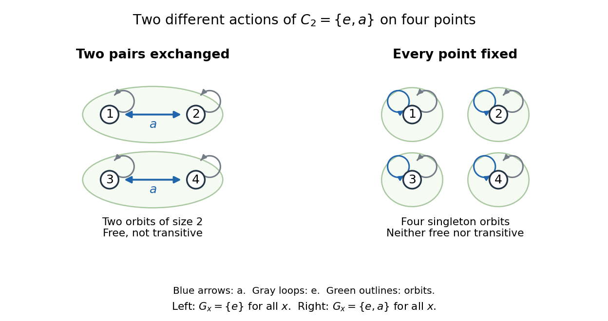

**[Figure 4](#free-actions-two-orbits-and-fixed-points). A free group action can have several group orbits**. Two [group actions](group-action.md) of the same [cyclic group](group.md#cyclic-group) $C_2=\{e,a\}$ on four points. On the left, $a=(12)(34)$ exchanges two pairs. On the right, both [group](group.md) elements fix every point. Green outlines show [group orbits](#orbit-group-theory); gray loops show the [identity element](algebraic-operation.md#identity-element), and blue arrows show $a$.

The [identity element](algebraic-operation.md#identity-element) fixes every point in every [group action](group-action.md); freeness excludes fixed points only for nonidentity elements. This also differs from a [fixed point of a group action](#fixed-point-of-a-group-action), which must be fixed by every [group](group.md) element. In the left diagram there are no such [fixed points of a group action](#fixed-point-of-a-group-action). In the right diagram, the same abstract [cyclic group](group.md#cyclic-group) $C_2$ acts by $e\cdot x=a\cdot x=x$: all four points are [fixed points of a group action](#fixed-point-of-a-group-action), every [stabilizer subgroup](#stabilizer-subgroup) is $C_2$, and each [group orbit](#orbit-group-theory) is a [singleton set](set.md#singleton-mathematics). Consequently this second [group action](group-action.md) is neither free nor transitive. A [group action](group-action.md) with no [fixed points of a group action](#fixed-point-of-a-group-action) can still fail freeness: the natural [group action](group-action.md) of the [symmetric group](finite-group-theory.md#symmetric-group) $S_3$ has no point fixed by all of $S_3$, but $(23)$ fixes $1$.

For a [finite group](group.md#finite-group), the [orbit-stabilizer theorem](#orbit-stabilizer-theorem) makes each [group orbit](#orbit-group-theory) of a [free group action](#free-group-action) have [cardinality](cardinal-number.md#cardinality) $|G|$. If $X$ is also finite, $|X|$ is therefore a multiple of the [group order](group.md#order-of-a-finite-group), with one copy of $|G|$ for each [group orbit](#orbit-group-theory). The [trivial group](group.md#trivial-group) acts freely on every [set](set.md), and acts transitively exactly on a [singleton set](set.md#singleton-mathematics). On the [empty set](set.md#empty-set) freeness is vacuous; our convention under [transitive group action](#transitive-group-action) requires a nonempty [set](set.md) for transitivity.

### Finite groups cannot act freely on Euclidean space

↑ **Parent:** [Free group action](#free-group-action)

If a nontrivial finite group acted freely on $\mathbb R^n$, a prime-order cyclic subgroup $C_p$ would too. The quotient is an $n$-manifold with contractible universal cover. The singular version of [cellular free resolution from a contractible universal cover](group-cohomology.md#cellular-free-resolution-from-a-contractible-universal-cover) identifies its cohomology with [group cohomology](group-cohomology.md) of $C_p$. The [periodic resolution of a finite cyclic group](group-cohomology.md#periodic-resolution-of-a-finite-cyclic-group) gives $H^{2j}(C_p;\mathbb Z)=\mathbb Z/p$ for every $j\geq1$. But [Poincaré duality for noncompact manifolds](cohomology.md#poincare-duality-for-noncompact-manifolds) makes the quotient cohomology zero above dimension $n$. This contradiction excludes the action, for arbitrary homeomorphisms, not only Euclidean isometries.

### Free actions on even-dimensional spheres have order at most two

↑ **Parent:** [Free group action](#free-group-action)

For every nonidentity element of a [free group action](#free-group-action) on $S^{2r}$, its action map has no fixed point and hence degree minus one by [fixed-point-free sphere maps are homotopic to the antipodal map](homology.md#fixed-point-free-sphere-maps-are-homotopic-to-the-antipodal-map). Degree of homeomorphisms defines a homomorphism into $\{1,-1\}$, whose kernel is trivial, since no nonidentity action map can have degree one. Thus the acting group has order at most two. For $S^0$, freeness on its two points gives the same conclusion directly.

### Free sphere actions exclude elementary abelian subgroups of rank two

↑ **Parent:** [Free group action](#free-group-action)

Suppose a finite [group](group.md) $G$ acts freely on $S^n$, $n>1$. The quotient has [fundamental group](algebraic-topology.md#fundamental-group) $G$ and higher [homotopy groups](homotopy.md#homotopy-group) equal to those of $S^n$. Attach one $(n+1)$-cell killing a generator of $\pi_n\cong\mathbb Z$, then attach higher cells successively to kill all remaining higher [homotopy](homotopy.md). This constructs a [Eilenberg–MacLane space](homotopy.md#eilenberg-maclane-space) $K(G,1)$ with only one $(n+1)$-cell. The [one-cell bound on next-degree cohomology](homology.md#one-cell-bound-on-next-degree-cohomology) gives dimension at most one in degree $n+1$. But if $G=C_p\times C_p$, the [mod-p cohomology ring of a cyclic group](group-cohomology.md#mod-p-cohomology-ring-of-a-cyclic-group) and [Künneth theorem](cohomology.md#kunneth-theorem) give dimension $n+2$ there. This contradiction excludes that group, and also excludes such a subgroup of any group acting freely on a sphere.

## Fundamental domain

↑ **Parent:** [Group action](group-action.md)  
ⓦ [Wiki](https://en.wikipedia.org/wiki/Fundamental_domain)

For a [group action](group-action.md), a fundamental domain selects one representative from each [orbit](dynamical-systems.md#orbit-dynamical-system). Geometric fundamental domains are often taken with their boundary included, allowing boundary overlaps while their interiors remain disjoint under the action. For translations of the real line by the [integers](integer.md), $[0,1)$ is an exact representative set and $[0,1]$ is its closed geometric version. A [lattice](mathematical-logic.md#lattice) similarly gives a half-open fundamental parallelepiped.

## Multiply transitive group action

↑ **Parent:** [Group action](group-action.md)  
ⓦ [Wiki](https://en.wikipedia.org/wiki/Multiply_transitive_group_action)

A [group action](group-action.md) is $t$-transitive if it acts transitively on ordered $t$-tuples of distinct points. In degree $n\ge t$ this implies $n(n-1)\cdots(n-t+1)\mid |G|$. It is [sharply t-transitive](#sharp-t-transitivity) when each such ordered tuple has trivial [stabilizer subgroup](#stabilizer-subgroup).

### Three-transitive group action

↑ **Parent:** [Multiply transitive group action](#multiply-transitive-group-action)

Transitivity on ordered triples of distinct points. It implies a [two-transitive group action](#two-transitive-group-action), but is stronger: in projective dimension at least two, collinear and noncollinear triples distinguish two orbits, even though the projective action is two-transitive.

## Diagonal action on a centerless group

↑ **Parent:** [Group action](group-action.md)

For nontrivial centerless $T$, this action of $T\times T$ is faithful and transitive. Its identity stabilizer is the diagonal subgroup. Subgroups above that diagonal are $\{(a,b):a^{-1}b\in N\}$ with $N\trianglelefteq T$: multiply by a diagonal element to isolate the second coordinate, then use diagonal conjugation. Thus the action is primitive exactly when $T$ is nonabelian simple.

## Ring of invariants

↑ **Parent:** [Group action](group-action.md)

For a group acting on a [ring](commutative-algebra.md#ring) by [ring automorphisms](commutative-algebra.md#ring-automorphism), the elements fixed by every group element form a [subring](commutative-algebra.md#subring) containing $1$. For finite $G$ acting on a commutative [ring](commutative-algebra.md#ring), each $r$ satisfies the monic orbit equation $\prod_{g\in G}(T-g(r))$, whose coefficients are fixed. Thus $R$ is integral over its [invariant subring](#ring-of-invariants). This uses an orbit product, not division by the group order.

### Normality of a ring of invariants

↑ **Parent:** [Ring of invariants](#ring-of-invariants)

A fraction of invariant elements is fixed by every automorphism. If that fraction is integral over $R^G$, its monic equation also makes it integral over $R$. A [normal domain](commutative-algebra.md#integrally-closed-domain) therefore places it in $R$, and fixedness places it in $R^G$. This proves integral closedness of the [invariant subring](#ring-of-invariants) in its own [fraction field](commutative-algebra.md#field-of-fractions). The proof works for any group and in every characteristic; no averaging or finiteness of the group is needed for normality.

## Primitive group action

↑ **Parent:** [Group action](group-action.md)

A transitive group action is primitive if the only blocks are singletons and the whole set; a block has every translate either equal to it or disjoint from it. Orbits of a normal subgroup form blocks. Hence a nontrivial normal subgroup in a faithful primitive action is transitive. Two-transitivity implies primitivity. This normal-subgroup observation is a hypothesis engine for [Iwasawa's simplicity lemma](finite-group-theory.md#iwasawa-simplicity-lemma).

### Primitive group with a transposition

↑ **Parent:** [Primitive group action](#primitive-group-action)

If a primitive subgroup of $S_n$ contains a [transposition](combinatorics.md#transposition-permutation), make a graph whose edges are the supports of its conjugate [transpositions](combinatorics.md#transposition-permutation). Connected components form blocks for the group. An edge exists, so primitivity forces the graph to be connected. Its edge [transpositions](combinatorics.md#transposition-permutation) generate all of $S_n$, proving that the original group is $S_n$.

### Even primitive groups of safe-prime degree

↑ **Parent:** [Primitive group action](#primitive-group-action)

Every nontrivial normal subgroup of a faithful primitive group of prime degree is transitive and contains a Sylow $p$-subgroup $P$. Its normalizer in $A_p$ has order $pq$. For a proper normal subgroup $N$, the [Frattini argument](finite-group-theory.md#frattini-argument) gives $G=NN_G(P)$; unless $G=C_p$, its $P$-normalizer is the full order-$pq$ normalizer, while $N_N(P)=P$. The [Burnside transfer theorem](group-theory.md#burnside-transfer-theorem) gives a characteristic normal $p$-complement in $N$. This complement is normal in $G$ and cannot be transitive because its order is prime to $p$, so it is trivial. Thus $N=P$ and $|G|=pq$.

<h3 id="o-nan-scott-theorem">O'Nan–Scott theorem</h3>

↑ **Parent:** [Primitive group action](#primitive-group-action)  
ⓦ [Wiki](https://en.wikipedia.org/wiki/O'Nan–Scott_theorem)

The theorem classifies finite primitive permutation groups by their minimal normal subgroups and the action of their socle. The modern types are affine (HA), almost simple (AS), simple diagonal (SD), compound diagonal (CD), product action (PA), holomorph simple (HS), holomorph compound (HC), and twisted wreath (TW). A coarser version describes primitive maximal subgroups of symmetric groups by affine, almost-simple, diagonal and full product-action overgroups. Intransitive and imprimitive maxima are respectively unequal-part subset stabilizers and block-system stabilizers. Primitivity alone is not maximality in the symmetric group; parity can put an otherwise natural candidate entirely inside the alternating group.

#### Diagonal primitive permutation group

↑ **Parent:** [O'Nan–Scott theorem](#o-nan-scott-theorem)

For a nonabelian simple group $T$, act on cosets of its full diagonal in $T^r$. A suitable factor-permuting extension is primitive and has point stabilizer intersecting the socle in the diagonal. The full normalizer has order $|T|^r|\operatorname{Out}(T)|r!$. For $T=A_5,r=2$, it acts on the sixty elements of $A_5$ by left/right multiplication, automorphisms and inversion, and has order $14400$. Odd conjugation in $S_5$ induces an odd permutation of these sixty points, while inversion is even; the full group is a primitive maximal subgroup of $S_{60}$.

#### Affine primitive permutation group

↑ **Parent:** [O'Nan–Scott theorem](#o-nan-scott-theorem)

An elementary abelian regular minimal normal subgroup acts as translations of a vector space. Its point stabilizer acts faithfully and irreducibly on that space; invariant subspaces would be blocks. The full affine normalizer is $AGL_d(p)$. In degree sixteen it lies inside $A_{16}$: nonzero translations swap eight pairs, and elementary linear transvections swap four pairs. Thus it is not a maximal subgroup of $S_{16}$.

##### General affine group

↑ **Parent:** [Affine primitive permutation group](#affine-primitive-permutation-group)

The [group](group.md) of maps $x\mapsto Ax+b$ of a finite-dimensional [vector space](vector-space.md), with $A$ invertible. Identifying the underlying points with a regular [elementary abelian group](group.md#elementary-abelian-group) identifies its normalizer in the [symmetric group](finite-group-theory.md#symmetric-group) with this [semidirect product](group-theory.md#semidirect-product).

### Primitive three-cycle criterion

↑ **Parent:** [Primitive group action](#primitive-group-action)

Conjugate the three-cycle throughout the group. Connected components of the support hypergraph form an invariant [block system](#block-system). Primitivity makes it connected, and [connected triple supports generate an alternating group](finite-group-theory.md#connected-triple-supports-generate-an-alternating-group) gives the conclusion.

## Variable-permutation action on polynomials

↑ **Parent:** [Group action](group-action.md)

The [symmetric group](finite-group-theory.md#symmetric-group) acts on [multivariate polynomials](polynomial.md#multivariate-polynomial) by replacing each variable $x_i$ by $x_{\sigma(i)}$. With $(\sigma\tau)(i)=\sigma(\tau(i))$, substitution gives $\sigma\cdot(\tau\cdot f)=(\sigma\tau)\cdot f$. Thus it is a left [group action](group-action.md). A polynomial encoding a combinatorial partition has a [group orbit](#orbit-group-theory) encoding all relabelings and a [stabiliser subgroup](#stabilizer-subgroup) encoding its label symmetries.

## Fixed point of a group action

↑ **Parent:** [Group action](group-action.md)

A fixed point of a [group action](group-action.md) is an element fixed by every group element. The set $A^G=\{a:g\cdot a=a\text{ for all }g\in G\}$ is the [categorical limit](category.md#categorical-limit) of the action viewed as a [functor](functor.md) from the one-object [category](category.md) associated with $G$ to the [Category of sets](category.md#category-of-sets).

## Left regular action

↑ **Parent:** [Group action](group-action.md)

The left regular action of a [group](group.md) on its own underlying set is left multiplication. It is faithful, because an element fixing the identity is itself the identity. For a finite group it gives the [permutation representation](representation-theory.md#permutation-representation) used in [Cayley theorem](group-theory.md#cayley-s-theorem).

## Block system

↑ **Parent:** [Group action](group-action.md)

A block system for a [group action](group-action.md) is a partition of the acted-on set such that every [group](group.md) element permutes its parts. For a transitive action, a nontrivial block system has more than one part and more than one element per part. The full [symmetric group](finite-group-theory.md#symmetric-group) preserves no such partition: a [transposition](combinatorics.md#transposition-permutation) exchanging one point in each of two parts breaks it.

### Uniform subdegrees force an imprimitive action to be Frobenius

↑ **Parent:** [Block system](#block-system)

For a transitive finite [permutation group](finite-group-theory.md#permutation-group), suppose each point stabilizer has orbits of a common size $r$ on the other points. If a nontrivial [block system](#block-system) exists, all two-point stabilizers are trivial. Indeed for block size $b$, $r\mid n-1$ gives $\gcd(r,b)=1$. An orbit of a block not containing $\alpha$ has size at most $br$ and divisible by $br$, so its b point-orbits are disjoint. A stabilizer of $\alpha$ and a point of that block fixes the whole block. Interchanging the two points also fixes the block of $\alpha$. Equal two-point-stabilizer orders then show that each two-point stabilizer fixes every point, and faithfulness makes it trivial.

## Transitive group action

↑ **Parent:** [Group action](group-action.md)  
ⓦ [Wiki](https://en.wikipedia.org/wiki/Transitive_group_action)

A [group action](group-action.md) on a nonempty [set](set.md) $X$ is transitive when every two points lie in the same [orbit of a group action](#orbit-group-theory), equivalently when for all $x,y\in X$ there is a [group](group.md) element $g$ with $g\cdot x=y$. There is exactly one [group orbit](#orbit-group-theory): every position is reachable from every other. Requiring $X\ne\varnothing$ avoids calling the [group action](group-action.md) on the [empty set](set.md#empty-set) transitive merely because the quantified statement has no points to test.[Definition 1.1, printed page 1: transitivity requires a nonempty set and exactly one orbit](mathematics-bibliography.md#transitive-group-actions-by-keith-conrad)

Here a left [group action](group-action.md) of a [group](group.md) $G$ means a [function](function.md) $G\times X\to X$, written $(g,x)\mapsto g\cdot x$, satisfying

$$
e\cdot x=x,\qquad (gh)\cdot x=g\cdot(h\cdot x),
$$

where $e$ is the [identity element](algebraic-operation.md#identity-element). Products move the point by $h$ first, then by $g$. Transitivity says that an [orbit map](#orbit-map) $G\to X$, $g\mapsto g\cdot x$, is [surjective](algebra.md#surjective-function) for every $x\in X$; it suffices to check one chosen point.[Definition 1.3, printed page 2: the two action axioms](mathematics-bibliography.md#group-actions-by-keith-conrad)[Theorem 3.1, printed page 2: equivalent tests for transitivity](mathematics-bibliography.md#transitive-group-actions-by-keith-conrad)

For example, the [symmetric group](finite-group-theory.md#symmetric-group) $S_3$ acts on $X=\{1,2,3\}$ by $\sigma\cdot i=\sigma(i)$. This is a [transitive group action](#transitive-group-action), but it is not a [free group action](#free-group-action): the [stabilizer subgroup](#stabilizer-subgroup) of $1$ is $\{e,(23)\}$. Both the [transposition](combinatorics.md#transposition-permutation) $(12)$ and the [cyclic permutation](combinatorics.md#cyclic-permutation) $(123)$ send $1$ to $2$. In contrast, the [cyclic group](group.md#cyclic-group) $C_3=\mathbb Z/3\mathbb Z$ acts on itself by $k\cdot x=k+x\pmod3$, using [modular arithmetic](modular-arithmetic.md). The [group](group.md) element sending $x$ to $y$ is uniquely $k=y-x\pmod3$. These two [group actions](group-action.md) reach the same number of points, but only the second has unique transport between them.

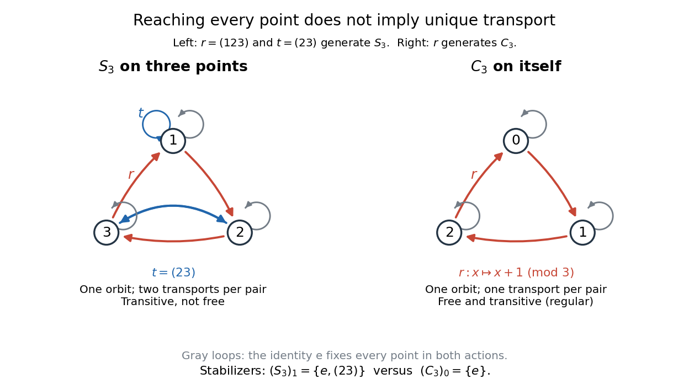

**[Figure 5](#transitive-actions-symmetric-and-cyclic). Transitive group actions with and without unique transport**. The [symmetric group](finite-group-theory.md#symmetric-group) $S_3$ on three labels has a [stabilizer subgroup](#stabilizer-subgroup) of [group order](group.md#order-of-a-finite-group) two at each point, hence two [group](group.md) elements sending any chosen point to any other. The [cyclic group](group.md#cyclic-group) $C_3$ acting on itself has trivial [stabilizer subgroups](#stabilizer-subgroup) and one transport per pair. Red arrows show a generating [cyclic permutation](combinatorics.md#cyclic-permutation); blue arrows show the extra [transposition](combinatorics.md#transposition-permutation) in $S_3$. Gray loops show the [identity element](algebraic-operation.md#identity-element) in both [group actions](group-action.md).

The [stabilizer subgroup](#stabilizer-subgroup) $G_x=\{h\in G:h\cdot x=x\}$ measures the ambiguity of transport. If $g_0\cdot x=y$, then

$$
\{g\in G:g\cdot x=y\}=g_0G_x,\qquad G_y=g_0G_xg_0^{-1}.
$$

The first [set](set.md) is a left [coset](group-theory.md#coset), and the second identity says that [stabilizer subgroups](#stabilizer-subgroup) in one [group orbit](#orbit-group-theory) are [conjugate subgroups](group-theory.md#conjugate-subgroup). Briefly, $g\cdot x=g_0\cdot x$ exactly when $g_0^{-1}g\in G_x$. Thus, for a [finite group](group.md#finite-group) in a [transitive group action](#transitive-group-action), the [orbit-stabilizer theorem](#orbit-stabilizer-theorem) gives $|G|=|X|\,|G_x|$, and there are exactly $|G_x|$ transports for each pair of points. The example counts are $6=3\cdot2$ for $S_3$ and $3=3\cdot1$ for $C_3$. This separates the number of reachable positions from the number of ways to reach each one.[Theorem 3.16(b)-(c), printed pages 12-13: conjugate stabilizers, transport cosets and the orbit-stabilizer formula](mathematics-bibliography.md#group-actions-by-keith-conrad)

### Simply transitive group action

↑ **Parent:** [Transitive group action](#transitive-group-action)

A [group action](group-action.md) on a nonempty [set](set.md) $X$ is simply transitive when exactly one [group](group.md) element sends any chosen point to any other:

$$
\forall x,y\in X\quad\exists!g\in G:\quad g\cdot x=y.
$$

Equivalently it is both a [transitive group action](#transitive-group-action) and a [free group action](#free-group-action); this is also a [regular group action](#regular-group-action). Transitivity supplies a transport, and freeness makes it unique. Conversely, putting $y=x$ in the uniqueness condition shows that every [stabilizer subgroup](#stabilizer-subgroup) is $\{e\}$, since the [identity element](algebraic-operation.md#identity-element) already fixes $x$. In a [transitive group action](#transitive-group-action), checking that just one [stabilizer subgroup](#stabilizer-subgroup) is trivial suffices: all the others are [conjugate subgroups](group-theory.md#conjugate-subgroup).

The [cyclic group](group.md#cyclic-group) $C_3$ in the diagram under [transitive group action](#transitive-group-action) is simply transitive. More generally, the [left regular action](#left-regular-action) of any [group](group.md) $G$ on itself is simply transitive: the equation $gx=y$ has the unique solution $g=yx^{-1}$, using the [inverse element](algebraic-operation.md#inverse-element) of $x$. This shows why the property is useful: every position has a unique label relative to a chosen starting position.

Choose a point $x_0\in X$. Its [orbit map](#orbit-map)

$$
\phi_{x_0}:G\longrightarrow X,\qquad g\longmapsto g\cdot x_0
$$

is a [bijection](function.md#bijection) and an [equivariant map](#equivariant-map) from the [left regular action](#left-regular-action): $\phi_{x_0}(hg)=h\cdot\phi_{x_0}(g)$. This identifies $X$ with a copy of $G$, but $X$ does not come with a preferred [identity element](algebraic-operation.md#identity-element). If $x_1=a\cdot x_0$, then $\phi_{x_1}(g)=\phi_{x_0}(ga)$: changing the chosen point composes this identification with right multiplication by $a$. An old label $g$ therefore becomes the new label $ga^{-1}$, which also specifies the side of multiplication for a noncommutative [group](group.md).

The transport from $x$ to $y$ remains independent of the chosen point. Writing $x=b\cdot x_0$ and $y=c\cdot x_0$, it is $cb^{-1}$. With $x_1=a\cdot x_0$, the new labels are $ba^{-1}$ and $ca^{-1}$, and

$$
(ca^{-1})(ba^{-1})^{-1}=cb^{-1}.
$$

For a [finite group](group.md#finite-group), simple transitivity implies $|X|=|G|$. Conversely, a [transitive group action](#transitive-group-action) with $|X|=|G|<\infty$ is simply transitive by the [orbit-stabilizer theorem](#orbit-stabilizer-theorem). Equality of [cardinalities](cardinal-number.md#cardinality) alone is insufficient without transitivity: the [cyclic group](group.md#cyclic-group) $C_2$ can fix both points of a two-point [set](set.md), giving two [group orbits](#orbit-group-theory) and two possible self-transports at each point.

### Regular group action

↑ **Parent:** [Transitive group action](#transitive-group-action)

A transitive [group action](group-action.md) is regular if every [point stabilizer](#stabilizer-subgroup) is trivial. Equivalently each ordered pair of points is connected by exactly one [group](group.md) element. Identifying one point with the identity identifies the action with left multiplication on the [group](group.md). A regular [normal subgroup](group-theory.md#normal-subgroup) inside a larger primitive [group](group.md) can supply translations or nonabelian left multiplication; the whole primitive [group](group.md) usually has a nontrivial stabilizer acting by automorphisms of this regular [subgroup](group.md#subgroup).

### Derangement in a transitive group action

↑ **Parent:** [Transitive group action](#transitive-group-action)

A derangement is an element fixing none of the points of a [group action](group-action.md). Every finite transitive action on at least two points has a derangement. Count pairs $(g,x)$ with $gx=x$: transitivity gives $\sum_g|\operatorname{Fix}(g)|=\sum_x|G_x|=|G|$. If every element fixed a point, the identity's extra fixed points would make this sum strictly larger than $|G|$. This is the [Burnside lemma](representation-theory.md#burnside-s-lemma) counting argument specialized to existence of a derangement.

#### Derangement counting formula

↑ **Parent:** [Derangement in a transitive group action](#derangement-in-a-transitive-group-action)

[Inclusion-exclusion](combinatorics.md#inclusion-exclusion-principle) applied to the events that a [permutation](combinatorics.md#permutation) fixes a specified point gives the displayed formula. There are $\binom nk$ choices of $k$ fixed points and $(n-k)!$ permutations fixing them. The probability that a uniformly chosen permutation is a [derangement](combinatorics.md#derangement-of-a-permutation) tends to $e^{-1}$.

// Target: analysis.bigb

### Rank of a transitive permutation group

↑ **Parent:** [Transitive group action](#transitive-group-action)

The number of point-stabilizer orbits, equivalently the number of orbits on ordered pairs. On $k$-spaces of an $n$-space with $k\le n/2$, $GL_n(q)$ has rank $k+1$, indexed by intersection dimension.

### Regular permutation subgroup

↑ **Parent:** [Transitive group action](#transitive-group-action)

A regular permutation subgroup acts transitively with trivial point stabilizers. Each ordered pair of points is related by exactly one subgroup element. A finite regular subgroup on $n$ points has order $n$. Normality and characteristicity are additional properties; they do not follow from regularity alone.

#### Centralizer of a regular permutation subgroup

↑ **Parent:** [Regular permutation subgroup](#regular-permutation-subgroup)

Identify a regular orbit with the [group](group.md) using a chosen base point. A [permutation](combinatorics.md#permutation) commuting with all left translations satisfies $c(x)=xc(1)$. Thus the [centralizer](#centralizer) consists of right translations. Defining $R_g(x)=xg^{-1}$ makes $R_gR_h=R_{gh}$ and gives an isomorphism to $G$, rather than an unmentioned reversal of multiplication.

### Sharp t-transitivity

↑ **Parent:** [Transitive group action](#transitive-group-action)

An action is sharply $t$-transitive if each ordered $t$-tuple of distinct points is carried to any other by exactly one group element. For finite degree $n\geq t$, its order is $n(n-1)\cdots(n-t+1)$ and each ordered-tuple stabilizer is trivial. Sharp one-transitivity is a regular action. Finite sharp two-transitivity gives a [regular kernel of a finite sharply two-transitive group](#regular-kernel-of-a-finite-sharply-two-transitive-group).

#### Sharp three-transitivity

↑ **Parent:** [Sharp t-transitivity](#sharp-t-transitivity)

Exactly one element sends each ordered triple of distinct points to each other such triple. On a [projective line](finite-group-theory.md#projective-line), representatives of the first two target points form a [basis](vector-space.md#basis); scaling them so their sum represents the third point gives the unique projective transformation.

#### Sharp two-transitivity

↑ **Parent:** [Sharp t-transitivity](#sharp-t-transitivity)

A [group action](group-action.md) is sharply two-transitive when exactly one element sends each ordered distinct pair to each other ordered distinct pair. The [affine group over a finite field](group-theory.md#affine-group-over-a-finite-field) provides an example: solve $ax+b=u$ and $ay+b=v$ uniquely, giving $a=(v-u)/(y-x)$.

#### Regular kernel of a finite sharply two-transitive group

↑ **Parent:** [Sharp t-transitivity](#sharp-t-transitivity)

In a finite sharply two-transitive group, the identity together with all fixed-point-free elements forms a regular normal subgroup. One proof constructs virtual characters from induced point-stabilizer characters and the augmentation character, proves their norms are one, and realizes this set as an intersection of representation kernels. Conjugation by the point stabilizer is transitive on the kernel's nonidentity elements. This forces the kernel to be elementary abelian, so it is a unique Sylow subgroup and is characteristic. Closure of the fixed-point-free set is a theorem, not something supplied merely by counting its size.

### One-point extension of a permutation group

↑ **Parent:** [Transitive group action](#transitive-group-action)

Adjoin a new point $\omega$ fixed by a transitive group $G$. A one-point extension is a transitive group on the enlarged set whose stabilizer of $\omega$ is exactly $G$, acting on the remaining points in the prescribed way. Its order is $(n+1)|G|$ in the finite degree-$n$ case. The [double-coset criterion for a one-point extension](#double-coset-criterion-for-a-one-point-extension) gives a concrete generator test.

#### Double-coset criterion for a one-point extension

↑ **Parent:** [One-point extension of a permutation group](#one-point-extension-of-a-permutation-group)

If $x$ interchanges the new point and $\alpha$, put $H=G_\alpha$. Then $\langle G,x\rangle$ is a one-point extension exactly when $x^2\in H$, $xHx^{-1}=H$, and $xgx\in GxG$ for every $g\notin H$. These conditions make $G\cup GxG$ multiplication-closed, hence a group in the finite setting, with new-point stabilizer $G$. Necessity comes from the two double cosets in the extended two-transitive action.

### Prime-degree transposition criterion

↑ **Parent:** [Transitive group action](#transitive-group-action)

A transitive subgroup $G\le S_p$ for prime $p$ that contains a transposition is $S_p$. Form a [graph](graph.md) on the $p$ letters with edges given by all conjugates in $G$ of that transposition. The transitive action permutes connected components, so their common size divides $p$. An edge rules out size one, hence the graph is connected. Its edge transpositions generate $S_p$: successive swaps along a path generate the swap of its endpoint with any chosen start. All these edge transpositions belong to $G$.

## Two-transitive group action

↑ **Parent:** [Group action](group-action.md)

A group action on a set is two-transitive when it acts transitively on ordered pairs of distinct points. Equivalently, a point stabilizer acts transitively on the remaining points.

This is the $k=2$ case of a [multiply transitive group action](#multiply-transitive-group-action).

### Elementary abelian regular kernels in doubly transitive groups

↑ **Parent:** [Two-transitive group action](#two-transitive-group-action)

A [point stabilizer](#stabilizer-subgroup) in a doubly transitive [group](group.md) acts transitively by conjugation on the nonidentity elements of a regular [normal subgroup](group-theory.md#normal-subgroup) $N$. All those elements have the same order; Cauchy's theorem makes this a prime p and excludes other primes from $|N|$. A finite p-group has a nontrivial characteristic center. Transitivity then forces all of $N$ into its center, so $N$ is elementary abelian. Choosing a vector-space [basis](vector-space.md#basis) identifies the original [permutation](combinatorics.md#permutation) [group](group.md) with a [subgroup](group.md#subgroup) of the corresponding general affine [group](group.md).

### Degree-ten partition action of S6

↑ **Parent:** [Two-transitive group action](#two-transitive-group-action)

There are $\binom63/2=10$ partitions of six letters into two unordered triples. A stabilizer is $S_3\wr S_2$, also the [normalizer](#normalizer) of the [Sylow subgroup](finite-group-theory.md#sylow-subgroup) generated by one 3-cycle in each triple. Relative to one partition, all other partitions have intersection pattern $1+2$ up to interchange, giving one orbit of the stabilizer and hence a [two-transitive](#two-transitive-group-action) action. A natural $S_5$ fixing one letter is transitive on these partitions, giving $S_6=S_5(S_3\wr S_2)$.

### Minimal normal subgroup dichotomy for two-transitive groups

↑ **Parent:** [Two-transitive group action](#two-transitive-group-action)

A [minimal normal subgroup](group-theory.md#minimal-normal-subgroup) of a finite faithful [two-transitive group action](#two-transitive-group-action) is either regular elementary abelian or primitive nonabelian simple. The imprimitive case reduces to two-point stabilizers being trivial, then counting derangements gives a characteristic regular Sylow subgroup. In the primitive nonregular case, each simple direct factor is transitive. Two commuting transitive factors are regular and are mutual full centralizers. Thus at most two factors occur and $|N|=n^2$. But the common subdegree of $N_\alpha$ then divides both $n$ and $n-1$, forcing $N_\alpha=1$, a contradiction. Only one factor remains.

### Affine two-transitive group

↑ **Parent:** [Two-transitive group action](#two-transitive-group-action)

Translations are regular on $V$, and the zero stabilizer is $H$. Two-transitivity is equivalent to $H$ being transitive on nonzero vectors. Full affine linear groups and groups with special linear or symplectic linear parts give examples.

## Orbit map

↑ **Parent:** [Group action](group-action.md)

For a group $G$ acting on a set $X$ and a point $x\in X$, the orbit map is $G\to X$, $g\mapsto gx$. Its image is the [orbit of a group action](#orbit-group-theory) of $x$, and its fibres are cosets of the [stabilizer subgroup](#stabilizer-subgroup) of $x$.

## Equivariant map

↑ **Parent:** [Group action](group-action.md)  
ⓦ [Wiki](https://en.wikipedia.org/wiki/Equivariant_map)

For $G$-sets $X$ and $Y$, a map $f:X\to Y$ is equivariant when $f(gx)=gf(x)$ for every $g\in G$ and $x\in X$.

### Translation equivariance

↑ **Parent:** [Equivariant map](#equivariant-map)

Translating an input translates its output under a map rather than necessarily leaving the output unchanged. Convolution has this property under consistent domain and boundary conventions.

## Conjugation action

↑ **Parent:** [Group action](group-action.md)

A group acts on itself and on its subgroups by conjugation: $g\cdot x=gxg^{-1}$ and $g\cdot H=gHg^{-1}$.

### Conjugates of a proper subgroup do not cover a finite group

↑ **Parent:** [Conjugation action](#conjugation-action)

For a proper [subgroup](group.md#subgroup) $B$ of a [finite group](group.md#finite-group) $G$, the number $m$ of its conjugates is $[G:N_G(B)]\leq[G:B]$, because its [normalizer](#normalizer) contains $B$. All conjugates contain the identity, so their union has size at most $1+m(|B|-1)\leq|G|-[G:B]+1<|G|$. Thus some element is not conjugate to any element of $B$. Finiteness is essential to this cardinal counting argument.

### Conjugation

↑ **Parent:** [Conjugation action](#conjugation-action)

Conjugation by $g$ is the [group automorphism](algebra.md#group-automorphism) $x\mapsto gxg^{-1}$. Its orbits are the [conjugacy classes](#conjugacy-class).

#### Conjugate subset

↑ **Parent:** [Conjugation](#conjugation)

For a subset $S$ of a [group](group.md) and an element $g$, its conjugate subset is

$$
gSg^{-1}=\{gsg^{-1}:s\in S\}.
$$

Conjugation is a [bijection](function.md#bijection) and a [group automorphism](algebra.md#group-automorphism), so it preserves cardinality and every property expressed using the group operation.

#### Conjugate group elements

↑ **Parent:** [Conjugation](#conjugation)

Two group elements $x$ and $y$ are conjugate when $y=gxg^{-1}$ for some group element $g$, equivalently when they belong to the same [conjugacy class](#conjugacy-class). Conjugate elements have the same [order of a group element](group-theory.md#order-of-a-group-element).

##### Conjugate permutation

↑ **Parent:** [Conjugate group elements](#conjugate-group-elements)

Two [permutations](combinatorics.md#permutation) in the same [symmetric group](finite-group-theory.md#symmetric-group) are conjugate if $\tau=\pi\sigma\pi^{-1}$ for some permutation $\pi$. Conjugation relabels every [permutation cycle](finite-group-theory.md#permutation-cycle), so it preserves [cycle type](finite-group-theory.md#cycle-type). Conversely, equal cycle types permit a relabelling between corresponding cycles, establishing conjugacy.

### Conjugacy class

↑ **Parent:** [Conjugation action](#conjugation-action)  
ⓦ [Wiki](https://en.wikipedia.org/wiki/Conjugacy_class)

For an element $x$ of a [group](group.md) $G$, its [conjugacy class](#conjugacy-class) is its [orbit of a group action](#orbit-group-theory) under the [conjugation action](#conjugation-action):

$$
\operatorname{Cl}_G(x)=\{gxg^{-1}:g\in G\}.
$$

Thus [conjugate group elements](#conjugate-group-elements) describe the same operation after a change of labels. In a [symmetric group](finite-group-theory.md#symmetric-group), [conjugation](#conjugation) renames the entries of every [permutation cycle](finite-group-theory.md#permutation-cycle):

$$
g(a_1\,a_2\,\ldots\,a_k)g^{-1}=(g(a_1)\,g(a_2)\,\ldots\,g(a_k)).
$$

For example, with $g=(123)$ and the [transposition](combinatorics.md#transposition-permutation) $t=(12)$, this gives $gtg^{-1}=(g(1)\,g(2))=(23)$. Products use [function composition](function.md#function-composition) of [permutations](combinatorics.md#permutation), with the rightmost factor applied first. The complete six-element example is [conjugacy classes of the symmetric group on three letters](#conjugacy-classes-of-the-symmetric-group-on-three-letters).

The [conjugacy classes](#conjugacy-class) form a [partition of a set](set.md#partition-of-a-set) of $G$, since [conjugacy](#conjugate-group-elements) is an [equivalence relation](set-theory.md#equivalence-relation). In a [symmetric group](finite-group-theory.md#symmetric-group), two [permutations](combinatorics.md#permutation) lie in the same [conjugacy class](#conjugacy-class) precisely when they have the same [cycle type](finite-group-theory.md#cycle-type): renaming preserves the lengths of [permutation cycles](finite-group-theory.md#permutation-cycle), and matching equal-length [permutation cycles](finite-group-theory.md#permutation-cycle) constructs a renaming in the other direction. This compresses many labelled [permutations](combinatorics.md#permutation) into a few structural types. See [McKernan, Conjugation in Sn, lemma 6.2 and proposition 6.6](https://ocw.mit.edu/courses/18-703-modern-algebra-spring-2013/ae501fc20d40fdb32f9e1edfa64da8f3_MIT18_703S13_pra_l_6.pdf).

The [stabilizer subgroup](#stabilizer-subgroup) of $x$ under the [conjugation action](#conjugation-action) is its [centralizer](#centralizer) $C_G(x)$. Consequently the [orbit-stabilizer theorem](#orbit-stabilizer-theorem) gives

$$
|\operatorname{Cl}_G(x)|=[G:C_G(x)],\qquad |\operatorname{Cl}_G(x)|=\frac{|G|}{|C_G(x)|}\quad\text{if }G\text{ is finite}.
$$

The counting mechanism is the [bijection](function.md#bijection) $gC_G(x)\mapsto gxg^{-1}$ from left [cosets](group-theory.md#coset) onto the [conjugacy class](#conjugacy-class): two choices of $g$ give the same result exactly when they differ on the right by an element of the [centralizer](#centralizer). A large [centralizer](#centralizer) means many choices of labels leave the operation unchanged, hence a small [conjugacy class](#conjugacy-class). A [conjugacy class](#conjugacy-class) has size one precisely when its element belongs to the [center of a group](group-theory.md#center-of-a-group). The [class equation](#class-equation) counts these [orbits of a group action](#orbit-group-theory) together.

#### Conjugacy classes of the symmetric group on three letters

↑ **Parent:** [Conjugacy class](#conjugacy-class)

The [symmetric group](finite-group-theory.md#symmetric-group) $S_3$ has exactly six [permutations](combinatorics.md#permutation), written using [permutation cycles](finite-group-theory.md#permutation-cycle):

$$
S_3=\{e,(12),(13),(23),(123),(132)\}.
$$

Here $e$ is the [identity element](algebraic-operation.md#identity-element); $(12)$, $(13)$ and $(23)$ are [transpositions](combinatorics.md#transposition-permutation); and $(123)$ and $(132)$ are [permutation cycles](finite-group-theory.md#permutation-cycle) of length three. With $t=(12)$ and $r=(123)$, rightmost-first [function composition](function.md#function-composition) gives $r^2=(132)$ and $r^{-1}=r^2$. The [conjugacy classes](#conjugacy-class) and representative [centralizers](#centralizer) are

$$
\begin{array}{c|c|c|c}
x&\operatorname{Cl}_{S_3}(x)&C_{S_3}(x)&|\operatorname{Cl}_{S_3}(x)|\\
\hline
e&\{e\}&S_3&6/6=1\\
t&\{(12),(13),(23)\}&\{e,t\}&6/2=3\\
r&\{(123),(132)\}&\{e,r,r^2\}&6/3=2
\end{array}
$$

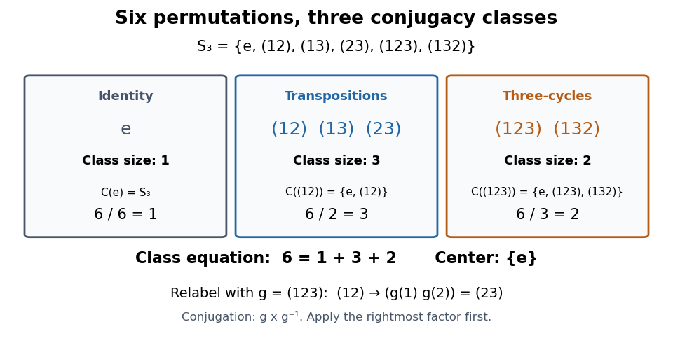

**[Figure 6](#image-all-six-permutations-of-the-symmetric-group-s-3-their-conjugacy-classes-and-representative-centralizers). All six permutations of the symmetric group $S_3$, their conjugacy classes, and representative centralizers**.

An explicit check of the [conjugation](#conjugation) $gtg^{-1}$ with $g=r=(123)$ sends $1\mapsto3\mapsto3\mapsto1$, $2\mapsto1\mapsto2\mapsto3$, and $3\mapsto2\mapsto1\mapsto2$, where each chain applies $g^{-1}$, then $t$, then $g$. Thus $1$ is fixed and $2,3$ are exchanged: $gtg^{-1}=(23)$. Relabelling also produces $(13)$, so the three [transpositions](combinatorics.md#transposition-permutation) share one [conjugacy class](#conjugacy-class). A [transposition](combinatorics.md#transposition-permutation) reverses the length-three [permutation cycle](finite-group-theory.md#permutation-cycle), since $trt^{-1}=(213)=(132)=r^{-1}$, putting both length-three [permutation cycles](finite-group-theory.md#permutation-cycle) in one [conjugacy class](#conjugacy-class).

Checking each of the six possible [permutations](combinatorics.md#permutation) against $gx=xg$ gives the displayed [centralizers](#centralizer). Only $e$ has a one-element [conjugacy class](#conjugacy-class), so the [center of a group](group-theory.md#center-of-a-group) here is $Z(S_3)=\{e\}$. The [class equation](#class-equation) is $6=1+3+2$. The second diagram in [centralizer and normalizer](#centralizer-and-normalizer) uses the same $r$ and $t$ to show how preserving a [cyclic subgroup](group.md#cyclic-subgroup) differs from fixing its [group generator](group.md#generator-of-a-group).

#### Infinite conjugacy class group

↑ **Parent:** [Conjugacy class](#conjugacy-class)

A discrete [group](group.md) is ICC when every nonidentity element has an infinite [conjugacy class](#conjugacy-class). The trivial [group](group.md) satisfies this condition vacuously. It characterizes when the [group von Neumann algebra](functional-analysis.md#group-von-neumann-algebra) is a [Von Neumann factor](functional-analysis.md#von-neumann-factor).

#### Torsion-freeness from one nonidentity conjugacy class

↑ **Parent:** [Conjugacy class](#conjugacy-class)

If an infinite [group](group.md) has a single nonidentity [conjugacy class](#conjugacy-class), it is a [torsion-free group](group.md#torsion-free-group). Otherwise every nonidentity element has the same finite order $n$. Powers show $n$ is prime. For $n\geq3$, choose $xgx^{-1}=g^2$; then $x^n=1$ gives $g=g^{2^n}$, impossible by [Fermat's little theorem](number-theory.md#fermat-little-theorem). For $n=2$, the group has exponent two and is abelian, so every conjugacy class is a singleton and the hypothesis would force the group to have only two elements. Infinitude excludes this final case.

#### Shortest conjugacy representative

↑ **Parent:** [Conjugacy class](#conjugacy-class)

A [shortest conjugacy representative](#shortest-conjugacy-representative) is a word having the fewest written letters among all words representing elements of a fixed [conjugacy class](#conjugacy-class). This minimum equals the least group [word length](geometric-group-theory.md#word-length) of an element in the class; a longer spelling of that element is not itself a shortest representative. Such a word exists because lengths are nonnegative integers. It is freely and cyclically reduced: free cancellation shortens the same representative, while removing mutually inverse first and last letters shortens a conjugate. Every cyclic rotation has the same minimal length.

##### Cyclic reduction of a shortest conjugacy representative

↑ **Parent:** [Shortest conjugacy representative](#shortest-conjugacy-representative)

A nonempty [shortest conjugacy representative](#shortest-conjugacy-representative) is a [cyclically reduced word](geometric-group-theory.md#cyclically-reduced-word). If $w=s v s^{-1}$ with first and last letters inverse, $v$ is a shorter word representing a conjugate. Consequently $w^n$ has length exactly $n|w|$ as a [freely reduced word](geometric-group-theory.md#freely-reduced-word), and any segment of the periodic word of length at most $|w|$ fits in a cyclic rotation of $w$. This observation turns a Dehn shortening segment crossing copy boundaries into a shortening of a conjugacy representative.

#### Conjugacy class splitting in a prime-index normal subgroup

↑ **Parent:** [Conjugacy class](#conjugacy-class)

If $N\trianglelefteq G$ has prime index $p$, a [conjugacy class](#conjugacy-class) of $G$ lying in $N$ splits into one or $p$ [conjugacy classes](#conjugacy-class) of $N$. [Conjugation](#conjugation) by $G$ acts transitively on these smaller classes, while $N$ fixes every one. This factors through $G/N$, and the [orbit-stabilizer theorem](#orbit-stabilizer-theorem) makes the number of classes a divisor of $p$.

##### Alternating conjugacy class splitting criterion

↑ **Parent:** [Conjugacy class splitting in a prime-index normal subgroup](#conjugacy-class-splitting-in-a-prime-index-normal-subgroup)

For an even [permutation](combinatorics.md#permutation) $g$, its [symmetric group](finite-group-theory.md#symmetric-group) class splits into two equal [alternating group](finite-group-theory.md#alternating-group) classes exactly when its symmetric-group centralizer contains no odd permutation. If an odd commuting element exists, an odd conjugator can be multiplied by it to become even; otherwise the index-two subgroup has two conjugation orbits. In cycle notation the splitting types are precisely distinct odd cycle lengths, counting fixed points as length-one cycles: rotating odd cycles is even, whereas an even cycle or the exchange of two equal odd cycles supplies an odd centralizer element.

###### Inversion of an odd cycle in an alternating group

↑ **Parent:** [Alternating conjugacy class splitting criterion](#alternating-conjugacy-class-splitting-criterion)

For an odd $n$-cycle $g$, an inverting permutation fixes one point and swaps $(n-1)/2$ pairs, so its sign is $(-1)^{(n-1)/2}$. Its other inverting permutations differ by elements of $C_{S_n}(g)=\langle g\rangle$, all even. Thus inversion is possible inside $A_n$ exactly when that sign is positive. In particular $A_n$ is not an [ambivalent group](group.md#ambivalent-group) when $n\equiv3\pmod4$.

#### Class equation

↑ **Parent:** [Conjugacy class](#conjugacy-class)  
ⓦ [Wiki](https://en.wikipedia.org/wiki/Class_equation)

For a [finite group](group.md#finite-group) $G$, choose one representative $x_i$ from each [conjugacy class](#conjugacy-class) with more than one element. The [class equation](#class-equation) is

$$
|G|=|Z(G)|+\sum_i[G:C_G(x_i)]=|Z(G)|+\sum_i\frac{|G|}{|C_G(x_i)|},
$$

where $Z(G)$ is the [center of a group](group-theory.md#center-of-a-group) and $C_G(x_i)$ is the [centralizer](#centralizer) of $x_i$. Each central element contributes its own one-element [conjugacy class](#conjugacy-class). Every remaining [conjugacy class](#conjugacy-class) contributes its size, given by the [orbit-stabilizer theorem](#orbit-stabilizer-theorem). The sum counts each element exactly once. See [McKernan, Group actions and automorphisms, lemma 23.6](https://ocw.mit.edu/courses/18-703-modern-algebra-spring-2013/96221ce2d5b1077b3e5d3c5e08c88afe_MIT18_703S13_pra_l_23.pdf).

For [conjugacy classes of the symmetric group on three letters](#conjugacy-classes-of-the-symmetric-group-on-three-letters), take $x_1=(12)$ and $x_2=(123)$. Their [centralizers](#centralizer) have sizes two and three, and the [center of a group](group-theory.md#center-of-a-group) has size one, giving

$$
6=1+\frac62+\frac63=1+3+2.
$$

For an [abelian group](group.md#abelian-group), every [centralizer](#centralizer) is the whole [group](group.md), every [conjugacy class](#conjugacy-class) has size one, and the sum over noncentral representatives is empty.

The power of this counting identity is that the sizes of [conjugacy classes](#conjugacy-class) constrain [group](group.md) structure. For a nontrivial finite [p-group](finite-group-theory.md#p-group) with [group order](group.md#order-of-a-finite-group) $p^n$, every noncentral [conjugacy class](#conjugacy-class) has size a positive power of $p$, by [Lagrange's theorem](group-theory.md#lagrange-s-theorem). The [class equation](#class-equation) therefore gives $|Z(G)|\equiv0\pmod p$. Since the [identity element](algebraic-operation.md#identity-element) lies in the [center of a group](group-theory.md#center-of-a-group), the [center of a group](group-theory.md#center-of-a-group) must have at least $p$ elements. This obtains an element commuting with the entire [group](group.md) without constructing one. See [McKernan, lemma 23.7](https://ocw.mit.edu/courses/18-703-modern-algebra-spring-2013/96221ce2d5b1077b3e5d3c5e08c88afe_MIT18_703S13_pra_l_23.pdf).

Historically, these ideas belong to the nineteenth-century development of [permutation groups](finite-group-theory.md#permutation-group) and [normal subgroups](group-theory.md#normal-subgroup). Milne's historical opening records Galois's introduction of [normal subgroups](group-theory.md#normal-subgroup) in 1832 and Jordan's systematic treatment of [permutation groups](finite-group-theory.md#permutation-group) in 1870. This is context for the [conjugation action](#conjugation-action) and the [class equation](#class-equation), rather than a claim that either author first stated the modern formula.[Group Theory (v4.01) by James S. Milne](mathematics-bibliography.md#group-theory-v4-01-by-james-s-milne)

##### Prime-to-p conjugacy class lemma

↑ **Parent:** [Class equation](#class-equation)

For a [finite group](group.md#finite-group) with trivial [centre of a group](group-theory.md#center-of-a-group) and a prime divisor $p$ of its order, some nonidentity [conjugacy class](#conjugacy-class) has size [coprime](divisibility.md#coprime-integers) to $p$. Otherwise the [class equation](#class-equation) would give $|G|\equiv1\pmod p$. Primality is essential: in the [symmetric group](finite-group-theory.md#symmetric-group) $S_3$, neither nonidentity class size is coprime to the composite divisor $6$.

### Centralizer and normalizer

↑ **Parent:** [Conjugation action](#conjugation-action)  
ⓦ [Wiki](https://en.wikipedia.org/wiki/Centralizer_and_normalizer)

Both constructions are [stabilizer subgroups](#stabilizer-subgroup) for the [conjugation action](#conjugation-action). The [centralizer](#centralizer) $C_G(x)$ fixes an individual element $x$; the [normalizer](#normalizer) $N_G(H)$ preserves a [subgroup](group.md#subgroup) $H$ as a whole, while possibly moving its elements. The [centralizer of a subset](#centralizer-of-a-subset) $C_G(H)$ fixes every member of $H$ individually, so

$$
C_G(H)\subseteq N_G(H).
$$

For a [cyclic subgroup](group.md#cyclic-subgroup) $H=\langle r\rangle$, commuting with the [group generator](group.md#generator-of-a-group) $r$ is equivalent to commuting with all its powers, giving $C_G(H)=C_G(r)$.

In the [symmetric group](finite-group-theory.md#symmetric-group) $S_3$, let $r=(123)$ and $H=\langle r\rangle=\{e,(123),(132)\}$. Then

$$
C_{S_3}(r)=C_{S_3}(H)=H,\qquad N_{S_3}(H)=S_3.
$$

Every [transposition](combinatorics.md#transposition-permutation) sends $r$ to $r^{-1}$ under [conjugation](#conjugation). In particular, for $t=(12)$,

$$
trt^{-1}=r^{-1}\ne r,\qquad tHt^{-1}=\{e,r^{-1},r\}=H.
$$

Thus $t$ belongs to the [normalizer](#normalizer) of $H$ but not to the [centralizer](#centralizer) of $r$. Preserving the collection of powers allows the two possible directions of its [group generator](group.md#generator-of-a-group) to be exchanged.

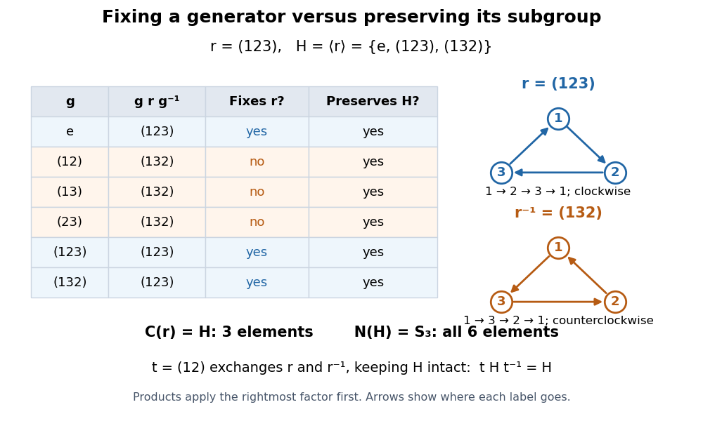

**[Figure 7](#image-the-centralizer-fixes-r-123-while-the-normalizer-preserves-h-langle-r-rangle-and-may-exchange-r-with-its-inverse-element). The centralizer fixes $r=(123)$, while the normalizer preserves $H=\langle r\rangle$ and may exchange $r$ with its inverse element**.

This distinction lets one ask separately which operations leave a chosen operation unchanged and which operations preserve the [subgroup](group.md#subgroup) it generates. The [normalizer](#normalizer) also supplies a [group homomorphism](group-theory.md#group-homomorphism) to the [automorphism group](group-theory.md#automorphism-group) of $H$, by $g\mapsto(h\mapsto ghg^{-1})$; its [group kernel](group-theory.md#kernel-of-a-group-homomorphism) is $C_G(H)$. In this example the [group homomorphism](group-theory.md#group-homomorphism) has two possible outputs, fixing $r$ or replacing it by $r^{-1}$. The [quotient group](group-theory.md#quotient-group) $N_{S_3}(H)/C_{S_3}(H)$ is therefore a [cyclic group](group.md#cyclic-group) of [group order](group.md#order-of-a-finite-group) two. Milne develops the [normalizer](#normalizer) as a [stabilizer subgroup](#stabilizer-subgroup) in [Group Theory (v4.01) by James S. Milne](mathematics-bibliography.md#group-theory-v4-01-by-james-s-milne).

#### Centralizer

↑ **Parent:** [Centralizer and normalizer](#centralizer-and-normalizer)

The [centralizer](#centralizer) of an element $x$ of a [group](group.md) $G$ consists of all elements that commute with $x$:

$$
C_G(x)=\{g\in G:gx=xg\}=\{g\in G:gxg^{-1}=x\}.
$$

It is the [stabilizer subgroup](#stabilizer-subgroup) of $x$ under the [conjugation action](#conjugation-action), hence a [subgroup](group.md#subgroup) of $G$. In [conjugacy classes of the symmetric group on three letters](#conjugacy-classes-of-the-symmetric-group-on-three-letters), the three representative computations are

$$
C_{S_3}(e)=S_3,\qquad C_{S_3}((12))=\{e,(12)\},\qquad C_{S_3}((123))=\{e,(123),(132)\}.
$$

For the [transposition](combinatorics.md#transposition-permutation) $(12)$, a commuting [permutation](combinatorics.md#permutation) must preserve the exchanged pair $\{1,2\}$ and fix $3$; only $e$ and $(12)$ do so. For $r=(123)$, a commuting [permutation](combinatorics.md#permutation) is determined by where it sends $1$: the equation $g(r(i))=r(g(i))$ forces the images of $2$ and $3$, leaving exactly $e,r,r^2$. For $e$, every [permutation](combinatorics.md#permutation) commutes. These [centralizer](#centralizer) sizes $6,2,3$ give [conjugacy class](#conjugacy-class) sizes $1,3,2$.

The [centralizer](#centralizer) is useful because it measures how much freedom remains after fixing one operation. Its [index of a subgroup](group.md#index-of-a-subgroup) counts the distinct results of [conjugation](#conjugation), and the intersection of all element [centralizers](#centralizer) is the [center of a group](group-theory.md#center-of-a-group). A [centralizer](#centralizer) need not be an [abelian group](group.md#abelian-group): $C_G(e)=G$ even when $G$ is a [nonabelian group](group.md#non-abelian-group). In an [abelian group](group.md#abelian-group), all element [centralizers](#centralizer) equal $G$. These observations also explain why the surrounding [group](group.md) matters: the [centralizer](#centralizer) of $(123)$ inside the [alternating group](finite-group-theory.md#alternating-group) $A_3$ is the whole $A_3$, whereas its [centralizer](#centralizer) inside $S_3$ is a proper [subgroup](group.md#subgroup). See [McKernan, the centralizer definition preceding lemma 23.6](https://ocw.mit.edu/courses/18-703-modern-algebra-spring-2013/96221ce2d5b1077b3e5d3c5e08c88afe_MIT18_703S13_pra_l_23.pdf).

For an arbitrary [subset](set.md#subset) $A\subseteq G$, the [centralizer of a subset](#centralizer-of-a-subset) fixes every element of $A$ individually under the [conjugation action](#conjugation-action):

$$
C_G(A)=\{g\in G:ga=ag\text{ for all }a\in A\}=\bigcap_{a\in A}C_G(a).
$$

This is a [pointwise stabilizer](#pointwise-stabilizer) of the elements of $A$, not of the [vertices of a polygon](euclidean-geometry.md#vertex-of-a-polygon) in a geometric realization. In particular, $r=(123)$ belongs to $C_{S_3}(r)$ although its [rotation](riemannian-geometry.md#rotation-mathematics) moves every [vertex of a polygon](euclidean-geometry.md#vertex-of-a-polygon) of the [equilateral triangle](euclidean-geometry.md#equilateral-triangle). If $A$ generates a [subgroup](group.md#subgroup) $H$, commuting with every element of $A$ implies commuting with every product of those elements and their [inverse elements](algebraic-operation.md#inverse-element); hence $C_G(A)=C_G(H)$. For the triangle [rotation](riemannian-geometry.md#rotation-mathematics) [subgroup](group.md#subgroup) $H=\langle r\rangle$, this gives $C_{S_3}(H)=C_{S_3}(r)=H$.

To see the commutation test directly on the [equilateral triangle](euclidean-geometry.md#equilateral-triangle), compare a [rotation](riemannian-geometry.md#rotation-mathematics) $r$ with the [reflection](linear-algebra.md#reflection-mathematics) $s=(12)$. Their [permutations](combinatorics.md#permutation) satisfy

$$
rs=(13),\qquad sr=(23),\qquad srs^{-1}=r^{-1}.
$$

The two orders send [vertex of a polygon](euclidean-geometry.md#vertex-of-a-polygon) $1$ to different places: $rs(1)=3$, but $sr(1)=1$. Thus $s\notin C_{S_3}(r)$. By contrast $r$ and $r^2$ commute, with $rr^2=r^2r=e$. The [reflection](linear-algebra.md#reflection-mathematics) reverses the chosen [rotation](riemannian-geometry.md#rotation-mathematics) while preserving the [subgroup](group.md#subgroup) of all triangle [rotations](riemannian-geometry.md#rotation-mathematics), so $s\in N_{S_3}(H)$. The distinction is visible before any counting: commuting preserves an operation itself; membership in the [normalizer](#normalizer) permits exchanging it with another operation in the same [subgroup](group.md#subgroup).

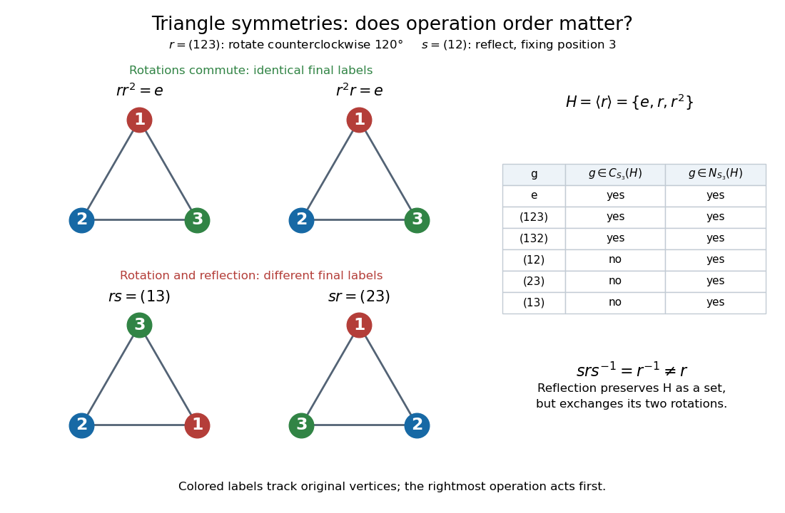

**[Figure 8](#image-commuting-triangle-rotations-and-noncommuting-rotation-reflection-products). Commuting triangle rotations and noncommuting rotation–reflection products**. Colored labels track the original [vertices of a polygon](euclidean-geometry.md#vertex-of-a-polygon). Products act from right to left. The top row gives the same labeled triangle for $rr^2$ and $r^2r$; the bottom row gives different labeled triangles for $rs$ and $sr$. All six [permutations](combinatorics.md#permutation) in $S_3$ are included in the [centralizer](#centralizer) and [normalizer](#normalizer) membership table.

##### Centralizer of a subset

↑ **Parent:** [Centralizer](#centralizer)

The centralizer of a subset $A$ of a [group](group.md) consists of the elements commuting with every member of $A$. It is the intersection of the element [centralizers](#centralizer), hence a [subgroup](group.md#subgroup). Directly, identity commutes with every element, products of two elements that each commute with every member of $A$ still have that property, and the same is true of inverses. For $A=G$ this is the [centre of a group](group-theory.md#center-of-a-group). For an empty subset the commutation condition is vacuous and the centralizer is all of $G$.

<h6 id="centralizer-of-a-hermitian-matrix-in-su-n">Centralizer of a Hermitian matrix in SU(n)</h6>

↑ **Parent:** [Centralizer of a subset](#centralizer-of-a-subset)

Let a [Hermitian matrix](hilbert-space.md#hermitian-operator) have distinct real [eigenvalues](linear-operator-theory.md#eigenvalue) with multiplicities $n_1,\ldots,n_k$. A [unitary matrix](linear-operator-theory.md#unitary-matrix) commuting with it must preserve each [eigenspace](linear-operator-theory.md#eigenspace): if $Av=\lambda v$, then $A(Uv)=UAv=\lambda Uv$. Conversely, any unitary transformation acting independently on these mutually orthogonal eigenspaces commutes with $A$. The [centralizer](#centralizer) in $U(n)$ is therefore $\prod_jU(n_j)$. Imposing total determinant one gives the displayed subgroup inside the [special unitary group](topological-group.md#special-unitary-group) $SU(n)$.

For multiplicities $(2,1)$ in [SU(3)](topological-group.md#su-3-group), it is $S(U(2)\times U(1))\cong U(2)$, embedded by $U\mapsto\operatorname{diag}(U,(\det U)^{-1})$. Three distinct eigenvalues leave the diagonal [maximal torus](lie-theory.md#maximal-torus) $U(1)^2$. This determines the unbroken group for a diagonal [adjoint scalar field](classical-field-theory.md#adjoint-scalar-field) vacuum, including its global determinant constraint.

##### Centraliser of a fixed-point-free involution

↑ **Parent:** [Centralizer](#centralizer)

Commutation with a fixed-point-free involution preserves its partner relation. A commuting [permutation](combinatorics.md#permutation) can permute the $m$ pairs and independently swap each pair. This gives the [permutation wreath product](group-theory.md#permutation-wreath-product) with order $2^m m!$.

##### Centraliser of a transposition

↑ **Parent:** [Centralizer](#centralizer)

A [permutation](combinatorics.md#permutation) commutes with a transposition exactly when it preserves its two-element support as a set. It may swap those two points and independently permute the remaining points. Thus this [centraliser](#centralizer) has order $2(n-2)!$.

#### Normalizer

↑ **Parent:** [Centralizer and normalizer](#centralizer-and-normalizer)

For a [subgroup](group.md#subgroup) $H$ of a [group](group.md) $G$, the [normalizer](#normalizer) is

$$
N_G(H)=\{g\in G:gHg^{-1}=H\}.
$$

It is the [stabilizer subgroup](#stabilizer-subgroup) of $H$ under the [conjugation action](#conjugation-action) on [subgroups](group.md#subgroup). Its elements can permute members of $H$; they need not commute with them. For $r=(123)$ in the [symmetric group](finite-group-theory.md#symmetric-group) $S_3$, the [cyclic subgroup](group.md#cyclic-subgroup) $H=\langle r\rangle$ has [normalizer](#normalizer) $S_3$, although the [centralizer](#centralizer) of $r$ has only three elements, as illustrated in [centralizer and normalizer](#centralizer-and-normalizer).

Every element of $H$ preserves $H$ under [conjugation](#conjugation), so $H\subseteq N_G(H)$. Moreover, $H$ is a [normal subgroup](group-theory.md#normal-subgroup) of $N_G(H)$, and this is the largest [subgroup](group.md#subgroup) of $G$ with that property. Indeed, any [subgroup](group.md#subgroup) in which $H$ is a [normal subgroup](group-theory.md#normal-subgroup) consists entirely of elements preserving $H$ under [conjugation](#conjugation). In particular, $N_G(H)=G$ exactly when $H$ is a [normal subgroup](group-theory.md#normal-subgroup) of $G$.[Group Theory (v4.01) by James S. Milne](mathematics-bibliography.md#group-theory-v4-01-by-james-s-milne)

The [orbit-stabilizer theorem](#orbit-stabilizer-theorem) counts distinct [conjugate subsets](#conjugate-subset) of a [subgroup](group.md#subgroup) by

$$
\#\{gHg^{-1}:g\in G\}=[G:N_G(H)].
$$

For $H=\langle(123)\rangle$ in $S_3$, there is just one, since $[S_3:N_{S_3}(H)]=6/6=1$. For the [subgroup](group.md#subgroup) $K=\langle(12)\rangle=\{e,(12)\}$, preserving $K$ forces its unique nonidentity element to stay fixed. Hence $N_{S_3}(K)=C_{S_3}((12))=K$, and its three distinct [conjugate subsets](#conjugate-subset) are $\{e,(12)\}$, $\{e,(13)\}$ and $\{e,(23)\}$. This is the [subgroup](group.md#subgroup) counterpart of counting a [conjugacy class](#conjugacy-class) with a [centralizer](#centralizer): the object being stabilized determines which denominator belongs in the count.[Group Theory (v4.01) by James S. Milne](mathematics-bibliography.md#group-theory-v4-01-by-james-s-milne)

The equality in the definition is essential. For a [subgroup](group.md#subgroup) $H$ that is a [finite group](group.md#finite-group), an inclusion $gHg^{-1}\subseteq H$ already gives equality by equal [cardinalities](cardinal-number.md#cardinality). For an infinite [subgroup](group.md#subgroup), that inference can fail: [conjugation](#conjugation) might carry it onto a proper [subgroup](group.md#subgroup). The [normal subgroup](group-theory.md#normal-subgroup) criterion is therefore, with the explicit hypothesis $H\leq G$,

$$
H\mathrel{\trianglelefteq}G\quad\Longleftrightarrow\quad N_G(H)=G.
$$

No finiteness or [commutativity](algebraic-operation.md#commutativity) assumption is needed. A [normal subgroup](group-theory.md#normal-subgroup) is preserved as a [set](set.md); its elements need not lie in the [center of a group](group-theory.md#center-of-a-group).

There is a second useful count, distinct from counting conjugate [subgroups](group.md#subgroup). The [normalizer](#normalizer) acts on $H$ itself by [group automorphisms](algebra.md#group-automorphism), giving the [group homomorphism](group-theory.md#group-homomorphism)

$$
\theta:N_G(H)\longrightarrow\operatorname{Aut}(H),\qquad \theta(g)(h)=ghg^{-1}.
$$

Its [group kernel](group-theory.md#kernel-of-a-group-homomorphism) is $C_G(H)$, so the [centralizer of a subset](#centralizer-of-a-subset) is a [normal subgroup](group-theory.md#normal-subgroup) of $N_G(H)$ and the [first isomorphism theorem](group-theory.md#first-isomorphism-theorem) gives

$$
N_G(H)/C_G(H)\cong\operatorname{im}\theta\leq\operatorname{Aut}(H).
$$

This [quotient group](group-theory.md#quotient-group) records the different rearrangements of $H$ induced by the surrounding [group](group.md). It gives a [faithful group action](#faithful-group-action) on $H$, but need not be the entire [automorphism group](group-theory.md#automorphism-group) of $H$. For example, take the ambient [group](group.md) $G=H=\langle(123)\rangle$. Since $G$ is an [abelian group](group.md#abelian-group), $N_G(H)=C_G(H)=G$, so the [quotient group](group-theory.md#quotient-group) is trivial; nevertheless $r\mapsto r^{-1}$ is a nonidentity [group automorphism](algebra.md#group-automorphism) of $H$. Returning to the ambient [symmetric group](finite-group-theory.md#symmetric-group) $S_3$ makes that [group automorphism](algebra.md#group-automorphism) available through a [reflection](linear-algebra.md#reflection-mathematics), and $N_{S_3}(H)/C_{S_3}(H)\cong C_2$. Its two [cosets](group-theory.md#coset) are the three [rotations](riemannian-geometry.md#rotation-mathematics) and the three [reflections](linear-algebra.md#reflection-mathematics).

The [subgroup](group.md#subgroup) $H$ itself need not be contained in $C_G(H)$: their intersection is the [center of a group](group-theory.md#center-of-a-group) $Z(H)$. It is contained precisely when $H$ is an [abelian group](group.md#abelian-group). Thus $N_G(H)/H$, which exists because $H$ is a [normal subgroup](group-theory.md#normal-subgroup) of its [normalizer](#normalizer), and $N_G(H)/C_G(H)$ answer different questions and should not be substituted for one another.

##### Normalizer of a diagonal subgroup of GL2

↑ **Parent:** [Normalizer](#normalizer)

Over the reals or a [finite field](algebra.md#finite-field) with more than two elements, the [normalizer](#normalizer) of all invertible diagonal [matrices](vector-space.md#matrix) in $GL_2$ consists of [monomial matrices](group-theory.md#monomial-matrix) and has quotient $C_2$ over that diagonal [subgroup](group.md#subgroup). Over $\mathbb F_p$ its size is $2(p-1)^2$ for $p>2$. For $p=2$ the diagonal [subgroup](group.md#subgroup) is trivial, so its normalizer is all of $GL_2(\mathbb F_2)$, of order six.

## Orbit-stabilizer theorem

↑ **Parent:** [Group action](group-action.md)  
ⓦ [Wiki](https://en.wikipedia.org/wiki/Orbit-stabilizer_theorem)

For a [group action](group-action.md) of any [group](group.md) $G$ on a [set](set.md) $X$, the [cardinality](cardinal-number.md#cardinality) of the [orbit of a group action](#orbit-group-theory) through $x$ is the [index of a subgroup](group.md#index-of-a-subgroup) of its [stabilizer subgroup](#stabilizer-subgroup):

$$
|Gx|=[G:G_x],\qquad G_x=\{g\in G:g\cdot x=x\}.
$$

In particular, if $G$ is a [finite group](group.md#finite-group),

$$
|G|=|Gx|\,|G_x|,\qquad |Gx|=\frac{|G|}{|G_x|}.
$$

For a fixed [finite group](group.md#finite-group), a larger [stabilizer subgroup](#stabilizer-subgroup) means a smaller [group orbit](#orbit-group-theory): more transformations repeat the same image of $x$. The [set](set.md) $X$ itself need not be finite.

The underlying [bijection](function.md#bijection) uses left [cosets](group-theory.md#coset), without requiring $G_x$ to be a [normal subgroup](group-theory.md#normal-subgroup):

$$
\Phi:\{gG_x:g\in G\}\longrightarrow Gx,\qquad gG_x\longmapsto g\cdot x.
$$

To check it briefly, replacing $g$ by $gh$ with $h\in G_x$ preserves $g\cdot x$, so $\Phi$ is well-defined. Every member of the [group orbit](#orbit-group-theory) has this form. Finally, $g\cdot x=k\cdot x$ implies $k^{-1}g\in G_x$, hence $gG_x=kG_x$, proving the [bijection](function.md#bijection). This is the construction in [MIT's group-action notes, lemma 23.5](https://ocw.mit.edu/courses/18-703-modern-algebra-spring-2013/96221ce2d5b1077b3e5d3c5e08c88afe_MIT18_703S13_pra_l_23.pdf). For infinite [groups](group.md), the [bijection](function.md#bijection) and the [cardinality](cardinal-number.md#cardinality) statement $|Gx|=[G:G_x]$ still hold; division of infinite [cardinalities](cardinal-number.md#cardinality) does not supply the finite formula.

For the eight-element [dihedral group](finite-group-theory.md#dihedral-group) $D_4$ acting on the [square](euclidean-geometry.md#square) described under [group action](group-action.md), moving a marked [vertex of a polygon](euclidean-geometry.md#vertex-of-a-polygon) gives $8=4\cdot2$. Moving a marked [side of a polygon](euclidean-geometry.md#side-of-a-polygon) also gives $8=4\cdot2$; moving one unoriented [diagonal of a polygon](euclidean-geometry.md#diagonal-of-a-polygon) gives $8=2\cdot4$; moving the [centroid](euclidean-geometry.md#centroid) gives $8=1\cdot8$. These are four different [group actions](group-action.md), each with one [group orbit](#orbit-group-theory). In the first [group action](group-action.md), the four left [cosets](group-theory.md#coset) of $H=G_A=\{e,s\}$ are

$$
H=\{e,s\},\quad rH=\{r,rs\},\quad r^2H=\{r^2,r^2s\},\quad r^3H=\{r^3,r^3s\}.
$$

They correspond respectively to $A,B,C,D$. Counting all eight transformations would count each position of the marked [vertex of a polygon](euclidean-geometry.md#vertex-of-a-polygon) twice.

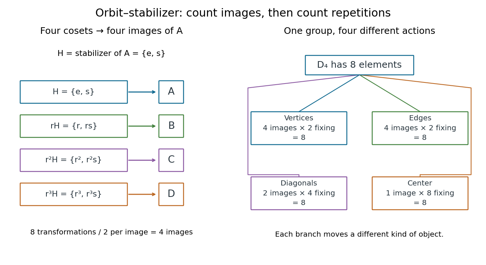

**[Figure 9](#image-cosets-explain-the-orbit-stabilizer-theorem-for-a-square). Cosets explain the orbit-stabilizer theorem for a square**. The left panel matches four left [cosets](group-theory.md#coset) of a [stabilizer subgroup](#stabilizer-subgroup) to four images of a [vertex of a polygon](euclidean-geometry.md#vertex-of-a-polygon). The right panel compares the [group orbits](#orbit-group-theory) for separate [group actions](group-action.md) on [vertices of a polygon](euclidean-geometry.md#vertex-of-a-polygon), [sides of a polygon](euclidean-geometry.md#side-of-a-polygon), [diagonals of a polygon](euclidean-geometry.md#diagonal-of-a-polygon), and the [centroid](euclidean-geometry.md#centroid); each [group orbit](#orbit-group-theory) size times the corresponding [stabilizer subgroup](#stabilizer-subgroup) [group order](group.md#order-of-a-finite-group) equals eight.

For a second computed example, let the [symmetric group](finite-group-theory.md#symmetric-group) $S_3$ act on the [Cartesian product](set-theory.md#cartesian-product) $X=\{1,2,3\}^2$ by $\sigma\cdot(i,j)=(\sigma(i),\sigma(j))$. There are two [orbits of a group action](#orbit-group-theory):

$$
S_3\cdot(1,1)=\{(1,1),(2,2),(3,3)\},\qquad (S_3)_{(1,1)}=\{e,(23)\},
$$

and

$$
S_3\cdot(1,2)=\{(1,2),(1,3),(2,1),(2,3),(3,1),(3,2)\},\qquad (S_3)_{(1,2)}=\{e\}.
$$

The first [stabilizer subgroup](#stabilizer-subgroup) can exchange $2$ and $3$ while fixing $1$; the second must fix both $1$ and $2$, so also fixes $3$. The [orbit-stabilizer theorem](#orbit-stabilizer-theorem) gives $6=3\cdot2$ and $6=6\cdot1$, and the two [group orbit](#orbit-group-theory) sizes account for all nine [ordered pairs](set.md#ordered-pair). The general reason for exactly these two [group orbits](#orbit-group-theory) is [equality-pattern orbits of ordered pairs](#equality-pattern-orbits-of-ordered-pairs).

### Orbit dimension formula

↑ **Parent:** [Orbit-stabilizer theorem](#orbit-stabilizer-theorem)

For an [algebraic group action](algebraic-variety.md#algebraic-group-action), the orbit dimension is the dimension of the group minus that of its stabilizer. For a finite-dimensional representation, the stabilizer is an automorphism group, open in its [endomorphism ring](module-theory.md#endomorphism-ring), so their dimensions agree. In a [quiver representation space](algebra.md#quiver-representation-space), the [Ringel form](algebra.md#ringel-form) turns the orbit codimension into the dimension of the self-extension group.

## Symmetry group of a cube

↑ **Parent:** [Group action](group-action.md)

The full isometry group of a cube has order $48$. Its transitive actions on the $8$ vertices, $12$ edges, and $4$ main diagonals have stabilizers isomorphic respectively to

$$
S_3,\qquad C_2\times C_2,\qquad C_2\times S_3.
$$

The action on main diagonals has kernel $\{I,-I\}$.

### Body-diagonal stabilizer in the cube symmetry group

↑ **Parent:** [Symmetry group of a cube](#symmetry-group-of-a-cube)

For vertices $(\pm1,\pm1,\pm1)$, the [symmetry group of a cube](#symmetry-group-of-a-cube) consists of [signed permutation matrices](vector-space.md#signed-permutation-matrix). A matrix preserving the unoriented line through $(1,1,1)$ must have all three signs equal, so it has the form $\varepsilon P$, where $P$ is a [permutation matrix](vector-space.md#permutation-matrix) and $\varepsilon\in\{1,-1\}$. Central inversion commutes with every $P$ and is not itself a permutation matrix. Consequently $(P,\varepsilon)\mapsto\varepsilon P$ identifies this twelve-element [stabilizer subgroup](#stabilizer-subgroup) with the [direct product of groups](group-theory.md#direct-product-of-groups) $S_3\times C_2$. A body diagonal is different from a face-normal coordinate axis, whose line stabilizer has order sixteen.

### Axial isotropy types of the full cube symmetry group

↑ **Parent:** [Symmetry group of a cube](#symmetry-group-of-a-cube)

The full [symmetry group of a cube](#symmetry-group-of-a-cube) acts as all signed permutation [matrices](vector-space.md#matrix). The [stabilizer subgroups](#stabilizer-subgroup) of $(1,0,0)$, $(1,1,0)$ and $(1,1,1)$ have orders eight, four and six, respectively, and their [fixed-point subspaces of a group action](representation-theory.md#fixed-point-subspace-of-a-group-action) are the lines through those vectors. The three [group orbits](#orbit-group-theory) have sizes six, twelve and eight. They therefore give distinct axial types for the [equivariant branching lemma](dynamical-systems.md#equivariant-branching-lemma). More generally the fixed-space dimension of a vector [stabilizer subgroup](#stabilizer-subgroup) equals the number of distinct nonzero absolute coordinate values, so these are precisely its one-dimensional types.

// Destination: dynamical-systems.bigb

### Axis stabilizer in the full octahedral symmetry group

↑ **Parent:** [Symmetry group of a cube](#symmetry-group-of-a-cube)

An opposite-vertex line in the [full octahedral symmetry group](#symmetry-group-of-a-cube) is an unoriented coordinate axis. Its [stabilizer subgroup](#stabilizer-subgroup) has the block form $\operatorname{diag}(A,\varepsilon)$, where $A$ is a signed two-dimensional permutation matrix and $\varepsilon=\pm1$. The eight possibilities for $A$ form the [dihedral group](finite-group-theory.md#dihedral-group) of a square, of order eight; the independent axial sign gives a [cyclic group](group.md#cyclic-group) of order two. Thus the stabilizer is their direct product, of order sixteen. It is larger than the stabilizer of an individual vertex, because exchanging the two endpoints still fixes the line.

### Cube symmetry action on edges

↑ **Parent:** [Symmetry group of a cube](#symmetry-group-of-a-cube)

The full [symmetry group of a cube](#symmetry-group-of-a-cube) acts transitively and faithfully on its twelve edges. For vertices $(\pm1,\pm1,\pm1)$, its [signed permutation matrices](vector-space.md#signed-permutation-matrix) act transitively on the edges. The [stabilizer subgroup](#stabilizer-subgroup) of $\{(1,1,z):-1\le z\le1\}$ consists of independently swapping $x,y$ and reversing $z$, and is a [Klein four-group](finite-group-theory.md#klein-four-group). The [orbit-stabilizer theorem](#orbit-stabilizer-theorem) gives order $12\cdot4=48$. Fixing every edge fixes every vertex, as each vertex is the unique intersection of its three incident edges, so the [group action](group-action.md) is faithful. The resulting [subgroup](group.md#subgroup) of $S_{12}$ has index $12!/48$ and is not normal: central inversion has [cycle type](finite-group-theory.md#cycle-type) $2^6$, whose [conjugacy class](#conjugacy-class) in $S_{12}$ has $12!/(2^6 6!)=10395>48$ elements.

### Direct-product decomposition of the cube symmetry group

↑ **Parent:** [Symmetry group of a cube](#symmetry-group-of-a-cube)

The [symmetry group of a cube](#symmetry-group-of-a-cube) splits into its central inversion and its [rotational symmetry group of a cube](#rotational-symmetry-group-of-a-cube). Inversion has [determinant](multilinear-algebra.md#determinant) $-1$, the rotation [subgroup](group.md#subgroup) has [determinant](multilinear-algebra.md#determinant) $1$, and together they generate the full [group](group.md) with trivial intersection. The rotation [subgroup](group.md#subgroup) acts faithfully on the four body diagonals and is isomorphic to $S_4$. Consequently the full [group](group.md) is this [direct product of groups](group-theory.md#direct-product-of-groups).

### Rotational symmetry group of a cube

↑ **Parent:** [Symmetry group of a cube](#symmetry-group-of-a-cube)

The orientation-preserving symmetries of a cube are the $3\times3$ [signed permutation matrices](vector-space.md#signed-permutation-matrix) with [determinant](multilinear-algebra.md#determinant) one. There are $3!\,2^2=24$ of them. Their [group action](group-action.md) on the four body diagonals identifies this [group](group.md) with the [symmetric group](finite-group-theory.md#symmetric-group) $S_4$. Indeed choose diagonal directions $(1,1,1),(1,-1,-1),(-1,1,-1),(-1,-1,1)$, whose sum is zero and whose only linear relation has all coefficients equal. A rotation fixing every diagonal sends each direction to itself or its negative; the relation forces all four signs equal. All negative would give $-I$, which has [determinant](multilinear-algebra.md#determinant) $-1$, so the [kernel of a group homomorphism](group-theory.md#kernel-of-a-group-homomorphism) is trivial. Both [groups](group.md) have order 24, giving the identification. Its face [permutations](combinatorics.md#permutation) have cycle types $1^6$, $1^24$, $1^22^2$, $2^3$ and $3^2$, occurring $1,6,3,6,8$ times respectively.

#### Tetrahedron stabilizer in the cube rotation group

↑ **Parent:** [Rotational symmetry group of a cube](#rotational-symmetry-group-of-a-cube)

For cube vertices $(\pm1,\pm1,\pm1)$, the four vertices of coordinate product $+1$ and the four of product $-1$ form the two inscribed [regular tetrahedra](euclidean-geometry.md#regular-tetrahedron). A cube [rotation](riemannian-geometry.md#rotation-mathematics) is a [signed permutation matrix](vector-space.md#signed-permutation-matrix) of [determinant](multilinear-algebra.md#determinant) one and maps each product class to one class. A quarter-turn about a coordinate axis exchanges the classes. The [orbit](dynamical-systems.md#orbit-dynamical-system) of either tetrahedron therefore has size two, while the [cube rotation group](#rotational-symmetry-group-of-a-cube) has order 24. The [orbit-stabilizer theorem](#orbit-stabilizer-theorem) gives its setwise [stabilizer subgroup](#stabilizer-subgroup) order 12; this is the tetrahedron's proper [rotation](riemannian-geometry.md#rotation-mathematics) [group](group.md).

#### Kernel of the cube face-axis action

↑ **Parent:** [Rotational symmetry group of a cube](#rotational-symmetry-group-of-a-cube)

Permuting the three pairs of opposite faces gives a [group homomorphism](group-theory.md#group-homomorphism) from the [rotational symmetry group of a cube](#rotational-symmetry-group-of-a-cube) to $S_3$. Its kernel consists of the identity and the half-turns about the three coordinate axes: these are precisely the diagonal sign matrices with [determinant](multilinear-algebra.md#determinant) one. Thus it is a [normal subgroup](group-theory.md#normal-subgroup) of order four, a [Klein four-group](finite-group-theory.md#klein-four-group).

#### Face-pair orbits of cube rotations

↑ **Parent:** [Rotational symmetry group of a cube](#rotational-symmetry-group-of-a-cube)

The [rotational symmetry group of a cube](#rotational-symmetry-group-of-a-cube) has three [group orbits](#orbit-group-theory) on ordered pairs of faces: equal faces, opposite faces, and adjacent faces. Their sizes are respectively $6$, $6$ and $24$. Fixing one face leaves its cyclic group of four quarter-turns, which acts transitively on the four adjacent faces; this proves transitivity in the last orbit rather than merely counting its points.

## Faithful group action

↑ **Parent:** [Group action](group-action.md)  
ⓦ [Wiki](https://en.wikipedia.org/wiki/Faithful_group_action)

A group action is faithful when only the identity acts as the identity on every point.

For a [group action](group-action.md) of $G$ on a [set](set.md) $X$, form the [group homomorphism](group-theory.md#group-homomorphism)

$$
\rho:G\longrightarrow\operatorname{Sym}(X),\qquad \rho(g)(x)=g\cdot x.
$$

A [faithful group action](#faithful-group-action) means that $\rho$ is [injective](algebra.md#injective-function): different [group](group.md) elements induce different [permutations](combinatorics.md#permutation) of $X$. Equivalently, its [group kernel](group-theory.md#kernel-of-a-group-homomorphism) is trivial:

$$
K=\ker\rho=\{g\in G:g\cdot x=x\text{ for every }x\in X\}=\bigcap_{x\in X}G_x=\{e\}.
$$

Here $G_x$ is the [stabilizer subgroup](#stabilizer-subgroup) of $x$, and $e$ is the [identity element](algebraic-operation.md#identity-element).[Theorem 1.7, printed page 3, and Definition 2.17, printed page 9: actions as homomorphisms and faithfulness](mathematics-bibliography.md#group-actions-by-keith-conrad)

The test is global. A [faithful group action](#faithful-group-action) requires each nonidentity [group](group.md) element to move at least one point; a [free group action](#free-group-action) requires it to move every point. In the [faithful coset action of the symmetric group on three letters](#faithful-coset-action-of-the-symmetric-group-on-three-letters), $(12)$ fixes one [coset](group-theory.md#coset) and exchanges the other two. Thus a nontrivial [stabilizer subgroup](#stabilizer-subgroup) does not rule out faithfulness. The distinction follows directly from the order of the quantifiers:

$$
\text{faithful: }\forall g\ne e\ \exists x:\ g\cdot x\ne x,\qquad
\text{free: }\forall g\ne e\ \forall x:\ g\cdot x\ne x.
$$

On a nonempty [set](set.md), a [free group action](#free-group-action) is therefore a [faithful group action](#faithful-group-action). A [transitive group action](#transitive-group-action) instead asks whether every point can reach every other; it allows several [group](group.md) elements to perform exactly the same rearrangement. The [nonfaithful coset action of the symmetric group on three letters](#nonfaithful-coset-action-of-the-symmetric-group-on-three-letters) is a counterexample to the claim that every [transitive group action](#transitive-group-action) is a [faithful group action](#faithful-group-action).

For a short proof of the [group kernel](group-theory.md#kernel-of-a-group-homomorphism) criterion, $\rho(g)=\rho(h)$ exactly when $\rho(h^{-1}g)$ is the identity [permutation](combinatorics.md#permutation), or $h^{-1}g\in K$. If $K=\{e\}$, this forces $g=h$; if $K$ contains a nonidentity element, that element and $e$ act identically. Thus a [faithful group action](#faithful-group-action) turns $G$ into an actual [subgroup](group.md#subgroup) of a [symmetric group](finite-group-theory.md#symmetric-group), retaining its [group operation](group.md#group-operation) as [function composition](function.md#function-composition). Choosing a suitable [coset action](#coset-action) can give a much smaller [set](set.md) of labels than the [regular group action](#regular-group-action) used in [Cayley's theorem](group-theory.md#cayley-s-theorem).

### Nonfaithful coset action of the symmetric group on three letters

↑ **Parent:** [Faithful group action](#faithful-group-action)

Let $G=S_3$, the [symmetric group](finite-group-theory.md#symmetric-group) on three letters, and take the [normal subgroup](group-theory.md#normal-subgroup) $N=A_3=\{e,(123),(132)\}$, the [alternating group](finite-group-theory.md#alternating-group) of [even permutations](finite-group-theory.md#even-permutation). Its two left [cosets](group-theory.md#coset) are

$$
E=N=\{e,(123),(132)\},\qquad O=(12)N=\{(12),(13),(23)\}.
$$

Products of [permutations](combinatorics.md#permutation) apply the rightmost factor first. Left multiplication by an [even permutation](finite-group-theory.md#even-permutation) preserves both [cosets](group-theory.md#coset), while left multiplication by an [odd permutation](finite-group-theory.md#odd-permutation) exchanges them. For example,

$$
(123)\cdot E=E,\quad (123)\cdot O=O,\qquad
(12)\cdot E=O,\quad (12)\cdot O=E.
$$

Consequently all six [group](group.md) elements give only two distinct [permutations](combinatorics.md#permutation) of $\{E,O\}$. Both [stabilizer subgroups](#stabilizer-subgroup) equal $A_3$, so their intersection, the [group kernel](group-theory.md#kernel-of-a-group-homomorphism), is $A_3$. This is a [transitive group action](#transitive-group-action) because $(12)$ reaches the other [coset](group-theory.md#coset), but it is not a [faithful group action](#faithful-group-action) because $(123)$ fixes both.

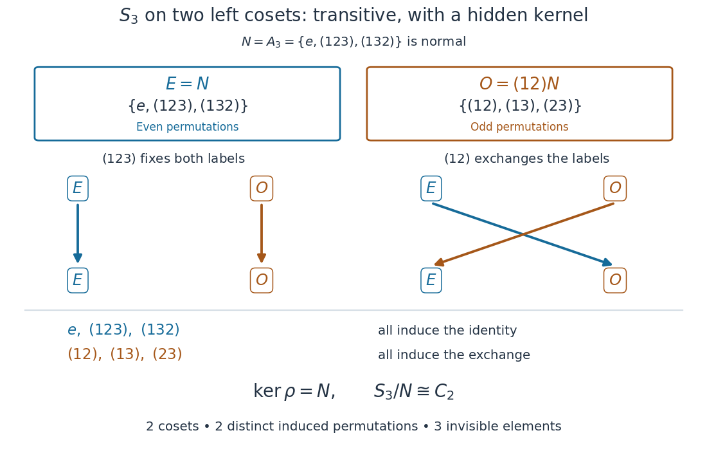

**[Figure 10](#s3-two-coset-action-kernel). A transitive group action of $S_3$ on two cosets detects only the sign of a permutation**. This computed example groups the six [permutations](combinatorics.md#permutation) by their induced [permutations](combinatorics.md#permutation) of the two [cosets](group-theory.md#coset). All three [even permutations](finite-group-theory.md#even-permutation) fix both labels; all three [odd permutations](finite-group-theory.md#odd-permutation) exchange them. The [group kernel](group-theory.md#kernel-of-a-group-homomorphism) has three elements.

The [orbit-stabilizer theorem](#orbit-stabilizer-theorem) still works perfectly: $6=2\cdot3$. It counts reachable labels, without asserting that the induced [group homomorphism](group-theory.md#group-homomorphism) is [injective](algebra.md#injective-function). The [quotient group](group-theory.md#quotient-group) $S_3/A_3\cong C_2$ captures exactly the two visible operations, identity and exchange. This is the same [group homomorphism](group-theory.md#group-homomorphism) as the [sign of a permutation](finite-group-theory.md#sign-of-a-permutation), with $+1$ represented by fixing both labels and $-1$ by exchanging them. Contrast the three-label example in [faithful coset action of the symmetric group on three letters](#faithful-coset-action-of-the-symmetric-group-on-three-letters).

### Faithful quotient of a group action

↑ **Parent:** [Faithful group action](#faithful-group-action)

For any [group action](group-action.md) with [group kernel](group-theory.md#kernel-of-a-group-homomorphism) $K$, the [quotient group](group-theory.md#quotient-group) $G/K$ has a [faithful group action](#faithful-group-action) on the same [set](set.md), given by

$$
(gK)\cdot x=g\cdot x.
$$

To check independence of the [coset](group-theory.md#coset) representative, replace $g$ by $gk$ with $k\in K$: then $(gk)\cdot x=g\cdot(k\cdot x)=g\cdot x$. If $gK$ fixes every point, then $g\in K$, so $gK=K$, the [identity element](algebraic-operation.md#identity-element) of the [quotient group](group-theory.md#quotient-group). The [first isomorphism theorem](group-theory.md#first-isomorphism-theorem) identifies this [quotient group](group-theory.md#quotient-group) with the image of $\rho$ inside the [symmetric group](finite-group-theory.md#symmetric-group). The [group orbits](#orbit-group-theory) stay the same because the possible point movements stay the same.

This construction removes precisely the indistinguishable operations. In [nonfaithful coset action of the symmetric group on three letters](#nonfaithful-coset-action-of-the-symmetric-group-on-three-letters), it replaces six [group](group.md) elements by two [cosets](group-theory.md#coset), each representing one visible operation. In [faithful coset action of the symmetric group on three letters](#faithful-coset-action-of-the-symmetric-group-on-three-letters), the [group kernel](group-theory.md#kernel-of-a-group-homomorphism) is already trivial, so all six distinct operations survive.

### Normal subgroup orbits in a faithful prime-degree action

↑ **Parent:** [Faithful group action](#faithful-group-action)

If a group acts transitively on a set of prime size and $N$ is normal, then the $N$-orbits form a $G$-invariant block system of equal size. They are therefore either singletons or the whole set. In a faithful action the singleton case forces $N=1$, so every nontrivial normal subgroup is transitive.

## Orbit (group theory)

↑ **Parent:** [Group action](group-action.md)  
ⓦ [Wiki](https://en.wikipedia.org/wiki/Orbit_(group_theory))

For a [group action](group-action.md) of a [group](group.md) $G$ on a [set](set.md) $X$, the [orbit of a group action](#orbit-group-theory) of $x\in X$ is the [subset](set.md#subset) of all positions reachable from $x$:

$$
Gx=G\cdot x=\{g\cdot x:g\in G\}\subseteq X.
$$

Two points belong to the same [group orbit](#orbit-group-theory) exactly when one can be moved to the other by a [group](group.md) element. This is an [equivalence relation](set-theory.md#equivalence-relation): the [identity element](algebraic-operation.md#identity-element) gives $x\sim x$, the [inverse element](algebraic-operation.md#inverse-element) of a transformation reverses a move, and a product combines two moves. Hence the [group orbits](#orbit-group-theory) form a [partition of a set](set.md#partition-of-a-set) of $X$ into [equivalence classes](set-theory.md#equivalence-class). A [transitive group action](#transitive-group-action) on a nonempty [set](set.md) has just one [group orbit](#orbit-group-theory). See [Ackerman's algebra notes, lemma 0.5.1.3, for the orbit partition](https://people.math.harvard.edu/~nate/teaching/UPenn/2007/fall/math_371/lectures/week_1/lecture_1/lecture_1.pdf).

For the [square](euclidean-geometry.md#square) and the eight-element [dihedral group](finite-group-theory.md#dihedral-group) $D_4$ defined under [group action](group-action.md), direct enumeration gives the following separate [group orbits](#orbit-group-theory):

- On [vertices of a polygon](euclidean-geometry.md#vertex-of-a-polygon), $D_4\cdot A=\{A,B,C,D\}$ has size four.
- On unoriented [sides of a polygon](euclidean-geometry.md#side-of-a-polygon), $D_4\cdot AB=\{AB,BC,CD,DA\}$ has size four; $AB$ and $BA$ denote the same [side of a polygon](euclidean-geometry.md#side-of-a-polygon).
- On unoriented [diagonals of a polygon](euclidean-geometry.md#diagonal-of-a-polygon), $D_4\cdot AC=\{AC,BD\}$ has size two.
- On the [singleton set](set.md#singleton-mathematics) containing the [centroid](euclidean-geometry.md#centroid) $O=(0,0)$, $D_4\cdot O=\{O\}$ has size one, so $O$ is a [fixed point of a group action](#fixed-point-of-a-group-action).

These counts depend on the chosen [group action](group-action.md), not just the [group](group.md). An [orbit of a group action](#orbit-group-theory) describes all configurations equivalent under the permitted transformations. For [ordered pairs](set.md#ordered-pair) under the [symmetric group](finite-group-theory.md#symmetric-group), equality of the two entries is preserved, separating the two [group orbits](#orbit-group-theory) in [equality-pattern orbits of ordered pairs](#equality-pattern-orbits-of-ordered-pairs); the [orbit-stabilizer theorem](#orbit-stabilizer-theorem) computes their sizes when the [symmetric group](finite-group-theory.md#symmetric-group) is $S_3$.

### Equality-pattern orbits of ordered pairs

↑ **Parent:** [Orbit (group theory)](#orbit-group-theory)

The diagonal [group action](group-action.md) of the [symmetric group](finite-group-theory.md#symmetric-group) on ordered pairs has two [orbits of a group action](#orbit-group-theory) when $n\geq2$: equal pairs, of size $n$, and distinct pairs, of size $n(n-1)$. Equality is preserved by a [bijection](function.md#bijection), and a prescribed bijection on one or two distinct letters extends to a [permutation](combinatorics.md#permutation) of all letters. At $n=1$ only the equal-pair orbit remains.

### Real rotation orbits on a complex unit quadric

↑ **Parent:** [Orbit (group theory)](#orbit-group-theory)

For $z=x+iy\in\mathbb C^3$ satisfying $z^Tz=1$, the real and imaginary parts obey $|x|^2-|y|^2=1$ and $x\cdot y=0$. Simultaneous real rotations preserve $r=|y|$. At $r=0$ the [group orbit](#orbit-group-theory) is the unit sphere, with [stabilizer subgroup](#stabilizer-subgroup) $SO(2)$. At each $r>0$, the normalized pair $(x,y)$ is an oriented two-frame, giving a free transitive [SO(3) group](linear-algebra.md#so-3-group) action. The [group orbit](#orbit-group-theory) space is $[0,\infty)$, and the whole quadric is diffeomorphic to the [tangent bundle](vector-bundle.md#tangent-bundle) of $S^2$. Its varying Hermitian norm prevents it from being a single [SU(3)](topological-group.md#su-3-group) [group orbit](#orbit-group-theory).

### Equality-pattern orbits of projective triples

↑ **Parent:** [Orbit (group theory)](#orbit-group-theory)

The [general linear group over a finite field](finite-group-theory.md#general-linear-group-over-a-finite-field) acting diagonally on projective triples has five [orbits of a group action](#orbit-group-theory): all equal, three different positions for the repeated coordinate when exactly two are equal, and all distinct. The corresponding representative [stabilizer subgroups](#stabilizer-subgroup) are upper triangular, diagonal, and [scalar matrices](linear-algebra.md#scalar-matrix). Their orders are $p(p-1)^2$, $(p-1)^2$, and $p-1$, respectively; the orbit sizes are $p+1$, $p(p+1)$, and $p(p+1)(p-1)$. Transitivity follows from the action being [sharply three-transitive on a projective line](finite-group-theory.md#sharply-three-transitive-on-a-projective-line).

## Stabilizer subgroup

↑ **Parent:** [Group action](group-action.md)

For a [group action](group-action.md) of a [group](group.md) $G$ on a [set](set.md) $X$, the [stabilizer subgroup](#stabilizer-subgroup) of $x\in X$ consists of the transformations that leave $x$ fixed:

$$
G_x=\operatorname{Stab}_G(x)=\{g\in G:g\cdot x=x\}\leq G.
$$

It is a [subgroup](group.md#subgroup): the [identity element](algebraic-operation.md#identity-element) fixes $x$, products of transformations fixing $x$ fix $x$, and the [inverse element](algebraic-operation.md#inverse-element) of a transformation fixing $x$ also fixes $x$. A [stabilizer subgroup](#stabilizer-subgroup) is a [subset](set.md#subset) of $G$, whereas the [orbit of a group action](#orbit-group-theory) is a [subset](set.md#subset) of $X$. See [Ackerman's algebra notes, definition 0.4.1.2](https://people.math.harvard.edu/~nate/teaching/UPenn/2007/fall/math_371/lectures/week_1/lecture_1/lecture_1.pdf).

For the [square](euclidean-geometry.md#square) [group actions](group-action.md) defined under [group action](group-action.md), direct calculation gives

$$
(D_4)_A=\{e,s\},\qquad (D_4)_{AB}=\{e,rs\},\qquad (D_4)_{AC}=\{e,r^2,s,r^2s\},\qquad (D_4)_O=D_4.
$$

The [reflection](linear-algebra.md#reflection-mathematics) $s$ fixes $A$ and $C$ individually. The [reflection](linear-algebra.md#reflection-mathematics) $rs$ preserves the unoriented [side of a polygon](euclidean-geometry.md#side-of-a-polygon) $AB$ by exchanging its two [vertices of a polygon](euclidean-geometry.md#vertex-of-a-polygon). The half-turn [rotation](riemannian-geometry.md#rotation-mathematics) $r^2$ exchanges the two ends of the unoriented [diagonal of a polygon](euclidean-geometry.md#diagonal-of-a-polygon) $AC$ while preserving that [diagonal of a polygon](euclidean-geometry.md#diagonal-of-a-polygon). Thus fixing a [side of a polygon](euclidean-geometry.md#side-of-a-polygon) or [diagonal of a polygon](euclidean-geometry.md#diagonal-of-a-polygon) as an object does not mean fixing every point on it; the latter condition uses a [pointwise stabilizer](#pointwise-stabilizer). The four [stabilizer subgroups](#stabilizer-subgroup) have [group orders](group.md#order-of-a-finite-group) $2,2,4,8$, matching [group orbit](#orbit-group-theory) sizes $4,4,2,1$ through the [orbit-stabilizer theorem](#orbit-stabilizer-theorem).

A [stabilizer subgroup](#stabilizer-subgroup) records the transformations still available after imposing a constraint. Fixing a [vertex of a polygon](euclidean-geometry.md#vertex-of-a-polygon) of the [square](euclidean-geometry.md#square) leaves two choices; fixing its [centroid](euclidean-geometry.md#centroid) leaves all eight. In a [faithful group action](#faithful-group-action), a [stabilizer subgroup](#stabilizer-subgroup) can still contain a nonidentity transformation, as $s\in(D_4)_A$ shows: a [faithful group action](#faithful-group-action) requires that only the [identity element](algebraic-operation.md#identity-element) fix every point of $X$ simultaneously, not that every individual [stabilizer subgroup](#stabilizer-subgroup) be trivial. The two-point [cyclic group](group.md#cyclic-group) example under [group action](group-action.md) has both [stabilizer subgroups](#stabilizer-subgroup) equal to the [group kernel](group-theory.md#kernel-of-a-group-homomorphism) $\{0,2\}$ of its associated [group homomorphism](group-theory.md#group-homomorphism).

### Pointwise stabilizer

↑ **Parent:** [Stabilizer subgroup](#stabilizer-subgroup)

For a [group action](group-action.md), the pointwise stabilizer of a set $S$ is the [subgroup](group.md#subgroup) fixing each of its points individually. It is the intersection of their [stabilizer subgroups](#stabilizer-subgroup). This is stronger than merely mapping the set to itself.

### Axial subgroup

↑ **Parent:** [Stabilizer subgroup](#stabilizer-subgroup)

For a steady-state [equivariant dynamical system](dynamical-systems.md#equivariant-dynamical-system), an axial subgroup has a one-dimensional real [fixed-point subspace of a group action](representation-theory.md#fixed-point-subspace-of-a-group-action). A complex axial subgroup for a Hopf problem has a one-dimensional complex fixed-point subspace under the spatial group combined with the common phase action. Distinct conjugacy classes may yield distinct types of bifurcating branches.

#### Complex axial isotropy subgroup

↑ **Parent:** [Axial subgroup](#axial-subgroup)

For the spatial group combined with the temporal phase circle in an equivariant Hopf problem, a complex axial isotropy subgroup is an actual stabilizer whose fixed-point space is one complex line. Its real dimension is two. One must include the kernel of the combined action when writing the full stabilizer, not just a generator having the right fixed space.

// Target: dynamical-systems.bigb

## Symmetric group action on subsets

↑ **Parent:** [Group action](group-action.md)  
ⓦ [Wiki](https://en.wikipedia.org/wiki/Symmetric_group_action_on_subsets)

The symmetric group acts on $k$-element subsets by applying a permutation to every member.

## Coset action

↑ **Parent:** [Group action](group-action.md)  
ⓦ [Wiki](https://en.wikipedia.org/wiki/Coset_action)

A group acts on the left cosets of a subgroup by left multiplication; its kernel is the core of that subgroup.

Let $H\leq G$ be a [subgroup](group.md#subgroup). The notation $G/H$ here means the [set](set.md) of left [cosets](group-theory.md#coset) $\{aH:a\in G\}$, even when $H$ is not a [normal subgroup](group-theory.md#normal-subgroup). Define

$$
g\cdot(aH)=(ga)H,\qquad
\rho_H:G\longrightarrow\operatorname{Sym}(G/H).
$$

This gives a [group action](group-action.md) without needing a [quotient group](group-theory.md#quotient-group) structure on $G/H$.[Example 2.12, printed pages 7–8: left multiplication on left cosets, without normality](mathematics-bibliography.md#group-actions-by-keith-conrad)

The representative check is essential: if $aH=bH$, then $a=bh$ for some $h\in H$, and $(ga)H=(gbh)H=(gb)H$. Thus equal input [cosets](group-theory.md#coset) give equal output [cosets](group-theory.md#coset). The [identity element](algebraic-operation.md#identity-element) fixes every [coset](group-theory.md#coset), and [associativity](algebraic-operation.md#associative-property) gives $g_1\cdot(g_2\cdot aH)=(g_1g_2)\cdot aH$. Each induced map is a [permutation](combinatorics.md#permutation), with inverse induced by $g^{-1}$. This is a [transitive group action](#transitive-group-action) because $ba^{-1}$ sends $aH$ to $bH$.

The [stabilizer subgroup](#stabilizer-subgroup) of $H$ is $H$ itself. At a general [coset](group-theory.md#coset), the [stabilizer subgroup](#stabilizer-subgroup) and the [group kernel](group-theory.md#kernel-of-a-group-homomorphism) are

$$
G_{aH}=aHa^{-1},\qquad
\ker\rho_H=\bigcap_{a\in G}aHa^{-1}=\operatorname{Core}_G(H).
$$

Consequently the [coset action](#coset-action) is a [faithful group action](#faithful-group-action) exactly when the [subgroup core](group-theory.md#core-group-theory) is trivial.[Chapter 4, Action on the left cosets, printed page 64, formulas preceding Remark 4.22 and Remark 4.22(a)](mathematics-bibliography.md#group-theory-v4-01-by-james-s-milne)

Indeed, $g\cdot(aH)=aH$ exactly when $a^{-1}ga\in H$, or $g\in aHa^{-1}$. Intersecting these membership conditions over all [cosets](group-theory.md#coset) gives the [group kernel](group-theory.md#kernel-of-a-group-homomorphism). [Conjugation](#conjugation) permutes the [subgroups](group.md#subgroup) in this intersection, making it a [normal subgroup](group-theory.md#normal-subgroup) of $G$ contained in $H$. Conversely, any [normal subgroup](group-theory.md#normal-subgroup) of $G$ contained in $H$ lies in every $aHa^{-1}$. This explains why the [subgroup core](group-theory.md#core-group-theory) is the largest such [normal subgroup](group-theory.md#normal-subgroup): it is exactly the portion of $H$ invisible at every label, rather than merely at the label $H$.

For a [normal subgroup](group-theory.md#normal-subgroup) $H$, every $aHa^{-1}$ equals $H$, so $\ker\rho_H=H$. For $H=\{e\}$, the construction is the [regular group action](#regular-group-action) behind [Cayley's theorem](group-theory.md#cayley-s-theorem). Between these extremes, a nontrivial [subgroup](group.md#subgroup) with trivial [subgroup core](group-theory.md#core-group-theory) can give a [faithful group action](#faithful-group-action) on fewer labels. If the [index of a subgroup](group.md#index-of-a-subgroup) is finite, $[G:H]=n$, the [first isomorphism theorem](group-theory.md#first-isomorphism-theorem) gives

$$
G/\operatorname{Core}_G(H)\cong\operatorname{im}\rho_H\leq S_n.
$$

Thus a [subgroup](group.md#subgroup) of small [index of a subgroup](group.md#index-of-a-subgroup) exposes a small [permutation group](finite-group-theory.md#permutation-group) associated with $G$. The two examples below and in [nonfaithful coset action of the symmetric group on three letters](#nonfaithful-coset-action-of-the-symmetric-group-on-three-letters) show exactly which information can survive.

### Faithful coset action of the symmetric group on three letters

↑ **Parent:** [Coset action](#coset-action)

Take the [symmetric group](finite-group-theory.md#symmetric-group) $G=S_3$ and the [subgroup](group.md#subgroup) $H=\langle(12)\rangle=\{e,(12)\}$ of [group order](group.md#order-of-a-finite-group) two. With the rightmost [permutation](combinatorics.md#permutation) applied first, its three left [cosets](group-theory.md#coset) are

$$
C_3=H=\{e,(12)\},\qquad C_2=(23)H=\{(23),(132)\},\qquad C_1=(13)H=\{(13),(123)\}.
$$

The subscripts record the image of $3$: every member of $C_i$ sends $3$ to $i$. Because $H$ is the [stabilizer subgroup](#stabilizer-subgroup) of $3$ in the usual [group action](group-action.md), $aH\mapsto a(3)$ is a [bijection](function.md#bijection) onto $\{1,2,3\}$. It is an [equivariant map](#equivariant-map), since $(ga)(3)=g(a(3))$. The [coset action](#coset-action) therefore becomes the familiar [group action](group-action.md) on three letters. In particular,

$$
(12):C_1\leftrightarrow C_2,\ C_3\mapsto C_3,\qquad
(123):C_1\mapsto C_2\mapsto C_3\mapsto C_1.
$$

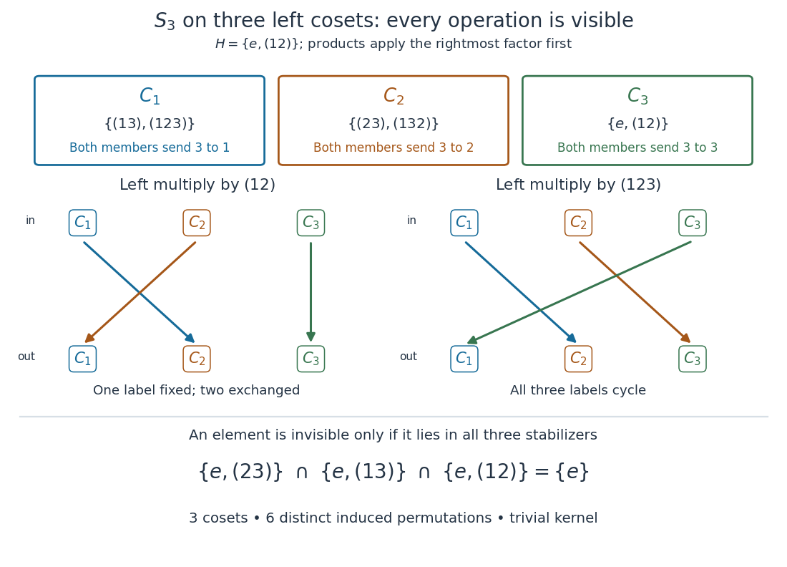

**[Figure 11](#s3-three-coset-action). Three left cosets turn left multiplication in $S_3$ into its faithful group action on three labels**. An original computed [coset](group-theory.md#coset) partition matches each two-element [coset](group-theory.md#coset) to the common image of $3$. The two rows show left multiplication by $(12)$ and $(123)$. The three [stabilizer subgroups](#stabilizer-subgroup) intersect only in the [identity element](algebraic-operation.md#identity-element).

The three [stabilizer subgroups](#stabilizer-subgroup) are

$$
G_{C_1}=\{e,(23)\},\qquad G_{C_2}=\{e,(13)\},\qquad G_{C_3}=\{e,(12)\}.
$$

Their [intersection](set.md#set-intersection) is $\{e\}$, so the [subgroup core](group-theory.md#core-group-theory) and the [group kernel](group-theory.md#kernel-of-a-group-homomorphism) are trivial. This proves that the [coset action](#coset-action) is a [faithful group action](#faithful-group-action) even though every point has a nontrivial [stabilizer subgroup](#stabilizer-subgroup). The [orbit-stabilizer theorem](#orbit-stabilizer-theorem) reads $6=3\cdot2$, while the induced [group homomorphism](group-theory.md#group-homomorphism) gives six distinct [permutations](combinatorics.md#permutation) of the three [cosets](group-theory.md#coset). For example, $(12)$ and $e$ agree at $C_3$, but disagree at $C_1$; inspecting one label would miss their difference.

The [subgroup](group.md#subgroup) need not be a [normal subgroup](group-theory.md#normal-subgroup) for the [coset action](#coset-action) to exist: $(123)H(123)^{-1}=\{e,(23)\}\ne H$. Here the [group action](group-action.md) is informative because the three conjugate [stabilizer subgroups](#stabilizer-subgroup) have no common nonidentity element. For the [normal subgroup](group-theory.md#normal-subgroup) $A_3$ instead, [nonfaithful coset action of the symmetric group on three letters](#nonfaithful-coset-action-of-the-symmetric-group-on-three-letters) shows that only the [sign of a permutation](finite-group-theory.md#sign-of-a-permutation) survives.

## ↑ Ancestors (5)

1. [Group theory](group-theory.md)
2. [Algebra](algebra.md)
3. [Area of mathematics](mathematics.md#area-of-mathematics)
4. [Mathematics](mathematics.md)
5. [Codex Wiki](README.md)

## ← Incoming links (124)

- [Abelianization of the square symmetry group](group-theory.md#abelianization-of-the-square-symmetry-group)
- [Affine space](geometry-and-topology.md#affine-space)
- [Axial isotropy of rolls and hexagons](convection.md#axial-isotropy-of-rolls-and-hexagons)
- [Block system](#block-system)
- [Borel construction](cohomology.md#borel-construction)
- [Cayley graph](geometric-group-theory.md#cayley-graph)
- [Cayley's theorem](group-theory.md#cayley-s-theorem)
- [Circle action](#circle-action)
- [Coadjoint representation](lie-theory.md#coadjoint-representation)
- [Cobounded group action](geometric-group-theory.md#cobounded-group-action)
- [Colour-preserving symmetry group](#colour-preserving-symmetry-group)
- [Coset](group-theory.md#coset)
- [Coset action](#coset-action)
- [Cube symmetry action on edges](#cube-symmetry-action-on-edges)
- [Derangement in a transitive group action](#derangement-in-a-transitive-group-action)
- [Equality-pattern orbits of ordered pairs](#equality-pattern-orbits-of-ordered-pairs)
- [Equivariant cohomology](cohomology.md#equivariant-cohomology)
- [Equivariant estimator](statistical-model.md#equivariant-estimator)
- [Faithful coset action of the symmetric group on three letters](#faithful-coset-action-of-the-symmetric-group-on-three-letters)
- [Faithful group action](#faithful-group-action)
- [Faithful quotient of a group action](#faithful-quotient-of-a-group-action)
- [Finite-index subgroup count for a finitely generated group](group.md#finite-index-subgroup-count-for-a-finitely-generated-group)
- [Fixed point of a group action](#fixed-point-of-a-group-action)
- [Framed instanton moduli space](classical-field-theory-soliton.md#framed-instanton-moduli-space)
- [Free action of a group](#free-action-of-a-group)
- [Free group action](#free-group-action)
- [Fundamental domain](#fundamental-domain)
- [Geometric invariant theory](representation-theory.md#geometric-invariant-theory)
- [Group](group.md)
- [Group action](group-action.md)
- [Group theory](group-theory.md)
- [Invariant (mathematics)](mathematics.md#invariant-mathematics)
- [Invariant tests factor through a maximal invariant](statistical-model.md#invariant-tests-factor-through-a-maximal-invariant)
- [Invariant theory](representation-theory.md#invariant-theory)
- [Kepler dynamical symmetry algebra](classical-mechanics.md#kepler-dynamical-symmetry-algebra)
- [Laplacian eigenspace](linear-operator-theory.md#laplacian-eigenspace)
- [Lie group action](lie-theory.md#lie-group-action)
- [Monodromy group of a covering](holomorphic-function.md#monodromy-group-of-a-covering)
- [Multiply transitive group action](#multiply-transitive-group-action)
- [N-transitive group action](#n-transitive-group-action)
- [Orbit (group theory)](#orbit-group-theory)
- [Orbit-stabilizer theorem](#orbit-stabilizer-theorem)
- [Solution](past-exam-of-the-mathematics-course-of-the-university-of-cambridge/2001/ia/paper-3.md#6e/solution)
- [Solution](past-exam-of-the-mathematics-course-of-the-university-of-cambridge/2001/iii/paper-32.md#5/i/solution)
- [Solution](past-exam-of-the-mathematics-course-of-the-university-of-cambridge/2001/iii/paper-77.md#3/solution)
- [Solution](past-exam-of-the-mathematics-course-of-the-university-of-cambridge/2002/ia/paper-1.md#5b/a/solution)
- [Solution](past-exam-of-the-mathematics-course-of-the-university-of-cambridge/2002/iii/paper-38.md#3/solution)
- [Solution](past-exam-of-the-mathematics-course-of-the-university-of-cambridge/2002/iii/paper-58.md#1/ii/solution)
- [Solution](past-exam-of-the-mathematics-course-of-the-university-of-cambridge/2002/iii/paper-58.md#2/solution)
- [Solution](past-exam-of-the-mathematics-course-of-the-university-of-cambridge/2003/ia/paper-1.md#7b/i/solution)
- [Solution](past-exam-of-the-mathematics-course-of-the-university-of-cambridge/2003/iii/paper-28.md#3/solution)
- [Solution](past-exam-of-the-mathematics-course-of-the-university-of-cambridge/2003/iii/paper-57.md#4/a/solution)
- [Solution](past-exam-of-the-mathematics-course-of-the-university-of-cambridge/2004/iii/paper-14.md#2/solution)
- [Solution](past-exam-of-the-mathematics-course-of-the-university-of-cambridge/2004/iii/paper-58.md#2/solution)
- [Solution](past-exam-of-the-mathematics-course-of-the-university-of-cambridge/2004/iii/paper-58.md#5/solution)
- [Solution](past-exam-of-the-mathematics-course-of-the-university-of-cambridge/2005/ia/paper-3.md#5d/solution)
- [Solution](past-exam-of-the-mathematics-course-of-the-university-of-cambridge/2005/iii/paper-42.md#2/solution)
- [Solution](past-exam-of-the-mathematics-course-of-the-university-of-cambridge/2005/iii/paper-42.md#6/v/solution)
- [Solution](past-exam-of-the-mathematics-course-of-the-university-of-cambridge/2006/ia/paper-3.md#5d/solution)
- [Solution](past-exam-of-the-mathematics-course-of-the-university-of-cambridge/2006/iii/paper-56.md#3/solution)
- [Solution](past-exam-of-the-mathematics-course-of-the-university-of-cambridge/2006/iii/paper-64.md#3/solution)
- [Solution](past-exam-of-the-mathematics-course-of-the-university-of-cambridge/2008/iii/paper-59.md#4/solution)
- [Solution](past-exam-of-the-mathematics-course-of-the-university-of-cambridge/2009/ia/paper-3.md#5d/solution)
- [Solution](past-exam-of-the-mathematics-course-of-the-university-of-cambridge/2009/ii/paper-3.md#19f/solution)
- [Solution](past-exam-of-the-mathematics-course-of-the-university-of-cambridge/2010/ia/paper-3.md#5d/i/solution)
- [Solution](past-exam-of-the-mathematics-course-of-the-university-of-cambridge/2010/ia/paper-3.md#8d/solution)
- [Solution](past-exam-of-the-mathematics-course-of-the-university-of-cambridge/2010/ii/paper-4.md#11g/solution)
- [Solution](past-exam-of-the-mathematics-course-of-the-university-of-cambridge/2010/iii/paper-4.md#2/ii/solution)
- [Solution](past-exam-of-the-mathematics-course-of-the-university-of-cambridge/2011/ia/paper-3.md#1d/b/solution)
- [Solution](past-exam-of-the-mathematics-course-of-the-university-of-cambridge/2011/ia/paper-3.md#7d/a/solution)
- [Solution](past-exam-of-the-mathematics-course-of-the-university-of-cambridge/2011/ii/paper-1.md#3g/solution)
- [Solution](past-exam-of-the-mathematics-course-of-the-university-of-cambridge/2012/ia/paper-3.md#5e/i/solution)
- [Solution](past-exam-of-the-mathematics-course-of-the-university-of-cambridge/2012/ia/paper-3.md#5e/ii/solution)
- [Solution](past-exam-of-the-mathematics-course-of-the-university-of-cambridge/2012/ia/paper-3.md#5e/iii/solution)
- [Solution](past-exam-of-the-mathematics-course-of-the-university-of-cambridge/2012/ia/paper-3.md#7e/solution)
- [Solution](past-exam-of-the-mathematics-course-of-the-university-of-cambridge/2012/iii/paper-3.md#5/solution)
- [Solution](past-exam-of-the-mathematics-course-of-the-university-of-cambridge/2013/iii/paper-42.md#1/solution)
- [Solution](past-exam-of-the-mathematics-course-of-the-university-of-cambridge/2014/ia/paper-3.md#5d/ii/solution)
- [Solution](past-exam-of-the-mathematics-course-of-the-university-of-cambridge/2014/iii/paper-4.md#3/solution)
- [Solution](past-exam-of-the-mathematics-course-of-the-university-of-cambridge/2014/iii/paper-4.md#4/solution)
- [Solution](past-exam-of-the-mathematics-course-of-the-university-of-cambridge/2015/ia/paper-3.md#5d/solution)
- [Solution](past-exam-of-the-mathematics-course-of-the-university-of-cambridge/2015/iii/paper-3.md#4/a/solution)
- [Solution](past-exam-of-the-mathematics-course-of-the-university-of-cambridge/2016/ia/paper-3.md#5d/v/solution)
- [Solution](past-exam-of-the-mathematics-course-of-the-university-of-cambridge/2016/ia/paper-3.md#7d/solution)
- [Solution](past-exam-of-the-mathematics-course-of-the-university-of-cambridge/2016/ib/paper-3.md#1e/solution)
- [1](past-exam-of-the-mathematics-course-of-the-university-of-cambridge/2016/iii/paper-104.md#1)
- [3](past-exam-of-the-mathematics-course-of-the-university-of-cambridge/2016/iii/paper-104.md#3)
- [Solution](past-exam-of-the-mathematics-course-of-the-university-of-cambridge/2016/iii/paper-119.md#5/a/solution)
- [Solution](past-exam-of-the-mathematics-course-of-the-university-of-cambridge/2016/iii/paper-119.md#5/b/solution)
- [Solution](past-exam-of-the-mathematics-course-of-the-university-of-cambridge/2017/ia/paper-3.md#5e/solution)
- [Solution](past-exam-of-the-mathematics-course-of-the-university-of-cambridge/2017/ia/paper-3.md#7e/a/solution)
- [Solution](past-exam-of-the-mathematics-course-of-the-university-of-cambridge/2017/ib/paper-1.md#10e/b/solution)
- [Solution](past-exam-of-the-mathematics-course-of-the-university-of-cambridge/2017/ii/paper-4.md#18g/a/solution)
- [Solution](past-exam-of-the-mathematics-course-of-the-university-of-cambridge/2017/iii/paper-132.md#2/a/solution)
- [Solution](past-exam-of-the-mathematics-course-of-the-university-of-cambridge/2017/iii/paper-132.md#2/b/solution)
- [Solution](past-exam-of-the-mathematics-course-of-the-university-of-cambridge/2020/ib/paper-2.md#1g/solution)
- [Solution](past-exam-of-the-mathematics-course-of-the-university-of-cambridge/2021/ib/paper-3.md#1g/solution)
- [Solution](past-exam-of-the-mathematics-course-of-the-university-of-cambridge/2022/ia/paper-3.md#5e/solution)
- [Solution](past-exam-of-the-mathematics-course-of-the-university-of-cambridge/2023/ib/paper-3.md#1e/solution)
- [Solution](past-exam-of-the-mathematics-course-of-the-university-of-cambridge/2025/iii/paper-324.md#1/a/i/solution)
- [Pattern inventory](representation-theory.md#pattern-inventory)
- [Permutation module](representation-theory.md#permutation-module)
- [Pointwise stabilizer](#pointwise-stabilizer)
- [Pólya enumeration](combinatorics.md#polya-enumeration)
- [Pólya enumeration theorem](combinatorics.md#polya-enumeration-theorem)
- [Properly discontinuous group action](geometric-group-theory.md#properly-discontinuous-group-action)
- [Rank of a permutation action](representation-theory.md#rank-of-a-permutation-action)
- [Regular group action](#regular-group-action)
- [Rotational symmetry group of a cube](#rotational-symmetry-group-of-a-cube)
- [Sharp two-transitivity](#sharp-two-transitivity)
- [Simply transitive group action](#simply-transitive-group-action)
- [SL2 over F2 as a permutation group](finite-group-theory.md#sl2-over-f2-as-a-permutation-group)
- [SL2R action on differentials](riemann-surfaces.md#sl2r-action-on-differentials)
- [Stabilizer as a hidden subgroup](quantum-fourier-transform.md#stabilizer-as-a-hidden-subgroup)
- [Stabilizer subgroup](#stabilizer-subgroup)
- [Subgroup](group.md#subgroup)
- [Symmetry group](#symmetry-group)
- [Symplectic reduction](symplectic-geometry.md#symplectic-reduction)
- [Transformation model](statistical-model.md#transformation-model)
- [Transitive group action](#transitive-group-action)
- [Transitive increasing event](probability-inequality.md#transitive-increasing-event)
- [Variable-permutation action on polynomials](#variable-permutation-action-on-polynomials)
- [Weighted Burnside lemma](representation-theory.md#weighted-burnside-lemma)
- [Word metric](geometric-group-theory.md#word-metric)
