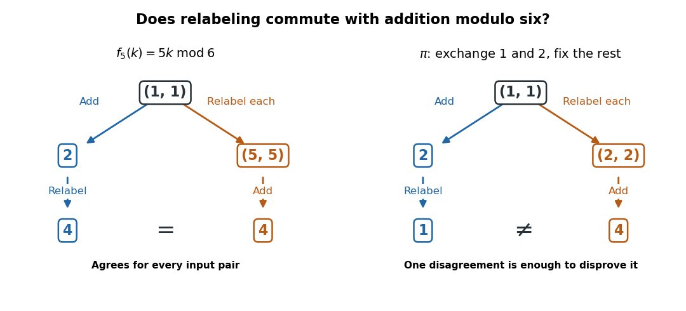

# Group automorphism

↑ **Parent:** [Automorphism](automorphism.md)

A [group automorphism](group-automorphism.md) is a [bijective](bijection.md) [group homomorphism](group-homomorphism.md) $\alpha:G\to G$. It preserves the [group operation](group-operation.md), the [identity element](identity-element.md), and [inverse elements](inverse-element.md); its inverse is another [group homomorphism](group-homomorphism.md). Thus it is a [group isomorphism](group-isomorphism.md) with identical source and target. These maps form the [automorphism group](automorphism-group.md) $\operatorname{Aut}(G)$ under [function composition](function-composition.md).[Chapter 3, Automorphisms of groups](group-theory-v4-01-by-james-s-milne.md)

For the additive [finite cyclic group](finite-cyclic-group.md) $C_6$, take $f_5(k)=5k\pmod6$. Its output list on $0,1,2,3,4,5$ is $0,5,4,3,2,1$, a [permutation](permutation.md) of all six elements. It preserves [addition](addition.md) because $5(a+b)=5a+5b\pmod6$, and applying it twice gives $25k=k\pmod6$. Hence it is a [group automorphism](group-automorphism.md) and its own [inverse function](inverse-function.md). Compare the collapsing $f_2$ in the figure under [endomorphism](endomorphism.md). The general criterion under [endomorphism of a finite cyclic group](endomorphism-of-a-finite-cyclic-group.md) says exactly when such a map is reversible: its multiplier must be [coprime](coprime-integers.md) to the size of the [finite cyclic group](finite-cyclic-group.md).

A [permutation](permutation.md) need not be a [group automorphism](group-automorphism.md), even if it fixes the [identity element](identity-element.md). Let $\pi$ exchange $1$ and $2$ in $C_6$ and fix $0,3,4,5$. It is a [bijection](bijection.md), and $\pi(0)=0$, but

$$
\pi(1+1)=\pi(2)=1,\qquad \pi(1)+\pi(1)=2+2=4\pmod6.
$$

Thus it fails to preserve [addition](addition.md) and is not even a [group homomorphism](group-homomorphism.md). Reversibility alone does not preserve the [group operation](group-operation.md).

**[Figure 5](#image-addition-before-or-after-relabeling-agreement-and-disagreement-modulo-six). Addition before or after relabeling: agreement and disagreement modulo six**. [Source](addition-preserving-versus-arbitrary-relabeling.py). Each panel follows the same input pair $(1,1)$ along two routes: add then relabel, or relabel each entry then add. All [addition](addition.md) is modulo six. The routes agree for the [group automorphism](group-automorphism.md) $f_5$; for the [permutation](permutation.md) exchanging $1$ and $2$, this single disagreement disproves preservation of [addition](addition.md).

A [group automorphism](group-automorphism.md) carries each [cyclic subgroup](cyclic-subgroup.md) onto the [cyclic subgroup](cyclic-subgroup.md) generated by the image of its defining element, preserving the [order of a group element](order-of-a-group-element.md). In particular, it carries a [generator of a group](generator-of-a-group.md) to another [generator of a group](generator-of-a-group.md). For $C_6$, the existing calculation of [generators of a finite cyclic group](generators-of-a-finite-cyclic-group.md) leaves only the images $1$ and $5$ for $1$, so its [automorphism group](automorphism-group.md) consists exactly of the [identity function](identity-function.md) and $f_5$. This turns the problem of compatible relabeling into a much smaller choice than enumerating arbitrary [permutations](permutation.md).

**Table of contents**

- [Characteristic subgroup](characteristic-subgroup.md)
  - [Characteristically simple group](characteristically-simple-group.md)

## ↑ Ancestors (6)

1. [Automorphism](automorphism.md)
2. [Morphism](morphism.md)
3. [Algebra](algebra-split.md)
4. [Area of mathematics](area-of-mathematics.md)
5. [Mathematics](mathematics-split.md)
6. [Codex Wiki](split.md)

## ← Incoming links (29)

- [Automorphism](automorphism.md)
- [Commutator subgroup](commutator-subgroup.md)
- [Conjugate subgroup](conjugate-subgroup.md)
- [Conjugate subset](conjugate-subset.md)
- [Conjugation](conjugation.md)
- [Endomorphism](endomorphism.md)
- [Endomorphism of a finite cyclic group](endomorphism-of-a-finite-cyclic-group.md)
- [Group automorphism](group-automorphism.md)
- [Group isomorphism](group-isomorphism.md)
- [Holomorph](holomorph.md)
- [Normalizer](normalizer.md)
- [Outer automorphism of a group](outer-automorphism-of-a-group.md)
- [Solution](past-exam-of-the-mathematics-course-of-the-university-of-cambridge/2001/iii/paper-3/3/a/solution.md)
- [Solution](past-exam-of-the-mathematics-course-of-the-university-of-cambridge/2001/iii/paper-3/3/b/solution.md)
- [Solution](past-exam-of-the-mathematics-course-of-the-university-of-cambridge/2001/iii/paper-3/4/b/solution.md)
- [Solution](past-exam-of-the-mathematics-course-of-the-university-of-cambridge/2001/iii/paper-3/4/c/solution.md)
- [Solution](past-exam-of-the-mathematics-course-of-the-university-of-cambridge/2005/ib/paper-2/2c/solution.md)
- [Solution](past-exam-of-the-mathematics-course-of-the-university-of-cambridge/2005/iii/paper-1/2/solution.md)
- [Solution](past-exam-of-the-mathematics-course-of-the-university-of-cambridge/2007/iii/paper-7/4/i/solution.md)
- [Solution](past-exam-of-the-mathematics-course-of-the-university-of-cambridge/2007/iii/paper-7/4/iii/solution.md)
- [Solution](past-exam-of-the-mathematics-course-of-the-university-of-cambridge/2009/iii/paper-5/2/solution.md)
- [Solution](past-exam-of-the-mathematics-course-of-the-university-of-cambridge/2009/iii/paper-5/5/solution.md)
- [Solution](past-exam-of-the-mathematics-course-of-the-university-of-cambridge/2010/iii/paper-4/1/ii/solution.md)
- [Solution](past-exam-of-the-mathematics-course-of-the-university-of-cambridge/2013/iii/paper-3/2/d/solution.md)
- [Solution](past-exam-of-the-mathematics-course-of-the-university-of-cambridge/2017/ia/paper-3/6e/solution.md)
- [Solution](past-exam-of-the-mathematics-course-of-the-university-of-cambridge/2018/ia/paper-3/6d/solution.md)
- [Solution](past-exam-of-the-mathematics-course-of-the-year-2-of-the-natural-sciences-course-of-the-university-of-cambridge/2005/paper-2/9/solution.md)
- [Solution](past-exam-of-the-mathematics-course-of-the-year-2-of-the-natural-sciences-course-of-the-university-of-cambridge/2018/paper-2/8/b/solution.md)
- [Symmetric-group involution class-size collision](symmetric-group-involution-class-size-collision.md)
