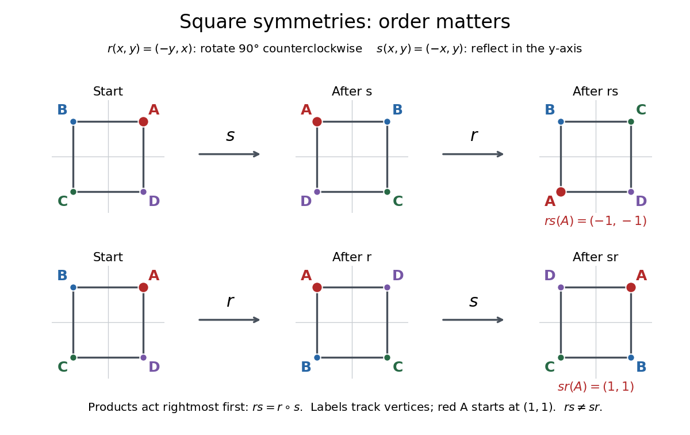

# Group

↑ **Parent:** [Group theory](group-theory-split.md)  
ⓦ [Wiki](https://en.wikipedia.org/wiki/Group_(mathematics))

A [group](group-split.md) packages reversible operations together with a rule for composing them. For example, the [rotations](rotation-mathematics.md) and [reflections](reflection-mathematics.md) that carry a [square](square.md) onto itself form a [group](group-split.md): performing two allowed motions gives another allowed motion, doing nothing is allowed, and every motion can be undone. The elements are the motions themselves, rather than the vertices they move. Labels in the figure track those vertices; they are markers, rather than extra decorations that the motions must preserve.

**[Figure 1](#image-square-symmetries-composed-in-opposite-orders). Square symmetries composed in opposite orders**. The [rotation](rotation-mathematics.md) $r$ is counterclockwise through $90^\circ$, and the [reflection](reflection-mathematics.md) $s$ is in the vertical axis. Products act rightmost first: $rs=r\circ s$. The red vertex starts at $(1,1)$ and ends at $(-1,-1)$ under $rs$, but at $(1,1)$ under $sr$. Both motions preserve the unmarked [square](square.md), while their [permutations](permutation.md) of its vertices differ.

Precisely, a [group](group-split.md) is a [set](set-split.md) $G$ equipped with a [binary operation](binary-operation.md) $G\times G\to G$, written $(a,b)\mapsto ab$, satisfying the [group axioms](group-axioms.md):

- Closure: $ab\in G$ for all $a,b\in G$. This is already part of specifying the operation's target as $G$.
- [Associativity](associative-property.md): $(ab)c=a(bc)$ for all $a,b,c\in G$.
- An [identity element](identity-element.md) $e\in G$ satisfies $ea=ae=a$ for every $a\in G$.
- Every $a\in G$ has an [inverse element](inverse-element.md) $a^{-1}\in G$ with $aa^{-1}=a^{-1}a=e$.

The [group operation](group-operation.md) need not be ordinary numerical multiplication. With [addition](addition.md) as the operation, the [identity element](identity-element.md) is usually written $0$ and the [inverse element](inverse-element.md) of $a$ is written $-a$. The definition requires a nonempty [set](set-split.md), since the [identity element](identity-element.md) must exist. See [McKernan's MIT lecture 1, Definition 1.1](https://ocw.mit.edu/courses/18-703-modern-algebra-spring-2013/faeeeaf01f838584ce2172cfd85cf74d_MIT18_703S13_pra_l_1.pdf) for the axioms.

Why insist on [associativity](associative-property.md)? It makes a string of operations unambiguous without specifying parentheses. For [function composition](function-composition.md), both $(fg)h$ and $f(gh)$ send $x$ to $f(g(h(x)))$. This fixes the order of execution while allowing regrouping. [Associativity](associative-property.md) therefore does not mean [commutativity](commutativity.md): exchanging two operations is a different question. Ordinary [subtraction](subtraction.md) fails [associativity](associative-property.md), since $(5-3)-1=1$ whereas $5-(3-1)=3$; it cannot serve as a [group operation](group-operation.md) on the [integers](integer-split.md).

An [inverse element](inverse-element.md) makes reversal exact and equations solvable. In any [group](group-split.md), $ax=b$ has the unique solution $x=a^{-1}b$, since $a^{-1}(ax)=(a^{-1}a)x=x$. Similarly, $xa=b$ has solution $x=ba^{-1}$. The side matters in a [non-abelian group](non-abelian-group.md). Undoing a composite operation requires reversing its order:

$$
(ab)^{-1}=b^{-1}a^{-1},\qquad
(ab)(b^{-1}a^{-1})=a(bb^{-1})a^{-1}=e.
$$

The analogous product in the other order also equals the [identity element](identity-element.md). These calculations explain why [group](group-split.md) equations allow cancellation without assuming [commutativity](commutativity.md).

For the [square](square.md) with vertices $(\pm1,\pm1)$, choose the [rotation](rotation-mathematics.md) and [reflection](reflection-mathematics.md)

$$
r(x,y)=(-y,x),\qquad s(x,y)=(-x,y).
$$

Throughout this example, multiplication is [function composition](function-composition.md) with the rightmost operation performed first: $(gh)(v)=g(h(v))$. Our notation $D_4$ means the [dihedral group](dihedral-group.md) of the [square](square.md), with eight elements; the alternative convention calls the same [group](group-split.md) $D_8$. Its elements are

$$
D_4=\{e,r,r^2,r^3,s,rs,r^2s,r^3s\},\qquad
r^4=e,\quad s^2=e,\quad srs=r^{-1}.
$$

Here $r^{-1}=r^3$ is clockwise [rotation](rotation-mathematics.md) through $90^\circ$, while each [reflection](reflection-mathematics.md) is its own [inverse element](inverse-element.md). There are exactly eight motions: the image of one vertex has four choices, and the image of an adjacent vertex has two choices; together these determine the motion. The four [rotations](rotation-mathematics.md) and four [reflections](reflection-mathematics.md) displayed above realize every choice. The vertex [permutations](permutation.md) give a concrete [group action](group-action-split.md). The general polygon construction is discussed in [Group Theory (v4.01) by James S. Milne](group-theory-v4-01-by-james-s-milne.md) (section 1.17).

Computing the two products rather than merely comparing their names gives

$$
(rs)(x,y)=r(-x,y)=(-y,-x),\qquad
(sr)(x,y)=s(-y,x)=(y,x).
$$

Thus $(rs)(1,1)=(-1,-1)$ but $(sr)(1,1)=(1,1)$, proving $rs\ne sr$. In fact $rs$ is [reflection](reflection-mathematics.md) in the line $y=-x$, whereas $sr$ is [reflection](reflection-mathematics.md) in $y=x$. This [group](group-split.md) is a [non-abelian group](non-abelian-group.md), although its [subgroup](subgroup.md) of [rotations](rotation-mathematics.md) is an [abelian group](abelian-group.md). The relation $srs=r^{-1}$ expresses a geometric fact: [conjugation](conjugation.md) of a counterclockwise [rotation](rotation-mathematics.md) by a [reflection](reflection-mathematics.md) turns it clockwise.

A contrasting example is the [cyclic group](cyclic-group.md) $\mathbb Z/4\mathbb Z$ under [addition](addition.md) in [modular arithmetic](modular-arithmetic-split.md). Using representatives $0,1,2,3$, the sum $3+2$ is $1$ modulo $4$, and the [inverse element](inverse-element.md) of $3$ is $1$. Repeated [addition](addition.md) of $1$ runs through $0,1,2,3,0$. The correspondence $k\mapsto r^k$ identifies this [cyclic group](cyclic-group.md) with the [rotation](rotation-mathematics.md) [subgroup](subgroup.md) of $D_4$: $r^3r^2=r^5=r$. This is a [group isomorphism](group-isomorphism.md), so the same rule of composition appears as arithmetic wraparound and geometric motion.

By comparison, $(\mathbb Z,+)$ is an [infinite cyclic group](infinite-cyclic-group.md). It has [identity element](identity-element.md) $0$, [inverse element](inverse-element.md) $-k$ for each [integer](integer-split.md) $k$, and a [generator of a group](generator-of-a-group.md) $1$, but no wraparound: $3+2=5$, and no positive number of copies of $1$ sums to $0$. Both examples are [abelian groups](abelian-group.md). The [nonnegative integers](natural-number.md) under [addition](addition.md) have closure, [associativity](associative-property.md), and an [identity element](identity-element.md), but lack an [inverse element](inverse-element.md) for $1$. Reversibility is precisely what fails.

The beauty of the abstraction is that a calculation using only the [group axioms](group-axioms.md) applies simultaneously to arithmetic and to geometric [isometries](isometry.md). To make that connection universal, let each $g\in G$ act on $G$ by the [translation in a group](translation-in-a-group.md) $L_g(x)=gx$. Each $L_g$ is a [bijection](bijection.md), with inverse $L_{g^{-1}}$, and $L_gL_h=L_{gh}$. Distinct elements give distinct maps because $L_g(e)=g$. This proves [Cayley's theorem](cayley-s-theorem.md): every [group](group-split.md) is isomorphic to a [subgroup](subgroup.md) of a [symmetric group](symmetric-group.md). A [group action](group-action-split.md) specifies how a [group](group-split.md) moves some other [set](set-split.md); a [group homomorphism](group-homomorphism.md) compares [groups](group-split.md) while preserving their composition rules.

An important historical connection is the use of [permutations](permutation.md) to study [polynomial equations](polynomial-equation.md). In the memoir submitted in 1831 and published by Liouville in 1846, Galois associates a [group](group-split.md) to a [polynomial equation](polynomial-equation.md) and studies how it changes when additional quantities are declared known. Proposition I relates this [group](group-split.md) to expressions in the [roots of a polynomial](root-of-a-polynomial.md) whose values remain unchanged under its [permutations](permutation.md); Proposition IV restricts the allowed [permutations](permutation.md) after adjoining a function of the [roots of a polynomial](root-of-a-polynomial.md). This connects reversible rearrangements with deciding [solvability by radicals](solvability-by-radicals.md). See [Galois's original memoir, pp. 417–433, especially Propositions I and IV; Liouville's introduction, p. 382](https://www.numdam.org/item/JMPA_1846_1_11__381_0.pdf).

**Table of contents**

- [Partially ordered group](partially-ordered-group.md)
  - [Positive cone of an ordered group](partially-ordered-group.md#positive-cone-of-an-ordered-group)
  - [Convex subgroup of an ordered group](partially-ordered-group.md#convex-subgroup-of-an-ordered-group)
  - [Lattice-ordered group](partially-ordered-group.md#lattice-ordered-group)
    - [Riesz decomposition in a lattice-ordered group](partially-ordered-group.md#riesz-decomposition-in-a-lattice-ordered-group)
    - [Lattice-ordered group homomorphism](partially-ordered-group.md#lattice-ordered-group-homomorphism)
    - [Absolute value in a lattice-ordered group](partially-ordered-group.md#absolute-value-in-a-lattice-ordered-group)
      - [Positive and negative parts in a lattice-ordered group](partially-ordered-group.md#positive-and-negative-parts-in-a-lattice-ordered-group)
    - [Convex lattice subgroup](partially-ordered-group.md#convex-lattice-subgroup)
      - [One-sided bounds for adjoining a positive element](partially-ordered-group.md#one-sided-bounds-for-adjoining-a-positive-element)
      - [Ordered right cosets of a convex lattice subgroup](partially-ordered-group.md#ordered-right-cosets-of-a-convex-lattice-subgroup)
      - [Lattice of convex lattice subgroups](partially-ordered-group.md#lattice-of-convex-lattice-subgroups)
      - [Principal convex lattice subgroup](partially-ordered-group.md#principal-convex-lattice-subgroup)
      - [Prime convex lattice subgroup](partially-ordered-group.md#prime-convex-lattice-subgroup)
      - [Value in a lattice-ordered group](partially-ordered-group.md#value-in-a-lattice-ordered-group)
        - [Squared bound from comparison at values](partially-ordered-group.md#squared-bound-from-comparison-at-values)
        - [Cover of a value in a lattice-ordered group](partially-ordered-group.md#cover-of-a-value-in-a-lattice-ordered-group)
          - [Power cofinality in the cover of a value](partially-ordered-group.md#power-cofinality-in-the-cover-of-a-value)
    - [Normal-valued lattice-ordered group](partially-ordered-group.md#normal-valued-lattice-ordered-group)
      - [Wolfenstein inequality for normal-valued lattice-ordered groups](partially-ordered-group.md#wolfenstein-inequality-for-normal-valued-lattice-ordered-groups)
    - [Linearly ordered group](partially-ordered-group.md#linearly-ordered-group)
      - [Archimedean ordered group](partially-ordered-group.md#archimedean-ordered-group)
        - [Archimedean linearly ordered groups are Abelian](partially-ordered-group.md#archimedean-linearly-ordered-groups-are-abelian)
      - [Lexicographically ordered group](partially-ordered-group.md#lexicographically-ordered-group)
      - [Convex subgroups of a finite-rank ordered Abelian group](partially-ordered-group.md#convex-subgroups-of-a-finite-rank-ordered-abelian-group)
      - [Ohnishi orderability criterion](partially-ordered-group.md#ohnishi-orderability-criterion)
    - [Abelian lattice-ordered group](partially-ordered-group.md#abelian-lattice-ordered-group)
      - [Hahn group](partially-ordered-group.md#hahn-group)
        - [Finite-support Hahn embedding along a countable convex chain](partially-ordered-group.md#finite-support-hahn-embedding-along-a-countable-convex-chain)
      - [Free Abelian lattice-ordered group](partially-ordered-group.md#free-abelian-lattice-ordered-group)
        - [Piecewise integer-linear representation of a free Abelian lattice-ordered group](partially-ordered-group.md#piecewise-integer-linear-representation-of-a-free-abelian-lattice-ordered-group)
          - [Integer-linear hinge functions have infinite independent rank](partially-ordered-group.md#integer-linear-hinge-functions-have-infinite-independent-rank)
    - [Lattice-ordered permutation group](partially-ordered-group.md#lattice-ordered-permutation-group)
      - [Order-primitive lattice permutation group](partially-ordered-group.md#order-primitive-lattice-permutation-group)
        - [McCleary trichotomy theorem](partially-ordered-group.md#mccleary-trichotomy-theorem)
      - [Holland representation theorem](partially-ordered-group.md#holland-representation-theorem)
      - [Order n-transitivity](partially-ordered-group.md#order-n-transitivity)
        - [Finite interpolation by lattice operations](partially-ordered-group.md#finite-interpolation-by-lattice-operations)
      - [Positive bump of an order automorphism](partially-ordered-group.md#positive-bump-of-an-order-automorphism)
        - [Conjugacy of positive real-line bumps](partially-ordered-group.md#conjugacy-of-positive-real-line-bumps)
          - [Conjugating positive bumps while preserving a fundamental interval](partially-ordered-group.md#conjugating-positive-bumps-while-preserving-a-fundamental-interval)
- [Exact factorization of a group](exact-factorization-of-a-group.md)
- [Shifted addition on odd integers](shifted-addition-on-odd-integers.md)
- [Triangle group](triangle-group.md)
- [Poly-(cyclic or finite) group](poly-cyclic-or-finite-group.md)
- [Group element](group-element.md)
- [Braid group](braid-group.md)
  - [Artin automorphism of a braid](artin-automorphism-of-a-braid.md)
  - [Braid group relations](braid-group-relations.md)
- [Infinite group](infinite-group.md)
  - [Tarski monster group](tarski-monster-group.md)
    - [Tarski monster groups are two-generated and simple](tarski-monster-groups-are-two-generated-and-simple.md)
- [Trivial group](trivial-group.md)
- [Group of exponent two is abelian](group-of-exponent-two-is-abelian.md)
- [Non-abelian group](non-abelian-group.md)
- [Torsion-free group](torsion-free-group.md)
  - [Countable torsion-free embedding with two conjugacy classes](countable-torsion-free-embedding-with-two-conjugacy-classes.md)
- [Divisible group](divisible-group.md)
  - [Divisibility by a prime](divisibility-by-a-prime.md)
  - [Torsion-free divisible Abelian group](torsion-free-divisible-abelian-group.md)
- [Group axioms](group-axioms.md)
  - [Group axioms from two-sided local inverse identities](group-axioms-from-two-sided-local-inverse-identities.md)
- [Finite group](finite-group.md)
  - [p-prime core of a finite group](p-prime-core-of-a-finite-group.md)
  - [p-core of a finite group](p-core-of-a-finite-group.md)
    - [p-constrained group](p-constrained-group.md)
  - [Pi-group](pi-group.md)
    - [Pi-element](pi-element.md)
  - [Elementary group](elementary-group.md)
    - [Prime-set decomposition of elementary groups](prime-set-decomposition-of-elementary-groups.md)
    - [p-elementary group](p-elementary-group.md)
  - [Ambivalent group](ambivalent-group.md)
  - [Monomial group](monomial-group.md)
    - [Abelian intersection of irreducible inducing subgroups](abelian-intersection-of-irreducible-inducing-subgroups.md)
    - [Dade's embedding theorem for monomial groups](dade-s-embedding-theorem-for-monomial-groups.md)
    - [Taketa's theorem](taketa-s-theorem.md)
  - [Frobenius group](frobenius-group.md)
    - [Frobenius kernel](frobenius-kernel.md)
      - [Frobenius kernel criterion by irreducible induction](frobenius-kernel-criterion-by-irreducible-induction.md)
      - [Commutator bijection from a fixed-point-free automorphism](commutator-bijection-from-a-fixed-point-free-automorphism.md)
      - [Frobenius kernel theorem](frobenius-kernel-theorem.md)
    - [Frobenius complement](frobenius-complement.md)
  - [Burnside's theorem](burnside-s-theorem.md)
    - [Prime-power conjugacy-class obstruction to simplicity](prime-power-conjugacy-class-obstruction-to-simplicity.md)
      - [Abelian subgroup cannot have prime-power index in a nonabelian simple group](abelian-subgroup-cannot-have-prime-power-index-in-a-nonabelian-simple-group.md)
  - [Order of a finite group](order-of-a-finite-group.md)
- [Nontrivial group](nontrivial-group.md)
- [Group operation](group-operation.md)
  - [Group commutator](group-commutator.md)
    - [Hall-Witt identity](hall-witt-identity.md)
    - [Hall-Petrescu formula](hall-petrescu-formula.md)
- [Translation in a group](translation-in-a-group.md)
- [Cyclic group](cyclic-group.md)
  - [Cyclic multiplicative group](cyclic-multiplicative-group.md)
  - [A group of prime order is cyclic](a-group-of-prime-order-is-cyclic.md)
  - [Groups with no proper nontrivial subgroups](groups-with-no-proper-nontrivial-subgroups.md)
  - [Subgroups and quotients of a cyclic group](subgroups-and-quotients-of-a-cyclic-group.md)
  - [Free translation action on nontrivial subsets of a prime cyclic group](free-translation-action-on-nontrivial-subsets-of-a-prime-cyclic-group.md)
  - [Cyclic subgroup](cyclic-subgroup.md)
    - [Counting cyclic subgroups by their generators](counting-cyclic-subgroups-by-their-generators.md)
  - [Finite cyclic group](finite-cyclic-group.md)
    - [Cyclic group of order four](cyclic-group-of-order-four.md)
      - [Faithfulness criterion for a block representation of the cyclic group of order four](faithfulness-criterion-for-a-block-representation-of-the-cyclic-group-of-order-four.md)
    - [Order of an element of a finite cyclic group](order-of-an-element-of-a-finite-cyclic-group.md)
    - [Homomorphism from a finite cyclic group](homomorphism-from-a-finite-cyclic-group.md)
  - [Infinite cyclic group](infinite-cyclic-group.md)
    - [Subgroup of an infinite cyclic group](subgroup-of-an-infinite-cyclic-group.md)
    - [Additive group of integers](additive-group-of-integers.md)
    - [Integer shear group](integer-shear-group.md)
  - [Finite subgroup of the multiplicative complex numbers](finite-subgroup-of-the-multiplicative-complex-numbers.md)
  - [Generator of a group](generator-of-a-group.md)
    - [Generators of a finite cyclic group](generators-of-a-finite-cyclic-group.md)
- [Generating set of a group](generating-set-of-a-group.md)
  - [Minimal generating set of a group](minimal-generating-set-of-a-group.md)
  - [Complement of a proper subgroup generates the group](complement-of-a-proper-subgroup-generates-the-group.md)
  - [Finitely generated group](finitely-generated-group.md)
    - [Benign subgroup](benign-subgroup.md)
      - [Normal benign subgroup quotient embedding](normal-benign-subgroup-quotient-embedding.md)
      - [Intersection and join of benign subgroups](intersection-and-join-of-benign-subgroups.md)
    - [Unshifted rank gradients](unshifted-rank-gradients.md)
    - [Finite-index subgroup count for a finitely generated group](finite-index-subgroup-count-for-a-finitely-generated-group.md)
    - [Rank of a group](rank-of-a-group.md)
- [Abelian group](abelian-group.md)
  - [Complex multiplicative group](complex-multiplicative-group.md)
  - [Abelian group of prime-square order](abelian-group-of-prime-square-order.md)
  - [Serre class](serre-class.md)
    - [Serre class of finitely generated abelian groups](serre-class-of-finitely-generated-abelian-groups.md)
  - [Torsion-free abelian group](torsion-free-abelian-group.md)
    - [Rational divisible hull](rational-divisible-hull.md)
  - [Abelian subgroup](abelian-subgroup.md)
  - [Finitely generated abelian group](finitely-generated-abelian-group.md)
    - [Finite generation detected by a prime quotient](finite-generation-detected-by-a-prime-quotient.md)
    - [Rank of an abelian group](rank-of-an-abelian-group.md)
    - [Fundamental theorem of finitely generated abelian groups](fundamental-theorem-of-finitely-generated-abelian-groups.md)
  - [Prüfer group](prufer-group.md)
  - [Additive group](additive-group.md)
    - [Finitely generated subgroup of the rational additive group](finitely-generated-subgroup-of-the-rational-additive-group.md)
  - [Infinitely divisible element of an abelian group](infinitely-divisible-element-of-an-abelian-group.md)
  - [Finite abelian group](finite-abelian-group.md)
    - [Cyclic group of order four and Klein four-group](cyclic-group-of-order-four-and-klein-four-group.md)
    - [Elementary abelian group](elementary-abelian-group.md)
      - [Order of a finite group of exponent two](order-of-a-finite-group-of-exponent-two.md)
  - [Pontryagin duality](pontryagin-duality.md)
    - [Pontryagin dual group](pontryagin-dual-group.md)
      - [Equicontinuity of compact families of characters](equicontinuity-of-compact-families-of-characters.md)
      - [Dual Haar measure](dual-haar-measure.md)
    - [Character group](character-group.md)
      - [Character group of a finite abelian group](character-group-of-a-finite-abelian-group.md)
        - [Multiplicative character of a finite field](multiplicative-character-of-a-finite-field.md)
          - [Jacobi sum of finite-field characters](jacobi-sum-of-finite-field-characters.md)
          - [Gauss sum of a finite-field character](gauss-sum-of-a-finite-field-character.md)
        - [Extension of a unitary character from a finite abelian subgroup](extension-of-a-unitary-character-from-a-finite-abelian-subgroup.md)
        - [Extension of a character across a cyclic quotient](extension-of-a-character-across-a-cyclic-quotient.md)
        - [Character of a finite abelian group](character-of-a-finite-abelian-group.md)
        - [Character-sum cancellation lemma](character-sum-cancellation-lemma.md)
        - [Annihilator of a subgroup of a finite abelian group](annihilator-of-a-subgroup-of-a-finite-abelian-group.md)
- [Finite additive group](finite-additive-group.md)
- [Subgroup](subgroup.md)
  - [Subgroup test](subgroup-test.md)
  - [Trivial subgroup](trivial-subgroup.md)
  - [Finitely generated subgroup](finitely-generated-subgroup.md)
  - [Membership problem for a subgroup](membership-problem-for-a-subgroup.md)
  - [Maximal subgroup](maximal-subgroup.md)
    - [Maximal symmetric-group subgroups containing a three-cycle](maximal-symmetric-group-subgroups-containing-a-three-cycle.md)
    - [Maximal subgroups of a finite soluble group](maximal-subgroups-of-a-finite-soluble-group.md)
    - [Maximal subgroup normalizer criterion](maximal-subgroup-normalizer-criterion.md)
  - [Hall subgroup](hall-subgroup.md)
    - [Schur-Zassenhaus theorem](schur-zassenhaus-theorem.md)
    - [Hall conjugacy and embedding in finite soluble groups](hall-conjugacy-and-embedding-in-finite-soluble-groups.md)
    - [Hall subgroup existence in soluble groups](hall-subgroup-existence-in-soluble-groups.md)
  - [Union of two subgroups](union-of-two-subgroups.md)
  - [Index of a subgroup](index-of-a-subgroup.md)
  - [Index-two subgroup is normal](index-two-subgroup-is-normal.md)
  - [Finite-index subgroup](finite-index-subgroup.md)

## ↑ Ancestors (5)

1. [Group theory](group-theory-split.md)
2. [Algebra](algebra-split.md)
3. [Area of mathematics](area-of-mathematics.md)
4. [Mathematics](mathematics-split.md)
5. [Codex Wiki](split.md)

## ← Incoming links (601)

- [Abelian group](abelian-group.md)
- [Abelian plane subgroup of the Heisenberg group modulo four](abelian-plane-subgroup-of-the-heisenberg-group-modulo-four.md)
- [Abelianization](abelianization.md)
- [Abelianization of the square symmetry group](abelianization-of-the-square-symmetry-group.md)
- [Additive combinatorics](additive-combinatorics-split.md)
- [Adjoint Chevalley group](adjoint-chevalley-group.md)
- [Albert-Brauer-Hasse-Noether theorem](albert-brauer-hasse-noether-theorem.md)
- [Algebra](algebra-split.md)
- [Algebraic K-theory](algebraic-k-theory.md)
- [Algebraic structure](algebraic-structure.md)
- [Algebraic topology](algebraic-topology-split.md)
- [Automorphism](automorphism.md)
- [Automorphism group](automorphism-group.md)
- [Automorphy character of an orbit Blaschke product](automorphy-character-of-an-orbit-blaschke-product.md)
- [Balanced indicator function of a finite subset](balanced-indicator-function-of-a-finite-subset.md)
- [Batch modular inversion](batch-modular-inversion.md)
- [Block of an Artinian algebra](block-of-an-artinian-algebra.md)
- [Block system](block-system.md)
- [Boone-Higman theorem](boone-higman-theorem.md)
- [Braid category](braid-category.md)
- [Braid group](braid-group.md)
- [Category of groups](category-of-groups.md)
- [Category theory](category-theory-split.md)
- [Cayley graph](cayley-graph.md)
- [Cayley's theorem](cayley-s-theorem.md)
- [Center of a group](center-of-a-group.md)
- [Center of an upper unitriangular group](center-of-an-upper-unitriangular-group.md)
- [Central element of a group](central-element-of-a-group.md)
- [Central translations in a linear semidirect product](central-translations-in-a-linear-semidirect-product.md)
- [Centralizer](centralizer.md)
- [Centralizer of a regular permutation subgroup](centralizer-of-a-regular-permutation-subgroup.md)
- [Centralizer of a subset](centralizer-of-a-subset.md)
- [Character lattice of a torus](character-lattice-of-a-torus.md)
- [Character projection operator](character-projection-operator.md)
- [Class equation](class-equation.md)
- [Class function](class-function.md)
- [Classification of connected abelian Lie groups](classification-of-connected-abelian-lie-groups.md)
- [Classification of groups of order p squared](classification-of-groups-of-order-p-squared.md)
- [Classification of groups of order ten](classification-of-groups-of-order-ten.md)
- [Common quotient obstruction to commutation of fixed points and orbits](common-quotient-obstruction-to-commutation-of-fixed-points-and-orbits.md)
- [Commutation of fixed points and orbit quotients for coprime groups](commutation-of-fixed-points-and-orbit-quotients-for-coprime-groups.md)
- [Commutator subgroup](commutator-subgroup.md)
- [Compact connected complex Lie groups are complex tori](compact-connected-complex-lie-groups-are-complex-tori.md)
- [Compact group](compact-group.md)
- [Compact groups with a descending chain condition are Lie groups](compact-groups-with-a-descending-chain-condition-are-lie-groups.md)
- [Complement of a proper subgroup generates the group](complement-of-a-proper-subgroup-generates-the-group.md)
- [Complex irreducible representations of a finite cyclic group](complex-irreducible-representations-of-a-finite-cyclic-group.md)
- [Conformal automorphism of the upper half-plane](conformal-automorphism-of-the-upper-half-plane.md)
- [Conjugacy class](conjugacy-class.md)
- [Conjugacy-class sum](conjugacy-class-sum.md)
- [Conjugate subgroup](conjugate-subgroup.md)
- [Conjugate subset](conjugate-subset.md)
- [Convolution of p-adic measures](convolution-of-p-adic-measures.md)
- [Convolution theorem on a finite group](convolution-theorem-on-a-finite-group.md)
- [Coset](coset.md)
- [Counting cyclic subgroups by their generators](counting-cyclic-subgroups-by-their-generators.md)
- [Coxeter group](coxeter-group.md)
- [Cyclic cohomology of a regular lattice](cyclic-cohomology-of-a-regular-lattice.md)
- [Cyclic group](cyclic-group.md)
- [Cyclic group of order four and Klein four-group](cyclic-group-of-order-four-and-klein-four-group.md)
- [Cyclic ternary channel capacity](cyclic-ternary-channel-capacity.md)
- [Cyclic-tuple proof of Cauchy theorem](cyclic-tuple-proof-of-cauchy-theorem.md)
- [Cyclically reduced sequence in an HNN extension](cyclically-reduced-sequence-in-an-hnn-extension.md)
- [Difference family for a Steiner 2-design](difference-family-for-a-steiner-2-design.md)
- [Dimension shifting in group cohomology](dimension-shifting-in-group-cohomology.md)
- [Direct-product decomposition of the cube symmetry group](direct-product-decomposition-of-the-cube-symmetry-group.md)
- [Direct product of groups](direct-product-of-groups.md)
- [Dirichlet domain](dirichlet-domain.md)
- [Double-coset Hecke algebra](double-coset-hecke-algebra.md)
- [Dual Lie algebra representation](dual-lie-algebra-representation.md)
- [Elementary abelian regular kernels in doubly transitive groups](elementary-abelian-regular-kernels-in-doubly-transitive-groups.md)
- [Endomorphism](endomorphism.md)
- [Enumerable identities of finitely generated subgroups](enumerable-identities-of-finitely-generated-subgroups.md)
- [Equivalence of finite word metrics](equivalence-of-finite-word-metrics.md)
- [Equivariant estimator](equivariant-estimator.md)
- [Euclidean group](euclidean-group.md)
- [Evaluation map of an exponential object](evaluation-map-of-an-exponential-object.md)
- [Exact factorization of a group](exact-factorization-of-a-group.md)
- [Exponential of right group actions](exponential-of-right-group-actions.md)
- [Faithful group action](faithful-group-action.md)
- [Faithful quotient of a group action](faithful-quotient-of-a-group-action.md)
- [Feit–Thompson theorem](feit-thompson-theorem.md)
- [Finite cyclic group](finite-cyclic-group.md)
- [Finite group](finite-group.md)
- [Finite group of prime exponent has prime-power order](finite-group-of-prime-exponent-has-prime-power-order.md)
- [Finite groups act freely on suitable closed orientable surfaces](finite-groups-act-freely-on-suitable-closed-orientable-surfaces.md)
- [Finite groups of planar rotations are cyclic](finite-groups-of-planar-rotations-are-cyclic.md)
- [Finite orientation-preserving plane isometry groups are cyclic](finite-orientation-preserving-plane-isometry-groups-are-cyclic.md)
- [Finite quotient of a group](finite-quotient-of-a-group.md)
- [Finite residual](finite-residual.md)
- [Finite subgroups of the plane orthogonal group](finite-subgroups-of-the-plane-orthogonal-group.md)
- [Finitely generated subgroup](finitely-generated-subgroup.md)
- [Finitely presented group](finitely-presented-group.md)
- [First isomorphism theorem](first-isomorphism-theorem.md)
- [Fixed point of a finite Euclidean isometry group](fixed-point-of-a-finite-euclidean-isometry-group.md)
- [Foundations of mathematics](foundations-of-mathematics-split.md)
- [Four-manifold realization of finitely presented groups](four-manifold-realization-of-finitely-presented-groups.md)
- [Free action of a group](free-action-of-a-group.md)
- [Free basis of a group](free-basis-of-a-group.md)
- [Free group action](free-group-action.md)
- [Free sphere actions exclude elementary abelian subgroups of rank two](free-sphere-actions-exclude-elementary-abelian-subgroups-of-rank-two.md)
- [Freeness criterion for a subgroup of a polygon-cover deck group](freeness-criterion-for-a-subgroup-of-a-polygon-cover-deck-group.md)
- [Freudenthal suspension from two cones](freudenthal-suspension-from-two-cones.md)
- [Full transformation monoid](full-transformation-monoid.md)
- [Gassmann equivalence](gassmann-equivalence.md)
- [General affine group](general-affine-group.md)
- [General linear group](general-linear-group.md)
- [Generating set of a group](generating-set-of-a-group.md)
- [Generator of a group](generator-of-a-group.md)
- [Gromov's theorem on groups of polynomial growth](gromov-s-theorem-on-groups-of-polynomial-growth.md)
- [Group](group-split.md)
- [Group action](group-action-split.md)
- [Group axioms from two-sided local inverse identities](group-axioms-from-two-sided-local-inverse-identities.md)
- [Group cohomology](group-cohomology-split.md)
- [Group commutator](group-commutator.md)
- [Group element](group-element.md)
- [Group generated by sign reversal and reciprocation](group-generated-by-sign-reversal-and-reciprocation.md)
- [Group homomorphism](group-homomorphism.md)
- [Group isomorphism](group-isomorphism.md)
- [Group multiplier automaton](group-multiplier-automaton.md)
- [Group of exponent two is abelian](group-of-exponent-two-is-abelian.md)
- [Group of Hamiltonian diffeomorphisms](group-of-hamiltonian-diffeomorphisms.md)
- [Group of invertible elements of a Banach algebra](group-of-invertible-elements-of-a-banach-algebra.md)
- [Group of order eight](group-of-order-eight.md)
- [Group of order six](group-of-order-six.md)
- [Group operation](group-operation.md)
- [Group representation](group-representation.md)
- [Group theory](group-theory-split.md)
- [Group von Neumann algebra](group-von-neumann-algebra.md)
- [Groups with no proper nontrivial subgroups](groups-with-no-proper-nontrivial-subgroups.md)
- [H-group](h-group.md)
- [Haar integral](haar-integral.md)
- [Heisenberg group over a commutative ring](heisenberg-group-over-a-commutative-ring.md)
- [Herbrand quotient of a finite module](herbrand-quotient-of-a-finite-module.md)
- [Holomorph](holomorph.md)
- [Homomorphism from a finite cyclic group](homomorphism-from-a-finite-cyclic-group.md)
- [Idempotent element of a semigroup](idempotent-element-of-a-semigroup.md)
- [Identity element](identity-element.md)
- [Infinite conjugacy class group](infinite-conjugacy-class-group.md)
- [Infinite group](infinite-group.md)
- [Internal direct product theorem](internal-direct-product-theorem.md)
- [Inverse-adjoint representation](inverse-adjoint-representation.md)
- [Inverse element](inverse-element.md)
- [Isomorphism](isomorphism.md)
- [Isomorphism theorems](isomorphism-theorems.md)
- [Isotropic linear magnetostriction vanishes](isotropic-linear-magnetostriction-vanishes.md)
- [K1 of a ring](k1-of-a-ring.md)
- [Kolyvagin derivative operator for a cyclic group](kolyvagin-derivative-operator-for-a-cyclic-group.md)
- [Kostant multiplicity formula](kostant-multiplicity-formula.md)
- [Lagrange's theorem](lagrange-s-theorem.md)
- [Lattice-ordered permutation group](lattice-ordered-permutation-group.md)
- [Layer-cake extraction of Følner sets](layer-cake-extraction-of-folner-sets.md)
- [Least-prime divisibility constraint for a finite simple group](least-prime-divisibility-constraint-for-a-finite-simple-group.md)
- [Left coset](left-coset.md)
- [Left regular action](left-regular-action.md)
- [Left translation of a group function](left-translation-of-a-group-function.md)
- [Length of a word over an alphabet](length-of-a-word-over-an-alphabet.md)
- [Lie group](lie-group.md)
- [Lie group homomorphism determined by its differential](lie-group-homomorphism-determined-by-its-differential.md)
- [Lie group isomorphism](lie-group-isomorphism.md)
- [Lie group–Lie algebra correspondence](lie-group-lie-algebra-correspondence.md)
- [Lie theory](lie-theory-split.md)
- [Linearity of a uniform pro-p group](linearity-of-a-uniform-pro-p-group.md)
- [Linearly ordered group](linearly-ordered-group.md)
- [Locally finite group](locally-finite-group.md)
- [Mathematical definition](mathematical-definition.md)
- [Mathematics](mathematics-split.md)
- [Matrix group](matrix-group.md)
- [Maximal condition on subgroups](maximal-condition-on-subgroups.md)
- [Maximal invariant](maximal-invariant.md)
- [Milnor–Švarc lemma](milnor-svarc-lemma.md)
- [Möbius group](mobius-group.md)
- [Module automorphism](module-automorphism.md)
- [Monoid](monoid.md)
- [Multiplicative group of a finite field](multiplicative-group-of-a-finite-field.md)
- [Neighbourhood criterion for a topological group](neighbourhood-criterion-for-a-topological-group.md)
- [Non-abelian additive combinatorics](non-abelian-additive-combinatorics.md)
- [Non-abelian group](non-abelian-group.md)
- [Nonfaithful coset action of the symmetric group on three letters](nonfaithful-coset-action-of-the-symmetric-group-on-three-letters.md)
- [Nontrivial knot exteriors have incompressible boundary](nontrivial-knot-exteriors-have-incompressible-boundary.md)
- [Nontrivial-quotient closure of two-involution groups](nontrivial-quotient-closure-of-two-involution-groups.md)
- [Normal form theorem for an HNN extension](normal-form-theorem-for-an-hnn-extension.md)
- [Normal subgroup](normal-subgroup.md)
- [Normal subgroup of order two is central](normal-subgroup-of-order-two-is-central.md)
- [Normal subgroups of coprime order commute](normal-subgroups-of-coprime-order-commute.md)
- [Normalizer](normalizer.md)
- [Nottingham group](nottingham-group.md)
- [Odd-prime principal p-adic congruence subgroup is uniform](odd-prime-principal-p-adic-congruence-subgroup-is-uniform.md)
- [Ohnishi orderability criterion](ohnishi-orderability-criterion.md)
- [One-dimensional representation](one-dimensional-representation.md)
- [Open normal subgroup](open-normal-subgroup.md)
- [Orbit (group theory)](orbit-group-theory.md)
- [Orbit-stabilizer theorem](orbit-stabilizer-theorem.md)
- [Order (group theory)](order-group-theory.md)
- [Order of a direct-product element](order-of-a-direct-product-element.md)
- [Orthogonal group over a finite field](orthogonal-group-over-a-finite-field.md)
- [Outer automorphism of a group](outer-automorphism-of-a-group.md)
- [P-constrained group](p-constrained-group.md)
- [P-core of a finite group](p-core-of-a-finite-group.md)
- [Paired-polygon construction of finite surface covers](paired-polygon-construction-of-finite-surface-covers.md)
- [Partially ordered group](partially-ordered-group-split.md)
- [Solution](past-exam-of-the-mathematics-course-of-the-university-of-cambridge/2001/ia/paper-3/2d/solution.md)
- [Solution](past-exam-of-the-mathematics-course-of-the-university-of-cambridge/2001/ia/paper-3/6e/solution.md)
- [Solution](past-exam-of-the-mathematics-course-of-the-university-of-cambridge/2001/ia/paper-3/7e/solution.md)
- [Solution](past-exam-of-the-mathematics-course-of-the-university-of-cambridge/2001/ia/paper-3/8d/ii/solution.md)
- [Solution](past-exam-of-the-mathematics-course-of-the-university-of-cambridge/2001/ia/paper-4/5e/a/solution.md)
- [Solution](past-exam-of-the-mathematics-course-of-the-university-of-cambridge/2001/iii/paper-1/1/solution.md)
- [Solution](past-exam-of-the-mathematics-course-of-the-university-of-cambridge/2001/iii/paper-1/2/b/iii/solution.md)
- [Solution](past-exam-of-the-mathematics-course-of-the-university-of-cambridge/2001/iii/paper-1/2/b/iv/solution.md)
- [Solution](past-exam-of-the-mathematics-course-of-the-university-of-cambridge/2001/iii/paper-1/4/solution.md)
- [Solution](past-exam-of-the-mathematics-course-of-the-university-of-cambridge/2001/iii/paper-1/5/solution.md)
- [Solution](past-exam-of-the-mathematics-course-of-the-university-of-cambridge/2001/iii/paper-13/4/solution.md)
- [Solution](past-exam-of-the-mathematics-course-of-the-university-of-cambridge/2001/iii/paper-13/5/b/solution.md)
- [Solution](past-exam-of-the-mathematics-course-of-the-university-of-cambridge/2001/iii/paper-13/5/c/solution.md)
- [Solution](past-exam-of-the-mathematics-course-of-the-university-of-cambridge/2001/iii/paper-2/1/i/solution.md)
- [Solution](past-exam-of-the-mathematics-course-of-the-university-of-cambridge/2001/iii/paper-2/4/iii/solution.md)
- [Solution](past-exam-of-the-mathematics-course-of-the-university-of-cambridge/2001/iii/paper-2/4/iv/solution.md)
- [Solution](past-exam-of-the-mathematics-course-of-the-university-of-cambridge/2001/iii/paper-3/1/solution.md)
- [Solution](past-exam-of-the-mathematics-course-of-the-university-of-cambridge/2001/iii/paper-3/2/solution.md)
- [Solution](past-exam-of-the-mathematics-course-of-the-university-of-cambridge/2001/iii/paper-3/3/b/solution.md)
- [Solution](past-exam-of-the-mathematics-course-of-the-university-of-cambridge/2001/iii/paper-3/4/b/solution.md)
- [Solution](past-exam-of-the-mathematics-course-of-the-university-of-cambridge/2001/iii/paper-3/4/c/solution.md)
- [Solution](past-exam-of-the-mathematics-course-of-the-university-of-cambridge/2001/iii/paper-3/5/a/solution.md)
- [Solution](past-exam-of-the-mathematics-course-of-the-university-of-cambridge/2001/iii/paper-3/5/c/solution.md)
- [Solution](past-exam-of-the-mathematics-course-of-the-university-of-cambridge/2001/iii/paper-32/5/i/solution.md)
- [Solution](past-exam-of-the-mathematics-course-of-the-university-of-cambridge/2001/iii/paper-32/6/iii/solution.md)
- [Solution](past-exam-of-the-mathematics-course-of-the-university-of-cambridge/2001/iii/paper-7/4/solution.md)
- [Solution](past-exam-of-the-mathematics-course-of-the-university-of-cambridge/2002/ia/paper-1/1b/a/solution.md)
- [Solution](past-exam-of-the-mathematics-course-of-the-university-of-cambridge/2002/ia/paper-1/5b/a/solution.md)
- [Solution](past-exam-of-the-mathematics-course-of-the-university-of-cambridge/2002/ia/paper-1/9c/iii/solution.md)
- [Solution](past-exam-of-the-mathematics-course-of-the-university-of-cambridge/2002/ia/paper-3/2b/a/solution.md)
- [Solution](past-exam-of-the-mathematics-course-of-the-university-of-cambridge/2002/iii/paper-1/1/solution.md)
- [Solution](past-exam-of-the-mathematics-course-of-the-university-of-cambridge/2002/iii/paper-1/2/solution.md)
- [Solution](past-exam-of-the-mathematics-course-of-the-university-of-cambridge/2002/iii/paper-1/3/solution.md)
- [Solution](past-exam-of-the-mathematics-course-of-the-university-of-cambridge/2002/iii/paper-1/4/solution.md)
- [Solution](past-exam-of-the-mathematics-course-of-the-university-of-cambridge/2002/iii/paper-1/5/solution.md)
- [Solution](past-exam-of-the-mathematics-course-of-the-university-of-cambridge/2002/iii/paper-11/1/i/solution.md)
- [Solution](past-exam-of-the-mathematics-course-of-the-university-of-cambridge/2002/iii/paper-17/1/solution.md)
- [Solution](past-exam-of-the-mathematics-course-of-the-university-of-cambridge/2002/iii/paper-17/2/solution.md)
- [Solution](past-exam-of-the-mathematics-course-of-the-university-of-cambridge/2002/iii/paper-17/3/solution.md)
- [Solution](past-exam-of-the-mathematics-course-of-the-university-of-cambridge/2002/iii/paper-17/4/solution.md)
- [Solution](past-exam-of-the-mathematics-course-of-the-university-of-cambridge/2002/iii/paper-17/5/solution.md)
- [Solution](past-exam-of-the-mathematics-course-of-the-university-of-cambridge/2002/iii/paper-19/4/solution.md)
- [Solution](past-exam-of-the-mathematics-course-of-the-university-of-cambridge/2002/iii/paper-38/3/solution.md)
- [Solution](past-exam-of-the-mathematics-course-of-the-university-of-cambridge/2002/iii/paper-4/2/solution.md)
- [Solution](past-exam-of-the-mathematics-course-of-the-university-of-cambridge/2002/iii/paper-4/6/iii/solution.md)
- [Solution](past-exam-of-the-mathematics-course-of-the-university-of-cambridge/2003/iii/paper-23/1/i/solution.md)
- [Solution](past-exam-of-the-mathematics-course-of-the-university-of-cambridge/2003/iii/paper-23/2/ii/solution.md)
- [Solution](past-exam-of-the-mathematics-course-of-the-university-of-cambridge/2003/iii/paper-23/3/solution.md)
- [Solution](past-exam-of-the-mathematics-course-of-the-university-of-cambridge/2003/iii/paper-23/4/solution.md)
- [Solution](past-exam-of-the-mathematics-course-of-the-university-of-cambridge/2003/iii/paper-23/5/ii/solution.md)
- [Solution](past-exam-of-the-mathematics-course-of-the-university-of-cambridge/2003/iii/paper-50/3/solution.md)
- [Solution](past-exam-of-the-mathematics-course-of-the-university-of-cambridge/2004/ia/paper-3/1d/solution.md)
- [Solution](past-exam-of-the-mathematics-course-of-the-university-of-cambridge/2004/ib/paper-1/13f/solution.md)
- [Solution](past-exam-of-the-mathematics-course-of-the-university-of-cambridge/2004/iii/paper-17/2/solution.md)
- [Solution](past-exam-of-the-mathematics-course-of-the-university-of-cambridge/2004/iii/paper-17/4/solution.md)
- [Solution](past-exam-of-the-mathematics-course-of-the-university-of-cambridge/2004/iii/paper-19/5/a/solution.md)
- [Solution](past-exam-of-the-mathematics-course-of-the-university-of-cambridge/2004/iii/paper-19/5/c/solution.md)
- [Solution](past-exam-of-the-mathematics-course-of-the-university-of-cambridge/2004/iii/paper-2/2/solution.md)
- [Solution](past-exam-of-the-mathematics-course-of-the-university-of-cambridge/2004/iii/paper-2/3/b/solution.md)
- [Solution](past-exam-of-the-mathematics-course-of-the-university-of-cambridge/2004/iii/paper-2/3/c/solution.md)
- [Solution](past-exam-of-the-mathematics-course-of-the-university-of-cambridge/2004/iii/paper-2/4/d/solution.md)
- [Solution](past-exam-of-the-mathematics-course-of-the-university-of-cambridge/2004/iii/paper-2/5/a/solution.md)
- [Solution](past-exam-of-the-mathematics-course-of-the-university-of-cambridge/2004/iii/paper-2/5/b/solution.md)
- [Solution](past-exam-of-the-mathematics-course-of-the-university-of-cambridge/2004/iii/paper-20/1/i/solution.md)
- [Solution](past-exam-of-the-mathematics-course-of-the-university-of-cambridge/2004/iii/paper-20/1/ii/solution.md)
- [Solution](past-exam-of-the-mathematics-course-of-the-university-of-cambridge/2004/iii/paper-20/2/i/solution.md)
- [Solution](past-exam-of-the-mathematics-course-of-the-university-of-cambridge/2004/iii/paper-20/2/ii/solution.md)
- [Solution](past-exam-of-the-mathematics-course-of-the-university-of-cambridge/2004/iii/paper-20/3/i/solution.md)
- [Solution](past-exam-of-the-mathematics-course-of-the-university-of-cambridge/2004/iii/paper-20/3/ii/solution.md)
- [Solution](past-exam-of-the-mathematics-course-of-the-university-of-cambridge/2004/iii/paper-20/3/iii/solution.md)
- [Solution](past-exam-of-the-mathematics-course-of-the-university-of-cambridge/2004/iii/paper-20/3/solution.md)
- [Solution](past-exam-of-the-mathematics-course-of-the-university-of-cambridge/2004/iii/paper-4/1/solution.md)
- [Solution](past-exam-of-the-mathematics-course-of-the-university-of-cambridge/2004/iii/paper-4/2/iv/solution.md)
- [Solution](past-exam-of-the-mathematics-course-of-the-university-of-cambridge/2004/iii/paper-4/3/ii/solution.md)
- [Solution](past-exam-of-the-mathematics-course-of-the-university-of-cambridge/2004/iii/paper-60/1/c/solution.md)
- [Solution](past-exam-of-the-mathematics-course-of-the-university-of-cambridge/2005/ia/paper-3/2d/solution.md)
- [Solution](past-exam-of-the-mathematics-course-of-the-university-of-cambridge/2005/ib/paper-2/11c/solution.md)
- [Solution](past-exam-of-the-mathematics-course-of-the-university-of-cambridge/2005/ib/paper-3/1c/solution.md)
- [Solution](past-exam-of-the-mathematics-course-of-the-university-of-cambridge/2005/iii/paper-1/1/solution.md)
- [Solution](past-exam-of-the-mathematics-course-of-the-university-of-cambridge/2005/iii/paper-19/1/solution.md)
- [Solution](past-exam-of-the-mathematics-course-of-the-university-of-cambridge/2005/iii/paper-19/2/solution.md)
- [Solution](past-exam-of-the-mathematics-course-of-the-university-of-cambridge/2005/iii/paper-19/3/solution.md)
- [Solution](past-exam-of-the-mathematics-course-of-the-university-of-cambridge/2005/iii/paper-19/4/solution.md)
- [Solution](past-exam-of-the-mathematics-course-of-the-university-of-cambridge/2005/iii/paper-19/5/solution.md)
- [Solution](past-exam-of-the-mathematics-course-of-the-university-of-cambridge/2005/iii/paper-20/1/solution.md)
- [Solution](past-exam-of-the-mathematics-course-of-the-university-of-cambridge/2005/iii/paper-20/4/solution.md)
- [Solution](past-exam-of-the-mathematics-course-of-the-university-of-cambridge/2005/iii/paper-20/5/solution.md)
- [Solution](past-exam-of-the-mathematics-course-of-the-university-of-cambridge/2005/iii/paper-26/2/solution.md)
- [Solution](past-exam-of-the-mathematics-course-of-the-university-of-cambridge/2005/iii/paper-30/2/solution.md)
- [Solution](past-exam-of-the-mathematics-course-of-the-university-of-cambridge/2005/iii/paper-31/1/i/solution.md)
- [Solution](past-exam-of-the-mathematics-course-of-the-university-of-cambridge/2005/iii/paper-31/1/ii/solution.md)
- [Solution](past-exam-of-the-mathematics-course-of-the-university-of-cambridge/2005/iii/paper-31/2/i/solution.md)
- [Solution](past-exam-of-the-mathematics-course-of-the-university-of-cambridge/2005/iii/paper-31/2/ii/solution.md)
- [Solution](past-exam-of-the-mathematics-course-of-the-university-of-cambridge/2005/iii/paper-31/3/solution.md)
- [Solution](past-exam-of-the-mathematics-course-of-the-university-of-cambridge/2005/iii/paper-31/4/solution.md)
- [Solution](past-exam-of-the-mathematics-course-of-the-university-of-cambridge/2005/iii/paper-31/5/i/solution.md)
- [Solution](past-exam-of-the-mathematics-course-of-the-university-of-cambridge/2005/iii/paper-32/1/ii/solution.md)
- [Solution](past-exam-of-the-mathematics-course-of-the-university-of-cambridge/2005/iii/paper-32/1/iii/solution.md)
- [Solution](past-exam-of-the-mathematics-course-of-the-university-of-cambridge/2005/iii/paper-32/2/i/solution.md)
- [Solution](past-exam-of-the-mathematics-course-of-the-university-of-cambridge/2005/iii/paper-32/2/ii/solution.md)
- [Solution](past-exam-of-the-mathematics-course-of-the-university-of-cambridge/2005/iii/paper-32/3/ii/solution.md)
- [Solution](past-exam-of-the-mathematics-course-of-the-university-of-cambridge/2005/iii/paper-4/1/i/solution.md)
- [Solution](past-exam-of-the-mathematics-course-of-the-university-of-cambridge/2005/iii/paper-42/2/solution.md)
- [Solution](past-exam-of-the-mathematics-course-of-the-university-of-cambridge/2005/iii/paper-42/6/v/solution.md)
- [Solution](past-exam-of-the-mathematics-course-of-the-university-of-cambridge/2005/iii/paper-54/2/solution.md)
- [Solution](past-exam-of-the-mathematics-course-of-the-university-of-cambridge/2006/ia/paper-3/2d/solution.md)
- [Solution](past-exam-of-the-mathematics-course-of-the-university-of-cambridge/2006/ia/paper-3/7d/solution.md)
- [Solution](past-exam-of-the-mathematics-course-of-the-university-of-cambridge/2006/ib/paper-2/11e/i/solution.md)
- [Solution](past-exam-of-the-mathematics-course-of-the-university-of-cambridge/2006/ib/paper-2/11e/ii/solution.md)
- [Solution](past-exam-of-the-mathematics-course-of-the-university-of-cambridge/2006/ib/paper-2/11e/iii/solution.md)
- [Solution](past-exam-of-the-mathematics-course-of-the-university-of-cambridge/2006/iii/paper-19/1/solution.md)
- [Solution](past-exam-of-the-mathematics-course-of-the-university-of-cambridge/2006/iii/paper-19/2/solution.md)
- [Solution](past-exam-of-the-mathematics-course-of-the-university-of-cambridge/2006/iii/paper-19/6/2/solution.md)
- [Solution](past-exam-of-the-mathematics-course-of-the-university-of-cambridge/2006/iii/paper-3/2/solution.md)
- [Solution](past-exam-of-the-mathematics-course-of-the-university-of-cambridge/2006/iii/paper-3/3/a/solution.md)
- [Solution](past-exam-of-the-mathematics-course-of-the-university-of-cambridge/2006/iii/paper-3/3/b/i/solution.md)
- [Solution](past-exam-of-the-mathematics-course-of-the-university-of-cambridge/2006/iii/paper-3/3/b/ii/solution.md)
- [Solution](past-exam-of-the-mathematics-course-of-the-university-of-cambridge/2006/iii/paper-3/4/solution.md)
- [Solution](past-exam-of-the-mathematics-course-of-the-university-of-cambridge/2006/iii/paper-3/5/solution.md)
- [Solution](past-exam-of-the-mathematics-course-of-the-university-of-cambridge/2007/ia/paper-3/2d/solution.md)
- [Solution](past-exam-of-the-mathematics-course-of-the-university-of-cambridge/2007/ib/paper-3/11g/i/solution.md)
- [Solution](past-exam-of-the-mathematics-course-of-the-university-of-cambridge/2007/iii/paper-25/2/solution.md)
- [Solution](past-exam-of-the-mathematics-course-of-the-university-of-cambridge/2007/iii/paper-27/3/a/solution.md)
- [Solution](past-exam-of-the-mathematics-course-of-the-university-of-cambridge/2007/iii/paper-5/1/ii/solution.md)
- [Solution](past-exam-of-the-mathematics-course-of-the-university-of-cambridge/2007/iii/paper-5/1/iii/solution.md)
- [Solution](past-exam-of-the-mathematics-course-of-the-university-of-cambridge/2007/iii/paper-5/1/solution.md)
- [Solution](past-exam-of-the-mathematics-course-of-the-university-of-cambridge/2007/iii/paper-5/2/solution.md)
- [Solution](past-exam-of-the-mathematics-course-of-the-university-of-cambridge/2007/iii/paper-5/3/iii/solution.md)
- [Solution](past-exam-of-the-mathematics-course-of-the-university-of-cambridge/2007/iii/paper-5/3/solution.md)
- [Solution](past-exam-of-the-mathematics-course-of-the-university-of-cambridge/2007/iii/paper-5/4/solution.md)
- [Solution](past-exam-of-the-mathematics-course-of-the-university-of-cambridge/2007/iii/paper-5/5/solution.md)
- [Solution](past-exam-of-the-mathematics-course-of-the-university-of-cambridge/2007/iii/paper-6/4/solution.md)
- [Solution](past-exam-of-the-mathematics-course-of-the-university-of-cambridge/2007/iii/paper-9/1/solution.md)
- [Solution](past-exam-of-the-mathematics-course-of-the-university-of-cambridge/2008/ia/paper-3/8e/solution.md)
- [Solution](past-exam-of-the-mathematics-course-of-the-university-of-cambridge/2008/ii/paper-1/18h/iv/solution.md)
- [Solution](past-exam-of-the-mathematics-course-of-the-university-of-cambridge/2008/ii/paper-1/20g/a/solution.md)
- [Solution](past-exam-of-the-mathematics-course-of-the-university-of-cambridge/2008/ii/paper-1/21f/iii/solution.md)
- [Solution](past-exam-of-the-mathematics-course-of-the-university-of-cambridge/2008/ii/paper-4/1h/solution.md)
- [Solution](past-exam-of-the-mathematics-course-of-the-university-of-cambridge/2008/iii/paper-1/1/c/solution.md)
- [Solution](past-exam-of-the-mathematics-course-of-the-university-of-cambridge/2008/iii/paper-1/3/b/solution.md)
- [Solution](past-exam-of-the-mathematics-course-of-the-university-of-cambridge/2008/iii/paper-1/4/solution.md)
- [Solution](past-exam-of-the-mathematics-course-of-the-university-of-cambridge/2008/iii/paper-1/5/a/solution.md)
- [Solution](past-exam-of-the-mathematics-course-of-the-university-of-cambridge/2008/iii/paper-1/7/b/solution.md)
- [Solution](past-exam-of-the-mathematics-course-of-the-university-of-cambridge/2008/iii/paper-20/4/solution.md)
- [Solution](past-exam-of-the-mathematics-course-of-the-university-of-cambridge/2008/iii/paper-4/1/a/solution.md)
- [Solution](past-exam-of-the-mathematics-course-of-the-university-of-cambridge/2008/iii/paper-4/3/c/solution.md)
- [Solution](past-exam-of-the-mathematics-course-of-the-university-of-cambridge/2008/iii/paper-4/4/d/solution.md)
- [Solution](past-exam-of-the-mathematics-course-of-the-university-of-cambridge/2008/iii/paper-4/6/solution.md)
- [Solution](past-exam-of-the-mathematics-course-of-the-university-of-cambridge/2008/iii/paper-9/1/solution.md)
- [Solution](past-exam-of-the-mathematics-course-of-the-university-of-cambridge/2009/ia/paper-1/8a/a/solution.md)
- [Solution](past-exam-of-the-mathematics-course-of-the-university-of-cambridge/2009/ia/paper-1/8a/b/solution.md)
- [Solution](past-exam-of-the-mathematics-course-of-the-university-of-cambridge/2009/ia/paper-1/8a/c/solution.md)
- [Solution](past-exam-of-the-mathematics-course-of-the-university-of-cambridge/2009/ia/paper-3/2d/solution.md)
- [Solution](past-exam-of-the-mathematics-course-of-the-university-of-cambridge/2009/ia/paper-3/5d/solution.md)
- [Solution](past-exam-of-the-mathematics-course-of-the-university-of-cambridge/2009/ia/paper-3/6d/solution.md)
- [Solution](past-exam-of-the-mathematics-course-of-the-university-of-cambridge/2009/ib/paper-2/11f/solution.md)
- [Solution](past-exam-of-the-mathematics-course-of-the-university-of-cambridge/2009/ib/paper-2/2f/solution.md)
- [Solution](past-exam-of-the-mathematics-course-of-the-university-of-cambridge/2009/ii/paper-3/11g/solution.md)
- [Solution](past-exam-of-the-mathematics-course-of-the-university-of-cambridge/2009/ii/paper-3/3f/solution.md)
- [Solution](past-exam-of-the-mathematics-course-of-the-university-of-cambridge/2009/iii/paper-1/1/b/solution.md)
- [Solution](past-exam-of-the-mathematics-course-of-the-university-of-cambridge/2009/iii/paper-1/2/a/solution.md)
- [Solution](past-exam-of-the-mathematics-course-of-the-university-of-cambridge/2009/iii/paper-1/2/b/solution.md)
- [Solution](past-exam-of-the-mathematics-course-of-the-university-of-cambridge/2009/iii/paper-1/6/i/solution.md)
- [Solution](past-exam-of-the-mathematics-course-of-the-university-of-cambridge/2009/iii/paper-1/6/iii/solution.md)
- [Solution](past-exam-of-the-mathematics-course-of-the-university-of-cambridge/2009/iii/paper-1/6/v/solution.md)
- [Solution](past-exam-of-the-mathematics-course-of-the-university-of-cambridge/2009/iii/paper-11/5/solution.md)
- [Solution](past-exam-of-the-mathematics-course-of-the-university-of-cambridge/2009/iii/paper-2/1/solution.md)
- [Solution](past-exam-of-the-mathematics-course-of-the-university-of-cambridge/2009/iii/paper-2/2/solution.md)
- [Solution](past-exam-of-the-mathematics-course-of-the-university-of-cambridge/2009/iii/paper-2/3/solution.md)
- [Solution](past-exam-of-the-mathematics-course-of-the-university-of-cambridge/2009/iii/paper-2/4/solution.md)
- [Solution](past-exam-of-the-mathematics-course-of-the-university-of-cambridge/2009/iii/paper-2/5/solution.md)
- [Solution](past-exam-of-the-mathematics-course-of-the-university-of-cambridge/2009/iii/paper-2/6/solution.md)
- [Solution](past-exam-of-the-mathematics-course-of-the-university-of-cambridge/2009/iii/paper-45/1/solution.md)
- [Solution](past-exam-of-the-mathematics-course-of-the-university-of-cambridge/2009/iii/paper-5/1/i/solution.md)
- [Solution](past-exam-of-the-mathematics-course-of-the-university-of-cambridge/2009/iii/paper-5/1/solution.md)
- [Solution](past-exam-of-the-mathematics-course-of-the-university-of-cambridge/2009/iii/paper-5/2/solution.md)
- [Solution](past-exam-of-the-mathematics-course-of-the-university-of-cambridge/2009/iii/paper-5/3/iv/solution.md)
- [Solution](past-exam-of-the-mathematics-course-of-the-university-of-cambridge/2009/iii/paper-5/3/solution.md)
- [Solution](past-exam-of-the-mathematics-course-of-the-university-of-cambridge/2009/iii/paper-5/3/vi/solution.md)
- [Solution](past-exam-of-the-mathematics-course-of-the-university-of-cambridge/2009/iii/paper-5/4/solution.md)
- [Solution](past-exam-of-the-mathematics-course-of-the-university-of-cambridge/2010/ii/paper-3/19f/solution.md)
- [Solution](past-exam-of-the-mathematics-course-of-the-university-of-cambridge/2010/ii/paper-3/20h/solution.md)
- [Solution](past-exam-of-the-mathematics-course-of-the-university-of-cambridge/2010/ii/paper-3/23g/ii/solution.md)
- [Solution](past-exam-of-the-mathematics-course-of-the-university-of-cambridge/2010/ii/paper-3/3f/solution.md)
- [Solution](past-exam-of-the-mathematics-course-of-the-university-of-cambridge/2010/iii/paper-19/5/solution.md)
- [Solution](past-exam-of-the-mathematics-course-of-the-university-of-cambridge/2010/iii/paper-23/2/solution.md)
- [Solution](past-exam-of-the-mathematics-course-of-the-university-of-cambridge/2010/iii/paper-24/5/a/solution.md)
- [Solution](past-exam-of-the-mathematics-course-of-the-university-of-cambridge/2010/iii/paper-24/5/b/solution.md)
- [Solution](past-exam-of-the-mathematics-course-of-the-university-of-cambridge/2011/ia/paper-3/1d/a/solution.md)
- [Solution](past-exam-of-the-mathematics-course-of-the-university-of-cambridge/2011/ia/paper-3/5d/a/solution.md)
- [Solution](past-exam-of-the-mathematics-course-of-the-university-of-cambridge/2011/ia/paper-3/6d/b/solution.md)
- [Solution](past-exam-of-the-mathematics-course-of-the-university-of-cambridge/2011/ia/paper-3/7d/b/solution.md)
- [Solution](past-exam-of-the-mathematics-course-of-the-university-of-cambridge/2011/ii/paper-1/3g/solution.md)
- [Solution](past-exam-of-the-mathematics-course-of-the-university-of-cambridge/2012/ia/paper-3/1e/solution.md)
- [Solution](past-exam-of-the-mathematics-course-of-the-university-of-cambridge/2012/ia/paper-3/7e/solution.md)
- [Solution](past-exam-of-the-mathematics-course-of-the-university-of-cambridge/2012/ia/paper-3/8e/solution.md)
- [Solution](past-exam-of-the-mathematics-course-of-the-university-of-cambridge/2012/iii/paper-23/1/b/solution.md)
- [Solution](past-exam-of-the-mathematics-course-of-the-university-of-cambridge/2013/ia/paper-3/5d/b/solution.md)
- [Solution](past-exam-of-the-mathematics-course-of-the-university-of-cambridge/2013/ia/paper-3/6d/b/solution.md)
- [Solution](past-exam-of-the-mathematics-course-of-the-university-of-cambridge/2013/ia/paper-3/8d/solution.md)
- [Solution](past-exam-of-the-mathematics-course-of-the-university-of-cambridge/2013/ib/paper-2/1e/solution.md)
- [Solution](past-exam-of-the-mathematics-course-of-the-university-of-cambridge/2014/ia/paper-3/12a/b/ii/solution.md)
- [Solution](past-exam-of-the-mathematics-course-of-the-university-of-cambridge/2014/ia/paper-3/2d/solution.md)
- [Solution](past-exam-of-the-mathematics-course-of-the-university-of-cambridge/2014/ia/paper-3/6d/i/solution.md)
- [Solution](past-exam-of-the-mathematics-course-of-the-university-of-cambridge/2014/ia/paper-3/8d/a/solution.md)
- [Solution](past-exam-of-the-mathematics-course-of-the-university-of-cambridge/2014/ia/paper-3/8d/b/ii/solution.md)
- [Solution](past-exam-of-the-mathematics-course-of-the-university-of-cambridge/2014/iii/paper-4/1/solution.md)
- [Solution](past-exam-of-the-mathematics-course-of-the-university-of-cambridge/2014/iii/paper-4/4/iii/solution.md)
- [Solution](past-exam-of-the-mathematics-course-of-the-university-of-cambridge/2014/iii/paper-4/4/solution.md)
- [Solution](past-exam-of-the-mathematics-course-of-the-university-of-cambridge/2015/ia/paper-3/1d/i/solution.md)
- [Solution](past-exam-of-the-mathematics-course-of-the-university-of-cambridge/2015/ia/paper-3/1d/ii/solution.md)
- [Solution](past-exam-of-the-mathematics-course-of-the-university-of-cambridge/2015/ia/paper-3/7d/a/solution.md)
- [Solution](past-exam-of-the-mathematics-course-of-the-university-of-cambridge/2015/ia/paper-3/8d/b/solution.md)
- [Solution](past-exam-of-the-mathematics-course-of-the-university-of-cambridge/2015/ii/paper-3/15f/a/solution.md)
- [Solution](past-exam-of-the-mathematics-course-of-the-university-of-cambridge/2015/iii/paper-2/6/solution.md)
- [Solution](past-exam-of-the-mathematics-course-of-the-university-of-cambridge/2016/ia/paper-3/5d/i/solution.md)
- [1](past-exam-of-the-mathematics-course-of-the-university-of-cambridge/2016/iii/paper-104/1.md)
- [Solution](past-exam-of-the-mathematics-course-of-the-university-of-cambridge/2016/iii/paper-104/1/ii/solution.md)
- [Solution](past-exam-of-the-mathematics-course-of-the-university-of-cambridge/2016/iii/paper-104/5/d/solution.md)
- [Solution](past-exam-of-the-mathematics-course-of-the-university-of-cambridge/2016/iii/paper-104/6/a/1/solution.md)
- [Solution](past-exam-of-the-mathematics-course-of-the-university-of-cambridge/2016/iii/paper-104/6/b/solution.md)
- [Solution](past-exam-of-the-mathematics-course-of-the-university-of-cambridge/2016/iii/paper-104/6/d/i/solution.md)
- [Solution](past-exam-of-the-mathematics-course-of-the-university-of-cambridge/2016/iii/paper-104/6/d/ii/solution.md)
- [Solution](past-exam-of-the-mathematics-course-of-the-university-of-cambridge/2016/iii/paper-119/5/a/solution.md)
- [Solution](past-exam-of-the-mathematics-course-of-the-university-of-cambridge/2016/iii/paper-120/1/d/solution.md)
- [Solution](past-exam-of-the-mathematics-course-of-the-university-of-cambridge/2017/ia/paper-3/2e/solution.md)
- [Solution](past-exam-of-the-mathematics-course-of-the-university-of-cambridge/2017/ia/paper-3/6e/solution.md)
- [Solution](past-exam-of-the-mathematics-course-of-the-university-of-cambridge/2017/ia/paper-3/8e/a/solution.md)
- [Solution](past-exam-of-the-mathematics-course-of-the-university-of-cambridge/2017/ii/paper-1/10g/i/solution.md)
- [Solution](past-exam-of-the-mathematics-course-of-the-university-of-cambridge/2017/ii/paper-1/17i/b/i/solution.md)
- [Solution](past-exam-of-the-mathematics-course-of-the-university-of-cambridge/2017/ii/paper-1/17i/b/ii/solution.md)
- [Solution](past-exam-of-the-mathematics-course-of-the-university-of-cambridge/2017/ii/paper-1/18g/b/i/solution.md)
- [Solution](past-exam-of-the-mathematics-course-of-the-university-of-cambridge/2017/ii/paper-1/19h/b/solution.md)
- [Solution](past-exam-of-the-mathematics-course-of-the-university-of-cambridge/2017/ii/paper-1/20i/d/solution.md)
- [Solution](past-exam-of-the-mathematics-course-of-the-university-of-cambridge/2017/ii/paper-1/25i/solution.md)
- [Solution](past-exam-of-the-mathematics-course-of-the-university-of-cambridge/2017/ii/paper-3/17g/a/solution.md)
- [Solution](past-exam-of-the-mathematics-course-of-the-university-of-cambridge/2017/ii/paper-3/17g/c/solution.md)
- [Solution](past-exam-of-the-mathematics-course-of-the-university-of-cambridge/2017/ii/paper-3/18i/solution.md)
- [Solution](past-exam-of-the-mathematics-course-of-the-university-of-cambridge/2019/iii/paper-115/3/solution.md)
- [Solution](past-exam-of-the-mathematics-course-of-the-university-of-cambridge/2019/iii/paper-149/1/b/solution.md)
- [Solution](past-exam-of-the-mathematics-course-of-the-university-of-cambridge/2019/iii/paper-302/1/solution.md)
- [Solution](past-exam-of-the-mathematics-course-of-the-university-of-cambridge/2019/iii/paper-324/1/a/i/solution.md)
- [Solution](past-exam-of-the-mathematics-course-of-the-university-of-cambridge/2022/ia/paper-3/2e/solution.md)
- [Solution](past-exam-of-the-mathematics-course-of-the-university-of-cambridge/2022/ia/paper-3/8e/solution.md)
- [Solution](past-exam-of-the-mathematics-course-of-the-university-of-cambridge/2022/ii/paper-2/34e/solution.md)
- [Solution](past-exam-of-the-mathematics-course-of-the-university-of-cambridge/2023/ia/paper-3/1d/ii/solution.md)
- [Solution](past-exam-of-the-mathematics-course-of-the-university-of-cambridge/2023/ia/paper-3/5d/ii/solution.md)
- [Solution](past-exam-of-the-mathematics-course-of-the-university-of-cambridge/2023/ia/paper-3/5d/solution.md)
- [Solution](past-exam-of-the-mathematics-course-of-the-university-of-cambridge/2023/ia/paper-3/8d/solution.md)
- [Solution](past-exam-of-the-mathematics-course-of-the-university-of-cambridge/2023/ib/paper-1/9e/solution.md)
- [Solution](past-exam-of-the-mathematics-course-of-the-university-of-cambridge/2023/ib/paper-2/9e/b/ii/solution.md)
- [Solution](past-exam-of-the-mathematics-course-of-the-university-of-cambridge/2024/ia/paper-3/2d/ii/solution.md)
- [Solution](past-exam-of-the-mathematics-course-of-the-university-of-cambridge/2024/ia/paper-3/5d/iv/solution.md)
- [Solution](past-exam-of-the-mathematics-course-of-the-university-of-cambridge/2024/ia/paper-3/6d/i/solution.md)
- [Solution](past-exam-of-the-mathematics-course-of-the-university-of-cambridge/2024/ia/paper-3/6d/ii/solution.md)
- [Solution](past-exam-of-the-mathematics-course-of-the-university-of-cambridge/2024/ia/paper-3/7d/i/solution.md)
- [Solution](past-exam-of-the-mathematics-course-of-the-university-of-cambridge/2024/ia/paper-3/7d/iii/solution.md)
- [Solution](past-exam-of-the-mathematics-course-of-the-university-of-cambridge/2024/ia/paper-3/7d/iv/solution.md)
- [Solution](past-exam-of-the-mathematics-course-of-the-university-of-cambridge/2024/ia/paper-3/8d/a/solution.md)
- [Solution](past-exam-of-the-mathematics-course-of-the-university-of-cambridge/2024/ia/paper-3/8d/b/i/solution.md)
- [Solution](past-exam-of-the-mathematics-course-of-the-university-of-cambridge/2024/ib/paper-1/9e/a/ii/solution.md)
- [Solution](past-exam-of-the-mathematics-course-of-the-university-of-cambridge/2024/ib/paper-2/11g/a/solution.md)
- [Solution](past-exam-of-the-mathematics-course-of-the-university-of-cambridge/2024/ib/paper-3/1e/i/solution.md)
- [Solution](past-exam-of-the-mathematics-course-of-the-university-of-cambridge/2024/ib/paper-3/1e/iii/solution.md)
- [Solution](past-exam-of-the-mathematics-course-of-the-university-of-cambridge/2024/ii/paper-1/19h/solution.md)
- [Solution](past-exam-of-the-mathematics-course-of-the-university-of-cambridge/2024/ii/paper-1/24h/solution.md)
- [Solution](past-exam-of-the-mathematics-course-of-the-university-of-cambridge/2024/ii/paper-2/19h/solution.md)
- [Solution](past-exam-of-the-mathematics-course-of-the-university-of-cambridge/2024/ii/paper-2/20f/solution.md)
- [Solution](past-exam-of-the-mathematics-course-of-the-university-of-cambridge/2024/ii/paper-2/21j/solution.md)
- [Solution](past-exam-of-the-mathematics-course-of-the-university-of-cambridge/2024/ii/paper-2/40d/c/iii/solution.md)
- [Solution](past-exam-of-the-mathematics-course-of-the-university-of-cambridge/2024/ii/paper-3/18h/b/solution.md)
- [Solution](past-exam-of-the-mathematics-course-of-the-university-of-cambridge/2024/ii/paper-4/18h/a/solution.md)
- [Solution](past-exam-of-the-mathematics-course-of-the-university-of-cambridge/2024/ii/paper-4/18h/b/solution.md)
- [Solution](past-exam-of-the-mathematics-course-of-the-university-of-cambridge/2024/ii/paper-4/18h/c/solution.md)
- [Solution](past-exam-of-the-mathematics-course-of-the-university-of-cambridge/2024/ii/paper-4/19h/solution.md)
- [Solution](past-exam-of-the-mathematics-course-of-the-university-of-cambridge/2024/iii/paper-151/2/solution.md)
- [Solution](past-exam-of-the-mathematics-course-of-the-university-of-cambridge/2024/iii/paper-324/1/a/solution.md)
- [Solution](past-exam-of-the-mathematics-course-of-the-university-of-cambridge/2025/ia/paper-3/2d/i/solution.md)
- [Solution](past-exam-of-the-mathematics-course-of-the-university-of-cambridge/2025/ia/paper-3/7d/solution.md)
- [Solution](past-exam-of-the-mathematics-course-of-the-university-of-cambridge/2025/ib/paper-1/9e/a/solution.md)
- [Solution](past-exam-of-the-mathematics-course-of-the-university-of-cambridge/2025/ib/paper-2/9e/d/solution.md)
- [Solution](past-exam-of-the-mathematics-course-of-the-university-of-cambridge/2025/ib/paper-3/1e/solution.md)
- [Solution](past-exam-of-the-mathematics-course-of-the-university-of-cambridge/2025/ib/paper-4/11e/b/solution.md)
- [Solution](past-exam-of-the-mathematics-course-of-the-university-of-cambridge/2025/ii/paper-1/18j/c/solution.md)
- [Solution](past-exam-of-the-mathematics-course-of-the-university-of-cambridge/2025/ii/paper-2/1g/b/solution.md)
- [Solution](past-exam-of-the-mathematics-course-of-the-university-of-cambridge/2026/ia/paper-3/5d/a/solution.md)
- [Solution](past-exam-of-the-mathematics-course-of-the-university-of-cambridge/2026/ia/paper-3/6d/ii/solution.md)
- [Solution](past-exam-of-the-mathematics-course-of-the-university-of-cambridge/2026/ib/paper-2/9e/c/solution.md)
- [Solution](past-exam-of-the-mathematics-course-of-the-university-of-cambridge/2026/ii/paper-1/18f/solution.md)
- [Solution](past-exam-of-the-mathematics-course-of-the-university-of-cambridge/2026/ii/paper-1/24g/a/solution.md)
- [Solution](past-exam-of-the-mathematics-course-of-the-university-of-cambridge/2026/ii/paper-2/19f/a/solution.md)
- [Solution](past-exam-of-the-mathematics-course-of-the-university-of-cambridge/2026/ii/paper-2/20g/a/solution.md)
- [Solution](past-exam-of-the-mathematics-course-of-the-university-of-cambridge/2026/ii/paper-4/18f/a/solution.md)
- [Solution](past-exam-of-the-mathematics-course-of-the-university-of-cambridge/2026/ii/paper-4/18f/b/solution.md)
- [Solution](past-exam-of-the-mathematics-course-of-the-university-of-cambridge/2026/ii/paper-4/18f/c/solution.md)
- [Solution](past-exam-of-the-mathematics-course-of-the-year-2-of-the-natural-sciences-course-of-the-university-of-cambridge/2001/paper-2/10/solution.md)
- [Solution](past-exam-of-the-mathematics-course-of-the-year-2-of-the-natural-sciences-course-of-the-university-of-cambridge/2001/paper-2/8/solution.md)
- [Solution](past-exam-of-the-mathematics-course-of-the-year-2-of-the-natural-sciences-course-of-the-university-of-cambridge/2002/paper-2/8/solution.md)
- [Solution](past-exam-of-the-mathematics-course-of-the-year-2-of-the-natural-sciences-course-of-the-university-of-cambridge/2003/paper-2/10/solution.md)
- [Solution](past-exam-of-the-mathematics-course-of-the-year-2-of-the-natural-sciences-course-of-the-university-of-cambridge/2003/paper-2/8/solution.md)
- [Solution](past-exam-of-the-mathematics-course-of-the-year-2-of-the-natural-sciences-course-of-the-university-of-cambridge/2006/paper-2/8/solution.md)
- [Solution](past-exam-of-the-mathematics-course-of-the-year-2-of-the-natural-sciences-course-of-the-university-of-cambridge/2007/paper-2/8/solution.md)
- [Solution](past-exam-of-the-mathematics-course-of-the-year-2-of-the-natural-sciences-course-of-the-university-of-cambridge/2011/paper-2/8/solution.md)
- [Solution](past-exam-of-the-mathematics-course-of-the-year-2-of-the-natural-sciences-course-of-the-university-of-cambridge/2011/paper-2/9/solution.md)
- [Solution](past-exam-of-the-mathematics-course-of-the-year-2-of-the-natural-sciences-course-of-the-university-of-cambridge/2013/paper-2/8/i/solution.md)
- [Solution](past-exam-of-the-mathematics-course-of-the-year-2-of-the-natural-sciences-course-of-the-university-of-cambridge/2014/paper-2/9/i/solution.md)
- [Solution](past-exam-of-the-mathematics-course-of-the-year-2-of-the-natural-sciences-course-of-the-university-of-cambridge/2016/paper-2/8/a/solution.md)
- [Solution](past-exam-of-the-mathematics-course-of-the-year-2-of-the-natural-sciences-course-of-the-university-of-cambridge/2016/paper-2/8/b/solution.md)
- [Solution](past-exam-of-the-mathematics-course-of-the-year-2-of-the-natural-sciences-course-of-the-university-of-cambridge/2017/paper-2/10/a/solution.md)
- [Solution](past-exam-of-the-mathematics-course-of-the-year-2-of-the-natural-sciences-course-of-the-university-of-cambridge/2017/paper-2/8/b/solution.md)
- [Solution](past-exam-of-the-mathematics-course-of-the-year-2-of-the-natural-sciences-course-of-the-university-of-cambridge/2017/paper-2/8/c/solution.md)
- [Solution](past-exam-of-the-mathematics-course-of-the-year-2-of-the-natural-sciences-course-of-the-university-of-cambridge/2018/paper-2/10/a/solution.md)
- [Solution](past-exam-of-the-mathematics-course-of-the-year-2-of-the-natural-sciences-course-of-the-university-of-cambridge/2018/paper-2/8/c/solution.md)
- [Solution](past-exam-of-the-mathematics-course-of-the-year-2-of-the-natural-sciences-course-of-the-university-of-cambridge/2018/paper-2/9/a/solution.md)
- [Solution](past-exam-of-the-mathematics-course-of-the-year-2-of-the-natural-sciences-course-of-the-university-of-cambridge/2018/paper-2/9/b/solution.md)
- [Solution](past-exam-of-the-mathematics-course-of-the-year-2-of-the-natural-sciences-course-of-the-university-of-cambridge/2019/paper-2/10/d/solution.md)
- [Solution](past-exam-of-the-mathematics-course-of-the-year-2-of-the-natural-sciences-course-of-the-university-of-cambridge/2019/paper-2/8/a/solution.md)
- [Solution](past-exam-of-the-mathematics-course-of-the-year-2-of-the-natural-sciences-course-of-the-university-of-cambridge/2019/paper-2/8/c/solution.md)
- [Solution](past-exam-of-the-mathematics-course-of-the-year-2-of-the-natural-sciences-course-of-the-university-of-cambridge/2019/paper-2/8/d/solution.md)
- [Solution](past-exam-of-the-mathematics-course-of-the-year-2-of-the-natural-sciences-course-of-the-university-of-cambridge/2019/paper-2/9/c/solution.md)
- [Solution](past-exam-of-the-mathematics-course-of-the-year-2-of-the-natural-sciences-course-of-the-university-of-cambridge/2020/paper-1/10/b/solution.md)
- [Solution](past-exam-of-the-mathematics-course-of-the-year-2-of-the-natural-sciences-course-of-the-university-of-cambridge/2020/paper-1/10/c/solution.md)
- [Solution](past-exam-of-the-mathematics-course-of-the-year-2-of-the-natural-sciences-course-of-the-university-of-cambridge/2022/paper-2/10/b/solution.md)
- [Solution](past-exam-of-the-mathematics-course-of-the-year-2-of-the-natural-sciences-course-of-the-university-of-cambridge/2022/paper-2/8/a/solution.md)
- [Solution](past-exam-of-the-mathematics-course-of-the-year-2-of-the-natural-sciences-course-of-the-university-of-cambridge/2022/paper-2/8/c/solution.md)
- [Solution](past-exam-of-the-mathematics-course-of-the-year-2-of-the-natural-sciences-course-of-the-university-of-cambridge/2022/paper-2/9/a/solution.md)
- [Solution](past-exam-of-the-mathematics-course-of-the-year-2-of-the-natural-sciences-course-of-the-university-of-cambridge/2022/paper-2/9/c/solution.md)
- [Solution](past-exam-of-the-mathematics-course-of-the-year-2-of-the-natural-sciences-course-of-the-university-of-cambridge/2022/paper-2/9/d/solution.md)
- [Solution](past-exam-of-the-mathematics-course-of-the-year-2-of-the-natural-sciences-course-of-the-university-of-cambridge/2024/paper-2/8/e/solution.md)
- [Solution](past-exam-of-the-mathematics-course-of-the-year-2-of-the-natural-sciences-course-of-the-university-of-cambridge/2025/paper-2/8/a/solution.md)
- [Period obstruction to integration of a Lie algebra homomorphism](period-obstruction-to-integration-of-a-lie-algebra-homomorphism.md)
- [Permutation wreath product](permutation-wreath-product.md)
- [Ping-pong lemma](ping-pong-lemma.md)
- [Powerful pro-p group](powerful-pro-p-group.md)
- [Pro-p completion](pro-p-completion.md)
- [Pro-p ring](pro-p-ring.md)
- [Procyclic group](procyclic-group.md)
- [Prüfer rank](prufer-rank.md)
- [Pumping of a group multiplier automaton](pumping-of-a-group-multiplier-automaton.md)
- [Quotient group](quotient-group.md)
- [Quotient map of groups](quotient-map-of-groups.md)
- [Reduced word in a free group](reduced-word-in-a-free-group.md)
- [Regular group action](regular-group-action.md)
- [Reiter condition](reiter-condition.md)
- [Relative homotopy of a Serre fibration](relative-homotopy-of-a-serre-fibration.md)
- [Representation theory](representation-theory-split.md)
- [Restricted direct sum of groups](restricted-direct-sum-of-groups.md)
- [Right coset](right-coset.md)
- [Right translation of a group function](right-translation-of-a-group-function.md)
- [Rotational symmetry group of a cube](rotational-symmetry-group-of-a-cube.md)
- [Schreier graph](schreier-graph.md)
- [Sign homomorphism](sign-homomorphism.md)
- [Simply transitive group action](simply-transitive-group-action.md)
- [Skyscraper sheaf of sets](skyscraper-sheaf-of-sets.md)
- [Smallest axial rotation group forcing second-rank transverse isotropy](smallest-axial-rotation-group-forcing-second-rank-transverse-isotropy.md)
- [Spherical triangle reflection group](spherical-triangle-reflection-group.md)
- [Splitting field for finite group representations](splitting-field-for-finite-group-representations.md)
- [Square-class group of a p-adic field](square-class-group-of-a-p-adic-field.md)
- [Stabilizer subgroup](stabilizer-subgroup.md)
- [Strengthened Sylow congruence from intersections](strengthened-sylow-congruence-from-intersections.md)
- [Subgroup](subgroup.md)
- [Subgroup test](subgroup-test.md)
- [Subnormal series](subnormal-series.md)
- [Sumset](sumset.md)
- [Sunada orbital heat-trace formula](sunada-orbital-heat-trace-formula.md)
- [Sunada theorem](sunada-theorem.md)
- [Sylow subgroup](sylow-subgroup.md)
- [Symmetric subset of a group](symmetric-subset-of-a-group.md)
- [Symmetry enlargement under group translates](symmetry-enlargement-under-group-translates.md)
- [Symmetry group](symmetry-group.md)
- [Symmetry group of a square](symmetry-group-of-a-square.md)
- [Tate cohomology of a finite group](tate-cohomology-of-a-finite-group.md)
- [Tetrahedron stabilizer in the cube rotation group](tetrahedron-stabilizer-in-the-cube-rotation-group.md)
- [Tietze transformations](tietze-transformations.md)
- [Topological group](topological-group-split.md)
- [Torsion-free group](torsion-free-group.md)
- [Torsion-freeness from one nonidentity conjugacy class](torsion-freeness-from-one-nonidentity-conjugacy-class.md)
- [Torsion group](torsion-group.md)
- [Torsion group construction by p-power relators](torsion-group-construction-by-p-power-relators.md)
- [Torus knots are prime](torus-knots-are-prime.md)
- [Trace criterion for defect groups](trace-criterion-for-defect-groups.md)
- [Transitive group action](transitive-group-action.md)
- [Transported addition on a uniform pro-p group](transported-addition-on-a-uniform-pro-p-group.md)
- [Triangle cover construction for Sunada surfaces](triangle-cover-construction-for-sunada-surfaces.md)
- [Trivial group](trivial-group.md)
- [Trivial representation](trivial-representation.md)
- [Trivial subgroup](trivial-subgroup.md)
- [Two-involution characterization of a dihedral group](two-involution-characterization-of-a-dihedral-group.md)
- [Unitary group over a finite field](unitary-group-over-a-finite-field.md)
- [Universal covering Lie group](universal-covering-lie-group.md)
- [Universal property of a free group](universal-property-of-a-free-group.md)
- [Upper central series](upper-central-series.md)
- [Upper half-plane (complex analysis)](upper-half-plane-complex-analysis.md)
- [Vertex cycle of a paired polygon](vertex-cycle-of-a-paired-polygon.md)
- [Virtually solvable group](virtually-solvable-group.md)
- [Word length](word-length.md)
- [Word metric](word-metric.md)
- [Word metric balls in the integer lattice](word-metric-balls-in-the-integer-lattice.md)
- [Word problem for groups](word-problem-for-groups.md)
- [Zassenhaus butterfly lemma](zassenhaus-butterfly-lemma.md)
