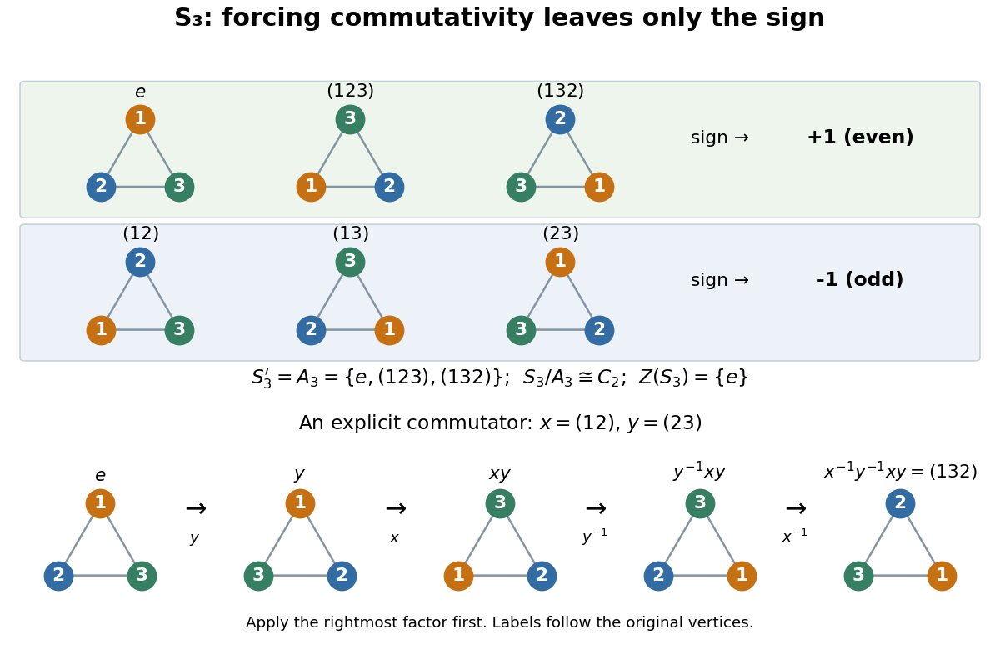
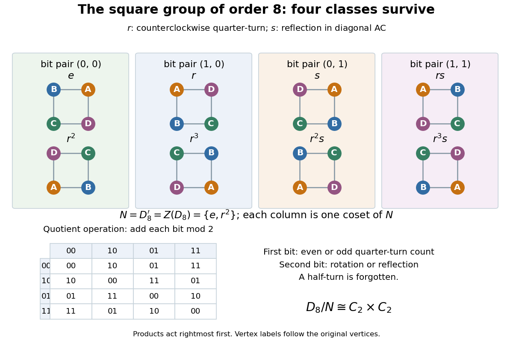
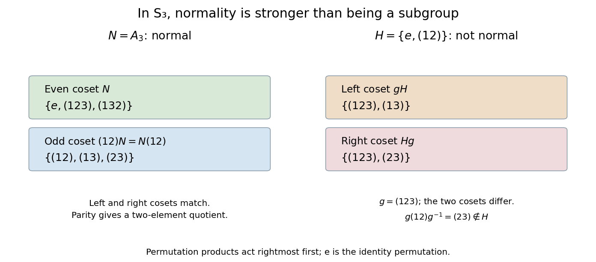

# Group theory

↑ **Parent:** [Algebra](algebra.md)  
ⓦ [Wiki](https://en.wikipedia.org/wiki/Group_theory)

Group theory studies groups, homomorphisms, actions, quotients, and symmetry.

**Table of contents**

- [Transfer (group theory)](#transfer-group-theory)
  - [Burnside transfer theorem](#burnside-transfer-theorem)
    - [Cyclic Sylow subgroup at the least prime gives a normal complement](#cyclic-sylow-subgroup-at-the-least-prime-gives-a-normal-complement)
- [Prüfer rank](#prufer-rank)
  - [Prüfer rank bound for extensions](#prufer-rank-bound-for-extensions)
- [Maximal condition on subgroups](#maximal-condition-on-subgroups)
- [Group](group.md)
  - [Partially ordered group](partially-ordered-group.md)
    - [Positive cone of an ordered group](partially-ordered-group.md#positive-cone-of-an-ordered-group)
    - [Convex subgroup of an ordered group](partially-ordered-group.md#convex-subgroup-of-an-ordered-group)
    - [Lattice-ordered group](partially-ordered-group.md#lattice-ordered-group)
      - [Riesz decomposition in a lattice-ordered group](partially-ordered-group.md#riesz-decomposition-in-a-lattice-ordered-group)
      - [Lattice-ordered group homomorphism](partially-ordered-group.md#lattice-ordered-group-homomorphism)
      - [Absolute value in a lattice-ordered group](partially-ordered-group.md#absolute-value-in-a-lattice-ordered-group)
        - [Positive and negative parts in a lattice-ordered group](partially-ordered-group.md#positive-and-negative-parts-in-a-lattice-ordered-group)
      - [Convex lattice subgroup](partially-ordered-group.md#convex-lattice-subgroup)
        - [One-sided bounds for adjoining a positive element](partially-ordered-group.md#one-sided-bounds-for-adjoining-a-positive-element)
        - [Ordered right cosets of a convex lattice subgroup](partially-ordered-group.md#ordered-right-cosets-of-a-convex-lattice-subgroup)
        - [Lattice of convex lattice subgroups](partially-ordered-group.md#lattice-of-convex-lattice-subgroups)
        - [Principal convex lattice subgroup](partially-ordered-group.md#principal-convex-lattice-subgroup)
        - [Prime convex lattice subgroup](partially-ordered-group.md#prime-convex-lattice-subgroup)
        - [Value in a lattice-ordered group](partially-ordered-group.md#value-in-a-lattice-ordered-group)
          - [Squared bound from comparison at values](partially-ordered-group.md#squared-bound-from-comparison-at-values)
          - [Cover of a value in a lattice-ordered group](partially-ordered-group.md#cover-of-a-value-in-a-lattice-ordered-group)
            - [Power cofinality in the cover of a value](partially-ordered-group.md#power-cofinality-in-the-cover-of-a-value)
      - [Normal-valued lattice-ordered group](partially-ordered-group.md#normal-valued-lattice-ordered-group)
        - [Wolfenstein inequality for normal-valued lattice-ordered groups](partially-ordered-group.md#wolfenstein-inequality-for-normal-valued-lattice-ordered-groups)
      - [Linearly ordered group](partially-ordered-group.md#linearly-ordered-group)
        - [Archimedean ordered group](partially-ordered-group.md#archimedean-ordered-group)
          - [Archimedean linearly ordered groups are Abelian](partially-ordered-group.md#archimedean-linearly-ordered-groups-are-abelian)
        - [Lexicographically ordered group](partially-ordered-group.md#lexicographically-ordered-group)
        - [Convex subgroups of a finite-rank ordered Abelian group](partially-ordered-group.md#convex-subgroups-of-a-finite-rank-ordered-abelian-group)
        - [Ohnishi orderability criterion](partially-ordered-group.md#ohnishi-orderability-criterion)
      - [Abelian lattice-ordered group](partially-ordered-group.md#abelian-lattice-ordered-group)
        - [Hahn group](partially-ordered-group.md#hahn-group)
          - [Finite-support Hahn embedding along a countable convex chain](partially-ordered-group.md#finite-support-hahn-embedding-along-a-countable-convex-chain)
        - [Free Abelian lattice-ordered group](partially-ordered-group.md#free-abelian-lattice-ordered-group)
          - [Piecewise integer-linear representation of a free Abelian lattice-ordered group](partially-ordered-group.md#piecewise-integer-linear-representation-of-a-free-abelian-lattice-ordered-group)
            - [Integer-linear hinge functions have infinite independent rank](partially-ordered-group.md#integer-linear-hinge-functions-have-infinite-independent-rank)
      - [Lattice-ordered permutation group](partially-ordered-group.md#lattice-ordered-permutation-group)
        - [Order-primitive lattice permutation group](partially-ordered-group.md#order-primitive-lattice-permutation-group)
          - [McCleary trichotomy theorem](partially-ordered-group.md#mccleary-trichotomy-theorem)
        - [Holland representation theorem](partially-ordered-group.md#holland-representation-theorem)
        - [Order n-transitivity](partially-ordered-group.md#order-n-transitivity)
          - [Finite interpolation by lattice operations](partially-ordered-group.md#finite-interpolation-by-lattice-operations)
        - [Positive bump of an order automorphism](partially-ordered-group.md#positive-bump-of-an-order-automorphism)
          - [Conjugacy of positive real-line bumps](partially-ordered-group.md#conjugacy-of-positive-real-line-bumps)
            - [Conjugating positive bumps while preserving a fundamental interval](partially-ordered-group.md#conjugating-positive-bumps-while-preserving-a-fundamental-interval)
  - [Triangle group](group.md#triangle-group)
  - [Poly-(cyclic or finite) group](group.md#poly-cyclic-or-finite-group)
  - [Group element](group.md#group-element)
  - [Braid group](group.md#braid-group)
    - [Artin automorphism of a braid](group.md#artin-automorphism-of-a-braid)
    - [Braid group relations](group.md#braid-group-relations)
  - [Infinite group](group.md#infinite-group)
    - [Tarski monster group](group.md#tarski-monster-group)
      - [Tarski monster groups are two-generated and simple](group.md#tarski-monster-groups-are-two-generated-and-simple)
  - [Trivial group](group.md#trivial-group)
  - [Group of exponent two is abelian](group.md#group-of-exponent-two-is-abelian)
  - [Non-abelian group](group.md#non-abelian-group)
  - [Torsion-free group](group.md#torsion-free-group)
    - [Countable torsion-free embedding with two conjugacy classes](group.md#countable-torsion-free-embedding-with-two-conjugacy-classes)
  - [Divisible group](group.md#divisible-group)
    - [Divisibility by a prime](group.md#divisibility-by-a-prime)
    - [Torsion-free divisible Abelian group](group.md#torsion-free-divisible-abelian-group)
  - [Group axioms](group.md#group-axioms)
  - [Finite group](group.md#finite-group)
    - [p-prime core of a finite group](group.md#p-prime-core-of-a-finite-group)
    - [p-core of a finite group](group.md#p-core-of-a-finite-group)
      - [p-constrained group](group.md#p-constrained-group)
    - [Pi-group](group.md#pi-group)
      - [Pi-element](group.md#pi-element)
    - [Elementary group](group.md#elementary-group)
      - [Prime-set decomposition of elementary groups](group.md#prime-set-decomposition-of-elementary-groups)
      - [p-elementary group](group.md#p-elementary-group)
    - [Ambivalent group](group.md#ambivalent-group)
    - [Monomial group](group.md#monomial-group)
      - [Abelian intersection of irreducible inducing subgroups](group.md#abelian-intersection-of-irreducible-inducing-subgroups)
      - [Dade's embedding theorem for monomial groups](group.md#dade-s-embedding-theorem-for-monomial-groups)
      - [Taketa's theorem](group.md#taketa-s-theorem)
    - [Frobenius group](group.md#frobenius-group)
      - [Frobenius kernel](group.md#frobenius-kernel)
        - [Frobenius kernel criterion by irreducible induction](group.md#frobenius-kernel-criterion-by-irreducible-induction)
        - [Commutator bijection from a fixed-point-free automorphism](group.md#commutator-bijection-from-a-fixed-point-free-automorphism)
        - [Frobenius kernel theorem](group.md#frobenius-kernel-theorem)
      - [Frobenius complement](group.md#frobenius-complement)
    - [Burnside's theorem](group.md#burnside-s-theorem)
      - [Prime-power conjugacy-class obstruction to simplicity](group.md#prime-power-conjugacy-class-obstruction-to-simplicity)
        - [Abelian subgroup cannot have prime-power index in a nonabelian simple group](group.md#abelian-subgroup-cannot-have-prime-power-index-in-a-nonabelian-simple-group)
    - [Order of a finite group](group.md#order-of-a-finite-group)
  - [Nontrivial group](group.md#nontrivial-group)
  - [Group operation](group.md#group-operation)
    - [Group commutator](group.md#group-commutator)
      - [Hall-Witt identity](group.md#hall-witt-identity)
      - [Hall-Petrescu formula](group.md#hall-petrescu-formula)
  - [Translation in a group](group.md#translation-in-a-group)
  - [Cyclic group](group.md#cyclic-group)
    - [Subgroups and quotients of a cyclic group](group.md#subgroups-and-quotients-of-a-cyclic-group)
    - [Free translation action on nontrivial subsets of a prime cyclic group](group.md#free-translation-action-on-nontrivial-subsets-of-a-prime-cyclic-group)
    - [Cyclic subgroup](group.md#cyclic-subgroup)
      - [Counting cyclic subgroups by their generators](group.md#counting-cyclic-subgroups-by-their-generators)
    - [Finite cyclic group](group.md#finite-cyclic-group)
      - [Order of an element of a finite cyclic group](group.md#order-of-an-element-of-a-finite-cyclic-group)
      - [Homomorphism from a finite cyclic group](group.md#homomorphism-from-a-finite-cyclic-group)
    - [Infinite cyclic group](group.md#infinite-cyclic-group)
    - [Finite subgroup of the multiplicative complex numbers](group.md#finite-subgroup-of-the-multiplicative-complex-numbers)
    - [Generator of a group](group.md#generator-of-a-group)
      - [Generators of a finite cyclic group](group.md#generators-of-a-finite-cyclic-group)
  - [Generating set of a group](group.md#generating-set-of-a-group)
    - [Minimal generating set of a group](group.md#minimal-generating-set-of-a-group)
    - [Complement of a proper subgroup generates the group](group.md#complement-of-a-proper-subgroup-generates-the-group)
    - [Finitely generated group](group.md#finitely-generated-group)
      - [Benign subgroup](group.md#benign-subgroup)
        - [Normal benign subgroup quotient embedding](group.md#normal-benign-subgroup-quotient-embedding)
        - [Intersection and join of benign subgroups](group.md#intersection-and-join-of-benign-subgroups)
      - [Unshifted rank gradients](group.md#unshifted-rank-gradients)
      - [Finite-index subgroup count for a finitely generated group](group.md#finite-index-subgroup-count-for-a-finitely-generated-group)
      - [Rank of a group](group.md#rank-of-a-group)
  - [Abelian group](group.md#abelian-group)
    - [Complex multiplicative group](group.md#complex-multiplicative-group)
    - [Abelian group of prime-square order](group.md#abelian-group-of-prime-square-order)
    - [Serre class](group.md#serre-class)
      - [Serre class of finitely generated abelian groups](group.md#serre-class-of-finitely-generated-abelian-groups)
    - [Torsion-free abelian group](group.md#torsion-free-abelian-group)
      - [Rational divisible hull](group.md#rational-divisible-hull)
    - [Abelian subgroup](group.md#abelian-subgroup)
    - [Finitely generated abelian group](group.md#finitely-generated-abelian-group)
      - [Finite generation detected by a prime quotient](group.md#finite-generation-detected-by-a-prime-quotient)
      - [Rank of an abelian group](group.md#rank-of-an-abelian-group)
      - [Fundamental theorem of finitely generated abelian groups](group.md#fundamental-theorem-of-finitely-generated-abelian-groups)
    - [Prüfer group](group.md#prufer-group)
    - [Additive group](group.md#additive-group)
      - [Finitely generated subgroup of the rational additive group](group.md#finitely-generated-subgroup-of-the-rational-additive-group)
    - [Infinitely divisible element of an abelian group](group.md#infinitely-divisible-element-of-an-abelian-group)
    - [Finite abelian group](group.md#finite-abelian-group)
      - [Cyclic group of order four and Klein four-group](group.md#cyclic-group-of-order-four-and-klein-four-group)
      - [Elementary abelian group](group.md#elementary-abelian-group)
        - [Order of a finite group of exponent two](group.md#order-of-a-finite-group-of-exponent-two)
    - [Pontryagin duality](group.md#pontryagin-duality)
      - [Pontryagin dual group](group.md#pontryagin-dual-group)
        - [Equicontinuity of compact families of characters](group.md#equicontinuity-of-compact-families-of-characters)
        - [Dual Haar measure](group.md#dual-haar-measure)
      - [Character group](group.md#character-group)
        - [Character group of a finite abelian group](group.md#character-group-of-a-finite-abelian-group)
          - [Multiplicative character of a finite field](group.md#multiplicative-character-of-a-finite-field)
            - [Jacobi sum of finite-field characters](group.md#jacobi-sum-of-finite-field-characters)
            - [Gauss sum of a finite-field character](group.md#gauss-sum-of-a-finite-field-character)
          - [Extension of a unitary character from a finite abelian subgroup](group.md#extension-of-a-unitary-character-from-a-finite-abelian-subgroup)
          - [Extension of a character across a cyclic quotient](group.md#extension-of-a-character-across-a-cyclic-quotient)
          - [Character of a finite abelian group](group.md#character-of-a-finite-abelian-group)
          - [Character-sum cancellation lemma](group.md#character-sum-cancellation-lemma)
          - [Annihilator of a subgroup of a finite abelian group](group.md#annihilator-of-a-subgroup-of-a-finite-abelian-group)
  - [Finite additive group](group.md#finite-additive-group)
  - [Subgroup](group.md#subgroup)
    - [Finitely generated subgroup](group.md#finitely-generated-subgroup)
    - [Membership problem for a subgroup](group.md#membership-problem-for-a-subgroup)
    - [Maximal subgroup](group.md#maximal-subgroup)
      - [Maximal symmetric-group subgroups containing a three-cycle](group.md#maximal-symmetric-group-subgroups-containing-a-three-cycle)
      - [Maximal subgroups of a finite soluble group](group.md#maximal-subgroups-of-a-finite-soluble-group)
      - [Maximal subgroup normalizer criterion](group.md#maximal-subgroup-normalizer-criterion)
    - [Hall subgroup](group.md#hall-subgroup)
      - [Schur-Zassenhaus theorem](group.md#schur-zassenhaus-theorem)
      - [Hall conjugacy and embedding in finite soluble groups](group.md#hall-conjugacy-and-embedding-in-finite-soluble-groups)
      - [Hall subgroup existence in soluble groups](group.md#hall-subgroup-existence-in-soluble-groups)
    - [Union of two subgroups](group.md#union-of-two-subgroups)
    - [Index of a subgroup](group.md#index-of-a-subgroup)
    - [Index-two subgroup is normal](group.md#index-two-subgroup-is-normal)
    - [Finite-index subgroup](group.md#finite-index-subgroup)
- [First isomorphism theorem](#first-isomorphism-theorem)
- [Direct product of groups](#direct-product-of-groups)
  - [Cyclicity of a product of two finite cyclic groups](#cyclicity-of-a-product-of-two-finite-cyclic-groups)
  - [Order of a direct-product element](#order-of-a-direct-product-element)
  - [Restricted direct sum of groups](#restricted-direct-sum-of-groups)
  - [Internal direct product theorem](#internal-direct-product-theorem)
- [Metacyclic group](#metacyclic-group)
- [Commutator subgroup](#commutator-subgroup)
  - [Commutator subgroup of the symmetric group on three letters](#commutator-subgroup-of-the-symmetric-group-on-three-letters)
  - [Perfect group](#perfect-group)
    - [Perfectness of the special linear group](#perfectness-of-the-special-linear-group)
  - [Abelianization](#abelianization)
    - [Universal property of abelianization](#universal-property-of-abelianization)
    - [Uniqueness of finite-index subgroups forces infinite cyclic abelianization](#uniqueness-of-finite-index-subgroups-forces-infinite-cyclic-abelianization)
      - [Residually finite group with one subgroup of each finite index is infinite cyclic](#residually-finite-group-with-one-subgroup-of-each-finite-index-is-infinite-cyclic)
    - [Abelianization of the square symmetry group](#abelianization-of-the-square-symmetry-group)
    - [Abelianization of an odd dihedral group](#abelianization-of-an-odd-dihedral-group)
- [Center of a group](#center-of-a-group)
  - [Cyclic quotient by the center](#cyclic-quotient-by-the-center)
- [Conjugate subgroup](#conjugate-subgroup)
- [Group action](#group-action)
  - [n-transitive group action](#n-transitive-group-action)
  - [Symmetry enlargement under group translates](#symmetry-enlargement-under-group-translates)
  - [Subgroup factorization from coset transitivity](#subgroup-factorization-from-coset-transitivity)
  - [Circle action](#circle-action)
  - [Symmetry group](#symmetry-group)
  - [Finite support in a permutation action](#finite-support-in-a-permutation-action)
  - [Free action of a group](#free-action-of-a-group)
  - [Free group action](#free-group-action)
    - [Finite groups cannot act freely on Euclidean space](#finite-groups-cannot-act-freely-on-euclidean-space)
    - [Free actions on even-dimensional spheres have order at most two](#free-actions-on-even-dimensional-spheres-have-order-at-most-two)
    - [Free sphere actions exclude elementary abelian subgroups of rank two](#free-sphere-actions-exclude-elementary-abelian-subgroups-of-rank-two)
  - [Fundamental domain](#fundamental-domain)
  - [Multiply transitive group action](#multiply-transitive-group-action)
    - [Three-transitive group action](#three-transitive-group-action)
  - [Diagonal action on a centerless group](#diagonal-action-on-a-centerless-group)
  - [Ring of invariants](#ring-of-invariants)
    - [Normality of a ring of invariants](#normality-of-a-ring-of-invariants)
  - [Primitive group action](#primitive-group-action)
    - [Primitive group with a transposition](#primitive-group-with-a-transposition)
    - [Even primitive groups of safe-prime degree](#even-primitive-groups-of-safe-prime-degree)
    - [O'Nan–Scott theorem](#o-nan-scott-theorem)
      - [Diagonal primitive permutation group](#diagonal-primitive-permutation-group)
      - [Affine primitive permutation group](#affine-primitive-permutation-group)
        - [General affine group](#general-affine-group)
    - [Primitive three-cycle criterion](#primitive-three-cycle-criterion)
  - [Variable-permutation action on polynomials](#variable-permutation-action-on-polynomials)
  - [Fixed point of a group action](#fixed-point-of-a-group-action)
  - [Left regular action](#left-regular-action)
  - [Block system](#block-system)
    - [Uniform subdegrees force an imprimitive action to be Frobenius](#uniform-subdegrees-force-an-imprimitive-action-to-be-frobenius)
  - [Transitive group action](#transitive-group-action)
    - [Simply transitive group action](#simply-transitive-group-action)
    - [Regular group action](#regular-group-action)
    - [Derangement in a transitive group action](#derangement-in-a-transitive-group-action)
      - [Derangement counting formula](#derangement-counting-formula)
    - [Rank of a transitive permutation group](#rank-of-a-transitive-permutation-group)
    - [Regular permutation subgroup](#regular-permutation-subgroup)
      - [Centralizer of a regular permutation subgroup](#centralizer-of-a-regular-permutation-subgroup)
    - [Sharp t-transitivity](#sharp-t-transitivity)
      - [Sharp three-transitivity](#sharp-three-transitivity)
      - [Sharp two-transitivity](#sharp-two-transitivity)
      - [Regular kernel of a finite sharply two-transitive group](#regular-kernel-of-a-finite-sharply-two-transitive-group)
    - [One-point extension of a permutation group](#one-point-extension-of-a-permutation-group)
      - [Double-coset criterion for a one-point extension](#double-coset-criterion-for-a-one-point-extension)
    - [Prime-degree transposition criterion](#prime-degree-transposition-criterion)
  - [Two-transitive group action](#two-transitive-group-action)
    - [Elementary abelian regular kernels in doubly transitive groups](#elementary-abelian-regular-kernels-in-doubly-transitive-groups)
    - [Degree-ten partition action of S6](#degree-ten-partition-action-of-s6)
    - [Minimal normal subgroup dichotomy for two-transitive groups](#minimal-normal-subgroup-dichotomy-for-two-transitive-groups)
    - [Affine two-transitive group](#affine-two-transitive-group)
  - [Orbit map](#orbit-map)
  - [Equivariant map](#equivariant-map)
  - [Conjugation action](#conjugation-action)
    - [Conjugates of a proper subgroup do not cover a finite group](#conjugates-of-a-proper-subgroup-do-not-cover-a-finite-group)
    - [Conjugation](#conjugation)
      - [Conjugate subset](#conjugate-subset)
      - [Conjugate group elements](#conjugate-group-elements)
        - [Conjugate permutation](#conjugate-permutation)
    - [Conjugacy class](#conjugacy-class)
      - [Conjugacy classes of the symmetric group on three letters](#conjugacy-classes-of-the-symmetric-group-on-three-letters)
      - [Infinite conjugacy class group](#infinite-conjugacy-class-group)
      - [Torsion-freeness from one nonidentity conjugacy class](#torsion-freeness-from-one-nonidentity-conjugacy-class)
      - [Shortest conjugacy representative](#shortest-conjugacy-representative)
        - [Cyclic reduction of a shortest conjugacy representative](#cyclic-reduction-of-a-shortest-conjugacy-representative)
      - [Conjugacy class splitting in a prime-index normal subgroup](#conjugacy-class-splitting-in-a-prime-index-normal-subgroup)
        - [Alternating conjugacy class splitting criterion](#alternating-conjugacy-class-splitting-criterion)
          - [Inversion of an odd cycle in an alternating group](#inversion-of-an-odd-cycle-in-an-alternating-group)
      - [Class equation](#class-equation)
        - [Prime-to-p conjugacy class lemma](#prime-to-p-conjugacy-class-lemma)
    - [Centralizer and normalizer](#centralizer-and-normalizer)
      - [Centralizer](#centralizer)
        - [Centralizer of a subset](#centralizer-of-a-subset)
        - [Centraliser of a fixed-point-free involution](#centraliser-of-a-fixed-point-free-involution)
        - [Centraliser of a transposition](#centraliser-of-a-transposition)
      - [Normalizer](#normalizer)
        - [Normalizer of a diagonal subgroup of GL2](#normalizer-of-a-diagonal-subgroup-of-gl2)
  - [Orbit-stabilizer theorem](#orbit-stabilizer-theorem)
    - [Orbit dimension formula](#orbit-dimension-formula)
  - [Symmetry group of a cube](#symmetry-group-of-a-cube)
    - [Body-diagonal stabilizer in the cube symmetry group](#body-diagonal-stabilizer-in-the-cube-symmetry-group)
    - [Axial isotropy types of the full cube symmetry group](#axial-isotropy-types-of-the-full-cube-symmetry-group)
    - [Axis stabilizer in the full octahedral symmetry group](#axis-stabilizer-in-the-full-octahedral-symmetry-group)
    - [Cube symmetry action on edges](#cube-symmetry-action-on-edges)
    - [Direct-product decomposition of the cube symmetry group](#direct-product-decomposition-of-the-cube-symmetry-group)
    - [Rotational symmetry group of a cube](#rotational-symmetry-group-of-a-cube)
      - [Tetrahedron stabilizer in the cube rotation group](#tetrahedron-stabilizer-in-the-cube-rotation-group)
      - [Kernel of the cube face-axis action](#kernel-of-the-cube-face-axis-action)
      - [Face-pair orbits of cube rotations](#face-pair-orbits-of-cube-rotations)
  - [Faithful group action](#faithful-group-action)
    - [Normal subgroup orbits in a faithful prime-degree action](#normal-subgroup-orbits-in-a-faithful-prime-degree-action)
  - [Orbit (group theory)](#orbit-group-theory)
    - [Equality-pattern orbits of ordered pairs](#equality-pattern-orbits-of-ordered-pairs)
    - [Real rotation orbits on a complex unit quadric](#real-rotation-orbits-on-a-complex-unit-quadric)
    - [Equality-pattern orbits of projective triples](#equality-pattern-orbits-of-projective-triples)
  - [Stabilizer subgroup](#stabilizer-subgroup)
    - [Pointwise stabilizer](#pointwise-stabilizer)
    - [Axial subgroup](#axial-subgroup)
      - [Complex axial isotropy subgroup](#complex-axial-isotropy-subgroup)
  - [Symmetric group action on subsets](#symmetric-group-action-on-subsets)
  - [Coset action](#coset-action)
- [Coset](#coset)
  - [Right coset transversal](#right-coset-transversal)
  - [Double coset](#double-coset)
    - [Double-coset counts need not divide group order](#double-coset-counts-need-not-divide-group-order)
    - [Double-coset sizes not dividing group order](#double-coset-sizes-not-dividing-group-order)
    - [Double-coset Hecke algebra](#double-coset-hecke-algebra)
    - [Sylow subgroup of a subgroup from double cosets](#sylow-subgroup-of-a-subgroup-from-double-cosets)
- [Lagrange's theorem](#lagrange-s-theorem)
  - [Failure of the converse to Lagrange's theorem](#failure-of-the-converse-to-lagrange-s-theorem)
- [Group embedding](#group-embedding)
  - [Two-generator HNN embedding](#two-generator-hnn-embedding)
  - [Alternating-group embedding of a finite group](#alternating-group-embedding-of-a-finite-group)
  - [Cayley's theorem](#cayley-s-theorem)
    - [Symmetric-group embedding at one less than the group order](#symmetric-group-embedding-at-one-less-than-the-group-order)
- [Generalized dihedral group](#generalized-dihedral-group)
  - [Two-involution characterization of a dihedral group](#two-involution-characterization-of-a-dihedral-group)
    - [Nontrivial-quotient closure of two-involution groups](#nontrivial-quotient-closure-of-two-involution-groups)
- [Order of a group element](#order-of-a-group-element)
  - [Product of commuting elements of coprime order](#product-of-commuting-elements-of-coprime-order)
  - [Infinite order](#infinite-order)
  - [Involution](#involution)
    - [Eigenspace decomposition of a linear involution](#eigenspace-decomposition-of-a-linear-involution)
      - [Involution exponential formula](#involution-exponential-formula)
- [Quotient group](#quotient-group)
  - [Quotient map of groups](#quotient-map-of-groups)
  - [Coset multiplication is well-defined exactly for normal subgroups](#coset-multiplication-is-well-defined-exactly-for-normal-subgroups)
  - [Universal property of a quotient group](#universal-property-of-a-quotient-group)
  - [Subgroup correspondence for a surjective group homomorphism](#subgroup-correspondence-for-a-surjective-group-homomorphism)
  - [Finite quotient of a group](#finite-quotient-of-a-group)
  - [Abelian quotient](#abelian-quotient)
- [General linear group](#general-linear-group)
  - [Monomial matrix](#monomial-matrix)
  - [Integral general linear group](#integral-general-linear-group)
  - [Matrix group](#matrix-group)
    - [Classical group](#classical-group)
    - [Orthogonal group over a finite field](#orthogonal-group-over-a-finite-field)
- [Special linear group](#special-linear-group)
  - [Real special linear group of degree two](#real-special-linear-group-of-degree-two)
    - [Elementary unipotent generators of SL2R](#elementary-unipotent-generators-of-sl2r)
  - [Projective special linear group](#projective-special-linear-group)
    - [Scalar kernel of the projective linear action](#scalar-kernel-of-the-projective-linear-action)
  - [Complex special linear group in dimension two](#complex-special-linear-group-in-dimension-two)
  - [Triangular-rotation factorization of real determinant-one matrices](#triangular-rotation-factorization-of-real-determinant-one-matrices)
  - [Congruence subgroup](#congruence-subgroup)
    - [Principal congruence subgroup](#principal-congruence-subgroup)
    - [Gamma 0 congruence subgroup](#gamma-0-congruence-subgroup)
    - [Gamma 1 congruence subgroup](#gamma-1-congruence-subgroup)
      - [Number of cusps of Gamma 1 of prime level](#number-of-cusps-of-gamma-1-of-prime-level)
        - [Prime Gamma 1 cusp counts and widths](#prime-gamma-1-cusp-counts-and-widths)
- [Group homomorphism](#group-homomorphism)
  - [Homomorphism of abelian groups](#homomorphism-of-abelian-groups)
  - [Surjective group homomorphism](#surjective-group-homomorphism)
  - [Covering homomorphism](#covering-homomorphism)
  - [Homomorphism between cyclic groups](#homomorphism-between-cyclic-groups)
  - [Kernel of a group homomorphism](#kernel-of-a-group-homomorphism)
    - [Fibres of a group homomorphism are cosets of its kernel](#fibres-of-a-group-homomorphism-are-cosets-of-its-kernel)
  - [Image of a group homomorphism](#image-of-a-group-homomorphism)
- [Automorphism group](#automorphism-group)
  - [Holomorph](#holomorph)
  - [Inner automorphism](#inner-automorphism)
  - [Outer automorphism group](#outer-automorphism-group)
    - [Outer automorphism of a group](#outer-automorphism-of-a-group)
- [Group cohomology](#group-cohomology)
  - [Cellular free resolution from a contractible universal cover](#cellular-free-resolution-from-a-contractible-universal-cover)
  - [Integral cohomological dimension of a group](#integral-cohomological-dimension-of-a-group)
    - [Stallings-Swan theorem](#stallings-swan-theorem)
  - [Poincare duality group](#poincare-duality-group)
    - [Normal finitely presented subgroups of three-dimensional duality groups](#normal-finitely-presented-subgroups-of-three-dimensional-duality-groups)
    - [Classification of two-dimensional Poincare duality groups](#classification-of-two-dimensional-poincare-duality-groups)
    - [Strebel infinite-index subgroup theorem](#strebel-infinite-index-subgroup-theorem)
    - [Extension rule for Poincare duality groups](#extension-rule-for-poincare-duality-groups)
    - [Finite-index invariance of Poincare duality for torsion-free groups](#finite-index-invariance-of-poincare-duality-for-torsion-free-groups)
  - [Mod-p cohomology ring of a cyclic group](#mod-p-cohomology-ring-of-a-cyclic-group)
  - [Dimension shifting in group cohomology](#dimension-shifting-in-group-cohomology)
  - [Tate cohomology of a finite group](#tate-cohomology-of-a-finite-group)
  - [Continuous cochains with topological coefficients](#continuous-cochains-with-topological-coefficients)
  - [Tate cohomology of a cyclic group](#tate-cohomology-of-a-cyclic-group)
    - [Cyclic cohomology of a regular lattice](#cyclic-cohomology-of-a-regular-lattice)
    - [Herbrand quotient](#herbrand-quotient)
      - [Herbrand quotient of a finite module](#herbrand-quotient-of-a-finite-module)
      - [Herbrand quotient of the local multiplicative group](#herbrand-quotient-of-the-local-multiplicative-group)
  - [Corestriction map in group cohomology](#corestriction-map-in-group-cohomology)
  - [Continuous cohomology of a profinite group](#continuous-cohomology-of-a-profinite-group)
    - [Cohomology continuity at closed subgroups](#cohomology-continuity-at-closed-subgroups)
    - [Cohomological dimension at a prime](#cohomological-dimension-at-a-prime)
      - [Trivial coefficients detect the cohomological dimension of a pro-p group](#trivial-coefficients-detect-the-cohomological-dimension-of-a-pro-p-group)
      - [Characteristic p Galois dimension bound](#characteristic-p-galois-dimension-bound)
  - [Nonabelian first cohomology](#nonabelian-first-cohomology)
  - [Periodic group cohomology](#periodic-group-cohomology)
    - [Cohomology ring of a finite cyclic group over its prime field](#cohomology-ring-of-a-finite-cyclic-group-over-its-prime-field)
    - [Periodic group cohomology from a free sphere action](#periodic-group-cohomology-from-a-free-sphere-action)
  - [Projective-resolution definition of group cohomology](#projective-resolution-definition-of-group-cohomology)
    - [Group cohomology commutes with finite direct sums](#group-cohomology-commutes-with-finite-direct-sums)
    - [Koszul resolution for a rank-two free abelian group](#koszul-resolution-for-a-rank-two-free-abelian-group)
      - [Second cohomology of a rank-two free abelian group with truncated group-ring coefficients](#second-cohomology-of-a-rank-two-free-abelian-group-with-truncated-group-ring-coefficients)
  - [Coinduced module](#coinduced-module)
    - [Shapiro's lemma](#shapiro-s-lemma)
      - [Hom functor adjunction for a coinduced module](#hom-functor-adjunction-for-a-coinduced-module)
  - [Conjugation module of a group ring](#conjugation-module-of-a-group-ring)
    - [Group cohomology of a conjugation module](#group-cohomology-of-a-conjugation-module)
  - [Integral cohomology of a finite cyclic group](#integral-cohomology-of-a-finite-cyclic-group)
    - [Periodic resolution of a finite cyclic group](#periodic-resolution-of-a-finite-cyclic-group)
  - [Group extension](#group-extension)
    - [Torsion-free finite extension of a lattice](#torsion-free-finite-extension-of-a-lattice)
    - [Split group extension](#split-group-extension)
      - [Section normal form for a split group extension](#section-normal-form-for-a-split-group-extension)
    - [Equivalent group extensions](#equivalent-group-extensions)
    - [Fiber product of groups](#fiber-product-of-groups)
      - [Mihailova subgroup](#mihailova-subgroup)
    - [Second group cohomology classifies group extensions](#second-group-cohomology-classifies-group-extensions)
      - [Integral central extensions of a rank-two free abelian group](#integral-central-extensions-of-a-rank-two-free-abelian-group)
      - [Extension cocycle](#extension-cocycle)
  - [Group cocycle](#group-cocycle)
    - [One-cocycle](#one-cocycle)
      - [Galois 1-cocycle](#galois-1-cocycle)
      - [Crossed homomorphism](#crossed-homomorphism)
        - [Principal crossed homomorphism](#principal-crossed-homomorphism)
    - [Two-cocycle](#two-cocycle)
      - [Normalized two-cocycle](#normalized-two-cocycle)
  - [Group coboundary](#group-coboundary)
  - [Group cochain](#group-cochain)
  - [Long exact sequence in group cohomology](#long-exact-sequence-in-group-cohomology)
  - [Finite-group cohomology is annihilated by the group order](#finite-group-cohomology-is-annihilated-by-the-group-order)
    - [Restriction-corestriction identity in group cohomology](#restriction-corestriction-identity-in-group-cohomology)
  - [Mac Lane exact sequence for a free presentation](#mac-lane-exact-sequence-for-a-free-presentation)
  - [Lyndon–Hochschild–Serre spectral sequence](#lyndon-hochschild-serre-spectral-sequence)
    - [Cyclic-extension shift of group-ring cohomology](#cyclic-extension-shift-of-group-ring-cohomology)
    - [Five-term exact sequence in group cohomology](#five-term-exact-sequence-in-group-cohomology)
      - [Inflation-restriction exact sequence](#inflation-restriction-exact-sequence)
      - [Inflation map in group cohomology](#inflation-map-in-group-cohomology)
      - [Restriction map in group cohomology](#restriction-map-in-group-cohomology)
      - [Transgression in group cohomology](#transgression-in-group-cohomology)
    - [Integral cohomology of the dihedral group of order ten](#integral-cohomology-of-the-dihedral-group-of-order-ten)
- [Group homology](#group-homology)
  - [Homology of a finite cyclic group](#homology-of-a-finite-cyclic-group)
  - [Schur multiplier](#schur-multiplier)
    - [Hopf's formula](#hopf-s-formula)
    - [Schur multiplier of an abelian group](#schur-multiplier-of-an-abelian-group)
- [Finite group theory](finite-group-theory.md)
  - [Fitting subgroup](finite-group-theory.md#fitting-subgroup)
    - [Fitting subgroup is self-centralizing in soluble groups](finite-group-theory.md#fitting-subgroup-is-self-centralizing-in-soluble-groups)
    - [Fitting subgroup centralizes the socle](finite-group-theory.md#fitting-subgroup-centralizes-the-socle)
    - [Nilpotent normal subgroup](finite-group-theory.md#nilpotent-normal-subgroup)
    - [p-core](finite-group-theory.md#p-core)
  - [Classification of groups of order ten](finite-group-theory.md#classification-of-groups-of-order-ten)
  - [Almost simple group](finite-group-theory.md#almost-simple-group)
  - [Heisenberg group over a prime field](finite-group-theory.md#heisenberg-group-over-a-prime-field)
  - [Tetrahedral symmetry](finite-group-theory.md#tetrahedral-symmetry)
  - [Group of order eight](finite-group-theory.md#group-of-order-eight)
  - [Feit–Thompson theorem](finite-group-theory.md#feit-thompson-theorem)
  - [Alternating group](finite-group-theory.md#alternating-group)
    - [Maximal subgroups of A5](finite-group-theory.md#maximal-subgroups-of-a5)
    - [Automorphisms of alternating groups from triple supports](finite-group-theory.md#automorphisms-of-alternating-groups-from-triple-supports)
    - [Connected triple supports generate an alternating group](finite-group-theory.md#connected-triple-supports-generate-an-alternating-group)
    - [Conjugacy classes of the alternating group on six letters](finite-group-theory.md#conjugacy-classes-of-the-alternating-group-on-six-letters)
  - [P-group](finite-group-theory.md#p-group)
  - [Symmetric group](finite-group-theory.md#symmetric-group)
    - [Automorphisms of the symmetric group](finite-group-theory.md#automorphisms-of-the-symmetric-group)
      - [Symmetric-group involution class-size collision](finite-group-theory.md#symmetric-group-involution-class-size-collision)
    - [Permutation group](finite-group-theory.md#permutation-group)
      - [Oligomorphic permutation group](finite-group-theory.md#oligomorphic-permutation-group)
    - [A cycle and a transposition generate the symmetric group exactly at coprime separation](finite-group-theory.md#a-cycle-and-a-transposition-generate-the-symmetric-group-exactly-at-coprime-separation)
    - [Transpositions on a connected graph generate the symmetric group](finite-group-theory.md#transpositions-on-a-connected-graph-generate-the-symmetric-group)
    - [Parity of a permutation](finite-group-theory.md#parity-of-a-permutation)
      - [Sign homomorphism](finite-group-theory.md#sign-homomorphism)
    - [Permutation cycle](finite-group-theory.md#permutation-cycle)
      - [Cycle type](finite-group-theory.md#cycle-type)
        - [Permutation order and sign do not determine conjugacy](finite-group-theory.md#permutation-order-and-sign-do-not-determine-conjugacy)
        - [Permutation conjugate to its square](finite-group-theory.md#permutation-conjugate-to-its-square)
        - [Transposition changes the cycle count by one](finite-group-theory.md#transposition-changes-the-cycle-count-by-one)
      - [Three-cycle](finite-group-theory.md#three-cycle)
      - [Disjoint permutation cycles](finite-group-theory.md#disjoint-permutation-cycles)
    - [Support of a permutation](finite-group-theory.md#support-of-a-permutation)
    - [Sign of a permutation](finite-group-theory.md#sign-of-a-permutation)
      - [Odd permutation](finite-group-theory.md#odd-permutation)
      - [Even permutation](finite-group-theory.md#even-permutation)
  - [Quaternion group](finite-group-theory.md#quaternion-group)
    - [Minimal faithful permutation degree of the quaternion group](finite-group-theory.md#minimal-faithful-permutation-degree-of-the-quaternion-group)
  - [Dicyclic group](finite-group-theory.md#dicyclic-group)
    - [Order-twelve dicyclic character table](finite-group-theory.md#order-twelve-dicyclic-character-table)
    - [Dicyclic character table](finite-group-theory.md#dicyclic-character-table)
  - [Finite p-group](finite-group-theory.md#finite-p-group)
    - [p-subgroup](finite-group-theory.md#p-subgroup)
      - [p-radical subgroup](finite-group-theory.md#p-radical-subgroup)
    - [Lower p-series](finite-group-theory.md#lower-p-series)
    - [Powerful p-group](finite-group-theory.md#powerful-p-group)
      - [Minimal cyclic factorization criterion for powerful p-groups](finite-group-theory.md#minimal-cyclic-factorization-criterion-for-powerful-p-groups)
      - [Subgroup generator bound for a powerful finite p-group](finite-group-theory.md#subgroup-generator-bound-for-a-powerful-finite-p-group)
      - [Power lifting in a powerful p-group](finite-group-theory.md#power-lifting-in-a-powerful-p-group)
      - [Powerfully embedded subgroup](finite-group-theory.md#powerfully-embedded-subgroup)
    - [Classification of groups of order p squared](finite-group-theory.md#classification-of-groups-of-order-p-squared)
    - [Normalizer condition for finite p-groups](finite-group-theory.md#normalizer-condition-for-finite-p-groups)
    - [Central intersection property of normal subgroups of finite p-groups](finite-group-theory.md#central-intersection-property-of-normal-subgroups-of-finite-p-groups)
    - [Nontrivial center of a finite p-group](finite-group-theory.md#nontrivial-center-of-a-finite-p-group)
    - [Frattini subgroup](finite-group-theory.md#frattini-subgroup)
      - [Frattini lifting of nilpotence](finite-group-theory.md#frattini-lifting-of-nilpotence)
      - [Non-generator of a finite group](finite-group-theory.md#non-generator-of-a-finite-group)
      - [Frattini quotient](finite-group-theory.md#frattini-quotient)
        - [Burnside basis theorem](finite-group-theory.md#burnside-basis-theorem)
  - [Simple group](finite-group-theory.md#simple-group)
    - [Finite simple group](finite-group-theory.md#finite-simple-group)
    - [Simple groups with order a power of two times fifteen](finite-group-theory.md#simple-groups-with-order-a-power-of-two-times-fifteen)
    - [Iwasawa simplicity lemma](finite-group-theory.md#iwasawa-simplicity-lemma)
    - [Simplicity of the alternating group on six letters](finite-group-theory.md#simplicity-of-the-alternating-group-on-six-letters)
    - [Simplicity of alternating groups](finite-group-theory.md#simplicity-of-alternating-groups)
    - [Finite nonabelian simple group](finite-group-theory.md#finite-nonabelian-simple-group)
      - [Least-prime divisibility constraint for a finite simple group](finite-group-theory.md#least-prime-divisibility-constraint-for-a-finite-simple-group)
      - [Mathieu group](finite-group-theory.md#mathieu-group)
      - [Ree group of type G2](finite-group-theory.md#ree-group-of-type-g2)
      - [Suzuki group of Lie type](finite-group-theory.md#suzuki-group-of-lie-type)
    - [Simplicity of the alternating group A5](finite-group-theory.md#simplicity-of-the-alternating-group-a5)
    - [Smallest nonabelian simple group](finite-group-theory.md#smallest-nonabelian-simple-group)
  - [General linear group over a finite field](finite-group-theory.md#general-linear-group-over-a-finite-field)
    - [Conjugacy-class generating function for finite general linear groups](finite-group-theory.md#conjugacy-class-generating-function-for-finite-general-linear-groups)
    - [Unitary group over a finite field](finite-group-theory.md#unitary-group-over-a-finite-field)
    - [Projective special unitary group over a finite field](finite-group-theory.md#projective-special-unitary-group-over-a-finite-field)
    - [Parabolic stabilizer of a subspace](finite-group-theory.md#parabolic-stabilizer-of-a-subspace)
    - [Symplectic group over a finite field](finite-group-theory.md#symplectic-group-over-a-finite-field)
      - [Symplectic quotient of the binary subset module](finite-group-theory.md#symplectic-quotient-of-the-binary-subset-module)
      - [Perfectness of finite symplectic groups](finite-group-theory.md#perfectness-of-finite-symplectic-groups)
      - [Symplectic transvection](finite-group-theory.md#symplectic-transvection)
      - [Projective symplectic group over a finite field](finite-group-theory.md#projective-symplectic-group-over-a-finite-field)
    - [Inverse-transpose automorphism](finite-group-theory.md#inverse-transpose-automorphism)
    - [Maximal subgroups of GL3 over F2](finite-group-theory.md#maximal-subgroups-of-gl3-over-f2)
      - [Elementary abelian subgroups in GL3 over F2](finite-group-theory.md#elementary-abelian-subgroups-in-gl3-over-f2)
    - [Singer cycle](finite-group-theory.md#singer-cycle)
    - [Order-p matrices in GL2 over the prime field](finite-group-theory.md#order-p-matrices-in-gl2-over-the-prime-field)
    - [Faithful four-point action of GL2 over F2](finite-group-theory.md#faithful-four-point-action-of-gl2-over-f2)
    - [Order of a general linear group over a finite field](finite-group-theory.md#order-of-a-general-linear-group-over-a-finite-field)
    - [Upper unitriangular group](finite-group-theory.md#upper-unitriangular-group)
      - [Center of an upper unitriangular group](finite-group-theory.md#center-of-an-upper-unitriangular-group)
      - [Unitriangular matrix power formula](finite-group-theory.md#unitriangular-matrix-power-formula)
      - [Unitriangular group of degree three over F3](finite-group-theory.md#unitriangular-group-of-degree-three-over-f3)
    - [Projective general linear group action on the projective line](finite-group-theory.md#projective-general-linear-group-action-on-the-projective-line)
      - [Sharply three-transitive on a projective line](finite-group-theory.md#sharply-three-transitive-on-a-projective-line)
      - [Projective line](finite-group-theory.md#projective-line)
      - [Sylow 2-subgroup of PGL2 over F4](finite-group-theory.md#sylow-2-subgroup-of-pgl2-over-f4)
    - [Special linear group over a finite field](finite-group-theory.md#special-linear-group-over-a-finite-field)
      - [Unique involution in SL2 over an odd field](finite-group-theory.md#unique-involution-in-sl2-over-an-odd-field)
      - [SL2 over F2 as a permutation group](finite-group-theory.md#sl2-over-f2-as-a-permutation-group)
      - [Projective special linear group over a finite field](finite-group-theory.md#projective-special-linear-group-over-a-finite-field)
        - [Exterior-square realization of PSL4 over F2](finite-group-theory.md#exterior-square-realization-of-psl4-over-f2)
        - [Projective special linear group over the field with five elements](finite-group-theory.md#projective-special-linear-group-over-the-field-with-five-elements)
          - [Quaternion construction of an index-five subgroup of PSL2 over F5](finite-group-theory.md#quaternion-construction-of-an-index-five-subgroup-of-psl2-over-f5)
      - [Unipotent conjugacy in SL2 over a finite field](finite-group-theory.md#unipotent-conjugacy-in-sl2-over-a-finite-field)
      - [SL2 action on a finite projective line](finite-group-theory.md#sl2-action-on-a-finite-projective-line)
  - [Dihedral group](finite-group-theory.md#dihedral-group)
    - [Dihedral splitting when the half-rotation order is odd](finite-group-theory.md#dihedral-splitting-when-the-half-rotation-order-is-odd)
    - [Classification of subgroups of a dihedral group](finite-group-theory.md#classification-of-subgroups-of-a-dihedral-group)
    - [Dihedral subgroups of every divisor order](finite-group-theory.md#dihedral-subgroups-of-every-divisor-order)
    - [Involutions in an even dihedral group](finite-group-theory.md#involutions-in-an-even-dihedral-group)
  - [Sylow theorems](finite-group-theory.md#sylow-theorems)
    - [Sylow basis](finite-group-theory.md#sylow-basis)
      - [Counting Sylow bases in a coprime elementary abelian extension](finite-group-theory.md#counting-sylow-bases-in-a-coprime-elementary-abelian-extension)
    - [Sylow existence by subset action](finite-group-theory.md#sylow-existence-by-subset-action)
    - [A group of order 56 has a normal Sylow subgroup](finite-group-theory.md#a-group-of-order-56-has-a-normal-sylow-subgroup)
    - [Frattini argument](finite-group-theory.md#frattini-argument)
    - [Groups of order p squared q are not simple](finite-group-theory.md#groups-of-order-p-squared-q-are-not-simple)
    - [Sylow subgroup](finite-group-theory.md#sylow-subgroup)
    - [Nonabelian group of order pq](finite-group-theory.md#nonabelian-group-of-order-pq)
      - [Nonabelian group of order 21](finite-group-theory.md#nonabelian-group-of-order-21)
    - [Conjugation action on Sylow subgroups](finite-group-theory.md#conjugation-action-on-sylow-subgroups)
      - [Strengthened Sylow congruence from intersections](finite-group-theory.md#strengthened-sylow-congruence-from-intersections)
      - [Simple group embedding from Sylow conjugation](finite-group-theory.md#simple-group-embedding-from-sylow-conjugation)
    - [Sylow subgroups of S3, S4 and A5](finite-group-theory.md#sylow-subgroups-of-s3-s4-and-a5)
    - [Sylow containment from a coset fixed point](finite-group-theory.md#sylow-containment-from-a-coset-fixed-point)
    - [Sylow counts in a faithful degree-seven action with S4 point stabilizers](finite-group-theory.md#sylow-counts-in-a-faithful-degree-seven-action-with-s4-point-stabilizers)
    - [Even-involution coset fixed-point lemma](finite-group-theory.md#even-involution-coset-fixed-point-lemma)
  - [Cauchy theorem for groups](finite-group-theory.md#cauchy-theorem-for-groups)
    - [Cyclic-tuple proof of Cauchy theorem](finite-group-theory.md#cyclic-tuple-proof-of-cauchy-theorem)
  - [Power-map criterion for a finite group](finite-group-theory.md#power-map-criterion-for-a-finite-group)
  - [Composition series](finite-group-theory.md#composition-series)
    - [Composition chains in products with S5](finite-group-theory.md#composition-chains-in-products-with-s5)
    - [Composition length](finite-group-theory.md#composition-length)
    - [Jordan–Hölder factor](finite-group-theory.md#jordan-holder-factor)
      - [Jordan–Hölder theorem](finite-group-theory.md#jordan-holder-theorem)
  - [Klein four-group](finite-group-theory.md#klein-four-group)
- [Residually finite group](#residually-finite-group)
  - [Finite residual](#finite-residual)
    - [Finite residual contains surjective endomorphism kernels](#finite-residual-contains-surjective-endomorphism-kernels)
  - [Residual finiteness of semidirect products](#residual-finiteness-of-semidirect-products)
  - [Conjugacy separable group](#conjugacy-separable-group)
  - [Subgroup of a residually finite group](#subgroup-of-a-residually-finite-group)
  - [Reduction modulo a prime in an integral matrix group](#reduction-modulo-a-prime-in-an-integral-matrix-group)
  - [Infinite residually finite group is not simple](#infinite-residually-finite-group-is-not-simple)
- [Hopfian group](#hopfian-group)
  - [Non-Hopfian group](#non-hopfian-group)
- [Torsion element](#torsion-element)
  - [Torsion group](#torsion-group)
    - [Infinite residually finite torsion group](#infinite-residually-finite-torsion-group)
    - [Locally finite group](#locally-finite-group)
      - [Local finiteness is closed under extensions](#local-finiteness-is-closed-under-extensions)
  - [Torsion subgroup](#torsion-subgroup)
    - [Torsion subgroup killed by an integer](#torsion-subgroup-killed-by-an-integer)
    - [Primary torsion subgroup at a prime](#primary-torsion-subgroup-at-a-prime)
- [Free abelian group](#free-abelian-group)
  - [Saturated sublattice](#saturated-sublattice)
  - [Primitive lattice element](#primitive-lattice-element)
- [Normal subgroup](#normal-subgroup)
  - [p-residual of a finite group](#p-residual-of-a-finite-group)
  - [Complement of a normal subgroup](#complement-of-a-normal-subgroup)
  - [Normal subgroups of coprime order commute](#normal-subgroups-of-coprime-order-commute)
  - [Normal p-complement](#normal-p-complement)
    - [p-nilpotent group](#p-nilpotent-group)
      - [Thompson's character-degree normal complement theorem](#thompson-s-character-degree-normal-complement-theorem)
      - [Isaacs' character-degree criterion for p-nilpotency](#isaacs-character-degree-criterion-for-p-nilpotency)
  - [Maximal normal subgroup](#maximal-normal-subgroup)
    - [Finitely generated groups have maximal proper normal subgroups](#finitely-generated-groups-have-maximal-proper-normal-subgroups)
  - [Subnormal series](#subnormal-series)
    - [Schreier refinement theorem](#schreier-refinement-theorem)
    - [Zassenhaus butterfly lemma](#zassenhaus-butterfly-lemma)
    - [Normal series of a group](#normal-series-of-a-group)
      - [Chief series](#chief-series)
        - [Chief factor](#chief-factor)
  - [Minimal normal subgroup](#minimal-normal-subgroup)
    - [Minimal normal subgroups of finite solvable groups are elementary abelian](#minimal-normal-subgroups-of-finite-solvable-groups-are-elementary-abelian)
    - [Direct-product structure of a finite minimal normal subgroup](#direct-product-structure-of-a-finite-minimal-normal-subgroup)
    - [Socle of a finite group](#socle-of-a-finite-group)
  - [Normal subgroup of order two is central](#normal-subgroup-of-order-two-is-central)
  - [Core (group theory)](#core-group-theory)
  - [Normal closure](#normal-closure)
  - [Preimage of a normal subgroup](#preimage-of-a-normal-subgroup)
  - [Image of a normal subgroup](#image-of-a-normal-subgroup)
- [Dedekind group](#dedekind-group)
- [Projective linear group](#projective-linear-group)
  - [Möbius group](#mobius-group)
    - [Möbius pointwise stabilizer of two points](#mobius-pointwise-stabilizer-of-two-points)
    - [Möbius transformations permuting three points](#mobius-transformations-permuting-three-points)
    - [Subgroup generated by complex scalings and reciprocal inversion](#subgroup-generated-by-complex-scalings-and-reciprocal-inversion)
    - [Finite abelian subgroup of the Möbius group](#finite-abelian-subgroup-of-the-mobius-group)
  - [Möbius transformation](#mobius-transformation)
    - [Möbius translation-scaling-inversion factorization](#mobius-translation-scaling-inversion-factorization)
    - [Antipodal fixed-point classification of Möbius transformations](#antipodal-fixed-point-classification-of-mobius-transformations)
    - [Möbius conjugacy normal forms](#mobius-conjugacy-normal-forms)
      - [Iteration of a one-fixed-point Möbius transformation](#iteration-of-a-one-fixed-point-mobius-transformation)
      - [Finite-order Möbius orbit sizes](#finite-order-mobius-orbit-sizes)
    - [Cayley transform (complex analysis)](#cayley-transform-complex-analysis)
    - [Möbius transformations from the real axis to the unit circle](#mobius-transformations-from-the-real-axis-to-the-unit-circle)
    - [Möbius scaling generated by translations and reciprocal inversion](#mobius-scaling-generated-by-translations-and-reciprocal-inversion)
    - [Blaschke factor](#blaschke-factor)
    - [Antipodal fixed points do not characterize sphere rotations](#antipodal-fixed-points-do-not-characterize-sphere-rotations)
    - [Loxodromic Möbius transformation](#loxodromic-mobius-transformation)
    - [Real determinant-one Möbius orbits](#real-determinant-one-mobius-orbits)
    - [Concentric normalization of disjoint circles](#concentric-normalization-of-disjoint-circles)
    - [Cross-ratio](#cross-ratio)
      - [Cross-ratio construction of generalized-circle reflection](#cross-ratio-construction-of-generalized-circle-reflection)
      - [Ptolemy's theorem](#ptolemy-s-theorem)
      - [Möbius invariance of the cross-ratio](#mobius-invariance-of-the-cross-ratio)
      - [Cross-ratio with second point mapped to zero](#cross-ratio-with-second-point-mapped-to-zero)
      - [Real cross-ratio criterion for a generalized circle](#real-cross-ratio-criterion-for-a-generalized-circle)
    - [Generalized circle under a Möbius transformation](#generalized-circle-under-a-mobius-transformation)
      - [Inversion in a circle](#inversion-in-a-circle)
    - [Affine subgroup of the Möbius group](#affine-subgroup-of-the-mobius-group)
    - [Fixed point of a Möbius transformation](#fixed-point-of-a-mobius-transformation)
      - [Conjugation of a Möbius transformation with two distinct fixed points](#conjugation-of-a-mobius-transformation-with-two-distinct-fixed-points)
      - [Prescribed fixed points of a Möbius transformation](#prescribed-fixed-points-of-a-mobius-transformation)
      - [Fixed points of a finite-order Möbius transformation](#fixed-points-of-a-finite-order-mobius-transformation)
    - [Constant-argument locus of a Möbius transformation](#constant-argument-locus-of-a-mobius-transformation)
    - [Classification of Möbius transformations by trace](#classification-of-mobius-transformations-by-trace)
    - [Möbius maps commuting with reflection in the unit circle](#mobius-maps-commuting-with-reflection-in-the-unit-circle)
  - [Matrix representative of a Möbius transformation](#matrix-representative-of-a-mobius-transformation)
- [Semidirect product](#semidirect-product)
  - [Central translations in a linear semidirect product](#central-translations-in-a-linear-semidirect-product)
  - [Finite presentation of a semidirect product](#finite-presentation-of-a-semidirect-product)
  - [Coprime splitting over an elementary abelian normal subgroup](#coprime-splitting-over-an-elementary-abelian-normal-subgroup)
  - [Twisted cyclic pair group](#twisted-cyclic-pair-group)
  - [Presentation of a semidirect product](#presentation-of-a-semidirect-product)
  - [Affine group of the complex line](#affine-group-of-the-complex-line)
    - [Commutator subgroup of the affine group of the complex line](#commutator-subgroup-of-the-affine-group-of-the-complex-line)
  - [Wreath product](#wreath-product)
    - [Product action of a wreath product](#product-action-of-a-wreath-product)
    - [Permutation wreath product](#permutation-wreath-product)
    - [Lamplighter group](#lamplighter-group)
  - [Abelianization of a semidirect product by the integers](#abelianization-of-a-semidirect-product-by-the-integers)
  - [Affine group over a finite field](#affine-group-over-a-finite-field)
    - [Involution orbits in an affine group of odd prime degree](#involution-orbits-in-an-affine-group-of-odd-prime-degree)
    - [Affine Galois group of a prime-radical splitting field](#affine-galois-group-of-a-prime-radical-splitting-field)
    - [Affine Galois group of the splitting field of x to the p minus two](#affine-galois-group-of-the-splitting-field-of-x-to-the-p-minus-two)
    - [Affine semidirect product of cyclic groups of orders eleven and five](#affine-semidirect-product-of-cyclic-groups-of-orders-eleven-and-five)
      - [Conjugacy classes in the affine semidirect product of orders eleven and five](#conjugacy-classes-in-the-affine-semidirect-product-of-orders-eleven-and-five)
- [Virtually cyclic group](#virtually-cyclic-group)
- [Solvable group](#solvable-group)
  - [Supersolvable group](#supersolvable-group)
  - [Finitely generated soluble torsion groups are finite](#finitely-generated-soluble-torsion-groups-are-finite)
  - [Virtually solvable group](#virtually-solvable-group)
    - [Finite-index characteristic soluble subgroup](#finite-index-characteristic-soluble-subgroup)
  - [Derived series](#derived-series)
  - [Metabelian group](#metabelian-group)
    - [Finite metabelian groups are monomial](#finite-metabelian-groups-are-monomial)
  - [Polycyclic group](#polycyclic-group)
    - [Polycyclic groups are virtually poly-infinite cyclic](#polycyclic-groups-are-virtually-poly-infinite-cyclic)
    - [Hirsch length](#hirsch-length)
    - [Poly-infinite cyclic group](#poly-infinite-cyclic-group)
  - [Nilpotent group](#nilpotent-group)
    - [Nilpotence criterion for an abelian-by-cyclic group](#nilpotence-criterion-for-an-abelian-by-cyclic-group)
    - [Malcev completion of a torsion-free nilpotent group](#malcev-completion-of-a-torsion-free-nilpotent-group)
    - [Commutator collection with fixed generators in nilpotent groups](#commutator-collection-with-fixed-generators-in-nilpotent-groups)
    - [Fixed-generator commutator collection in nilpotent groups](#fixed-generator-commutator-collection-in-nilpotent-groups)
    - [Finite nilpotent group decomposition](#finite-nilpotent-group-decomposition)
    - [Normalizer condition for nilpotent groups](#normalizer-condition-for-nilpotent-groups)
    - [Upper central series](#upper-central-series)
    - [Nilpotency class](#nilpotency-class)
      - [Nilpotency class of a direct product](#nilpotency-class-of-a-direct-product)
    - [Two-step nilpotent group](#two-step-nilpotent-group)
      - [Word collection in a two-step nilpotent group](#word-collection-in-a-two-step-nilpotent-group)
    - [Virtually nilpotent group](#virtually-nilpotent-group)
    - [Lower central series](#lower-central-series)
      - [Bounded-exponent finitely generated nilpotent group order bound](#bounded-exponent-finitely-generated-nilpotent-group-order-bound)
    - [Free nilpotent group](#free-nilpotent-group)
      - [Central nonsplit extension of the integer Heisenberg group by $\mathbb Z^2$](#central-nonsplit-extension-of-the-integer-heisenberg-group-by-mathbb-z-2)
    - [Central series](#central-series)
      - [Central-series comparison theorem](#central-series-comparison-theorem)
- [Exponential growth of a group](#exponential-growth-of-a-group)
- [Exponent of a finite group](#exponent-of-a-finite-group)
  - [Finite group of prime exponent has prime-power order](#finite-group-of-prime-exponent-has-prime-power-order)
  - [Finite subgroup of a field multiplicative group is cyclic](#finite-subgroup-of-a-field-multiplicative-group-is-cyclic)
- [Order of an element of a finite group](#order-of-an-element-of-a-finite-group)
- [Order (group theory)](#order-group-theory)

## Transfer (group theory)

↑ **Parent:** [Group theory](group-theory.md)  
ⓦ [Wiki](https://en.wikipedia.org/wiki/Transfer_(group_theory))

For a subgroup $H$ of finite index, choose representatives $t$ of right cosets $Ht$. Write $tg=h(t,g)t_g$ with $h(t,g)\in H$. The transfer is $V_{G,H}(g)=\prod_t h(t,g)\pmod{H'}$. Replacing $t$ by $a_tt$ multiplies each factor by $a_t$ on the left and $a_{t_g}^{-1}$ on the right; these cancel in the [abelianization](#abelianization) because $t\mapsto t_g$ is a permutation. The identity $h(t,g_1g_2)=h(t,g_1)h(t_{g_1},g_2)$ proves the [group homomorphism](#group-homomorphism) property after multiplying all factors.

### Burnside transfer theorem

↑ **Parent:** [Transfer (group theory)](#transfer-group-theory)

The hypothesis makes $P$ abelian and makes any two conjugate elements of $P$ equal. For the latter assertion, Sylow conjugacy inside the centralizer of the target element adjusts a conjugating element into $N_G(P)$, where it centralizes $P$. Evaluating [group transfer](#transfer-group-theory) to $P$ on an element $u\in P$, each coset cycle contributes a conjugate of $u$ raised to the cycle length, hence that same power of $u$. The restriction is consequently $u\mapsto u^{[G:P]}$, an automorphism of the abelian $p$-group. Transfer is surjective, and its kernel is the required [normal p-complement](#normal-p-complement).

#### Cyclic Sylow subgroup at the least prime gives a normal complement

↑ **Parent:** [Burnside transfer theorem](#burnside-transfer-theorem)

Let $p$ be the smallest prime dividing the order of a [finite group](group.md#finite-group), and suppose its [Sylow subgroup](finite-group-theory.md#sylow-subgroup) $P$ is cyclic of order $p^a$. [Conjugation](#conjugation) embeds $N_G(P)/C_G(P)$ into $\operatorname{Aut}(P)$, of order $p^{a-1}(p-1)$. Since $P\subseteq C_G(P)$, this quotient has order prime to $p$. Its remaining possible prime divisors are smaller than $p$ and cannot divide $|G|$. Thus $N_G(P)=C_G(P)$, and the [Burnside transfer theorem](#burnside-transfer-theorem) gives a [normal p-complement](#normal-p-complement).

<h2 id="prufer-rank">Prüfer rank</h2>

↑ **Parent:** [Group theory](group-theory.md)

The Prüfer rank bounds the number of [generators of a group](group.md#generator-of-a-group) needed for each finitely generated subgroup, without requiring the ambient group to be finitely generated. The additive [group](group.md) $\mathbb Q$ has Prüfer rank one: any finitely generated subgroup has a common denominator and is cyclic, but no finite collection generates all rational numbers. Prüfer rank cannot increase under taking subgroups or quotients; for quotients, lift a finite generating set and apply the rank bound to the subgroup generated by its lifts.

<h3 id="prufer-rank-bound-for-extensions">Prüfer rank bound for extensions</h3>

↑ **Parent:** [Prüfer rank](#prufer-rank)

For a [normal subgroup](#normal-subgroup) $N$ with [Prüfer rank](#prufer-rank) $r$ and quotient of rank $s$, let $H=\langle h_1,\ldots,h_k\rangle\le G$. Choose at most $s$ elements $x_j\in H$ generating the image of $H$. Write $h_i=w_i(x_1,\ldots,x_s)n_i$ with $n_i\in N\cap H$. The finitely generated subgroup $\langle n_1,\ldots,n_k\rangle$ needs at most $r$ generators, so $H$ needs at most $r+s$. The full intersection $H\cap N$ need not be finitely generated.

## Maximal condition on subgroups

↑ **Parent:** [Group theory](group-theory.md)

A [group](group.md) has the maximal condition on subgroups when every ascending sequence of [subgroups](group.md#subgroup) eventually stabilizes. Equivalently, every subgroup is a [finitely generated group](group.md#finitely-generated-group). If a subgroup were not finitely generated, repeatedly adjoining an element outside the previously generated subgroup would give a strictly ascending sequence. Conversely, generators of the union of an ascending sequence all lie in one term, making that term the whole union. This condition is preserved by [group extensions](#group-extension) because each subgroup is an extension of its intersection with the kernel by its image in the quotient.

## Group

↑ **Parent:** [Group theory](group-theory.md)

[This section is present in another page, follow this link to view it.](group.md)

## First isomorphism theorem

↑ **Parent:** [Group theory](group-theory.md)

For a [group homomorphism](#group-homomorphism) $\varphi:G\to H$, the [group isomorphism](algebra.md#group-isomorphism) $g\ker\varphi\mapsto\varphi(g)$ gives

$$
G/\ker\varphi\cong\operatorname{im}\varphi.
$$

The [group kernel](#kernel-of-a-group-homomorphism) records which inputs become indistinguishable, and the image records which outputs actually occur. The [first isomorphism theorem](#first-isomorphism-theorem) says that identifying precisely those indistinguishable inputs gives a [group](group.md) isomorphic to the image. It is one of the general [isomorphism theorems](algebra.md#isomorphism-theorems). [McKernan, MIT 18.703, Theorem 10.1: the first isomorphism theorem](https://ocw.mit.edu/courses/18-703-modern-algebra-spring-2013/b40d60898322bbd1d63410b0a925946a_MIT18_703S13_pra_l_10.pdf).

For example, reduction modulo three gives a [surjective group homomorphism](#surjective-group-homomorphism) from the additive [cyclic group](group.md#cyclic-group) $\mathbb Z/6\mathbb Z$ to $\mathbb Z/3\mathbb Z$. Its [group kernel](#kernel-of-a-group-homomorphism) is $\{0,3\}$. The three [cosets](#coset) $\{0,3\}$, $\{1,4\}$, and $\{2,5\}$ become the three outputs zero, one, and two, respectively. Thus

$$
(\mathbb Z/6\mathbb Z)/\{0,3\}\cong\mathbb Z/3\mathbb Z.
$$

The [quotient group](#quotient-group) diagram shows both the identification and the resulting operation. More generally, [fibres of a group homomorphism are cosets of its kernel](#fibres-of-a-group-homomorphism-are-cosets-of-its-kernel) explains why this map is well-defined and [injective](algebra.md#injective-function); it is [surjective](algebra.md#surjective-function) onto the image by definition.

## Direct product of groups

↑ **Parent:** [Group theory](group-theory.md)  
ⓦ [Wiki](https://en.wikipedia.org/wiki/Direct_product_of_groups)

A direct product combines two [groups](group.md) into one while keeping their operations in separate coordinates. Its underlying [set](set.md) is the [Cartesian product](set-theory.md#cartesian-product) $G\times H$, and its [group operation](group.md#group-operation) is

$$
(g_1,h_1)(g_2,h_2)=(g_1g_2,h_1h_2).
$$

The [identity element](algebra.md#identity-element) is $(e_G,e_H)$, and the [inverse element](algebra.md#inverse-element) of $(g,h)$ is $(g^{-1},h^{-1})$. [Associativity](algebra.md#associative-property) follows coordinate by coordinate. For finite [groups](group.md), the [multiplication principle](combinatorics.md#rule-of-product) gives $|G\times H|=|G||H|$.

For example, write the [cyclic group](group.md#cyclic-group) $C_m$ as the additive [group](group.md) of [residue classes](number-theory.md#residue-class) modulo $m$. In $C_2\times C_3$,

$$
(1,2)+(1,2)=(0,1),
$$

since each coordinate reduces with its own [integer modulus](number-theory.md#modulus-in-modular-arithmetic). A pair can track two cyclic counters that advance independently. Updating the first coordinate does not alter the second, and vice versa.

This independence has an algebraic form. The embedded factor elements always [commute](algebra.md#commuting-elements):

$$
(g,e_H)(e_G,h)=(g,h)=(e_G,h)(g,e_H).
$$

The coordinate maps $(g,h)\mapsto g$ and $(g,h)\mapsto h$ are [group homomorphisms](#group-homomorphism), so one can analyze either component separately. This does not make the full product an [abelian group](group.md#abelian-group) when one of its factors is nonabelian: two arbitrary pairs need not [commute](algebra.md#commuting-elements).

The construction is useful in both directions. It builds a larger [group](group.md) from familiar pieces, while the [internal direct product theorem](#internal-direct-product-theorem) recognizes when an existing [group](group.md) can be separated into such pieces. A [cyclic group](group.md#cyclic-group) can sometimes be split this way; whether two finite cyclic factors combine into one [cyclic group](group.md#cyclic-group) is decided by the [cyclicity of a product of two finite cyclic groups](#cyclicity-of-a-product-of-two-finite-cyclic-groups). Definitions and the basic recognition theorems are developed in [Thomas Judson, Abstract Algebra: Theory and Applications, §9.2, Direct Products](https://judsonbooks.org/aata-files/aata-html/isomorph-section-direct-products.html).

### Cyclicity of a product of two finite cyclic groups

↑ **Parent:** [Direct product of groups](#direct-product-of-groups)

For positive [integers](number-theory.md#integer) $m,n$, two finite [cyclic groups](group.md#cyclic-group) combine into one [cyclic group](group.md#cyclic-group) precisely when their [group orders](group.md#order-of-a-finite-group) are [coprime](number-theory.md#coprime-integers):

$$
C_m\times C_n\cong C_{mn}\quad\Longleftrightarrow\quad\gcd(m,n)=1.
$$

The reason is that both cyclic counters must return to their [identity elements](algebra.md#identity-element) simultaneously. If $a,b$ are [generators of a group](group.md#generator-of-a-group) for the two factors, the [order of a direct-product element](#order-of-a-direct-product-element) gives $\operatorname{ord}(a,b)=\operatorname{lcm}(m,n)$. The pair generates all $mn$ elements exactly when this [least common multiple](number-theory.md#least-common-multiple) is $mn$.

For $C_2\times C_3$, repeated addition of $(1,1)$ visits

$$
(0,0),(1,1),(0,2),(1,0),(0,1),(1,2),(0,0).
$$

All six pairs appear before the return, so $(1,1)$ is a generator. In contrast, in $C_2\times C_2$ the same step gives only $(0,0),(1,1),(0,0)$. Every nonidentity element has [order of a group element](#order-of-a-group-element) two, so none can generate all four pairs. This is the [Klein four-group](finite-group-theory.md#klein-four-group); there is no [group isomorphism](algebra.md#group-isomorphism) to $C_4$ even though both have four elements.

**[Figure 1](#image-adding-the-same-pair-generates-all-of-c2-times-c3-but-only-a-two-element-subgroup-of-c2-times-c2). Adding the same pair generates all of C2 times C3 but only a two-element subgroup of C2 times C2**.

For a brief proof of the converse, each component [order of a group element](#order-of-a-group-element) divides the corresponding factor [group order](group.md#order-of-a-finite-group). Every pair's order therefore divides $\operatorname{lcm}(m,n)$. If $\gcd(m,n)>1$, this is smaller than $mn$, so no pair can generate the whole product. The [Chinese remainder theorem](mathematics.md#chinese-remainder-theorem) gives the explicit isomorphism in the [coprime](number-theory.md#coprime-integers) case: $t\bmod mn\mapsto(t\bmod m,t\bmod n)$.

### Order of a direct-product element

↑ **Parent:** [Direct product of groups](#direct-product-of-groups)

If the [order of a group element](#order-of-a-group-element) is $m$ for $g$ and $n$ for $h$, with both finite, then

$$
(g,h)^k=(g^k,h^k)=(e_G,e_H)
$$

exactly when both $m$ and $n$ divide $k$. The smallest positive such $k$ is their [least common multiple](number-theory.md#least-common-multiple), giving

$$
\operatorname{ord}(g,h)=\operatorname{lcm}(m,n).
$$

This concerns the orders of the selected elements, which need not equal the orders of their entire [groups](group.md). If either component has infinite [order of a group element](#order-of-a-group-element), no positive power can return the pair to the [identity element](algebra.md#identity-element), so the pair also has infinite order.

For example, in $C_4\times C_6$, the additive element $(2,3)$ has component orders $2,2$, hence pair order $2$. The element $(1,1)$ instead has order $\operatorname{lcm}(4,6)=12$. The product has $24$ elements, so even this latter element does not generate it. This distinguishes [group order](group.md#order-of-a-finite-group) from [order of a group element](#order-of-a-group-element) while exposing the simultaneous-return interpretation.

### Restricted direct sum of groups

↑ **Parent:** [Direct product of groups](#direct-product-of-groups)

The restricted direct sum of a family of [groups](group.md) $G_i$ is the subgroup of their [direct product of groups](#direct-product-of-groups) consisting of tuples with only finitely many nonidentity coordinates. Multiplication is coordinatewise. If every factor is a [finite group](group.md#finite-group), each [subgroup](group.md#subgroup) that is a [finitely generated group](group.md#finitely-generated-group) lies in a finite subproduct, so the restricted direct sum is a [locally finite group](#locally-finite-group). This gives concrete infinite [torsion groups](#torsion-group) without a uniform bound on element orders.

### Internal direct product theorem

↑ **Parent:** [Direct product of groups](#direct-product-of-groups)

An internal direct product finds independent coordinates already present inside a [group](group.md). Let $H,K$ be [normal subgroups](#normal-subgroup) of $G$ with

$$
H\cap K=\{e\},\qquad HK=G.
$$

Then the multiplication map

$$
\Phi:H\times K\longrightarrow G,\qquad \Phi(h,k)=hk
$$

is a [group isomorphism](algebra.md#group-isomorphism). Thus every element of $G$ has a unique factorization into one element of each subgroup. Conversely, the embedded factors $G\times\{e_H\}$ and $\{e_G\}\times H$ inside an external [direct product of groups](#direct-product-of-groups) satisfy these conditions.

For a concrete example, take the additive [cyclic group](group.md#cyclic-group) $C_6=\mathbb Z/6\mathbb Z$ and its [subgroups](group.md#subgroup) $H=\{0,3\}$ and $K=\{0,2,4\}$. They are [normal subgroups](#normal-subgroup) because $C_6$ is an [abelian group](group.md#abelian-group). Their intersection is $\{0\}$, and the sums $h+k$ give every [residue class](number-theory.md#residue-class) exactly once. For instance, $1=3+4\bmod6$. The table makes the unique decomposition visible.

**[Figure 2](#image-each-element-of-c6-has-one-decomposition-as-an-element-of-the-subgroup-0-3-plus-one-of-0-2-4). Each element of C6 has one decomposition as an element of the subgroup $\{0,3\}$ plus one of $\{0,2,4\}$**.

The proof explains each hypothesis. Normality puts the [group commutator](group.md#group-commutator) $[h,k]=h^{-1}k^{-1}hk$ in both $H$ and $K$, so it is the [identity element](algebra.md#identity-element). Therefore the factors [commute](algebra.md#commuting-elements), and $\Phi$ preserves the [group operation](group.md#group-operation). The condition $HK=G$ makes it [surjective](algebra.md#surjective-function). If $hk=e$, then $h=k^{-1}$ belongs to the intersection, forcing both to be the [identity element](algebra.md#identity-element); thus its [group kernel](#kernel-of-a-group-homomorphism) is trivial and it is [injective](algebra.md#injective-function).

Normality cannot simply be omitted. In the [symmetric group](finite-group-theory.md#symmetric-group) $S_3$, take $H=\langle(123)\rangle$ and $K=\langle(12)\rangle$. Their intersection is trivial and $HK=S_3$, but $K$ is not a [normal subgroup](#normal-subgroup). With [permutations](combinatorics.md#permutation) composed right to left, $(123)(12)=(13)$ while $(12)(123)=(23)$, so the factors do not [commute](algebra.md#commuting-elements). The setwise decomposition is unique, but its multiplication map is not a [group homomorphism](#group-homomorphism) from $H\times K$. An independent-coordinate interpretation requires the group operations to agree, not merely a bijection of the underlying sets.

## Metacyclic group

↑ **Parent:** [Group theory](group-theory.md)  
ⓦ [Wiki](https://en.wikipedia.org/wiki/Metacyclic_group)

A group is metacyclic when it has a cyclic normal subgroup whose quotient is cyclic. Every [dihedral group](finite-group-theory.md#dihedral-group) is metacyclic through its rotation subgroup.

## Commutator subgroup

↑ **Parent:** [Group theory](group-theory.md)  
ⓦ [Wiki](https://en.wikipedia.org/wiki/Commutator_subgroup)

The commutator subgroup of a [group](group.md) $G$ is the [subgroup](group.md#subgroup) generated by all its [group commutators](group.md#group-commutator):

$$
G'=[G,G]=\langle x^{-1}y^{-1}xy:x,y\in G\rangle.
$$

Here and throughout, $[x,y]=x^{-1}y^{-1}xy$. A [group commutator](group.md#group-commutator) is the [identity element](algebra.md#identity-element) precisely when $x$ and $y$ commute. The generated [subgroup](group.md#subgroup) includes finite products of [group commutators](group.md#group-commutator) and their [inverse elements](algebra.md#inverse-element); an element of $G'$ need not itself be a single [group commutator](group.md#group-commutator). Thus $G'=\{e\}$ precisely when $G$ is an [abelian group](group.md#abelian-group).

The useful idea is to record exactly what must disappear to make multiplication commutative. The identity $xy=yx[x,y]$ shows how a [group commutator](group.md#group-commutator) corrects a change in multiplication order. Setting every such correction equal to $e$ produces the [abelianization](#abelianization) $G/G'$, while preserving every piece of information that a [group homomorphism](#group-homomorphism) to an [abelian group](group.md#abelian-group) can detect. This connects a local comparison of two operations to a canonical [quotient group](#quotient-group) of the whole [group](group.md).

The commutator subgroup is a [characteristic subgroup](algebra.md#characteristic-subgroup), hence a [normal subgroup](#normal-subgroup): a [group automorphism](algebra.md#group-automorphism) $\alpha$ sends $[x,y]$ to $[\alpha(x),\alpha(y)]$. For any [normal subgroup](#normal-subgroup) $N$,

$$
G/N\text{ is abelian}\quad\Longleftrightarrow\quad G'\subseteq N.
$$

Indeed, the [group commutator](group.md#group-commutator) of $xN$ and $yN$ is $[x,y]N$. This makes $G'$ the smallest [normal subgroup](#normal-subgroup) whose [quotient group](#quotient-group) is an [abelian group](group.md#abelian-group). See [Conrad, Subgroup series I, section 4: commutators and abelian quotients](https://kconrad.math.uconn.edu/blurbs/grouptheory/subgpseries1.pdf).

### Commutator subgroup of the symmetric group on three letters

↑ **Parent:** [Commutator subgroup](#commutator-subgroup)

For the [symmetric group](finite-group-theory.md#symmetric-group) $S_3$, take the [transpositions](combinatorics.md#transposition-permutation) $x=(12)$ and $y=(23)$. Products of [permutations](combinatorics.md#permutation) apply the rightmost factor first. Then

$$
xy=(123),\qquad yx=(132),\qquad [x,y]=(12)(23)(12)(23)=(132).
$$

The last [permutation](combinatorics.md#permutation) sends $1\mapsto3$, $3\mapsto2$, and $2\mapsto1$: two swaps fail to commute by an entire three-cycle.

**[Figure 3](#image-group-commutators-and-the-information-surviving-abelianization-in-the-symmetric-group-s-3). Group commutators and the information surviving abelianization in the symmetric group $S_3$**. The upper rows group the six [permutations](combinatorics.md#permutation) by [sign of a permutation](finite-group-theory.md#sign-of-a-permutation). Each triangle labels the original vertices in their new positions. The lower row applies $y,x,y^{-1},x^{-1}$ successively, giving $[x,y]=(132)$ under the rightmost-first convention. The [commutator subgroup](#commutator-subgroup) consists of the three [even permutations](finite-group-theory.md#even-permutation); the [center of a group](#center-of-a-group) here contains only $e$.

Every [group commutator](group.md#group-commutator) has [sign of a permutation](finite-group-theory.md#sign-of-a-permutation) $+1$, so $S_3'\subseteq A_3$, the [alternating group](finite-group-theory.md#alternating-group) of [even permutations](finite-group-theory.md#even-permutation). Conversely, the displayed [group commutator](group.md#group-commutator) generates $A_3=\{e,(123),(132)\}$. Therefore $S_3'=A_3$. The two [cosets](#coset) are the [even permutations](finite-group-theory.md#even-permutation) and the [odd permutations](finite-group-theory.md#odd-permutation), and their multiplication is just multiplication of signs:

$$
S_3^{\mathrm{ab}}=S_3/A_3\cong\{+1,-1\}\cong C_2.
$$

This is the [first isomorphism theorem](#first-isomorphism-theorem) applied to the [sign of a permutation](finite-group-theory.md#sign-of-a-permutation). Once [commutativity](algebra.md#commutativity) is forced, all three [transpositions](combinatorics.md#transposition-permutation) become indistinguishable, and both three-cycles become the [identity element](algebra.md#identity-element). The surviving information is exactly whether the [permutation](combinatorics.md#permutation) is even or odd. Compare the very different [center of a group](#center-of-a-group) $Z(S_3)=\{e\}$.

### Perfect group

↑ **Parent:** [Commutator subgroup](#commutator-subgroup)  
ⓦ [Wiki](https://en.wikipedia.org/wiki/Perfect_group)

A group $G$ is perfect when $G'=G$, equivalently when its [abelianization](#abelianization) is trivial.

#### Perfectness of the special linear group

↑ **Parent:** [Perfect group](#perfect-group)

For dimension at least three, $[I+aE_{ik},I+E_{kj}]=I+aE_{ij}$ for distinct $i,j,k$, with $[x,y]=x^{-1}y^{-1}xy$. In dimension two over a field with more than three elements, choose $s$ with $s^2\ne1$ and commute an elementary matrix with $\operatorname{diag}(s,s^{-1})$. In both cases all generating [transvections](vector-space.md#transvection) lie in the [commutator subgroup](#commutator-subgroup), so the [special linear group over a finite field](finite-group-theory.md#special-linear-group-over-a-finite-field) is perfect outside $\operatorname{SL}_2(\mathbb F_2)$ and $\operatorname{SL}_2(\mathbb F_3)$.

// Target: algebra.bigb

### Abelianization

↑ **Parent:** [Commutator subgroup](#commutator-subgroup)  
ⓦ [Wiki](https://en.wikipedia.org/wiki/Abelianization)

The abelianization of a [group](group.md) $G$ is the [quotient group](#quotient-group)

$$
G^{\mathrm{ab}}=G/G',\qquad q:G\longrightarrow G^{\mathrm{ab}},\quad q(g)=gG',
$$

where $G'$ is the [commutator subgroup](#commutator-subgroup). Its elements are [cosets](#coset), and its operation is $(gG')(hG')=ghG'$. The result is an [abelian group](group.md#abelian-group): the two products $gh$ and $hg$ differ by a [group commutator](group.md#group-commutator), which disappears in the [quotient group](#quotient-group).

For the [symmetric group](finite-group-theory.md#symmetric-group) $S_3$, the [sign of a permutation](finite-group-theory.md#sign-of-a-permutation) realizes $S_3^{\mathrm{ab}}\cong C_2$, as shown in [commutator subgroup of the symmetric group on three letters](#commutator-subgroup-of-the-symmetric-group-on-three-letters). For the [dihedral group](finite-group-theory.md#dihedral-group) of a [square](geometry-and-topology.md#square), [abelianization of the square symmetry group](#abelianization-of-the-square-symmetry-group) gives $C_2\times C_2$: two independent yes-or-no pieces of information survive. An [abelian group](group.md#abelian-group) already has $G'=\{e\}$, so its [abelianization](#abelianization) is isomorphic to itself. At the other extreme, a [perfect group](#perfect-group) has trivial [abelianization](#abelianization).

Calling this the largest [abelian quotient](#abelian-quotient) means that every [group homomorphism](#group-homomorphism) into any [abelian group](group.md#abelian-group) factors uniquely through $q$. It does not require $G$ to be finite, or compare the sizes of unrelated [abelian groups](group.md#abelian-group). The [universal property of abelianization](#universal-property-of-abelianization) makes this precise. It lets us solve all such mapping problems in one simpler [group](group.md): any invariant that respects multiplication and takes values in an [abelian group](group.md#abelian-group) sees only $G^{\mathrm{ab}}$.

#### Universal property of abelianization

↑ **Parent:** [Abelianization](#abelianization)

For every [abelian group](group.md#abelian-group) $A$ and [group homomorphism](#group-homomorphism) $f:G\to A$, there is a unique [group homomorphism](#group-homomorphism) $\bar f:G^{\mathrm{ab}}\to A$ such that

$$
f=\bar f\circ q,\qquad \bar f(gG')=f(g).
$$

This is a [universal property](category-theory.md#universal-property). To see why it holds, compute $f([x,y])=[f(x),f(y)]=e_A$, using [commutativity](algebra.md#commutativity) in $A$. Hence $G'\subseteq\ker f$, and $f$ is constant on each [coset](#coset) of $G'$. The displayed formula is therefore well-defined and preserves multiplication. It is unique because $q$ is [surjective](algebra.md#surjective-function). This is an instance of factoring a [group homomorphism](#group-homomorphism) through a [quotient group](#quotient-group); see [Conrad, Universal mapping properties, theorem 3.4](https://kconrad.math.uconn.edu/blurbs/linmultialg/universalmapping.pdf).

In particular, every [abelian quotient](#abelian-quotient) $G/N$ comes from a [surjective group homomorphism](#surjective-group-homomorphism) $G^{\mathrm{ab}}\to G/N$, $gG'\mapsto gN$. For $S_3$, any [group homomorphism](#group-homomorphism) to an [abelian group](group.md#abelian-group) is determined by the common image $a$ of its three [transpositions](combinatorics.md#transposition-permutation), with $a^2=e_A$. Every [even permutation](finite-group-theory.md#even-permutation) must map to $e_A$. Thus [sign of a permutation](finite-group-theory.md#sign-of-a-permutation) captures all possible information of this kind, including maps with infinite [abelian groups](group.md#abelian-group) as their targets.

#### Uniqueness of finite-index subgroups forces infinite cyclic abelianization

↑ **Parent:** [Abelianization](#abelianization)

If a finitely generated group $S$ has exactly one subgroup of each finite index, every such subgroup is normal. The quotients of prime order give surjections of its finitely generated abelianization onto $C_p$ for all primes, forcing positive free rank. A free rank of at least two gives two distinct index-$p$ subgroups. Positive finite torsion together with the free rank-one factor also gives two index-$p$ subgroups for a suitable prime. Hence $S_{\mathrm{ab}}\cong\mathbb Z$.

// Target: algebra.bigb

##### Residually finite group with one subgroup of each finite index is infinite cyclic

↑ **Parent:** [Uniqueness of finite-index subgroups forces infinite cyclic abelianization](#uniqueness-of-finite-index-subgroups-forces-infinite-cyclic-abelianization)

The epimorphism $S\to S_{\mathrm{ab}}\cong\mathbb Z$ has preimage of $n\mathbb Z$ as the unique index-$n$ subgroup. Thus every finite-index subgroup contains the commutator subgroup. Residual finiteness makes their intersection trivial, forcing the commutator subgroup to vanish and $S\cong\mathbb Z$.

// Target: geometry-and-topology.bigb

#### Abelianization of the square symmetry group

↑ **Parent:** [Abelianization](#abelianization)

Let $D_8$ denote the [dihedral group](finite-group-theory.md#dihedral-group) of [group order](group.md#order-of-a-finite-group) eight acting on a [square](geometry-and-topology.md#square). Here the subscript specifies [group order](group.md#order-of-a-finite-group); the same [group](group.md) is called $D_4$ in the convention that counts [vertices of a polygon](geometry-and-topology.md#vertex-of-a-polygon), as in the [group action](#group-action) example. Let $r$ be a counterclockwise quarter-turn [rotation](riemannian-geometry.md#rotation-mathematics) and $s$ a [reflection](linear-algebra.md#reflection-mathematics) in a diagonal. Then

$$
D_8=\{e,r,r^2,r^3,s,rs,r^2s,r^3s\},\qquad r^4=s^2=e,\quad srs=r^{-1}.
$$

Products act rightmost first. The [group commutator](group.md#group-commutator) of the [generators of a group](group.md#generator-of-a-group) is

$$
[r,s]=r^{-1}s^{-1}rs=r^{-1}(srs)=r^{-2}=r^2.
$$

It is a half-turn [rotation](riemannian-geometry.md#rotation-mathematics), so forcing $r$ and $s$ to commute must identify a half-turn with $e$.

**[Figure 4](#image-the-eight-square-symmetries-become-four-elements-under-abelianization). The eight square symmetries become four elements under abelianization**. Each column is a [coset](#coset) of the [commutator subgroup](#commutator-subgroup) $N=\{e,r^2\}$ in the [dihedral group](finite-group-theory.md#dihedral-group) of [group order](group.md#order-of-a-finite-group) eight. Vertex labels show where each original vertex goes. The map $r^is^j\mapsto(i\bmod2,j)$ retains quarter-turn [integer parity](number-theory.md#parity-mathematics) and the presence of a [reflection](linear-algebra.md#reflection-mathematics). The table adds the two bits separately modulo two, giving the [Klein four-group](finite-group-theory.md#klein-four-group) $C_2\times C_2$.

More concretely, write each element uniquely as $r^is^j$, with $0\leq i<4$ and $j\in\{0,1\}$. The [function](function.md)

$$
\phi:D_8\longrightarrow C_2\times C_2,\qquad \phi(r^is^j)=(i\bmod2,j)
$$

is a [surjective group homomorphism](#surjective-group-homomorphism). Indeed, $srs=r^{-1}$ gives

$$
(r^is^j)(r^ks^\ell)=r^{i+(-1)^jk}s^{j+\ell},
$$

where the exponents are reduced modulo four and two. Modulo two, $-k$ and $k$ agree, so $\phi$ adds the two coordinates separately. Its [group kernel](#kernel-of-a-group-homomorphism) is $N=\{e,r^2\}$. Since the target is an [abelian group](group.md#abelian-group), $D_8'\subseteq N$; since $[r,s]=r^2$, also $N\subseteq D_8'$. Thus

$$
D_8'=\{e,r^2\},\qquad D_8^{\mathrm{ab}}\cong C_2\times C_2.
$$

The four [cosets](#coset) are $\{e,r^2\}$, $\{r,r^3\}$, $\{s,r^2s\}$, and $\{rs,r^3s\}$. Each [coset](#coset) forgets the difference of a half-turn. The [quotient group](#quotient-group) still distinguishes [rotations](riemannian-geometry.md#rotation-mathematics) from [reflections](linear-algebra.md#reflection-mathematics), and even from odd numbers of quarter-turns; the two surviving choices are independent. This is the [Klein four-group](finite-group-theory.md#klein-four-group), rather than the [cyclic group](group.md#cyclic-group) $C_4$, because each nonidentity element squares to the [identity element](algebra.md#identity-element). For the general [dihedral group](finite-group-theory.md#dihedral-group) calculation, see [Conrad, Dihedral groups I, theorem A.1](https://kconrad.math.uconn.edu/blurbs/grouptheory/dihedral.pdf); that source uses the vertex-count convention and $xyx^{-1}y^{-1}$ for individual [group commutators](group.md#group-commutator).

#### Abelianization of an odd dihedral group

↑ **Parent:** [Abelianization](#abelianization)

For odd $n\geq3$, the [dihedral group](finite-group-theory.md#dihedral-group) $D_{2n}$ of order $2n$ has rotation generator $r$ and reflection generator $s$, with $srs=r^{-1}$. The [group commutator](group.md#group-commutator) $[r,s]=r^{-2}$ generates the rotation [subgroup](group.md#subgroup), while the quotient by that [subgroup](group.md#subgroup) is $C_2$. Hence the [commutator subgroup](#commutator-subgroup) is exactly $\langle r\rangle$ and the [abelianization](#abelianization) is $C_2$. The only [abelian quotients](#abelian-quotient) are $C_2$ and the trivial group.

## Center of a group

↑ **Parent:** [Group theory](group-theory.md)  
ⓦ [Wiki](https://en.wikipedia.org/wiki/Center_(group_theory))

The center of a [group](group.md) consists of the elements that commute with every element of that [group](group.md):

$$
Z(G)=\{z\in G:zg=gz\text{ for every }g\in G\}=\bigcap_{g\in G}C_G(g),
$$

where $C_G(g)$ is the [centralizer](#centralizer) of $g$. These are operations whose position in any product can be changed freely. The center is an [abelian group](group.md#abelian-group) and a [characteristic subgroup](algebra.md#characteristic-subgroup), hence a [normal subgroup](#normal-subgroup). A [group](group.md) is an [abelian group](group.md#abelian-group) precisely when $Z(G)=G$.

For the [symmetric group](finite-group-theory.md#symmetric-group) $S_3$, the [conjugacy classes](#conjugacy-class) are

$$
\{e\},\qquad\{(12),(13),(23)\},\qquad\{(123),(132)\}.
$$

An element belongs to the center precisely when its [conjugacy class](#conjugacy-class) has one element, so $Z(S_3)=\{e\}$. Yet [commutator subgroup of the symmetric group on three letters](#commutator-subgroup-of-the-symmetric-group-on-three-letters) gives $S_3'=A_3$, with three elements. Thus belonging to the [commutator subgroup](#commutator-subgroup) does not mean commuting with everything. The [alternating group](finite-group-theory.md#alternating-group) $A_3$ is an [abelian group](group.md#abelian-group) as a [subgroup](group.md#subgroup), but its nonidentity elements do not commute with the [transpositions](combinatorics.md#transposition-permutation) in the surrounding $S_3$.

For the [dihedral group](finite-group-theory.md#dihedral-group) $D_8$ of [group order](group.md#order-of-a-finite-group) eight in [abelianization of the square symmetry group](#abelianization-of-the-square-symmetry-group), the center is $\{e,r^2\}$. A [rotation](riemannian-geometry.md#rotation-mathematics) $r^i$ commutes with $s$ precisely when $r^i=r^{-i}$, which requires $i$ even. No [reflection](linear-algebra.md#reflection-mathematics) $r^is$ commutes with $r$, since $(r^is)r=r^{i-1}s$ whereas $r(r^is)=r^{i+1}s$. Consequently

$$
Z(D_8)=\{e,r^2\}=D_8'.
$$

The half-turn can be performed before or after any [square](geometry-and-topology.md#square) symmetry with the same result. Its appearance both here and in the [commutator subgroup](#commutator-subgroup) is a feature of this example, rather than a general equality. See [Conrad, Dihedral groups I, theorem 3.4 and example 3.5](https://kconrad.math.uconn.edu/blurbs/grouptheory/dihedral.pdf).

The center and the [commutator subgroup](#commutator-subgroup) answer different useful questions: which operations already commute with everything, and which operations must disappear for the entire [group](group.md) to commute. In an [abelian group](group.md#abelian-group) these answers are $Z(G)=G$ and $G'=\{e\}$. Another way to use the center is through [conjugation](#conjugation): the [group homomorphism](#group-homomorphism) $g\mapsto(h\mapsto ghg^{-1})$ has [group kernel](#kernel-of-a-group-homomorphism) $Z(G)$, so the [first isomorphism theorem](#first-isomorphism-theorem) gives $G/Z(G)\cong\operatorname{Inn}(G)$, the [inner automorphism group](#inner-automorphism). The [quotient group](#quotient-group) by the center thus records the distinct conjugation operations; it need not be an [abelian quotient](#abelian-quotient).

A nontrivial finite [p-group](finite-group-theory.md#p-group) always has a nontrivial center. In the [class equation](#class-equation), each noncentral [conjugacy class](#conjugacy-class) has size divisible by $p$, so $|Z(G)|\equiv|G|\equiv0\pmod p$. The [identity element](algebra.md#identity-element) ensures $Z(G)$ is nonempty, hence it has at least $p$ elements. See [McKernan, MIT 18.703, lemmas 23.6–23.7 and definition-lemma 23.10](https://ocw.mit.edu/courses/18-703-modern-algebra-spring-2013/96221ce2d5b1077b3e5d3c5e08c88afe_MIT18_703S13_pra_l_23.pdf).

### Cyclic quotient by the center

↑ **Parent:** [Center of a group](#center-of-a-group)

If $G/Z(G)$ is cyclic, then $G$ is abelian. Indeed, if $gZ(G)$ generates the quotient, every element is $g^az$ with $z\in Z(G)$, and any two such elements commute.

## Conjugate subgroup

↑ **Parent:** [Group theory](group-theory.md)  
ⓦ [Wiki](https://en.wikipedia.org/wiki/Conjugate_subgroup)

For a [subgroup](group.md#subgroup) $H$ of a [group](group.md) $G$ and $g\in G$, the conjugate subgroup is the [conjugate subset](#conjugate-subset)

$$
gHg^{-1}=\{ghg^{-1}:h\in H\}.
$$

It is a [subgroup](group.md#subgroup) because [conjugation](#conjugation) is a [group automorphism](algebra.md#group-automorphism). Restricting that [group automorphism](algebra.md#group-automorphism) gives a [group isomorphism](algebra.md#group-isomorphism) from $H$ to $gHg^{-1}$, so conjugate [subgroups](group.md#subgroup) have the same [group order](group.md#order-of-a-finite-group). This describes the same operations after moving their reference configuration. Conjugacy of [subgroups](group.md#subgroup) is an [equivalence relation](set-theory.md#equivalence-relation). [Structure of Groups](mathematics-bibliography.md#abstract-algebra-second-edition-by-john-a-beachy-and-others/structure-of-groups)

For an [equilateral triangle](geometry-and-topology.md#equilateral-triangle) with [vertices of a polygon](geometry-and-topology.md#vertex-of-a-polygon) labeled $1,2,3$ counterclockwise, its [symmetry group](#symmetry-group) is the [symmetric group](finite-group-theory.md#symmetric-group) $S_3$, also the [dihedral group](finite-group-theory.md#dihedral-group) of [group order](group.md#order-of-a-finite-group) six. Let $r=(123)$ be the counterclockwise [rotation](riemannian-geometry.md#rotation-mathematics) through $120$ degrees, and let $s=(12)$ be the [reflection](linear-algebra.md#reflection-mathematics) fixing [vertex of a polygon](geometry-and-topology.md#vertex-of-a-polygon) $3$. Products apply the rightmost [permutation](combinatorics.md#permutation) first. The [cyclic subgroup](group.md#cyclic-subgroup) $K=\langle s\rangle=\{e,(12)\}$ contains the [identity element](algebra.md#identity-element) and one [reflection](linear-algebra.md#reflection-mathematics). Relabeling a [transposition](combinatorics.md#transposition-permutation) by [conjugation](#conjugation) gives

$$
r(12)r^{-1}=(r(1)\ r(2))=(23),\qquad r^2(12)r^{-2}=(13).
$$

Thus the [conjugation action](#conjugation-action) moves $K$ among the three [subgroups](group.md#subgroup) $\langle(12)\rangle$, $\langle(23)\rangle$, and $\langle(13)\rangle$. Geometrically, the [rotation](riemannian-geometry.md#rotation-mathematics) moves the axis of the [reflection](linear-algebra.md#reflection-mathematics) to the next axis. Each [reflection](linear-algebra.md#reflection-mathematics) fixes a different [vertex of a polygon](geometry-and-topology.md#vertex-of-a-polygon), although [group isomorphisms](algebra.md#group-isomorphism) relate all three [subgroups](group.md#subgroup).

**[Figure 5](#image-the-conjugation-action-of-a-triangle-rotation-cycles-three-reflection-subgroups). The conjugation action of a triangle rotation cycles three reflection subgroups**. Each arrow sends a [subgroup](group.md#subgroup) $L$ to $rLr^{-1}$, rather than multiplying its elements by $r$ on one side. The three-node [group orbit](#orbit-group-theory) has [stabilizer subgroup](#stabilizer-subgroup) $N_{S_3}(K)=K$. The [cyclic subgroup](group.md#cyclic-subgroup) $H=\langle r\rangle$ has a one-node [group orbit](#orbit-group-theory) even though [reflection](linear-algebra.md#reflection-mathematics) [conjugation](#conjugation) exchanges its two nonidentity elements.

The [normalizer](#normalizer) tells when this change of reference leaves the [subgroup](group.md#subgroup) unchanged. For any [group](group.md) $G$ and [subgroup](group.md#subgroup) $H\leq G$, there is a [bijection](function.md#bijection)

$$
\{gN_G(H):g\in G\}\longrightarrow\{gHg^{-1}:g\in G\},\qquad gN_G(H)\longmapsto gHg^{-1}.
$$

Two choices $g,k$ give the same conjugate [subgroup](group.md#subgroup) exactly when $k^{-1}g\in N_G(H)$. Consequently the [index of a subgroup](group.md#index-of-a-subgroup) $[G:N_G(H)]$ counts the distinct conjugate [subgroups](group.md#subgroup), even for an infinite [group](group.md). For a [finite group](group.md#finite-group) the count is $|G|/|N_G(H)|$. These are [cosets](#coset); they need not form a [quotient group](#quotient-group), since $N_G(H)$ need not be a [normal subgroup](#normal-subgroup) of $G$. In the triangle example there are $6/2=3$ conjugate [subgroups](group.md#subgroup), while the [cyclic subgroup](group.md#cyclic-subgroup) $\langle r\rangle$ has only one. [Group Theory (v4.01) by James S. Milne](mathematics-bibliography.md#group-theory-v4-01-by-james-s-milne)

## Group action

↑ **Parent:** [Group theory](group-theory.md)  
ⓦ [Wiki](https://en.wikipedia.org/wiki/Group_action)

A left [group action](#group-action) of a [group](group.md) $G$ on a [set](set.md) $X$ is a [function](function.md) $(g,x)\mapsto g\cdot x$ satisfying

$$
e\cdot x=x,\qquad (gh)\cdot x=g\cdot(h\cdot x)\qquad(g,h\in G,\ x\in X),
$$

where $e$ is the [identity element](algebra.md#identity-element) of $G$. The second rule means that $h$ moves the point first and $g$ moves it next. These rules let [group](group.md) multiplication describe consistent rearrangements of a [set](set.md); see [Ackerman's algebra notes, definition 0.4.1.1](https://people.math.harvard.edu/~nate/teaching/UPenn/2007/fall/math_371/lectures/week_1/lecture_1/lecture_1.pdf).

For each $g$, the [function](function.md) $x\mapsto g\cdot x$ is a [bijection](function.md#bijection): its inverse is $x\mapsto g^{-1}\cdot x$, using the [inverse element](algebra.md#inverse-element) of $g$. Equivalently, a [group action](#group-action) is a [group homomorphism](#group-homomorphism) $\rho:G\to\operatorname{Sym}(X)$ into the [symmetric group](finite-group-theory.md#symmetric-group) of all [permutations](combinatorics.md#permutation) of $X$, with $\rho(g)(x)=g\cdot x$ and $\rho(gh)=\rho(g)\circ\rho(h)$. See [MIT's group-action notes, definition 23.1](https://ocw.mit.edu/courses/18-703-modern-algebra-spring-2013/96221ce2d5b1077b3e5d3c5e08c88afe_MIT18_703S13_pra_l_23.pdf).

For a concrete [group action](#group-action), put the [vertices of a polygon](geometry-and-topology.md#vertex-of-a-polygon) of a [square](geometry-and-topology.md#square) at $A=(1,1)$, $B=(-1,1)$, $C=(-1,-1)$ and $D=(1,-1)$. Let $r(x,y)=(-y,x)$ be a counterclockwise quarter-turn [rotation](riemannian-geometry.md#rotation-mathematics) and let $s(x,y)=(y,x)$ be a [reflection](linear-algebra.md#reflection-mathematics). Their eight [permutations](combinatorics.md#permutation) of the [vertices of a polygon](geometry-and-topology.md#vertex-of-a-polygon) form the [dihedral group](finite-group-theory.md#dihedral-group)

$$
D_4=\{e,r,r^2,r^3,s,rs,r^2s,r^3s\},\qquad r^4=s^2=e,\quad srs=r^{-1}.
$$

Here $D_4$ means the [symmetry group](#symmetry-group) of a four-sided [polygon](geometry-and-topology.md#polygon), with [group order](group.md#order-of-a-finite-group) eight; the alternative convention calls this same [group](group.md) $D_8$. Products apply the rightmost operation first. For example, $s\cdot B=D$ and $(rs)\cdot B=r\cdot D=A$. The same [group](group.md) also has separate [group actions](#group-action) on the [sides of a polygon](geometry-and-topology.md#side-of-a-polygon), the [diagonals of a polygon](geometry-and-topology.md#diagonal-of-a-polygon), and the [singleton set](set.md#singleton-mathematics) containing the [centroid](geometry-and-topology.md#centroid) of the [square](geometry-and-topology.md#square). Specifying $X$ matters: changing what is moved changes the [orbits of a group action](#orbit-group-theory) and the [stabilizer subgroups](#stabilizer-subgroup).

**[Figure 6](#image-eight-square-symmetry-group-elements-grouped-by-the-image-of-one-vertex-of-a-polygon). Eight square symmetry group elements grouped by the image of one vertex of a polygon**. The [group action](#group-action) sends the marked [vertex of a polygon](geometry-and-topology.md#vertex-of-a-polygon) $A$ to four possible [vertices of a polygon](geometry-and-topology.md#vertex-of-a-polygon). Each column contains two [group](group.md) elements with the same image, giving a [group orbit](#orbit-group-theory) of size four and a [stabilizer subgroup](#stabilizer-subgroup) of [group order](group.md#order-of-a-finite-group) two. The labels show where every original [vertex of a polygon](geometry-and-topology.md#vertex-of-a-polygon) goes.

A [group action](#group-action) need not be a [faithful group action](#faithful-group-action). For example, the [cyclic group](group.md#cyclic-group) $C_4=\mathbb Z/4\mathbb Z$ acts on $X=\{0,1\}$ by $k\cdot x=x+k\pmod2$, using [modular arithmetic](number-theory.md#modular-arithmetic). Only the [parity](quantum-mechanics.md#parity) of $k$ matters: $0,2$ fix both points and $1,3$ exchange them. The associated [group homomorphism](#group-homomorphism) $C_4\to\operatorname{Sym}(X)$ has [group kernel](#kernel-of-a-group-homomorphism) $\{0,2\}$, of [group order](group.md#order-of-a-finite-group) two. Either point has a [group orbit](#orbit-group-theory) of size two and a [stabilizer subgroup](#stabilizer-subgroup) of [group order](group.md#order-of-a-finite-group) two, so the [orbit-stabilizer theorem](#orbit-stabilizer-theorem) gives $4=2\cdot2$.

The useful questions are which positions can be exchanged, and which transformations survive after imposing a constraint such as keeping one marked point fixed. An [orbit of a group action](#orbit-group-theory) answers the first question; a [stabilizer subgroup](#stabilizer-subgroup) answers the second. This turns a list of transformations into a count of distinct configurations, and explains why several transformations can produce the same configuration.

### n-transitive group action

↑ **Parent:** [Group action](#group-action)

A [group action](#group-action) on a set is n-transitive when it can send any ordered tuple of $n$ distinct points to any other such tuple. Here ordered means a sequence of entries, not increasing in a [total order](set.md#total-order). For order-preserving actions the corresponding notion is [order n-transitivity](partially-ordered-group.md#order-n-transitivity).

### Symmetry enlargement under group translates

↑ **Parent:** [Group action](#group-action)

For a [group](group.md) of [Euclidean isometries](riemannian-geometry.md#euclidean-isometry), every element preserves the displayed union of images of a [set](set.md), because left multiplication permutes its [group](group.md) indices. Its full setwise [isometry group](riemannian-geometry.md#isometry-group) can be larger even when $T$ itself has no nonidentity symmetry. Take $G$ to be the [integer](number-theory.md#integer) [translations](geometry-and-topology.md#translation-geometry) of the plane and $T=\{(0,0),(1,0),(0,2)\}$. By [rigidity of a scalene triangle](riemannian-geometry.md#rigidity-of-a-scalene-triangle), $T$ has trivial [stabilizer subgroup](#stabilizer-subgroup). Yet $S=\mathbb Z^2$, whose quarter-turn about the origin is a symmetry outside the [translation](geometry-and-topology.md#translation-geometry) [group](group.md).

### Subgroup factorization from coset transitivity

↑ **Parent:** [Group action](#group-action)

In the right multiplication action, the orbit of the coset $H$ under $K$ is $\{Hk:k\in K\}$. It is the whole right coset space exactly when every $g$ has form $hk$, proving the displayed criterion. The factorization need not be unique; for finite groups $|HK|=|H||K|/|H\cap K|$.

### Circle action

↑ **Parent:** [Group action](#group-action)

A circle action is a [group action](#group-action) by $S^1$. Hamiltonian circle actions are especially useful in [symplectic reduction](symplectic-geometry.md#symplectic-reduction).

### Symmetry group

↑ **Parent:** [Group action](#group-action)  
ⓦ [Wiki](https://en.wikipedia.org/wiki/Symmetry_group)

The [group](group.md) of transformations preserving a specified geometric object or structure.

### Finite support in a permutation action

↑ **Parent:** [Group action](#group-action)

Suppose a permutation group $G$ acts on an underlying atom set $A$ and on a collection of objects built over it. A finite subset $S\subseteq A$ supports an object $x$ when every permutation fixing all members of $S$ fixes $x$. Pairing supported objects uses the union of their supports. A definable subset or functional image inherits a support from its domain and parameters. In a [hereditarily finite-supported Quine-atom model](set-theory.md#hereditarily-finite-supported-quine-atom-model), every member is recursively required to have such a support; symmetry then rules out a choice function on the pairs of atoms.

### Free action of a group

↑ **Parent:** [Group action](#group-action)

A [group action](#group-action) is free when only the identity fixes any given point, or equivalently every [stabilizer subgroup](#stabilizer-subgroup) is trivial. The trivial group acts freely on every space. A nontrivial [group](group.md) acting freely must act by a fixed-point-free map for each nonidentity element; the [fixed-point property of even-dimensional complex projective space](algebraic-topology.md#fixed-point-property-of-even-dimensional-complex-projective-space) obstructs such actions. For a [finite group](group.md#finite-group) acting freely on a Hausdorff [manifold](topology.md#topological-manifold), the quotient map is a [covering map](algebraic-topology.md#covering-space).

### Free group action

↑ **Parent:** [Group action](#group-action)

A [group action](#group-action) is free if the only element of the [group](group.md) fixing any point is the [identity element](algebra.md#identity-element). Thus every [stabilizer subgroup](#stabilizer-subgroup) is trivial. This is a property of an action of any [group](group.md), not an assertion that the acting group is a [free group](geometric-group-theory.md#free-group).

Explicitly, for a left [group action](#group-action) of a [group](group.md) $G$ on a [set](set.md) $X$ with [identity element](algebra.md#identity-element) $e$, freeness means

$$
g\cdot x=x\Longrightarrow g=e\qquad(g\in G,\ x\in X),\qquad G_x=\{e\}\quad(x\in X).
$$

Equivalently, for any $x,y\in X$ there is at most one $g\in G$ with $g\cdot x=y$. Indeed, if $g\cdot x=h\cdot x$, the [group action](#group-action) rules give $(h^{-1}g)\cdot x=x$, so freeness forces $g=h$; conversely, take $y=x$, since the [identity element](algebra.md#identity-element) already sends $x$ to itself. Thus every [orbit map](#orbit-map) $g\mapsto g\cdot x$ is [injective](algebra.md#injective-function), even when its [image of a function](set-theory.md#image-of-a-function) is only part of $X$.

For a [permutation](combinatorics.md#permutation) example, let the [cyclic group](group.md#cyclic-group) $C_2=\{e,a\}$ act on the [set](set.md) $X=\{1,2,3,4\}$ by $a=(12)(34)$. The nonidentity element exchanges both pairs and fixes no point, so every [stabilizer subgroup](#stabilizer-subgroup) is $\{e\}$. Its two [group orbits](#orbit-group-theory) are $\{1,2\}$ and $\{3,4\}$. This is a [free group action](#free-group-action) but not a [transitive group action](#transitive-group-action): there is no [group](group.md) element sending $1$ to $3$. Each restriction to one [group orbit](#orbit-group-theory) is a [simply transitive group action](#simply-transitive-group-action).

**[Figure 7](#free-actions-two-orbits-and-fixed-points). A free group action can have several group orbits**. Two [group actions](#group-action) of the same [cyclic group](group.md#cyclic-group) $C_2=\{e,a\}$ on four points. On the left, $a=(12)(34)$ exchanges two pairs. On the right, both [group](group.md) elements fix every point. Green outlines show [group orbits](#orbit-group-theory); gray loops show the [identity element](algebra.md#identity-element), and blue arrows show $a$.

The [identity element](algebra.md#identity-element) fixes every point in every [group action](#group-action); freeness excludes fixed points only for nonidentity elements. This also differs from a [fixed point of a group action](#fixed-point-of-a-group-action), which must be fixed by every [group](group.md) element. In the left diagram there are no such [fixed points of a group action](#fixed-point-of-a-group-action). In the right diagram, the same abstract [cyclic group](group.md#cyclic-group) $C_2$ acts by $e\cdot x=a\cdot x=x$: all four points are [fixed points of a group action](#fixed-point-of-a-group-action), every [stabilizer subgroup](#stabilizer-subgroup) is $C_2$, and each [group orbit](#orbit-group-theory) is a [singleton set](set.md#singleton-mathematics). Consequently this second [group action](#group-action) is neither free nor transitive. A [group action](#group-action) with no [fixed points of a group action](#fixed-point-of-a-group-action) can still fail freeness: the natural [group action](#group-action) of the [symmetric group](finite-group-theory.md#symmetric-group) $S_3$ has no point fixed by all of $S_3$, but $(23)$ fixes $1$.

For a [finite group](group.md#finite-group), the [orbit-stabilizer theorem](#orbit-stabilizer-theorem) makes each [group orbit](#orbit-group-theory) of a [free group action](#free-group-action) have [cardinality](set-theory.md#cardinality) $|G|$. If $X$ is also finite, $|X|$ is therefore a multiple of the [group order](group.md#order-of-a-finite-group), with one copy of $|G|$ for each [group orbit](#orbit-group-theory). The [trivial group](group.md#trivial-group) acts freely on every [set](set.md), and acts transitively exactly on a [singleton set](set.md#singleton-mathematics). On the [empty set](set.md#empty-set) freeness is vacuous; our convention under [transitive group action](#transitive-group-action) requires a nonempty [set](set.md) for transitivity.

#### Finite groups cannot act freely on Euclidean space

↑ **Parent:** [Free group action](#free-group-action)

If a nontrivial finite group acted freely on $\mathbb R^n$, a prime-order cyclic subgroup $C_p$ would too. The quotient is an $n$-manifold with contractible universal cover. The singular version of [cellular free resolution from a contractible universal cover](#cellular-free-resolution-from-a-contractible-universal-cover) identifies its cohomology with [group cohomology](#group-cohomology) of $C_p$. The [periodic resolution of a finite cyclic group](#periodic-resolution-of-a-finite-cyclic-group) gives $H^{2j}(C_p;\mathbb Z)=\mathbb Z/p$ for every $j\geq1$. But [Poincaré duality for noncompact manifolds](cohomology.md#poincare-duality-for-noncompact-manifolds) makes the quotient cohomology zero above dimension $n$. This contradiction excludes the action, for arbitrary homeomorphisms, not only Euclidean isometries.

#### Free actions on even-dimensional spheres have order at most two

↑ **Parent:** [Free group action](#free-group-action)

For every nonidentity element of a [free group action](#free-group-action) on $S^{2r}$, its action map has no fixed point and hence degree minus one by [fixed-point-free sphere maps are homotopic to the antipodal map](homology.md#fixed-point-free-sphere-maps-are-homotopic-to-the-antipodal-map). Degree of homeomorphisms defines a homomorphism into $\{1,-1\}$, whose kernel is trivial, since no nonidentity action map can have degree one. Thus the acting group has order at most two. For $S^0$, freeness on its two points gives the same conclusion directly.

#### Free sphere actions exclude elementary abelian subgroups of rank two

↑ **Parent:** [Free group action](#free-group-action)

Suppose a finite [group](group.md) $G$ acts freely on $S^n$, $n>1$. The quotient has [fundamental group](algebraic-topology.md#fundamental-group) $G$ and higher [homotopy groups](algebraic-topology.md#homotopy-group) equal to those of $S^n$. Attach one $(n+1)$-cell killing a generator of $\pi_n\cong\mathbb Z$, then attach higher cells successively to kill all remaining higher [homotopy](algebraic-topology.md#homotopy). This constructs a [Eilenberg–MacLane space](algebraic-topology.md#eilenberg-maclane-space) $K(G,1)$ with only one $(n+1)$-cell. The [one-cell bound on next-degree cohomology](homology.md#one-cell-bound-on-next-degree-cohomology) gives dimension at most one in degree $n+1$. But if $G=C_p\times C_p$, the [mod-p cohomology ring of a cyclic group](#mod-p-cohomology-ring-of-a-cyclic-group) and [Künneth theorem](cohomology.md#kunneth-theorem) give dimension $n+2$ there. This contradiction excludes that group, and also excludes such a subgroup of any group acting freely on a sphere.

### Fundamental domain

↑ **Parent:** [Group action](#group-action)  
ⓦ [Wiki](https://en.wikipedia.org/wiki/Fundamental_domain)

For a [group action](#group-action), a fundamental domain selects one representative from each [orbit](dynamical-systems.md#orbit-dynamical-system). Geometric fundamental domains are often taken with their boundary included, allowing boundary overlaps while their interiors remain disjoint under the action. For translations of the real line by the [integers](number-theory.md#integer), $[0,1)$ is an exact representative set and $[0,1]$ is its closed geometric version. A [lattice](mathematical-logic.md#lattice) similarly gives a half-open fundamental parallelepiped.

### Multiply transitive group action

↑ **Parent:** [Group action](#group-action)  
ⓦ [Wiki](https://en.wikipedia.org/wiki/Multiply_transitive_group_action)

A [group action](#group-action) is $t$-transitive if it acts transitively on ordered $t$-tuples of distinct points. In degree $n\ge t$ this implies $n(n-1)\cdots(n-t+1)\mid |G|$. It is [sharply t-transitive](#sharp-t-transitivity) when each such ordered tuple has trivial [stabilizer subgroup](#stabilizer-subgroup).

#### Three-transitive group action

↑ **Parent:** [Multiply transitive group action](#multiply-transitive-group-action)

Transitivity on ordered triples of distinct points. It implies a [two-transitive group action](#two-transitive-group-action), but is stronger: in projective dimension at least two, collinear and noncollinear triples distinguish two orbits, even though the projective action is two-transitive.

### Diagonal action on a centerless group

↑ **Parent:** [Group action](#group-action)

For nontrivial centerless $T$, this action of $T\times T$ is faithful and transitive. Its identity stabilizer is the diagonal subgroup. Subgroups above that diagonal are $\{(a,b):a^{-1}b\in N\}$ with $N\trianglelefteq T$: multiply by a diagonal element to isolate the second coordinate, then use diagonal conjugation. Thus the action is primitive exactly when $T$ is nonabelian simple.

### Ring of invariants

↑ **Parent:** [Group action](#group-action)

For a group acting on a [ring](commutative-algebra.md#ring) by [ring automorphisms](commutative-algebra.md#ring-automorphism), the elements fixed by every group element form a [subring](commutative-algebra.md#subring) containing $1$. For finite $G$ acting on a commutative [ring](commutative-algebra.md#ring), each $r$ satisfies the monic orbit equation $\prod_{g\in G}(T-g(r))$, whose coefficients are fixed. Thus $R$ is integral over its [invariant subring](#ring-of-invariants). This uses an orbit product, not division by the group order.

#### Normality of a ring of invariants

↑ **Parent:** [Ring of invariants](#ring-of-invariants)

A fraction of invariant elements is fixed by every automorphism. If that fraction is integral over $R^G$, its monic equation also makes it integral over $R$. A [normal domain](commutative-algebra.md#integrally-closed-domain) therefore places it in $R$, and fixedness places it in $R^G$. This proves integral closedness of the [invariant subring](#ring-of-invariants) in its own [fraction field](commutative-algebra.md#field-of-fractions). The proof works for any group and in every characteristic; no averaging or finiteness of the group is needed for normality.

### Primitive group action

↑ **Parent:** [Group action](#group-action)

A transitive group action is primitive if the only blocks are singletons and the whole set; a block has every translate either equal to it or disjoint from it. Orbits of a normal subgroup form blocks. Hence a nontrivial normal subgroup in a faithful primitive action is transitive. Two-transitivity implies primitivity. This normal-subgroup observation is a hypothesis engine for [Iwasawa's simplicity lemma](finite-group-theory.md#iwasawa-simplicity-lemma).

#### Primitive group with a transposition

↑ **Parent:** [Primitive group action](#primitive-group-action)

If a primitive subgroup of $S_n$ contains a [transposition](combinatorics.md#transposition-permutation), make a graph whose edges are the supports of its conjugate [transpositions](combinatorics.md#transposition-permutation). Connected components form blocks for the group. An edge exists, so primitivity forces the graph to be connected. Its edge [transpositions](combinatorics.md#transposition-permutation) generate all of $S_n$, proving that the original group is $S_n$.

#### Even primitive groups of safe-prime degree

↑ **Parent:** [Primitive group action](#primitive-group-action)

Every nontrivial normal subgroup of a faithful primitive group of prime degree is transitive and contains a Sylow $p$-subgroup $P$. Its normalizer in $A_p$ has order $pq$. For a proper normal subgroup $N$, the [Frattini argument](finite-group-theory.md#frattini-argument) gives $G=NN_G(P)$; unless $G=C_p$, its $P$-normalizer is the full order-$pq$ normalizer, while $N_N(P)=P$. The [Burnside transfer theorem](#burnside-transfer-theorem) gives a characteristic normal $p$-complement in $N$. This complement is normal in $G$ and cannot be transitive because its order is prime to $p$, so it is trivial. Thus $N=P$ and $|G|=pq$.

<h4 id="o-nan-scott-theorem">O'Nan–Scott theorem</h4>

↑ **Parent:** [Primitive group action](#primitive-group-action)  
ⓦ [Wiki](https://en.wikipedia.org/wiki/O'Nan–Scott_theorem)

The theorem classifies finite primitive permutation groups by their minimal normal subgroups and the action of their socle. The modern types are affine (HA), almost simple (AS), simple diagonal (SD), compound diagonal (CD), product action (PA), holomorph simple (HS), holomorph compound (HC), and twisted wreath (TW). A coarser version describes primitive maximal subgroups of symmetric groups by affine, almost-simple, diagonal and full product-action overgroups. Intransitive and imprimitive maxima are respectively unequal-part subset stabilizers and block-system stabilizers. Primitivity alone is not maximality in the symmetric group; parity can put an otherwise natural candidate entirely inside the alternating group.

##### Diagonal primitive permutation group

↑ **Parent:** [O'Nan–Scott theorem](#o-nan-scott-theorem)

For a nonabelian simple group $T$, act on cosets of its full diagonal in $T^r$. A suitable factor-permuting extension is primitive and has point stabilizer intersecting the socle in the diagonal. The full normalizer has order $|T|^r|\operatorname{Out}(T)|r!$. For $T=A_5,r=2$, it acts on the sixty elements of $A_5$ by left/right multiplication, automorphisms and inversion, and has order $14400$. Odd conjugation in $S_5$ induces an odd permutation of these sixty points, while inversion is even; the full group is a primitive maximal subgroup of $S_{60}$.

##### Affine primitive permutation group

↑ **Parent:** [O'Nan–Scott theorem](#o-nan-scott-theorem)

An elementary abelian regular minimal normal subgroup acts as translations of a vector space. Its point stabilizer acts faithfully and irreducibly on that space; invariant subspaces would be blocks. The full affine normalizer is $AGL_d(p)$. In degree sixteen it lies inside $A_{16}$: nonzero translations swap eight pairs, and elementary linear transvections swap four pairs. Thus it is not a maximal subgroup of $S_{16}$.

###### General affine group

↑ **Parent:** [Affine primitive permutation group](#affine-primitive-permutation-group)

The [group](group.md) of maps $x\mapsto Ax+b$ of a finite-dimensional [vector space](vector-space.md), with $A$ invertible. Identifying the underlying points with a regular [elementary abelian group](group.md#elementary-abelian-group) identifies its normalizer in the [symmetric group](finite-group-theory.md#symmetric-group) with this [semidirect product](#semidirect-product).

#### Primitive three-cycle criterion

↑ **Parent:** [Primitive group action](#primitive-group-action)

Conjugate the three-cycle throughout the group. Connected components of the support hypergraph form an invariant [block system](#block-system). Primitivity makes it connected, and [connected triple supports generate an alternating group](finite-group-theory.md#connected-triple-supports-generate-an-alternating-group) gives the conclusion.

### Variable-permutation action on polynomials

↑ **Parent:** [Group action](#group-action)

The [symmetric group](finite-group-theory.md#symmetric-group) acts on [multivariate polynomials](polynomial.md#multivariate-polynomial) by replacing each variable $x_i$ by $x_{\sigma(i)}$. With $(\sigma\tau)(i)=\sigma(\tau(i))$, substitution gives $\sigma\cdot(\tau\cdot f)=(\sigma\tau)\cdot f$. Thus it is a left [group action](#group-action). A polynomial encoding a combinatorial partition has a [group orbit](#orbit-group-theory) encoding all relabelings and a [stabiliser subgroup](#stabilizer-subgroup) encoding its label symmetries.

### Fixed point of a group action

↑ **Parent:** [Group action](#group-action)

A fixed point of a [group action](#group-action) is an element fixed by every group element. The set $A^G=\{a:g\cdot a=a\text{ for all }g\in G\}$ is the [categorical limit](category.md#categorical-limit) of the action viewed as a [functor](category.md#functor) from the one-object [category](category.md) associated with $G$ to the [Category of sets](category.md#category-of-sets).

### Left regular action

↑ **Parent:** [Group action](#group-action)

The left regular action of a [group](group.md) on its own underlying set is left multiplication. It is faithful, because an element fixing the identity is itself the identity. For a finite group it gives the [permutation representation](representation-theory.md#permutation-representation) used in [Cayley theorem](#cayley-s-theorem).

### Block system

↑ **Parent:** [Group action](#group-action)

A block system for a [group action](#group-action) is a partition of the acted-on set such that every [group](group.md) element permutes its parts. For a transitive action, a nontrivial block system has more than one part and more than one element per part. The full [symmetric group](finite-group-theory.md#symmetric-group) preserves no such partition: a [transposition](combinatorics.md#transposition-permutation) exchanging one point in each of two parts breaks it.

#### Uniform subdegrees force an imprimitive action to be Frobenius

↑ **Parent:** [Block system](#block-system)

For a transitive finite [permutation group](finite-group-theory.md#permutation-group), suppose each point stabilizer has orbits of a common size $r$ on the other points. If a nontrivial [block system](#block-system) exists, all two-point stabilizers are trivial. Indeed for block size $b$, $r\mid n-1$ gives $\gcd(r,b)=1$. An orbit of a block not containing $\alpha$ has size at most $br$ and divisible by $br$, so its b point-orbits are disjoint. A stabilizer of $\alpha$ and a point of that block fixes the whole block. Interchanging the two points also fixes the block of $\alpha$. Equal two-point-stabilizer orders then show that each two-point stabilizer fixes every point, and faithfulness makes it trivial.

### Transitive group action

↑ **Parent:** [Group action](#group-action)  
ⓦ [Wiki](https://en.wikipedia.org/wiki/Transitive_group_action)

A [group action](#group-action) on a nonempty [set](set.md) $X$ is transitive when every two points lie in the same [orbit of a group action](#orbit-group-theory), equivalently when for all $x,y\in X$ there is a [group](group.md) element $g$ with $g\cdot x=y$. There is exactly one [group orbit](#orbit-group-theory): every position is reachable from every other. Requiring $X\ne\varnothing$ avoids calling the [group action](#group-action) on the [empty set](set.md#empty-set) transitive merely because the quantified statement has no points to test.[Definition 1.1, printed page 1: transitivity requires a nonempty set and exactly one orbit](mathematics-bibliography.md#transitive-group-actions-by-keith-conrad)

Here a left [group action](#group-action) of a [group](group.md) $G$ means a [function](function.md) $G\times X\to X$, written $(g,x)\mapsto g\cdot x$, satisfying

$$
e\cdot x=x,\qquad (gh)\cdot x=g\cdot(h\cdot x),
$$

where $e$ is the [identity element](algebra.md#identity-element). Products move the point by $h$ first, then by $g$. Transitivity says that an [orbit map](#orbit-map) $G\to X$, $g\mapsto g\cdot x$, is [surjective](algebra.md#surjective-function) for every $x\in X$; it suffices to check one chosen point.[Definition 1.3, printed page 2: the two action axioms](mathematics-bibliography.md#group-actions-by-keith-conrad)[Theorem 3.1, printed page 2: equivalent tests for transitivity](mathematics-bibliography.md#transitive-group-actions-by-keith-conrad)

For example, the [symmetric group](finite-group-theory.md#symmetric-group) $S_3$ acts on $X=\{1,2,3\}$ by $\sigma\cdot i=\sigma(i)$. This is a [transitive group action](#transitive-group-action), but it is not a [free group action](#free-group-action): the [stabilizer subgroup](#stabilizer-subgroup) of $1$ is $\{e,(23)\}$. Both the [transposition](combinatorics.md#transposition-permutation) $(12)$ and the [cyclic permutation](combinatorics.md#cyclic-permutation) $(123)$ send $1$ to $2$. In contrast, the [cyclic group](group.md#cyclic-group) $C_3=\mathbb Z/3\mathbb Z$ acts on itself by $k\cdot x=k+x\pmod3$, using [modular arithmetic](number-theory.md#modular-arithmetic). The [group](group.md) element sending $x$ to $y$ is uniquely $k=y-x\pmod3$. These two [group actions](#group-action) reach the same number of points, but only the second has unique transport between them.

**[Figure 8](#transitive-actions-symmetric-and-cyclic). Transitive group actions with and without unique transport**. The [symmetric group](finite-group-theory.md#symmetric-group) $S_3$ on three labels has a [stabilizer subgroup](#stabilizer-subgroup) of [group order](group.md#order-of-a-finite-group) two at each point, hence two [group](group.md) elements sending any chosen point to any other. The [cyclic group](group.md#cyclic-group) $C_3$ acting on itself has trivial [stabilizer subgroups](#stabilizer-subgroup) and one transport per pair. Red arrows show a generating [cyclic permutation](combinatorics.md#cyclic-permutation); blue arrows show the extra [transposition](combinatorics.md#transposition-permutation) in $S_3$. Gray loops show the [identity element](algebra.md#identity-element) in both [group actions](#group-action).

The [stabilizer subgroup](#stabilizer-subgroup) $G_x=\{h\in G:h\cdot x=x\}$ measures the ambiguity of transport. If $g_0\cdot x=y$, then

$$
\{g\in G:g\cdot x=y\}=g_0G_x,\qquad G_y=g_0G_xg_0^{-1}.
$$

The first [set](set.md) is a left [coset](#coset), and the second identity says that [stabilizer subgroups](#stabilizer-subgroup) in one [group orbit](#orbit-group-theory) are [conjugate subgroups](#conjugate-subgroup). Briefly, $g\cdot x=g_0\cdot x$ exactly when $g_0^{-1}g\in G_x$. Thus, for a [finite group](group.md#finite-group) in a [transitive group action](#transitive-group-action), the [orbit-stabilizer theorem](#orbit-stabilizer-theorem) gives $|G|=|X|\,|G_x|$, and there are exactly $|G_x|$ transports for each pair of points. The example counts are $6=3\cdot2$ for $S_3$ and $3=3\cdot1$ for $C_3$. This separates the number of reachable positions from the number of ways to reach each one.[Theorem 3.16(b)-(c), printed pages 12-13: conjugate stabilizers, transport cosets and the orbit-stabilizer formula](mathematics-bibliography.md#group-actions-by-keith-conrad)

#### Simply transitive group action

↑ **Parent:** [Transitive group action](#transitive-group-action)

A [group action](#group-action) on a nonempty [set](set.md) $X$ is simply transitive when exactly one [group](group.md) element sends any chosen point to any other:

$$
\forall x,y\in X\quad\exists!g\in G:\quad g\cdot x=y.
$$

Equivalently it is both a [transitive group action](#transitive-group-action) and a [free group action](#free-group-action); this is also a [regular group action](#regular-group-action). Transitivity supplies a transport, and freeness makes it unique. Conversely, putting $y=x$ in the uniqueness condition shows that every [stabilizer subgroup](#stabilizer-subgroup) is $\{e\}$, since the [identity element](algebra.md#identity-element) already fixes $x$. In a [transitive group action](#transitive-group-action), checking that just one [stabilizer subgroup](#stabilizer-subgroup) is trivial suffices: all the others are [conjugate subgroups](#conjugate-subgroup).

The [cyclic group](group.md#cyclic-group) $C_3$ in the diagram under [transitive group action](#transitive-group-action) is simply transitive. More generally, the [left regular action](#left-regular-action) of any [group](group.md) $G$ on itself is simply transitive: the equation $gx=y$ has the unique solution $g=yx^{-1}$, using the [inverse element](algebra.md#inverse-element) of $x$. This shows why the property is useful: every position has a unique label relative to a chosen starting position.

Choose a point $x_0\in X$. Its [orbit map](#orbit-map)

$$
\phi_{x_0}:G\longrightarrow X,\qquad g\longmapsto g\cdot x_0
$$

is a [bijection](function.md#bijection) and an [equivariant map](#equivariant-map) from the [left regular action](#left-regular-action): $\phi_{x_0}(hg)=h\cdot\phi_{x_0}(g)$. This identifies $X$ with a copy of $G$, but $X$ does not come with a preferred [identity element](algebra.md#identity-element). If $x_1=a\cdot x_0$, then $\phi_{x_1}(g)=\phi_{x_0}(ga)$: changing the chosen point composes this identification with right multiplication by $a$. An old label $g$ therefore becomes the new label $ga^{-1}$, which also specifies the side of multiplication for a noncommutative [group](group.md).

The transport from $x$ to $y$ remains independent of the chosen point. Writing $x=b\cdot x_0$ and $y=c\cdot x_0$, it is $cb^{-1}$. With $x_1=a\cdot x_0$, the new labels are $ba^{-1}$ and $ca^{-1}$, and

$$
(ca^{-1})(ba^{-1})^{-1}=cb^{-1}.
$$

For a [finite group](group.md#finite-group), simple transitivity implies $|X|=|G|$. Conversely, a [transitive group action](#transitive-group-action) with $|X|=|G|<\infty$ is simply transitive by the [orbit-stabilizer theorem](#orbit-stabilizer-theorem). Equality of [cardinalities](set-theory.md#cardinality) alone is insufficient without transitivity: the [cyclic group](group.md#cyclic-group) $C_2$ can fix both points of a two-point [set](set.md), giving two [group orbits](#orbit-group-theory) and two possible self-transports at each point.

#### Regular group action

↑ **Parent:** [Transitive group action](#transitive-group-action)

A transitive [group action](#group-action) is regular if every [point stabilizer](#stabilizer-subgroup) is trivial. Equivalently each ordered pair of points is connected by exactly one [group](group.md) element. Identifying one point with the identity identifies the action with left multiplication on the [group](group.md). A regular [normal subgroup](#normal-subgroup) inside a larger primitive [group](group.md) can supply translations or nonabelian left multiplication; the whole primitive [group](group.md) usually has a nontrivial stabilizer acting by automorphisms of this regular [subgroup](group.md#subgroup).

#### Derangement in a transitive group action

↑ **Parent:** [Transitive group action](#transitive-group-action)

A derangement is an element fixing none of the points of a [group action](#group-action). Every finite transitive action on at least two points has a derangement. Count pairs $(g,x)$ with $gx=x$: transitivity gives $\sum_g|\operatorname{Fix}(g)|=\sum_x|G_x|=|G|$. If every element fixed a point, the identity's extra fixed points would make this sum strictly larger than $|G|$. This is the [Burnside lemma](representation-theory.md#burnside-s-lemma) counting argument specialized to existence of a derangement.

##### Derangement counting formula

↑ **Parent:** [Derangement in a transitive group action](#derangement-in-a-transitive-group-action)

[Inclusion-exclusion](combinatorics.md#inclusion-exclusion-principle) applied to the events that a [permutation](combinatorics.md#permutation) fixes a specified point gives the displayed formula. There are $\binom nk$ choices of $k$ fixed points and $(n-k)!$ permutations fixing them. The probability that a uniformly chosen permutation is a [derangement](combinatorics.md#derangement-of-a-permutation) tends to $e^{-1}$.

// Target: analysis.bigb

#### Rank of a transitive permutation group

↑ **Parent:** [Transitive group action](#transitive-group-action)

The number of point-stabilizer orbits, equivalently the number of orbits on ordered pairs. On $k$-spaces of an $n$-space with $k\le n/2$, $GL_n(q)$ has rank $k+1$, indexed by intersection dimension.

#### Regular permutation subgroup

↑ **Parent:** [Transitive group action](#transitive-group-action)

A regular permutation subgroup acts transitively with trivial point stabilizers. Each ordered pair of points is related by exactly one subgroup element. A finite regular subgroup on $n$ points has order $n$. Normality and characteristicity are additional properties; they do not follow from regularity alone.

##### Centralizer of a regular permutation subgroup

↑ **Parent:** [Regular permutation subgroup](#regular-permutation-subgroup)

Identify a regular orbit with the [group](group.md) using a chosen base point. A [permutation](combinatorics.md#permutation) commuting with all left translations satisfies $c(x)=xc(1)$. Thus the [centralizer](#centralizer) consists of right translations. Defining $R_g(x)=xg^{-1}$ makes $R_gR_h=R_{gh}$ and gives an isomorphism to $G$, rather than an unmentioned reversal of multiplication.

#### Sharp t-transitivity

↑ **Parent:** [Transitive group action](#transitive-group-action)

An action is sharply $t$-transitive if each ordered $t$-tuple of distinct points is carried to any other by exactly one group element. For finite degree $n\geq t$, its order is $n(n-1)\cdots(n-t+1)$ and each ordered-tuple stabilizer is trivial. Sharp one-transitivity is a regular action. Finite sharp two-transitivity gives a [regular kernel of a finite sharply two-transitive group](#regular-kernel-of-a-finite-sharply-two-transitive-group).

##### Sharp three-transitivity

↑ **Parent:** [Sharp t-transitivity](#sharp-t-transitivity)

Exactly one element sends each ordered triple of distinct points to each other such triple. On a [projective line](finite-group-theory.md#projective-line), representatives of the first two target points form a [basis](vector-space.md#basis); scaling them so their sum represents the third point gives the unique projective transformation.

##### Sharp two-transitivity

↑ **Parent:** [Sharp t-transitivity](#sharp-t-transitivity)

A [group action](#group-action) is sharply two-transitive when exactly one element sends each ordered distinct pair to each other ordered distinct pair. The [affine group over a finite field](#affine-group-over-a-finite-field) provides an example: solve $ax+b=u$ and $ay+b=v$ uniquely, giving $a=(v-u)/(y-x)$.

##### Regular kernel of a finite sharply two-transitive group

↑ **Parent:** [Sharp t-transitivity](#sharp-t-transitivity)

In a finite sharply two-transitive group, the identity together with all fixed-point-free elements forms a regular normal subgroup. One proof constructs virtual characters from induced point-stabilizer characters and the augmentation character, proves their norms are one, and realizes this set as an intersection of representation kernels. Conjugation by the point stabilizer is transitive on the kernel's nonidentity elements. This forces the kernel to be elementary abelian, so it is a unique Sylow subgroup and is characteristic. Closure of the fixed-point-free set is a theorem, not something supplied merely by counting its size.

#### One-point extension of a permutation group

↑ **Parent:** [Transitive group action](#transitive-group-action)

Adjoin a new point $\omega$ fixed by a transitive group $G$. A one-point extension is a transitive group on the enlarged set whose stabilizer of $\omega$ is exactly $G$, acting on the remaining points in the prescribed way. Its order is $(n+1)|G|$ in the finite degree-$n$ case. The [double-coset criterion for a one-point extension](#double-coset-criterion-for-a-one-point-extension) gives a concrete generator test.

##### Double-coset criterion for a one-point extension

↑ **Parent:** [One-point extension of a permutation group](#one-point-extension-of-a-permutation-group)

If $x$ interchanges the new point and $\alpha$, put $H=G_\alpha$. Then $\langle G,x\rangle$ is a one-point extension exactly when $x^2\in H$, $xHx^{-1}=H$, and $xgx\in GxG$ for every $g\notin H$. These conditions make $G\cup GxG$ multiplication-closed, hence a group in the finite setting, with new-point stabilizer $G$. Necessity comes from the two double cosets in the extended two-transitive action.

#### Prime-degree transposition criterion

↑ **Parent:** [Transitive group action](#transitive-group-action)

A transitive subgroup $G\le S_p$ for prime $p$ that contains a transposition is $S_p$. Form a [graph](graph.md) on the $p$ letters with edges given by all conjugates in $G$ of that transposition. The transitive action permutes connected components, so their common size divides $p$. An edge rules out size one, hence the graph is connected. Its edge transpositions generate $S_p$: successive swaps along a path generate the swap of its endpoint with any chosen start. All these edge transpositions belong to $G$.

### Two-transitive group action

↑ **Parent:** [Group action](#group-action)

A group action on a set is two-transitive when it acts transitively on ordered pairs of distinct points. Equivalently, a point stabilizer acts transitively on the remaining points.

This is the $k=2$ case of a [multiply transitive group action](#multiply-transitive-group-action).

#### Elementary abelian regular kernels in doubly transitive groups

↑ **Parent:** [Two-transitive group action](#two-transitive-group-action)

A [point stabilizer](#stabilizer-subgroup) in a doubly transitive [group](group.md) acts transitively by conjugation on the nonidentity elements of a regular [normal subgroup](#normal-subgroup) $N$. All those elements have the same order; Cauchy's theorem makes this a prime p and excludes other primes from $|N|$. A finite p-group has a nontrivial characteristic center. Transitivity then forces all of $N$ into its center, so $N$ is elementary abelian. Choosing a vector-space [basis](vector-space.md#basis) identifies the original [permutation](combinatorics.md#permutation) [group](group.md) with a [subgroup](group.md#subgroup) of the corresponding general affine [group](group.md).

#### Degree-ten partition action of S6

↑ **Parent:** [Two-transitive group action](#two-transitive-group-action)

There are $\binom63/2=10$ partitions of six letters into two unordered triples. A stabilizer is $S_3\wr S_2$, also the [normalizer](#normalizer) of the [Sylow subgroup](finite-group-theory.md#sylow-subgroup) generated by one 3-cycle in each triple. Relative to one partition, all other partitions have intersection pattern $1+2$ up to interchange, giving one orbit of the stabilizer and hence a [two-transitive](#two-transitive-group-action) action. A natural $S_5$ fixing one letter is transitive on these partitions, giving $S_6=S_5(S_3\wr S_2)$.

#### Minimal normal subgroup dichotomy for two-transitive groups

↑ **Parent:** [Two-transitive group action](#two-transitive-group-action)

A [minimal normal subgroup](#minimal-normal-subgroup) of a finite faithful [two-transitive group action](#two-transitive-group-action) is either regular elementary abelian or primitive nonabelian simple. The imprimitive case reduces to two-point stabilizers being trivial, then counting derangements gives a characteristic regular Sylow subgroup. In the primitive nonregular case, each simple direct factor is transitive. Two commuting transitive factors are regular and are mutual full centralizers. Thus at most two factors occur and $|N|=n^2$. But the common subdegree of $N_\alpha$ then divides both $n$ and $n-1$, forcing $N_\alpha=1$, a contradiction. Only one factor remains.

#### Affine two-transitive group

↑ **Parent:** [Two-transitive group action](#two-transitive-group-action)

Translations are regular on $V$, and the zero stabilizer is $H$. Two-transitivity is equivalent to $H$ being transitive on nonzero vectors. Full affine linear groups and groups with special linear or symplectic linear parts give examples.

### Orbit map

↑ **Parent:** [Group action](#group-action)

For a group $G$ acting on a set $X$ and a point $x\in X$, the orbit map is $G\to X$, $g\mapsto gx$. Its image is the [orbit of a group action](#orbit-group-theory) of $x$, and its fibres are cosets of the [stabilizer subgroup](#stabilizer-subgroup) of $x$.

### Equivariant map

↑ **Parent:** [Group action](#group-action)  
ⓦ [Wiki](https://en.wikipedia.org/wiki/Equivariant_map)

For $G$-sets $X$ and $Y$, a map $f:X\to Y$ is equivariant when $f(gx)=gf(x)$ for every $g\in G$ and $x\in X$.

### Conjugation action

↑ **Parent:** [Group action](#group-action)

A group acts on itself and on its subgroups by conjugation: $g\cdot x=gxg^{-1}$ and $g\cdot H=gHg^{-1}$.

#### Conjugates of a proper subgroup do not cover a finite group

↑ **Parent:** [Conjugation action](#conjugation-action)

For a proper [subgroup](group.md#subgroup) $B$ of a [finite group](group.md#finite-group) $G$, the number $m$ of its conjugates is $[G:N_G(B)]\leq[G:B]$, because its [normalizer](#normalizer) contains $B$. All conjugates contain the identity, so their union has size at most $1+m(|B|-1)\leq|G|-[G:B]+1<|G|$. Thus some element is not conjugate to any element of $B$. Finiteness is essential to this cardinal counting argument.

#### Conjugation

↑ **Parent:** [Conjugation action](#conjugation-action)

Conjugation by $g$ is the [group automorphism](algebra.md#group-automorphism) $x\mapsto gxg^{-1}$. Its orbits are the [conjugacy classes](#conjugacy-class).

##### Conjugate subset

↑ **Parent:** [Conjugation](#conjugation)

For a subset $S$ of a [group](group.md) and an element $g$, its conjugate subset is

$$
gSg^{-1}=\{gsg^{-1}:s\in S\}.
$$

Conjugation is a [bijection](function.md#bijection) and a [group automorphism](algebra.md#group-automorphism), so it preserves cardinality and every property expressed using the group operation.

##### Conjugate group elements

↑ **Parent:** [Conjugation](#conjugation)

Two group elements $x$ and $y$ are conjugate when $y=gxg^{-1}$ for some group element $g$, equivalently when they belong to the same [conjugacy class](#conjugacy-class). Conjugate elements have the same [order of a group element](#order-of-a-group-element).

###### Conjugate permutation

↑ **Parent:** [Conjugate group elements](#conjugate-group-elements)

Two [permutations](combinatorics.md#permutation) in the same [symmetric group](finite-group-theory.md#symmetric-group) are conjugate if $\tau=\pi\sigma\pi^{-1}$ for some permutation $\pi$. Conjugation relabels every [permutation cycle](finite-group-theory.md#permutation-cycle), so it preserves [cycle type](finite-group-theory.md#cycle-type). Conversely, equal cycle types permit a relabelling between corresponding cycles, establishing conjugacy.

#### Conjugacy class

↑ **Parent:** [Conjugation action](#conjugation-action)  
ⓦ [Wiki](https://en.wikipedia.org/wiki/Conjugacy_class)

For an element $x$ of a [group](group.md) $G$, its [conjugacy class](#conjugacy-class) is its [orbit of a group action](#orbit-group-theory) under the [conjugation action](#conjugation-action):

$$
\operatorname{Cl}_G(x)=\{gxg^{-1}:g\in G\}.
$$

Thus [conjugate group elements](#conjugate-group-elements) describe the same operation after a change of labels. In a [symmetric group](finite-group-theory.md#symmetric-group), [conjugation](#conjugation) renames the entries of every [permutation cycle](finite-group-theory.md#permutation-cycle):

$$
g(a_1\,a_2\,\ldots\,a_k)g^{-1}=(g(a_1)\,g(a_2)\,\ldots\,g(a_k)).
$$

For example, with $g=(123)$ and the [transposition](combinatorics.md#transposition-permutation) $t=(12)$, this gives $gtg^{-1}=(g(1)\,g(2))=(23)$. Products use [function composition](function.md#function-composition) of [permutations](combinatorics.md#permutation), with the rightmost factor applied first. The complete six-element example is [conjugacy classes of the symmetric group on three letters](#conjugacy-classes-of-the-symmetric-group-on-three-letters).

The [conjugacy classes](#conjugacy-class) form a [partition of a set](set.md#partition-of-a-set) of $G$, since [conjugacy](#conjugate-group-elements) is an [equivalence relation](set-theory.md#equivalence-relation). In a [symmetric group](finite-group-theory.md#symmetric-group), two [permutations](combinatorics.md#permutation) lie in the same [conjugacy class](#conjugacy-class) precisely when they have the same [cycle type](finite-group-theory.md#cycle-type): renaming preserves the lengths of [permutation cycles](finite-group-theory.md#permutation-cycle), and matching equal-length [permutation cycles](finite-group-theory.md#permutation-cycle) constructs a renaming in the other direction. This compresses many labelled [permutations](combinatorics.md#permutation) into a few structural types. See [McKernan, Conjugation in Sn, lemma 6.2 and proposition 6.6](https://ocw.mit.edu/courses/18-703-modern-algebra-spring-2013/ae501fc20d40fdb32f9e1edfa64da8f3_MIT18_703S13_pra_l_6.pdf).

The [stabilizer subgroup](#stabilizer-subgroup) of $x$ under the [conjugation action](#conjugation-action) is its [centralizer](#centralizer) $C_G(x)$. Consequently the [orbit-stabilizer theorem](#orbit-stabilizer-theorem) gives

$$
|\operatorname{Cl}_G(x)|=[G:C_G(x)],\qquad |\operatorname{Cl}_G(x)|=\frac{|G|}{|C_G(x)|}\quad\text{if }G\text{ is finite}.
$$

The counting mechanism is the [bijection](function.md#bijection) $gC_G(x)\mapsto gxg^{-1}$ from left [cosets](#coset) onto the [conjugacy class](#conjugacy-class): two choices of $g$ give the same result exactly when they differ on the right by an element of the [centralizer](#centralizer). A large [centralizer](#centralizer) means many choices of labels leave the operation unchanged, hence a small [conjugacy class](#conjugacy-class). A [conjugacy class](#conjugacy-class) has size one precisely when its element belongs to the [center of a group](#center-of-a-group). The [class equation](#class-equation) counts these [orbits of a group action](#orbit-group-theory) together.

##### Conjugacy classes of the symmetric group on three letters

↑ **Parent:** [Conjugacy class](#conjugacy-class)

The [symmetric group](finite-group-theory.md#symmetric-group) $S_3$ has exactly six [permutations](combinatorics.md#permutation), written using [permutation cycles](finite-group-theory.md#permutation-cycle):

$$
S_3=\{e,(12),(13),(23),(123),(132)\}.
$$

Here $e$ is the [identity element](algebra.md#identity-element); $(12)$, $(13)$ and $(23)$ are [transpositions](combinatorics.md#transposition-permutation); and $(123)$ and $(132)$ are [permutation cycles](finite-group-theory.md#permutation-cycle) of length three. With $t=(12)$ and $r=(123)$, rightmost-first [function composition](function.md#function-composition) gives $r^2=(132)$ and $r^{-1}=r^2$. The [conjugacy classes](#conjugacy-class) and representative [centralizers](#centralizer) are

$$
\begin{array}{c|c|c|c}
x&\operatorname{Cl}_{S_3}(x)&C_{S_3}(x)&|\operatorname{Cl}_{S_3}(x)|\\
\hline
e&\{e\}&S_3&6/6=1\\
t&\{(12),(13),(23)\}&\{e,t\}&6/2=3\\
r&\{(123),(132)\}&\{e,r,r^2\}&6/3=2
\end{array}
$$

**[Figure 9](#image-all-six-permutations-of-the-symmetric-group-s-3-their-conjugacy-classes-and-representative-centralizers). All six permutations of the symmetric group $S_3$, their conjugacy classes, and representative centralizers**.

An explicit check of the [conjugation](#conjugation) $gtg^{-1}$ with $g=r=(123)$ sends $1\mapsto3\mapsto3\mapsto1$, $2\mapsto1\mapsto2\mapsto3$, and $3\mapsto2\mapsto1\mapsto2$, where each chain applies $g^{-1}$, then $t$, then $g$. Thus $1$ is fixed and $2,3$ are exchanged: $gtg^{-1}=(23)$. Relabelling also produces $(13)$, so the three [transpositions](combinatorics.md#transposition-permutation) share one [conjugacy class](#conjugacy-class). A [transposition](combinatorics.md#transposition-permutation) reverses the length-three [permutation cycle](finite-group-theory.md#permutation-cycle), since $trt^{-1}=(213)=(132)=r^{-1}$, putting both length-three [permutation cycles](finite-group-theory.md#permutation-cycle) in one [conjugacy class](#conjugacy-class).

Checking each of the six possible [permutations](combinatorics.md#permutation) against $gx=xg$ gives the displayed [centralizers](#centralizer). Only $e$ has a one-element [conjugacy class](#conjugacy-class), so the [center of a group](#center-of-a-group) here is $Z(S_3)=\{e\}$. The [class equation](#class-equation) is $6=1+3+2$. The second diagram in [centralizer and normalizer](#centralizer-and-normalizer) uses the same $r$ and $t$ to show how preserving a [cyclic subgroup](group.md#cyclic-subgroup) differs from fixing its [group generator](group.md#generator-of-a-group).

##### Infinite conjugacy class group

↑ **Parent:** [Conjugacy class](#conjugacy-class)

A discrete [group](group.md) is ICC when every nonidentity element has an infinite [conjugacy class](#conjugacy-class). The trivial [group](group.md) satisfies this condition vacuously. It characterizes when the [group von Neumann algebra](functional-analysis.md#group-von-neumann-algebra) is a [Von Neumann factor](functional-analysis.md#von-neumann-factor).

##### Torsion-freeness from one nonidentity conjugacy class

↑ **Parent:** [Conjugacy class](#conjugacy-class)

If an infinite [group](group.md) has a single nonidentity [conjugacy class](#conjugacy-class), it is a [torsion-free group](group.md#torsion-free-group). Otherwise every nonidentity element has the same finite order $n$. Powers show $n$ is prime. For $n\geq3$, choose $xgx^{-1}=g^2$; then $x^n=1$ gives $g=g^{2^n}$, impossible by [Fermat's little theorem](number-theory.md#fermat-little-theorem). For $n=2$, the group has exponent two and is abelian, so every conjugacy class is a singleton and the hypothesis would force the group to have only two elements. Infinitude excludes this final case.

##### Shortest conjugacy representative

↑ **Parent:** [Conjugacy class](#conjugacy-class)

A [shortest conjugacy representative](#shortest-conjugacy-representative) is a word having the fewest written letters among all words representing elements of a fixed [conjugacy class](#conjugacy-class). This minimum equals the least group [word length](geometric-group-theory.md#word-length) of an element in the class; a longer spelling of that element is not itself a shortest representative. Such a word exists because lengths are nonnegative integers. It is freely and cyclically reduced: free cancellation shortens the same representative, while removing mutually inverse first and last letters shortens a conjugate. Every cyclic rotation has the same minimal length.

###### Cyclic reduction of a shortest conjugacy representative

↑ **Parent:** [Shortest conjugacy representative](#shortest-conjugacy-representative)

A nonempty [shortest conjugacy representative](#shortest-conjugacy-representative) is a [cyclically reduced word](geometric-group-theory.md#cyclically-reduced-word). If $w=s v s^{-1}$ with first and last letters inverse, $v$ is a shorter word representing a conjugate. Consequently $w^n$ has length exactly $n|w|$ as a [freely reduced word](geometric-group-theory.md#freely-reduced-word), and any segment of the periodic word of length at most $|w|$ fits in a cyclic rotation of $w$. This observation turns a Dehn shortening segment crossing copy boundaries into a shortening of a conjugacy representative.

##### Conjugacy class splitting in a prime-index normal subgroup

↑ **Parent:** [Conjugacy class](#conjugacy-class)

If $N\trianglelefteq G$ has prime index $p$, a [conjugacy class](#conjugacy-class) of $G$ lying in $N$ splits into one or $p$ [conjugacy classes](#conjugacy-class) of $N$. [Conjugation](#conjugation) by $G$ acts transitively on these smaller classes, while $N$ fixes every one. This factors through $G/N$, and the [orbit-stabilizer theorem](#orbit-stabilizer-theorem) makes the number of classes a divisor of $p$.

###### Alternating conjugacy class splitting criterion

↑ **Parent:** [Conjugacy class splitting in a prime-index normal subgroup](#conjugacy-class-splitting-in-a-prime-index-normal-subgroup)

For an even [permutation](combinatorics.md#permutation) $g$, its [symmetric group](finite-group-theory.md#symmetric-group) class splits into two equal [alternating group](finite-group-theory.md#alternating-group) classes exactly when its symmetric-group centralizer contains no odd permutation. If an odd commuting element exists, an odd conjugator can be multiplied by it to become even; otherwise the index-two subgroup has two conjugation orbits. In cycle notation the splitting types are precisely distinct odd cycle lengths, counting fixed points as length-one cycles: rotating odd cycles is even, whereas an even cycle or the exchange of two equal odd cycles supplies an odd centralizer element.

###### Inversion of an odd cycle in an alternating group

↑ **Parent:** [Alternating conjugacy class splitting criterion](#alternating-conjugacy-class-splitting-criterion)

For an odd $n$-cycle $g$, an inverting permutation fixes one point and swaps $(n-1)/2$ pairs, so its sign is $(-1)^{(n-1)/2}$. Its other inverting permutations differ by elements of $C_{S_n}(g)=\langle g\rangle$, all even. Thus inversion is possible inside $A_n$ exactly when that sign is positive. In particular $A_n$ is not an [ambivalent group](group.md#ambivalent-group) when $n\equiv3\pmod4$.

##### Class equation

↑ **Parent:** [Conjugacy class](#conjugacy-class)  
ⓦ [Wiki](https://en.wikipedia.org/wiki/Class_equation)

For a [finite group](group.md#finite-group) $G$, choose one representative $x_i$ from each [conjugacy class](#conjugacy-class) with more than one element. The [class equation](#class-equation) is

$$
|G|=|Z(G)|+\sum_i[G:C_G(x_i)]=|Z(G)|+\sum_i\frac{|G|}{|C_G(x_i)|},
$$

where $Z(G)$ is the [center of a group](#center-of-a-group) and $C_G(x_i)$ is the [centralizer](#centralizer) of $x_i$. Each central element contributes its own one-element [conjugacy class](#conjugacy-class). Every remaining [conjugacy class](#conjugacy-class) contributes its size, given by the [orbit-stabilizer theorem](#orbit-stabilizer-theorem). The sum counts each element exactly once. See [McKernan, Group actions and automorphisms, lemma 23.6](https://ocw.mit.edu/courses/18-703-modern-algebra-spring-2013/96221ce2d5b1077b3e5d3c5e08c88afe_MIT18_703S13_pra_l_23.pdf).

For [conjugacy classes of the symmetric group on three letters](#conjugacy-classes-of-the-symmetric-group-on-three-letters), take $x_1=(12)$ and $x_2=(123)$. Their [centralizers](#centralizer) have sizes two and three, and the [center of a group](#center-of-a-group) has size one, giving

$$
6=1+\frac62+\frac63=1+3+2.
$$

For an [abelian group](group.md#abelian-group), every [centralizer](#centralizer) is the whole [group](group.md), every [conjugacy class](#conjugacy-class) has size one, and the sum over noncentral representatives is empty.

The power of this counting identity is that the sizes of [conjugacy classes](#conjugacy-class) constrain [group](group.md) structure. For a nontrivial finite [p-group](finite-group-theory.md#p-group) with [group order](group.md#order-of-a-finite-group) $p^n$, every noncentral [conjugacy class](#conjugacy-class) has size a positive power of $p$, by [Lagrange's theorem](#lagrange-s-theorem). The [class equation](#class-equation) therefore gives $|Z(G)|\equiv0\pmod p$. Since the [identity element](algebra.md#identity-element) lies in the [center of a group](#center-of-a-group), the [center of a group](#center-of-a-group) must have at least $p$ elements. This obtains an element commuting with the entire [group](group.md) without constructing one. See [McKernan, lemma 23.7](https://ocw.mit.edu/courses/18-703-modern-algebra-spring-2013/96221ce2d5b1077b3e5d3c5e08c88afe_MIT18_703S13_pra_l_23.pdf).

Historically, these ideas belong to the nineteenth-century development of [permutation groups](finite-group-theory.md#permutation-group) and [normal subgroups](#normal-subgroup). Milne's historical opening records Galois's introduction of [normal subgroups](#normal-subgroup) in 1832 and Jordan's systematic treatment of [permutation groups](finite-group-theory.md#permutation-group) in 1870. This is context for the [conjugation action](#conjugation-action) and the [class equation](#class-equation), rather than a claim that either author first stated the modern formula.[Group Theory (v4.01) by James S. Milne](mathematics-bibliography.md#group-theory-v4-01-by-james-s-milne)

###### Prime-to-p conjugacy class lemma

↑ **Parent:** [Class equation](#class-equation)

For a [finite group](group.md#finite-group) with trivial [centre of a group](#center-of-a-group) and a prime divisor $p$ of its order, some nonidentity [conjugacy class](#conjugacy-class) has size [coprime](number-theory.md#coprime-integers) to $p$. Otherwise the [class equation](#class-equation) would give $|G|\equiv1\pmod p$. Primality is essential: in the [symmetric group](finite-group-theory.md#symmetric-group) $S_3$, neither nonidentity class size is coprime to the composite divisor $6$.

#### Centralizer and normalizer

↑ **Parent:** [Conjugation action](#conjugation-action)  
ⓦ [Wiki](https://en.wikipedia.org/wiki/Centralizer_and_normalizer)

Both constructions are [stabilizer subgroups](#stabilizer-subgroup) for the [conjugation action](#conjugation-action). The [centralizer](#centralizer) $C_G(x)$ fixes an individual element $x$; the [normalizer](#normalizer) $N_G(H)$ preserves a [subgroup](group.md#subgroup) $H$ as a whole, while possibly moving its elements. The [centralizer of a subset](#centralizer-of-a-subset) $C_G(H)$ fixes every member of $H$ individually, so

$$
C_G(H)\subseteq N_G(H).
$$

For a [cyclic subgroup](group.md#cyclic-subgroup) $H=\langle r\rangle$, commuting with the [group generator](group.md#generator-of-a-group) $r$ is equivalent to commuting with all its powers, giving $C_G(H)=C_G(r)$.

In the [symmetric group](finite-group-theory.md#symmetric-group) $S_3$, let $r=(123)$ and $H=\langle r\rangle=\{e,(123),(132)\}$. Then

$$
C_{S_3}(r)=C_{S_3}(H)=H,\qquad N_{S_3}(H)=S_3.
$$

Every [transposition](combinatorics.md#transposition-permutation) sends $r$ to $r^{-1}$ under [conjugation](#conjugation). In particular, for $t=(12)$,

$$
trt^{-1}=r^{-1}\ne r,\qquad tHt^{-1}=\{e,r^{-1},r\}=H.
$$

Thus $t$ belongs to the [normalizer](#normalizer) of $H$ but not to the [centralizer](#centralizer) of $r$. Preserving the collection of powers allows the two possible directions of its [group generator](group.md#generator-of-a-group) to be exchanged.

**[Figure 10](#image-the-centralizer-fixes-r-123-while-the-normalizer-preserves-h-langle-r-rangle-and-may-exchange-r-with-its-inverse-element). The centralizer fixes $r=(123)$, while the normalizer preserves $H=\langle r\rangle$ and may exchange $r$ with its inverse element**.

This distinction lets one ask separately which operations leave a chosen operation unchanged and which operations preserve the [subgroup](group.md#subgroup) it generates. The [normalizer](#normalizer) also supplies a [group homomorphism](#group-homomorphism) to the [automorphism group](#automorphism-group) of $H$, by $g\mapsto(h\mapsto ghg^{-1})$; its [group kernel](#kernel-of-a-group-homomorphism) is $C_G(H)$. In this example the [group homomorphism](#group-homomorphism) has two possible outputs, fixing $r$ or replacing it by $r^{-1}$. The [quotient group](#quotient-group) $N_{S_3}(H)/C_{S_3}(H)$ is therefore a [cyclic group](group.md#cyclic-group) of [group order](group.md#order-of-a-finite-group) two. Milne develops the [normalizer](#normalizer) as a [stabilizer subgroup](#stabilizer-subgroup) in [Group Theory (v4.01) by James S. Milne](mathematics-bibliography.md#group-theory-v4-01-by-james-s-milne).

##### Centralizer

↑ **Parent:** [Centralizer and normalizer](#centralizer-and-normalizer)

The [centralizer](#centralizer) of an element $x$ of a [group](group.md) $G$ consists of all elements that commute with $x$:

$$
C_G(x)=\{g\in G:gx=xg\}=\{g\in G:gxg^{-1}=x\}.
$$

It is the [stabilizer subgroup](#stabilizer-subgroup) of $x$ under the [conjugation action](#conjugation-action), hence a [subgroup](group.md#subgroup) of $G$. In [conjugacy classes of the symmetric group on three letters](#conjugacy-classes-of-the-symmetric-group-on-three-letters), the three representative computations are

$$
C_{S_3}(e)=S_3,\qquad C_{S_3}((12))=\{e,(12)\},\qquad C_{S_3}((123))=\{e,(123),(132)\}.
$$

For the [transposition](combinatorics.md#transposition-permutation) $(12)$, a commuting [permutation](combinatorics.md#permutation) must preserve the exchanged pair $\{1,2\}$ and fix $3$; only $e$ and $(12)$ do so. For $r=(123)$, a commuting [permutation](combinatorics.md#permutation) is determined by where it sends $1$: the equation $g(r(i))=r(g(i))$ forces the images of $2$ and $3$, leaving exactly $e,r,r^2$. For $e$, every [permutation](combinatorics.md#permutation) commutes. These [centralizer](#centralizer) sizes $6,2,3$ give [conjugacy class](#conjugacy-class) sizes $1,3,2$.

The [centralizer](#centralizer) is useful because it measures how much freedom remains after fixing one operation. Its [index of a subgroup](group.md#index-of-a-subgroup) counts the distinct results of [conjugation](#conjugation), and the intersection of all element [centralizers](#centralizer) is the [center of a group](#center-of-a-group). A [centralizer](#centralizer) need not be an [abelian group](group.md#abelian-group): $C_G(e)=G$ even when $G$ is a [nonabelian group](group.md#non-abelian-group). In an [abelian group](group.md#abelian-group), all element [centralizers](#centralizer) equal $G$. These observations also explain why the surrounding [group](group.md) matters: the [centralizer](#centralizer) of $(123)$ inside the [alternating group](finite-group-theory.md#alternating-group) $A_3$ is the whole $A_3$, whereas its [centralizer](#centralizer) inside $S_3$ is a proper [subgroup](group.md#subgroup). See [McKernan, the centralizer definition preceding lemma 23.6](https://ocw.mit.edu/courses/18-703-modern-algebra-spring-2013/96221ce2d5b1077b3e5d3c5e08c88afe_MIT18_703S13_pra_l_23.pdf).

For an arbitrary [subset](set.md#subset) $A\subseteq G$, the [centralizer of a subset](#centralizer-of-a-subset) fixes every element of $A$ individually under the [conjugation action](#conjugation-action):

$$
C_G(A)=\{g\in G:ga=ag\text{ for all }a\in A\}=\bigcap_{a\in A}C_G(a).
$$

This is a [pointwise stabilizer](#pointwise-stabilizer) of the elements of $A$, not of the [vertices of a polygon](geometry-and-topology.md#vertex-of-a-polygon) in a geometric realization. In particular, $r=(123)$ belongs to $C_{S_3}(r)$ although its [rotation](riemannian-geometry.md#rotation-mathematics) moves every [vertex of a polygon](geometry-and-topology.md#vertex-of-a-polygon) of the [equilateral triangle](geometry-and-topology.md#equilateral-triangle). If $A$ generates a [subgroup](group.md#subgroup) $H$, commuting with every element of $A$ implies commuting with every product of those elements and their [inverse elements](algebra.md#inverse-element); hence $C_G(A)=C_G(H)$. For the triangle [rotation](riemannian-geometry.md#rotation-mathematics) [subgroup](group.md#subgroup) $H=\langle r\rangle$, this gives $C_{S_3}(H)=C_{S_3}(r)=H$.

To see the commutation test directly on the [equilateral triangle](geometry-and-topology.md#equilateral-triangle), compare a [rotation](riemannian-geometry.md#rotation-mathematics) $r$ with the [reflection](linear-algebra.md#reflection-mathematics) $s=(12)$. Their [permutations](combinatorics.md#permutation) satisfy

$$
rs=(13),\qquad sr=(23),\qquad srs^{-1}=r^{-1}.
$$

The two orders send [vertex of a polygon](geometry-and-topology.md#vertex-of-a-polygon) $1$ to different places: $rs(1)=3$, but $sr(1)=1$. Thus $s\notin C_{S_3}(r)$. By contrast $r$ and $r^2$ commute, with $rr^2=r^2r=e$. The [reflection](linear-algebra.md#reflection-mathematics) reverses the chosen [rotation](riemannian-geometry.md#rotation-mathematics) while preserving the [subgroup](group.md#subgroup) of all triangle [rotations](riemannian-geometry.md#rotation-mathematics), so $s\in N_{S_3}(H)$. The distinction is visible before any counting: commuting preserves an operation itself; membership in the [normalizer](#normalizer) permits exchanging it with another operation in the same [subgroup](group.md#subgroup).

**[Figure 11](#image-commuting-triangle-rotations-and-noncommuting-rotation-reflection-products). Commuting triangle rotations and noncommuting rotation–reflection products**. Colored labels track the original [vertices of a polygon](geometry-and-topology.md#vertex-of-a-polygon). Products act from right to left. The top row gives the same labeled triangle for $rr^2$ and $r^2r$; the bottom row gives different labeled triangles for $rs$ and $sr$. All six [permutations](combinatorics.md#permutation) in $S_3$ are included in the [centralizer](#centralizer) and [normalizer](#normalizer) membership table.

###### Centralizer of a subset

↑ **Parent:** [Centralizer](#centralizer)

The centralizer of a subset $A$ of a [group](group.md) consists of the elements commuting with every member of $A$. It is the intersection of the element [centralizers](#centralizer), hence a [subgroup](group.md#subgroup). Directly, identity commutes with every element, products of two elements that each commute with every member of $A$ still have that property, and the same is true of inverses. For $A=G$ this is the [centre of a group](#center-of-a-group). For an empty subset the commutation condition is vacuous and the centralizer is all of $G$.

###### Centraliser of a fixed-point-free involution

↑ **Parent:** [Centralizer](#centralizer)

Commutation with a fixed-point-free involution preserves its partner relation. A commuting [permutation](combinatorics.md#permutation) can permute the $m$ pairs and independently swap each pair. This gives the [permutation wreath product](#permutation-wreath-product) with order $2^m m!$.

###### Centraliser of a transposition

↑ **Parent:** [Centralizer](#centralizer)

A [permutation](combinatorics.md#permutation) commutes with a transposition exactly when it preserves its two-element support as a set. It may swap those two points and independently permute the remaining points. Thus this [centraliser](#centralizer) has order $2(n-2)!$.

##### Normalizer

↑ **Parent:** [Centralizer and normalizer](#centralizer-and-normalizer)

For a [subgroup](group.md#subgroup) $H$ of a [group](group.md) $G$, the [normalizer](#normalizer) is

$$
N_G(H)=\{g\in G:gHg^{-1}=H\}.
$$

It is the [stabilizer subgroup](#stabilizer-subgroup) of $H$ under the [conjugation action](#conjugation-action) on [subgroups](group.md#subgroup). Its elements can permute members of $H$; they need not commute with them. For $r=(123)$ in the [symmetric group](finite-group-theory.md#symmetric-group) $S_3$, the [cyclic subgroup](group.md#cyclic-subgroup) $H=\langle r\rangle$ has [normalizer](#normalizer) $S_3$, although the [centralizer](#centralizer) of $r$ has only three elements, as illustrated in [centralizer and normalizer](#centralizer-and-normalizer).

Every element of $H$ preserves $H$ under [conjugation](#conjugation), so $H\subseteq N_G(H)$. Moreover, $H$ is a [normal subgroup](#normal-subgroup) of $N_G(H)$, and this is the largest [subgroup](group.md#subgroup) of $G$ with that property. Indeed, any [subgroup](group.md#subgroup) in which $H$ is a [normal subgroup](#normal-subgroup) consists entirely of elements preserving $H$ under [conjugation](#conjugation). In particular, $N_G(H)=G$ exactly when $H$ is a [normal subgroup](#normal-subgroup) of $G$.[Group Theory (v4.01) by James S. Milne](mathematics-bibliography.md#group-theory-v4-01-by-james-s-milne)

The [orbit-stabilizer theorem](#orbit-stabilizer-theorem) counts distinct [conjugate subsets](#conjugate-subset) of a [subgroup](group.md#subgroup) by

$$
\#\{gHg^{-1}:g\in G\}=[G:N_G(H)].
$$

For $H=\langle(123)\rangle$ in $S_3$, there is just one, since $[S_3:N_{S_3}(H)]=6/6=1$. For the [subgroup](group.md#subgroup) $K=\langle(12)\rangle=\{e,(12)\}$, preserving $K$ forces its unique nonidentity element to stay fixed. Hence $N_{S_3}(K)=C_{S_3}((12))=K$, and its three distinct [conjugate subsets](#conjugate-subset) are $\{e,(12)\}$, $\{e,(13)\}$ and $\{e,(23)\}$. This is the [subgroup](group.md#subgroup) counterpart of counting a [conjugacy class](#conjugacy-class) with a [centralizer](#centralizer): the object being stabilized determines which denominator belongs in the count.[Group Theory (v4.01) by James S. Milne](mathematics-bibliography.md#group-theory-v4-01-by-james-s-milne)

The equality in the definition is essential. For a [subgroup](group.md#subgroup) $H$ that is a [finite group](group.md#finite-group), an inclusion $gHg^{-1}\subseteq H$ already gives equality by equal [cardinalities](set-theory.md#cardinality). For an infinite [subgroup](group.md#subgroup), that inference can fail: [conjugation](#conjugation) might carry it onto a proper [subgroup](group.md#subgroup). The [normal subgroup](#normal-subgroup) criterion is therefore, with the explicit hypothesis $H\leq G$,

$$
H\mathrel{\trianglelefteq}G\quad\Longleftrightarrow\quad N_G(H)=G.
$$

No finiteness or [commutativity](algebra.md#commutativity) assumption is needed. A [normal subgroup](#normal-subgroup) is preserved as a [set](set.md); its elements need not lie in the [center of a group](#center-of-a-group).

There is a second useful count, distinct from counting conjugate [subgroups](group.md#subgroup). The [normalizer](#normalizer) acts on $H$ itself by [group automorphisms](algebra.md#group-automorphism), giving the [group homomorphism](#group-homomorphism)

$$
\theta:N_G(H)\longrightarrow\operatorname{Aut}(H),\qquad \theta(g)(h)=ghg^{-1}.
$$

Its [group kernel](#kernel-of-a-group-homomorphism) is $C_G(H)$, so the [centralizer of a subset](#centralizer-of-a-subset) is a [normal subgroup](#normal-subgroup) of $N_G(H)$ and the [first isomorphism theorem](#first-isomorphism-theorem) gives

$$
N_G(H)/C_G(H)\cong\operatorname{im}\theta\leq\operatorname{Aut}(H).
$$

This [quotient group](#quotient-group) records the different rearrangements of $H$ induced by the surrounding [group](group.md). It gives a [faithful group action](#faithful-group-action) on $H$, but need not be the entire [automorphism group](#automorphism-group) of $H$. For example, take the ambient [group](group.md) $G=H=\langle(123)\rangle$. Since $G$ is an [abelian group](group.md#abelian-group), $N_G(H)=C_G(H)=G$, so the [quotient group](#quotient-group) is trivial; nevertheless $r\mapsto r^{-1}$ is a nonidentity [group automorphism](algebra.md#group-automorphism) of $H$. Returning to the ambient [symmetric group](finite-group-theory.md#symmetric-group) $S_3$ makes that [group automorphism](algebra.md#group-automorphism) available through a [reflection](linear-algebra.md#reflection-mathematics), and $N_{S_3}(H)/C_{S_3}(H)\cong C_2$. Its two [cosets](#coset) are the three [rotations](riemannian-geometry.md#rotation-mathematics) and the three [reflections](linear-algebra.md#reflection-mathematics).

The [subgroup](group.md#subgroup) $H$ itself need not be contained in $C_G(H)$: their intersection is the [center of a group](#center-of-a-group) $Z(H)$. It is contained precisely when $H$ is an [abelian group](group.md#abelian-group). Thus $N_G(H)/H$, which exists because $H$ is a [normal subgroup](#normal-subgroup) of its [normalizer](#normalizer), and $N_G(H)/C_G(H)$ answer different questions and should not be substituted for one another.

###### Normalizer of a diagonal subgroup of GL2

↑ **Parent:** [Normalizer](#normalizer)

Over the reals or a [finite field](algebra.md#finite-field) with more than two elements, the [normalizer](#normalizer) of all invertible diagonal [matrices](vector-space.md#matrix) in $GL_2$ consists of [monomial matrices](#monomial-matrix) and has quotient $C_2$ over that diagonal [subgroup](group.md#subgroup). Over $\mathbb F_p$ its size is $2(p-1)^2$ for $p>2$. For $p=2$ the diagonal [subgroup](group.md#subgroup) is trivial, so its normalizer is all of $GL_2(\mathbb F_2)$, of order six.

### Orbit-stabilizer theorem

↑ **Parent:** [Group action](#group-action)  
ⓦ [Wiki](https://en.wikipedia.org/wiki/Orbit-stabilizer_theorem)

For a [group action](#group-action) of any [group](group.md) $G$ on a [set](set.md) $X$, the [cardinality](set-theory.md#cardinality) of the [orbit of a group action](#orbit-group-theory) through $x$ is the [index of a subgroup](group.md#index-of-a-subgroup) of its [stabilizer subgroup](#stabilizer-subgroup):

$$
|Gx|=[G:G_x],\qquad G_x=\{g\in G:g\cdot x=x\}.
$$

In particular, if $G$ is a [finite group](group.md#finite-group),

$$
|G|=|Gx|\,|G_x|,\qquad |Gx|=\frac{|G|}{|G_x|}.
$$

For a fixed [finite group](group.md#finite-group), a larger [stabilizer subgroup](#stabilizer-subgroup) means a smaller [group orbit](#orbit-group-theory): more transformations repeat the same image of $x$. The [set](set.md) $X$ itself need not be finite.

The underlying [bijection](function.md#bijection) uses left [cosets](#coset), without requiring $G_x$ to be a [normal subgroup](#normal-subgroup):

$$
\Phi:\{gG_x:g\in G\}\longrightarrow Gx,\qquad gG_x\longmapsto g\cdot x.
$$

To check it briefly, replacing $g$ by $gh$ with $h\in G_x$ preserves $g\cdot x$, so $\Phi$ is well-defined. Every member of the [group orbit](#orbit-group-theory) has this form. Finally, $g\cdot x=k\cdot x$ implies $k^{-1}g\in G_x$, hence $gG_x=kG_x$, proving the [bijection](function.md#bijection). This is the construction in [MIT's group-action notes, lemma 23.5](https://ocw.mit.edu/courses/18-703-modern-algebra-spring-2013/96221ce2d5b1077b3e5d3c5e08c88afe_MIT18_703S13_pra_l_23.pdf). For infinite [groups](group.md), the [bijection](function.md#bijection) and the [cardinality](set-theory.md#cardinality) statement $|Gx|=[G:G_x]$ still hold; division of infinite [cardinalities](set-theory.md#cardinality) does not supply the finite formula.

For the eight-element [dihedral group](finite-group-theory.md#dihedral-group) $D_4$ acting on the [square](geometry-and-topology.md#square) described under [group action](#group-action), moving a marked [vertex of a polygon](geometry-and-topology.md#vertex-of-a-polygon) gives $8=4\cdot2$. Moving a marked [side of a polygon](geometry-and-topology.md#side-of-a-polygon) also gives $8=4\cdot2$; moving one unoriented [diagonal of a polygon](geometry-and-topology.md#diagonal-of-a-polygon) gives $8=2\cdot4$; moving the [centroid](geometry-and-topology.md#centroid) gives $8=1\cdot8$. These are four different [group actions](#group-action), each with one [group orbit](#orbit-group-theory). In the first [group action](#group-action), the four left [cosets](#coset) of $H=G_A=\{e,s\}$ are

$$
H=\{e,s\},\quad rH=\{r,rs\},\quad r^2H=\{r^2,r^2s\},\quad r^3H=\{r^3,r^3s\}.
$$

They correspond respectively to $A,B,C,D$. Counting all eight transformations would count each position of the marked [vertex of a polygon](geometry-and-topology.md#vertex-of-a-polygon) twice.

**[Figure 12](#image-cosets-explain-the-orbit-stabilizer-theorem-for-a-square). Cosets explain the orbit-stabilizer theorem for a square**. The left panel matches four left [cosets](#coset) of a [stabilizer subgroup](#stabilizer-subgroup) to four images of a [vertex of a polygon](geometry-and-topology.md#vertex-of-a-polygon). The right panel compares the [group orbits](#orbit-group-theory) for separate [group actions](#group-action) on [vertices of a polygon](geometry-and-topology.md#vertex-of-a-polygon), [sides of a polygon](geometry-and-topology.md#side-of-a-polygon), [diagonals of a polygon](geometry-and-topology.md#diagonal-of-a-polygon), and the [centroid](geometry-and-topology.md#centroid); each [group orbit](#orbit-group-theory) size times the corresponding [stabilizer subgroup](#stabilizer-subgroup) [group order](group.md#order-of-a-finite-group) equals eight.

For a second computed example, let the [symmetric group](finite-group-theory.md#symmetric-group) $S_3$ act on the [Cartesian product](set-theory.md#cartesian-product) $X=\{1,2,3\}^2$ by $\sigma\cdot(i,j)=(\sigma(i),\sigma(j))$. There are two [orbits of a group action](#orbit-group-theory):

$$
S_3\cdot(1,1)=\{(1,1),(2,2),(3,3)\},\qquad (S_3)_{(1,1)}=\{e,(23)\},
$$

and

$$
S_3\cdot(1,2)=\{(1,2),(1,3),(2,1),(2,3),(3,1),(3,2)\},\qquad (S_3)_{(1,2)}=\{e\}.
$$

The first [stabilizer subgroup](#stabilizer-subgroup) can exchange $2$ and $3$ while fixing $1$; the second must fix both $1$ and $2$, so also fixes $3$. The [orbit-stabilizer theorem](#orbit-stabilizer-theorem) gives $6=3\cdot2$ and $6=6\cdot1$, and the two [group orbit](#orbit-group-theory) sizes account for all nine [ordered pairs](set.md#ordered-pair). The general reason for exactly these two [group orbits](#orbit-group-theory) is [equality-pattern orbits of ordered pairs](#equality-pattern-orbits-of-ordered-pairs).

#### Orbit dimension formula

↑ **Parent:** [Orbit-stabilizer theorem](#orbit-stabilizer-theorem)

For an [algebraic group action](algebraic-geometry.md#algebraic-group-action), the orbit dimension is the dimension of the group minus that of its stabilizer. For a finite-dimensional representation, the stabilizer is an automorphism group, open in its [endomorphism ring](module-theory.md#endomorphism-ring), so their dimensions agree. In a [quiver representation space](algebra.md#quiver-representation-space), the [Ringel form](algebra.md#ringel-form) turns the orbit codimension into the dimension of the self-extension group.

### Symmetry group of a cube

↑ **Parent:** [Group action](#group-action)

The full isometry group of a cube has order $48$. Its transitive actions on the $8$ vertices, $12$ edges, and $4$ main diagonals have stabilizers isomorphic respectively to

$$
S_3,\qquad C_2\times C_2,\qquad C_2\times S_3.
$$

The action on main diagonals has kernel $\{I,-I\}$.

#### Body-diagonal stabilizer in the cube symmetry group

↑ **Parent:** [Symmetry group of a cube](#symmetry-group-of-a-cube)

For vertices $(\pm1,\pm1,\pm1)$, the [symmetry group of a cube](#symmetry-group-of-a-cube) consists of [signed permutation matrices](vector-space.md#signed-permutation-matrix). A matrix preserving the unoriented line through $(1,1,1)$ must have all three signs equal, so it has the form $\varepsilon P$, where $P$ is a [permutation matrix](vector-space.md#permutation-matrix) and $\varepsilon\in\{1,-1\}$. Central inversion commutes with every $P$ and is not itself a permutation matrix. Consequently $(P,\varepsilon)\mapsto\varepsilon P$ identifies this twelve-element [stabilizer subgroup](#stabilizer-subgroup) with the [direct product of groups](#direct-product-of-groups) $S_3\times C_2$. A body diagonal is different from a face-normal coordinate axis, whose line stabilizer has order sixteen.

#### Axial isotropy types of the full cube symmetry group

↑ **Parent:** [Symmetry group of a cube](#symmetry-group-of-a-cube)

The full [symmetry group of a cube](#symmetry-group-of-a-cube) acts as all signed permutation [matrices](vector-space.md#matrix). The [stabilizer subgroups](#stabilizer-subgroup) of $(1,0,0)$, $(1,1,0)$ and $(1,1,1)$ have orders eight, four and six, respectively, and their [fixed-point subspaces of a group action](representation-theory.md#fixed-point-subspace-of-a-group-action) are the lines through those vectors. The three [group orbits](#orbit-group-theory) have sizes six, twelve and eight. They therefore give distinct axial types for the [equivariant branching lemma](dynamical-systems.md#equivariant-branching-lemma). More generally the fixed-space dimension of a vector [stabilizer subgroup](#stabilizer-subgroup) equals the number of distinct nonzero absolute coordinate values, so these are precisely its one-dimensional types.

// Destination: dynamical-systems.bigb

#### Axis stabilizer in the full octahedral symmetry group

↑ **Parent:** [Symmetry group of a cube](#symmetry-group-of-a-cube)

An opposite-vertex line in the [full octahedral symmetry group](#symmetry-group-of-a-cube) is an unoriented coordinate axis. Its [stabilizer subgroup](#stabilizer-subgroup) has the block form $\operatorname{diag}(A,\varepsilon)$, where $A$ is a signed two-dimensional permutation matrix and $\varepsilon=\pm1$. The eight possibilities for $A$ form the [dihedral group](finite-group-theory.md#dihedral-group) of a square, of order eight; the independent axial sign gives a [cyclic group](group.md#cyclic-group) of order two. Thus the stabilizer is their direct product, of order sixteen. It is larger than the stabilizer of an individual vertex, because exchanging the two endpoints still fixes the line.

#### Cube symmetry action on edges

↑ **Parent:** [Symmetry group of a cube](#symmetry-group-of-a-cube)

The full [symmetry group of a cube](#symmetry-group-of-a-cube) acts transitively and faithfully on its twelve edges. For vertices $(\pm1,\pm1,\pm1)$, its [signed permutation matrices](vector-space.md#signed-permutation-matrix) act transitively on the edges. The [stabilizer subgroup](#stabilizer-subgroup) of $\{(1,1,z):-1\le z\le1\}$ consists of independently swapping $x,y$ and reversing $z$, and is a [Klein four-group](finite-group-theory.md#klein-four-group). The [orbit-stabilizer theorem](#orbit-stabilizer-theorem) gives order $12\cdot4=48$. Fixing every edge fixes every vertex, as each vertex is the unique intersection of its three incident edges, so the [group action](#group-action) is faithful. The resulting [subgroup](group.md#subgroup) of $S_{12}$ has index $12!/48$ and is not normal: central inversion has [cycle type](finite-group-theory.md#cycle-type) $2^6$, whose [conjugacy class](#conjugacy-class) in $S_{12}$ has $12!/(2^6 6!)=10395>48$ elements.

#### Direct-product decomposition of the cube symmetry group

↑ **Parent:** [Symmetry group of a cube](#symmetry-group-of-a-cube)

The [symmetry group of a cube](#symmetry-group-of-a-cube) splits into its central inversion and its [rotational symmetry group of a cube](#rotational-symmetry-group-of-a-cube). Inversion has [determinant](linear-algebra.md#determinant) $-1$, the rotation [subgroup](group.md#subgroup) has [determinant](linear-algebra.md#determinant) $1$, and together they generate the full [group](group.md) with trivial intersection. The rotation [subgroup](group.md#subgroup) acts faithfully on the four body diagonals and is isomorphic to $S_4$. Consequently the full [group](group.md) is this [direct product of groups](#direct-product-of-groups).

#### Rotational symmetry group of a cube

↑ **Parent:** [Symmetry group of a cube](#symmetry-group-of-a-cube)

The orientation-preserving symmetries of a cube are the $3\times3$ [signed permutation matrices](vector-space.md#signed-permutation-matrix) with [determinant](linear-algebra.md#determinant) one. There are $3!\,2^2=24$ of them. Their [group action](#group-action) on the four body diagonals identifies this [group](group.md) with the [symmetric group](finite-group-theory.md#symmetric-group) $S_4$. Indeed choose diagonal directions $(1,1,1),(1,-1,-1),(-1,1,-1),(-1,-1,1)$, whose sum is zero and whose only linear relation has all coefficients equal. A rotation fixing every diagonal sends each direction to itself or its negative; the relation forces all four signs equal. All negative would give $-I$, which has [determinant](linear-algebra.md#determinant) $-1$, so the [kernel of a group homomorphism](#kernel-of-a-group-homomorphism) is trivial. Both [groups](group.md) have order 24, giving the identification. Its face [permutations](combinatorics.md#permutation) have cycle types $1^6$, $1^24$, $1^22^2$, $2^3$ and $3^2$, occurring $1,6,3,6,8$ times respectively.

##### Tetrahedron stabilizer in the cube rotation group

↑ **Parent:** [Rotational symmetry group of a cube](#rotational-symmetry-group-of-a-cube)

For cube vertices $(\pm1,\pm1,\pm1)$, the four vertices of coordinate product $+1$ and the four of product $-1$ form the two inscribed [regular tetrahedra](geometry-and-topology.md#regular-tetrahedron). A cube [rotation](riemannian-geometry.md#rotation-mathematics) is a [signed permutation matrix](vector-space.md#signed-permutation-matrix) of [determinant](linear-algebra.md#determinant) one and maps each product class to one class. A quarter-turn about a coordinate axis exchanges the classes. The [orbit](dynamical-systems.md#orbit-dynamical-system) of either tetrahedron therefore has size two, while the [cube rotation group](#rotational-symmetry-group-of-a-cube) has order 24. The [orbit-stabilizer theorem](#orbit-stabilizer-theorem) gives its setwise [stabilizer subgroup](#stabilizer-subgroup) order 12; this is the tetrahedron's proper [rotation](riemannian-geometry.md#rotation-mathematics) [group](group.md).

##### Kernel of the cube face-axis action

↑ **Parent:** [Rotational symmetry group of a cube](#rotational-symmetry-group-of-a-cube)

Permuting the three pairs of opposite faces gives a [group homomorphism](#group-homomorphism) from the [rotational symmetry group of a cube](#rotational-symmetry-group-of-a-cube) to $S_3$. Its kernel consists of the identity and the half-turns about the three coordinate axes: these are precisely the diagonal sign matrices with [determinant](linear-algebra.md#determinant) one. Thus it is a [normal subgroup](#normal-subgroup) of order four, a [Klein four-group](finite-group-theory.md#klein-four-group).

##### Face-pair orbits of cube rotations

↑ **Parent:** [Rotational symmetry group of a cube](#rotational-symmetry-group-of-a-cube)

The [rotational symmetry group of a cube](#rotational-symmetry-group-of-a-cube) has three [group orbits](#orbit-group-theory) on ordered pairs of faces: equal faces, opposite faces, and adjacent faces. Their sizes are respectively $6$, $6$ and $24$. Fixing one face leaves its cyclic group of four quarter-turns, which acts transitively on the four adjacent faces; this proves transitivity in the last orbit rather than merely counting its points.

### Faithful group action

↑ **Parent:** [Group action](#group-action)  
ⓦ [Wiki](https://en.wikipedia.org/wiki/Faithful_group_action)

A group action is faithful when only the identity acts as the identity on every point.

#### Normal subgroup orbits in a faithful prime-degree action

↑ **Parent:** [Faithful group action](#faithful-group-action)

If a group acts transitively on a set of prime size and $N$ is normal, then the $N$-orbits form a $G$-invariant block system of equal size. They are therefore either singletons or the whole set. In a faithful action the singleton case forces $N=1$, so every nontrivial normal subgroup is transitive.

### Orbit (group theory)

↑ **Parent:** [Group action](#group-action)  
ⓦ [Wiki](https://en.wikipedia.org/wiki/Orbit_(group_theory))

For a [group action](#group-action) of a [group](group.md) $G$ on a [set](set.md) $X$, the [orbit of a group action](#orbit-group-theory) of $x\in X$ is the [subset](set.md#subset) of all positions reachable from $x$:

$$
Gx=G\cdot x=\{g\cdot x:g\in G\}\subseteq X.
$$

Two points belong to the same [group orbit](#orbit-group-theory) exactly when one can be moved to the other by a [group](group.md) element. This is an [equivalence relation](set-theory.md#equivalence-relation): the [identity element](algebra.md#identity-element) gives $x\sim x$, the [inverse element](algebra.md#inverse-element) of a transformation reverses a move, and a product combines two moves. Hence the [group orbits](#orbit-group-theory) form a [partition of a set](set.md#partition-of-a-set) of $X$ into [equivalence classes](set-theory.md#equivalence-class). A [transitive group action](#transitive-group-action) on a nonempty [set](set.md) has just one [group orbit](#orbit-group-theory). See [Ackerman's algebra notes, lemma 0.5.1.3, for the orbit partition](https://people.math.harvard.edu/~nate/teaching/UPenn/2007/fall/math_371/lectures/week_1/lecture_1/lecture_1.pdf).

For the [square](geometry-and-topology.md#square) and the eight-element [dihedral group](finite-group-theory.md#dihedral-group) $D_4$ defined under [group action](#group-action), direct enumeration gives the following separate [group orbits](#orbit-group-theory):

- On [vertices of a polygon](geometry-and-topology.md#vertex-of-a-polygon), $D_4\cdot A=\{A,B,C,D\}$ has size four.
- On unoriented [sides of a polygon](geometry-and-topology.md#side-of-a-polygon), $D_4\cdot AB=\{AB,BC,CD,DA\}$ has size four; $AB$ and $BA$ denote the same [side of a polygon](geometry-and-topology.md#side-of-a-polygon).
- On unoriented [diagonals of a polygon](geometry-and-topology.md#diagonal-of-a-polygon), $D_4\cdot AC=\{AC,BD\}$ has size two.
- On the [singleton set](set.md#singleton-mathematics) containing the [centroid](geometry-and-topology.md#centroid) $O=(0,0)$, $D_4\cdot O=\{O\}$ has size one, so $O$ is a [fixed point of a group action](#fixed-point-of-a-group-action).

These counts depend on the chosen [group action](#group-action), not just the [group](group.md). An [orbit of a group action](#orbit-group-theory) describes all configurations equivalent under the permitted transformations. For [ordered pairs](set.md#ordered-pair) under the [symmetric group](finite-group-theory.md#symmetric-group), equality of the two entries is preserved, separating the two [group orbits](#orbit-group-theory) in [equality-pattern orbits of ordered pairs](#equality-pattern-orbits-of-ordered-pairs); the [orbit-stabilizer theorem](#orbit-stabilizer-theorem) computes their sizes when the [symmetric group](finite-group-theory.md#symmetric-group) is $S_3$.

#### Equality-pattern orbits of ordered pairs

↑ **Parent:** [Orbit (group theory)](#orbit-group-theory)

The diagonal [group action](#group-action) of the [symmetric group](finite-group-theory.md#symmetric-group) on ordered pairs has two [orbits of a group action](#orbit-group-theory) when $n\geq2$: equal pairs, of size $n$, and distinct pairs, of size $n(n-1)$. Equality is preserved by a [bijection](function.md#bijection), and a prescribed bijection on one or two distinct letters extends to a [permutation](combinatorics.md#permutation) of all letters. At $n=1$ only the equal-pair orbit remains.

#### Real rotation orbits on a complex unit quadric

↑ **Parent:** [Orbit (group theory)](#orbit-group-theory)

For $z=x+iy\in\mathbb C^3$ satisfying $z^Tz=1$, the real and imaginary parts obey $|x|^2-|y|^2=1$ and $x\cdot y=0$. Simultaneous real rotations preserve $r=|y|$. At $r=0$ the [group orbit](#orbit-group-theory) is the unit sphere, with [stabilizer subgroup](#stabilizer-subgroup) $SO(2)$. At each $r>0$, the normalized pair $(x,y)$ is an oriented two-frame, giving a free transitive [SO(3) group](linear-algebra.md#so-3-group) action. The [group orbit](#orbit-group-theory) space is $[0,\infty)$, and the whole quadric is diffeomorphic to the [tangent bundle](fiber-bundle.md#tangent-bundle) of $S^2$. Its varying Hermitian norm prevents it from being a single [SU(3)](topological-group.md#su-3-group) [group orbit](#orbit-group-theory).

#### Equality-pattern orbits of projective triples

↑ **Parent:** [Orbit (group theory)](#orbit-group-theory)

The [general linear group over a finite field](finite-group-theory.md#general-linear-group-over-a-finite-field) acting diagonally on projective triples has five [orbits of a group action](#orbit-group-theory): all equal, three different positions for the repeated coordinate when exactly two are equal, and all distinct. The corresponding representative [stabilizer subgroups](#stabilizer-subgroup) are upper triangular, diagonal, and [scalar matrices](linear-algebra.md#scalar-matrix). Their orders are $p(p-1)^2$, $(p-1)^2$, and $p-1$, respectively; the orbit sizes are $p+1$, $p(p+1)$, and $p(p+1)(p-1)$. Transitivity follows from the action being [sharply three-transitive on a projective line](finite-group-theory.md#sharply-three-transitive-on-a-projective-line).

### Stabilizer subgroup

↑ **Parent:** [Group action](#group-action)

For a [group action](#group-action) of a [group](group.md) $G$ on a [set](set.md) $X$, the [stabilizer subgroup](#stabilizer-subgroup) of $x\in X$ consists of the transformations that leave $x$ fixed:

$$
G_x=\operatorname{Stab}_G(x)=\{g\in G:g\cdot x=x\}\leq G.
$$

It is a [subgroup](group.md#subgroup): the [identity element](algebra.md#identity-element) fixes $x$, products of transformations fixing $x$ fix $x$, and the [inverse element](algebra.md#inverse-element) of a transformation fixing $x$ also fixes $x$. A [stabilizer subgroup](#stabilizer-subgroup) is a [subset](set.md#subset) of $G$, whereas the [orbit of a group action](#orbit-group-theory) is a [subset](set.md#subset) of $X$. See [Ackerman's algebra notes, definition 0.4.1.2](https://people.math.harvard.edu/~nate/teaching/UPenn/2007/fall/math_371/lectures/week_1/lecture_1/lecture_1.pdf).

For the [square](geometry-and-topology.md#square) [group actions](#group-action) defined under [group action](#group-action), direct calculation gives

$$
(D_4)_A=\{e,s\},\qquad (D_4)_{AB}=\{e,rs\},\qquad (D_4)_{AC}=\{e,r^2,s,r^2s\},\qquad (D_4)_O=D_4.
$$

The [reflection](linear-algebra.md#reflection-mathematics) $s$ fixes $A$ and $C$ individually. The [reflection](linear-algebra.md#reflection-mathematics) $rs$ preserves the unoriented [side of a polygon](geometry-and-topology.md#side-of-a-polygon) $AB$ by exchanging its two [vertices of a polygon](geometry-and-topology.md#vertex-of-a-polygon). The half-turn [rotation](riemannian-geometry.md#rotation-mathematics) $r^2$ exchanges the two ends of the unoriented [diagonal of a polygon](geometry-and-topology.md#diagonal-of-a-polygon) $AC$ while preserving that [diagonal of a polygon](geometry-and-topology.md#diagonal-of-a-polygon). Thus fixing a [side of a polygon](geometry-and-topology.md#side-of-a-polygon) or [diagonal of a polygon](geometry-and-topology.md#diagonal-of-a-polygon) as an object does not mean fixing every point on it; the latter condition uses a [pointwise stabilizer](#pointwise-stabilizer). The four [stabilizer subgroups](#stabilizer-subgroup) have [group orders](group.md#order-of-a-finite-group) $2,2,4,8$, matching [group orbit](#orbit-group-theory) sizes $4,4,2,1$ through the [orbit-stabilizer theorem](#orbit-stabilizer-theorem).

A [stabilizer subgroup](#stabilizer-subgroup) records the transformations still available after imposing a constraint. Fixing a [vertex of a polygon](geometry-and-topology.md#vertex-of-a-polygon) of the [square](geometry-and-topology.md#square) leaves two choices; fixing its [centroid](geometry-and-topology.md#centroid) leaves all eight. In a [faithful group action](#faithful-group-action), a [stabilizer subgroup](#stabilizer-subgroup) can still contain a nonidentity transformation, as $s\in(D_4)_A$ shows: a [faithful group action](#faithful-group-action) requires that only the [identity element](algebra.md#identity-element) fix every point of $X$ simultaneously, not that every individual [stabilizer subgroup](#stabilizer-subgroup) be trivial. The two-point [cyclic group](group.md#cyclic-group) example under [group action](#group-action) has both [stabilizer subgroups](#stabilizer-subgroup) equal to the [group kernel](#kernel-of-a-group-homomorphism) $\{0,2\}$ of its associated [group homomorphism](#group-homomorphism).

#### Pointwise stabilizer

↑ **Parent:** [Stabilizer subgroup](#stabilizer-subgroup)

For a [group action](#group-action), the pointwise stabilizer of a set $S$ is the [subgroup](group.md#subgroup) fixing each of its points individually. It is the intersection of their [stabilizer subgroups](#stabilizer-subgroup). This is stronger than merely mapping the set to itself.

#### Axial subgroup

↑ **Parent:** [Stabilizer subgroup](#stabilizer-subgroup)

For a steady-state [equivariant dynamical system](dynamical-systems.md#equivariant-dynamical-system), an axial subgroup has a one-dimensional real [fixed-point subspace of a group action](representation-theory.md#fixed-point-subspace-of-a-group-action). A complex axial subgroup for a Hopf problem has a one-dimensional complex fixed-point subspace under the spatial group combined with the common phase action. Distinct conjugacy classes may yield distinct types of bifurcating branches.

##### Complex axial isotropy subgroup

↑ **Parent:** [Axial subgroup](#axial-subgroup)

For the spatial group combined with the temporal phase circle in an equivariant Hopf problem, a complex axial isotropy subgroup is an actual stabilizer whose fixed-point space is one complex line. Its real dimension is two. One must include the kernel of the combined action when writing the full stabilizer, not just a generator having the right fixed space.

// Target: dynamical-systems.bigb

### Symmetric group action on subsets

↑ **Parent:** [Group action](#group-action)  
ⓦ [Wiki](https://en.wikipedia.org/wiki/Symmetric_group_action_on_subsets)

The symmetric group acts on $k$-element subsets by applying a permutation to every member.

### Coset action

↑ **Parent:** [Group action](#group-action)  
ⓦ [Wiki](https://en.wikipedia.org/wiki/Coset_action)

A group acts on the left cosets of a subgroup by left multiplication; its kernel is the core of that subgroup.

## Coset

↑ **Parent:** [Group theory](group-theory.md)  
ⓦ [Wiki](https://en.wikipedia.org/wiki/Coset)

For a [subgroup](group.md#subgroup) $H\leq G$ of a [group](group.md) $G$, a left [coset](#coset) is $gH=\{gh:h\in H\}$; a right [coset](#coset) is $Hg=\{hg:h\in H\}$. The name refers to the side on which the representative $g$ multiplies $H$. Think of a [coset](#coset) as a translated copy of a [subgroup](group.md#subgroup): it remembers the relative differences allowed by $H$, while moving the whole collection to another location in the [group](group.md).

Two left [cosets](#coset) of the same [subgroup](group.md#subgroup) are either equal or disjoint. Thus distinct left [cosets](#coset) form a [partition of a set](set.md#partition-of-a-set) covering $G$; the same statement holds separately for right [cosets](#coset). The useful membership test is

$$
aH=bH\quad\Longleftrightarrow\quad b^{-1}a\in H.
$$

This also defines an [equivalence relation](set-theory.md#equivalence-relation): changing a representative by right multiplication with a member of $H$ leaves its left [coset](#coset) unchanged. These facts hold even for infinite [groups](group.md). See [MIT's coset notes, definitions 3.6 and 3.9](https://ocw.mit.edu/courses/18-703-modern-algebra-spring-2013/df580757da0149c376f1fda29bf82a91_MIT18_703S13_pra_l_3.pdf).

For an explicit additive example, take the [cyclic group](group.md#cyclic-group) $G=\mathbb Z/6\mathbb Z$, with [modular arithmetic](number-theory.md#modular-arithmetic), and the [subgroup](group.md#subgroup) $H=\{0,3\}$. Adding each representative to both members gives exactly

$$
0+H=\{0,3\},\qquad 1+H=\{1,4\},\qquad 2+H=\{2,5\}.
$$

Representatives $3,4,5$ repeat these three [cosets](#coset), respectively. For example, $4+H=\{4,1\}=1+H$, since $4-1=3\in H$. Every residue appears once in the displayed [partition of a set](set.md#partition-of-a-set). Each [coset](#coset) has two members, so the [group order](group.md#order-of-a-finite-group) of $H$ is $2$ and its [index of a subgroup](group.md#index-of-a-subgroup) is $3$. Left and right [cosets](#coset) coincide here because $G$ is an [abelian group](group.md#abelian-group).

**[Figure 13](#image-three-cosets-of-the-order-two-subgroup-of-the-additive-cyclic-group-of-order-six). Three cosets of the order-two subgroup of the additive cyclic group of order six**.

A [coset](#coset) need not be a [subgroup](group.md#subgroup). In this example, $\{1,4\}$ lacks the [identity element](algebra.md#identity-element) $0$, and $1+1=2$ leaves it. In fact, the only left or right [coset](#coset) of $H$ that is a [subgroup](group.md#subgroup) is $H$ itself: a [subgroup](group.md#subgroup) must contain the [identity element](algebra.md#identity-element), and the [coset](#coset) containing that element is $H$. Equal sizes come instead from the [bijection](function.md#bijection) $h\mapsto gh$, whose inverse is $x\mapsto g^{-1}x$; for right [cosets](#coset), use $h\mapsto hg$ and $x\mapsto xg^{-1}$.

The [nonabelian group](group.md#non-abelian-group) $S_3$, the [symmetric group](finite-group-theory.md#symmetric-group) on three letters, separates the two sides. Use [function composition](function.md#function-composition) with the rightmost [permutation](combinatorics.md#permutation) applied first, and let $H=\{e,(12)\}$. Then $(13)(12)=(123)$ but $(12)(13)=(132)$, giving the differing pair

$$
(13)H=\{(13),(123)\},\qquad H(13)=\{(13),(132)\}.
$$

The complete [partition of a set](set.md#partition-of-a-set) into left [cosets](#coset) consists of $H$, $\{(13),(123)\}$ and $\{(23),(132)\}$; the complete [partition of a set](set.md#partition-of-a-set) into right [cosets](#coset) consists of $H$, $\{(13),(132)\}$ and $\{(23),(123)\}$. Each lists all six [permutations](combinatorics.md#permutation) exactly once. Both have three parts of size two, although their parts differ.

**[Figure 14](#image-left-and-right-coset-partitions-in-s3-with-rightmost-first-permutation-composition). Left and right coset partitions in S3 with rightmost-first permutation composition**.

Left [cosets](#coset) support a [group action](#group-action) by $a\cdot(gH)=(ag)H$ for every [subgroup](group.md#subgroup), as in the [coset action](#coset-action). Multiplication of representatives defines a [quotient group](#quotient-group) operation $(aH)(bH)=(ab)H$ precisely when $H$ is a [normal subgroup](#normal-subgroup). Otherwise the answer can depend on the representatives: in this $S_3$ example, $e$ and $(12)$ represent the same [coset](#coset) $H$, yet $e(13)H=(13)H$ and $(12)(13)H=(23)H$ differ. In the additive example, $H$ is a [normal subgroup](#normal-subgroup), making $(1+H)+(2+H)=3+H=H$ valid. See [MIT's quotient-group notes, theorem 9.1](https://ocw.mit.edu/courses/18-703-modern-algebra-spring-2013/ecdbd211f736b3ac92379dea05b34491_MIT18_703S13_pra_l_9.pdf).

### Right coset transversal

↑ **Parent:** [Coset](#coset)

A right coset transversal for a [subgroup](group.md#subgroup) $A\le G$ chooses one representative $r$ for each right coset $Ar$. Every $g\in G$ then has a unique expression $g=ar$ with $a\in A$ and $r$ in the transversal. Choosing $1$ as the representative of $A$ makes membership in $A$ equivalent to having representative $1$.

### Double coset

↑ **Parent:** [Coset](#coset)  
ⓦ [Wiki](https://en.wikipedia.org/wiki/Double_coset)

For subgroups $H,P\leq G$, the double coset of $x\in G$ is

$$
HxP=\{hxp:h\in H,\ p\in P\}.
$$

The double cosets partition $G$. The action of $H$ on the left cosets of $P$ gives

$$
\frac{|HxP|}{|P|}
=\frac{|H|}{|H\cap xPx^{-1}|}
$$

by the [orbit-stabilizer theorem](#orbit-stabilizer-theorem).

#### Double-coset counts need not divide group order

↑ **Parent:** [Double coset](#double-coset)

For the order-eight [dihedral group](finite-group-theory.md#dihedral-group) generated by $r$ of order four and $s$ of order two with $srs=r^{-1}$, let $H=K=\langle s\rangle$. There are exactly three [double cosets](#double-coset): $H$, $Hr^2H$, and $HrH$, of sizes two, two, and four. Their number does not divide eight. This differs from the number of ordinary [cosets](#coset), which divides group order by [Lagrange's theorem](#lagrange-s-theorem).

#### Double-coset sizes not dividing group order

↑ **Parent:** [Double coset](#double-coset)

A [double coset](#double-coset) is generally not a [subgroup](group.md#subgroup), so [Lagrange's theorem](#lagrange-s-theorem) does not force its size to divide the ambient group order. In $S_3$, take $H=K=\langle(12)\rangle$. Then $HeH$ has size two, while $H(13)H$ has size four, which does not divide six. The general size formula $|HgK|=|H||K|/|H\cap gKg^{-1}|$ explains why different double cosets can have different sizes.

#### Double-coset Hecke algebra

↑ **Parent:** [Double coset](#double-coset)

For a [group](group.md) $G$ and subgroup $\Gamma$ such that every [double coset](#double-coset) has finitely many orbits under left multiplication by $\Gamma$, this algebra consists of complex $\Gamma$-bi-invariant [functions](function.md) on $G$ supported on finitely many [double cosets](#double-coset). Its convolution is

$$
(h_1*h_2)(g)=\sum_{\Gamma x\in\Gamma\backslash G}h_1(gx^{-1})h_2(x).
$$

The [double coset](#double-coset) indicator functions form a basis. On invariant modular [functions](function.md) it acts on the right by $f*h=\sum_{\Gamma x}h(x)f|_kx$. For $G=GL_2(\mathbb Q)^+$ and $\Gamma=SL_2(\mathbb Z)$, [rational conjugation of finite-index modular subgroups](modular-function.md#rational-conjugation-of-finite-index-modular-subgroups) verifies the finiteness condition. The determinant-$n$ [Hecke operator](modular-function.md#hecke-operator) uses the indicator of all integral determinant-$n$ [matrices](vector-space.md#matrix), not only a single [double coset](#double-coset) when $n$ is composite.

#### Sylow subgroup of a subgroup from double cosets

↑ **Parent:** [Double coset](#double-coset)

If $P$ is a [Sylow subgroup](finite-group-theory.md#sylow-subgroup) of a finite group $G$ and $H\leq G$, some intersection $H\cap xPx^{-1}$ is a Sylow subgroup of $H$. Otherwise every double-coset size

$$
|HxP|=\frac{|H||P|}{|H\cap xPx^{-1}|}
$$

would be divisible by a larger power of $p$ than $|G|$, as would their sum $|G|$.

<h2 id="lagrange-s-theorem">Lagrange's theorem</h2>

↑ **Parent:** [Group theory](group-theory.md)  
ⓦ [Wiki](https://en.wikipedia.org/wiki/Lagrange's_theorem_(group_theory))

For a [finite group](group.md#finite-group) $G$ and a [subgroup](group.md#subgroup) $H$, the [group order](group.md#order-of-a-finite-group) of $H$ divides the [group order](group.md#order-of-a-finite-group) of $G$:

$$
|G|=[G:H]|H|.
$$

Here $[G:H]$ is the [index of a subgroup](group.md#index-of-a-subgroup), the number of distinct left [cosets](#coset). It is also the number of distinct right [cosets](#coset): inversion gives a [bijection](function.md#bijection) $gH\mapsto Hg^{-1}$ between the two collections. No [normal subgroup](#normal-subgroup) assumption is needed for [Lagrange's theorem](#lagrange-s-theorem). The [normal subgroup](#normal-subgroup) condition matters when constructing a [quotient group](#quotient-group), rather than when counting a [partition of a set](set.md#partition-of-a-set).

The beauty of [Lagrange's theorem](#lagrange-s-theorem) is that an arithmetic restriction follows from a structural picture. A [group](group.md) can be tiled by equal-sized [cosets](#coset) of any [subgroup](group.md#subgroup). To see the count, choose one representative from each left [coset](#coset). Every [group element](group.md#group-element) has exactly one expression $g_i h$ for these chosen representatives and $h\in H$: different rows do not overlap, and multiplication by $g_i$ is a [bijection](function.md#bijection) from $H$ to its row. Counting rows times row size gives the formula. See [MIT's symmetries notes, section 2](https://math.mit.edu/~djk/18.310/Lecture-Notes/symmetries_2007.html).

The additive [cyclic group](group.md#cyclic-group) $\mathbb Z/6\mathbb Z$ above gives $6=3\times2$ from $H=\{0,3\}$. Another [subgroup](group.md#subgroup), $K=\{0,2,4\}$, has [cosets](#coset) $K$ and $1+K=\{1,3,5\}$, giving $6=2\times3$. In $S_3$, the [subgroup](group.md#subgroup) $\{e,(12)\}$ also gives $6=3\times2$, despite its distinct left and right [coset](#coset) partitions. Thus equal row sizes persist in a [nonabelian group](group.md#non-abelian-group). A proposed [subgroup](group.md#subgroup) of size four in either [group](group.md) is impossible: four does not divide six. This filters possible [subgroups](group.md#subgroup) before any search for [group generators](group.md#generator-of-a-group).

Apply [Lagrange's theorem](#lagrange-s-theorem) to the [cyclic subgroup](group.md#cyclic-subgroup) generated by a [group element](group.md#group-element) $g$. Its size is the [order of a group element](#order-of-a-group-element), so $\operatorname{ord}(g)\mid|G|$ and $g^{|G|}=e$. In the additive example, $2$ has [order of a group element](#order-of-a-group-element) $3$, since $2+2+2=0$ modulo six; the corresponding multiplicative statement becomes $6\cdot2=0$. A [group](group.md) of [prime](number-theory.md#prime-number) [group order](group.md#order-of-a-finite-group) is consequently a [cyclic group](group.md#cyclic-group): any nonidentity [group element](group.md#group-element) generates a [subgroup](group.md#subgroup) whose size is greater than one and divides that [prime](number-theory.md#prime-number), forcing it to be the whole [group](group.md). See [MIT's cyclic-group notes](https://ocw.mit.edu/courses/18-703-modern-algebra-spring-2013/50c134275caf32dbf4430ab097185157_MIT18_703S13_pra_l_4.pdf). The same counting idea underlies the [orbit-stabilizer theorem](#orbit-stabilizer-theorem): the [orbit of a group action](#orbit-group-theory) is parametrized by [cosets](#coset) of its [stabilizer subgroup](#stabilizer-subgroup).

Historically, [Lagrange's theorem](#lagrange-s-theorem) grew from investigations of [permutations](combinatorics.md#permutation) of [roots of a polynomial](polynomial.md#root-of-a-polynomial); see [St Andrews' account of Lagrange's early work](https://mathshistory.st-andrews.ac.uk/Biographies/Lagrange/). The modern statement about arbitrary [finite groups](group.md#finite-group) should not be read back into the early work. Carmichael's 1921 review explicitly cautioned against attributing the full result to Lagrange; see [Carmichael's historical note, reproduced by St Andrews](https://mathshistory.st-andrews.ac.uk/Extras/Carmichael_Hardy_1/). Finally, [Lagrange's theorem](#lagrange-s-theorem) supplies a necessary size condition; the [failure of the converse to Lagrange's theorem](#failure-of-the-converse-to-lagrange-s-theorem) below explains its limit.

<h3 id="failure-of-the-converse-to-lagrange-s-theorem">Failure of the converse to Lagrange's theorem</h3>

↑ **Parent:** [Lagrange's theorem](#lagrange-s-theorem)

Divisibility of a proposed subgroup order is necessary by [Lagrange's theorem](#lagrange-s-theorem) but is not sufficient in arbitrary [finite groups](group.md#finite-group). The [alternating group](finite-group-theory.md#alternating-group) $A_4$ has order $12$ and no [subgroup](group.md#subgroup) of order $6$. Such a subgroup would have index two, hence be a [normal subgroup](#normal-subgroup). The quotient would have order two, so every element of order three would map to its identity. But $A_4$ has eight distinct three-cycles, which together with the identity cannot fit in a subgroup of order six. This obstruction contrasts with [cyclic groups](group.md#cyclic-group), which have a subgroup of every divisor order.

## Group embedding

↑ **Parent:** [Group theory](group-theory.md)

A group embedding is an injective [group homomorphism](#group-homomorphism). It identifies its domain with an isomorphic subgroup of its codomain.

### Two-generator HNN embedding

↑ **Parent:** [Group embedding](#group-embedding)

For $G=\langle g_i\mid R\rangle$, put $B=G*F(a,b)$, $u_0=a$, $v_0=b$, $u_i=b^{-i}ab^i$ and $v_i=g_i a^{-i}ba^i$ for $i\ge1$. The $u_i$ freely generate by [free conjugate bases in a rank-two free group](geometric-group-theory.md#free-conjugate-bases-in-a-rank-two-free-group). The $v_i$ do too: projection killing $G$ maps them to a free conjugate basis, so no reduced word in them is trivial. The [HNN extension](geometric-group-theory.md#hnn-extension) adjoining $t^{-1}u_it=v_i$ embeds $G$ by [Britton's lemma](geometric-group-theory.md#britton-s-lemma). Since $b=t^{-1}at$ and $g_i=t^{-1}u_it(a^{-i}ba^i)^{-1}$, its generators reduce to $a,t$. For finitely many $g_i$ and $R$ this is a [finite group presentation](geometric-group-theory.md#finite-group-presentation); for effective countably many generators and enumerable $R$ it is a two-generator [recursive presentation of a group](geometric-group-theory.md#recursive-presentation-of-a-group).

### Alternating-group embedding of a finite group

↑ **Parent:** [Group embedding](#group-embedding)

[Cayley theorem](#cayley-s-theorem) embeds a [finite group](group.md#finite-group) of order $n$ into $S_n$. Extend $\sigma\in S_n$ to $n+2$ letters and multiply it by the disjoint [transposition](combinatorics.md#transposition-permutation) $(n+1\ n+2)$ exactly when $\sigma$ is odd. Additivity of parity makes this an injective [group homomorphism](#group-homomorphism) into the [alternating group](finite-group-theory.md#alternating-group) $A_{n+2}$. Thus every [finite group](group.md#finite-group) is isomorphic to a [subgroup](group.md#subgroup) of some [alternating group](finite-group-theory.md#alternating-group).

<h3 id="cayley-s-theorem">Cayley's theorem</h3>

↑ **Parent:** [Group embedding](#group-embedding)  
ⓦ [Wiki](https://en.wikipedia.org/wiki/Cayley's_theorem)

Every [group](group.md) $G$ is [isomorphic](algebra.md#isomorphism) to a [subgroup](group.md#subgroup) of the [symmetric group](finite-group-theory.md#symmetric-group) on its underlying [set](set.md). The construction uses the [left regular action](#left-regular-action): each [group element](group.md#group-element) $g$ becomes a [permutation](combinatorics.md#permutation) of all the [group elements](group.md#group-element), given by

$$
L_g:G\longrightarrow G,\qquad L_g(x)=gx,\qquad \lambda:G\hookrightarrow\operatorname{Sym}(G),\quad g\longmapsto L_g.
$$

For a [finite group](group.md#finite-group) of [group order](group.md#order-of-a-finite-group) $n$, labeling these elements by $1,\ldots,n$ gives a [group embedding](#group-embedding) into $S_n$. The same construction works for an [infinite group](group.md#infinite-group), with the [symmetric group](finite-group-theory.md#symmetric-group) of all [bijections](function.md#bijection) of its underlying [set](set.md).[Theorem 1.22 and Corollary 1.23, printed page 16: left multiplication embeds a group into its symmetric group](mathematics-bibliography.md#group-theory-v4-01-by-james-s-milne)

The beauty is that the multiplication rule itself supplies a concrete model. Whatever the [group elements](group.md#group-element) originally represent, each one rearranges the entire [group](group.md) by multiplication. A product becomes [function composition](function.md#function-composition), and no distinctions between [group elements](group.md#group-element) are lost. For a [finite group](group.md#finite-group), a row of its [Cayley table](algebra.md#cayley-table) lists the images under one $L_g$: the multiplication table is already a catalogue of [permutations](combinatorics.md#permutation).

Throughout this construction, products of [permutations](combinatorics.md#permutation) act rightmost first:

$$
(\sigma\tau)(x)=(\sigma\circ\tau)(x)=\sigma(\tau(x)),\qquad L_gL_h=L_{gh}.
$$

Thus $L_gL_h$ first multiplies by $h$, then by $g$. This is a left [group action](#group-action), not a license to reverse the multiplication order in a [nonabelian group](group.md#non-abelian-group). Ordinary right multiplication $R_g(x)=xg$ instead satisfies $R_gR_h=R_{hg}$ with this convention; replacing it by $x\mapsto xg^{-1}$ restores the [group homomorphism](#group-homomorphism) law.[Example 2.10, printed page 7: left multiplication and the reversed composition law for right multiplication](mathematics-bibliography.md#group-actions-by-keith-conrad)

For an explicit [cyclic group](group.md#cyclic-group) example, take $C_4=\mathbb Z/4\mathbb Z$ under addition, using [modular arithmetic](number-theory.md#modular-arithmetic). Its [left regular action](#left-regular-action) consists of $L_k(x)=k+x\pmod4$. In [permutation cycles](finite-group-theory.md#permutation-cycle) on the labels $0,1,2,3$,

$$
L_0=\operatorname{id},\qquad L_1=(0\ 1\ 2\ 3),\qquad L_2=(0\ 2)(1\ 3),\qquad L_3=(0\ 3\ 2\ 1).
$$

The [function composition](function.md#function-composition) $L_1L_1=L_2$ sends $0$ to $2$, $1$ to $3$, $2$ to $0$, and $3$ to $1$: squaring the four-point [permutation cycle](finite-group-theory.md#permutation-cycle) produces two [disjoint permutation cycles](finite-group-theory.md#disjoint-permutation-cycles). Also $L_1L_3=L_0$. These four [permutations](combinatorics.md#permutation) form a [cyclic subgroup](group.md#cyclic-subgroup) of $S_4$, reproducing addition in $C_4$ exactly.

For a [nonabelian group](group.md#non-abelian-group) example, let $G=S_3$, with $r=(123)$, $s=(12)$, and $e$ its [identity element](algebra.md#identity-element). The six [group elements](group.md#group-element) are $e,r,r^2,s,rs,r^2s$, where $r^3=s^2=e$ and $sr=r^2s$. Now the labels being permuted are themselves [permutations](combinatorics.md#permutation) of three points. Computing the [left regular action](#left-regular-action) gives [permutations](combinatorics.md#permutation) of these six labels:

$$
L_r=(e\ r\ r^2)(s\ rs\ r^2s),\qquad L_s=(e\ s)(r\ r^2s)(r^2\ rs).
$$

For example, $L_s(r)=sr=r^2s$; putting $rs$ here would accidentally switch to right multiplication. Noncommutativity survives in the model:

$$
(L_rL_s)(e)=rs=(13),\qquad (L_sL_r)(e)=sr=(23).
$$

These different outputs prove that $L_rL_s\ne L_sL_r$. The [group generators](group.md#generator-of-a-group) $r,s$ become [group generators](group.md#generator-of-a-group) $L_r,L_s$ of a six-element [subgroup](group.md#subgroup) of $S_6$.

**[Figure 15](#cayley-left-translation-cycles). Left regular action as permutation cycles for $C_4$ and $S_3$**. Each arrow sends a label $x$ to $gx$, or to $k+x$ in the additive [cyclic group](group.md#cyclic-group). The top panels show the translations by $1$ and $2$ in $C_4$; the bottom panels show multiplication by $r$ and $s$ in the [symmetric group](finite-group-theory.md#symmetric-group) $S_3$. Each panel depicts one [permutation](combinatorics.md#permutation), decomposed into [disjoint permutation cycles](finite-group-theory.md#disjoint-permutation-cycles).

Why does a [group action](#group-action) here produce a [group embedding](#group-embedding)? Any [group action](#group-action) on a [set](set.md) $X$ gives a [group homomorphism](#group-homomorphism) $\rho:G\to\operatorname{Sym}(X)$; it is a [group embedding](#group-embedding) precisely when it is a [faithful group action](#faithful-group-action). The [group kernel](#kernel-of-a-group-homomorphism) consists of the [group elements](group.md#group-element) fixing every point of $X$. In the [left regular action](#left-regular-action), $L_g(e)=g$, so fixing the [identity element](algebra.md#identity-element) already forces $g=e$. In fact every [stabilizer subgroup](#stabilizer-subgroup) is trivial, since $gx=x$ forces $g=e$; this stronger property makes the [left regular action](#left-regular-action) a [regular group action](#regular-group-action).[Theorem 1.2, printed pages 1-2: injectivity by evaluating at the identity; Theorem 1.7 and following paragraph, printed page 3: actions as homomorphisms and their kernels](mathematics-bibliography.md#group-actions-by-keith-conrad)

Compare two [group actions](#group-action) of the same [cyclic group](group.md#cyclic-group) $C_4$. Its [left regular action](#left-regular-action) on four labels distinguishes all four [group elements](group.md#group-element). On $X=\{0,1\}$, the rule $k\cdot x=k+x\pmod2$ defines a [transitive group action](#transitive-group-action), but $0$ and $2$ both fix both points, while $1$ and $3$ both exchange them. Its [group kernel](#kernel-of-a-group-homomorphism) is $\{0,2\}$, so it is not a [faithful group action](#faithful-group-action). Its image is a two-element [subgroup](group.md#subgroup) of $S_2$, [isomorphic](algebra.md#isomorphism) to the [quotient group](#quotient-group) $C_4/\{0,2\}$ rather than to $C_4$.

**[Figure 16](#cayley-faithful-and-nonfaithful-actions). A faithful group action preserves all four translations; a two-point group action merges them**. Both panels start with the same [cyclic group](group.md#cyclic-group) $C_4$. The arrows show the [group action](#group-action) of its [group generator](group.md#generator-of-a-group) $1$, and the tables show all four resulting [permutations](combinatorics.md#permutation). On four points the [group kernel](#kernel-of-a-group-homomorphism) is $\{0\}$; on two points it is $\{0,2\}$. Reachability of every point does not imply a [faithful group action](#faithful-group-action).

The guaranteed number $|G|$ of labels need not be the smallest possible for a [faithful group action](#faithful-group-action). The [symmetric group](finite-group-theory.md#symmetric-group) $S_3$ naturally acts faithfully on $\{1,2,3\}$: a [permutation](combinatorics.md#permutation) fixing all three labels is the [identity element](algebra.md#identity-element). Its [left regular action](#left-regular-action) uses six labels instead. Three is the smallest possible here, since $S_1$ and $S_2$ have fewer than six elements and cannot contain an [isomorphic](algebra.md#isomorphism) copy of $S_3$. Moreover, in the natural three-point [group action](#group-action), the [stabilizer subgroup](#stabilizer-subgroup) of $1$ is $\{e,(23)\}$: a [faithful group action](#faithful-group-action) can have nontrivial point [stabilizer subgroups](#stabilizer-subgroup). Cayley's construction supplies a universal model, while a smaller model can reveal particular [symmetries](physics.md#symmetry-physics).

The proof is short. Each $L_g$ is a [bijection](function.md#bijection) with inverse $L_{g^{-1}}$. [Associativity](algebra.md#associative-property) gives

$$
L_g(L_h(x))=g(hx)=(gh)x=L_{gh}(x),
$$

so $\lambda$ is a [group homomorphism](#group-homomorphism). If $L_g=L_h$, evaluating both at the [identity element](algebra.md#identity-element) gives $g=L_g(e)=L_h(e)=h$. Hence $\lambda$ is [injective](algebra.md#injective-function), and its image is the required [isomorphic](algebra.md#isomorphism) [subgroup](group.md#subgroup). No finiteness assumption entered the argument.

The historical connection is unusually close to the notation. The opening paragraph of [Arthur Cayley](mathematics-author.md#arthur-cayley)'s 1854 paper already treats [permutations](combinatorics.md#permutation) as one example of operations on a collection of quantities and explicitly performs the rightmost operation first in a product. It also allows noncommutativity while insisting on [associativity](algebra.md#associative-property). The modern [left regular action](#left-regular-action) shows how that viewpoint reaches every abstract [group](group.md), by choosing the [group](group.md) itself as the [set](set.md) to be acted on.[Abstract awakenings in algebra: Early group theory in the works of Lagrange, Cauchy, and Cayley by Janet Heine Barnett, Section 3.1, printed page 50: reproduced opening paragraph of Arthur Cayley's On the theory of groups, as depending on the symbolic equation theta^n = 1; reference 5, printed page 91: original publication in 1854](mathematics-bibliography.md#abstract-awakenings-in-algebra-early-group-theory-in-the-works-of-lagrange-cauchy-and-cayley-by-janet-heine-barnett)

#### Symmetric-group embedding at one less than the group order

↑ **Parent:** [Cayley's theorem](#cayley-s-theorem)

For $n>1$, a cyclic group of prime-power order $n$ cannot embed in $S_{n-1}$, because a permutation of order $p^k$ requires a cycle of length at least $p^k$. If $n$ is not a prime power, every group of order $n$ embeds in $S_{n-1}$ by combining coset actions on subgroups of two distinct prime orders.

## Generalized dihedral group

↑ **Parent:** [Group theory](group-theory.md)  
ⓦ [Wiki](https://en.wikipedia.org/wiki/Generalized_dihedral_group)

For an abelian group $A$, the generalized dihedral group is the semidirect product $A\rtimes C_2$ in which the nonidentity element of $C_2$ acts on $A$ by inversion.

### Two-involution characterization of a dihedral group

↑ **Parent:** [Generalized dihedral group](#generalized-dihedral-group)

A [group](group.md) generated by two [involutions](#involution) is dihedral in the extended convention allowing $C_2$ and the [infinite dihedral group](representation-theory.md#infinite-dihedral-group). If $a\ne b$, put $x=ab$, $y=b$; then $yxy^{-1}=x^{-1}$. Conversely, from the inversion relation, $y$ and $xy$ square to the identity and generate. If $xy=e$, the group is $C_2$ and the same nonidentity element is used twice. Exact order two, rather than merely a square equal to the identity, requires this exceptional case. This convention extends the usual finite [dihedral group](finite-group-theory.md#dihedral-group) definition.

#### Nontrivial-quotient closure of two-involution groups

↑ **Parent:** [Two-involution characterization of a dihedral group](#two-involution-characterization-of-a-dihedral-group)

Every nontrivial [quotient group](#quotient-group) of a [group](group.md) generated by two [involutions](#involution) is generated by two [involutions](#involution), allowing repeated generators. The two generator images have squares equal to the identity. If one image becomes trivial, the other generates $C_2$; if both become trivial, the quotient is trivial and is excluded. Thus the [two-involution characterization of a dihedral group](#two-involution-characterization-of-a-dihedral-group) is preserved by nontrivial quotients.

## Order of a group element

↑ **Parent:** [Group theory](group-theory.md)  
ⓦ [Wiki](https://en.wikipedia.org/wiki/Order_of_a_group_element)

The order of a group element $g$ is the least positive integer $n$ for which $g^n$ is the identity. If no such integer exists, $g$ has infinite order.

### Product of commuting elements of coprime order

↑ **Parent:** [Order of a group element](#order-of-a-group-element)

Let commuting elements $a,b$ have finite coprime orders $m,n$. Their [cyclic subgroups](group.md#cyclic-subgroup) have trivial intersection by [Lagrange's theorem](#lagrange-s-theorem). If $(ab)^k=1$, then $a^k=b^{-k}$ belongs to this intersection, so $m\mid k$ and $n\mid k$. Thus $mn\mid k$. Conversely, $(ab)^{mn}=1$ because the elements commute. This proves the displayed order formula.

### Infinite order

↑ **Parent:** [Order of a group element](#order-of-a-group-element)

A group element has infinite order when no positive power of it is the [identity element](algebra.md#identity-element).

### Involution

↑ **Parent:** [Order of a group element](#order-of-a-group-element)  
ⓦ [Wiki](https://en.wikipedia.org/wiki/Involution)

An involution is a group element $s$ satisfying $s^2=1$. Some conventions require $s\ne1$.

#### Eigenspace decomposition of a linear involution

↑ **Parent:** [Involution](#involution)

Let $F$ be a [linear map](vector-space.md#linear-map) on a [vector space](vector-space.md) over a field of characteristic different from two, with $F^2=I$. Then

$$
V=\ker(F-I)\oplus\ker(F+I),\qquad
P_\pm=\tfrac12(I\pm F).
$$

The projections satisfy $P_+P_-=0$ and $P_++P_-=I$, giving existence and uniqueness of the decomposition. In characteristic two, the two signs coincide and the conclusion need not hold.

##### Involution exponential formula

↑ **Parent:** [Eigenspace decomposition of a linear involution](#eigenspace-decomposition-of-a-linear-involution)

For a linear operator with $A^2=I$, every even power is $I$ and every odd power is $A$. Separating the absolutely convergent [matrix exponential](linear-operator-theory.md#matrix-exponential) series into those powers proves the displayed identity without a Hermiticity assumption. If $A$ is also a [Hermitian operator](hilbert-space.md#hermitian-operator), the exponential is a [unitary operator](vector-space.md#unitary-operator).

## Quotient group

↑ **Parent:** [Group theory](group-theory.md)  
ⓦ [Wiki](https://en.wikipedia.org/wiki/Quotient_group)

For a [group](group.md) $G$ and a [normal subgroup](#normal-subgroup) $N$, the [quotient group](#quotient-group) $G/N$ is the [set](set.md) of [cosets](#coset) $gN$, with operation

$$
(gN)(hN)=(gh)N.
$$

Its [identity element](algebra.md#identity-element) is the [coset](#coset) $N$, and the [inverse element](algebra.md#inverse-element) of $gN$ is $g^{-1}N$. A [quotient group](#quotient-group) treats all elements within one [coset](#coset) as the same input while retaining a consistent operation on the classes. The [normal subgroup](#normal-subgroup) condition is what makes this operation independent of which representatives are chosen. [McKernan, MIT 18.703, Theorem 9.1: quotient-group construction](https://ocw.mit.edu/courses/18-703-modern-algebra-spring-2013/ecdbd211f736b3ac92379dea05b34491_MIT18_703S13_pra_l_9.pdf).

Take the additive [group](group.md) $G=\mathbb Z/6\mathbb Z$ and $N=\{0,3\}$. Since $G$ is an [abelian group](group.md#abelian-group), $N$ is a [normal subgroup](#normal-subgroup). There are three elements in the [quotient group](#quotient-group):

$$
N=\{0,3\},\qquad 1+N=\{1,4\},\qquad 2+N=\{2,5\}.
$$

Adding two copies of $2+N$ gives $4+N=1+N$; adding $1+N$ and $2+N$ gives $3+N=N$. Hence the [quotient group](#quotient-group) has the addition table of $\mathbb Z/3\mathbb Z$. It does not select one representative and discard the others: its elements are the entire [cosets](#coset).

**[Figure 17](#image-identifying-residues-differing-by-three-turns-a-six-element-cyclic-group-into-a-three-element-quotient-group). Identifying residues differing by three turns a six-element cyclic group into a three-element quotient group**.

This is useful whenever distinctions within a [normal subgroup](#normal-subgroup) should be ignored. For example, the [sign of a permutation](finite-group-theory.md#sign-of-a-permutation) retains only even or odd parity of a [permutation](combinatorics.md#permutation) in $S_3$. Its [group kernel](#kernel-of-a-group-homomorphism) is the [alternating group](finite-group-theory.md#alternating-group) $A_3$, and the [quotient group](#quotient-group) $S_3/A_3$ has two elements. The [first isomorphism theorem](#first-isomorphism-theorem) explains why a [group homomorphism](#group-homomorphism)'s image is a [quotient group](#quotient-group) of its domain.

### Quotient map of groups

↑ **Parent:** [Quotient group](#quotient-group)

The [quotient map of groups](#quotient-map-of-groups) sends each [group element](group.md#group-element) to its [coset](#coset) modulo a [normal subgroup](#normal-subgroup). It is a [surjective group homomorphism](#surjective-group-homomorphism), with [group kernel](#kernel-of-a-group-homomorphism) exactly $N$. In the additive six-element example, it sends $0,3$ to $N$, $1,4$ to $1+N$, and $2,5$ to $2+N$. The [quotient map of groups](#quotient-map-of-groups) records the identification that produces the new [group](group.md).

### Coset multiplication is well-defined exactly for normal subgroups

↑ **Parent:** [Quotient group](#quotient-group)

If $N$ is a [normal subgroup](#normal-subgroup), changing representatives to $gn$ and $hm$, where $n,m\in N$, gives

$$
(gn)(hm)=gh(h^{-1}nh)m\in ghN.
$$

The chosen representatives therefore give the same [coset](#coset). Conversely, suppose the rule defines an operation on left [cosets](#coset). Since $nN=N$ for $n\in N$, multiplying by $gN$ gives $ngN=gN$, hence $g^{-1}ng\in N$. Applying this inclusion for every $g$ and $g^{-1}$ proves $g^{-1}Ng=N$, so $N$ is a [normal subgroup](#normal-subgroup). This makes normality exactly the condition needed to carry [group operation](group.md#group-operation) to these classes.

### Universal property of a quotient group

↑ **Parent:** [Quotient group](#quotient-group)

Let $N$ be a [normal subgroup](#normal-subgroup) of $G$, and let $\pi:G\to G/N$ be the [quotient map of groups](#quotient-map-of-groups). If a [group homomorphism](#group-homomorphism) $\varphi:G\to H$ has [group kernel](#kernel-of-a-group-homomorphism) containing $N$, there is exactly one [group homomorphism](#group-homomorphism) $\bar\varphi:G/N\to H$ with $\varphi=\bar\varphi\circ\pi$. Its value is forced: $\bar\varphi(gN)=\varphi(g)$. Every measurement by a [group homomorphism](#group-homomorphism) that ignores $N$ can thus be performed on the [quotient group](#quotient-group) directly. This is the [universal property](category-theory.md#universal-property) of the construction.

### Subgroup correspondence for a surjective group homomorphism

↑ **Parent:** [Quotient group](#quotient-group)

For a surjection $\theta:G\to H$ with kernel $K$, inverse image and image give inverse order-preserving bijections between subgroups of $H$ and subgroups of $G$ containing $K$. They preserve index. For an arbitrary subgroup $A$, $\theta^{-1}(\theta(A))=AK$, so $[H:\theta(A)]=[G:AK]$.

// Target: algebra.bigb

### Finite quotient of a group

↑ **Parent:** [Quotient group](#quotient-group)

A finite quotient is the image of a [group](group.md) under a surjective [group homomorphism](#group-homomorphism) to a [finite group](group.md#finite-group). A group has no nontrivial finite quotients exactly when every homomorphism from it to a finite group is trivial. This property does not prohibit finite or finite-quotient-bearing subgroups.

### Abelian quotient

↑ **Parent:** [Quotient group](#quotient-group)

An abelian quotient is a [quotient group](#quotient-group) $G/N$ that is an [abelian group](group.md#abelian-group). It exists only for a [normal subgroup](#normal-subgroup) $N$, and it is abelian exactly when $N$ contains the [commutator subgroup](#commutator-subgroup). Thus every abelian quotient factors through the [abelianization](#abelianization) $G/[G,G]$.

## General linear group

↑ **Parent:** [Group theory](group-theory.md)  
ⓦ [Wiki](https://en.wikipedia.org/wiki/General_linear_group)

The general linear group $GL(V)$ is the [group](group.md) of invertible [linear maps](vector-space.md#linear-map) from a [vector space](vector-space.md) $V$ to itself, with composition as its operation.

### Monomial matrix

↑ **Parent:** [General linear group](#general-linear-group)

A monomial [matrix](vector-space.md#matrix) has exactly one nonzero entry in each row and column. It factors as an invertible diagonal [matrix](vector-space.md#matrix) times a permutation [matrix](vector-space.md#matrix). Such [matrices](vector-space.md#matrix) permute the coordinate axes and normalize the group of invertible diagonal [matrices](vector-space.md#matrix); over very small fields that normalizer can be larger if the diagonal [subgroup](group.md#subgroup) fails to distinguish the axes.

### Integral general linear group

↑ **Parent:** [General linear group](#general-linear-group)

The integral general linear group consists of integer matrices with determinant $\pm1$. These are exactly the integer matrices whose inverses also have integer entries, so they are the automorphisms of the free abelian group $\mathbb Z^n$.

### Matrix group

↑ **Parent:** [General linear group](#general-linear-group)  
ⓦ [Wiki](https://en.wikipedia.org/wiki/Matrix_group)

A matrix group is a [group](group.md) represented by invertible matrices, equivalently a subgroup of a [general linear group](#general-linear-group).

#### Classical group

↑ **Parent:** [Matrix group](#matrix-group)  
ⓦ [Wiki](https://en.wikipedia.org/wiki/Classical_group)

A [classical group](#classical-group) is a standard family of linear groups, principally the general/special linear groups and groups preserving nondegenerate alternating, symmetric, Hermitian or quadratic forms. Finite-field versions yield many [finite simple groups](finite-group-theory.md#finite-simple-group) after imposing the appropriate determinant or derived-subgroup condition and quotienting the scalar [center of a group](#center-of-a-group). Small dimensions and small fields have exceptional isomorphisms and nonsimple cases.

#### Orthogonal group over a finite field

↑ **Parent:** [Matrix group](#matrix-group)

The [group](group.md) of invertible [linear maps](vector-space.md#linear-map) preserving a specified [quadratic form](linear-algebra.md#quadratic-form) over a [finite field](algebra.md#finite-field). In characteristic two one must preserve the [quadratic form](linear-algebra.md#quadratic-form) itself, not merely its polar [alternating bilinear form](linear-algebra.md#alternating-bilinear-form). For a nonsingular form, any two nonzero [isotropic vectors](linear-algebra.md#isotropic-vector) can be incorporated into hyperbolic pairs and standard adapted bases, producing an isometry between them.

## Special linear group

↑ **Parent:** [Group theory](group-theory.md)  
ⓦ [Wiki](https://en.wikipedia.org/wiki/Special_linear_group)

### Real special linear group of degree two

↑ **Parent:** [Special linear group](#special-linear-group)

This [Lie group](lie-theory.md#lie-group) consists of real two-by-two matrices of determinant one. Its [Lie algebra](lie-algebra.md) is the space of traceless real two-by-two matrices. Its [Exponential map of a Lie group](lie-theory.md#exponential-map-of-a-lie-group) is not onto: by the [Cayley-Hamilton theorem](mathematics.md#cayley-hamilton-theorem), $A^2=-\det(A)I$ for traceless $A$, and its exponential has trace either $2\cosh s$ or $2\cos s$, hence never less than $-2$. The determinant-one matrix $\operatorname{diag}(-2,-1/2)$ is therefore outside its exponential image.

#### Elementary unipotent generators of SL2R

↑ **Parent:** [Real special linear group of degree two](#real-special-linear-group-of-degree-two)

The upper and lower [unipotent matrices](lie-theory.md#unipotent-matrix) generate [SL2R](#real-special-linear-group-of-degree-two). For $a\ne0$, let $w(a)=U(a)L(-a^{-1})U(a)$; multiplication gives $w(a)=\begin{pmatrix}0&a\\-a^{-1}&0\end{pmatrix}$ and $w(a)w(-1)=\operatorname{diag}(a,a^{-1})$. A determinant-one matrix with upper-left entry $a\ne0$ factors as $L(c/a)\operatorname{diag}(a,a^{-1})U(b/a)$. If that entry vanishes, first add the second row to the first by $U(1)$. Lower unipotents are conjugates of upper unipotents, so the latter also generate the whole group normally.

### Projective special linear group

↑ **Parent:** [Special linear group](#special-linear-group)

The quotient of the [special linear group](#special-linear-group) by its scalar center, acting faithfully on [projective space](projective-space.md). It is a [simple group](finite-group-theory.md#simple-group) for $n\ge3$, or for $n=2$ and $|F|>3$. [Elementary transvection matrices](vector-space.md#elementary-transvection-matrix) give generation and perfectness, and the [Iwasawa simplicity lemma](finite-group-theory.md#iwasawa-simplicity-lemma) applies to the abelian subgroup of transvections with a fixed center.

#### Scalar kernel of the projective linear action

↑ **Parent:** [Projective special linear group](#projective-special-linear-group)

A linear transformation fixing every one-dimensional subspace is scalar. Fixing the coordinate lines makes it diagonal, and fixing the lines spanned by $e_i+e_j$ makes all diagonal entries equal. Within determinant-one [matrices](vector-space.md#matrix) the scalar satisfies $\lambda^n=1$. Conversely scalars fix all projective points. Commutation with all elementary [transvections](vector-space.md#transvection) shows these scalars are exactly the center of the [special linear group](#special-linear-group), so its projective quotient acts faithfully.

### Complex special linear group in dimension two

↑ **Parent:** [Special linear group](#special-linear-group)

Complex two-by-two [matrices](vector-space.md#matrix) of [determinant](linear-algebra.md#determinant) one form a complex three-dimensional [Lie group](lie-theory.md#lie-group), or a real six-dimensional [Lie group](lie-theory.md#lie-group). Their congruence action on Hermitian two-by-two [matrices](vector-space.md#matrix) gives the [Lorentz spinor double cover](special-relativity.md#lorentz-spinor-double-cover) with kernel $\{I,-I\}$. The two [Weyl spinor](relativistic-quantum-field.md#weyl-spinor) representations are $A$ and $(A^\dagger)^{-1}$. Treating the group as real is essential for the second, antiholomorphic representation.

### Triangular-rotation factorization of real determinant-one matrices

↑ **Parent:** [Special linear group](#special-linear-group)

Every $g\in SL_2(\mathbb R)$ factors into an upper triangular determinant-one matrix and a [rotation matrix](linear-algebra.md#rotation-matrix). This follows because the triangular subgroup acts transitively on the [complex upper half-plane](complex-analysis.md#upper-half-plane-complex-analysis), a [group orbit](#orbit-group-theory) of the full group, while $SO(2)$ is the [stabilizer subgroup](#stabilizer-subgroup) of $i$. The intersection of the two subgroups is $\{\pm I\}$, giving exactly two matrix pairs $(h,k)$ and $(-h,-k)$. Requiring the diagonal of $h$ to be positive gives uniqueness. For $g=\begin{pmatrix}a&b\\c&d\end{pmatrix}$ and $q=\sqrt{c^2+d^2}$, the positive branch is $h=\begin{pmatrix}1/q&(ac+bd)/q\\0&q\end{pmatrix}$ and $k=q^{-1}\begin{pmatrix}d&-c\\c&d\end{pmatrix}$.

### Congruence subgroup

↑ **Parent:** [Special linear group](#special-linear-group)  
ⓦ [Wiki](https://en.wikipedia.org/wiki/Congruence_subgroup)

A congruence subgroup of $SL_n(\mathbb Z)$ contains the kernel of reduction modulo some positive integer.

#### Principal congruence subgroup

↑ **Parent:** [Congruence subgroup](#congruence-subgroup)

The principal congruence subgroup of level $N$ is

$$
\Gamma(N)=\ker\left(SL_n(\mathbb Z)\longrightarrow SL_n(\mathbb Z/N\mathbb Z)\right).
$$

It has finite index because the target is finite.

#### Gamma 0 congruence subgroup

↑ **Parent:** [Congruence subgroup](#congruence-subgroup)

The Gamma 0 congruence subgroup is

$$
\Gamma_0(N)=\left\{\begin{pmatrix}a&b\\c&d\end{pmatrix}\in SL_2(\mathbb Z):c\equiv0\pmod N\right\}.
$$

#### Gamma 1 congruence subgroup

↑ **Parent:** [Congruence subgroup](#congruence-subgroup)

The subgroup

$$
\Gamma_1(N)=
\left\{
\begin{pmatrix}a&b\\c&d\end{pmatrix}\in SL_2(\mathbb Z):
a\equiv d\equiv1\pmod N,\ c\equiv0\pmod N
\right\}
$$

is a congruence subgroup of the [modular group](modular-function.md#modular-group).

##### Number of cusps of Gamma 1 of prime level

↑ **Parent:** [Gamma 1 congruence subgroup](#gamma-1-congruence-subgroup)

For an odd prime $p$, the group $\Gamma_1(p)$ has $p-1$ cusps. The general primitive-vector count gives

$$
\frac12\sum_{d\mid p}\varphi(d)\varphi(p/d)=p-1.
$$

The exceptional group $\Gamma_1(2)=\Gamma_0(2)$ has two cusps, represented by infinity and zero.

###### Prime Gamma 1 cusp counts and widths

↑ **Parent:** [Number of cusps of Gamma 1 of prime level](#number-of-cusps-of-gamma-1-of-prime-level)

For $p\ge5$, the [Gamma 1 congruence subgroup](#gamma-1-congruence-subgroup) has $(p-1)/2$ [modular cusps](modular-function.md#cusp-of-a-modular-group) of [cusp width](modular-function.md#width-of-a-cusp) one and $(p-1)/2$ of [cusp width](modular-function.md#width-of-a-cusp) $p$. Primitive columns modulo $p$, taken up to sign, are acted on by $(a,c)\mapsto(a+bc,c)$. The classes with $c=0$ have [cusp width](modular-function.md#width-of-a-cusp) one, the others [cusp width](modular-function.md#width-of-a-cusp) $p$. There are no effective elliptic stabilizers. The [genus formula for a modular curve](modular-function.md#genus-formula-for-a-modular-curve) gives genus $(p-5)(p-7)/24$.

## Group homomorphism

↑ **Parent:** [Group theory](group-theory.md)  
ⓦ [Wiki](https://en.wikipedia.org/wiki/Group_homomorphism)

A [group homomorphism](#group-homomorphism) is a [map](function.md#function-class) $\varphi:G\to H$ preserving the [group operation](group.md#group-operation): $\varphi(gh)=\varphi(g)\varphi(h)$. It also preserves the [identity element](algebra.md#identity-element) and [inverse elements](algebra.md#inverse-element). In an additive [group](group.md), the same requirement reads $\varphi(g+h)=\varphi(g)+\varphi(h)$. A [group homomorphism](#group-homomorphism) preserves a way of combining inputs, even when several inputs have the same output.

Reduction modulo three from $\mathbb Z/6\mathbb Z$ to $\mathbb Z/3\mathbb Z$ is a [group homomorphism](#group-homomorphism): reducing a [sum](arithmetic.md#sum) agrees with adding the reduced residues. For example, $2+5=1$ modulo six, and both sides reduce to one modulo three; the outputs $2$ and $2$ also add to one modulo three. This [map](function.md#function-class) is [surjective](algebra.md#surjective-function) but not [injective](algebra.md#injective-function), since zero and three both map to zero.

The [sign of a permutation](finite-group-theory.md#sign-of-a-permutation) gives another example, from the [symmetric group](finite-group-theory.md#symmetric-group) $S_3$ to the multiplicative [group](group.md) $\{1,-1\}$. A product of two odd [permutations](combinatorics.md#permutation) is even, matching $(-1)(-1)=1$. Its [group kernel](#kernel-of-a-group-homomorphism) is $A_3$, the [alternating group](finite-group-theory.md#alternating-group) of even [permutations](combinatorics.md#permutation). This shows how a [group homomorphism](#group-homomorphism) can retain a useful feature while forgetting other details.

### Homomorphism of abelian groups

↑ **Parent:** [Group homomorphism](#group-homomorphism)

A [group homomorphism](#group-homomorphism) between [abelian groups](group.md#abelian-group), conventionally written additively. Its [kernel](linear-algebra.md#kernel-of-a-linear-map) and [image](set-theory.md#image-of-a-function) are [subgroups](group.md#subgroup), and the additive formula implies preservation of zero, negation and every integer multiple. Maps on [Mordell-Weil groups](normalization-of-an-algebraic-curve.md#mordell-weil-group) induced by [isogenies of elliptic curves](normalization-of-an-algebraic-curve.md#isogeny-of-elliptic-curves) and by [good reduction](normalization-of-an-algebraic-curve.md#good-reduction-of-an-elliptic-curve) are examples.

### Surjective group homomorphism

↑ **Parent:** [Group homomorphism](#group-homomorphism)

A group homomorphism $f:G\to H$ is surjective when every element of $H$ is $f(g)$ for some $g\in G$.

### Covering homomorphism

↑ **Parent:** [Group homomorphism](#group-homomorphism)

A covering homomorphism is a surjective homomorphism of topological groups whose underlying map is a [covering space](algebraic-topology.md#covering-space). Its discrete kernel is the fiber over the identity.

### Homomorphism between cyclic groups

↑ **Parent:** [Group homomorphism](#group-homomorphism)  
ⓦ [Wiki](https://en.wikipedia.org/wiki/Homomorphism_between_cyclic_groups)

A homomorphism from $C_n$ is determined by the image of one generator; a surjection $C_n\to C_m$ exists exactly when $m\mid n$.

### Kernel of a group homomorphism

↑ **Parent:** [Group homomorphism](#group-homomorphism)

The [kernel of a group homomorphism](#kernel-of-a-group-homomorphism) is the group version of a [kernel](algebra.md#kernel-algebra). For $\varphi:G\to H$, it is

$$
\ker\varphi=\{g\in G:\varphi(g)=e_H\}.
$$

It is a [normal subgroup](#normal-subgroup) of the domain: for $n$ in the [group kernel](#kernel-of-a-group-homomorphism), $\varphi(gng^{-1})=\varphi(g)e_H\varphi(g)^{-1}=e_H$. The [group kernel](#kernel-of-a-group-homomorphism) describes inputs whose effect disappears after mapping. For reduction modulo three from $\mathbb Z/6\mathbb Z$, it is $\{0,3\}$; for the [sign of a permutation](finite-group-theory.md#sign-of-a-permutation) on $S_3$, it is $A_3$. A [group homomorphism](#group-homomorphism) is [injective](algebra.md#injective-function) exactly when its [group kernel](#kernel-of-a-group-homomorphism) contains only the [identity element](algebra.md#identity-element).

#### Fibres of a group homomorphism are cosets of its kernel

↑ **Parent:** [Kernel of a group homomorphism](#kernel-of-a-group-homomorphism)

For a [group homomorphism](#group-homomorphism) $\varphi:G\to H$, two inputs give the same output exactly when $\varphi(h^{-1}g)=e_H$. Consequently the [fibre](function.md#fiber-of-a-function) over an output $\varphi(h)$ is the left [coset](#coset) $h\ker\varphi$. These [cosets](#coset) identify precisely the inputs indistinguishable to $\varphi$, which is the mechanism behind the [first isomorphism theorem](#first-isomorphism-theorem).

### Image of a group homomorphism

↑ **Parent:** [Group homomorphism](#group-homomorphism)

The image of a group homomorphism $\phi:G\to H$ is the subgroup $\{\phi(g):g\in G\}$ of $H$.

## Automorphism group

↑ **Parent:** [Group theory](group-theory.md)  
ⓦ [Wiki](https://en.wikipedia.org/wiki/Automorphism_group)

The automorphism group of a [group](group.md) $G$ is the group of all isomorphisms $G\to G$ under composition.

### Holomorph

↑ **Parent:** [Automorphism group](#automorphism-group)

The holomorph acts on the underlying set of a [group](group.md) by $x\mapsto g\alpha(x)$. Its multiplication is $(g,\alpha)(h,\beta)=(g\alpha(h),\alpha\beta)$. This is exactly the [normalizer](#normalizer) of the left regular [permutation](combinatorics.md#permutation) representation: a normalizing [permutation](combinatorics.md#permutation) fixing the identity is an [group automorphism](algebra.md#group-automorphism), and every normalizing [permutation](combinatorics.md#permutation) is a left translation followed by one. The embedded copy of $G$ is normal and the identity stabilizer is its [group automorphism](algebra.md#group-automorphism) [group](group.md).

### Inner automorphism

↑ **Parent:** [Automorphism group](#automorphism-group)  
ⓦ [Wiki](https://en.wikipedia.org/wiki/Inner_automorphism)

An inner automorphism is conjugation by an element of the group. The inner automorphisms form a normal subgroup $\operatorname{Inn}(G)\triangleleft\operatorname{Aut}(G)$.

### Outer automorphism group

↑ **Parent:** [Automorphism group](#automorphism-group)  
ⓦ [Wiki](https://en.wikipedia.org/wiki/Outer_automorphism_group)

The outer automorphism group is

$$
\operatorname{Out}(G)=\operatorname{Aut}(G)/\operatorname{Inn}(G).
$$

It records automorphisms modulo conjugation by elements of $G$.

#### Outer automorphism of a group

↑ **Parent:** [Outer automorphism group](#outer-automorphism-group)

An outer [group automorphism](algebra.md#group-automorphism) is not [conjugation](#conjugation) by any element of the [group](group.md). Its nonidentity class belongs to $\operatorname{Out}(G)=\operatorname{Aut}(G)/\operatorname{Inn}(G)$. A permutation-group example is the exceptional automorphism of $S_6$ that swaps its natural and transitive copies of $S_5$; it sends a [transposition](combinatorics.md#transposition-permutation) to a product of three disjoint [transpositions](combinatorics.md#transposition-permutation) and hence cannot be inner.

## Group cohomology

↑ **Parent:** [Group theory](group-theory.md)  
ⓦ [Wiki](https://en.wikipedia.org/wiki/Group_cohomology)

Group cohomology studies a [group](group.md) through cochain complexes built from its actions on abelian groups. In degree one, $H^1(G,M)$ identifies one-cocycles $c:G\to M$ modulo one-coboundaries.

### Cellular free resolution from a contractible universal cover

↑ **Parent:** [Group cohomology](#group-cohomology)

For a connected [CW complex](algebraic-topology.md#cw-complex) $X$ with contractible [universal cover](algebraic-topology.md#universal-cover), let $\Gamma=\pi_1(X)$ and $R=\mathbb Z\Gamma$. Lift each cell once and transport its orientation by [deck transformations](algebraic-topology.md#deck-transformation). Its translates form an $R$-basis of the cellular chains of the cover. The augmentation sends every vertex to one, and contractibility makes the augmented chain complex an exact [free resolution](algebra.md#free-resolution) of the trivial module $\mathbb Z$. An $R$-linear cochain with trivial coefficient action is constant on each orbit of lifts, identifying $\operatorname{Hom}_R(C_*(\widetilde X),\mathbb Z)$ with the [cellular cohomology](homology.md#cellular-cohomology) complex of $X$. Consequently $H^i(X;\mathbb Z)=\operatorname{Ext}_R^i(\mathbb Z,\mathbb Z)$. The same argument with singular simplex lifts works for spaces with a contractible universal cover.

### Integral cohomological dimension of a group

↑ **Parent:** [Group cohomology](#group-cohomology)

The integral cohomological dimension is the least length of a [projective resolution](algebra.md#projective-resolution) of the trivial [group ring](commutative-algebra.md#group-ring) module $\mathbb Z$, equivalently the largest degree in which [group cohomology](#group-cohomology) with some module can be nonzero. A group containing torsion has infinite integral cohomological dimension. For $\mathbb Z^r$ the dimension is $r$, realized by its [torus](topology.md#torus) classifying space and detected by its top cohomology.

#### Stallings-Swan theorem

↑ **Parent:** [Integral cohomological dimension of a group](#integral-cohomological-dimension-of-a-group)

A group has integral [cohomological dimension](#integral-cohomological-dimension-of-a-group) at most one precisely when it is a [free group](geometric-group-theory.md#free-group), including the trivial free group in dimension zero. This result concerns integral coefficients; a rational dimension-one statement has different conclusions.

### Poincare duality group

↑ **Parent:** [Group cohomology](#group-cohomology)

A Poincare duality group of dimension $n$ has a finite-length resolution of the trivial [group ring](commutative-algebra.md#group-ring) module $\mathbb Z$ by [finitely generated projective modules](module-theory.md#finite-projective-module), and $H^k(G,\mathbb ZG)$ vanishes except in degree $n$, where it is infinite cyclic as an abelian group. The top module $D$ can have an orientation-sign action. Reversing the dual projective resolution gives $H^k(G,V)\cong\operatorname{Tor}^{\mathbb ZG}_{n-k}(D,V)$, equivalently $H_{n-k}(G,D\otimes V)$ with the appropriate diagonal action. Untwisted duality requires trivial orientation action. In positive dimension $H^0(G,\mathbb ZG)=0$, since a finitely supported invariant element cannot exist for an infinite group.

#### Normal finitely presented subgroups of three-dimensional duality groups

↑ **Parent:** [Poincare duality group](#poincare-duality-group)

Let $N$ be a normal [finitely presented group](geometric-group-theory.md#finitely-presented-group) inside a dimension-three [Poincare duality group](#poincare-duality-group) $G$, with $G/N$ containing an element of infinite order. Then $N$ is either a [free group](geometric-group-theory.md#free-group) or a dimension-two [Poincare duality group](#poincare-duality-group). The [Strebel infinite-index subgroup theorem](#strebel-infinite-index-subgroup-theorem) gives $\operatorname{cd}N\leq2$. If the dimension is two, take the preimage of an infinite cyclic subgroup of the quotient. The [cyclic-extension shift of group-ring cohomology](#cyclic-extension-shift-of-group-ring-cohomology) gives dimension three, forcing this preimage to have finite index by Strebel. Its duality then gives $H^*(N;\mathbb ZN)$ concentrated in degree two with top group $\mathbb Z$. The quotient is virtually cyclic, and surface automorphism realization gives a finite-index surface mapping-torus group.

#### Classification of two-dimensional Poincare duality groups

↑ **Parent:** [Poincare duality group](#poincare-duality-group)

Every integral dimension-two [Poincare duality group](#poincare-duality-group) is the [fundamental group](algebraic-topology.md#fundamental-group) of a closed aspherical [topological surface](topology.md#topological-surface). Orientable examples are the torus and closed surfaces of genus at least two. Nonorientable aspherical closed surfaces supply the orientation-twisted examples.

#### Strebel infinite-index subgroup theorem

↑ **Parent:** [Poincare duality group](#poincare-duality-group)

An infinite-index subgroup of an integral dimension-$d$ [Poincare duality group](#poincare-duality-group) has integral [cohomological dimension](#integral-cohomological-dimension-of-a-group) at most $d-1$. No finiteness assumption on the subgroup is needed for this inequality. In dimension three it places every infinite-index subgroup in cohomological dimension at most two.

#### Extension rule for Poincare duality groups

↑ **Parent:** [Poincare duality group](#poincare-duality-group)

For an extension with kernel a dimension-$n$ [Poincare duality group](#poincare-duality-group) and quotient a dimension-$q$ [Poincare duality group](#poincare-duality-group), apply the [Lyndon–Hochschild–Serre spectral sequence](#lyndon-hochschild-serre-spectral-sequence) to the ambient group ring. Kernel cohomology is concentrated in degree $n$ and is a regular quotient module with a rank-one orientation twist. Quotient cohomology is then concentrated in degree $q$ with underlying group $\mathbb Z$. The extension resolution supplies finiteness and gives cohomological dimension at most $n+q$, proving duality in that dimension. Orientation actions need not be trivial.

#### Finite-index invariance of Poincare duality for torsion-free groups

↑ **Parent:** [Poincare duality group](#poincare-duality-group)

For a [torsion-free group](group.md#torsion-free-group) $G$ and [finite-index subgroup](group.md#finite-index-subgroup) $H$, $G$ is a [Poincare duality group](#poincare-duality-group) of dimension $n$ if and only if $H$ is. Finite-index induction and coinduction of $\mathbb ZH$ coincide and give $\mathbb ZG$, so [Shapiro's lemma](#shapiro-s-lemma) identifies their group-ring cohomology as abelian groups. The finite-index finiteness and cohomological-dimension lemmas supply finite projective resolutions. Without torsion-freeness of $G$ the converse fails: $\mathbb Z\times C_2$ contains the index-two $PD^1$ subgroup $\mathbb Z$ but has infinite integral cohomological dimension.

### Mod-p cohomology ring of a cyclic group

↑ **Parent:** [Group cohomology](#group-cohomology)

For a prime $p$, a classifying [Eilenberg–MacLane space](algebraic-topology.md#eilenberg-maclane-space) for $C_p$ is the infinite lens space $S^\infty/C_p$, using scalar multiplication by a primitive $p$th root on the complex-coordinate sphere. Its contractible [universal cover](algebraic-topology.md#universal-cover) is $S^\infty$. The standard two-periodic free resolution has differentials $g-1$ and $1+g+\cdots+g^{p-1}$, both zero after applying [cochains](cohomology.md#singular-cochain) with trivial $\mathbb F_p$ coefficients. Thus every [cohomology](cohomology.md) degree has dimension one. If $p=2$, the ring is $\mathbb F_2[t]$, $|t|=1$. If $p$ is odd, it is $\Lambda(a)\otimes\mathbb F_p[b]$, with $|a|=1$, $|b|=2$: graded commutativity gives $a^2=0$ and the periodicity class $b$ induces the degree-two isomorphisms. The [Künneth theorem](cohomology.md#kunneth-theorem) gives two copies of these generators for $C_p\times C_p$; the dimension in degree $d$ is $d+1$ for every $p$.

### Dimension shifting in group cohomology

↑ **Parent:** [Group cohomology](#group-cohomology)

Embed a [module](module-theory.md#module-mathematics) $M$ over the [group ring](commutative-algebra.md#group-ring) $\mathbb Z[G]$ in a module $I$ with vanishing positive [group cohomology](#group-cohomology), and write $M'=I/M$. The connecting map in the long exact [group cohomology](#group-cohomology) sequence of $0\to M\to I\to M'\to0$ is an isomorphism $H^r(G,M')\to H^{r+1}(G,M)$ for $r\geq1$, since the groups involving $I$ on both sides vanish. For a finite [group](group.md) and a module $I$ with vanishing [Tate cohomology of a finite group](#tate-cohomology-of-a-finite-group) in every degree, the same argument shifts every Tate degree. Repeating this construction transports computations to a convenient resolution.

### Tate cohomology of a finite group

↑ **Parent:** [Group cohomology](#group-cohomology)

For a finite [group](group.md) $G$, Tate cohomology joins [group cohomology](#group-cohomology) and [group homology](#group-homology) through the norm map $N_G=\sum_{g\in G}g$. For $r\geq1$ it equals ordinary [group cohomology](#group-cohomology); for $r\leq-2$ it equals $H_{-r-1}(G,M)$. The middle terms are $\widehat H^0(G,M)=M^G/N_GM$ and $\widehat H^{-1}(G,M)=\ker(N_G)/I_GM$, where $I_GM$ is generated by $gm-m$. For the trivial module $\mathbb Z$, $\widehat H^{-2}(G,\mathbb Z)=G^{\mathrm{ab}}$. With multiplicative coefficients the norm is the product of the translates.

### Continuous cochains with topological coefficients

↑ **Parent:** [Group cohomology](#group-cohomology)

For a [topological group module](module-theory.md#topological-group-module), use continuous maps with pointwise addition and the inhomogeneous group-cohomology differential. The kernel modulo the image defines continuous [group cohomology](#group-cohomology) as an abelian group. With general topological coefficients the quotient topology need not be Hausdorff; the cohomology here is the algebraic quotient of continuous cocycles by continuous coboundaries. With trivial discrete coefficients in a [prime field](algebra.md#prime-field), its first cohomology is the space of continuous [group homomorphisms](#group-homomorphism) to that field's additive group.

### Tate cohomology of a cyclic group

↑ **Parent:** [Group cohomology](#group-cohomology)

For $G=\langle\sigma\rangle$, set $D=\sigma-1$ and $N=\sum_{g\in G}g$. The two periodic groups are $M^G/NM$ and $\ker N/DM$. A short exact sequence of modules gives a six-term periodic exact sequence. For multiplicative modules the norm operator is a product and $D(x)=\sigma(x)/x$.

#### Cyclic cohomology of a regular lattice

↑ **Parent:** [Tate cohomology of a cyclic group](#tate-cohomology-of-a-cyclic-group)

Let $G$ be cyclic and let $R[G]$ carry the regular [permutation action](#group-action). Invariants are constant coefficient vectors, which are the images of the norm operator. A vector with coefficient sum zero is the difference of a vector and its cyclic translate, by successively solving the coordinate differences. Thus the norm [group kernel](#kernel-of-a-group-homomorphism) equals $(\sigma-1)R[G]$. Both cyclic [Tate cohomology](#tate-cohomology-of-a-finite-group) [groups](group.md) vanish. This applies to $R=\mathbb Z$ and $R=\mathbb Z_p$, and to finite [direct sums](vector-space.md#direct-sum) of regular lattices.

#### Herbrand quotient

↑ **Parent:** [Tate cohomology of a cyclic group](#tate-cohomology-of-a-cyclic-group)  
ⓦ [Wiki](https://en.wikipedia.org/wiki/Herbrand_quotient)

When the two indicated groups are finite, their size ratio is multiplicative on short exact sequences. It is one for finite modules and therefore unchanged by finite-index modifications. A trivial integral module $\mathbb Z$ has quotient $|G|$, while an induced regular lattice $\mathbb Z_p[G]$ has both Tate groups zero and quotient one. These facts permit norm-index calculations without explicitly finding every norm.

##### Herbrand quotient of a finite module

↑ **Parent:** [Herbrand quotient](#herbrand-quotient)

For a finite [module](module-theory.md#module-mathematics) acted on by a cyclic [group](group.md), write $D=\sigma-1$ and $N=1+\sigma+\cdots+\sigma^{n-1}$. The two [Tate cohomology](#tate-cohomology-of-a-finite-group) [group](group.md) sizes are $|\ker D|/|NM|$ and $|\ker N|/|DM|$. The equalities $|NM|=|M|/|\ker N|$ and $|DM|=|M|/|\ker D|$ show that these sizes are equal. The exact-sequence multiplication rule for the [Herbrand quotient](#herbrand-quotient) consequently makes it unchanged by finite-index modifications of lattices.

##### Herbrand quotient of the local multiplicative group

↑ **Parent:** [Herbrand quotient](#herbrand-quotient)

For a cyclic extension of [p-adic fields](arithmetic.md#p-adic-field), sufficiently deep [principal units](arithmetic.md#principal-unit) are equivariantly isomorphic to an additive lattice by the [p-adic logarithm](arithmetic.md#p-adic-logarithm). The [normal basis theorem](galois-theory.md#normal-basis-theorem) makes its [Herbrand quotient](#herbrand-quotient) one. Passing across finite unit quotients preserves it. The valuation exact sequence with quotient $\mathbb Z$ therefore gives the displayed formula.

### Corestriction map in group cohomology

↑ **Parent:** [Group cohomology](#group-cohomology)

For an open finite-index subgroup $U$ of a [profinite group](topological-group.md#profinite-group) $G$ and a discrete $G$-module $M$, cohomological transfer gives $\operatorname{Cor}_U^G:H^q(U,M)\to H^q(G,M)$. In degree zero it is the sum over cosets, or the norm for multiplicative coefficients. It is transitive and satisfies $\operatorname{Cor}\operatorname{Res}=[G:U]$ and the cup-product projection formula.

### Continuous cohomology of a profinite group

↑ **Parent:** [Group cohomology](#group-cohomology)

For a [profinite group](topological-group.md#profinite-group) and a discrete module with continuous action, continuous cohomology is computed by continuous cochains. On a compact domain these cochains have finite image. Positive-degree classes become zero on a sufficiently small open subgroup and hence are torsion by restriction followed by corestriction.

#### Cohomology continuity at closed subgroups

↑ **Parent:** [Continuous cohomology of a profinite group](#continuous-cohomology-of-a-profinite-group)

For a closed subgroup $P$ of a [profinite group](topological-group.md#profinite-group) $G$ and a discrete $G$-module $M$, restriction gives $H^q(P,M)=\varinjlim_{U\supseteq P,\ U\ \mathrm{open}}H^q(U,M)$. Thus a class restricting to zero on $P$ already restricts to zero on one such open subgroup. The property follows by extending continuous finite-image cochains and their identities to a sufficiently small open neighborhood of $P$.

#### Cohomological dimension at a prime

↑ **Parent:** [Continuous cohomology of a profinite group](#continuous-cohomology-of-a-profinite-group)

The value $\operatorname{cd}_p(G)$ is the least $n$ such that all cohomology in degrees greater than $n$ vanishes for every discrete $p$-primary torsion module. Vanishing in degree $n+1$ for all such modules suffices by dimension shifting. Dimension does not increase on closed subgroups. For a field, use its [absolute Galois group](galois-theory.md#absolute-galois-group).

##### Trivial coefficients detect the cohomological dimension of a pro-p group

↑ **Parent:** [Cohomological dimension at a prime](#cohomological-dimension-at-a-prime)

For a [pro-p group](topological-group.md#pro-p-group) $P$, vanishing of $H^{n+1}(P,\mathbb F_p)$ implies vanishing in that degree for every discrete $p$-primary module. Finite such modules have composition factors equal to the trivial module $\mathbb F_p$, so the long exact sequence gives the result by induction. General modules are unions of finite stable submodules, and continuous cohomology commutes with filtered unions. Dimension shifting gives $\operatorname{cd}_p(P)\le n$. The converse is immediate from the definition.

##### Characteristic p Galois dimension bound

↑ **Parent:** [Cohomological dimension at a prime](#cohomological-dimension-at-a-prime)

A field of characteristic $p$ satisfies $\operatorname{cd}_p(K)\le1$. The Artin-Schreier sequence and vanishing of positive-degree cohomology of the additive separable-closure module yield the bound. It concerns discrete $p$-primary modules; it does not assert that the $p$-primary [Brauer group](associative-algebra.md#brauer-group) vanishes.

### Nonabelian first cohomology

↑ **Parent:** [Group cohomology](#group-cohomology)

For a group $G$ acting by automorphisms on a possibly noncommutative group $B$, $H^1(G,B)$ is the pointed set of maps satisfying $c_{\sigma\tau}=c_\sigma\sigma(c_\tau)$ modulo $c_\sigma\mapsto b c_\sigma\sigma(b)^{-1}$. It classifies twisting of a reference action. It need not be an abelian group.

### Periodic group cohomology

↑ **Parent:** [Group cohomology](#group-cohomology)

For a finite group, the usual integral notion asks for a class $\Delta\in H^n(G;\mathbb Z)$ whose [cup product](cohomology.md#cup-product) gives the displayed isomorphisms for every coefficient module $M$ and every $i>0$. The analogous claim for just trivial coefficients over a fixed field is weaker and should be stated as such. A free cohomologically orientation-preserving sphere action supplies that field-coefficient version through [periodic group cohomology from a free sphere action](#periodic-group-cohomology-from-a-free-sphere-action).

#### Cohomology ring of a finite cyclic group over its prime field

↑ **Parent:** [Periodic group cohomology](#periodic-group-cohomology)

The alternating resolution maps $g-1$ and $1+g+\cdots+g^{p-1}$ for a [cyclic group](group.md#cyclic-group) $C_p$ become zero after applying homomorphisms to its trivial [prime field](algebra.md#prime-field) module. Thus there is one class in every degree. A two-step shift of the resolution represents a degree-two periodicity class $u$. For odd $p$, a degree-one class $v$ squares to zero by graded commutativity, and

$$
H^*(BC_p;\mathbb F_p)=\Lambda_{\mathbb F_p}(v)\otimes\mathbb F_p[u],\qquad |v|=1,\ |u|=2.
$$

One can take $u=\beta(v)$ for the [Bockstein homomorphism](homology.md#bockstein-homomorphism). For $p=2$ the two maps agree over $\mathbb F_2[C_2]$, so a one-step shift gives $H^*(BC_2;\mathbb F_2)=\mathbb F_2[v]$ with $|v|=1$. The [Künneth theorem](cohomology.md#kunneth-theorem) then gives dimension $i+1$ in degree $i$ for $B(C_p\times C_p)$, obstructing [periodic group cohomology](#periodic-group-cohomology) and hence such a free sphere action.

#### Periodic group cohomology from a free sphere action

↑ **Parent:** [Periodic group cohomology](#periodic-group-cohomology)

Suppose a finite group acts freely on $S^{n-1}$ and trivially on its integral [cohomology](cohomology.md). The [Borel construction](cohomology.md#borel-construction) gives a sphere fibration over $BG$ whose total space is homotopy equivalent to the $(n-1)$-dimensional quotient. Its [Serre spectral sequence](algebraic-topology.md#serre-spectral-sequence) has just two rows with trivial local coefficients. Transgressing the fibre generator gives $\Delta$; the sole differential is multiplication by it up to sign. For $i>0$, both the source and target terms have total degrees above $n-1$, so their surviving kernel and cokernel must vanish. Hence multiplication by $\Delta$ gives period $n$ in positive-degree cohomology over any field.

### Projective-resolution definition of group cohomology

↑ **Parent:** [Group cohomology](#group-cohomology)

Choose a [projective resolution](algebra.md#projective-resolution) $P_\bullet\to\mathbb Z$ of the trivial $\mathbb ZG$-module. For a $\mathbb ZG$-module $M$, [group cohomology](#group-cohomology) is

$$
H^n(G,M)=H^n\!\left(\operatorname{Hom}_{\mathbb ZG}(P_\bullet,M)\right)
=\operatorname{Ext}_{\mathbb ZG}^n(\mathbb Z,M).
$$

Different [projective resolutions](algebra.md#projective-resolution) give naturally isomorphic groups.

#### Group cohomology commutes with finite direct sums

↑ **Parent:** [Projective-resolution definition of group cohomology](#projective-resolution-definition-of-group-cohomology)

For $\mathbb ZG$-modules $M_1,M_2$,

$$
H^n(G,M_1\oplus M_2)\cong H^n(G,M_1)\oplus H^n(G,M_2),
$$

because the [Hom functor](algebra.md#hom-functor) into a finite [direct sum](vector-space.md#direct-sum) splits degree by degree and taking [cohomology](cohomology.md) preserves that splitting.

#### Koszul resolution for a rank-two free abelian group

↑ **Parent:** [Projective-resolution definition of group cohomology](#projective-resolution-definition-of-group-cohomology)

For $G=\langle x,y\mid xy=yx\rangle$, the trivial $\mathbb ZG$-module has the free resolution

$$
0\longrightarrow\mathbb ZG\xrightarrow{\binom{1-y}{x-1}}(\mathbb ZG)^2
\xrightarrow{(x-1\quad y-1)}\mathbb ZG\longrightarrow\mathbb Z\longrightarrow0.
$$

##### Second cohomology of a rank-two free abelian group with truncated group-ring coefficients

↑ **Parent:** [Koszul resolution for a rank-two free abelian group](#koszul-resolution-for-a-rank-two-free-abelian-group)

If $G\cong\mathbb Z^2$, $I$ is the augmentation ideal, and $M=\mathbb ZG/I^2$, then

$$
H^2(G,M)\cong M/IM\cong\mathbb Z.
$$

The quotient map $M\to\mathbb ZG/I\cong\mathbb Z$ induces an isomorphism in second cohomology.

### Coinduced module

↑ **Parent:** [Group cohomology](#group-cohomology)

For a subgroup $K\leq G$ and a $\mathbb ZK$-module $X$, the coinduced module is

$$
\operatorname{Coind}_K^G X=\operatorname{Hom}_{\mathbb ZK}(\mathbb ZG,X),
\qquad (g f)(r)=f(rg).
$$

<h4 id="shapiro-s-lemma">Shapiro's lemma</h4>

↑ **Parent:** [Coinduced module](#coinduced-module)  
ⓦ [Wiki](https://en.wikipedia.org/wiki/Shapiro's_lemma)

[Shapiro's lemma](#shapiro-s-lemma) gives a natural isomorphism

$$
H^n\!\left(G,\operatorname{Coind}_K^G X\right)\cong H^n(K,X).
$$

It follows by applying the [Hom functor adjunction for a coinduced module](#hom-functor-adjunction-for-a-coinduced-module) to a [projective resolution](algebra.md#projective-resolution) and observing that restriction from $G$ to $K$ preserves [projective modules](module-theory.md#projective-module).

##### Hom functor adjunction for a coinduced module

↑ **Parent:** [Shapiro's lemma](#shapiro-s-lemma)

For a $\mathbb ZG$-module $P$ and a $\mathbb ZK$-module $X$,

$$
\operatorname{Hom}_{\mathbb ZG}\!\left(P,\operatorname{Hom}_{\mathbb ZK}(\mathbb ZG,X)\right)
\cong\operatorname{Hom}_{\mathbb ZK}(P,X).
$$

Evaluation at $1\in G$ gives the forward map. If $a:P\to X$ is $\mathbb ZK$-linear, its inverse sends $a$ to $p\mapsto(r\mapsto a(rp))$.

### Conjugation module of a group ring

↑ **Parent:** [Group cohomology](#group-cohomology)

The [group ring](commutative-algebra.md#group-ring) $\mathbb ZG$ becomes a $\mathbb ZG$-module under the [conjugation action](#conjugation-action) $g\cdot x=gxg^{-1}$. Its basis splits into [conjugacy classes](#conjugacy-class), and the span of the class of $x$ is the permutation module on $G/C_G(x)$.

#### Group cohomology of a conjugation module

↑ **Parent:** [Conjugation module of a group ring](#conjugation-module-of-a-group-ring)

For a [finite group](group.md#finite-group) $G$ and representatives $g_i$ of its [conjugacy classes](#conjugacy-class), [Shapiro's lemma](#shapiro-s-lemma) gives

$$
H^n(G,\mathbb ZG_{\mathrm{conj}})
\cong\bigoplus_iH^n(C_G(g_i),\mathbb Z).
$$

### Integral cohomology of a finite cyclic group

↑ **Parent:** [Group cohomology](#group-cohomology)

For the trivial action of the [finite cyclic group](group.md#finite-cyclic-group) $C_m$ on $\mathbb Z$,

$$
H^0(C_m,\mathbb Z)=\mathbb Z,
\qquad H^{2k+1}(C_m,\mathbb Z)=0,
\qquad H^{2k}(C_m,\mathbb Z)=\mathbb Z/m\mathbb Z
$$

for $k\geq1$. The [periodic resolution of a finite cyclic group](#periodic-resolution-of-a-finite-cyclic-group) proves this directly.

#### Periodic resolution of a finite cyclic group

↑ **Parent:** [Integral cohomology of a finite cyclic group](#integral-cohomology-of-a-finite-cyclic-group)

If $C_m=\langle t\rangle$ and $N=1+t+\cdots+t^{m-1}$, a [free resolution](algebra.md#free-resolution) of the trivial $\mathbb ZC_m$-module alternates multiplication by $t-1$ and $N$. Applying $\operatorname{Hom}_{\mathbb ZC_m}(-,\mathbb Z)$ for the trivial action alternates the zero map and multiplication by $m$.

### Group extension

↑ **Parent:** [Group cohomology](#group-cohomology)  
ⓦ [Wiki](https://en.wikipedia.org/wiki/Group_extension)

A group extension of $G$ by an abelian $G$-module $A$ is a [short exact sequence](module-theory.md#short-exact-sequence)

$$
1\longrightarrow A\longrightarrow E\longrightarrow G\longrightarrow1
$$

whose conjugation action on $A$ is the specified $G$-action.

#### Torsion-free finite extension of a lattice

↑ **Parent:** [Group extension](#group-extension)

For a specified [finite group](group.md#finite-group) action on $A=\mathbb Z^n$, extensions are classified by $e\in H^2(Q,A)$. For an element $q$ of prime order $p$, a lift $g$ satisfies $g^p=a\in A^q$; changing the lift changes $a$ by $N_qv=(1+q+\cdots+q^{p-1})v$. Thus the extension is torsion-free precisely when every restriction to a prime-order cyclic subgroup is nonzero in $A^q/N_qA$. Any finite-order element has a prime-order power, so this tests all torsion. An arbitrary finite quotient must not be confused with faithful holonomy on a maximal translation lattice.

#### Split group extension

↑ **Parent:** [Group extension](#group-extension)

A [group extension](#group-extension) is split when its quotient homomorphism admits a group-homomorphic section. Equivalently, the middle group is a [semidirect product](#semidirect-product) of the kernel by the quotient.

##### Section normal form for a split group extension

↑ **Parent:** [Split group extension](#split-group-extension)

If a [group homomorphism](#group-homomorphism) section $i:G/N\to G$ satisfies $\pi i=\mathrm{id}$, then each $g\in G$ has a unique form $i(q)n$ with $q\in G/N$ and $n\in N$: take $q=\pi(g)$ and $n=i(q)^{-1}g$. Thus $(q,n)\mapsto i(q)n$ is a bijection. It is a homomorphism for the ordinary [direct product of groups](#direct-product-of-groups) exactly when the section image centralizes $N$. In general it describes a [semidirect product](#semidirect-product) with a nontrivial conjugation action.

#### Equivalent group extensions

↑ **Parent:** [Group extension](#group-extension)

Two extensions of $G$ by the same $G$-module $M$ are equivalent when an isomorphism between their middle groups commutes with the inclusions of $M$ and the projections to $G$. Splitness is preserved under this equivalence.

#### Fiber product of groups

↑ **Parent:** [Group extension](#group-extension)

For homomorphisms $E\to H$ and $G\to H$, their fiber product is

$$
E\times_HG=\{(e,g)\in E\times G:\pi(e)=f(g)\}.
$$

It is a subgroup of $E\times G$. Pulling a [group extension](#group-extension) back along $G\to H$ uses this fiber product as its middle group.

##### Mihailova subgroup

↑ **Parent:** [Fiber product of groups](#fiber-product-of-groups)

For a [finite group presentation](geometric-group-theory.md#finite-group-presentation) $H=\langle x_1,\ldots,x_m\mid r_1,\ldots,r_n\rangle$, let $F$ be the free group on its generators and $\pi:F\to H$. The corresponding [fiber product of groups](#fiber-product-of-groups) is generated by $(x_i,x_i)$ and $(1,r_j)$. Conjugation by the diagonal pairs supplies every pair $(1,r)$ with $r$ in the [normal closure](#normal-closure) of the relators, and $(u,v)=(u,u)(1,u^{-1}v)$ proves the generating claim. Membership of $(1,w)$ is equivalent to $w=1$ in $H$, so this finitely generated subgroup can have undecidable membership even though $F\times F$ has soluble word problem.

#### Second group cohomology classifies group extensions

↑ **Parent:** [Group extension](#group-extension)

Equivalence classes of [group extensions](#group-extension) of $G$ by an abelian $G$-module $A$ correspond to $H^2(G,A)$. A section $s:G\to E$ produces the [extension cocycle](#extension-cocycle)

$$
c(g,h)=s(g)s(h)s(gh)^{-1},
$$

and changing the section changes $c$ by a [group coboundary](#group-coboundary).

##### Integral central extensions of a rank-two free abelian group

↑ **Parent:** [Second group cohomology classifies group extensions](#second-group-cohomology-classifies-group-extensions)

With a fixed identification of the kernel with $\mathbb Z$ and quotient with $\mathbb Z^2$, these central [group extensions](#group-extension) are classified by $n\in\mathbb Z$. Choose lifts $x,y$ of the quotient generators; their commutator is $z^n$ and is unchanged by central changes of lifts. Every element has unique normal form $z^my^bx^a$, proving this invariant is complete. A cocycle representative is $c((a,b),(c,d))=nad$, whose cocycle identity follows from bilinearity. Its extension multiplication is $(a,b,m)(c,d,l)=(a+c,b+d,m+l+nad)$. The zero parameter gives $\mathbb Z^3$ and parameter one gives the integer Heisenberg group. The [Koszul resolution for a rank-two free abelian group](#koszul-resolution-for-a-rank-two-free-abelian-group) independently computes $H^2(\mathbb Z^2,\mathbb Z)\cong\mathbb Z$.

##### Extension cocycle

↑ **Parent:** [Second group cohomology classifies group extensions](#second-group-cohomology-classifies-group-extensions)

An extension cocycle is the [two-cocycle](#two-cocycle) obtained from a section of a [group extension](#group-extension). It measures the failure of the section to be a [group homomorphism](#group-homomorphism).

### Group cocycle

↑ **Parent:** [Group cohomology](#group-cohomology)

A group cocycle is an element of the kernel of the coboundary map in the standard cochain complex computing [group cohomology](#group-cohomology).

#### One-cocycle

↑ **Parent:** [Group cocycle](#group-cocycle)

For a $G$-module $M$, a one-cocycle is a map $f:G\to M$ satisfying $f(gh)=f(g)+g\cdot f(h)$.

##### Galois 1-cocycle

↑ **Parent:** [One-cocycle](#one-cocycle)

A continuous one-cocycle for a Galois group acting on an abelian module $M$ is a map satisfying the displayed identity. Cocycles modulo maps $\sigma\mapsto\sigma u-u$ form $H^1(K,M)$ in [Galois cohomology](galois-theory.md#galois-cohomology). For an [elliptic curve](normalization-of-an-algebraic-curve.md#elliptic-curve), choosing $mQ=P$ gives the cocycle $\sigma\mapsto\sigma Q-Q$ in $E[m]$, which represents the [Kummer map of an elliptic curve](normalization-of-an-algebraic-curve.md#kummer-map-of-an-elliptic-curve).

##### Crossed homomorphism

↑ **Parent:** [One-cocycle](#one-cocycle)  
ⓦ [Wiki](https://en.wikipedia.org/wiki/Crossed_homomorphism)

A crossed homomorphism from $G$ to a $G$-module $M$ is a map $f:G\to M$ satisfying

$$
f(gh)=f(g)+g\cdot f(h).
$$

Thus crossed homomorphisms are precisely [one-cocycles](#one-cocycle).

###### Principal crossed homomorphism

↑ **Parent:** [Crossed homomorphism](#crossed-homomorphism)

For $m\in M$, the map $g\mapsto g\cdot m-m$ is a principal crossed homomorphism. It is the [group coboundary](#group-coboundary) of the zero-cochain $m$, so first [group cohomology](#group-cohomology) is the quotient of crossed homomorphisms by principal crossed homomorphisms.

#### Two-cocycle

↑ **Parent:** [Group cocycle](#group-cocycle)

For a $G$-module $M$, a two-cocycle is a map $c:G\times G\to M$ satisfying

$$
g\cdot c(h,k)-c(gh,k)+c(g,hk)-c(g,h)=0.
$$

##### Normalized two-cocycle

↑ **Parent:** [Two-cocycle](#two-cocycle)

A two-cocycle is normalized when $c(1,g)=c(g,1)=0$ in additive notation, or $c(1,g)=c(g,1)=1$ in multiplicative notation.

### Group coboundary

↑ **Parent:** [Group cohomology](#group-cohomology)

A group coboundary is a cochain in the image of the preceding coboundary map. Quotienting [group cocycles](#group-cocycle) by group coboundaries gives [group cohomology](#group-cohomology).

### Group cochain

↑ **Parent:** [Group cohomology](#group-cohomology)

An inhomogeneous group $n$-cochain with values in a $G$-module $M$ is a function $G^n\to M$. The standard alternating [group coboundary](#group-coboundary) turns these groups into the cochain complex whose cohomology is $H^n(G,M)$.

### Long exact sequence in group cohomology

↑ **Parent:** [Group cohomology](#group-cohomology)

A [short exact sequence](module-theory.md#short-exact-sequence) $0\to M_1\to M_2\to M_3\to0$ of $G$-modules induces a natural long exact sequence

$$
0\to H^0(G,M_1)\to H^0(G,M_2)\to H^0(G,M_3)
\to H^1(G,M_1)\to\cdots.
$$

It follows by applying the cochain functor and the long exact cohomology sequence of a short exact sequence of cochain complexes.

### Finite-group cohomology is annihilated by the group order

↑ **Parent:** [Group cohomology](#group-cohomology)

If $G$ is finite and $n>0$, multiplication by $|G|$ annihilates $H^n(G,M)$. Indeed, restriction to the trivial subgroup is zero in positive degree, while the restriction-corestriction composite is multiplication by $|G|$.

#### Restriction-corestriction identity in group cohomology

↑ **Parent:** [Finite-group cohomology is annihilated by the group order](#finite-group-cohomology-is-annihilated-by-the-group-order)

For a subgroup $K\leq G$, restriction followed by corestriction acts on group cohomology as the sum over coset translates. For $K$ trivial, inner automorphisms act trivially on cohomology, so this sum is multiplication by $|G|$.

### Mac Lane exact sequence for a free presentation

↑ **Parent:** [Group cohomology](#group-cohomology)

For a free presentation $G=F/R$ and a $\mathbb ZG$-module $M$, restriction of derivations to $R$ gives an exact sequence

$$
H^1(F,M)\longrightarrow\operatorname{Hom}_G(R/[R,R],M)
\longrightarrow H^2(G,M)\longrightarrow0.
$$

It follows by applying $\operatorname{Hom}_{\mathbb ZG}(-,M)$ to the presentation relation sequence.

<h3 id="lyndon-hochschild-serre-spectral-sequence">Lyndon–Hochschild–Serre spectral sequence</h3>

↑ **Parent:** [Group cohomology](#group-cohomology)  
ⓦ [Wiki](https://en.wikipedia.org/wiki/Lyndon–Hochschild–Serre_spectral_sequence)

For a [normal subgroup](#normal-subgroup) $H\triangleleft G$, quotient $Q=G/H$, and a $G$-module $M$, the Lyndon–Hochschild–Serre spectral sequence has

$$
E_2^{p,q}=H^p(Q,H^q(H,M))\Longrightarrow H^{p+q}(G,M).
$$

#### Cyclic-extension shift of group-ring cohomology

↑ **Parent:** [Lyndon–Hochschild–Serre spectral sequence](#lyndon-hochschild-serre-spectral-sequence)

If $N$ has a finite resolution by finitely generated projective modules, restriction of the semidirect-product group ring gives a direct sum of copies of $\mathbb ZN$, indexed by the integers. On its kernel cohomology the cyclic generator shifts those copies, possibly twisting each copy by an automorphism. Invariants are zero because elements have finite support; coinvariants identify with a single copy. The two-column [Lyndon–Hochschild–Serre spectral sequence](#lyndon-hochschild-serre-spectral-sequence) therefore gives the displayed isomorphism of abelian groups. A group with such a finite resolution and cohomological dimension $d$ has $H^d(N;\mathbb ZN)\ne0$, so the cyclic extension has dimension $d+1$.

#### Five-term exact sequence in group cohomology

↑ **Parent:** [Lyndon–Hochschild–Serre spectral sequence](#lyndon-hochschild-serre-spectral-sequence)

The low-degree edge maps of the [Lyndon–Hochschild–Serre spectral sequence](#lyndon-hochschild-serre-spectral-sequence) give

$$
0\to H^1(Q,M^H)\xrightarrow{\mathrm{inf}}H^1(G,M)
\xrightarrow{\mathrm{res}}H^1(H,M)^Q
\xrightarrow{d_2}H^2(Q,M^H)
\xrightarrow{\mathrm{inf}}H^2(G,M).
$$

##### Inflation-restriction exact sequence

↑ **Parent:** [Five-term exact sequence in group cohomology](#five-term-exact-sequence-in-group-cohomology)

For a normal subgroup $N$ of $G$ and a $G$-module $M$, the low-degree exact sequence begins $0\to H^1(G/N,M^N)\to H^1(G,M)\to H^1(N,M)^{G/N}\to H^2(G/N,M^N)$. The first map inflates cocycles along $G\to G/N$; the second restricts them. If the restriction is trivial, subtract a coboundary to make the cocycle vanish on $N$ and descend to the quotient. Thus for a finite Galois extension, the kernel of restriction on [Galois cohomology](galois-theory.md#galois-cohomology) with finite coefficients is finite.

##### Inflation map in group cohomology

↑ **Parent:** [Five-term exact sequence in group cohomology](#five-term-exact-sequence-in-group-cohomology)

Inflation composes a cocycle on the quotient $Q=G/H$ with the quotient map $G\to Q$ and regards its values in the invariant submodule $M^H$ as values in $M$.

##### Restriction map in group cohomology

↑ **Parent:** [Five-term exact sequence in group cohomology](#five-term-exact-sequence-in-group-cohomology)

Restriction sends a cocycle on $G$ to its restriction to a subgroup $H$. If $H$ is normal, its image in $H^1(H,M)$ is fixed by the induced $G/H$-action.

##### Transgression in group cohomology

↑ **Parent:** [Five-term exact sequence in group cohomology](#five-term-exact-sequence-in-group-cohomology)

The transgression $d_2:H^1(H,M)^Q\to H^2(Q,M^H)$ is the first differential crossing from the vertical to the horizontal edge of the [Lyndon–Hochschild–Serre spectral sequence](#lyndon-hochschild-serre-spectral-sequence). If a representative on $H$ is extended to a cochain on $G$, its coboundary descends to the representing two-cocycle on $Q$.

#### Integral cohomology of the dihedral group of order ten

↑ **Parent:** [Lyndon–Hochschild–Serre spectral sequence](#lyndon-hochschild-serre-spectral-sequence)

For the dihedral group $D_{10}=C_5\rtimes C_2$,

$$
H^n(D_{10},\mathbb Z)\cong
\begin{cases}
\mathbb Z,&n=0,\\
0,&n\text{ odd},\\
\mathbb Z/2,&n\equiv2\pmod4,\\
\mathbb Z/10,&n>0\text{ and }n\equiv0\pmod4.
\end{cases}
$$

The Lyndon–Hochschild–Serre spectral sequence proves this from the inversion action of $C_2$ on $H^2(C_5,\mathbb Z)$.

## Group homology

↑ **Parent:** [Group theory](group-theory.md)  
ⓦ [Wiki](https://en.wikipedia.org/wiki/Group_homology)

Group homology is obtained by tensoring a [projective resolution](algebra.md#projective-resolution) of the trivial $\mathbb ZG$-module with a coefficient module and taking [homology](homology.md).

### Homology of a finite cyclic group

↑ **Parent:** [Group homology](#group-homology)

For the cyclic group $C_m$ with trivial integral coefficients,

$$
H_0(C_m;\mathbb Z)=\mathbb Z,
\qquad H_{2k+1}(C_m;\mathbb Z)=\mathbb Z/m,
\qquad H_{2k}(C_m;\mathbb Z)=0
$$

for $k\geq0$ in the positive-degree formulas.

### Schur multiplier

↑ **Parent:** [Group homology](#group-homology)  
ⓦ [Wiki](https://en.wikipedia.org/wiki/Schur_multiplier)

The Schur multiplier of a group $G$ is its second integral [group homology](#group-homology) group:

$$
M(G)=H_2(G,\mathbb Z).
$$

<h4 id="hopf-s-formula">Hopf's formula</h4>

↑ **Parent:** [Schur multiplier](#schur-multiplier)

For a [free presentation](geometric-group-theory.md#free-presentation) $G\cong F/R$, [Hopf's formula](#hopf-s-formula) is

$$
H_2(G,\mathbb Z)\cong\frac{R\cap[F,F]}{[F,R]}.
$$

#### Schur multiplier of an abelian group

↑ **Parent:** [Schur multiplier](#schur-multiplier)

For an [abelian group](group.md#abelian-group) $A$,

$$
M(A)\cong\bigwedge^2A.
$$

For a finite direct sum of cyclic groups this gives one summand $C_{\gcd(m,n)}$ for every pair $C_m,C_n$.

## Finite group theory

↑ **Parent:** [Group theory](group-theory.md)

[This section is present in another page, follow this link to view it.](finite-group-theory.md)

## Residually finite group

↑ **Parent:** [Group theory](group-theory.md)  
ⓦ [Wiki](https://en.wikipedia.org/wiki/Residually_finite_group)

A group $G$ is residually finite when every nonidentity $g\in G$ survives in some finite quotient: there are a finite group $Q$ and a homomorphism $\phi:G\to Q$ with $\phi(g)\ne1$.

### Finite residual

↑ **Parent:** [Residually finite group](#residually-finite-group)

The finite residual consists of all elements killed by every homomorphism to a finite group. A [group](group.md) is a [residually finite group](#residually-finite-group) precisely when its finite residual is trivial. Intersecting all finite-index subgroups gives the same result: the [normal core](#core-group-theory) of each such subgroup is normal of finite index and lies inside it.

#### Finite residual contains surjective endomorphism kernels

↑ **Parent:** [Finite residual](#finite-residual)

Let $G$ be a [finitely generated group](group.md#finitely-generated-group) and $\theta:G\to G$ a surjective [endomorphism](algebra.md#endomorphism). Pullback by $\theta$ permutes the finite set of normal subgroups of any prescribed finite index. For each such $N$, some iterate satisfies $\theta^{-m}(N)=N$, so $\ker\theta\subseteq\ker\theta^m\subseteq N$. Intersecting proves the inclusion. Consequently every finitely generated [residually finite group](#residually-finite-group) is a [Hopfian group](#hopfian-group).

### Residual finiteness of semidirect products

↑ **Parent:** [Residually finite group](#residually-finite-group)

If $K$ is a [finitely generated group](group.md#finitely-generated-group), then the [semidirect product](#semidirect-product) $K\rtimes H$ is a [residually finite group](#residually-finite-group) exactly when both $K$ and $H$ are [residually finite groups](#residually-finite-group). To separate an element whose $H$ coordinate is nontrivial, use a finite quotient of $H$. For $1\ne k\in K$, choose a finite-index normal subgroup $U$ omitting $k$, and intersect all subgroups of index at most $[K:U]$ to obtain a characteristic finite-index subgroup $C\leq U$. The induced map into $(K/C)\rtimes\operatorname{im}(H\to\operatorname{Aut}(K/C))$ has finite target and separates $k$. More generally, finite generation can be replaced by a separating family of finite-index normal subgroups invariant under the given $H$ action.

### Conjugacy separable group

↑ **Parent:** [Residually finite group](#residually-finite-group)  
ⓦ [Wiki](https://en.wikipedia.org/wiki/Conjugacy_separable_group)

A group $G$ is conjugacy separable when any two nonconjugate elements remain nonconjugate in some finite quotient. Equivalently, every [conjugacy class](#conjugacy-class) is closed in the [profinite topology](topological-group.md#profinite-topology).

### Subgroup of a residually finite group

↑ **Parent:** [Residually finite group](#residually-finite-group)

Every subgroup of a residually finite group is residually finite, because a finite quotient separating an element of the ambient group also separates it after restriction to the subgroup.

### Reduction modulo a prime in an integral matrix group

↑ **Parent:** [Residually finite group](#residually-finite-group)

For a [prime number](number-theory.md#prime-number) $p$, reducing every entry modulo $p$ defines a [group homomorphism](#group-homomorphism) from an integral matrix group to the corresponding matrix group over $\mathbb F_p$. The target is finite. If an integral matrix $M$ is not the identity, choosing $p$ not to divide one nonzero entry of $M-I$ ensures that its reduction is also nonidentity.

### Infinite residually finite group is not simple

↑ **Parent:** [Residually finite group](#residually-finite-group)

An infinite residually finite group is not a [simple group](finite-group-theory.md#simple-group). For a nonidentity element, residual finiteness supplies a map to a finite group in which it survives. Its kernel is proper and cannot be trivial, since an infinite group cannot inject into a finite group.

## Hopfian group

↑ **Parent:** [Group theory](group-theory.md)  
ⓦ [Wiki](https://en.wikipedia.org/wiki/Hopfian_group)

A group is Hopfian when every surjective endomorphism is an automorphism. Every finitely generated residually finite group is Hopfian.

### Non-Hopfian group

↑ **Parent:** [Hopfian group](#hopfian-group)

A non-Hopfian group admits a surjective [endomorphism](algebra.md#endomorphism) which is not injective. The [Baumslag-Solitar group](geometric-group-theory.md#baumslag-solitar-group) $BS(2,3)$ has such an endomorphism $a\mapsto a^2$, $t\mapsto t$: its image contains $a^2$ and $a^3$, while the nonidentity [commutator](lie-algebra.md#commutator) $[a,tat^{-1}]$ lies in its kernel by [Britton's lemma](geometric-group-theory.md#britton-s-lemma).

## Torsion element

↑ **Parent:** [Group theory](group-theory.md)  
ⓦ [Wiki](https://en.wikipedia.org/wiki/Torsion_element)

A torsion element has finite order.

### Torsion group

↑ **Parent:** [Torsion element](#torsion-element)

A [group](group.md) is a torsion group when every element is a [torsion element](#torsion-element), meaning that each element has finite order. The orders need not have a common finite bound. A torsion group has no nontrivial [torsion-free group](group.md#torsion-free-group) as a subgroup; in particular it cannot contain a nonabelian [free group](geometric-group-theory.md#free-group). Infinite [finitely generated groups](group.md#finitely-generated-group) of this kind can be constructed using a [torsion group construction by p-power relators](geometric-group-theory.md#torsion-group-construction-by-p-power-relators).

#### Infinite residually finite torsion group

↑ **Parent:** [Torsion group](#torsion-group)

Enumerate all words $w_i$ on two generators in a [free pro-p group](topological-group.md#free-pro-p-group). Choose powers $p^{e_i}$ so large that $\sum_i\tau^{p^{e_i}}<2\tau-1$ for some $1/2<\tau<1$, and impose the closed normal relations $w_i^{p^{e_i}}=1$. The [Golod-Shafarevich infinitude criterion for pro-p groups](topological-group.md#golod-shafarevich-infinitude-criterion-for-pro-p-groups) makes the resulting pro-$p$ group infinite. Its abstract subgroup generated by the two generator images is dense and infinite; each element is represented by an enumerated word and has finite order. The ambient finite quotients separate its elements, so it is also a [residually finite group](#residually-finite-group). The abstract subgroup, rather than the whole topological group, is the desired finitely generated [torsion group](#torsion-group).

#### Locally finite group

↑ **Parent:** [Torsion group](#torsion-group)

A [group](group.md) is locally finite when every [subgroup](group.md#subgroup) that is a [finitely generated group](group.md#finitely-generated-group) is finite. It is a [torsion group](#torsion-group), since the cyclic subgroup generated by one element must be finite. A [restricted direct sum of groups](#restricted-direct-sum-of-groups) with finite factors is locally finite. A locally finite group can be infinite, while a locally finite [finitely generated group](group.md#finitely-generated-group) is finite by definition.

##### Local finiteness is closed under extensions

↑ **Parent:** [Locally finite group](#locally-finite-group)

For $1\to N\to G\to Q\to1$ with $N,Q$ locally finite, take a finitely generated subgroup $L\leq G$. Its image in $Q$ is finite, so $L\cap N$ has finite index in $L$ and is finitely generated by [Schreier's lemma](geometric-group-theory.md#schreier-s-lemma). Local finiteness of $N$ makes that intersection finite. Thus $L$ itself is finite, proving local finiteness of $G$.

// Target: algebra.bigb

### Torsion subgroup

↑ **Parent:** [Torsion element](#torsion-element)  
ⓦ [Wiki](https://en.wikipedia.org/wiki/Torsion_subgroup)

The torsion subgroup of an [abelian group](group.md#abelian-group) consists of all elements of finite order. For a finitely generated abelian group, it is the finite direct summand complementary to the free abelian part.

#### Torsion subgroup killed by an integer

↑ **Parent:** [Torsion subgroup](#torsion-subgroup)

For an [abelian group](group.md#abelian-group) $G$ and an integer $m\geq1$, its $m$-torsion subgroup is $G[m]=\{x\in G:mx=0\}$, the kernel of multiplication by $m$. In a [finite abelian group](group.md#finite-abelian-group), every nonempty fiber of this homomorphism has [cardinality](set-theory.md#cardinality) $|G[m]|$, so $|G:mG|=|G[m]|$. This follows directly: if $mx=my$, then $x-y\in G[m]$, and conversely translating by an element of $G[m]$ leaves the image unchanged. On the [cyclic group](group.md#cyclic-group) $\mathbb Z_N$, the solutions of $mx=0$ number $\gcd(m,N)$; divide both integers by their greatest common divisor to see that $x$ must be a multiple of $N/\gcd(m,N)$.

#### Primary torsion subgroup at a prime

↑ **Parent:** [Torsion subgroup](#torsion-subgroup)

For an abelian group $A$, its $p$-primary torsion subgroup is $A\{p\}=\{a:p^ra=0\text{ for some }r\ge0\}$. It is zero exactly when $A[p]=0$, since a nonzero element of $p$-power order has a multiple of order $p$. Multiplication by an integer prime to $p$ is an automorphism on it.

## Free abelian group

↑ **Parent:** [Group theory](group-theory.md)  
ⓦ [Wiki](https://en.wikipedia.org/wiki/Free_abelian_group)

A free abelian group has a basis over $\mathbb Z$ and is isomorphic to a direct sum of copies of $\mathbb Z$.

### Saturated sublattice

↑ **Parent:** [Free abelian group](#free-abelian-group)

A subgroup $L\subseteq M$ of a finitely generated free abelian group is saturated if $am\in L$ for a nonzero integer $a$ implies $m\in L$. Equivalently $M/L$ is torsion-free. It is then free abelian and the quotient map splits, so $L$ is a direct summand. Intersecting $M$ with a real linear subspace always gives a saturated sublattice.

// Target: algebra.bigb

### Primitive lattice element

↑ **Parent:** [Free abelian group](#free-abelian-group)

A nonzero element of a [free abelian group](#free-abelian-group) is primitive when it is part of an integral basis, equivalently when some homomorphism to $\mathbb Z$ takes it to one. Its coordinates have [greatest common divisor](number-theory.md#greatest-common-divisor) one. This lattice meaning differs from a [primitive homology class](homology.md#primitive-homology-class) in the coalgebra sense.

## Normal subgroup

↑ **Parent:** [Group theory](group-theory.md)  
ⓦ [Wiki](https://en.wikipedia.org/wiki/Normal_subgroup)

A [subgroup](group.md#subgroup) $N\leq G$ is a [normal subgroup](#normal-subgroup) when $gNg^{-1}=N$ for every $g\in G$. In other words, [conjugation](#conjugation) by any [group element](group.md#group-element) preserves the [subgroup](group.md#subgroup) as a [set](set.md), although it may exchange its individual elements. Equivalently, $gN=Ng$ for every $g$: the left and right [cosets](#coset) of $N$ agree. Write $N\trianglelefteq G$.

Every [subgroup](group.md#subgroup) of an [abelian group](group.md#abelian-group) is a [normal subgroup](#normal-subgroup), because [conjugation](#conjugation) fixes each element. Normality can also hold in a nonabelian [group](group.md): in $S_3$, the three even [permutations](combinatorics.md#permutation) form the [alternating group](finite-group-theory.md#alternating-group) $A_3=\{e,(123),(132)\}$, a [normal subgroup](#normal-subgroup) as the [group kernel](#kernel-of-a-group-homomorphism) of the [sign of a permutation](finite-group-theory.md#sign-of-a-permutation). Its two [cosets](#coset) separate the even and odd [permutations](combinatorics.md#permutation).

In contrast, $H=\{e,(12)\}$ is a [subgroup](group.md#subgroup) of $S_3$ but is not a [normal subgroup](#normal-subgroup). With [function composition](function.md#function-composition) of [permutations](combinatorics.md#permutation) acting rightmost first, choose $g=(123)$. Then

$$
gH=\{(123),(13)\},\qquad Hg=\{(123),(23)\},
$$

which are different [cosets](#coset). Also $g(12)g^{-1}=(23)\notin H$, directly contradicting invariance under [conjugation](#conjugation). Thus a [subgroup](group.md#subgroup) alone does not suffice for [quotient group](#quotient-group) multiplication.

**[Figure 18](#image-a-normal-subgroup-gives-matching-left-and-right-cosets-while-a-nonnormal-subgroup-can-give-different-ones). A normal subgroup gives matching left and right cosets, while a nonnormal subgroup can give different ones**.

The practical value of normality is [coset multiplication is well-defined exactly for normal subgroups](#coset-multiplication-is-well-defined-exactly-for-normal-subgroups). Each [coset](#coset) can act as one element of a [quotient group](#quotient-group), with results independent of representatives. Conversely every [normal subgroup](#normal-subgroup) is the [group kernel](#kernel-of-a-group-homomorphism) of its [quotient map of groups](#quotient-map-of-groups), so normality also identifies which distinctions a [group homomorphism](#group-homomorphism) can consistently forget.

### p-residual of a finite group

↑ **Parent:** [Normal subgroup](#normal-subgroup)

The p-residual is the smallest [normal subgroup](#normal-subgroup) with p-group quotient, equivalently the subgroup generated by all elements of order prime to $p$. It is [characteristic](algebra.md#characteristic-of-a-field) and satisfies $O^p(O^p(G))=O^p(G)$: an extension of two finite p-groups is a p-group. A finite group has a [normal p-complement](#normal-p-complement) exactly when its p-residual has order prime to $p$.

### Complement of a normal subgroup

↑ **Parent:** [Normal subgroup](#normal-subgroup)

A group complement to a [normal subgroup](#normal-subgroup) $N\triangleleft G$ is a subgroup $H$ with $G=NH$ and $N\cap H=1$. Projection identifies $H$ with $G/N$, and conjugation gives $G=N\rtimes H$. This is a subgroup notion, not the set-theoretic complement of $N$.

### Normal subgroups of coprime order commute

↑ **Parent:** [Normal subgroup](#normal-subgroup)

If finite [normal subgroups](#normal-subgroup) $H,K$ of a [group](group.md) have coprime orders, their intersection is trivial by [Lagrange's theorem](#lagrange-s-theorem). For $h\in H$ and $k\in K$, the [commutator](lie-algebra.md#commutator) $hkh^{-1}k^{-1}$ belongs to both subgroups: write it as $h(kh^{-1}k^{-1})$ to use normality of $H$, and as $(hkh^{-1})k^{-1}$ to use normality of $K$. Hence it is the identity and $hk=kh$. The product subgroup is therefore isomorphic to the [direct product of groups](#direct-product-of-groups) $H\times K$.

### Normal p-complement

↑ **Parent:** [Normal subgroup](#normal-subgroup)

For a finite group with Sylow $p$-subgroup $P$, a normal $p$-complement is a normal subgroup of order $|G|/|P|$. It consists exactly of the elements of order prime to $p$: every such element has trivial image in the $p$-group quotient, and every element of the complement has prime-to-$p$ order. Thus a normal $p$-complement, if it exists, is unique and a [characteristic subgroup](algebra.md#characteristic-subgroup).

#### p-nilpotent group

↑ **Parent:** [Normal p-complement](#normal-p-complement)

A finite group is p-nilpotent when it has a [normal p-complement](#normal-p-complement). This terminology is distinct from having a normal Sylow p-subgroup. A finite group is [nilpotent](commutative-algebra.md#nilpotent) exactly when it is p-nilpotent for every prime dividing its order.

<h5 id="thompson-s-character-degree-normal-complement-theorem">Thompson's character-degree normal complement theorem</h5>

↑ **Parent:** [P-nilpotent group](#p-nilpotent-group)

If a prime $p$ divides the degree of every [nonlinear irreducible character](representation-theory.md#nonlinear-irreducible-character) of a finite group, the group has a [normal p-complement](#normal-p-complement). Indeed, the p-prime-degree characters are exactly the linear characters. Their squared-degree sum is $|G:G'|$, whose p-part is $|G:G'|_p$; [Isaacs' character-degree criterion for p-nilpotency](#isaacs-character-degree-criterion-for-p-nilpotency) applies.

##### Isaacs' character-degree criterion for p-nilpotency

↑ **Parent:** [P-nilpotent group](#p-nilpotent-group)

The integer $h=|G:G'|_p$ divides $s=\sum_{\chi\in\operatorname{Irr}_{p'}(G)}\chi(1)^2$. The group is [p-nilpotent](#p-nilpotent-group) exactly when $p\nmid s/h$. To see this, let $N=O^p(G)$. Invariant p-prime-degree characters of $N$ extend, and each has exactly $h$ extensions of p-prime degree. Conjugation by the p-group $G/N$ then gives $s/h\equiv|N|\pmod p$. Thus the quotient is prime to $p$ precisely when $N$ is a [normal p-complement](#normal-p-complement).

### Maximal normal subgroup

↑ **Parent:** [Normal subgroup](#normal-subgroup)

A proper [normal subgroup](#normal-subgroup) maximal among proper normal subgroups. Its quotient is a nontrivial [simple group](finite-group-theory.md#simple-group). Maximality among normal subgroups does not imply maximality among all subgroups.

// Target: algebra.bigb

#### Finitely generated groups have maximal proper normal subgroups

↑ **Parent:** [Maximal normal subgroup](#maximal-normal-subgroup)

Above any proper normal subgroup of a finitely generated group, a chain of proper normal subgroups has proper union. Otherwise that union would contain the finite generating set, all of which would already lie in one member of the chain. The [Zorn lemma](set-theory.md#zorn-s-lemma) therefore provides a maximal proper normal subgroup containing the given one.

// Target: algebra.bigb

### Subnormal series

↑ **Parent:** [Normal subgroup](#normal-subgroup)

A subnormal series is a finite chain of [subgroups](group.md#subgroup) in which each is a [normal subgroup](#normal-subgroup) of the next. A member need not be normal in the whole [group](group.md). Requiring the factors to be [cyclic groups](group.md#cyclic-group) defines a [polycyclic group](#polycyclic-group); allowing finite factors as well defines a [poly-(cyclic or finite) group](group.md#poly-cyclic-or-finite-group).

#### Schreier refinement theorem

↑ **Parent:** [Subnormal series](#subnormal-series)

Any two finite [subnormal series](#subnormal-series) have refinements with the same successive factors up to ordering and [group isomorphism](algebra.md#group-isomorphism). For descending chains $A_i$ and $B_j$, insert $A_{i+1}(A_i\cap B_j)$ between $A_i$ and $A_{i+1}$ and insert $B_{j+1}(B_j\cap A_i)$ in the other chain. The [Zassenhaus butterfly lemma](#zassenhaus-butterfly-lemma) identifies the factor indexed by $(i,j)$ in the first refinement with the factor indexed by $(j,i)$ in the second. If both chains are [composition series](finite-group-theory.md#composition-series), their simple factors admit no nontrivial refinement, giving the [Jordan–Hölder theorem](finite-group-theory.md#jordan-holder-theorem).

#### Zassenhaus butterfly lemma

↑ **Parent:** [Subnormal series](#subnormal-series)

Let $A'\trianglelefteq A$ and $B'\trianglelefteq B$ be [subgroups](group.md#subgroup) of one [group](group.md). Put $C=A\cap B$ and $D=(A'\cap B)(A\cap B')$. Then $D\trianglelefteq C$ and the [first isomorphism theorem](#first-isomorphism-theorem) identifies both

$$
\frac{A'C}{A'(A\cap B')}\quad\text{and}\quad\frac{B'C}{B'(B\cap A')}
$$

with $C/D$. Indeed $C$ maps onto either displayed [quotient group](#quotient-group), and its kernel in either case is $D$. This gives the matching factors used in the [Schreier refinement theorem](#schreier-refinement-theorem).

#### Normal series of a group

↑ **Parent:** [Subnormal series](#subnormal-series)

A normal series is a chain $1=G_0\le G_1\le\cdots\le G_r=G$ whose terms are all [normal subgroups](#normal-subgroup) of the ambient group. A [subnormal series](#subnormal-series) only requires each term normal in the next. Confusing these conditions would incorrectly require every term of a composition series to be normal in the full group.

##### Chief series

↑ **Parent:** [Normal series of a group](#normal-series-of-a-group)  
ⓦ [Wiki](https://en.wikipedia.org/wiki/Chief_series)

A chief series is a strict [normal series of a group](#normal-series-of-a-group) with no proper normal-series refinement. Its factors are [minimal normal subgroups](#minimal-normal-subgroup) of the appropriate quotient groups. A chief factor of a finite soluble group is elementary abelian, whereas a composition factor of a finite soluble group is cyclic of prime order. A chief factor can therefore have order larger than a prime.

###### Chief factor

↑ **Parent:** [Chief series](#chief-series)

A chief factor of $G$ is a quotient $N/M$ with $M,N$ normal in $G$ and no $G$-normal subgroup strictly between them. Equivalently, $N/M$ is a [minimal normal subgroup](#minimal-normal-subgroup) of $G/M$. Such factors are the successive factors of a [chief series](#chief-series), and are direct products of isomorphic simple groups when $G$ is finite.

### Minimal normal subgroup

↑ **Parent:** [Normal subgroup](#normal-subgroup)

A minimal normal subgroup is a nontrivial [normal subgroup](#normal-subgroup) containing no smaller nontrivial normal subgroup of the ambient group. It need not be a minimal nontrivial subgroup. In a finite [soluble group](#solvable-group), it is elementary abelian: its derived subgroup must be trivial, a characteristic Sylow subgroup selects one prime, and the characteristic subgroup of elements killed by that prime gives exponent $p$.

#### Minimal normal subgroups of finite solvable groups are elementary abelian

↑ **Parent:** [Minimal normal subgroup](#minimal-normal-subgroup)

A nontrivial [minimal normal subgroup](#minimal-normal-subgroup) $N$ of a finite [solvable group](#solvable-group) is abelian: its [commutator subgroup](#commutator-subgroup) is characteristic, and minimality plus solvability excludes $N'=N$. A nontrivial [Sylow subgroup](finite-group-theory.md#sylow-subgroup) of this [abelian group](group.md#abelian-group) is characteristic, so minimality makes $N$ a p-group. The [characteristic subgroup](algebra.md#characteristic-subgroup) of pth powers is proper, hence trivial by minimality. Therefore $N$ is an [elementary abelian group](group.md#elementary-abelian-group).

#### Direct-product structure of a finite minimal normal subgroup

↑ **Parent:** [Minimal normal subgroup](#minimal-normal-subgroup)

Choose a minimal nontrivial normal subgroup $L$ of $K$. Its conjugates under the ambient group are minimal normal subgroups of $K$; distinct ones intersect trivially and commute. Choose a maximal family whose product is direct. Any omitted conjugate either lies in that product or meets it trivially and could be adjoined, so all conjugates lie in it. Their product is ambient-normal and therefore is $K$. A normal subgroup of one factor is then normal in $K$, since the other factors commute with it; minimality makes each factor simple. All factors are isomorphic because they are conjugates of $L$. In the abelian case they are cyclic of one common prime order.

#### Socle of a finite group

↑ **Parent:** [Minimal normal subgroup](#minimal-normal-subgroup)

The socle is generated by all minimal nontrivial normal subgroups. Distinct minimal normal subgroups commute and meet trivially, although in the abelian case not every collection of them is an independent direct-product decomposition. It is a direct product of simple groups. In a faithful primitive permutation group each nontrivial normal subgroup is transitive; its minimal normal subgroups are either elementary abelian and regular, or direct powers of a nonabelian simple group. This is the starting point of the [O'Nan–Scott theorem](#o-nan-scott-theorem).

### Normal subgroup of order two is central

↑ **Parent:** [Normal subgroup](#normal-subgroup)

If $N=\{1,z\}$ is a [normal subgroup](#normal-subgroup) of a [group](group.md) $G$, conjugation by any element of $G$ preserves $N$ and fixes $1$. It must therefore fix $z$ as well. Thus $N$ lies in the [center of a group](#center-of-a-group). This fact can turn a small [normal subgroup](#normal-subgroup) into a commuting factor without assuming the whole group is abelian.

### Core (group theory)

↑ **Parent:** [Normal subgroup](#normal-subgroup)  
ⓦ [Wiki](https://en.wikipedia.org/wiki/Core_(group_theory))

The core of a [subgroup](group.md#subgroup) $H\leq G$ is

$$
\operatorname{Core}_G(H)=\bigcap_{g\in G}gHg^{-1}.
$$

It is the largest [normal subgroup](#normal-subgroup) of $G$ contained in $H$. If $H$ has finite index $k$, the action on $G/H$ gives $[G:\operatorname{Core}_G(H)]\leq k!$.

### Normal closure

↑ **Parent:** [Normal subgroup](#normal-subgroup)  
ⓦ [Wiki](https://en.wikipedia.org/wiki/Normal_closure)

The normal closure of a subset $S\subseteq G$ is the smallest [normal subgroup](#normal-subgroup) containing $S$, equivalently the subgroup generated by all conjugates $gsg^{-1}$ with $g\in G$ and $s\in S$.

### Preimage of a normal subgroup

↑ **Parent:** [Normal subgroup](#normal-subgroup)  
ⓦ [Wiki](https://en.wikipedia.org/wiki/Preimage_of_a_normal_subgroup)

The preimage of a normal subgroup under any group homomorphism is normal.

### Image of a normal subgroup

↑ **Parent:** [Normal subgroup](#normal-subgroup)  
ⓦ [Wiki](https://en.wikipedia.org/wiki/Image_of_a_normal_subgroup)

Under a surjective homomorphism, the image of a normal subgroup is normal.

## Dedekind group

↑ **Parent:** [Group theory](group-theory.md)  
ⓦ [Wiki](https://en.wikipedia.org/wiki/Dedekind_group)

A Dedekind group is a group in which every subgroup is normal.

## Projective linear group

↑ **Parent:** [Group theory](group-theory.md)  
ⓦ [Wiki](https://en.wikipedia.org/wiki/Projective_linear_group)

The projective linear group is $PGL_n(F)=GL_n(F)/F^\times$ and acts on projective space.

<h3 id="mobius-group">Möbius group</h3>

↑ **Parent:** [Projective linear group](#projective-linear-group)

The Möbius group is the [group](group.md) of all [Möbius transformations](#mobius-transformation) of the [Riemann sphere](complex-analysis.md#riemann-sphere), under [function composition](function.md#function-composition). An invertible $2\times2$ complex matrix represents $z\mapsto(az+b)/(cz+d)$, and nonzero scalar multiples represent the same transformation. Rescaling a representative to determinant one gives a surjective [group homomorphism](#group-homomorphism) $SL_2(\mathbb C)\to\mathcal M$ with [kernel of a group homomorphism](#kernel-of-a-group-homomorphism) $\{I,-I\}$. Thus it is also the [projective linear group](#projective-linear-group) $PGL_2(\mathbb C)$ and the quotient $PSL_2(\mathbb C)=SL_2(\mathbb C)/\{\pm I\}$.

<h4 id="mobius-pointwise-stabilizer-of-two-points">Möbius pointwise stabilizer of two points</h4>

↑ **Parent:** [Möbius group](#mobius-group)

For two distinct points of the [Riemann sphere](complex-analysis.md#riemann-sphere), conjugate by a [Möbius transformation](#mobius-transformation) sending them to zero and infinity. A transformation fixing those two points has the form $z\mapsto\lambda z$, $\lambda\ne0$. Composition multiplies the parameter, so the [pointwise stabilizer](#pointwise-stabilizer) is isomorphic to the [complex multiplicative group](group.md#complex-multiplicative-group). For zero and one, conjugation by $z/(1-z)$ gives $z\mapsto\lambda z/[1+(\lambda-1)z]$.

<h4 id="mobius-transformations-permuting-three-points">Möbius transformations permuting three points</h4>

↑ **Parent:** [Möbius group](#mobius-group)

The [Möbius transformations](#mobius-transformation) preserving a three-point set act faithfully on it: one fixing all three is the identity. Every permutation is realized because a [Möbius transformation](#mobius-transformation) can send any ordered distinct triple to any other, by composing the two normalizations to $0,1,\infty$. For that normalized set the six maps are $z$, $1-z$, $1/z$, $1/(1-z)$, $z/(z-1)$ and $(z-1)/z$. Thus its setwise stabilizer is the [symmetric group](finite-group-theory.md#symmetric-group) $S_3$. Normalizing any other three-point set conjugates its stabilizer to this group.

#### Subgroup generated by complex scalings and reciprocal inversion

↑ **Parent:** [Möbius group](#mobius-group)

The [Möbius transformations](#mobius-transformation) generated by $D_\lambda(z)=\lambda z$ with $\lambda\ne0$ and $I(z)=1/z$ have exactly the two displayed forms. The relations $I^2=1$ and $ID_\lambda=D_{\lambda^{-1}}I$ reduce every word to $D_\lambda I^\epsilon$, $\epsilon\in\{0,1\}$. This is a [semidirect product](#semidirect-product) of $\mathbb C^\times$ with a cyclic group of order two acting by multiplicative inversion. It preserves the unordered pair $\{0,\infty\}$, and only its scaling elements fix zero.

<h4 id="finite-abelian-subgroup-of-the-mobius-group">Finite abelian subgroup of the Möbius group</h4>

↑ **Parent:** [Möbius group](#mobius-group)

A finite [abelian subgroup](group.md#abelian-subgroup) of the [Möbius group](#mobius-group) is cyclic or isomorphic to $C_2\times C_2$. If it contains an element of order greater than two, conjugate that element's two fixed points to $0,\infty$. Every commuting map must preserve these points individually: an interchange would conjugate the element to its inverse. All maps are then scalings, forming a cyclic finite subgroup of $\mathbb C^\times$. If every nonidentity element has order two, choose one with fixed points $0,\infty$; the subgroup acts on this pair with image of size at most two and kernel contained in $\{z,-z\}$. Its size is therefore at most four, giving the asserted possibilities.

<h3 id="mobius-transformation">Möbius transformation</h3>

↑ **Parent:** [Projective linear group](#projective-linear-group)  
ⓦ [Wiki](https://en.wikipedia.org/wiki/Möbius_transformation)

A Möbius transformation of the Riemann sphere has the form

$$
z\longmapsto\frac{az+b}{cz+d},
\qquad ad-bc\ne0.
$$

The group is generated by translations, nonzero complex scalings, and inversion $z\mapsto1/z$.

<h4 id="mobius-translation-scaling-inversion-factorization">Möbius translation-scaling-inversion factorization</h4>

↑ **Parent:** [Möbius transformation](#mobius-transformation)

Let $T_a(z)=z+a$, $S_k(z)=kz$ with $k\ne0$, and $I(z)=1/z$ on the [Riemann sphere](complex-analysis.md#riemann-sphere). For $F(z)=(az+b)/(cz+d)$ and $\Delta=ad-bc\ne0$, $c=0$ gives $F=T_{b/d}\circ S_{a/d}$. If $c\ne0$, division gives $F=T_{a/c}\circ S_{-\Delta/c^2}\circ I\circ T_{d/c}$. The expressions agree at poles and at infinity by the sphere conventions. These elementary maps therefore generate the [Möbius transformation](#mobius-transformation) group.

<h4 id="antipodal-fixed-point-classification-of-mobius-transformations">Antipodal fixed-point classification of Möbius transformations</h4>

↑ **Parent:** [Möbius transformation](#mobius-transformation)

For a nonidentity [Möbius transformation](#mobius-transformation) whose two fixed points are antipodal under [stereographic projection](complex-analysis.md#stereographic-projection), conjugate by a sphere rotation sending them to $0,\infty$. The conjugated map fixes both, hence is $z\mapsto az$ with $a\ne0$. If $|a|=1$ it is an axial rotation; if $|a|<1$ every finite orbit tends to zero; if $|a|>1$ every nonzero orbit tends to infinity. Undoing the rotation gives either a sphere rotation or one attracting fixed point with the other as the sole exceptional initial point.

<h4 id="mobius-conjugacy-normal-forms">Möbius conjugacy normal forms</h4>

↑ **Parent:** [Möbius transformation](#mobius-transformation)

A nonidentity [Möbius transformation](#mobius-transformation) has one or two distinct [fixed points](function.md#fixed-point) on the [Riemann sphere](complex-analysis.md#riemann-sphere). If there are two, send them to zero and infinity; the conjugated map fixes both and is a nonzero scaling. If there is one, send it to infinity; the resulting affine map cannot have slope different from one, since that would give another fixed point. It is a nonzero translation, which a scaling conjugates to $z+1$. The identity is the scaling $\mu=1$. Fixed-point sets are carried bijectively under conjugacy, so a translation is not conjugate to a scaling.

<h5 id="iteration-of-a-one-fixed-point-mobius-transformation">Iteration of a one-fixed-point Möbius transformation</h5>

↑ **Parent:** [Möbius conjugacy normal forms](#mobius-conjugacy-normal-forms)

A nonidentity [Möbius transformation](#mobius-transformation) with only one [fixed point](function.md#fixed-point) is conjugate to a nonzero translation of the [Riemann sphere](complex-analysis.md#riemann-sphere). Its translation iterates are $z+nb$, tending to infinity in the topology of the [Riemann sphere](complex-analysis.md#riemann-sphere) for finite $z$, with infinity itself fixed. Conjugating back proves that every point tends to the unique [fixed point](function.md#fixed-point). This is convergence on the [sphere](geometry-and-topology.md#sphere); if the [fixed point](function.md#fixed-point) is finite, intermediate iterates can still pass through infinity.

<h5 id="finite-order-mobius-orbit-sizes">Finite-order Möbius orbit sizes</h5>

↑ **Parent:** [Möbius conjugacy normal forms](#mobius-conjugacy-normal-forms)

A nonidentity [Möbius transformation](#mobius-transformation) of finite order $n$ is conjugate to multiplication by a primitive $n$th [root of unity](algebra.md#root-of-unity). Zero and infinity are fixed; for any other point, a return after $k$ iterates requires $\mu^k=1$, whose least positive solution is $n$. Thus its only orbit sizes are one and $n$. For the identity, every orbit has size one. This is a direct orbit computation, independent of an appeal to the orbit-stabilizer theorem.

#### Cayley transform (complex analysis)

↑ **Parent:** [Möbius transformation](#mobius-transformation)

This [Möbius transformation](#mobius-transformation) maps the [upper half-plane](complex-analysis.md#upper-half-plane-complex-analysis) onto the [unit disk](geometry-and-topology.md#unit-disk). For $\operatorname{Im}z>0$, the identity $1-|C(z)|^2=4\operatorname{Im}z/|z+i|^2$ puts the image inside the [unit disk](geometry-and-topology.md#unit-disk). Its inverse is $z=i(1+w)/(1-w)$, so the map is a [conformal bijection](complex-analysis.md#biholomorphism). On the extended real boundary it maps onto the [unit circle](complex-analysis.md#complex-unit-circle). It is the scalar complex-analytic version of a Cayley map, rather than the matrix parametrization used in [Cayley transform](lie-theory.md#cayley-transform-lie-theory).

<h4 id="mobius-transformations-from-the-real-axis-to-the-unit-circle">Möbius transformations from the real axis to the unit circle</h4>

↑ **Parent:** [Möbius transformation](#mobius-transformation)

A nonconstant [Möbius transformation](#mobius-transformation) mapping the [real line](real-analysis.md#real-line) into the [unit circle](complex-analysis.md#complex-unit-circle) has the displayed form with $|\lambda|=1$ and $k$ nonreal. Indeed $|ax+b|^2=|cx+d|^2$ for real $x$ yields $|a|=|c|\ne0$, $|b/a|=|d/c|$ and $\operatorname{Re}(b/a)=\operatorname{Re}(d/c)$. Thus $d/c$ is $b/a$ or its [complex conjugate](complex-analysis.md#complex-conjugate); the first possibility makes the map constant, so the second is necessary. Conjugate numerator and denominator have equal modulus on the [real line](real-analysis.md#real-line), proving the converse as well.

<h4 id="mobius-scaling-generated-by-translations-and-reciprocal-inversion">Möbius scaling generated by translations and reciprocal inversion</h4>

↑ **Parent:** [Möbius transformation](#mobius-transformation)

Let $T_b(z)=z+b$ and $I(z)=1/z$ on the [Riemann sphere](complex-analysis.md#riemann-sphere). For $s\ne0$, direct composition gives the displayed identity. Every nonzero complex scaling $z\mapsto\lambda z$ is obtained by choosing $s^2=-\lambda$. Since translations, scalings and reciprocal inversion generate the [Möbius group](#mobius-group), translations and reciprocal inversion alone also generate it.

#### Blaschke factor

↑ **Parent:** [Möbius transformation](#mobius-transformation)

For $|w|<R$, this [Möbius transformation](#mobius-transformation) maps the radius-$R$ disc to the unit disc, vanishes at $w$ and has modulus one on the boundary. Expanding gives $|R^2-\overline wz|^2=R^2|z-w|^2$ when $|z|=R$; its [pole](isolated-singularity.md#pole) lies outside the disc. Dividing a [holomorphic function](complex-analysis.md#holomorphic-function) by factors corresponding to its interior zeros removes those zeros without changing its boundary modulus. This gives a direct factorization proof of [Jensen's formula](complex-analysis.md#jensen-s-formula).

#### Antipodal fixed points do not characterize sphere rotations

↑ **Parent:** [Möbius transformation](#mobius-transformation)

The [Möbius transformation](#mobius-transformation) $M(z)=(3z-1)/(3-z)$ fixes the [antipodal pair](geometry-and-topology.md#antipodal-pair) $1,-1$ under [stereographic projection](complex-analysis.md#stereographic-projection). But $M'(1)=2$, so it multiplies infinitesimal spherical lengths at that fixed point by two, as follows from the round line element $2|dz|/(1+|z|^2)$. It is not an [isometry](riemannian-geometry.md#isometry) and hence not a sphere [rotation](riemannian-geometry.md#rotation-mathematics). Fixing an [antipodal pair](geometry-and-topology.md#antipodal-pair) is therefore necessary for a nontrivial rotational [Möbius transformation](#mobius-transformation), but is not sufficient.

<h4 id="loxodromic-mobius-transformation">Loxodromic Möbius transformation</h4>

↑ **Parent:** [Möbius transformation](#mobius-transformation)

A [Möbius transformation](#mobius-transformation) with two distinct fixed points is conjugate to $z\mapsto az$. It is loxodromic when $|a|\ne1$; on three-dimensional [hyperbolic space](geometry-and-topology.md#hyperbolic-space) it translates along the axis joining its fixed points and rotates around that axis by $\arg a$. The positive-real multiplier case has no rotation and is also called hyperbolic. When listing elliptic, parabolic, hyperbolic and loxodromic as separate types, loxodromic refers to the remaining case with nonzero rotation. A determinant-one matrix with nonreal [trace](linear-algebra.md#matrix-trace) has reciprocal [eigenvalues](linear-operator-theory.md#eigenvalue) that are neither real nor of modulus one, so it supplies this latter case.

<h4 id="real-determinant-one-mobius-orbits">Real determinant-one Möbius orbits</h4>

↑ **Parent:** [Möbius transformation](#mobius-transformation)

The [special linear group](#special-linear-group) $SL_2(\mathbb R)$ acting by [Möbius transformations](#mobius-transformation) has exactly three [group orbits](#orbit-group-theory) on the [Riemann sphere](complex-analysis.md#riemann-sphere): the extended real line and the two open half-planes. The identity $\operatorname{Im}((az+b)/(cz+d))=\operatorname{Im}z/|cz+d|^2$ preserves these sets. Upper triangular determinant-one matrices send $i$ to any prescribed point of the [complex upper half-plane](complex-analysis.md#upper-half-plane-complex-analysis), and similarly send $-i$ through the lower half-plane. The [stabilizer subgroups](#stabilizer-subgroup) of $i$ and $-i$ are both $SO(2)$.

#### Concentric normalization of disjoint circles

↑ **Parent:** [Möbius transformation](#mobius-transformation)

Two disjoint ordinary [circle](topology.md#circle) boundaries can be taken to distinct concentric [circles](topology.md#circle) by a [Möbius transformation](#mobius-transformation). After their centres are put at $0,d$ with radii $a,b$, the map $(z-s)/(z-t)$ works when $st=a^2$ and $s+t=(d^2+a^2-b^2)/d$. Disjointness makes the quadratic have distinct real roots. Already concentric [circles](topology.md#circle) require no transformation.

#### Cross-ratio

↑ **Parent:** [Möbius transformation](#mobius-transformation)  
ⓦ [Wiki](https://en.wikipedia.org/wiki/Cross-ratio)

For four distinct points of the [Riemann sphere](complex-analysis.md#riemann-sphere), their cross-ratio is

$$
[z_1,z_2,z_3,z_4]
=\frac{(z_4-z_2)(z_1-z_3)}
{(z_4-z_3)(z_1-z_2)},
$$

with the evident limiting conventions at infinity. Every Möbius transformation preserves it.

##### Cross-ratio construction of generalized-circle reflection

↑ **Parent:** [Cross-ratio](#cross-ratio)

Normalize three distinct points on a [generalized circle](#generalized-circle-under-a-mobius-transformation) by a [Möbius transformation](#mobius-transformation) $f$ taking them to $1,0,\infty$. The inverse image of the extended real line is their generalized circle, and $J=f^{-1}\circ c\circ f$, with $c(z)=\overline z$, fixes that circle pointwise and squares to the identity. Changing the three normalizing points replaces $f$ by $M\circ f$ with a real-coefficient Möbius map $M$. Since $M$ commutes with conjugation, $J$ is unchanged. Thus this construction depends only on the circle. It is [inversion in a circle](#inversion-in-a-circle) for an ordinary circle and [Euclidean reflection](linear-algebra.md#reflection-mathematics) for a straight line, each extended to the [Riemann sphere](complex-analysis.md#riemann-sphere).

<h5 id="ptolemy-s-theorem">Ptolemy's theorem</h5>

↑ **Parent:** [Cross-ratio](#cross-ratio)  
ⓦ [Wiki](https://en.wikipedia.org/wiki/Ptolemy's_theorem)

For four vertices in cyclic order on a circle, the product of the diagonal lengths is the sum of the products of opposite side lengths. One proof uses the [cross-ratio with second point mapped to zero](#cross-ratio-with-second-point-mapped-to-zero): its negative sign gives $|r|+1=|1-r|$, which becomes the displayed length relation.

<h5 id="mobius-invariance-of-the-cross-ratio">Möbius invariance of the cross-ratio</h5>

↑ **Parent:** [Cross-ratio](#cross-ratio)

Every [Möbius transformation](#mobius-transformation) preserves the [cross-ratio](#cross-ratio). The identity $M(u)-M(v)=(ad-bc)(u-v)/[(cu+d)(cv+d)]$ makes all extra factors cancel in the ratio; limiting conventions handle points at infinity.

##### Cross-ratio with second point mapped to zero

↑ **Parent:** [Cross-ratio](#cross-ratio)

This [cross-ratio](#cross-ratio) convention is the value of $z_3$ under the [Möbius transformation](#mobius-transformation) sending $z_1,z_2,z_4$ to $1,0,\infty$. It is one minus the convention $(z_1-z_3)(z_2-z_4)/[(z_1-z_2)(z_3-z_4)]$. Exchanging the first two points replaces $r$ by $1-r$. For four points in cyclic order on a circle, this convention gives $r<0$ and $1-r>1$.

##### Real cross-ratio criterion for a generalized circle

↑ **Parent:** [Cross-ratio](#cross-ratio)

Normalize three distinct points of the [Riemann sphere](complex-analysis.md#riemann-sphere) by a [Möbius transformation](#mobius-transformation) $f$ sending them to $\infty,0,1$. A fourth point lies on their [generalized circle](#generalized-circle-under-a-mobius-transformation) exactly when $f$ takes a real value there: the image of that [generalized circle](#generalized-circle-under-a-mobius-transformation) is the extended real line. Other standard [cross-ratio](#cross-ratio) ordering conventions differ by real fractional-linear transformations and preserve this reality criterion.

<h4 id="generalized-circle-under-a-mobius-transformation">Generalized circle under a Möbius transformation</h4>

↑ **Parent:** [Möbius transformation](#mobius-transformation)

A generalized circle is either a Euclidean circle or a straight line together with the point at infinity. Every Möbius transformation maps generalized circles to generalized circles. A Euclidean circle becomes a line exactly when it contains the pole, the preimage of infinity.

##### Inversion in a circle

↑ **Parent:** [Generalized circle under a Möbius transformation](#generalized-circle-under-a-mobius-transformation)

[Inversion in a circle](#inversion-in-a-circle) of centre $a$ and radius $R$ is an orientation-reversing involution of the [Riemann sphere](complex-analysis.md#riemann-sphere) fixing that circle pointwise and exchanging its interior and exterior. It is an anti-[Möbius transformation](#mobius-transformation). Reflection in a line is the corresponding inversion for a [generalized circle](#generalized-circle-under-a-mobius-transformation) through infinity. A composition of two such inversions is a [Möbius transformation](#mobius-transformation).

<h4 id="affine-subgroup-of-the-mobius-group">Affine subgroup of the Möbius group</h4>

↑ **Parent:** [Möbius transformation](#mobius-transformation)

The transformations that take every Euclidean circle to a Euclidean circle are precisely

$$
z\longmapsto az+b,\qquad a\ne0.
$$

They form the stabilizer of infinity in the Möbius group and are not a normal subgroup.

<h4 id="fixed-point-of-a-mobius-transformation">Fixed point of a Möbius transformation</h4>

↑ **Parent:** [Möbius transformation](#mobius-transformation)  
ⓦ [Wiki](https://en.wikipedia.org/wiki/Fixed_point_of_a_Möbius_transformation)

A fixed point of a Möbius transformation satisfies a quadratic equation on the Riemann sphere.

<h5 id="conjugation-of-a-mobius-transformation-with-two-distinct-fixed-points">Conjugation of a Möbius transformation with two distinct fixed points</h5>

↑ **Parent:** [Fixed point of a Möbius transformation](#fixed-point-of-a-mobius-transformation)

For $f(z)=(az+b)/(cz+d)$ with distinct finite [fixed points of a Möbius transformation](#fixed-point-of-a-mobius-transformation) $\alpha,\beta$, the fixed-point equation gives $f(z)-\alpha=(a-c\alpha)(z-\alpha)/(cz+d)$. Dividing the two identities gives $k=(a-c\alpha)/(a-c\beta)$, which is nonzero because $(a-c\alpha)(a-c\beta)=ad-bc\ne0$. The identities extend over the [Riemann sphere](complex-analysis.md#riemann-sphere). This conjugates the transformation to a dilation.

<h5 id="prescribed-fixed-points-of-a-mobius-transformation">Prescribed fixed points of a Möbius transformation</h5>

↑ **Parent:** [Fixed point of a Möbius transformation](#fixed-point-of-a-mobius-transformation)

For $f(z)=(az+b)/(z+1)$, the finite fixed points are the roots of

$$
z^2+(1-a)z-b=0.
$$

Thus a repeated fixed point or two prescribed fixed points determine $a$ and $b$ by the usual sum and product of roots.

<h5 id="fixed-points-of-a-finite-order-mobius-transformation">Fixed points of a finite-order Möbius transformation</h5>

↑ **Parent:** [Fixed point of a Möbius transformation](#fixed-point-of-a-mobius-transformation)

Every nonidentity finite-order Möbius transformation has exactly two fixed points on the Riemann sphere. A transformation with one repeated fixed point is conjugate to a nontrivial translation and therefore has infinite order.

<h4 id="constant-argument-locus-of-a-mobius-transformation">Constant-argument locus of a Möbius transformation</h4>

↑ **Parent:** [Möbius transformation](#mobius-transformation)

A condition $\arg((z-z_1)/(z-z_2))=\theta$ fixes the oriented angle subtended by $z_1,z_2$. Its locus is an arc of a circle through those two points, with the endpoints excluded.

<h4 id="classification-of-mobius-transformations-by-trace">Classification of Möbius transformations by trace</h4>

↑ **Parent:** [Möbius transformation](#mobius-transformation)  
ⓦ [Wiki](https://en.wikipedia.org/wiki/Classification_of_Möbius_transformations_by_trace)

For determinant-one real representatives, trace magnitude below, equal to, or above two gives elliptic, parabolic, or hyperbolic type.

<h4 id="mobius-maps-commuting-with-reflection-in-the-unit-circle">Möbius maps commuting with reflection in the unit circle</h4>

↑ **Parent:** [Möbius transformation](#mobius-transformation)

The Möbius transformations commuting with $J(z)=1/\overline z$ are exactly

$$
z\longmapsto\frac{az+b}{\overline bz+\overline a},
\qquad |a|^2-|b|^2\ne0.
$$

They preserve the open unit disc exactly when $|a|>|b|$. The identity

$$
|az+b|^2-|\overline bz+\overline a|^2
=(|a|^2-|b|^2)(|z|^2-1)
$$

proves the latter assertion.

<h3 id="matrix-representative-of-a-mobius-transformation">Matrix representative of a Möbius transformation</h3>

↑ **Parent:** [Projective linear group](#projective-linear-group)  
ⓦ [Wiki](https://en.wikipedia.org/wiki/Matrix_representative_of_a_Möbius_transformation)

A Möbius transformation is represented by an invertible two-by-two matrix, with nonzero scalar multiples representing the same map.

## Semidirect product

↑ **Parent:** [Group theory](group-theory.md)  
ⓦ [Wiki](https://en.wikipedia.org/wiki/Semidirect_product)

A semidirect product combines a normal subgroup with a subgroup acting on it by automorphisms.

### Central translations in a linear semidirect product

↑ **Parent:** [Semidirect product](#semidirect-product)

Let an [abelian group](group.md#abelian-group) $V$ carry an action $\rho$ of a [group](group.md) $H$ by automorphisms, and use multiplication $(h,v)(k,w)=(hk,v+\rho(h)w)$. Comparing $(e,v)(h,w)$ and $(h,w)(e,v)$ shows that a translation is central precisely when its vector is fixed by the entire action. If $H$ is itself abelian, the whole semidirect product is abelian exactly when the action is trivial. For $H=(\mathbb R,+)$, $V=\mathbb R^2$, and determinant-one linear actions fixing the first coordinate vector, $\rho(x)=\begin{pmatrix}1&r(x)\\0&1\end{pmatrix}$, where $r$ is an [additive function](analysis.md#additive-function). Without a regularity assumption, it need not be $r(x)=cx$.

### Finite presentation of a semidirect product

↑ **Parent:** [Semidirect product](#semidirect-product)

If $N=\langle A\mid R\rangle$ and $H=\langle B\mid S\rangle$ have [finite group presentations](geometric-group-theory.md#finite-group-presentation) and $\phi:H\to\operatorname{Aut}(N)$ is an action, choose a word $w_{b,a}(A)$ representing $\phi(b)(a)$. Then $N\rtimes_\phi H$ has the finite presentation

$$
\langle A,B\mid R,S,\ bab^{-1}=w_{b,a}(A)\ (a\in A,b\in B)\rangle.
$$

The action automorphisms also let these relations rewrite conjugation by inverse generators. Every word becomes an $A$-word followed by a $B$-word. The natural map to the [semidirect product](#semidirect-product) is injective because its triviality forces the $B$-word to be trivial using $S$ and then the $A$-word to be trivial using $R$.

### Coprime splitting over an elementary abelian normal subgroup

↑ **Parent:** [Semidirect product](#semidirect-product)

If $N$ is an elementary abelian normal subgroup and $|G/N|$ is prime to its characteristic, the extension splits and its complements are conjugate by $N$. In additive notation an extension cocycle satisfies $f(h,k)+f(hk,t)=h f(k,t)+f(h,kt)$. Averaging over $t$ gives $f(h,k)=b(h)+h b(k)-b(hk)$, where $b(h)=|G/N|^{-1}\sum_t f(h,t)$. Changing the section by $b$ removes the cocycle. For two complements the difference cocycle has $d(hk)=d(h)+h d(k)$; averaging gives $d(h)=b-hb$, which is conjugation by an element of $N$. These arguments use invertibility of the group order on $N$ and underlie Hall conjugacy in soluble groups.

### Twisted cyclic pair group

↑ **Parent:** [Semidirect product](#semidirect-product)

Let $p$ be prime, $a\in\mathbb F_p^\times$, $x,y\in\mathbb Z/(p-1)\mathbb Z$ and $u,v\in\mathbb F_p$. [Fermat's little theorem](number-theory.md#fermat-little-theorem) makes the displayed multiplication well defined. Its identity is $(0,0)$ and inverse is $(-x,-a^{-x}u)$; associativity follows by expanding both bracketings. Projection onto the first coordinate is a [group homomorphism](#group-homomorphism) with normal cyclic kernel of order $p$. Under the change $U=a^{-x}u$, multiplication becomes $(x,U)(y,V)=(x+y,U+a^{-x}V)$, the [semidirect product](#semidirect-product) of the additive prime field by the cyclic group of order $p-1$. The group is abelian precisely when $a=1$; $a$ need not be a generator of the multiplicative field group.

### Presentation of a semidirect product

↑ **Parent:** [Semidirect product](#semidirect-product)

Let $G=\langle S\mid R\rangle$ and $H=\langle T\mid U\rangle$ be [group presentations](geometric-group-theory.md#group-presentation), and let $\phi:H\to\operatorname{Aut}(G)$ be a [group homomorphism](#group-homomorphism). Choose a word $w_{t,s}(S)$ representing $\phi(t)(s)$ for each pair of generators. Then the [semidirect product](#semidirect-product) has presentation

$$
G\rtimes_\phi H=\langle S\sqcup T\mid R,U,\ tst^{-1}=w_{t,s}\ (t\in T,s\in S)\rangle.
$$

The cross-relations allow every word to be written in factor order $gh$, and the multiplication rule matches the prescribed action. The natural homomorphisms to and from the [semidirect product](#semidirect-product) are inverse on the generators. Finite factor presentations yield a [finite group presentation](geometric-group-theory.md#finite-group-presentation).

### Affine group of the complex line

↑ **Parent:** [Semidirect product](#semidirect-product)

The affine group of the complex line consists of the maps

$$
f_{a,b}(z)=az+b,
\qquad a\in\mathbb C^\times,\quad b\in\mathbb C.
$$

Composition identifies it with the [semidirect product](#semidirect-product) $(\mathbb C,+)\rtimes\mathbb C^\times$, where $a$ acts on a translation coordinate by multiplication.

#### Commutator subgroup of the affine group of the complex line

↑ **Parent:** [Affine group of the complex line](#affine-group-of-the-complex-line)

For the [Affine group of the complex line](#affine-group-of-the-complex-line),

$$
[G,G]=\{f_{1,b}:b\in\mathbb C\}\cong(\mathbb C,+),
\qquad G/[G,G]\cong\mathbb C^\times.
$$

Indeed, the multiplier map $f_{a,b}\mapsto a$ has the displayed translation group as its kernel and abelian image, while

$$
[f_{a,1},f_{1,b}]=f_{1,b(1-a^{-1})}
$$

produces every translation.

### Wreath product

↑ **Parent:** [Semidirect product](#semidirect-product)  
ⓦ [Wiki](https://en.wikipedia.org/wiki/Wreath_product)

The restricted wreath product of groups $H$ and $G$ is

$$
H\wr G=\left(\bigoplus_{g\in G}H_g\right)\rtimes G,
$$

where $G$ acts on the finitely supported functions $G\to H$ by translation.

#### Product action of a wreath product

↑ **Parent:** [Wreath product](#wreath-product)

The base group acts independently on each coordinate of a Cartesian power, and the top group permutes coordinates. This is distinct from the imprimitive action on a disjoint union of blocks. It is primitive when the base action is primitive and nonregular and the top group is transitive. The full product-action overgroup is $S_{|\Delta|}\wr S_r$. Socles of almost-simple, diagonal or holomorph bases produce respectively product-action, compound-diagonal or holomorph-compound types.

#### Permutation wreath product

↑ **Parent:** [Wreath product](#wreath-product)

If a [group](group.md) $K$ acts on a finite set $X$, it acts on the [direct product of groups](#direct-product-of-groups) $H^X$ by permuting its factors. The resulting [semidirect product](#semidirect-product) is the permutation wreath product. For $K=S_m$ acting on $m$ two-point blocks and $H=C_2$, it describes independent within-block swaps combined with a permutation of blocks, and has order $2^m m!$. The action on $X$ is part of the definition; it need not be the regular action used in a regular [wreath product](#wreath-product).

#### Lamplighter group

↑ **Parent:** [Wreath product](#wreath-product)  
ⓦ [Wiki](https://en.wikipedia.org/wiki/Lamplighter_group)

The lamplighter group is the restricted wreath product $C_2\wr\mathbb Z$. It is generated by one lamp switch and the translation of the integer line.

### Abelianization of a semidirect product by the integers

↑ **Parent:** [Semidirect product](#semidirect-product)

Let $B\in\operatorname{GL}_d(\mathbb Z)$ and $\Gamma_B=\mathbb Z^d\rtimes_B\mathbb Z$. If $t$ generates the second factor, then the elements $tnt^{-1}n^{-1}$ fill $(B-I)\mathbb Z^d$, and hence

$$
\Gamma_B^{\mathrm{ab}}\cong
\mathbb Z\oplus\mathbb Z^d/(B-I)\mathbb Z^d.
$$

If $1$ is not an [eigenvalue](linear-operator-theory.md#eigenvalue) of $B$, the second summand is finite.

### Affine group over a finite field

↑ **Parent:** [Semidirect product](#semidirect-product)  
ⓦ [Wiki](https://en.wikipedia.org/wiki/Affine_group_over_a_finite_field)

The one-dimensional affine group over $\mathbb F_q$ consists of maps $x\mapsto ax+b$ with $a\ne0$.

#### Involution orbits in an affine group of odd prime degree

↑ **Parent:** [Affine group over a finite field](#affine-group-over-a-finite-field)

A nonidentity [involution](#involution) in the [affine group over a finite field](#affine-group-over-a-finite-field) $\mathbb F_\ell$, for odd prime $\ell$, has linear coefficient $-1$: a translation has order $\ell$, while $u^2=1$ forces $u=\pm1$. Its unique fixed point is $b/2$, and its remaining orbits have size two. This orbit count computes [primes in an intermediate field as double cosets](arithmetic.md#primes-in-an-intermediate-field-as-double-cosets) for an order-two [decomposition group](arithmetic.md#decomposition-group) acting on the radical roots.

// Target: number-theory.bigb

#### Affine Galois group of a prime-radical splitting field

↑ **Parent:** [Affine group over a finite field](#affine-group-over-a-finite-field)

For distinct or equal [prime numbers](number-theory.md#prime-number) $\ell,\lambda$, the polynomial $X^\ell-\lambda$ is [Eisenstein](commutative-algebra.md#eisenstein-criterion) at $\lambda$. Its [splitting field](galois-theory.md#splitting-field) over $\mathbb Q(\zeta_\ell)$ has [Galois group](galois-theory.md#galois-group) a subgroup of $C_\ell$, which is nontrivial because a degree-$\ell$ radical cannot belong to a degree-$(\ell-1)$ [cyclotomic field](galois-theory.md#cyclotomic-field). Thus the full [Galois group](galois-theory.md#galois-group) has order $\ell(\ell-1)$. On roots indexed by $j\in\mathbb F_\ell$, all automorphisms act as $j\mapsto uj+b$. Equality of orders identifies the group with the full [affine group over a finite field](#affine-group-over-a-finite-field).

// Target: algebra.bigb

#### Affine Galois group of the splitting field of x to the p minus two

↑ **Parent:** [Affine group over a finite field](#affine-group-over-a-finite-field)

For an odd prime $p$, the splitting field

$$
\mathbb Q(\zeta_p,2^{1/p})
$$

of $X^p-2$ has Galois group

$$
C_p\rtimes\mathbb F_p^\times
\cong\operatorname{AGL}_1(\mathbb F_p).
$$

The translation subgroup multiplies $2^{1/p}$ by powers of $\zeta_p$, while the multiplicative subgroup acts on $\zeta_p$ by cyclotomic automorphisms.

#### Affine semidirect product of cyclic groups of orders eleven and five

↑ **Parent:** [Affine group over a finite field](#affine-group-over-a-finite-field)

Let $Q$ be the subgroup of nonzero squares in $\mathbb F_{11}^\times$. The affine maps

$$
x\longmapsto rx+b,
\qquad r\in Q,\quad b\in\mathbb F_{11},
$$

form the nonabelian semidirect product $C_{11}\rtimes C_5$, with multiplication

$$
(r,b)(s,c)=(rs,b+rc).
$$

##### Conjugacy classes in the affine semidirect product of orders eleven and five

↑ **Parent:** [Affine semidirect product of cyclic groups of orders eleven and five](#affine-semidirect-product-of-cyclic-groups-of-orders-eleven-and-five)

This group has seven conjugacy classes: the identity; two classes of five nonidentity translations, distinguished by square class of the translation parameter; and, for each of the four $r\in Q\setminus\{1\}$, one class $\{(r,b):b\in\mathbb F_{11}\}$ of size eleven.

## Virtually cyclic group

↑ **Parent:** [Group theory](group-theory.md)  
ⓦ [Wiki](https://en.wikipedia.org/wiki/Virtually_cyclic_group)

A group is virtually cyclic when it has a cyclic subgroup of finite index. A finitely generated abelian group is virtually cyclic exactly when its free abelian rank is one.

## Solvable group

↑ **Parent:** [Group theory](group-theory.md)  
ⓦ [Wiki](https://en.wikipedia.org/wiki/Solvable_group)

A solvable group has a subnormal series whose factor groups are abelian.

### Supersolvable group

↑ **Parent:** [Solvable group](#solvable-group)  
ⓦ [Wiki](https://en.wikipedia.org/wiki/Supersolvable_group)

A finite group is supersolvable if it has a [normal series of a group](#normal-series-of-a-group) whose nontrivial factors are cyclic of prime order. This is stronger than solubility, because the individual terms must be normal in the ambient group. For instance, $A_4$ is soluble via its normal Klein four-group, but is not supersolvable: it has no normal subgroup of order two or three with which such a series could begin.

### Finitely generated soluble torsion groups are finite

↑ **Parent:** [Solvable group](#solvable-group)

A finitely generated [abelian group](group.md#abelian-group) whose elements all have finite order is finite. Induct on derived length for a finitely generated [soluble group](#solvable-group) with this property. Its [abelianization](#abelianization) is finite, so its [commutator subgroup](#commutator-subgroup) has finite index and is finitely generated by [Schreier's lemma](geometric-group-theory.md#schreier-s-lemma). That subgroup is soluble of smaller derived length and is still a [torsion group](#torsion-group), hence finite by induction. The ambient group is a finite extension of it and is finite.

### Virtually solvable group

↑ **Parent:** [Solvable group](#solvable-group)

A [group](group.md) is virtually solvable, or virtually soluble, when it contains a [solvable group](#solvable-group) as a [finite-index subgroup](group.md#finite-index-subgroup). This is preserved under [subgroups](group.md#subgroup), quotients and [group extensions](#group-extension). The extension proof can use a [finite-index characteristic soluble subgroup](#finite-index-characteristic-soluble-subgroup) of the kernel, followed by centralizing the resulting finite normal kernel. Finite generation is not required for these closure properties.

#### Finite-index characteristic soluble subgroup

↑ **Parent:** [Virtually solvable group](#virtually-solvable-group)

Every [virtually soluble group](#virtually-solvable-group) $K$ has a soluble [characteristic subgroup](algebra.md#characteristic-subgroup) of finite index. First take a soluble [normal subgroup](#normal-subgroup) $K_0$ of finite index by the [subgroup core](#core-group-theory) construction. Choose a soluble normal subgroup $R\supseteq K_0$ maximizing its image size in the finite quotient $K/K_0$. For every soluble normal subgroup $S$, the product $RS$ is soluble, because its quotient by $R$ is a quotient of $S$. Maximality forces $S\leq R$. Hence $R$ is the unique largest soluble normal subgroup and is invariant under all [automorphisms](algebra.md#automorphism). This avoids incorrectly intersecting infinitely many conjugates when proving closure under [group extensions](#group-extension).

### Derived series

↑ **Parent:** [Solvable group](#solvable-group)  
ⓦ [Wiki](https://en.wikipedia.org/wiki/Derived_series)

The derived series is defined by

$$
G^{(0)}=G,\qquad G^{(n+1)}=[G^{(n)},G^{(n)}].
$$

A group is [solvable](#solvable-group) exactly when this series reaches the trivial group after finitely many steps.

### Metabelian group

↑ **Parent:** [Solvable group](#solvable-group)  
ⓦ [Wiki](https://en.wikipedia.org/wiki/Metabelian_group)

A group is metabelian when its [commutator subgroup](#commutator-subgroup) is [abelian](group.md#abelian-group), equivalently when its derived length is at most two.

#### Finite metabelian groups are monomial

↑ **Parent:** [Metabelian group](#metabelian-group)

Let $L\triangleleft G$ and both $L,G/L$ be abelian. For an irreducible $G$-module, choose a subgroup $A\supseteq L$ of maximal order whose restriction contains a [linear character](representation-theory.md#linear-character) $\varphi$. Every subgroup containing $L$ is normal. If an element $x\notin A$ stabilizes $\varphi$, its action on the nonzero $\varphi$-[isotypic component](module-theory.md#isotypic-component) has an eigenvector; that line is invariant under $\langle A,x\rangle$ and affords a larger linear constituent, contradicting maximality. Thus $I_G(\varphi)=A$, and the [Clifford correspondence](representation-theory.md#clifford-correspondence) gives $\chi=\varphi^G$.

### Polycyclic group

↑ **Parent:** [Solvable group](#solvable-group)  
ⓦ [Wiki](https://en.wikipedia.org/wiki/Polycyclic_group)

A group is polycyclic when it has a subnormal series with cyclic factors. Every subgroup and quotient of a polycyclic group is finitely generated, and extensions of polycyclic groups are polycyclic.

#### Polycyclic groups are virtually poly-infinite cyclic

↑ **Parent:** [Polycyclic group](#polycyclic-group)

Every [polycyclic group](#polycyclic-group) has a finite-index subgroup with a series whose nontrivial factors are infinite cyclic. This is the polycyclic finite-index lemma; it also supplies torsion-free finite-index subgroups. Such a subgroup is a [poly-infinite cyclic group](#poly-infinite-cyclic-group). Combining its series with the extension rule for [Poincare duality groups](#poincare-duality-group) makes it a duality group of dimension its [Hirsch length](#hirsch-length).

#### Hirsch length

↑ **Parent:** [Polycyclic group](#polycyclic-group)  
ⓦ [Wiki](https://en.wikipedia.org/wiki/Hirsch_length)

The Hirsch length of a [polycyclic group](#polycyclic-group) counts infinite cyclic factors in a polycyclic series. Refinement shows it is independent of the series, additive in extensions, and unchanged in finite-index subgroups. A finite-index [poly-infinite cyclic group](#poly-infinite-cyclic-group) has one infinite cyclic factor for each unit of Hirsch length.

#### Poly-infinite cyclic group

↑ **Parent:** [Polycyclic group](#polycyclic-group)

A poly-infinite cyclic group has a finite subnormal series all of whose nontrivial factors are [infinite cyclic groups](group.md#infinite-cyclic-group). Intersecting its series with a subgroup again gives trivial or infinite cyclic factors; repetitions may be deleted. Splicing a kernel series with the preimage of a quotient series proves closure under extensions. Such groups are [finitely presented groups](geometric-group-theory.md#finitely-presented-group): induct on the series, split the last extension by an infinite cyclic quotient, and use [finite presentation of a semidirect product](#finite-presentation-of-a-semidirect-product).

### Nilpotent group

↑ **Parent:** [Solvable group](#solvable-group)  
ⓦ [Wiki](https://en.wikipedia.org/wiki/Nilpotent_group)

A group is nilpotent when it has a finite central series, equivalently when its lower central series reaches the identity.

#### Nilpotence criterion for an abelian-by-cyclic group

↑ **Parent:** [Nilpotent group](#nilpotent-group)

For $tvt^{-1}=Bv$, the commutator $[t,v]$ is $(B-I)v$ in additive notation. The lower central series from its second term is $(B-I)\mathbb Z^r,(B-I)^2\mathbb Z^r,\ldots$. It terminates exactly when $B-I$ is a [nilpotent matrix](linear-operator-theory.md#nilpotent-matrix). For rank two this means $(B-I)^2=0$, equivalently $\det B=1$ and $\operatorname{tr}B=2$. Nilpotence of a finite-index subgroup alone gives virtual nilpotence of the whole group.

#### Malcev completion of a torsion-free nilpotent group

↑ **Parent:** [Nilpotent group](#nilpotent-group)

Every finitely generated [torsion-free group](group.md#torsion-free-group) which is a [nilpotent group](#nilpotent-group) embeds as a discrete cocompact subgroup of a unique simply connected nilpotent real [Lie group](lie-theory.md#lie-group). Its dimension equals the group's [integral cohomological dimension of a group](#integral-cohomological-dimension-of-a-group). In dimension three the Lie algebra is either abelian or has a basis with a single nonzero bracket $[Y,T]=X$, giving the [real Heisenberg group](lie-algebra.md#heisenberg-group).

#### Commutator collection with fixed generators in nilpotent groups

↑ **Parent:** [Nilpotent group](#nilpotent-group)

If a [nilpotent group](#nilpotent-group) is generated by $a_1,\ldots,a_d$, every element of its [commutator subgroup](#commutator-subgroup) is a product $[x_1,a_1]\cdots[x_d,a_d]$. The sets in the displayed formula need not be [subgroups](group.md#subgroup). Induct on the nilpotency class $c$. Collection in $G/\gamma_c(G)$ gives the desired product with a central error. Since $\gamma_c(G)=[\gamma_{c-1}(G),G]$, that error is a product $[y_1,a_1]\cdots[y_d,a_d]$ with $y_i\in\gamma_{c-1}(G)$. These factors are central, and $\gamma_{c-1}(G)$ centralizes $G\prime$, so replacing $x_i$ by $x_iy_i$ absorbs the error. For a finitely generated [pro-p group](topological-group.md#pro-p-group), applying this formula in all finite quotients and using compactness makes its algebraically generated [commutator subgroup](#commutator-subgroup) closed.

#### Fixed-generator commutator collection in nilpotent groups

↑ **Parent:** [Nilpotent group](#nilpotent-group)

If a [nilpotent group](#nilpotent-group) is generated by $a_1,\ldots,a_d$, every element of its [commutator subgroup](#commutator-subgroup) is a product $[x_1,a_1]\cdots[x_d,a_d]$. The sets in the displayed formula need not be [subgroups](group.md#subgroup). Induct on the nilpotency class $c$. Collection in $G/\gamma_c(G)$ gives the desired product with a central error. Since $\gamma_c(G)=[\gamma_{c-1}(G),G]$, that error is a product $[y_1,a_1]\cdots[y_d,a_d]$ with $y_i\in\gamma_{c-1}(G)$. These factors are central, and $\gamma_{c-1}(G)$ centralizes $G\prime$, so replacing $x_i$ by $x_iy_i$ absorbs the error. For a finitely generated [pro-p group](topological-group.md#pro-p-group), applying this formula in all finite quotients and using compactness makes its algebraically generated [commutator subgroup](#commutator-subgroup) closed.

#### Finite nilpotent group decomposition

↑ **Parent:** [Nilpotent group](#nilpotent-group)

A finite group is nilpotent exactly when it is the [direct product of groups](#direct-product-of-groups) of its [Sylow subgroups](finite-group-theory.md#sylow-subgroup). The [normalizer condition for nilpotent groups](#normalizer-condition-for-nilpotent-groups) and Sylow conjugacy force each Sylow normalizer to be the whole group. Distinct normal Sylow subgroups commute because their commutators lie in their trivial intersection. Conversely finite p-groups are nilpotent by the nontrivial center and induction; direct products preserve nilpotence.

#### Normalizer condition for nilpotent groups

↑ **Parent:** [Nilpotent group](#nilpotent-group)

Choose the first term of the [upper central series](#upper-central-series) not contained in $H$. The preceding term lies in $H$, so an element of the new term outside $H$ commutes with $H$ modulo that preceding term and normalizes $H$.

#### Upper central series

↑ **Parent:** [Nilpotent group](#nilpotent-group)

Repeatedly take the [center of a group](#center-of-a-group) after quotienting by the preceding term. A [group](group.md) is a [nilpotent group](#nilpotent-group) exactly when a finite term is the whole group. This yields the [normalizer condition for nilpotent groups](#normalizer-condition-for-nilpotent-groups).

#### Nilpotency class

↑ **Parent:** [Nilpotent group](#nilpotent-group)  
ⓦ [Wiki](https://en.wikipedia.org/wiki/Nilpotency_class)

The nilpotency class of a [nilpotent group](#nilpotent-group) $G$ is the least nonnegative integer $s$ for which $\gamma_{s+1}(G)=\{1\}$ in the [lower central series](#lower-central-series). Thus nontrivial [abelian groups](group.md#abelian-group) have class one.

##### Nilpotency class of a direct product

↑ **Parent:** [Nilpotency class](#nilpotency-class)

[Group commutators](group.md#group-commutator) are taken coordinatewise in a [direct product of groups](#direct-product-of-groups), giving $\Gamma_j(A\times B)=\Gamma_j(A)\times\Gamma_j(B)$. A finite direct product of [nilpotent groups](#nilpotent-group) is nilpotent, with class the maximum of the factor classes.

// Target: algebra.bigb

#### Two-step nilpotent group

↑ **Parent:** [Nilpotent group](#nilpotent-group)

A group $G$ is two-step nilpotent when

$$
[[G,G],G]=\{1\}.
$$

Equivalently, its [commutator subgroup](#commutator-subgroup) is contained in the [center of a group](#center-of-a-group) of $G$. This allows every word to be collected into powers of generators followed by powers of their pairwise commutators.

##### Word collection in a two-step nilpotent group

↑ **Parent:** [Two-step nilpotent group](#two-step-nilpotent-group)

In a two-generated [two-step nilpotent group](#two-step-nilpotent-group), use $c=[x,y]=x^{-1}y^{-1}xy$. Centrality of $c$ gives $yx=xyc^{-1}$, so every word collects to $x^ay^bc^r$. The multiplication of these collected expressions is $(a,b,r)(a',b',r')=(a+a',b+b',r+r'-a'b)$. Relations on the central commutator can reduce $r$ modulo its order. To turn collection into a [word problem for a group](geometric-group-theory.md#word-problem-for-groups) algorithm, one must also prove the independence of the remaining coordinates, for example by constructing a group with that cocycle multiplication.

#### Virtually nilpotent group

↑ **Parent:** [Nilpotent group](#nilpotent-group)  
ⓦ [Wiki](https://en.wikipedia.org/wiki/Virtually_nilpotent_group)

A group is virtually nilpotent when it has a nilpotent subgroup of finite index.

#### Lower central series

↑ **Parent:** [Nilpotent group](#nilpotent-group)  
ⓦ [Wiki](https://en.wikipedia.org/wiki/Lower_central_series)

The lower central series of a group is defined by $\gamma_1(G)=G$ and $\gamma_{i+1}(G)=[\gamma_i(G),G]$. A group is nilpotent of class at most $c$ exactly when $\gamma_{c+1}(G)$ is trivial.

##### Bounded-exponent finitely generated nilpotent group order bound

↑ **Parent:** [Lower central series](#lower-central-series)

Let $G$ be a [nilpotent group](#nilpotent-group) of class at most $s$ in which every element has order at most $r$. A subgroup generated by $k$ elements has order at most

$$
r^{sk^s}.
$$

Indeed, collection by the [lower central series](#lower-central-series) expresses every element as an ordered product of simple [group commutators](group.md#group-commutator) in the generators of weights at most $s$. There are at most $k+k^2+\cdots+k^s\leq sk^s$ such commutators, and each exponent may be reduced to one of at most $r$ values.

#### Free nilpotent group

↑ **Parent:** [Nilpotent group](#nilpotent-group)  
ⓦ [Wiki](https://en.wikipedia.org/wiki/Free_nilpotent_group)

The free nilpotent group of rank $r$ and class $c$ is $F_r/\gamma_{c+1}(F_r)$, where $F_r$ is the free group of rank $r$ and $\gamma_i$ is its lower central series.

<h5 id="central-nonsplit-extension-of-the-integer-heisenberg-group-by-mathbb-z-2">Central nonsplit extension of the integer Heisenberg group by Z2</h5>

↑ **Parent:** [Free nilpotent group](#free-nilpotent-group)

The quotient map

$$
F_2/\gamma_4(F_2)\longrightarrow F_2/\gamma_3(F_2)
$$

is a central nonsplit extension of the [Integer Heisenberg group](lie-algebra.md#integer-heisenberg-group) by $\gamma_3(F_2)/\gamma_4(F_2)\cong\mathbb Z^2$. It cannot split because the source has abelianization $\mathbb Z^2$, whereas a central splitting would give an abelianization containing an additional direct factor $\mathbb Z^2$.

#### Central series

↑ **Parent:** [Nilpotent group](#nilpotent-group)  
ⓦ [Wiki](https://en.wikipedia.org/wiki/Central_series)

A central series is a chain of normal subgroups whose successive quotients lie in the centers of the corresponding quotient groups.

##### Central-series comparison theorem

↑ **Parent:** [Central series](#central-series)

For a length-$r$ [central series](#central-series) $1=G_0\le\cdots\le G_r=G$, induction from the top gives $\Gamma_{r-i+1}(G)\le G_i$, and induction from the bottom gives $G_i\le Z_i(G)$. Consequently the [lower central series](#lower-central-series) terminates at $\Gamma_{c+1}=1$ exactly when the [upper central series](#upper-central-series) reaches $Z_c=G$.

// Target: algebra.bigb

## Exponential growth of a group

↑ **Parent:** [Group theory](group-theory.md)

A finitely generated group has exponential growth when the number of elements represented by words of length at most $n$ is bounded below by $c^n$ for some $c>1$ and all sufficiently large $n$. The property is independent of the chosen finite generating set.

## Exponent of a finite group

↑ **Parent:** [Group theory](group-theory.md)

The exponent of a finite group is the least common multiple of the orders of all its elements.

Every [finite group](group.md#finite-group) is a [torsion group](#torsion-group); its exponent is a common multiple of the [order of a group element](#order-of-a-group-element) for every element.

### Finite group of prime exponent has prime-power order

↑ **Parent:** [Exponent of a finite group](#exponent-of-a-finite-group)

If every nonidentity element of a [finite group](group.md#finite-group) has order equal to a prime $p$, its order is a power of $p$. For any prime divisor $q$ of the [group](group.md) order, [Cauchy theorem for groups](finite-group-theory.md#cauchy-theorem-for-groups) gives an element of order $q$, forcing $q=p$. This statement does not imply that the [group](group.md) is abelian; odd-characteristic [upper unitriangular groups](finite-group-theory.md#upper-unitriangular-group) provide counterexamples.

### Finite subgroup of a field multiplicative group is cyclic

↑ **Parent:** [Exponent of a finite group](#exponent-of-a-finite-group)

Every finite subgroup of $K^\times$ is cyclic. If its exponent is $m$, all its elements are roots of $X^m-1$, so its size is at most $m$; finite abelian group theory supplies an element of order $m$, forcing equality.

## Order of an element of a finite group

↑ **Parent:** [Group theory](group-theory.md)

The order of an element is the least positive power equal to the identity and divides the order of a finite group.

This is the [order of a group element](#order-of-a-group-element) in the finite setting, one use of [order (group theory)](#order-group-theory).

## Order (group theory)

↑ **Parent:** [Group theory](group-theory.md)  
ⓦ [Wiki](https://en.wikipedia.org/wiki/Order_(group_theory))

In [group theory](group-theory.md), order can mean the cardinality of a [group](group.md) or the least positive $n$ for which a [group element](group.md#group-element) $g$ satisfies $g^n=e$. If no such $n$ exists, the element has infinite order. For a [finite group](group.md#finite-group), [Lagrange's theorem](#lagrange-s-theorem) implies that each element order divides the group order.

## ↑ Ancestors (4)

1. [Algebra](algebra.md)
2. [Area of mathematics](mathematics.md#area-of-mathematics)
3. [Mathematics](mathematics.md)
4. [Codex Wiki](README.md)

## ← Incoming links (2)

- [Fiber of a function](function.md#fiber-of-a-function)
- [Order (group theory)](#order-group-theory)
