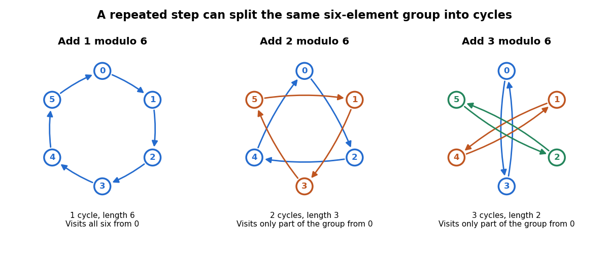

# Group

↑ **Parent:** [Group theory](group-theory.md)  
ⓦ [Wiki](https://en.wikipedia.org/wiki/Group_(mathematics))

A [group](group.md) packages reversible operations together with a rule for composing them. For example, the [rotations](riemannian-geometry.md#rotation-mathematics) and [reflections](linear-algebra.md#reflection-mathematics) that carry a [square](euclidean-geometry.md#square) onto itself form a [group](group.md): performing two allowed motions gives another allowed motion, doing nothing is allowed, and every motion can be undone. The elements are the motions themselves, rather than the vertices they move. Labels in the figure track those vertices; they are markers, rather than extra decorations that the motions must preserve.

**[Figure 1](#image-square-symmetries-composed-in-opposite-orders). Square symmetries composed in opposite orders**. The [rotation](riemannian-geometry.md#rotation-mathematics) $r$ is counterclockwise through $90^\circ$, and the [reflection](linear-algebra.md#reflection-mathematics) $s$ is in the vertical axis. Products act rightmost first: $rs=r\circ s$. The red vertex starts at $(1,1)$ and ends at $(-1,-1)$ under $rs$, but at $(1,1)$ under $sr$. Both motions preserve the unmarked [square](euclidean-geometry.md#square), while their [permutations](combinatorics.md#permutation) of its vertices differ.

Precisely, a [group](group.md) is a [set](set.md) $G$ equipped with a [binary operation](algebraic-operation.md#binary-operation) $G\times G\to G$, written $(a,b)\mapsto ab$, satisfying the [group axioms](#group-axioms):

- Closure: $ab\in G$ for all $a,b\in G$. This is already part of specifying the operation's target as $G$.
- [Associativity](algebraic-operation.md#associative-property): $(ab)c=a(bc)$ for all $a,b,c\in G$.
- An [identity element](algebraic-operation.md#identity-element) $e\in G$ satisfies $ea=ae=a$ for every $a\in G$.
- Every $a\in G$ has an [inverse element](algebraic-operation.md#inverse-element) $a^{-1}\in G$ with $aa^{-1}=a^{-1}a=e$.

The [group operation](#group-operation) need not be ordinary numerical multiplication. With [addition](arithmetic.md#addition) as the operation, the [identity element](algebraic-operation.md#identity-element) is usually written $0$ and the [inverse element](algebraic-operation.md#inverse-element) of $a$ is written $-a$. The definition requires a nonempty [set](set.md), since the [identity element](algebraic-operation.md#identity-element) must exist. See [McKernan's MIT lecture 1, Definition 1.1](https://ocw.mit.edu/courses/18-703-modern-algebra-spring-2013/faeeeaf01f838584ce2172cfd85cf74d_MIT18_703S13_pra_l_1.pdf) for the axioms.

Why insist on [associativity](algebraic-operation.md#associative-property)? It makes a string of operations unambiguous without specifying parentheses. For [function composition](function.md#function-composition), both $(fg)h$ and $f(gh)$ send $x$ to $f(g(h(x)))$. This fixes the order of execution while allowing regrouping. [Associativity](algebraic-operation.md#associative-property) therefore does not mean [commutativity](algebraic-operation.md#commutativity): exchanging two operations is a different question. Ordinary [subtraction](arithmetic.md#subtraction) fails [associativity](algebraic-operation.md#associative-property), since $(5-3)-1=1$ whereas $5-(3-1)=3$; it cannot serve as a [group operation](#group-operation) on the [integers](integer.md).

An [inverse element](algebraic-operation.md#inverse-element) makes reversal exact and equations solvable. In any [group](group.md), $ax=b$ has the unique solution $x=a^{-1}b$, since $a^{-1}(ax)=(a^{-1}a)x=x$. Similarly, $xa=b$ has solution $x=ba^{-1}$. The side matters in a [non-abelian group](#non-abelian-group). Undoing a composite operation requires reversing its order:

$$
(ab)^{-1}=b^{-1}a^{-1},\qquad
(ab)(b^{-1}a^{-1})=a(bb^{-1})a^{-1}=e.
$$

The analogous product in the other order also equals the [identity element](algebraic-operation.md#identity-element). These calculations explain why [group](group.md) equations allow cancellation without assuming [commutativity](algebraic-operation.md#commutativity).

For the [square](euclidean-geometry.md#square) with vertices $(\pm1,\pm1)$, choose the [rotation](riemannian-geometry.md#rotation-mathematics) and [reflection](linear-algebra.md#reflection-mathematics)

$$
r(x,y)=(-y,x),\qquad s(x,y)=(-x,y).
$$

Throughout this example, multiplication is [function composition](function.md#function-composition) with the rightmost operation performed first: $(gh)(v)=g(h(v))$. Our notation $D_4$ means the [dihedral group](finite-group-theory.md#dihedral-group) of the [square](euclidean-geometry.md#square), with eight elements; the alternative convention calls the same [group](group.md) $D_8$. Its elements are

$$
D_4=\{e,r,r^2,r^3,s,rs,r^2s,r^3s\},\qquad
r^4=e,\quad s^2=e,\quad srs=r^{-1}.
$$

Here $r^{-1}=r^3$ is clockwise [rotation](riemannian-geometry.md#rotation-mathematics) through $90^\circ$, while each [reflection](linear-algebra.md#reflection-mathematics) is its own [inverse element](algebraic-operation.md#inverse-element). There are exactly eight motions: the image of one vertex has four choices, and the image of an adjacent vertex has two choices; together these determine the motion. The four [rotations](riemannian-geometry.md#rotation-mathematics) and four [reflections](linear-algebra.md#reflection-mathematics) displayed above realize every choice. The vertex [permutations](combinatorics.md#permutation) give a concrete [group action](group-action.md). The general polygon construction is discussed in [Group Theory (v4.01) by James S. Milne](mathematics-bibliography.md#group-theory-v4-01-by-james-s-milne) (section 1.17).

Computing the two products rather than merely comparing their names gives

$$
(rs)(x,y)=r(-x,y)=(-y,-x),\qquad
(sr)(x,y)=s(-y,x)=(y,x).
$$

Thus $(rs)(1,1)=(-1,-1)$ but $(sr)(1,1)=(1,1)$, proving $rs\ne sr$. In fact $rs$ is [reflection](linear-algebra.md#reflection-mathematics) in the line $y=-x$, whereas $sr$ is [reflection](linear-algebra.md#reflection-mathematics) in $y=x$. This [group](group.md) is a [non-abelian group](#non-abelian-group), although its [subgroup](#subgroup) of [rotations](riemannian-geometry.md#rotation-mathematics) is an [abelian group](#abelian-group). The relation $srs=r^{-1}$ expresses a geometric fact: [conjugation](group-action.md#conjugation) of a counterclockwise [rotation](riemannian-geometry.md#rotation-mathematics) by a [reflection](linear-algebra.md#reflection-mathematics) turns it clockwise.

A contrasting example is the [cyclic group](#cyclic-group) $\mathbb Z/4\mathbb Z$ under [addition](arithmetic.md#addition) in [modular arithmetic](modular-arithmetic.md). Using representatives $0,1,2,3$, the sum $3+2$ is $1$ modulo $4$, and the [inverse element](algebraic-operation.md#inverse-element) of $3$ is $1$. Repeated [addition](arithmetic.md#addition) of $1$ runs through $0,1,2,3,0$. The correspondence $k\mapsto r^k$ identifies this [cyclic group](#cyclic-group) with the [rotation](riemannian-geometry.md#rotation-mathematics) [subgroup](#subgroup) of $D_4$: $r^3r^2=r^5=r$. This is a [group isomorphism](algebra.md#group-isomorphism), so the same rule of composition appears as arithmetic wraparound and geometric motion.

By comparison, $(\mathbb Z,+)$ is an [infinite cyclic group](#infinite-cyclic-group). It has [identity element](algebraic-operation.md#identity-element) $0$, [inverse element](algebraic-operation.md#inverse-element) $-k$ for each [integer](integer.md) $k$, and a [generator of a group](#generator-of-a-group) $1$, but no wraparound: $3+2=5$, and no positive number of copies of $1$ sums to $0$. Both examples are [abelian groups](#abelian-group). The [nonnegative integers](arithmetic.md#natural-number) under [addition](arithmetic.md#addition) have closure, [associativity](algebraic-operation.md#associative-property), and an [identity element](algebraic-operation.md#identity-element), but lack an [inverse element](algebraic-operation.md#inverse-element) for $1$. Reversibility is precisely what fails.

The beauty of the abstraction is that a calculation using only the [group axioms](#group-axioms) applies simultaneously to arithmetic and to geometric [isometries](riemannian-geometry.md#isometry). To make that connection universal, let each $g\in G$ act on $G$ by the [translation in a group](#translation-in-a-group) $L_g(x)=gx$. Each $L_g$ is a [bijection](function.md#bijection), with inverse $L_{g^{-1}}$, and $L_gL_h=L_{gh}$. Distinct elements give distinct maps because $L_g(e)=g$. This proves [Cayley's theorem](group-theory.md#cayley-s-theorem): every [group](group.md) is isomorphic to a [subgroup](#subgroup) of a [symmetric group](finite-group-theory.md#symmetric-group). A [group action](group-action.md) specifies how a [group](group.md) moves some other [set](set.md); a [group homomorphism](group-theory.md#group-homomorphism) compares [groups](group.md) while preserving their composition rules.

An important historical connection is the use of [permutations](combinatorics.md#permutation) to study [polynomial equations](polynomial.md#polynomial-equation). In the memoir submitted in 1831 and published by Liouville in 1846, Galois associates a [group](group.md) to a [polynomial equation](polynomial.md#polynomial-equation) and studies how it changes when additional quantities are declared known. Proposition I relates this [group](group.md) to expressions in the [roots of a polynomial](polynomial.md#root-of-a-polynomial) whose values remain unchanged under its [permutations](combinatorics.md#permutation); Proposition IV restricts the allowed [permutations](combinatorics.md#permutation) after adjoining a function of the [roots of a polynomial](polynomial.md#root-of-a-polynomial). This connects reversible rearrangements with deciding [solvability by radicals](galois-theory.md#solvability-by-radicals). See [Galois's original memoir, pp. 417–433, especially Propositions I and IV; Liouville's introduction, p. 382](https://www.numdam.org/item/JMPA_1846_1_11__381_0.pdf).

**Table of contents**

- [Partially ordered group](partially-ordered-group.md)
  - [Positive cone of an ordered group](partially-ordered-group.md#positive-cone-of-an-ordered-group)
  - [Convex subgroup of an ordered group](partially-ordered-group.md#convex-subgroup-of-an-ordered-group)
  - [Lattice-ordered group](partially-ordered-group.md#lattice-ordered-group)
    - [Riesz decomposition in a lattice-ordered group](partially-ordered-group.md#riesz-decomposition-in-a-lattice-ordered-group)
    - [Lattice-ordered group homomorphism](partially-ordered-group.md#lattice-ordered-group-homomorphism)
    - [Absolute value in a lattice-ordered group](partially-ordered-group.md#absolute-value-in-a-lattice-ordered-group)
      - [Positive and negative parts in a lattice-ordered group](partially-ordered-group.md#positive-and-negative-parts-in-a-lattice-ordered-group)
    - [Convex lattice subgroup](partially-ordered-group.md#convex-lattice-subgroup)
      - [One-sided bounds for adjoining a positive element](partially-ordered-group.md#one-sided-bounds-for-adjoining-a-positive-element)
      - [Ordered right cosets of a convex lattice subgroup](partially-ordered-group.md#ordered-right-cosets-of-a-convex-lattice-subgroup)
      - [Lattice of convex lattice subgroups](partially-ordered-group.md#lattice-of-convex-lattice-subgroups)
      - [Principal convex lattice subgroup](partially-ordered-group.md#principal-convex-lattice-subgroup)
      - [Prime convex lattice subgroup](partially-ordered-group.md#prime-convex-lattice-subgroup)
      - [Value in a lattice-ordered group](partially-ordered-group.md#value-in-a-lattice-ordered-group)
        - [Squared bound from comparison at values](partially-ordered-group.md#squared-bound-from-comparison-at-values)
        - [Cover of a value in a lattice-ordered group](partially-ordered-group.md#cover-of-a-value-in-a-lattice-ordered-group)
          - [Power cofinality in the cover of a value](partially-ordered-group.md#power-cofinality-in-the-cover-of-a-value)
    - [Normal-valued lattice-ordered group](partially-ordered-group.md#normal-valued-lattice-ordered-group)
      - [Wolfenstein inequality for normal-valued lattice-ordered groups](partially-ordered-group.md#wolfenstein-inequality-for-normal-valued-lattice-ordered-groups)
    - [Linearly ordered group](partially-ordered-group.md#linearly-ordered-group)
      - [Archimedean ordered group](partially-ordered-group.md#archimedean-ordered-group)
        - [Archimedean linearly ordered groups are Abelian](partially-ordered-group.md#archimedean-linearly-ordered-groups-are-abelian)
      - [Lexicographically ordered group](partially-ordered-group.md#lexicographically-ordered-group)
      - [Convex subgroups of a finite-rank ordered Abelian group](partially-ordered-group.md#convex-subgroups-of-a-finite-rank-ordered-abelian-group)
      - [Ohnishi orderability criterion](partially-ordered-group.md#ohnishi-orderability-criterion)
    - [Abelian lattice-ordered group](partially-ordered-group.md#abelian-lattice-ordered-group)
      - [Hahn group](partially-ordered-group.md#hahn-group)
        - [Finite-support Hahn embedding along a countable convex chain](partially-ordered-group.md#finite-support-hahn-embedding-along-a-countable-convex-chain)
      - [Free Abelian lattice-ordered group](partially-ordered-group.md#free-abelian-lattice-ordered-group)
        - [Piecewise integer-linear representation of a free Abelian lattice-ordered group](partially-ordered-group.md#piecewise-integer-linear-representation-of-a-free-abelian-lattice-ordered-group)
          - [Integer-linear hinge functions have infinite independent rank](partially-ordered-group.md#integer-linear-hinge-functions-have-infinite-independent-rank)
    - [Lattice-ordered permutation group](partially-ordered-group.md#lattice-ordered-permutation-group)
      - [Order-primitive lattice permutation group](partially-ordered-group.md#order-primitive-lattice-permutation-group)
        - [McCleary trichotomy theorem](partially-ordered-group.md#mccleary-trichotomy-theorem)
      - [Holland representation theorem](partially-ordered-group.md#holland-representation-theorem)
      - [Order n-transitivity](partially-ordered-group.md#order-n-transitivity)
        - [Finite interpolation by lattice operations](partially-ordered-group.md#finite-interpolation-by-lattice-operations)
      - [Positive bump of an order automorphism](partially-ordered-group.md#positive-bump-of-an-order-automorphism)
        - [Conjugacy of positive real-line bumps](partially-ordered-group.md#conjugacy-of-positive-real-line-bumps)
          - [Conjugating positive bumps while preserving a fundamental interval](partially-ordered-group.md#conjugating-positive-bumps-while-preserving-a-fundamental-interval)
- [Exact factorization of a group](#exact-factorization-of-a-group)
- [Shifted addition on odd integers](#shifted-addition-on-odd-integers)
- [Triangle group](#triangle-group)
- [Poly-(cyclic or finite) group](#poly-cyclic-or-finite-group)
- [Group element](#group-element)
- [Braid group](#braid-group)
  - [Artin automorphism of a braid](#artin-automorphism-of-a-braid)
  - [Braid group relations](#braid-group-relations)
- [Infinite group](#infinite-group)
  - [Tarski monster group](#tarski-monster-group)
    - [Tarski monster groups are two-generated and simple](#tarski-monster-groups-are-two-generated-and-simple)
- [Trivial group](#trivial-group)
- [Group of exponent two is abelian](#group-of-exponent-two-is-abelian)
- [Non-abelian group](#non-abelian-group)
- [Torsion-free group](#torsion-free-group)
  - [Countable torsion-free embedding with two conjugacy classes](#countable-torsion-free-embedding-with-two-conjugacy-classes)
- [Divisible group](#divisible-group)
  - [Divisibility by a prime](#divisibility-by-a-prime)
  - [Torsion-free divisible Abelian group](#torsion-free-divisible-abelian-group)
- [Group axioms](#group-axioms)
  - [Group axioms from two-sided local inverse identities](#group-axioms-from-two-sided-local-inverse-identities)
- [Finite group](#finite-group)
  - [p-prime core of a finite group](#p-prime-core-of-a-finite-group)
  - [p-core of a finite group](#p-core-of-a-finite-group)
    - [p-constrained group](#p-constrained-group)
  - [Pi-group](#pi-group)
    - [Pi-element](#pi-element)
  - [Elementary group](#elementary-group)
    - [Prime-set decomposition of elementary groups](#prime-set-decomposition-of-elementary-groups)
    - [p-elementary group](#p-elementary-group)
  - [Ambivalent group](#ambivalent-group)
  - [Monomial group](#monomial-group)
    - [Abelian intersection of irreducible inducing subgroups](#abelian-intersection-of-irreducible-inducing-subgroups)
    - [Dade's embedding theorem for monomial groups](#dade-s-embedding-theorem-for-monomial-groups)
    - [Taketa's theorem](#taketa-s-theorem)
  - [Frobenius group](#frobenius-group)
    - [Frobenius kernel](#frobenius-kernel)
      - [Frobenius kernel criterion by irreducible induction](#frobenius-kernel-criterion-by-irreducible-induction)
      - [Commutator bijection from a fixed-point-free automorphism](#commutator-bijection-from-a-fixed-point-free-automorphism)
      - [Frobenius kernel theorem](#frobenius-kernel-theorem)
    - [Frobenius complement](#frobenius-complement)
  - [Burnside's theorem](#burnside-s-theorem)
    - [Prime-power conjugacy-class obstruction to simplicity](#prime-power-conjugacy-class-obstruction-to-simplicity)
      - [Abelian subgroup cannot have prime-power index in a nonabelian simple group](#abelian-subgroup-cannot-have-prime-power-index-in-a-nonabelian-simple-group)
  - [Order of a finite group](#order-of-a-finite-group)
- [Nontrivial group](#nontrivial-group)
- [Group operation](#group-operation)
  - [Group commutator](#group-commutator)
    - [Hall-Witt identity](#hall-witt-identity)
    - [Hall-Petrescu formula](#hall-petrescu-formula)
- [Translation in a group](#translation-in-a-group)
- [Cyclic group](#cyclic-group)
  - [Cyclic multiplicative group](#cyclic-multiplicative-group)
  - [A group of prime order is cyclic](#a-group-of-prime-order-is-cyclic)
  - [Groups with no proper nontrivial subgroups](#groups-with-no-proper-nontrivial-subgroups)
  - [Subgroups and quotients of a cyclic group](#subgroups-and-quotients-of-a-cyclic-group)
  - [Free translation action on nontrivial subsets of a prime cyclic group](#free-translation-action-on-nontrivial-subsets-of-a-prime-cyclic-group)
  - [Cyclic subgroup](#cyclic-subgroup)
    - [Counting cyclic subgroups by their generators](#counting-cyclic-subgroups-by-their-generators)
  - [Finite cyclic group](#finite-cyclic-group)
    - [Cyclic group of order four](#cyclic-group-of-order-four)
      - [Faithfulness criterion for a block representation of the cyclic group of order four](#faithfulness-criterion-for-a-block-representation-of-the-cyclic-group-of-order-four)
    - [Order of an element of a finite cyclic group](#order-of-an-element-of-a-finite-cyclic-group)
    - [Homomorphism from a finite cyclic group](#homomorphism-from-a-finite-cyclic-group)
  - [Infinite cyclic group](#infinite-cyclic-group)
    - [Subgroup of an infinite cyclic group](#subgroup-of-an-infinite-cyclic-group)
    - [Additive group of integers](#additive-group-of-integers)
    - [Integer shear group](#integer-shear-group)
  - [Finite subgroup of the multiplicative complex numbers](#finite-subgroup-of-the-multiplicative-complex-numbers)
  - [Generator of a group](#generator-of-a-group)
    - [Generators of a finite cyclic group](#generators-of-a-finite-cyclic-group)
- [Generating set of a group](#generating-set-of-a-group)
  - [Minimal generating set of a group](#minimal-generating-set-of-a-group)
  - [Complement of a proper subgroup generates the group](#complement-of-a-proper-subgroup-generates-the-group)
  - [Finitely generated group](#finitely-generated-group)
    - [Benign subgroup](#benign-subgroup)
      - [Normal benign subgroup quotient embedding](#normal-benign-subgroup-quotient-embedding)
      - [Intersection and join of benign subgroups](#intersection-and-join-of-benign-subgroups)
    - [Unshifted rank gradients](#unshifted-rank-gradients)
    - [Finite-index subgroup count for a finitely generated group](#finite-index-subgroup-count-for-a-finitely-generated-group)
    - [Rank of a group](#rank-of-a-group)
- [Abelian group](#abelian-group)
  - [Complex multiplicative group](#complex-multiplicative-group)
  - [Abelian group of prime-square order](#abelian-group-of-prime-square-order)
  - [Serre class](#serre-class)
    - [Serre class of finitely generated abelian groups](#serre-class-of-finitely-generated-abelian-groups)
  - [Torsion-free abelian group](#torsion-free-abelian-group)
    - [Rational divisible hull](#rational-divisible-hull)
  - [Abelian subgroup](#abelian-subgroup)
  - [Finitely generated abelian group](#finitely-generated-abelian-group)
    - [Finite generation detected by a prime quotient](#finite-generation-detected-by-a-prime-quotient)
    - [Rank of an abelian group](#rank-of-an-abelian-group)
    - [Fundamental theorem of finitely generated abelian groups](#fundamental-theorem-of-finitely-generated-abelian-groups)
  - [Prüfer group](#prufer-group)
  - [Additive group](#additive-group)
    - [Finitely generated subgroup of the rational additive group](#finitely-generated-subgroup-of-the-rational-additive-group)
  - [Infinitely divisible element of an abelian group](#infinitely-divisible-element-of-an-abelian-group)
  - [Finite abelian group](#finite-abelian-group)
    - [Cyclic group of order four and Klein four-group](#cyclic-group-of-order-four-and-klein-four-group)
    - [Elementary abelian group](#elementary-abelian-group)
      - [Order of a finite group of exponent two](#order-of-a-finite-group-of-exponent-two)
  - [Pontryagin duality](#pontryagin-duality)
    - [Pontryagin dual group](#pontryagin-dual-group)
      - [Equicontinuity of compact families of characters](#equicontinuity-of-compact-families-of-characters)
      - [Dual Haar measure](#dual-haar-measure)
    - [Character group](#character-group)
      - [Character group of a finite abelian group](#character-group-of-a-finite-abelian-group)
        - [Multiplicative character of a finite field](#multiplicative-character-of-a-finite-field)
          - [Jacobi sum of finite-field characters](#jacobi-sum-of-finite-field-characters)
          - [Gauss sum of a finite-field character](#gauss-sum-of-a-finite-field-character)
        - [Extension of a unitary character from a finite abelian subgroup](#extension-of-a-unitary-character-from-a-finite-abelian-subgroup)
        - [Extension of a character across a cyclic quotient](#extension-of-a-character-across-a-cyclic-quotient)
        - [Character of a finite abelian group](#character-of-a-finite-abelian-group)
        - [Character-sum cancellation lemma](#character-sum-cancellation-lemma)
        - [Annihilator of a subgroup of a finite abelian group](#annihilator-of-a-subgroup-of-a-finite-abelian-group)
- [Finite additive group](#finite-additive-group)
- [Subgroup](#subgroup)
  - [Subgroup test](#subgroup-test)
  - [Trivial subgroup](#trivial-subgroup)
  - [Finitely generated subgroup](#finitely-generated-subgroup)
  - [Membership problem for a subgroup](#membership-problem-for-a-subgroup)
  - [Maximal subgroup](#maximal-subgroup)
    - [Maximal symmetric-group subgroups containing a three-cycle](#maximal-symmetric-group-subgroups-containing-a-three-cycle)
    - [Maximal subgroups of a finite soluble group](#maximal-subgroups-of-a-finite-soluble-group)
    - [Maximal subgroup normalizer criterion](#maximal-subgroup-normalizer-criterion)
  - [Hall subgroup](#hall-subgroup)
    - [Schur-Zassenhaus theorem](#schur-zassenhaus-theorem)
    - [Hall conjugacy and embedding in finite soluble groups](#hall-conjugacy-and-embedding-in-finite-soluble-groups)
    - [Hall subgroup existence in soluble groups](#hall-subgroup-existence-in-soluble-groups)
  - [Union of two subgroups](#union-of-two-subgroups)
  - [Index of a subgroup](#index-of-a-subgroup)
  - [Index-two subgroup is normal](#index-two-subgroup-is-normal)
  - [Finite-index subgroup](#finite-index-subgroup)

## Partially ordered group

↑ **Parent:** [Group](group.md)

[This section is present in another page, follow this link to view it.](partially-ordered-group.md)

## Exact factorization of a group

↑ **Parent:** [Group](group.md)

Two [subgroups](#subgroup) give an exact factorization of a [group](group.md) when every element has a unique expression $h_1h_2$ with $h_i\in H_i$. Existence and trivial intersection are equivalent to this uniqueness: if $h_1h_2=k_1k_2$, then $k_1^{-1}h_1=k_2h_2^{-1}\in H_1\cap H_2$, so both sides are the identity. Conversely, an element $a$ in the intersection gives the two factorizations $a\cdot e=e\cdot a$, forcing $a=e$. For finite [groups](group.md) the multiplication map $H_1\times H_2\to G$ is therefore a [bijection](function.md#bijection) and $|G|=|H_1||H_2|$. It need not be a [group homomorphism](group-theory.md#group-homomorphism): an exact factorization is not automatically a [direct product of groups](group-theory.md#direct-product-of-groups). If $H_1$ is normal, it gives an internal [semidirect product](group-theory.md#semidirect-product).

## Shifted addition on odd integers

↑ **Parent:** [Group](group.md)

The [odd integers](integer.md#odd-integer) form an [abelian group](#abelian-group) under the displayed operation. The [identity element](algebraic-operation.md#identity-element) is $-1$ and the [inverse element](algebraic-operation.md#inverse-element) of $a$ is $-a-2$. The [bijection](function.md#bijection) $a\mapsto(a+1)/2$ is a [group isomorphism](algebra.md#group-isomorphism) to $(\mathbb Z,+)$, since it converts the shifted operation into addition. This illustrates how an unfamiliar identity and inverse can arise from ordinary addition by a change of coordinates.

## Triangle group

↑ **Parent:** [Group](group.md)  
ⓦ [Wiki](https://en.wikipedia.org/wiki/Triangle_group)

A [triangle group](#triangle-group) is generated by [reflections](linear-algebra.md#reflection-mathematics) in the sides of a triangular [fundamental domain](group-action.md#fundamental-domain) in [spherical geometry](geometry-and-topology.md#spherical-geometry), [Euclidean geometry](euclidean-geometry.md) or [hyperbolic geometry](hyperbolic-geometry.md). The angles $\pi/p,\pi/q,\pi/r$ determine the geometry through the sign of $1/p+1/q+1/r-1$. Its orientation-preserving [subgroup](#subgroup) has [group presentation](geometric-group-theory.md#group-presentation) $\langle x,y,z\mid x^p=y^q=z^r=xyz=1\rangle$.

## Poly-(cyclic or finite) group

↑ **Parent:** [Group](group.md)

A group is poly-(cyclic or finite) when it has a finite [subnormal series](group-theory.md#subnormal-series) $1=G_0\triangleleft G_1\triangleleft\cdots\triangleleft G_r=G$ in which each quotient $G_i/G_{i-1}$ is a [cyclic group](#cyclic-group) or a [finite group](#finite-group). Each term need only be normal in the next term. The [polycyclic group](group-theory.md#polycyclic-group) condition instead requires every factor to be cyclic.

## Group element

↑ **Parent:** [Group](group.md)

A [group element](#group-element) is a member of the underlying set of a [group](group.md). The group operation assigns a product to each pair of elements, the identity fixes every element under multiplication, and every element has an inverse.

## Braid group

↑ **Parent:** [Group](group.md)  
ⓦ [Wiki](https://en.wikipedia.org/wiki/Braid_group)

The [group](group.md) of braids on $n$ strands, composed by stacking, with adjacent-crossing generators $\sigma_i$ and the [braid group relations](#braid-group-relations). It retains over/under crossings and is not a permutation group.

### Artin automorphism of a braid

↑ **Parent:** [Braid group](#braid-group)

A positive elementary braid acts on the free group of punctured-disk meridians by the displayed substitution, fixing other generators. The inverse sends $x_i$ to $x_{i+1}$ and $x_{i+1}$ to $x_{i+1}^{-1}x_ix_{i+1}$. Applying [Seifert-van Kampen theorem](algebraic-topology.md#seifert-van-kampen-theorem) at the crossings and closing the braid gives the knot-complement presentation $\langle x_i\mid x_i=\phi(x_i)\rangle$.

### Braid group relations

↑ **Parent:** [Braid group](#braid-group)

The generators $\sigma_i$ commute when $|i-j|>1$ and satisfy $\sigma_i\sigma_{i+1}\sigma_i=\sigma_{i+1}\sigma_i\sigma_{i+1}$. Unlike a symmetric-group presentation, there is no $\sigma_i^2=1$ relation.

## Infinite group

↑ **Parent:** [Group](group.md)

An infinite group is a [group](group.md) with infinitely many elements. An element of infinite order proves that its group is infinite, but the converse need not hold: an infinite group can have all elements of finite order.

### Tarski monster group

↑ **Parent:** [Infinite group](#infinite-group)  
ⓦ [Wiki](https://en.wikipedia.org/wiki/Tarski_monster_group)

An infinite group whose every proper nontrivial subgroup is cyclic of a fixed prime order $p$. Such groups exist for sufficiently large primes. This subgroup condition is stronger than the condition that every nonidentity element has order $p$.

// Target: algebra.bigb

#### Tarski monster groups are two-generated and simple

↑ **Parent:** [Tarski monster group](#tarski-monster-group)

For a [Tarski monster group](#tarski-monster-group), any nonidentity element generates a proper subgroup of order $p$. Adjoining an element outside that subgroup generates the whole group. A proper nontrivial normal subgroup would have order $p$; conjugation into its finite automorphism group forces it to be central. Combining it with another order-$p$ cyclic subgroup would then give a proper subgroup of order $p^2$, a contradiction.

// Target: algebra.bigb

## Trivial group

↑ **Parent:** [Group](group.md)  
ⓦ [Wiki](https://en.wikipedia.org/wiki/Trivial_group)

The trivial group has exactly one element, its identity. Every [group homomorphism](group-theory.md#group-homomorphism) to it is trivial, and a [group](group.md) is trivial precisely when all elements in a generating set equal the identity.

## Group of exponent two is abelian

↑ **Parent:** [Group](group.md)

If every element of a [group](group.md) squares to the identity, every element equals its inverse. Then $ab=(ab)^{-1}=b^{-1}a^{-1}=ba$, so the [group](group.md) is an [abelian group](#abelian-group). The argument does not require a finite group.

## Non-abelian group

↑ **Parent:** [Group](group.md)  
ⓦ [Wiki](https://en.wikipedia.org/wiki/Non-abelian_group)

A non-abelian group is a [group](group.md) containing elements $a,b$ for which $ab\ne ba$.

## Torsion-free group

↑ **Parent:** [Group](group.md)  
ⓦ [Wiki](https://en.wikipedia.org/wiki/Torsion-free_group)

A torsion-free group is a [group](group.md) in which the [identity element](algebraic-operation.md#identity-element) is the only element of finite [order of a group element](group-theory.md#order-of-a-group-element).

### Countable torsion-free embedding with two conjugacy classes

↑ **Parent:** [Torsion-free group](#torsion-free-group)

Every nontrivial countable [torsion-free group](#torsion-free-group) embeds in a countable torsion-free group with precisely two [conjugacy classes](group-action.md#conjugacy-class), the identity and all nonidentity elements. At each stage, enumerate all ordered pairs of nonidentity elements of the current group and successively adjoin [HNN extensions](geometric-group-theory.md#hnn-extension) identifying their infinite cyclic subgroups. [Britton's lemma](geometric-group-theory.md#britton-s-lemma) preserves embeddings and [torsion in an HNN extension](geometric-group-theory.md#torsion-in-an-hnn-extension) preserves torsion-freeness. Repeat on the resulting countable union, so pairs involving newly introduced elements are eventually included. A final increasing union is countable and torsion-free, and any two nonidentity elements become conjugate at a later stage. No effective enumeration of nonidentity elements is claimed.

## Divisible group

↑ **Parent:** [Group](group.md)  
ⓦ [Wiki](https://en.wikipedia.org/wiki/Divisible_group)

A divisible group is an [abelian group](#abelian-group) $G$ in which, for every positive integer $n$ and every $g\in G$, some $h\in G$ satisfies $nh=g$.

### Divisibility by a prime

↑ **Parent:** [Divisible group](#divisible-group)

An abelian group $A$ is $p$-divisible when multiplication by $p$ is surjective, equivalently $A/pA=0$. This does not mean it has no $p$-torsion: $\mathbb Q/\mathbb Z$ is divisible and has elements of every finite order. The [Kummer cohomology divisibility criterion](galois-theory.md#kummer-cohomology-divisibility-criterion) relates this property to [Galois cohomology](galois-theory.md#galois-cohomology).

### Torsion-free divisible Abelian group

↑ **Parent:** [Divisible group](#divisible-group)

A divisible [Abelian group](#abelian-group) is torsion-free precisely when division by each nonzero integer is unique. Defining rational scalar multiplication by $n((m/n)a)=ma$ identifies these groups with [vector spaces over the rational numbers](vector-space.md#vector-space-over-the-rational-numbers), including the zero space.

## Group axioms

↑ **Parent:** [Group](group.md)

The group axioms require closure and associativity of the binary operation, an identity element, and an inverse for every element.

### Group axioms from two-sided local inverse identities

↑ **Parent:** [Group axioms](#group-axioms)

Suppose a nonempty [semigroup](algebraic-operation.md#semigroup) has, for each $a$, elements $l_a,r_a$ satisfying $bl_aa=b$ and $ar_ab=b$ for every $b$. Then it is a [group](group.md). For any fixed $a$, the element $e_R=l_aa$ is a right [identity element](algebraic-operation.md#identity-element), and $e_L=ar_a$ is a left [identity element](algebraic-operation.md#identity-element). Since $e_Le_R=e_L=e_R$, they coincide in a two-sided identity $e$. For each $a$, putting $b=e$ in the two assumed identities gives $l_aa=e$ and $ar_a=e$. [Associativity](algebraic-operation.md#associative-property) then yields $l_a=l_ae=l_a(ar_a)=(l_aa)r_a=er_a=r_a$, a two-sided [inverse element](algebraic-operation.md#inverse-element). Thus the usual [group axioms](#group-axioms) follow without an assumed identity or cancellation law.

## Finite group

↑ **Parent:** [Group](group.md)  
ⓦ [Wiki](https://en.wikipedia.org/wiki/Finite_group)

A [finite group](#finite-group) is a [group](group.md) whose underlying [set](set.md) has finitely many elements. Its [order of a finite group](#order-of-a-finite-group) is the number of elements, counting the [identity element](algebraic-operation.md#identity-element). The [group operation](#group-operation) still has to satisfy all the [group axioms](#group-axioms): merely having a finite list of states does not make a [group](group.md).

For example, the six [congruence classes](modular-arithmetic.md#congruence-class) modulo six form a [finite cyclic group](#finite-cyclic-group) under [addition](arithmetic.md#addition), whereas the [permutations](combinatorics.md#permutation) of three objects form the [symmetric group](finite-group-theory.md#symmetric-group) $S_3$, also with six elements. The first is an [abelian group](#abelian-group); the second is a [non-abelian group](#non-abelian-group). Thus the [order of a finite group](#order-of-a-finite-group) is a useful first measurement, but the composition rule contains information that the count alone loses.

Finiteness makes [group](group.md) structure accessible to exact calculation. A [Cayley table](algebraic-operation.md#cayley-table) for a [finite group](#finite-group) of order $n$ has $n^2$ entries, and every [group element](#group-element) eventually returns to the [identity element](algebraic-operation.md#identity-element) when repeated. [Lagrange's theorem](group-theory.md#lagrange-s-theorem) strengthens this observation: the [order of a group element](group-theory.md#order-of-a-group-element), being the size of its [cyclic subgroup](#cyclic-subgroup), divides $n$. The [cyclic group of order four and Klein four-group](#cyclic-group-of-order-four-and-klein-four-group) give a small example of how that constraint can distinguish different composition rules.

### p-prime core of a finite group

↑ **Parent:** [Finite group](#finite-group)

The p-prime core is the largest normal subgroup whose order is coprime to $p$. Products of normal subgroups of order coprime to $p$ again have order coprime to $p$, so it exists and is characteristic.

### p-core of a finite group

↑ **Parent:** [Finite group](#finite-group)

The p-core is the largest normal [p-subgroup](finite-group-theory.md#p-subgroup) of a finite [group](group.md). The product of two normal p-subgroups is again a normal p-subgroup, so this subgroup exists and is characteristic.

#### p-constrained group

↑ **Parent:** [P-core of a finite group](#p-core-of-a-finite-group)

Put $\overline G=G/O_{p'}(G)$ using the [p-prime core of a finite group](#p-prime-core-of-a-finite-group). A finite [group](group.md) is p-constrained if $C_{\overline G}(O_p(\overline G))\le O_p(\overline G)$. If $O_{p'}(G)=1$, the [p-core of a finite group](#p-core-of-a-finite-group) has its centralizer contained in itself. Then [block idempotents centralize a normal p-subgroup](modular-representation-theory.md#block-idempotents-centralize-a-normal-p-subgroup) places every block idempotent in $kO_p(G)$, a [local ring](commutative-algebra.md#local-ring), so $kG$ has only the [principal block](modular-representation-theory.md#principal-block).

### Pi-group

↑ **Parent:** [Finite group](#finite-group)

For a set $\pi$ of primes, a pi-group is a finite group whose order has no prime divisors outside $\pi$. The trivial group qualifies for every $\pi$.

#### Pi-element

↑ **Parent:** [Pi-group](#pi-group)

A pi-element is an element whose order has no prime divisors outside a specified prime set $\pi$. The identity is a pi-element for every prime set. Conjugation preserves the property because it preserves element order.

### Elementary group

↑ **Parent:** [Finite group](#finite-group)

In finite-group character theory, an elementary group is a group that is [p-elementary group](#p-elementary-group) for some prime $p$. Such groups are solvable and provide the subgroup tests in [Brauer's characterization of characters](representation-theory.md#brauer-s-characterization-of-characters). This does not mean [elementary abelian group](#elementary-abelian-group).

#### Prime-set decomposition of elementary groups

↑ **Parent:** [Elementary group](#elementary-group)

Write an [elementary group](#elementary-group) as $P\times C$ with $P$ a p-group and $C$ cyclic of order prime to $p$. Split $C$ into its cyclic pi-part and pi-complementary part. Attach $P$ to whichever part contains $p$, producing a [direct product of groups](group-theory.md#direct-product-of-groups) of a [pi-group](#pi-group) and a complementary-prime group.

#### p-elementary group

↑ **Parent:** [Elementary group](#elementary-group)

A p-elementary group is a [direct product of groups](group-theory.md#direct-product-of-groups) of a [p-group](finite-group-theory.md#p-group) and a cyclic group whose order is coprime to $p$. Either factor may be trivial. The coprime cyclic factor is central, a stronger requirement than merely having a cyclic subgroup with p-group quotient.

### Ambivalent group

↑ **Parent:** [Finite group](#finite-group)

A finite group is ambivalent when every element is conjugate to its inverse. Since every complex character satisfies $\chi(g^{-1})=\overline{\chi(g)}$, an ambivalent group has real values for every [irreducible character](representation-theory.md#irreducible-character). Conversely, if every irreducible value is real, [irreducible characters separate conjugacy classes](representation-theory.md#irreducible-characters-separate-conjugacy-classes) and force every $g$ to be conjugate to $g^{-1}$.

### Monomial group

↑ **Parent:** [Finite group](#finite-group)

A finite group is monomial if every [irreducible character](representation-theory.md#irreducible-character) is a [monomial character](representation-theory.md#monomial-character). Finite [metabelian groups](group-theory.md#metabelian-group) have this property.

#### Abelian intersection of irreducible inducing subgroups

↑ **Parent:** [Monomial group](#monomial-group)

In a finite [monomial group](#monomial-group), the displayed intersection is a [normal subgroup](group-theory.md#normal-subgroup). Every irreducible character is induced from a linear character of a subgroup containing $K$. On restriction to $K$, all conjugate inducing lines remain invariant, so $K'$ lies in every irreducible character kernel. The intersection of those kernels is trivial, proving that $K$ is [Abelian](#abelian-group).

<h4 id="dade-s-embedding-theorem-for-monomial-groups">Dade's embedding theorem for monomial groups</h4>

↑ **Parent:** [Monomial group](#monomial-group)

Every finite [solvable group](group-theory.md#solvable-group) is isomorphic to a [subgroup](#subgroup) of a finite [monomial group](#monomial-group). This is an embedding assertion and does not assert that every solvable group is monomial, nor that the embedding is normal.

<h4 id="taketa-s-theorem">Taketa's theorem</h4>

↑ **Parent:** [Monomial group](#monomial-group)

Every finite [monomial group](#monomial-group) is a [solvable group](group-theory.md#solvable-group). Thus expressing every [irreducible character](representation-theory.md#irreducible-character) as induction from a [linear character](representation-theory.md#linear-character) imposes a group-theoretic solvability condition.

### Frobenius group

↑ **Parent:** [Finite group](#finite-group)  
ⓦ [Wiki](https://en.wikipedia.org/wiki/Frobenius_group)

A Frobenius group has a nontrivial proper subgroup $H$ satisfying $H\cap H^g=\{1\}$ for every $g\notin H$, with $H^g=g^{-1}Hg$. Such $H$ is a [Frobenius complement](#frobenius-complement). The [Frobenius kernel theorem](#frobenius-kernel-theorem) turns the identity together with elements outside all conjugates of $H$ into a normal subgroup $N$, giving $G=N\rtimes H$.

#### Frobenius kernel

↑ **Parent:** [Frobenius group](#frobenius-group)

The Frobenius kernel consists of the identity and the elements lying in no conjugate of a [Frobenius complement](#frobenius-complement). The [Frobenius kernel theorem](#frobenius-kernel-theorem) proves that this conjugacy-invariant set is a [normal subgroup](group-theory.md#normal-subgroup), rather than assuming closure as part of its definition.

##### Frobenius kernel criterion by irreducible induction

↑ **Parent:** [Frobenius kernel](#frobenius-kernel)

For $1<N\triangleleft G$ proper, the displayed condition is equivalent to $N$ being a [Frobenius kernel](#frobenius-kernel). For a normal subgroup the induction norm is $|I_G(\varphi):N|$. Trivial inertia for each nonprincipal character and [Brauer's permutation lemma](representation-theory.md#brauer-s-permutation-lemma) imply that every element outside $N$ has trivial centralizer in $N$. This forces $N$ to be a normal Hall subgroup; a complement is then fixed-point-free on $N$.

##### Commutator bijection from a fixed-point-free automorphism

↑ **Parent:** [Frobenius kernel](#frobenius-kernel)

Let $N$ be a [finite group](#finite-group) and $\alpha$ an [automorphism](algebra.md#automorphism) whose only fixed element is the identity. If $\alpha(a)^{-1}a=\alpha(b)^{-1}b$, then $\alpha(ba^{-1})=ba^{-1}$, so $a=b$. The displayed map is therefore a bijection. For conjugation by a nonidentity element of a [Frobenius complement](#frobenius-complement), it gives the commutator map $y\mapsto h^{-1}y^{-1}hy$.

##### Frobenius kernel theorem

↑ **Parent:** [Frobenius kernel](#frobenius-kernel)

For a [Frobenius complement](#frobenius-complement) $H$, a class function $\theta$ with $\theta(1)=0$ satisfies $(\theta^G)_H=\theta$. For each nontrivial $\eta\in\operatorname{Irr}(H)$ of degree $d$, the [virtual character](representation-theory.md#virtual-character) $(\eta-d1_H)^G+d1_G$ has norm one and positive degree by [Frobenius reciprocity](representation-theory.md#frobenius-reciprocity). It is therefore irreducible, restricts to $\eta$ and is identically $d$ on the candidate kernel $N$. The intersection of the kernels of these characters is exactly $N$: outside $N$, separation follows from the character of the [regular representation](representation-theory.md#regular-representation) of $H$. This proves normality; $N\cap H=1$ and $|N|=[G:H]$ then give the semidirect product.

#### Frobenius complement

↑ **Parent:** [Frobenius group](#frobenius-group)

A Frobenius complement is the nontrivial proper subgroup $H$ in a [Frobenius group](#frobenius-group) with the displayed trivial-intersection property. In the action on cosets of $H$, it is a point stabilizer; no nonidentity element fixes two distinct points.

<h3 id="burnside-s-theorem">Burnside's theorem</h3>

↑ **Parent:** [Finite group](#finite-group)  
ⓦ [Wiki](https://en.wikipedia.org/wiki/Burnside's_theorem)

Every [finite group](#finite-group) whose order is divisible by at most two distinct [primes](prime-number.md) is a [solvable group](group-theory.md#solvable-group). A nonabelian [simple group](finite-group-theory.md#simple-group) must therefore have at least three distinct prime divisors.

#### Prime-power conjugacy-class obstruction to simplicity

↑ **Parent:** [Burnside's theorem](#burnside-s-theorem)

A nonabelian [simple group](finite-group-theory.md#simple-group) has no nonidentity [conjugacy class](group-action.md#conjugacy-class) of prime-power size. Coprime-degree [irreducible characters](representation-theory.md#irreducible-character) vanish on such an element: the [conjugacy-class sum](associative-algebra.md#conjugacy-class-sum) makes the character-to-degree ratio an [algebraic integer](algebraic-number-theory.md#algebraic-integer), and the [Kronecker theorem on algebraic integers in the unit disk](algebraic-number-theory.md#kronecker-theorem-on-algebraic-integers-in-the-unit-disk) makes a nonzero ratio a [root of unity](algebra.md#root-of-unity), forcing a scalar in a faithful [group representation](representation-theory.md#group-representation). Column [character orthogonality](representation-theory.md#character-orthogonality) then makes $1/p$ an [algebraic integer](algebraic-number-theory.md#algebraic-integer), impossible. This is the character-theoretic ingredient in [Burnside's theorem](#burnside-s-theorem).

##### Abelian subgroup cannot have prime-power index in a nonabelian simple group

↑ **Parent:** [Prime-power conjugacy-class obstruction to simplicity](#prime-power-conjugacy-class-obstruction-to-simplicity)

If an abelian [subgroup](#subgroup) $A$ has index $p^a$, the [centralizer](group-action.md#centralizer) of any $1\ne g\in A$ contains $A$, so the class size of $g$ divides $p^a$. The [prime-power conjugacy-class obstruction to simplicity](#prime-power-conjugacy-class-obstruction-to-simplicity) rules this out. If $A=1$, the group is a [p-group](finite-group-theory.md#p-group) and has nontrivial [center of a group](group-theory.md#center-of-a-group), also ruling out nonabelian simplicity.

### Order of a finite group

↑ **Parent:** [Finite group](#finite-group)

The [order of a finite group](#order-of-a-finite-group) is its [cardinality](cardinal-number.md#cardinality), written $|G|$. The [identity element](algebraic-operation.md#identity-element) is included: $|\mathbb Z/6\mathbb Z|=6$, and the [trivial group](#trivial-group) has order one, rather than zero.

Keep this count distinct from the [order of a group element](group-theory.md#order-of-a-group-element). In the additive [finite cyclic group](#finite-cyclic-group) $\mathbb Z/6\mathbb Z$, the element $1$ has order six, $2$ has order three, $3$ has order two, and $0$ has order one. Each element's order is the least positive number of repetitions needed to return to the [identity element](algebraic-operation.md#identity-element) $0$. The [order of an element of a finite cyclic group](#order-of-an-element-of-a-finite-cyclic-group) computes these periods directly.

The count also constrains [subgroups](#subgroup): [Lagrange's theorem](group-theory.md#lagrange-s-theorem) gives $|G|=[G:H]|H|$ for a [subgroup](#subgroup) $H$ of a [finite group](#finite-group) $G$, where the [index of a subgroup](#index-of-a-subgroup) counts its [cosets](group-theory.md#coset). For $H=\{0,2,4\}$ inside $\mathbb Z/6\mathbb Z$, the two [cosets](group-theory.md#coset) are $\{0,2,4\}$ and $\{1,3,5\}$, so $6=2\cdot3$. Divisibility is a necessary constraint; it does not imply that every divisor occurs as the [order of a group element](group-theory.md#order-of-a-group-element), as the [Klein four-group](finite-group-theory.md#klein-four-group) shows.

## Nontrivial group

↑ **Parent:** [Group](group.md)

A nontrivial group has more than one element.

## Group operation

↑ **Parent:** [Group](group.md)

A group operation is the associative binary operation of a [group](group.md). It has an [identity element](algebraic-operation.md#identity-element), and every element has an [inverse element](algebraic-operation.md#inverse-element).

### Group commutator

↑ **Parent:** [Group operation](#group-operation)

The [group commutator](#group-commutator) measures the failure of two elements of a [group](group.md) to commute. Under the convention $[x,y]=x^{-1}y^{-1}xy$, it is the identity exactly when $xy=yx$. The [commutator subgroup](group-theory.md#commutator-subgroup) is generated by these elements. The alternative convention $xyx^{-1}y^{-1}$ generates the same [commutator subgroup](group-theory.md#commutator-subgroup); individual formulas must specify their convention.

#### Hall-Witt identity

↑ **Parent:** [Group commutator](#group-commutator)

The Hall-Witt identity is a three-variable identity among iterated [group commutators](#group-commutator). Passing to the leading terms of a filtered group turns it into the [Jacobi identity](lie-algebra.md#jacobi-identity) for the associated graded Lie algebra.

#### Hall-Petrescu formula

↑ **Parent:** [Group commutator](#group-commutator)

The Hall-Petrescu formula expands $(xy)^{p^n}$ as $x^{p^n}y^{p^n}$ times ordered powers of higher commutators. In a p-valued group, the correction terms have controlled higher valuation and make the p-power map linear on the associated graded group.

## Translation in a group

↑ **Parent:** [Group](group.md)

Left and right multiplication by a fixed group element are bijections, called left and right translations.

Both translations are bijections because the [inverse element](algebraic-operation.md#inverse-element) gives the inverse multiplication operation.

## Cyclic group

↑ **Parent:** [Group](group.md)  
ⓦ [Wiki](https://en.wikipedia.org/wiki/Cyclic_group)

A [cyclic group](#cyclic-group) is a [group](group.md) that can be generated by repeating a single [group element](#group-element) $g$ and its [inverse element](algebraic-operation.md#inverse-element):

$$
G=\langle g\rangle=\{g^k:k\in\mathbb Z\}.
$$

For an additive [group](group.md), the same expression is written $\{kg:k\in\mathbb Z\}$: $kg$ means repeated [addition](arithmetic.md#addition), including subtraction when $k$ is negative. A [finite cyclic group](#finite-cyclic-group) has a repeating cycle, while an [infinite cyclic group](#infinite-cyclic-group) is isomorphic to the additive [integers](integer.md). The notation $C_n$ refers to a [finite cyclic group](#finite-cyclic-group) of order $n$.

This definition compresses a whole composition rule into one repeatable operation. Once $g$ is chosen, $g^ag^b=g^{a+b}$, so working with [group elements](#group-element) becomes working with [integer](integer.md) exponents. In the finite case those exponents are reduced using [modular arithmetic](modular-arithmetic.md). It also proves that every [cyclic group](#cyclic-group) is an [abelian group](#abelian-group), because $a+b=b+a$. A [finite cyclic group](#finite-cyclic-group) of order $n$ has exactly $d$ solutions of $x^d=e$ for every positive [integer divisor](divisibility.md#divisor) $d$ of $n$: in exponents, $n\mid dk$ has exactly $d$ solutions modulo $n$. The standard finite and infinite models are described in [Group Theory (v4.01) by James S. Milne](mathematics-bibliography.md#group-theory-v4-01-by-james-s-milne) (section 1.16).

### Cyclic multiplicative group

↑ **Parent:** [Cyclic group](#cyclic-group)

### A group of prime order is cyclic

↑ **Parent:** [Cyclic group](#cyclic-group)

Let $G$ have [group order](#order-of-a-finite-group) equal to a [prime number](prime-number.md) $p$. Choose any $g\ne e$. By [Lagrange's theorem](group-theory.md#lagrange-s-theorem), the [order of a group element](group-theory.md#order-of-a-group-element) $g$ divides $p$, and it is greater than one. It is therefore $p$, so the [cyclic subgroup](#cyclic-subgroup) generated by $g$ is all of $G$. This proves that every nonidentity element generates $G$, and $G$ is isomorphic to the additive group of integers modulo $p$.

### Groups with no proper nontrivial subgroups

↑ **Parent:** [Cyclic group](#cyclic-group)

A nontrivial [group](group.md) has no proper nontrivial [subgroups](#subgroup) exactly when it is a [cyclic group](#cyclic-group) of prime [group order](#order-of-a-finite-group). To prove necessity without presupposing finiteness, take $g\ne e$. Its cyclic subgroup is nontrivial and hence equals $G$. An infinite-order generator would give the proper nontrivial subgroup $\langle g^2\rangle$, so its order $N$ is finite. If $N$ were composite, a proper divisor $d$ with $1<d<N$ would make $\langle g^d\rangle$ another proper nontrivial subgroup. Thus $N$ is prime. Conversely [Lagrange's theorem](group-theory.md#lagrange-s-theorem) excludes intermediate subgroup orders in a prime-order group. The qualification “nontrivial” is necessary because every group with more than one element has the proper [trivial subgroup](#trivial-subgroup) $\{e\}$.

### Subgroups and quotients of a cyclic group

↑ **Parent:** [Cyclic group](#cyclic-group)

A nontrivial [subgroup](#subgroup) $H$ of $\langle g\rangle$ is generated by $g^d$, where $d$ is the least positive exponent with $g^d\in H$. Divide any exponent $k$ with $g^k\in H$ by $d$; its remainder also gives an element in $H$ and must be zero. A [quotient group](group-theory.md#quotient-group) by a [normal subgroup](group-theory.md#normal-subgroup) is generated by the coset of $g$, because every coset is a power of that coset. The trivial subgroup and quotient are also cyclic.

### Free translation action on nontrivial subsets of a prime cyclic group

↑ **Parent:** [Cyclic group](#cyclic-group)

If a nonempty subset $A$ of $\mathbb Z_p$ is invariant under translation by a nonzero $t$, then repeated translation of any member runs through all $p$ residues, so $A=\mathbb Z_p$. Thus all $p$ translates of a nontrivial subset are distinct. Partitioning the $k$-element subsets into translation classes of size $p$ proves $p\mid\binom pk$ for $0<k<p$.

// Target: analysis.bigb

### Cyclic subgroup

↑ **Parent:** [Cyclic group](#cyclic-group)

The cyclic subgroup generated by an element $g$ is $\langle g\rangle=\{g^n:n\in\mathbb Z\}$. Its size is the [order](group-theory.md#order-of-a-group-element) of $g$.

#### Counting cyclic subgroups by their generators

↑ **Parent:** [Cyclic subgroup](#cyclic-subgroup)

In a finite [group](group.md), a [cyclic subgroup](#cyclic-subgroup) of order $m$ has exactly $\varphi(m)$ generators, where $\varphi$ is the [Euler totient function](number-theory.md#euler-totient-function). Each element generates exactly one [cyclic subgroup](#cyclic-subgroup), so dividing the number of elements of order $m$ by $\varphi(m)$ counts these subgroups. Include the identity subgroup using $m=1$ and $\varphi(1)=1$. In a [symmetric group](finite-group-theory.md#symmetric-group), element counts come from [cycle type](finite-group-theory.md#cycle-type) and [order of a group element](group-theory.md#order-of-a-group-element) is the [least common multiple](divisibility.md#least-common-multiple) of cycle lengths.

### Finite cyclic group

↑ **Parent:** [Cyclic group](#cyclic-group)

A [finite cyclic group](#finite-cyclic-group) of order $n$ is isomorphic to the additive [group](group.md) $C_n=\mathbb Z/n\mathbb Z$. The [group isomorphism](algebra.md#group-isomorphism) sends the [congruence class](modular-arithmetic.md#congruence-class) of $k$ to $g^k$, where $g$ is a chosen [generator of a group](#generator-of-a-group). For $n=6$, the [identity element](algebraic-operation.md#identity-element) is $0$, $4+5=3$ modulo six, and the [inverse element](algebraic-operation.md#inverse-element) of $4$ is $2$.

One [finite cyclic group](#finite-cyclic-group) can have several choices of [generator of a group](#generator-of-a-group). Adding $1$ visits all six elements before returning to zero; adding $5$ also visits all six, in the reverse order. Adding $2$ reaches only $\{0,2,4\}$ from zero, and adding $3$ reaches only $\{0,3\}$. The following [permutations](combinatorics.md#permutation) of the six elements show what each repeated step can reach.

**[Figure 2](#image-repeated-addition-modulo-six-one-cycle-two-cycles-or-three-cycles). Repeated addition modulo six: one cycle, two cycles, or three cycles**. Each arrow applies $x\mapsto x+k$ modulo six. The panels use $k=1,2,3$. Colors distinguish the separate cycles; only the cycle containing zero is the [cyclic subgroup](#cyclic-subgroup) generated by $k$. For $k=2$, the other cycle is the [coset](group-theory.md#coset) $\{1,3,5\}$; for $k=3$, the other two cycles are its other [cosets](group-theory.md#coset).

This gives a precise version of a familiar scheduling question: does a fixed step visit every position, or repeatedly miss some? The [generators of a finite cyclic group](#generators-of-a-finite-cyclic-group) are exactly the steps [coprime](divisibility.md#coprime-integers) to the total number of positions. Changing the step changes the orbit through the same underlying [group](group.md); the diagram does not replace its [group operation](#group-operation) with a different one.

#### Cyclic group of order four

↑ **Parent:** [Finite cyclic group](#finite-cyclic-group)

The [cyclic group](#cyclic-group) generated by $r$ with $r^4=e$ and $r^2\ne e$ has elements $e,r,r^2,r^3$. It is realized by quarter-turn [rotations](riemannian-geometry.md#rotation-mathematics) of a plane. The [cyclic group of order four and Klein four-group](#cyclic-group-of-order-four-and-klein-four-group) have the same order but different element orders: the latter has no element of order four.

##### Faithfulness criterion for a block representation of the cyclic group of order four

↑ **Parent:** [Cyclic group of order four](#cyclic-group-of-order-four)

For real $b,c$, this matrix defines a [group representation](representation-theory.md#group-representation) of $C_4=\langle a:a^4=e\rangle$ exactly when $bc=\pm1$. Indeed its lower block $B$ satisfies $B^2=bcI_2$, so $T(a)^4=I_3$ exactly when $(bc)^2=1$. If $bc=-1$, $T(a)^2=\operatorname{diag}(1,-1,-1)\ne I_3$, so its order is four and the representation is [faithful](group-action.md#faithful-group-action). If $bc=1$, its order is exactly two and the [kernel of a group homomorphism](group-theory.md#kernel-of-a-group-homomorphism) is $\{e,a^2\}$, giving an unfaithful representation. Other values do not give representations at all, including $bc=0$, when the proposed matrix is singular.

#### Order of an element of a finite cyclic group

↑ **Parent:** [Finite cyclic group](#finite-cyclic-group)

For a positive [integer](integer.md) $n$ and a [congruence class](modular-arithmetic.md#congruence-class) $k$ in the additive [finite cyclic group](#finite-cyclic-group) $\mathbb Z/n\mathbb Z$, the [order of a group element](group-theory.md#order-of-a-group-element) is

$$
\operatorname{ord}(k)=\frac{n}{\gcd(n,k)}.
$$

Indeed, write $d=\gcd(n,k)$, $n=dn'$ and $k=dk'$. Returning to zero after $m$ steps means $n\mid mk$, equivalently $n'\mid mk'$. Since $n'$ and $k'$ are [coprime](divisibility.md#coprime-integers), this holds exactly when $n'\mid m$; the least positive such $m$ is $n'$. This argument also covers $k=0$, since $\gcd(n,0)=n$.

For $n=6$, the orders of $0,1,2,3,4,5$ are respectively $1,6,3,2,3,6$. The [translation in a group](#translation-in-a-group) $x\mapsto x+k$ has the same period from every starting element. Consequently its cycles each have length $n/d$ and there are $d$ of them. They are exactly the [cosets](group-theory.md#coset) of the [cyclic subgroup](#cyclic-subgroup) generated by $k$, which explains both the lengths and the number of components in the picture.

#### Homomorphism from a finite cyclic group

↑ **Parent:** [Finite cyclic group](#finite-cyclic-group)

For any [group](group.md) $G$, evaluation at a chosen [generator of a group](#generator-of-a-group) $x$ of $C_n$ gives a bijection between [group homomorphisms](group-theory.md#group-homomorphism) $C_n\to G$ and elements satisfying $g^n=1$. A [group homomorphism](group-theory.md#group-homomorphism) must send $x^j$ to $g^j$. Conversely, this formula is well-defined because exponents differing by a multiple of $n$ give equal powers, and it respects multiplication. The displayed correspondence is a bijection of sets; it is not claimed to be a group isomorphism for a nonabelian target. In a [symmetric group](finite-group-theory.md#symmetric-group), the [order of a group element](group-theory.md#order-of-a-group-element) is the [least common multiple](divisibility.md#least-common-multiple) of its disjoint cycle lengths, making this correspondence easy to enumerate.

### Infinite cyclic group

↑ **Parent:** [Cyclic group](#cyclic-group)  
ⓦ [Wiki](https://en.wikipedia.org/wiki/Infinite_cyclic_group)

An infinite cyclic group is generated by an element of [infinite order](group-theory.md#infinite-order) and is isomorphic to the additive group of [integers](integer.md).

#### Subgroup of an infinite cyclic group

↑ **Parent:** [Infinite cyclic group](#infinite-cyclic-group)

For $G=\langle g\rangle$ infinite, every [subgroup](#subgroup) is $\langle g^m\rangle$ for a unique integer $m\geq0$. This is the classification of subgroups of the [additive group of integers](#additive-group-of-integers) transported through a [group isomorphism](algebra.md#group-isomorphism). For $m>0$ the [subgroup index](#index-of-a-subgroup) is $m$ and the subgroup is again an [infinite cyclic group](#infinite-cyclic-group); for $m=0$ it is trivial and has infinite [subgroup index](#index-of-a-subgroup).

#### Additive group of integers

↑ **Parent:** [Infinite cyclic group](#infinite-cyclic-group)

The [integers](integer.md) form an [infinite cyclic group](#infinite-cyclic-group) under addition, with [identity element](algebraic-operation.md#identity-element) zero and [inverse element](algebraic-operation.md#inverse-element) $-n$ for $n$. Its two generators are $1$ and $-1$. Every [subgroup](#subgroup) is $m\mathbb Z$ for a unique nonnegative integer $m$: if it is nonzero, take its least positive element and use division with remainder to show that every element is a multiple of it. The zero subgroup corresponds to $m=0$.

#### Integer shear group

↑ **Parent:** [Infinite cyclic group](#infinite-cyclic-group)

These [invertible matrices](linear-algebra.md#invertible-matrix), for $n\in\mathbb Z$, form an [infinite cyclic group](#infinite-cyclic-group). The displayed multiplication rule, $B_0=I$, and $B_n^{-1}=B_{-n}$ give a [group isomorphism](algebra.md#group-isomorphism) from the additive [group of integers](#additive-group-of-integers) via $n\mapsto B_n$. Its generator is $B_1$. The [subgroups of an infinite cyclic group](#subgroup-of-an-infinite-cyclic-group) become $\{B_{mk}:k\in\mathbb Z\}$ for integers $m\geq0$, and their [subgroup indices](#index-of-a-subgroup) are $m$ when $m>0$. The case $m=0$ is the trivial subgroup and has infinite index. As transformations, these matrices send $(x,y)$ to $(x+ny,y)$.

### Finite subgroup of the multiplicative complex numbers

↑ **Parent:** [Cyclic group](#cyclic-group)

Every finite subgroup of $\mathbb C^\times$ is cyclic. If its exponent is $n$, it is a subgroup of the cyclic group of $n$th roots of unity.

### Generator of a group

↑ **Parent:** [Cyclic group](#cyclic-group)

A [generator of a group](#generator-of-a-group) is a single element $g$ for which $G=\langle g\rangle$: every [group element](#group-element) is an [integer](integer.md) power of $g$. A [group](group.md) admitting such an element is a [cyclic group](#cyclic-group). In additive notation, every element must be an [integer](integer.md) multiple of $g$.

Distinguish a single [generator of a group](#generator-of-a-group) from a [generating set of a group](#generating-set-of-a-group). The [Klein four-group](finite-group-theory.md#klein-four-group) needs two elements to generate it, although it has only four elements; no single element visits all four. A [cyclic group](#cyclic-group) need not have a unique [generator of a group](#generator-of-a-group): $\mathbb Z/6\mathbb Z$ has $1$ and $5$, while the additive [integers](integer.md) have $1$ and $-1$.

#### Generators of a finite cyclic group

↑ **Parent:** [Generator of a group](#generator-of-a-group)

An element $k$ of the additive [finite cyclic group](#finite-cyclic-group) $C_n=\mathbb Z/n\mathbb Z$ is a [generator of a group](#generator-of-a-group) precisely when $\gcd(n,k)=1$. The [order of an element of a finite cyclic group](#order-of-an-element-of-a-finite-cyclic-group) proves this immediately: its [cyclic subgroup](#cyclic-subgroup) has size $n/\gcd(n,k)$, and this equals $n$ exactly when the [greatest common divisor](divisibility.md#greatest-common-divisor) is one. There are therefore $\varphi(n)$ choices, where $\varphi$ is the [Euler totient function](number-theory.md#euler-totient-function).

For $C_6$, the two choices are $1$ and $5$, so $\varphi(6)=2$. For $C_8$, they are $1,3,5,7$. Starting from zero and repeatedly adding $3$ modulo eight gives $0,3,6,1,4,7,2,5,0$, visiting every element once before returning. By contrast, adding $2$ gives $0,2,4,6,0$ and misses the [odd integers](integer.md#odd-integer) represented in the other [coset](group-theory.md#coset).

If the [cyclic group](#cyclic-group) is written multiplicatively as $\langle g\rangle$ with $g$ of order $n$, the same statement says that $g^k$ is a [generator of a group](#generator-of-a-group) exactly when $k$ and $n$ are [coprime](divisibility.md#coprime-integers). This changes notation without changing the calculation.

## Generating set of a group

↑ **Parent:** [Group](group.md)  
ⓦ [Wiki](https://en.wikipedia.org/wiki/Generating_set_of_a_group)

A subset $S$ of a [group](group.md) $G$ is a generating set when every element of $G$ is a finite product of elements of $S$ and their inverses, equivalently when the [subgroup](#subgroup) $\langle S\rangle$ generated by $S$ equals $G$.

### Minimal generating set of a group

↑ **Parent:** [Generating set of a group](#generating-set-of-a-group)

A [generating set of a group](#generating-set-of-a-group) from which no element can be deleted. This is inclusion-minimal, rather than necessarily having least cardinality. For finite p-groups, the [Burnside basis theorem](finite-group-theory.md#burnside-basis-theorem) makes all such sets have the same size.

### Complement of a proper subgroup generates the group

↑ **Parent:** [Generating set of a group](#generating-set-of-a-group)

For a proper [subgroup](#subgroup) $H$ of any [group](group.md) $G$, its complement is a [generating set of a group](#generating-set-of-a-group). Choose $x\notin H$. For every $h\in H$, also $xh\notin H$, and $h=x^{-1}(xh)$ lies in the [subgroup](#subgroup) generated by the complement. That [subgroup](#subgroup) consequently contains both $H$ and its complement. No finiteness assumption is needed.

### Finitely generated group

↑ **Parent:** [Generating set of a group](#generating-set-of-a-group)  
ⓦ [Wiki](https://en.wikipedia.org/wiki/Finitely_generated_group)

A group is finitely generated when it has a finite [generating set of a group](#generating-set-of-a-group).

#### Benign subgroup

↑ **Parent:** [Finitely generated group](#finitely-generated-group)

A subgroup $H$ of a [finitely generated group](#finitely-generated-group) $G$ is benign if some [finitely presented group](geometric-group-theory.md#finitely-presented-group) $P$ contains $G$ and some [finitely generated subgroup](#finitely-generated-subgroup) $L\le P$ satisfies $H=G\cap L$. The subgroup $H$ itself need not be finitely generated. A centralizing [HNN extension](geometric-group-theory.md#hnn-extension) of $P$ along $L$ is finitely presented even when the corresponding intersection subgroup $H$ is infinitely generated.

##### Normal benign subgroup quotient embedding

↑ **Parent:** [Benign subgroup](#benign-subgroup)

If $N\triangleleft G$ is a [benign subgroup](#benign-subgroup), use its witness $N=G\cap L$ inside a [finitely presented group](geometric-group-theory.md#finitely-presented-group). Enumerate words on the generators of $L$, together with proofs that each equals a substituted word on the generators of $G$. This enumerates exactly the null words of $G/N$, giving a [recursive presentation of a group](geometric-group-theory.md#recursive-presentation-of-a-group). The [Higman embedding theorem](geometric-group-theory.md#higman-s-embedding-theorem) then embeds the finitely generated quotient in a finitely presented group.

##### Intersection and join of benign subgroups

↑ **Parent:** [Benign subgroup](#benign-subgroup)

For [benign subgroups](#benign-subgroup) $H,K\le G$, amalgamate their finite-presentation witnesses over the finitely generated $G$, then adjoin independent [stable letters](geometric-group-theory.md#stable-letter) $t,s$ centralizing their finite-generation witnesses. [Britton's lemma](geometric-group-theory.md#britton-s-lemma) identifies the subgroup generated by $G,t,s$ with the extension centralizing $H,K$. In it, $G\cap G^{ts}=H\cap K$ and $G\cap\langle G^t,G^s\rangle=\langle H,K\rangle$. Both conjugate witnesses are finitely generated, proving benignity. For the second identity, the subgroup generated by $G,G^t,G^s$ is the iterated [amalgamated free product](algebraic-topology.md#amalgamated-free-product) $G*_H G^t *_K G^s$; its normal forms show that adjoining each outer copy intersects the central copy only in the subgroup already generated by $H,K$.

#### Unshifted rank gradients

↑ **Parent:** [Finitely generated group](#finitely-generated-group)

These upper and lower quantities use $d(H)$, without subtracting one. For a [free group](geometric-group-theory.md#free-group) $F_n$ with $n\ge1$, the [Nielsen–Schreier formula](geometric-group-theory.md#nielsen-schreier-formula) gives $d(H)/[F_n:H]=n-1+1/[F_n:H]$. The upper value is $n$, attained at the whole group, and the lower value is $n-1$, approached by kernels of maps onto cyclic groups of arbitrarily large finite order. The frequently used shifted rank gradient replaces $d(H)$ by $d(H)-1$ and therefore gives different upper values.

#### Finite-index subgroup count for a finitely generated group

↑ **Parent:** [Finitely generated group](#finitely-generated-group)

If $G$ has $d$ generators, there are at most $(n!)^d$ [group homomorphisms](group-theory.md#group-homomorphism) $G\to S_n$. Each [subgroup](#subgroup) of index $n$ is a point stabilizer in a transitive coset [group action](group-action.md), so there are at most $n(n!)^d$ such subgroups. Consequently finitely many subgroups have index at most any fixed bound. Intersecting them gives a finite-index [characteristic subgroup](algebra.md#characteristic-subgroup), useful in proving [residual finiteness of semidirect products](group-theory.md#residual-finiteness-of-semidirect-products).

#### Rank of a group

↑ **Parent:** [Finitely generated group](#finitely-generated-group)  
ⓦ [Wiki](https://en.wikipedia.org/wiki/Rank_of_a_group)

The rank $d(G)$ of a [finitely generated group](#finitely-generated-group) is the minimum cardinality of a [generating set of a group](#generating-set-of-a-group) of $G$.

## Abelian group

↑ **Parent:** [Group](group.md)  
ⓦ [Wiki](https://en.wikipedia.org/wiki/Abelian_group)

An [abelian group](#abelian-group) is a [group](group.md) whose [group operation](#group-operation) is [commutative](algebraic-operation.md#commutativity): $gh=hg$ for every $g,h\in G$. Thus rearranging a finite sequence of operations preserves the result. [Associativity](algebraic-operation.md#associative-property) already permits changing parentheses; [commutativity](algebraic-operation.md#commutativity) additionally permits exchanging the elements.

The additive [integers](integer.md), the additive [real numbers](arithmetic.md#real-number), and every [cyclic group](#cyclic-group) are [abelian groups](#abelian-group). Additive notation is often convenient: the [identity element](algebraic-operation.md#identity-element) is written $0$, the [inverse element](algebraic-operation.md#inverse-element) of $a$ is $-a$, and $a+b=b+a$. It does not force an element to be an ordinary number: in $C_2\times C_2$, an element is a pair of binary coordinates, added componentwise modulo two.

[Commutativity](algebraic-operation.md#commutativity) is useful because an [integer](integer.md) linear combination of chosen [group elements](#group-element) depends only on their coefficients, rather than on the order in which the operations were performed. The [Fundamental theorem of finitely generated abelian groups](#fundamental-theorem-of-finitely-generated-abelian-groups) turns this simplicity into a classification by [cyclic groups](#cyclic-group). However, [commutativity](algebraic-operation.md#commutativity) does not imply that a single [generator of a group](#generator-of-a-group) suffices: the [Klein four-group](finite-group-theory.md#klein-four-group) is the smallest counterexample, as the [cyclic group of order four and Klein four-group](#cyclic-group-of-order-four-and-klein-four-group) demonstrate.

### Complex multiplicative group

↑ **Parent:** [Abelian group](#abelian-group)

The nonzero [complex numbers](complex-analysis.md#complex-number) form an [abelian group](#abelian-group) under multiplication, with identity one and inverse $z^{-1}$. As a [topological group](topological-group.md) it is isomorphic to $\mathbb R\times S^1$ by logarithmic modulus and phase. It appears naturally as a [Möbius pointwise stabilizer of two points](group-theory.md#mobius-pointwise-stabilizer-of-two-points).

### Abelian group of prime-square order

↑ **Parent:** [Abelian group](#abelian-group)

An [abelian group](#abelian-group) of order $p^2$ is cyclic if it has an element of order $p^2$. Otherwise [Lagrange's theorem](group-theory.md#lagrange-s-theorem) makes every nonidentity element have order $p$. Choose $a\ne1$ and $b\notin\langle a\rangle$. The [group homomorphism](group-theory.md#group-homomorphism) $(i,j)\mapsto a^ib^j$ from $C_p\times C_p$ is injective: $b^j\in\langle a\rangle$ with $j\ne0$ would imply $b\in\langle a\rangle$, using the inverse of $j$ modulo $p$. Equal finite orders then make this an isomorphism.

### Serre class

↑ **Parent:** [Abelian group](#abelian-group)

A class of abelian groups closed under isomorphisms, subgroups, quotients and extensions. For the homotopical Serre-class theorems one also uses tensor/Tor closure and [homology](homology.md) closure for Eilenberg–MacLane spaces. A homomorphism is an isomorphism modulo the class when its kernel and cokernel lie in the class.

#### Serre class of finitely generated abelian groups

↑ **Parent:** [Serre class](#serre-class)

The class of all finitely generated abelian groups has the closure properties needed for the [Hurewicz theorem modulo a Serre class](homotopy.md#hurewicz-theorem-modulo-a-serre-class). In a [simply connected](algebraic-topology.md#simply-connected-space) space, degreewise membership of [homotopy groups](homotopy.md#homotopy-group) and integral [homology](homology.md) groups in this class is equivalent.

### Torsion-free abelian group

↑ **Parent:** [Abelian group](#abelian-group)

An abelian group in which no nonzero element has finite order. [Free abelian groups](group-theory.md#free-abelian-group) are torsion-free, but torsion-free groups need not be free, as the additive rationals show. This algebraic meaning differs from the torsion-free connection in differential geometry.

#### Rational divisible hull

↑ **Parent:** [Torsion-free abelian group](#torsion-free-abelian-group)

For a [torsion-free abelian group](#torsion-free-abelian-group) $G$, its rational divisible hull is $G\otimes_{\mathbb Z}\mathbb Q$. It consists of fractions $g/n$, with $n>0$ and $g/n=h/m$ exactly when $mg=nh$. The natural map $G\to G\otimes\mathbb Q$ is injective. Every homomorphism from $G$ into a [torsion-free divisible Abelian group](#torsion-free-divisible-abelian-group) extends uniquely through this hull.

### Abelian subgroup

↑ **Parent:** [Abelian group](#abelian-group)

An abelian subgroup is a [subgroup](#subgroup) that is an [abelian group](#abelian-group) under the restricted operation.

### Finitely generated abelian group

↑ **Parent:** [Abelian group](#abelian-group)  
ⓦ [Wiki](https://en.wikipedia.org/wiki/Finitely_generated_abelian_group)

A finitely generated abelian group has a finite [generating set](set.md#generating-set). Equivalently, it is the [cokernel](linear-algebra.md#cokernel) of a homomorphism between finitely generated free abelian groups.

#### Finite generation detected by a prime quotient

↑ **Parent:** [Finitely generated abelian group](#finitely-generated-abelian-group)

The [Fundamental theorem of finitely generated abelian groups](#fundamental-theorem-of-finitely-generated-abelian-groups) writes $A=\mathbb Z^r\oplus F$ with $F$ finite. Reduction modulo a prime contains $(\mathbb Z/p\mathbb Z)^r$, so a vanishing quotient forces $r=0$. Conversely multiplication by a prime coprime to $|F|$ is bijective on $F$. Finite generation matters: the nonzero [divisible group](#divisible-group) $(\mathbb Q,+)$ satisfies $p\mathbb Q=\mathbb Q$ for every prime and is not finitely generated, since any finite list of rational generators has a common denominator.

#### Rank of an abelian group

↑ **Parent:** [Finitely generated abelian group](#finitely-generated-abelian-group)

The rank of a finitely generated abelian group $G$ is the number $r$ of infinite cyclic factors in its invariant-factor decomposition, equivalently $\dim_{\mathbb Q}(G\otimes_{\mathbb Z}\mathbb Q)$.

#### Fundamental theorem of finitely generated abelian groups

↑ **Parent:** [Finitely generated abelian group](#finitely-generated-abelian-group)  
ⓦ [Wiki](https://en.wikipedia.org/wiki/Fundamental_theorem_of_finitely_generated_abelian_groups)

Every finitely generated [abelian group](#abelian-group) is isomorphic to

$$
\mathbb Z^r\oplus\mathbb Z/d_1\mathbb Z\oplus\cdots\oplus\mathbb Z/d_s\mathbb Z,
\qquad d_1\mid d_2\mid\cdots\mid d_s.
$$

The rank $r$ and invariant factors $d_i>1$ are unique.

<h3 id="prufer-group">Prüfer group</h3>

↑ **Parent:** [Abelian group](#abelian-group)  
ⓦ [Wiki](https://en.wikipedia.org/wiki/Prüfer_group)

For a prime $p$, the Prüfer group $C_{p^\infty}$ is the union of an ascending chain of cyclic groups of orders $p,p^2,p^3,\ldots$. As a $\mathbb Z$-module it is Artinian but not Noetherian.

### Additive group

↑ **Parent:** [Abelian group](#abelian-group)

An additive group is an [abelian group](#abelian-group) whose operation is written as addition, with identity $0$ and inverse of $x$ written $-x$.

#### Finitely generated subgroup of the rational additive group

↑ **Parent:** [Additive group](#additive-group)

A nonzero finitely generated [subgroup](#subgroup) of the additive [rational numbers](number-theory.md#rational-number) is an [infinite cyclic group](#infinite-cyclic-group). Put the generators over a common positive denominator. Their integer numerators generate the ideal given by their [greatest common divisor](divisibility.md#greatest-common-divisor), and [Bezout identity](algebra.md#bezout-s-identity) expresses that divisor as an integer combination of them. Dividing back by the denominator gives a single generator.

### Infinitely divisible element of an abelian group

↑ **Parent:** [Abelian group](#abelian-group)

An element $a$ of an abelian group is infinitely divisible when, for every positive integer $n$, there is an element $b$ with $nb=a$. Compactness can create a nonzero infinitely divisible element in a nonstandard model even when the original group has none.

### Finite abelian group

↑ **Parent:** [Abelian group](#abelian-group)  
ⓦ [Wiki](https://en.wikipedia.org/wiki/Finite_abelian_group)

A [finite abelian group](#finite-abelian-group) combines a finite [set](set.md) of reversible operations with [commutativity](algebraic-operation.md#commutativity). All [finite cyclic groups](#finite-cyclic-group) qualify, but [direct products of groups](group-theory.md#direct-product-of-groups) supply examples that need more than one [generator of a group](#generator-of-a-group). The [Fundamental theorem of finitely generated abelian groups](#fundamental-theorem-of-finitely-generated-abelian-groups) says that every [finite abelian group](#finite-abelian-group) is a [direct product of groups](group-theory.md#direct-product-of-groups) of finite [cyclic groups](#cyclic-group); the finite case has no infinite cyclic factors.[Theorem 1.54](mathematics-bibliography.md#group-theory-v4-01-by-james-s-milne)

These factors distinguish different ways to have the same total number of states. A single four-position dial gives $C_4$, while two independent binary switches give $C_2\times C_2$. Both have four states and [commutative](algebraic-operation.md#commutativity) composition, yet only the dial permits a single operation whose repetition visits all four states. The following [Cayley tables](algebraic-operation.md#cayley-table) make that distinction visible without relying on the labels alone.

#### Cyclic group of order four and Klein four-group

↑ **Parent:** [Finite abelian group](#finite-abelian-group)

The [finite cyclic group](#finite-cyclic-group) $C_4=\mathbb Z/4\mathbb Z$ and the [Klein four-group](finite-group-theory.md#klein-four-group) $V_4=C_2\times C_2$ are both [abelian groups](#abelian-group) of order four. In $C_4$, composition is [addition](arithmetic.md#addition) modulo four. In $V_4$, label the elements $00,01,10,11$ and add each coordinate modulo two. For example, $01+10=11$ and $11+11=00$.

**[Figure 3](#image-two-abelian-groups-of-order-four-have-different-addition-tables). Two abelian groups of order four have different addition tables**. Each cell is the row element plus the column element. Diagonal cells record adding an element to itself. In $C_4$, only $0$ and $2$ return to zero after two additions. In the [Klein four-group](finite-group-theory.md#klein-four-group), every diagonal cell is the [identity element](algebraic-operation.md#identity-element) $00$. The symmetric tables show [commutativity](algebraic-operation.md#commutativity), while the different doubling behavior distinguishes the [groups](group.md).

The [order of a group element](group-theory.md#order-of-a-group-element) is preserved by a [group isomorphism](algebra.md#group-isomorphism): an equation $g^m=e$ holds exactly when its image satisfies the same equation. In $C_4$, both $1$ and $3$ have order four. In $V_4$, each nonidentity element has order two. Hence **these groups are not isomorphic**, despite having the same [order of a finite group](#order-of-a-finite-group). No relabelling can repair this discrepancy.

For a geometric model of $V_4$, take the [symmetries](physics.md#symmetry-physics) of a non-square [rectangle](euclidean-geometry.md#rectangle): the [identity element](algebraic-operation.md#identity-element), [reflection](linear-algebra.md#reflection-mathematics) in its horizontal axis, [reflection](linear-algebra.md#reflection-mathematics) in its vertical axis, and [rotation](riemannian-geometry.md#rotation-mathematics) through $180^\circ$. The two [reflections](linear-algebra.md#reflection-mathematics) commute, and their composite is the half-turn. Every nonidentity motion is its own [inverse element](algebraic-operation.md#inverse-element). This makes the two binary switches concrete: choosing whether to apply each [reflection](linear-algebra.md#reflection-mathematics) specifies all four motions. The case of [abelian groups of prime-square order](#abelian-group-of-prime-square-order) generalizes this distinction from $p=2$ to any [prime](prime-number.md) $p$.

#### Elementary abelian group

↑ **Parent:** [Finite abelian group](#finite-abelian-group)  
ⓦ [Wiki](https://en.wikipedia.org/wiki/Elementary_abelian_group)

An elementary abelian $p$-group is a finite [abelian group](#abelian-group) in which every nonidentity element has order $p$. It is equivalently a finite-dimensional [vector space](vector-space.md) over $\mathbb F_p$ under addition.

##### Order of a finite group of exponent two

↑ **Parent:** [Elementary abelian group](#elementary-abelian-group)

A [group of exponent two is abelian](#group-of-exponent-two-is-abelian). Give such a finite group the additive notation of a [vector space](vector-space.md) over $\mathbb F_2$, with zero acting as zero and one as the identity scalar. The group axioms and $g+g=0$ verify the vector-space laws. A [basis](vector-space.md#basis) with $d$ vectors then gives exactly $2^d$ elements. Thus a finite group whose elements all have order at most two must have power-of-two order.

### Pontryagin duality

↑ **Parent:** [Abelian group](#abelian-group)  
ⓦ [Wiki](https://en.wikipedia.org/wiki/Pontryagin_duality)

Pontryagin duality associates to a locally compact abelian group the group of its continuous characters and identifies the double dual canonically with the original group.

#### Pontryagin dual group

↑ **Parent:** [Pontryagin duality](#pontryagin-duality)

For a locally compact Hausdorff Abelian group $G$, its Pontryagin dual is the group of [continuous unitary characters](topological-group.md#continuous-unitary-character), with pointwise multiplication and the [compact-open topology](sequence-and-series.md#compact-open-topology). Its topology agrees with the [Gelfand topology](banach-algebra.md#gelfand-topology) of the [L1 convolution algebra](banach-algebra.md#l1-convolution-algebra). It is again a locally compact Hausdorff Abelian group.

// Target: analysis.bigb

##### Equicontinuity of compact families of characters

↑ **Parent:** [Pontryagin dual group](#pontryagin-dual-group)

Evaluation $(x,\chi)\mapsto\chi(x)$ is jointly continuous for the [compact-open topology](sequence-and-series.md#compact-open-topology) on the dual of a locally compact group. One proof uses $\overline{\chi(x)}=\widehat{T_xa}(\chi)/\widehat a(\chi)$ near any character where the denominator is nonzero, together with norm-continuity of translations. A finite neighbourhood cover of a compact family $C$ then gives the displayed uniform convergence. This justifies compact-set-and-integrable-tail estimates even when the group is not metrizable and approximation is indexed by a net.

##### Dual Haar measure

↑ **Parent:** [Pontryagin dual group](#pontryagin-dual-group)

The dual Haar measure is the scale of [Haar measure](measure.md#haar-measure) on the [Pontryagin dual group](#pontryagin-dual-group) compatible with [Fourier inversion on a locally compact abelian group](fourier-transform.md#fourier-inversion-on-a-locally-compact-abelian-group). It can be constructed without first assuming inversion: for a compactly supported test function $\psi$, choose a finite sum of convolution squares $p$ with $\widehat p>0$ on its support and define $J(\psi)=\int\psi/\widehat p\,d\mu_p$. The [Bochner consistency identity for convolution squares](harmonic-analysis.md#bochner-consistency-identity-for-convolution-squares) makes this independent of the choice. Modulation by a character shows $J$ is invariant under dual translation; the [Riesz representation on compactly supported continuous functions](functional-analysis.md#riesz-representation-on-compactly-supported-continuous-functions) gives the measure. It satisfies $d\mu_p=\widehat p\,dm_{\widehat G}$ and scales reciprocally when $dm_G$ is rescaled.

#### Character group

↑ **Parent:** [Pontryagin duality](#pontryagin-duality)

The character group of a [topological group](topological-group.md) that is an [abelian group](#abelian-group) consists of its continuous [group homomorphisms](group-theory.md#group-homomorphism) to the [circle group](lie-theory.md#circle-group), with pointwise multiplication. For a [finite group](#finite-group), all characters are continuous and their values are [roots of unity](algebra.md#root-of-unity), so this agrees with the [character group of a finite abelian group](#character-group-of-a-finite-abelian-group).

##### Character group of a finite abelian group

↑ **Parent:** [Character group](#character-group)

The character group $\widehat G$ consists of the group homomorphisms $\gamma:G\to\mathbb C^\times$. Pointwise multiplication makes it a finite abelian group isomorphic to $G$.

###### Multiplicative character of a finite field

↑ **Parent:** [Character group of a finite abelian group](#character-group-of-a-finite-abelian-group)

A multiplicative [character](representation-theory.md#character-of-a-representation) is a [group homomorphism](group-theory.md#group-homomorphism) from a [finite field](algebra.md#finite-field)'s [multiplicative group of a finite field](algebra.md#multiplicative-group-of-a-finite-field) to the complex unit circle. A generator of the cyclic [multiplicative group of a finite field](algebra.md#multiplicative-group-of-a-finite-field) produces a [character](representation-theory.md#character-of-a-representation) of every order dividing $q-1$. Extend every such [character](representation-theory.md#character-of-a-representation) to zero by value zero, including the trivial multiplicative [character](representation-theory.md#character-of-a-representation), when using cyclotomic indicator formulas.

###### Jacobi sum of finite-field characters

↑ **Parent:** [Multiplicative character of a finite field](#multiplicative-character-of-a-finite-field)

When $\chi,\eta,\chi\eta$ are nontrivial, changing variables in a product of [Gauss sums of finite-field characters](#gauss-sum-of-a-finite-field-character) gives $G(\chi)G(\eta)=J(\chi,\eta)G(\chi\eta)$, hence $|J|=\sqrt q$. If at least one [character](representation-theory.md#character-of-a-representation) is nontrivial and their product is trivial, or the other [character](representation-theory.md#character-of-a-representation) is trivial, the absolute value is one. Thus all non-main terms in a two-character cyclotomic intersection count are $O(\sqrt q)$.

###### Gauss sum of a finite-field character

↑ **Parent:** [Multiplicative character of a finite field](#multiplicative-character-of-a-finite-field)

Here $\psi$ is a nontrivial additive [character](representation-theory.md#character-of-a-representation) of the [finite field](algebra.md#finite-field). For nontrivial $\chi$, substituting $x=ty$ in the squared absolute value gives

$$
|G(\chi)|^2=\sum_{t\ne0}\chi(t)\sum_{y\ne0}\psi((t-1)y)=q.
$$

The inner sum is $q-1$ at $t=1$ and $-1$ otherwise; multiplicative [character](representation-theory.md#character-of-a-representation) [orthogonality](inner-product.md#orthogonal-vectors) completes the identity.

###### Extension of a unitary character from a finite abelian subgroup

↑ **Parent:** [Character group of a finite abelian group](#character-group-of-a-finite-abelian-group)

Let $H\le G$ be finite abelian and let $\chi:H\to\mathbb T$ be a [character of a finite abelian group](#character-of-a-finite-abelian-group). To adjoin $x\in G$, let $d$ be the least positive integer with $dx\in H$ and choose a complex number $z$ of modulus one with $z^d=\chi(dx)$. Then $\widetilde\chi(h+jx)=\chi(h)z^j$ is well-defined and extends $\chi$ to $H+\langle x\rangle$. There are exactly $d$ choices, corresponding to the $d$ roots. Iterating proves character extension to $G$, proves that $G$ has exactly $|G|$ characters, and proves separation of points by extending a primitive character of the cyclic subgroup generated by a nonzero point. No structure theorem is needed for this argument.

###### Extension of a character across a cyclic quotient

↑ **Parent:** [Character group of a finite abelian group](#character-group-of-a-finite-abelian-group)

If $H$ is a subgroup of a [finite abelian group](#finite-abelian-group), $a\notin H$, and $k$ is the least positive integer with $ka\in H$, then each [character of a finite abelian group](#character-of-a-finite-abelian-group) on $H$ has exactly $k$ extensions to $H+\langle a\rangle$. The displayed root choice makes the extension well-defined. Starting with the trivial subgroup and adjoining generators proves that the number of characters equals the group order without using a decomposition into cyclic groups.

###### Character of a finite abelian group

↑ **Parent:** [Character group of a finite abelian group](#character-group-of-a-finite-abelian-group)

A character of a [finite abelian group](#finite-abelian-group) is a homomorphism into the complex unit circle. Equivalently it is a [linear character](representation-theory.md#linear-character); finite order forces each character value to be a root of unity. These are the elements of the [character group of a finite abelian group](#character-group-of-a-finite-abelian-group) and form the orthogonal Fourier basis of functions on the group.

###### Character-sum cancellation lemma

↑ **Parent:** [Character group of a finite abelian group](#character-group-of-a-finite-abelian-group)

For a [linear character](representation-theory.md#linear-character) $\chi$ of a [finite group](#finite-group) $K$,

$$
\sum_{k\in K}\chi(k)=\begin{cases}|K|,&\chi=1,\\0,&\chi\ne1.\end{cases}
$$

Indeed, if $\chi(h)\ne1$, the [bijection](function.md#bijection) $k\mapsto hk$ gives $\sum_k\chi(k)=\chi(h)\sum_k\chi(k)$, forcing the sum to vanish. The trivial character gives $|K|$ directly. The same argument applies to the restriction of a [linear character](representation-theory.md#linear-character) of a larger group to a [subgroup](#subgroup).

###### Annihilator of a subgroup of a finite abelian group

↑ **Parent:** [Character group of a finite abelian group](#character-group-of-a-finite-abelian-group)

For a [subgroup](#subgroup) $K$ of a [finite abelian group](#finite-abelian-group) $G$, its annihilator is

$$
K^\perp=\{\chi\in\widehat G:\chi(k)=1\text{ for every }k\in K\}.
$$

These are exactly the [linear characters](representation-theory.md#linear-character) that descend to the [quotient group](group-theory.md#quotient-group) $G/K$. The [character group of a finite abelian group](#character-group-of-a-finite-abelian-group) has the same size as the group, so $|K^\perp|=|G/K|=|G|/|K|$. The annihilator is what [abelian hidden-subgroup Fourier sampling](quantum-fourier-transform.md#abelian-hidden-subgroup-fourier-sampling) measures.

## Finite additive group

↑ **Parent:** [Group](group.md)

A finite additive group is a [finite group](#finite-group) whose operation is written as [addition](arithmetic.md#addition). Its [identity element](algebraic-operation.md#identity-element) is denoted $0$, the [inverse element](algebraic-operation.md#inverse-element) of $x$ is denoted $-x$, and [translation](#translation-in-a-group) $y\mapsto x+y$ is a [bijection](function.md#bijection).

## Subgroup

↑ **Parent:** [Group](group.md)  
ⓦ [Wiki](https://en.wikipedia.org/wiki/Subgroup)

A [subgroup](#subgroup) $H\le G$ is a [subset](set.md#subset) of a [group](group.md) $G$ that is itself a [group](group.md) under the same [group operation](#group-operation). It must contain the [identity element](algebraic-operation.md#identity-element) of $G$ and be closed under products and [inverse elements](algebraic-operation.md#inverse-element). [Associativity](algebraic-operation.md#associative-property) is inherited from $G$, so it needs no new proof. The whole [group](group.md) and the [trivial group](#trivial-group) $\{e\}$ are always [subgroups](#subgroup). A proper [subgroup](#subgroup) satisfies $H\ne G$.

A useful single-condition test is

$$
H\ne\varnothing\quad\text{and}\quad
ab^{-1}\in H\ \text{for all }a,b\in H.
$$

To see why it works, choose $a\in H$; then $aa^{-1}=e\in H$. Taking $a=e$ gives every [inverse element](algebraic-operation.md#inverse-element) $b^{-1}\in H$. Applying the test to $a$ and $b^{-1}$ then gives $ab\in H$. Conversely, every [subgroup](#subgroup) satisfies the test by closure under products and [inverse elements](algebraic-operation.md#inverse-element). This also makes the additive version memorable: a nonempty [subset](set.md#subset) of an [additive group](#additive-group) is a [subgroup](#subgroup) exactly when it is closed under differences. See [McKernan's MIT lecture 2, Proposition 2.3, for the equivalent closure criterion](https://ocw.mit.edu/courses/18-703-modern-algebra-spring-2013/ed9964d3df50737e155f0d021af3eb49_MIT18_703S13_pra_l_2.pdf).

For the [square](euclidean-geometry.md#square) [dihedral group](finite-group-theory.md#dihedral-group) $D_4$ above, $R=\{e,r,r^2,r^3\}$ is a [cyclic subgroup](#cyclic-subgroup): products add exponents modulo four, and $(r^k)^{-1}=r^{-k}$. The smaller collections $\{e,r^2\}$ and $\{e,s\}$ are [subgroups](#subgroup) of [group order](#order-of-a-finite-group) two. But $\{e,r\}$ is not a [subgroup](#subgroup), since $r\cdot r=r^2$ lies outside it. A plausible-looking list of symmetries therefore need not constitute a complete collection of reversible operations.

Inside $(\mathbb Z,+)$, the [even numbers](integer.md#even-number) $2\mathbb Z$ form a [subgroup](#subgroup): $2m-2n=2(m-n)$ is an [even number](integer.md#even-number). Its two [cosets](group-theory.md#coset) consist of the [even numbers](integer.md#even-number) and the [odd numbers](integer.md#odd-number), so its [index of a subgroup](#index-of-a-subgroup) is two. The parity [group homomorphism](group-theory.md#group-homomorphism) $k\mapsto k\bmod2$ has $2\mathbb Z$ as its [kernel of a group homomorphism](group-theory.md#kernel-of-a-group-homomorphism). A [subgroup](#subgroup) can thus identify exactly which information a composition-preserving map forgets.

[Subgroups](#subgroup) also describe residual symmetry. In the [group action](group-action.md) of $D_4$ on the four vertices, the [stabilizer subgroup](group-action.md#stabilizer-subgroup) of $(1,1)$ is $\{e,sr\}$: the diagonal [reflection](linear-algebra.md#reflection-mathematics) $sr$ fixes that vertex, and the other six motions move it. Requiring a feature to stay fixed still leaves a [group](group.md), because both composition and reversal preserve that requirement. This is why [subgroups](#subgroup) are useful for studying a [group action](group-action.md) one feature at a time.

### Subgroup test

↑ **Parent:** [Subgroup](#subgroup)

A nonempty subset $H$ of a [group](group.md) $G$ is a [subgroup](#subgroup) if and only if $gh^{-1}\in H$ for every $g,h\in H$. Necessity follows from [closure](topology.md#closure-topology) and the existence of [inverse elements](algebraic-operation.md#inverse-element) in a [subgroup](#subgroup).

Conversely, choose $a\in H$. Setting $g=h=a$ gives the [identity element](algebraic-operation.md#identity-element) $e=aa^{-1}\in H$. Taking $g=e$ then gives $h^{-1}\in H$ for every $h\in H$. Finally, using $h^{-1}$ as the second element gives $g(h^{-1})^{-1}=gh\in H$, proving [closure](topology.md#closure-topology). The inherited multiplication is [associative](algebraic-operation.md#associative-property), so these properties establish the [group](group.md) axioms on $H$.

### Trivial subgroup

↑ **Parent:** [Subgroup](#subgroup)

The trivial subgroup contains only the [identity element](algebraic-operation.md#identity-element) of a [group](group.md). It is a [subgroup](#subgroup) of every group and is proper whenever the group has more than one element. Thus a group of prime [group order](#order-of-a-finite-group) has no proper nontrivial subgroups, rather than having no proper subgroups at all.

### Finitely generated subgroup

↑ **Parent:** [Subgroup](#subgroup)

A subgroup is finitely generated when finitely many of its elements generate it as a [group](group.md). Even inside a [finitely generated group](#finitely-generated-group), subgroups need not be finitely generated. Finite generation of a witness subgroup, rather than of the original intersection, is what makes centralizing [HNN extensions](geometric-group-theory.md#hnn-extension) usable for a [benign subgroup](#benign-subgroup).

### Membership problem for a subgroup

↑ **Parent:** [Subgroup](#subgroup)

For a specified subgroup $H\le G$ and a chosen alphabet for $G$, the membership problem asks whether an input word represents an element of $H$. Solubility of the ordinary [word problem for a group](geometric-group-theory.md#word-problem-for-groups) does not imply solubility of this problem, even for finitely generated subgroups: a [Mihailova subgroup](group-cohomology.md#mihailova-subgroup) of a product of finite-rank [free groups](geometric-group-theory.md#free-group) can have undecidable membership.

### Maximal subgroup

↑ **Parent:** [Subgroup](#subgroup)

A proper subgroup with no strictly intermediate subgroup between it and the ambient group. In a transitive action a point stabilizer is maximal exactly when the action is primitive.

#### Maximal symmetric-group subgroups containing a three-cycle

↑ **Parent:** [Maximal subgroup](#maximal-subgroup)

Up to [conjugation](group-action.md#conjugation), the proper [maximal subgroups](#maximal-subgroup) of $S_n$ containing a [three-cycle](finite-group-theory.md#three-cycle) are $A_n$; the unequal-part subset stabilizers $S_k\times S_{n-k}$ for $1\leq k<n/2$ with $n-k\geq3$; and the full block stabilizers $S_a\wr S_b$ for $n=ab$, $a\geq3$, $b\geq2$. The [primitive three-cycle criterion](group-action.md#primitive-three-cycle-criterion) treats the primitive case. A nontrivial [block system](group-action.md#block-system) gives the full [permutation wreath product](group-theory.md#permutation-wreath-product) in the imprimitive case. These block stabilizers are maximal because any extra [permutation](combinatorics.md#permutation) produces a transposition connecting two different blocks; conjugating by the block stabilizer then gives every cross-block transposition, hence the [symmetric group](finite-group-theory.md#symmetric-group). Unequal-part subset stabilizers are maximal by the same connected-transposition argument. Equal-part subset stabilizers are not maximal: they lie in the larger stabilizer that can interchange the two parts.

#### Maximal subgroups of a finite soluble group

↑ **Parent:** [Maximal subgroup](#maximal-subgroup)

Two maximal subgroups of a finite soluble group either multiply to the whole group or are conjugate. Reduce modulo a nontrivial normal subgroup contained in either maximum. If no such subgroup exists, both maxima complement a minimal normal elementary abelian subgroup $K$. Their actions on $K$ are faithful and irreducible. A minimal normal subgroup of $G/K$ has characteristic different from that of $K$, since a normal p-subgroup has nonzero fixed points on a characteristic-p module. The intersections of the two maxima with its preimage are conjugate Sylow subgroups. Each maximum is the normalizer of its nontrivial intersection, proving conjugacy.

#### Maximal subgroup normalizer criterion

↑ **Parent:** [Maximal subgroup](#maximal-subgroup)

For a maximal subgroup $M$ of a finite nonabelian simple group, take a minimal nontrivial normal subgroup $N$ of $M$. It is a [characteristically simple group](algebra.md#characteristically-simple-group). Its normalizer contains $M$ but cannot be the whole simple group, since $1<N\le M<G$. Maximality gives equality.

### Hall subgroup

↑ **Parent:** [Subgroup](#subgroup)  
ⓦ [Wiki](https://en.wikipedia.org/wiki/Hall_subgroup)

A Hall subgroup has order coprime to its index. For a set of primes $\pi$, a Hall $\pi$-subgroup has order using only primes of $\pi$ and index using only primes outside $\pi$. Thus its order contains the full prime-power contributions belonging to $\pi$. A [Sylow subgroup](finite-group-theory.md#sylow-subgroup) is the single-prime instance. [Hall subgroup existence in soluble groups](#hall-subgroup-existence-in-soluble-groups) generalizes Sylow existence to every prime set.

#### Schur-Zassenhaus theorem

↑ **Parent:** [Hall subgroup](#hall-subgroup)

A finite [normal subgroup](group-theory.md#normal-subgroup) whose order is coprime to its index has a [group complement](group-theory.md#complement-of-a-normal-subgroup): if $N\triangleleft G$ is a [Hall subgroup](#hall-subgroup), then $G=NH$ and $N\cap H=1$ for some subgroup $H$. Complement conjugacy holds when either $N$ or $G/N$ is solvable; the existence assertion does not require that extra hypothesis.

#### Hall conjugacy and embedding in finite soluble groups

↑ **Parent:** [Hall subgroup](#hall-subgroup)

For any prime set $\pi$, every finite soluble group has Hall $\pi$-subgroups, any two are conjugate, and every $\pi$-subgroup lies in one. Induction uses an elementary abelian minimal normal subgroup $N$ of characteristic $p$. If $p\in\pi$, the preimage of a quotient Hall subgroup is itself a Hall subgroup. If $p\notin\pi$, [coprime splitting over an elementary abelian normal subgroup](group-theory.md#coprime-splitting-over-an-elementary-abelian-normal-subgroup) gives a conjugate class of complements in that preimage. The same complement conjugacy in the preimage of a smaller quotient subgroup gives the embedding assertion.

#### Hall subgroup existence in soluble groups

↑ **Parent:** [Hall subgroup](#hall-subgroup)

Every finite [soluble group](group-theory.md#solvable-group) has a [Hall subgroup](#hall-subgroup) for each prime set. Induct on the group order using an elementary abelian [minimal normal subgroup](group-theory.md#minimal-normal-subgroup). In the coprime hard case, lift a minimal normal subgroup of the quotient, choose its Sylow subgroup, and apply the [Frattini argument](finite-group-theory.md#frattini-argument). A proper normalizer reduces the order; a normal Sylow subgroup allows induction in its quotient. This proves existence without assuming an independent complement theorem.

### Union of two subgroups

↑ **Parent:** [Subgroup](#subgroup)

The union of two [subgroups](#subgroup) is a [subgroup](#subgroup) exactly when one contains the other. Otherwise choose $h\in H\setminus K$ and $k\in K\setminus H$. Their product cannot lie in $H$, since $h^{-1}(hk)=k$ would then lie in $H$, and cannot lie in $K$, since $(hk)k^{-1}=h$ would then lie in $K$. The union therefore fails closure. Unlike the union, the [subgroup](#subgroup) generated by both [subgroups](#subgroup) always exists.

### Index of a subgroup

↑ **Parent:** [Subgroup](#subgroup)  
ⓦ [Wiki](https://en.wikipedia.org/wiki/Index_of_a_subgroup)

The index $[G:H]$ is the number of left cosets of $H$ in $G$.

### Index-two subgroup is normal

↑ **Parent:** [Subgroup](#subgroup)

Every subgroup $H\leq G$ of index two is normal: the two left cosets and the two right cosets are both $H$ and its complement, so they agree.

### Finite-index subgroup

↑ **Parent:** [Subgroup](#subgroup)

A subgroup $H\leq G$ has finite index when the coset space $G/H$ is finite. Intersecting a finite-index subgroup with a subgroup again gives a finite-index subgroup of the latter.

## ↑ Ancestors (5)

1. [Group theory](group-theory.md)
2. [Algebra](algebra.md)
3. [Area of mathematics](mathematics.md#area-of-mathematics)
4. [Mathematics](mathematics.md)
5. [Codex Wiki](README.md)

## ← Incoming links (601)

- [Abelian group](#abelian-group)
- [Abelian plane subgroup of the Heisenberg group modulo four](lie-algebra.md#abelian-plane-subgroup-of-the-heisenberg-group-modulo-four)
- [Abelianization](group-theory.md#abelianization)
- [Abelianization of the square symmetry group](group-theory.md#abelianization-of-the-square-symmetry-group)
- [Additive combinatorics](additive-combinatorics.md)
- [Adjoint Chevalley group](lie-theory.md#adjoint-chevalley-group)
- [Albert-Brauer-Hasse-Noether theorem](associative-algebra.md#albert-brauer-hasse-noether-theorem)
- [Algebra](algebra.md)
- [Algebraic K-theory](algebra.md#algebraic-k-theory)
- [Algebraic structure](algebra.md#algebraic-structure)
- [Algebraic topology](algebraic-topology.md)
- [Automorphism](algebra.md#automorphism)
- [Automorphism group](group-theory.md#automorphism-group)
- [Automorphy character of an orbit Blaschke product](holomorphic-function.md#automorphy-character-of-an-orbit-blaschke-product)
- [Balanced indicator function of a finite subset](additive-combinatorics.md#balanced-indicator-function-of-a-finite-subset)
- [Batch modular inversion](number-theory.md#batch-modular-inversion)
- [Block of an Artinian algebra](associative-algebra.md#block-of-an-artinian-algebra)
- [Block system](group-action.md#block-system)
- [Boone-Higman theorem](geometric-group-theory.md#boone-higman-theorem)
- [Braid category](category-theory.md#braid-category)
- [Braid group](#braid-group)
- [Category of groups](category-theory.md#category-of-groups)
- [Category theory](category-theory.md)
- [Cayley graph](geometric-group-theory.md#cayley-graph)
- [Cayley's theorem](group-theory.md#cayley-s-theorem)
- [Center of a group](group-theory.md#center-of-a-group)
- [Center of an upper unitriangular group](finite-group-theory.md#center-of-an-upper-unitriangular-group)
- [Central element of a group](group-theory.md#central-element-of-a-group)
- [Central translations in a linear semidirect product](group-theory.md#central-translations-in-a-linear-semidirect-product)
- [Centralizer](group-action.md#centralizer)
- [Centralizer of a regular permutation subgroup](group-action.md#centralizer-of-a-regular-permutation-subgroup)
- [Centralizer of a subset](group-action.md#centralizer-of-a-subset)
- [Character lattice of a torus](lie-theory.md#character-lattice-of-a-torus)
- [Character projection operator](representation-theory.md#character-projection-operator)
- [Class equation](group-action.md#class-equation)
- [Class function](representation-theory.md#class-function)
- [Classification of connected abelian Lie groups](lie-theory.md#classification-of-connected-abelian-lie-groups)
- [Classification of groups of order p squared](finite-group-theory.md#classification-of-groups-of-order-p-squared)
- [Classification of groups of order ten](finite-group-theory.md#classification-of-groups-of-order-ten)
- [Common quotient obstruction to commutation of fixed points and orbits](category.md#common-quotient-obstruction-to-commutation-of-fixed-points-and-orbits)
- [Commutation of fixed points and orbit quotients for coprime groups](category.md#commutation-of-fixed-points-and-orbit-quotients-for-coprime-groups)
- [Commutator subgroup](group-theory.md#commutator-subgroup)
- [Compact connected complex Lie groups are complex tori](lie-theory.md#compact-connected-complex-lie-groups-are-complex-tori)
- [Compact group](topological-group.md#compact-group)
- [Compact groups with a descending chain condition are Lie groups](topological-group.md#compact-groups-with-a-descending-chain-condition-are-lie-groups)
- [Complement of a proper subgroup generates the group](#complement-of-a-proper-subgroup-generates-the-group)
- [Complex irreducible representations of a finite cyclic group](representation-theory.md#complex-irreducible-representations-of-a-finite-cyclic-group)
- [Conformal automorphism of the upper half-plane](complex-analysis.md#conformal-automorphism-of-the-upper-half-plane)
- [Conjugacy class](group-action.md#conjugacy-class)
- [Conjugacy-class sum](associative-algebra.md#conjugacy-class-sum)
- [Conjugate subgroup](group-theory.md#conjugate-subgroup)
- [Conjugate subset](group-action.md#conjugate-subset)
- [Convolution of p-adic measures](measure.md#convolution-of-p-adic-measures)
- [Convolution theorem on a finite group](additive-combinatorics.md#convolution-theorem-on-a-finite-group)
- [Coset](group-theory.md#coset)
- [Counting cyclic subgroups by their generators](#counting-cyclic-subgroups-by-their-generators)
- [Coxeter group](lie-theory.md#coxeter-group)
- [Cyclic cohomology of a regular lattice](group-cohomology.md#cyclic-cohomology-of-a-regular-lattice)
- [Cyclic group](#cyclic-group)
- [Cyclic group of order four and Klein four-group](#cyclic-group-of-order-four-and-klein-four-group)
- [Cyclic ternary channel capacity](information-theory.md#cyclic-ternary-channel-capacity)
- [Cyclic-tuple proof of Cauchy theorem](finite-group-theory.md#cyclic-tuple-proof-of-cauchy-theorem)
- [Cyclically reduced sequence in an HNN extension](geometric-group-theory.md#cyclically-reduced-sequence-in-an-hnn-extension)
- [Difference family for a Steiner 2-design](combinatorics.md#difference-family-for-a-steiner-2-design)
- [Dimension shifting in group cohomology](group-cohomology.md#dimension-shifting-in-group-cohomology)
- [Direct-product decomposition of the cube symmetry group](group-action.md#direct-product-decomposition-of-the-cube-symmetry-group)
- [Direct product of groups](group-theory.md#direct-product-of-groups)
- [Dirichlet domain](geometric-group-theory.md#dirichlet-domain)
- [Double-coset Hecke algebra](group-theory.md#double-coset-hecke-algebra)
- [Dual Lie algebra representation](lie-algebra.md#dual-lie-algebra-representation)
- [Elementary abelian regular kernels in doubly transitive groups](group-action.md#elementary-abelian-regular-kernels-in-doubly-transitive-groups)
- [Endomorphism](algebra.md#endomorphism)
- [Enumerable identities of finitely generated subgroups](geometric-group-theory.md#enumerable-identities-of-finitely-generated-subgroups)
- [Equivalence of finite word metrics](geometric-group-theory.md#equivalence-of-finite-word-metrics)
- [Equivariant estimator](statistical-model.md#equivariant-estimator)
- [Euclidean group](euclidean-geometry.md#euclidean-group)
- [Evaluation map of an exponential object](category.md#evaluation-map-of-an-exponential-object)
- [Exact factorization of a group](#exact-factorization-of-a-group)
- [Exponential of right group actions](algebraic-operation.md#exponential-of-right-group-actions)
- [Faithful group action](group-action.md#faithful-group-action)
- [Faithful quotient of a group action](group-action.md#faithful-quotient-of-a-group-action)
- [Feit–Thompson theorem](finite-group-theory.md#feit-thompson-theorem)
- [Finite cyclic group](#finite-cyclic-group)
- [Finite group](#finite-group)
- [Finite group of prime exponent has prime-power order](group-theory.md#finite-group-of-prime-exponent-has-prime-power-order)
- [Finite groups act freely on suitable closed orientable surfaces](algebraic-topology.md#finite-groups-act-freely-on-suitable-closed-orientable-surfaces)
- [Finite groups of planar rotations are cyclic](linear-algebra.md#finite-groups-of-planar-rotations-are-cyclic)
- [Finite orientation-preserving plane isometry groups are cyclic](riemannian-geometry.md#finite-orientation-preserving-plane-isometry-groups-are-cyclic)
- [Finite quotient of a group](group-theory.md#finite-quotient-of-a-group)
- [Finite residual](group-theory.md#finite-residual)
- [Finite subgroups of the plane orthogonal group](linear-algebra.md#finite-subgroups-of-the-plane-orthogonal-group)
- [Finitely generated subgroup](#finitely-generated-subgroup)
- [Finitely presented group](geometric-group-theory.md#finitely-presented-group)
- [First isomorphism theorem](group-theory.md#first-isomorphism-theorem)
- [Fixed point of a finite Euclidean isometry group](riemannian-geometry.md#fixed-point-of-a-finite-euclidean-isometry-group)
- [Foundations of mathematics](foundations-of-mathematics.md)
- [Four-manifold realization of finitely presented groups](smooth-manifold.md#four-manifold-realization-of-finitely-presented-groups)
- [Free action of a group](group-action.md#free-action-of-a-group)
- [Free basis of a group](geometric-group-theory.md#free-basis-of-a-group)
- [Free group action](group-action.md#free-group-action)
- [Free sphere actions exclude elementary abelian subgroups of rank two](group-action.md#free-sphere-actions-exclude-elementary-abelian-subgroups-of-rank-two)
- [Freeness criterion for a subgroup of a polygon-cover deck group](geometry-and-topology.md#freeness-criterion-for-a-subgroup-of-a-polygon-cover-deck-group)
- [Freudenthal suspension from two cones](homotopy.md#freudenthal-suspension-from-two-cones)
- [Full transformation monoid](algebraic-operation.md#full-transformation-monoid)
- [Gassmann equivalence](representation-theory.md#gassmann-equivalence)
- [General affine group](group-action.md#general-affine-group)
- [General linear group](group-theory.md#general-linear-group)
- [Generating set of a group](#generating-set-of-a-group)
- [Generator of a group](#generator-of-a-group)
- [Gromov's theorem on groups of polynomial growth](geometric-group-theory.md#gromov-s-theorem-on-groups-of-polynomial-growth)
- [Group](group.md)
- [Group action](group-action.md)
- [Group axioms from two-sided local inverse identities](#group-axioms-from-two-sided-local-inverse-identities)
- [Group cohomology](group-cohomology.md)
- [Group commutator](#group-commutator)
- [Group element](#group-element)
- [Group generated by sign reversal and reciprocation](finite-group-theory.md#group-generated-by-sign-reversal-and-reciprocation)
- [Group homomorphism](group-theory.md#group-homomorphism)
- [Group isomorphism](algebra.md#group-isomorphism)
- [Group multiplier automaton](geometric-group-theory.md#group-multiplier-automaton)
- [Group of exponent two is abelian](#group-of-exponent-two-is-abelian)
- [Group of Hamiltonian diffeomorphisms](symplectic-geometry.md#group-of-hamiltonian-diffeomorphisms)
- [Group of invertible elements of a Banach algebra](banach-algebra.md#group-of-invertible-elements-of-a-banach-algebra)
- [Group of order eight](finite-group-theory.md#group-of-order-eight)
- [Group of order six](finite-group-theory.md#group-of-order-six)
- [Group operation](#group-operation)
- [Group representation](representation-theory.md#group-representation)
- [Group theory](group-theory.md)
- [Group von Neumann algebra](functional-analysis.md#group-von-neumann-algebra)
- [Groups with no proper nontrivial subgroups](#groups-with-no-proper-nontrivial-subgroups)
- [H-group](homotopy.md#h-group)
- [Haar integral](measure.md#haar-integral)
- [Heisenberg group over a commutative ring](lie-algebra.md#heisenberg-group-over-a-commutative-ring)
- [Herbrand quotient of a finite module](group-cohomology.md#herbrand-quotient-of-a-finite-module)
- [Holomorph](group-theory.md#holomorph)
- [Homomorphism from a finite cyclic group](#homomorphism-from-a-finite-cyclic-group)
- [Idempotent element of a semigroup](algebraic-operation.md#idempotent-element-of-a-semigroup)
- [Identity element](algebraic-operation.md#identity-element)
- [Infinite conjugacy class group](group-action.md#infinite-conjugacy-class-group)
- [Infinite group](#infinite-group)
- [Internal direct product theorem](group-theory.md#internal-direct-product-theorem)
- [Inverse-adjoint representation](representation-theory.md#inverse-adjoint-representation)
- [Inverse element](algebraic-operation.md#inverse-element)
- [Isomorphism](algebra.md#isomorphism)
- [Isomorphism theorems](algebra.md#isomorphism-theorems)
- [Isotropic linear magnetostriction vanishes](elasticity-physics.md#isotropic-linear-magnetostriction-vanishes)
- [K1 of a ring](algebra.md#k1-of-a-ring)
- [Kolyvagin derivative operator for a cyclic group](galois-theory.md#kolyvagin-derivative-operator-for-a-cyclic-group)
- [Kostant multiplicity formula](semisimple-lie-algebra.md#kostant-multiplicity-formula)
- [Lagrange's theorem](group-theory.md#lagrange-s-theorem)
- [Lattice-ordered permutation group](partially-ordered-group.md#lattice-ordered-permutation-group)
- [Layer-cake extraction of Følner sets](geometric-group-theory.md#layer-cake-extraction-of-folner-sets)
- [Least-prime divisibility constraint for a finite simple group](finite-group-theory.md#least-prime-divisibility-constraint-for-a-finite-simple-group)
- [Left coset](group-theory.md#left-coset)
- [Left regular action](group-action.md#left-regular-action)
- [Left translation of a group function](additive-combinatorics.md#left-translation-of-a-group-function)
- [Length of a word over an alphabet](foundations-of-mathematics.md#length-of-a-word-over-an-alphabet)
- [Lie group](lie-theory.md#lie-group)
- [Lie group homomorphism determined by its differential](lie-theory.md#lie-group-homomorphism-determined-by-its-differential)
- [Lie group isomorphism](lie-theory.md#lie-group-isomorphism)
- [Lie group–Lie algebra correspondence](lie-theory.md#lie-group-lie-algebra-correspondence)
- [Lie theory](lie-theory.md)
- [Linearity of a uniform pro-p group](topological-group.md#linearity-of-a-uniform-pro-p-group)
- [Linearly ordered group](partially-ordered-group.md#linearly-ordered-group)
- [Locally finite group](group-theory.md#locally-finite-group)
- [Mathematical definition](foundations-of-mathematics.md#mathematical-definition)
- [Mathematics](mathematics.md)
- [Matrix group](group-theory.md#matrix-group)
- [Maximal condition on subgroups](group-theory.md#maximal-condition-on-subgroups)
- [Maximal invariant](statistical-model.md#maximal-invariant)
- [Milnor–Švarc lemma](geometric-group-theory.md#milnor-svarc-lemma)
- [Möbius group](group-theory.md#mobius-group)
- [Module automorphism](module-theory.md#module-automorphism)
- [Monoid](algebraic-operation.md#monoid)
- [Multiplicative group of a finite field](algebra.md#multiplicative-group-of-a-finite-field)
- [Neighbourhood criterion for a topological group](topological-group.md#neighbourhood-criterion-for-a-topological-group)
- [Non-abelian additive combinatorics](additive-combinatorics.md#non-abelian-additive-combinatorics)
- [Non-abelian group](#non-abelian-group)
- [Nonfaithful coset action of the symmetric group on three letters](group-action.md#nonfaithful-coset-action-of-the-symmetric-group-on-three-letters)
- [Nontrivial knot exteriors have incompressible boundary](knot-theory.md#nontrivial-knot-exteriors-have-incompressible-boundary)
- [Nontrivial-quotient closure of two-involution groups](group-theory.md#nontrivial-quotient-closure-of-two-involution-groups)
- [Normal form theorem for an HNN extension](geometric-group-theory.md#normal-form-theorem-for-an-hnn-extension)
- [Normal subgroup](group-theory.md#normal-subgroup)
- [Normal subgroup of order two is central](group-theory.md#normal-subgroup-of-order-two-is-central)
- [Normal subgroups of coprime order commute](group-theory.md#normal-subgroups-of-coprime-order-commute)
- [Normalizer](group-action.md#normalizer)
- [Nottingham group](topological-group.md#nottingham-group)
- [Odd-prime principal p-adic congruence subgroup is uniform](topological-group.md#odd-prime-principal-p-adic-congruence-subgroup-is-uniform)
- [Ohnishi orderability criterion](partially-ordered-group.md#ohnishi-orderability-criterion)
- [One-dimensional representation](representation-theory.md#one-dimensional-representation)
- [Open normal subgroup](topological-group.md#open-normal-subgroup)
- [Orbit (group theory)](group-action.md#orbit-group-theory)
- [Orbit-stabilizer theorem](group-action.md#orbit-stabilizer-theorem)
- [Order (group theory)](group-theory.md#order-group-theory)
- [Order of a direct-product element](group-theory.md#order-of-a-direct-product-element)
- [Orthogonal group over a finite field](group-theory.md#orthogonal-group-over-a-finite-field)
- [Outer automorphism of a group](group-theory.md#outer-automorphism-of-a-group)
- [P-constrained group](#p-constrained-group)
- [P-core of a finite group](#p-core-of-a-finite-group)
- [Paired-polygon construction of finite surface covers](geometry-and-topology.md#paired-polygon-construction-of-finite-surface-covers)
- [Partially ordered group](partially-ordered-group.md)
- [Solution](past-exam-of-the-mathematics-course-of-the-university-of-cambridge/2001/ia/paper-3.md#2d/solution)
- [Solution](past-exam-of-the-mathematics-course-of-the-university-of-cambridge/2001/ia/paper-3.md#6e/solution)
- [Solution](past-exam-of-the-mathematics-course-of-the-university-of-cambridge/2001/ia/paper-3.md#7e/solution)
- [Solution](past-exam-of-the-mathematics-course-of-the-university-of-cambridge/2001/ia/paper-3.md#8d/ii/solution)
- [Solution](past-exam-of-the-mathematics-course-of-the-university-of-cambridge/2001/ia/paper-4.md#5e/a/solution)
- [Solution](past-exam-of-the-mathematics-course-of-the-university-of-cambridge/2001/iii/paper-1.md#1/solution)
- [Solution](past-exam-of-the-mathematics-course-of-the-university-of-cambridge/2001/iii/paper-1.md#2/b/iii/solution)
- [Solution](past-exam-of-the-mathematics-course-of-the-university-of-cambridge/2001/iii/paper-1.md#2/b/iv/solution)
- [Solution](past-exam-of-the-mathematics-course-of-the-university-of-cambridge/2001/iii/paper-1.md#4/solution)
- [Solution](past-exam-of-the-mathematics-course-of-the-university-of-cambridge/2001/iii/paper-1.md#5/solution)
- [Solution](past-exam-of-the-mathematics-course-of-the-university-of-cambridge/2001/iii/paper-13.md#4/solution)
- [Solution](past-exam-of-the-mathematics-course-of-the-university-of-cambridge/2001/iii/paper-13.md#5/b/solution)
- [Solution](past-exam-of-the-mathematics-course-of-the-university-of-cambridge/2001/iii/paper-13.md#5/c/solution)
- [Solution](past-exam-of-the-mathematics-course-of-the-university-of-cambridge/2001/iii/paper-2.md#1/i/solution)
- [Solution](past-exam-of-the-mathematics-course-of-the-university-of-cambridge/2001/iii/paper-2.md#4/iii/solution)
- [Solution](past-exam-of-the-mathematics-course-of-the-university-of-cambridge/2001/iii/paper-2.md#4/iv/solution)
- [Solution](past-exam-of-the-mathematics-course-of-the-university-of-cambridge/2001/iii/paper-3.md#1/solution)
- [Solution](past-exam-of-the-mathematics-course-of-the-university-of-cambridge/2001/iii/paper-3.md#2/solution)
- [Solution](past-exam-of-the-mathematics-course-of-the-university-of-cambridge/2001/iii/paper-3.md#3/b/solution)
- [Solution](past-exam-of-the-mathematics-course-of-the-university-of-cambridge/2001/iii/paper-3.md#4/b/solution)
- [Solution](past-exam-of-the-mathematics-course-of-the-university-of-cambridge/2001/iii/paper-3.md#4/c/solution)
- [Solution](past-exam-of-the-mathematics-course-of-the-university-of-cambridge/2001/iii/paper-3.md#5/a/solution)
- [Solution](past-exam-of-the-mathematics-course-of-the-university-of-cambridge/2001/iii/paper-3.md#5/c/solution)
- [Solution](past-exam-of-the-mathematics-course-of-the-university-of-cambridge/2001/iii/paper-32.md#5/i/solution)
- [Solution](past-exam-of-the-mathematics-course-of-the-university-of-cambridge/2001/iii/paper-32.md#6/iii/solution)
- [Solution](past-exam-of-the-mathematics-course-of-the-university-of-cambridge/2001/iii/paper-7.md#4/solution)
- [Solution](past-exam-of-the-mathematics-course-of-the-university-of-cambridge/2002/ia/paper-1.md#1b/a/solution)
- [Solution](past-exam-of-the-mathematics-course-of-the-university-of-cambridge/2002/ia/paper-1.md#5b/a/solution)
- [Solution](past-exam-of-the-mathematics-course-of-the-university-of-cambridge/2002/ia/paper-1.md#9c/iii/solution)
- [Solution](past-exam-of-the-mathematics-course-of-the-university-of-cambridge/2002/ia/paper-3.md#2b/a/solution)
- [Solution](past-exam-of-the-mathematics-course-of-the-university-of-cambridge/2002/iii/paper-1.md#1/solution)
- [Solution](past-exam-of-the-mathematics-course-of-the-university-of-cambridge/2002/iii/paper-1.md#2/solution)
- [Solution](past-exam-of-the-mathematics-course-of-the-university-of-cambridge/2002/iii/paper-1.md#3/solution)
- [Solution](past-exam-of-the-mathematics-course-of-the-university-of-cambridge/2002/iii/paper-1.md#4/solution)
- [Solution](past-exam-of-the-mathematics-course-of-the-university-of-cambridge/2002/iii/paper-1.md#5/solution)
- [Solution](past-exam-of-the-mathematics-course-of-the-university-of-cambridge/2002/iii/paper-11.md#1/i/solution)
- [Solution](past-exam-of-the-mathematics-course-of-the-university-of-cambridge/2002/iii/paper-17.md#1/solution)
- [Solution](past-exam-of-the-mathematics-course-of-the-university-of-cambridge/2002/iii/paper-17.md#2/solution)
- [Solution](past-exam-of-the-mathematics-course-of-the-university-of-cambridge/2002/iii/paper-17.md#3/solution)
- [Solution](past-exam-of-the-mathematics-course-of-the-university-of-cambridge/2002/iii/paper-17.md#4/solution)
- [Solution](past-exam-of-the-mathematics-course-of-the-university-of-cambridge/2002/iii/paper-17.md#5/solution)
- [Solution](past-exam-of-the-mathematics-course-of-the-university-of-cambridge/2002/iii/paper-19.md#4/solution)
- [Solution](past-exam-of-the-mathematics-course-of-the-university-of-cambridge/2002/iii/paper-38.md#3/solution)
- [Solution](past-exam-of-the-mathematics-course-of-the-university-of-cambridge/2002/iii/paper-4.md#2/solution)
- [Solution](past-exam-of-the-mathematics-course-of-the-university-of-cambridge/2002/iii/paper-4.md#6/iii/solution)
- [Solution](past-exam-of-the-mathematics-course-of-the-university-of-cambridge/2003/iii/paper-23.md#1/i/solution)
- [Solution](past-exam-of-the-mathematics-course-of-the-university-of-cambridge/2003/iii/paper-23.md#2/ii/solution)
- [Solution](past-exam-of-the-mathematics-course-of-the-university-of-cambridge/2003/iii/paper-23.md#3/solution)
- [Solution](past-exam-of-the-mathematics-course-of-the-university-of-cambridge/2003/iii/paper-23.md#4/solution)
- [Solution](past-exam-of-the-mathematics-course-of-the-university-of-cambridge/2003/iii/paper-23.md#5/ii/solution)
- [Solution](past-exam-of-the-mathematics-course-of-the-university-of-cambridge/2003/iii/paper-50.md#3/solution)
- [Solution](past-exam-of-the-mathematics-course-of-the-university-of-cambridge/2004/ia/paper-3.md#1d/solution)
- [Solution](past-exam-of-the-mathematics-course-of-the-university-of-cambridge/2004/ib/paper-1.md#13f/solution)
- [Solution](past-exam-of-the-mathematics-course-of-the-university-of-cambridge/2004/iii/paper-17.md#2/solution)
- [Solution](past-exam-of-the-mathematics-course-of-the-university-of-cambridge/2004/iii/paper-17.md#4/solution)
- [Solution](past-exam-of-the-mathematics-course-of-the-university-of-cambridge/2004/iii/paper-19.md#5/a/solution)
- [Solution](past-exam-of-the-mathematics-course-of-the-university-of-cambridge/2004/iii/paper-19.md#5/c/solution)
- [Solution](past-exam-of-the-mathematics-course-of-the-university-of-cambridge/2004/iii/paper-2.md#2/solution)
- [Solution](past-exam-of-the-mathematics-course-of-the-university-of-cambridge/2004/iii/paper-2.md#3/b/solution)
- [Solution](past-exam-of-the-mathematics-course-of-the-university-of-cambridge/2004/iii/paper-2.md#3/c/solution)
- [Solution](past-exam-of-the-mathematics-course-of-the-university-of-cambridge/2004/iii/paper-2.md#4/d/solution)
- [Solution](past-exam-of-the-mathematics-course-of-the-university-of-cambridge/2004/iii/paper-2.md#5/a/solution)
- [Solution](past-exam-of-the-mathematics-course-of-the-university-of-cambridge/2004/iii/paper-2.md#5/b/solution)
- [Solution](past-exam-of-the-mathematics-course-of-the-university-of-cambridge/2004/iii/paper-20.md#1/i/solution)
- [Solution](past-exam-of-the-mathematics-course-of-the-university-of-cambridge/2004/iii/paper-20.md#1/ii/solution)
- [Solution](past-exam-of-the-mathematics-course-of-the-university-of-cambridge/2004/iii/paper-20.md#2/i/solution)
- [Solution](past-exam-of-the-mathematics-course-of-the-university-of-cambridge/2004/iii/paper-20.md#2/ii/solution)
- [Solution](past-exam-of-the-mathematics-course-of-the-university-of-cambridge/2004/iii/paper-20.md#3/i/solution)
- [Solution](past-exam-of-the-mathematics-course-of-the-university-of-cambridge/2004/iii/paper-20.md#3/ii/solution)
- [Solution](past-exam-of-the-mathematics-course-of-the-university-of-cambridge/2004/iii/paper-20.md#3/iii/solution)
- [Solution](past-exam-of-the-mathematics-course-of-the-university-of-cambridge/2004/iii/paper-20.md#3/solution)
- [Solution](past-exam-of-the-mathematics-course-of-the-university-of-cambridge/2004/iii/paper-4.md#1/solution)
- [Solution](past-exam-of-the-mathematics-course-of-the-university-of-cambridge/2004/iii/paper-4.md#2/iv/solution)
- [Solution](past-exam-of-the-mathematics-course-of-the-university-of-cambridge/2004/iii/paper-4.md#3/ii/solution)
- [Solution](past-exam-of-the-mathematics-course-of-the-university-of-cambridge/2004/iii/paper-60.md#1/c/solution)
- [Solution](past-exam-of-the-mathematics-course-of-the-university-of-cambridge/2005/ia/paper-3.md#2d/solution)
- [Solution](past-exam-of-the-mathematics-course-of-the-university-of-cambridge/2005/ib/paper-2.md#11c/solution)
- [Solution](past-exam-of-the-mathematics-course-of-the-university-of-cambridge/2005/ib/paper-3.md#1c/solution)
- [Solution](past-exam-of-the-mathematics-course-of-the-university-of-cambridge/2005/iii/paper-1.md#1/solution)
- [Solution](past-exam-of-the-mathematics-course-of-the-university-of-cambridge/2005/iii/paper-19.md#1/solution)
- [Solution](past-exam-of-the-mathematics-course-of-the-university-of-cambridge/2005/iii/paper-19.md#2/solution)
- [Solution](past-exam-of-the-mathematics-course-of-the-university-of-cambridge/2005/iii/paper-19.md#3/solution)
- [Solution](past-exam-of-the-mathematics-course-of-the-university-of-cambridge/2005/iii/paper-19.md#4/solution)
- [Solution](past-exam-of-the-mathematics-course-of-the-university-of-cambridge/2005/iii/paper-19.md#5/solution)
- [Solution](past-exam-of-the-mathematics-course-of-the-university-of-cambridge/2005/iii/paper-20.md#1/solution)
- [Solution](past-exam-of-the-mathematics-course-of-the-university-of-cambridge/2005/iii/paper-20.md#4/solution)
- [Solution](past-exam-of-the-mathematics-course-of-the-university-of-cambridge/2005/iii/paper-20.md#5/solution)
- [Solution](past-exam-of-the-mathematics-course-of-the-university-of-cambridge/2005/iii/paper-26.md#2/solution)
- [Solution](past-exam-of-the-mathematics-course-of-the-university-of-cambridge/2005/iii/paper-30.md#2/solution)
- [Solution](past-exam-of-the-mathematics-course-of-the-university-of-cambridge/2005/iii/paper-31.md#1/i/solution)
- [Solution](past-exam-of-the-mathematics-course-of-the-university-of-cambridge/2005/iii/paper-31.md#1/ii/solution)
- [Solution](past-exam-of-the-mathematics-course-of-the-university-of-cambridge/2005/iii/paper-31.md#2/i/solution)
- [Solution](past-exam-of-the-mathematics-course-of-the-university-of-cambridge/2005/iii/paper-31.md#2/ii/solution)
- [Solution](past-exam-of-the-mathematics-course-of-the-university-of-cambridge/2005/iii/paper-31.md#3/solution)
- [Solution](past-exam-of-the-mathematics-course-of-the-university-of-cambridge/2005/iii/paper-31.md#4/solution)
- [Solution](past-exam-of-the-mathematics-course-of-the-university-of-cambridge/2005/iii/paper-31.md#5/i/solution)
- [Solution](past-exam-of-the-mathematics-course-of-the-university-of-cambridge/2005/iii/paper-32.md#1/ii/solution)
- [Solution](past-exam-of-the-mathematics-course-of-the-university-of-cambridge/2005/iii/paper-32.md#1/iii/solution)
- [Solution](past-exam-of-the-mathematics-course-of-the-university-of-cambridge/2005/iii/paper-32.md#2/i/solution)
- [Solution](past-exam-of-the-mathematics-course-of-the-university-of-cambridge/2005/iii/paper-32.md#2/ii/solution)
- [Solution](past-exam-of-the-mathematics-course-of-the-university-of-cambridge/2005/iii/paper-32.md#3/ii/solution)
- [Solution](past-exam-of-the-mathematics-course-of-the-university-of-cambridge/2005/iii/paper-4.md#1/i/solution)
- [Solution](past-exam-of-the-mathematics-course-of-the-university-of-cambridge/2005/iii/paper-42.md#2/solution)
- [Solution](past-exam-of-the-mathematics-course-of-the-university-of-cambridge/2005/iii/paper-42.md#6/v/solution)
- [Solution](past-exam-of-the-mathematics-course-of-the-university-of-cambridge/2005/iii/paper-54.md#2/solution)
- [Solution](past-exam-of-the-mathematics-course-of-the-university-of-cambridge/2006/ia/paper-3.md#2d/solution)
- [Solution](past-exam-of-the-mathematics-course-of-the-university-of-cambridge/2006/ia/paper-3.md#7d/solution)
- [Solution](past-exam-of-the-mathematics-course-of-the-university-of-cambridge/2006/ib/paper-2.md#11e/i/solution)
- [Solution](past-exam-of-the-mathematics-course-of-the-university-of-cambridge/2006/ib/paper-2.md#11e/ii/solution)
- [Solution](past-exam-of-the-mathematics-course-of-the-university-of-cambridge/2006/ib/paper-2.md#11e/iii/solution)
- [Solution](past-exam-of-the-mathematics-course-of-the-university-of-cambridge/2006/iii/paper-19.md#1/solution)
- [Solution](past-exam-of-the-mathematics-course-of-the-university-of-cambridge/2006/iii/paper-19.md#2/solution)
- [Solution](past-exam-of-the-mathematics-course-of-the-university-of-cambridge/2006/iii/paper-19.md#6/2/solution)
- [Solution](past-exam-of-the-mathematics-course-of-the-university-of-cambridge/2006/iii/paper-3.md#2/solution)
- [Solution](past-exam-of-the-mathematics-course-of-the-university-of-cambridge/2006/iii/paper-3.md#3/a/solution)
- [Solution](past-exam-of-the-mathematics-course-of-the-university-of-cambridge/2006/iii/paper-3.md#3/b/i/solution)
- [Solution](past-exam-of-the-mathematics-course-of-the-university-of-cambridge/2006/iii/paper-3.md#3/b/ii/solution)
- [Solution](past-exam-of-the-mathematics-course-of-the-university-of-cambridge/2006/iii/paper-3.md#4/solution)
- [Solution](past-exam-of-the-mathematics-course-of-the-university-of-cambridge/2006/iii/paper-3.md#5/solution)
- [Solution](past-exam-of-the-mathematics-course-of-the-university-of-cambridge/2007/ia/paper-3.md#2d/solution)
- [Solution](past-exam-of-the-mathematics-course-of-the-university-of-cambridge/2007/ib/paper-3.md#11g/i/solution)
- [Solution](past-exam-of-the-mathematics-course-of-the-university-of-cambridge/2007/iii/paper-25.md#2/solution)
- [Solution](past-exam-of-the-mathematics-course-of-the-university-of-cambridge/2007/iii/paper-27.md#3/a/solution)
- [Solution](past-exam-of-the-mathematics-course-of-the-university-of-cambridge/2007/iii/paper-5.md#1/ii/solution)
- [Solution](past-exam-of-the-mathematics-course-of-the-university-of-cambridge/2007/iii/paper-5.md#1/iii/solution)
- [Solution](past-exam-of-the-mathematics-course-of-the-university-of-cambridge/2007/iii/paper-5.md#1/solution)
- [Solution](past-exam-of-the-mathematics-course-of-the-university-of-cambridge/2007/iii/paper-5.md#2/solution)
- [Solution](past-exam-of-the-mathematics-course-of-the-university-of-cambridge/2007/iii/paper-5.md#3/iii/solution)
- [Solution](past-exam-of-the-mathematics-course-of-the-university-of-cambridge/2007/iii/paper-5.md#3/solution)
- [Solution](past-exam-of-the-mathematics-course-of-the-university-of-cambridge/2007/iii/paper-5.md#4/solution)
- [Solution](past-exam-of-the-mathematics-course-of-the-university-of-cambridge/2007/iii/paper-5.md#5/solution)
- [Solution](past-exam-of-the-mathematics-course-of-the-university-of-cambridge/2007/iii/paper-6.md#4/solution)
- [Solution](past-exam-of-the-mathematics-course-of-the-university-of-cambridge/2007/iii/paper-9.md#1/solution)
- [Solution](past-exam-of-the-mathematics-course-of-the-university-of-cambridge/2008/ia/paper-3.md#8e/solution)
- [Solution](past-exam-of-the-mathematics-course-of-the-university-of-cambridge/2008/ii/paper-1.md#18h/iv/solution)
- [Solution](past-exam-of-the-mathematics-course-of-the-university-of-cambridge/2008/ii/paper-1.md#20g/a/solution)
- [Solution](past-exam-of-the-mathematics-course-of-the-university-of-cambridge/2008/ii/paper-1.md#21f/iii/solution)
- [Solution](past-exam-of-the-mathematics-course-of-the-university-of-cambridge/2008/ii/paper-4.md#1h/solution)
- [Solution](past-exam-of-the-mathematics-course-of-the-university-of-cambridge/2008/iii/paper-1.md#1/c/solution)
- [Solution](past-exam-of-the-mathematics-course-of-the-university-of-cambridge/2008/iii/paper-1.md#3/b/solution)
- [Solution](past-exam-of-the-mathematics-course-of-the-university-of-cambridge/2008/iii/paper-1.md#4/solution)
- [Solution](past-exam-of-the-mathematics-course-of-the-university-of-cambridge/2008/iii/paper-1.md#5/a/solution)
- [Solution](past-exam-of-the-mathematics-course-of-the-university-of-cambridge/2008/iii/paper-1.md#7/b/solution)
- [Solution](past-exam-of-the-mathematics-course-of-the-university-of-cambridge/2008/iii/paper-20.md#4/solution)
- [Solution](past-exam-of-the-mathematics-course-of-the-university-of-cambridge/2008/iii/paper-4.md#1/a/solution)
- [Solution](past-exam-of-the-mathematics-course-of-the-university-of-cambridge/2008/iii/paper-4.md#3/c/solution)
- [Solution](past-exam-of-the-mathematics-course-of-the-university-of-cambridge/2008/iii/paper-4.md#4/d/solution)
- [Solution](past-exam-of-the-mathematics-course-of-the-university-of-cambridge/2008/iii/paper-4.md#6/solution)
- [Solution](past-exam-of-the-mathematics-course-of-the-university-of-cambridge/2008/iii/paper-9.md#1/solution)
- [Solution](past-exam-of-the-mathematics-course-of-the-university-of-cambridge/2009/ia/paper-1.md#8a/a/solution)
- [Solution](past-exam-of-the-mathematics-course-of-the-university-of-cambridge/2009/ia/paper-1.md#8a/b/solution)
- [Solution](past-exam-of-the-mathematics-course-of-the-university-of-cambridge/2009/ia/paper-1.md#8a/c/solution)
- [Solution](past-exam-of-the-mathematics-course-of-the-university-of-cambridge/2009/ia/paper-3.md#2d/solution)
- [Solution](past-exam-of-the-mathematics-course-of-the-university-of-cambridge/2009/ia/paper-3.md#5d/solution)
- [Solution](past-exam-of-the-mathematics-course-of-the-university-of-cambridge/2009/ia/paper-3.md#6d/solution)
- [Solution](past-exam-of-the-mathematics-course-of-the-university-of-cambridge/2009/ib/paper-2.md#11f/solution)
- [Solution](past-exam-of-the-mathematics-course-of-the-university-of-cambridge/2009/ib/paper-2.md#2f/solution)
- [Solution](past-exam-of-the-mathematics-course-of-the-university-of-cambridge/2009/ii/paper-3.md#11g/solution)
- [Solution](past-exam-of-the-mathematics-course-of-the-university-of-cambridge/2009/ii/paper-3.md#3f/solution)
- [Solution](past-exam-of-the-mathematics-course-of-the-university-of-cambridge/2009/iii/paper-1.md#1/b/solution)
- [Solution](past-exam-of-the-mathematics-course-of-the-university-of-cambridge/2009/iii/paper-1.md#2/a/solution)
- [Solution](past-exam-of-the-mathematics-course-of-the-university-of-cambridge/2009/iii/paper-1.md#2/b/solution)
- [Solution](past-exam-of-the-mathematics-course-of-the-university-of-cambridge/2009/iii/paper-1.md#6/i/solution)
- [Solution](past-exam-of-the-mathematics-course-of-the-university-of-cambridge/2009/iii/paper-1.md#6/iii/solution)
- [Solution](past-exam-of-the-mathematics-course-of-the-university-of-cambridge/2009/iii/paper-1.md#6/v/solution)
- [Solution](past-exam-of-the-mathematics-course-of-the-university-of-cambridge/2009/iii/paper-11.md#5/solution)
- [Solution](past-exam-of-the-mathematics-course-of-the-university-of-cambridge/2009/iii/paper-2.md#1/solution)
- [Solution](past-exam-of-the-mathematics-course-of-the-university-of-cambridge/2009/iii/paper-2.md#2/solution)
- [Solution](past-exam-of-the-mathematics-course-of-the-university-of-cambridge/2009/iii/paper-2.md#3/solution)
- [Solution](past-exam-of-the-mathematics-course-of-the-university-of-cambridge/2009/iii/paper-2.md#4/solution)
- [Solution](past-exam-of-the-mathematics-course-of-the-university-of-cambridge/2009/iii/paper-2.md#5/solution)
- [Solution](past-exam-of-the-mathematics-course-of-the-university-of-cambridge/2009/iii/paper-2.md#6/solution)
- [Solution](past-exam-of-the-mathematics-course-of-the-university-of-cambridge/2009/iii/paper-45.md#1/solution)
- [Solution](past-exam-of-the-mathematics-course-of-the-university-of-cambridge/2009/iii/paper-5.md#1/i/solution)
- [Solution](past-exam-of-the-mathematics-course-of-the-university-of-cambridge/2009/iii/paper-5.md#1/solution)
- [Solution](past-exam-of-the-mathematics-course-of-the-university-of-cambridge/2009/iii/paper-5.md#2/solution)
- [Solution](past-exam-of-the-mathematics-course-of-the-university-of-cambridge/2009/iii/paper-5.md#3/iv/solution)
- [Solution](past-exam-of-the-mathematics-course-of-the-university-of-cambridge/2009/iii/paper-5.md#3/solution)
- [Solution](past-exam-of-the-mathematics-course-of-the-university-of-cambridge/2009/iii/paper-5.md#3/vi/solution)
- [Solution](past-exam-of-the-mathematics-course-of-the-university-of-cambridge/2009/iii/paper-5.md#4/solution)
- [Solution](past-exam-of-the-mathematics-course-of-the-university-of-cambridge/2010/ii/paper-3.md#19f/solution)
- [Solution](past-exam-of-the-mathematics-course-of-the-university-of-cambridge/2010/ii/paper-3.md#20h/solution)
- [Solution](past-exam-of-the-mathematics-course-of-the-university-of-cambridge/2010/ii/paper-3.md#23g/ii/solution)
- [Solution](past-exam-of-the-mathematics-course-of-the-university-of-cambridge/2010/ii/paper-3.md#3f/solution)
- [Solution](past-exam-of-the-mathematics-course-of-the-university-of-cambridge/2010/iii/paper-19.md#5/solution)
- [Solution](past-exam-of-the-mathematics-course-of-the-university-of-cambridge/2010/iii/paper-23.md#2/solution)
- [Solution](past-exam-of-the-mathematics-course-of-the-university-of-cambridge/2010/iii/paper-24.md#5/a/solution)
- [Solution](past-exam-of-the-mathematics-course-of-the-university-of-cambridge/2010/iii/paper-24.md#5/b/solution)
- [Solution](past-exam-of-the-mathematics-course-of-the-university-of-cambridge/2011/ia/paper-3.md#1d/a/solution)
- [Solution](past-exam-of-the-mathematics-course-of-the-university-of-cambridge/2011/ia/paper-3.md#5d/a/solution)
- [Solution](past-exam-of-the-mathematics-course-of-the-university-of-cambridge/2011/ia/paper-3.md#6d/b/solution)
- [Solution](past-exam-of-the-mathematics-course-of-the-university-of-cambridge/2011/ia/paper-3.md#7d/b/solution)
- [Solution](past-exam-of-the-mathematics-course-of-the-university-of-cambridge/2011/ii/paper-1.md#3g/solution)
- [Solution](past-exam-of-the-mathematics-course-of-the-university-of-cambridge/2012/ia/paper-3.md#1e/solution)
- [Solution](past-exam-of-the-mathematics-course-of-the-university-of-cambridge/2012/ia/paper-3.md#7e/solution)
- [Solution](past-exam-of-the-mathematics-course-of-the-university-of-cambridge/2012/ia/paper-3.md#8e/solution)
- [Solution](past-exam-of-the-mathematics-course-of-the-university-of-cambridge/2012/iii/paper-23.md#1/b/solution)
- [Solution](past-exam-of-the-mathematics-course-of-the-university-of-cambridge/2013/ia/paper-3.md#5d/b/solution)
- [Solution](past-exam-of-the-mathematics-course-of-the-university-of-cambridge/2013/ia/paper-3.md#6d/b/solution)
- [Solution](past-exam-of-the-mathematics-course-of-the-university-of-cambridge/2013/ia/paper-3.md#8d/solution)
- [Solution](past-exam-of-the-mathematics-course-of-the-university-of-cambridge/2013/ib/paper-2.md#1e/solution)
- [Solution](past-exam-of-the-mathematics-course-of-the-university-of-cambridge/2014/ia/paper-3.md#12a/b/ii/solution)
- [Solution](past-exam-of-the-mathematics-course-of-the-university-of-cambridge/2014/ia/paper-3.md#2d/solution)
- [Solution](past-exam-of-the-mathematics-course-of-the-university-of-cambridge/2014/ia/paper-3.md#6d/i/solution)
- [Solution](past-exam-of-the-mathematics-course-of-the-university-of-cambridge/2014/ia/paper-3.md#8d/a/solution)
- [Solution](past-exam-of-the-mathematics-course-of-the-university-of-cambridge/2014/ia/paper-3.md#8d/b/ii/solution)
- [Solution](past-exam-of-the-mathematics-course-of-the-university-of-cambridge/2014/iii/paper-4.md#1/solution)
- [Solution](past-exam-of-the-mathematics-course-of-the-university-of-cambridge/2014/iii/paper-4.md#4/iii/solution)
- [Solution](past-exam-of-the-mathematics-course-of-the-university-of-cambridge/2014/iii/paper-4.md#4/solution)
- [Solution](past-exam-of-the-mathematics-course-of-the-university-of-cambridge/2015/ia/paper-3.md#1d/i/solution)
- [Solution](past-exam-of-the-mathematics-course-of-the-university-of-cambridge/2015/ia/paper-3.md#1d/ii/solution)
- [Solution](past-exam-of-the-mathematics-course-of-the-university-of-cambridge/2015/ia/paper-3.md#7d/a/solution)
- [Solution](past-exam-of-the-mathematics-course-of-the-university-of-cambridge/2015/ia/paper-3.md#8d/b/solution)
- [Solution](past-exam-of-the-mathematics-course-of-the-university-of-cambridge/2015/ii/paper-3.md#15f/a/solution)
- [Solution](past-exam-of-the-mathematics-course-of-the-university-of-cambridge/2015/iii/paper-2.md#6/solution)
- [Solution](past-exam-of-the-mathematics-course-of-the-university-of-cambridge/2016/ia/paper-3.md#5d/i/solution)
- [1](past-exam-of-the-mathematics-course-of-the-university-of-cambridge/2016/iii/paper-104.md#1)
- [Solution](past-exam-of-the-mathematics-course-of-the-university-of-cambridge/2016/iii/paper-104.md#1/ii/solution)
- [Solution](past-exam-of-the-mathematics-course-of-the-university-of-cambridge/2016/iii/paper-104.md#5/d/solution)
- [Solution](past-exam-of-the-mathematics-course-of-the-university-of-cambridge/2016/iii/paper-104.md#6/a/1/solution)
- [Solution](past-exam-of-the-mathematics-course-of-the-university-of-cambridge/2016/iii/paper-104.md#6/b/solution)
- [Solution](past-exam-of-the-mathematics-course-of-the-university-of-cambridge/2016/iii/paper-104.md#6/d/i/solution)
- [Solution](past-exam-of-the-mathematics-course-of-the-university-of-cambridge/2016/iii/paper-104.md#6/d/ii/solution)
- [Solution](past-exam-of-the-mathematics-course-of-the-university-of-cambridge/2016/iii/paper-119.md#5/a/solution)
- [Solution](past-exam-of-the-mathematics-course-of-the-university-of-cambridge/2016/iii/paper-120.md#1/d/solution)
- [Solution](past-exam-of-the-mathematics-course-of-the-university-of-cambridge/2017/ia/paper-3.md#2e/solution)
- [Solution](past-exam-of-the-mathematics-course-of-the-university-of-cambridge/2017/ia/paper-3.md#6e/solution)
- [Solution](past-exam-of-the-mathematics-course-of-the-university-of-cambridge/2017/ia/paper-3.md#8e/a/solution)
- [Solution](past-exam-of-the-mathematics-course-of-the-university-of-cambridge/2017/ii/paper-1.md#10g/i/solution)
- [Solution](past-exam-of-the-mathematics-course-of-the-university-of-cambridge/2017/ii/paper-1.md#17i/b/i/solution)
- [Solution](past-exam-of-the-mathematics-course-of-the-university-of-cambridge/2017/ii/paper-1.md#17i/b/ii/solution)
- [Solution](past-exam-of-the-mathematics-course-of-the-university-of-cambridge/2017/ii/paper-1.md#18g/b/i/solution)
- [Solution](past-exam-of-the-mathematics-course-of-the-university-of-cambridge/2017/ii/paper-1.md#19h/b/solution)
- [Solution](past-exam-of-the-mathematics-course-of-the-university-of-cambridge/2017/ii/paper-1.md#20i/d/solution)
- [Solution](past-exam-of-the-mathematics-course-of-the-university-of-cambridge/2017/ii/paper-1.md#25i/solution)
- [Solution](past-exam-of-the-mathematics-course-of-the-university-of-cambridge/2017/ii/paper-3.md#17g/a/solution)
- [Solution](past-exam-of-the-mathematics-course-of-the-university-of-cambridge/2017/ii/paper-3.md#17g/c/solution)
- [Solution](past-exam-of-the-mathematics-course-of-the-university-of-cambridge/2017/ii/paper-3.md#18i/solution)
- [Solution](past-exam-of-the-mathematics-course-of-the-university-of-cambridge/2019/iii/paper-115.md#3/solution)
- [Solution](past-exam-of-the-mathematics-course-of-the-university-of-cambridge/2019/iii/paper-149.md#1/b/solution)
- [Solution](past-exam-of-the-mathematics-course-of-the-university-of-cambridge/2019/iii/paper-302.md#1/solution)
- [Solution](past-exam-of-the-mathematics-course-of-the-university-of-cambridge/2019/iii/paper-324.md#1/a/i/solution)
- [Solution](past-exam-of-the-mathematics-course-of-the-university-of-cambridge/2022/ia/paper-3.md#2e/solution)
- [Solution](past-exam-of-the-mathematics-course-of-the-university-of-cambridge/2022/ia/paper-3.md#8e/solution)
- [Solution](past-exam-of-the-mathematics-course-of-the-university-of-cambridge/2022/ii/paper-2.md#34e/solution)
- [Solution](past-exam-of-the-mathematics-course-of-the-university-of-cambridge/2023/ia/paper-3.md#1d/ii/solution)
- [Solution](past-exam-of-the-mathematics-course-of-the-university-of-cambridge/2023/ia/paper-3.md#5d/ii/solution)
- [Solution](past-exam-of-the-mathematics-course-of-the-university-of-cambridge/2023/ia/paper-3.md#5d/solution)
- [Solution](past-exam-of-the-mathematics-course-of-the-university-of-cambridge/2023/ia/paper-3.md#8d/solution)
- [Solution](past-exam-of-the-mathematics-course-of-the-university-of-cambridge/2023/ib/paper-1.md#9e/solution)
- [Solution](past-exam-of-the-mathematics-course-of-the-university-of-cambridge/2023/ib/paper-2.md#9e/b/ii/solution)
- [Solution](past-exam-of-the-mathematics-course-of-the-university-of-cambridge/2024/ia/paper-3.md#2d/ii/solution)
- [Solution](past-exam-of-the-mathematics-course-of-the-university-of-cambridge/2024/ia/paper-3.md#5d/iv/solution)
- [Solution](past-exam-of-the-mathematics-course-of-the-university-of-cambridge/2024/ia/paper-3.md#6d/i/solution)
- [Solution](past-exam-of-the-mathematics-course-of-the-university-of-cambridge/2024/ia/paper-3.md#6d/ii/solution)
- [Solution](past-exam-of-the-mathematics-course-of-the-university-of-cambridge/2024/ia/paper-3.md#7d/i/solution)
- [Solution](past-exam-of-the-mathematics-course-of-the-university-of-cambridge/2024/ia/paper-3.md#7d/iii/solution)
- [Solution](past-exam-of-the-mathematics-course-of-the-university-of-cambridge/2024/ia/paper-3.md#7d/iv/solution)
- [Solution](past-exam-of-the-mathematics-course-of-the-university-of-cambridge/2024/ia/paper-3.md#8d/a/solution)
- [Solution](past-exam-of-the-mathematics-course-of-the-university-of-cambridge/2024/ia/paper-3.md#8d/b/i/solution)
- [Solution](past-exam-of-the-mathematics-course-of-the-university-of-cambridge/2024/ib/paper-1.md#9e/a/ii/solution)
- [Solution](past-exam-of-the-mathematics-course-of-the-university-of-cambridge/2024/ib/paper-2.md#11g/a/solution)
- [Solution](past-exam-of-the-mathematics-course-of-the-university-of-cambridge/2024/ib/paper-3.md#1e/i/solution)
- [Solution](past-exam-of-the-mathematics-course-of-the-university-of-cambridge/2024/ib/paper-3.md#1e/iii/solution)
- [Solution](past-exam-of-the-mathematics-course-of-the-university-of-cambridge/2024/ii/paper-1.md#19h/solution)
- [Solution](past-exam-of-the-mathematics-course-of-the-university-of-cambridge/2024/ii/paper-1.md#24h/solution)
- [Solution](past-exam-of-the-mathematics-course-of-the-university-of-cambridge/2024/ii/paper-2.md#19h/solution)
- [Solution](past-exam-of-the-mathematics-course-of-the-university-of-cambridge/2024/ii/paper-2.md#20f/solution)
- [Solution](past-exam-of-the-mathematics-course-of-the-university-of-cambridge/2024/ii/paper-2.md#21j/solution)
- [Solution](past-exam-of-the-mathematics-course-of-the-university-of-cambridge/2024/ii/paper-2.md#40d/c/iii/solution)
- [Solution](past-exam-of-the-mathematics-course-of-the-university-of-cambridge/2024/ii/paper-3.md#18h/b/solution)
- [Solution](past-exam-of-the-mathematics-course-of-the-university-of-cambridge/2024/ii/paper-4.md#18h/a/solution)
- [Solution](past-exam-of-the-mathematics-course-of-the-university-of-cambridge/2024/ii/paper-4.md#18h/b/solution)
- [Solution](past-exam-of-the-mathematics-course-of-the-university-of-cambridge/2024/ii/paper-4.md#18h/c/solution)
- [Solution](past-exam-of-the-mathematics-course-of-the-university-of-cambridge/2024/ii/paper-4.md#19h/solution)
- [Solution](past-exam-of-the-mathematics-course-of-the-university-of-cambridge/2024/iii/paper-151.md#2/solution)
- [Solution](past-exam-of-the-mathematics-course-of-the-university-of-cambridge/2024/iii/paper-324.md#1/a/solution)
- [Solution](past-exam-of-the-mathematics-course-of-the-university-of-cambridge/2025/ia/paper-3.md#2d/i/solution)
- [Solution](past-exam-of-the-mathematics-course-of-the-university-of-cambridge/2025/ia/paper-3.md#7d/solution)
- [Solution](past-exam-of-the-mathematics-course-of-the-university-of-cambridge/2025/ib/paper-1.md#9e/a/solution)
- [Solution](past-exam-of-the-mathematics-course-of-the-university-of-cambridge/2025/ib/paper-2.md#9e/d/solution)
- [Solution](past-exam-of-the-mathematics-course-of-the-university-of-cambridge/2025/ib/paper-3.md#1e/solution)
- [Solution](past-exam-of-the-mathematics-course-of-the-university-of-cambridge/2025/ib/paper-4.md#11e/b/solution)
- [Solution](past-exam-of-the-mathematics-course-of-the-university-of-cambridge/2025/ii/paper-1.md#18j/c/solution)
- [Solution](past-exam-of-the-mathematics-course-of-the-university-of-cambridge/2025/ii/paper-2.md#1g/b/solution)
- [Solution](past-exam-of-the-mathematics-course-of-the-university-of-cambridge/2026/ia/paper-3.md#5d/a/solution)
- [Solution](past-exam-of-the-mathematics-course-of-the-university-of-cambridge/2026/ia/paper-3.md#6d/ii/solution)
- [Solution](past-exam-of-the-mathematics-course-of-the-university-of-cambridge/2026/ib/paper-2.md#9e/c/solution)
- [Solution](past-exam-of-the-mathematics-course-of-the-university-of-cambridge/2026/ii/paper-1.md#18f/solution)
- [Solution](past-exam-of-the-mathematics-course-of-the-university-of-cambridge/2026/ii/paper-1.md#24g/a/solution)
- [Solution](past-exam-of-the-mathematics-course-of-the-university-of-cambridge/2026/ii/paper-2.md#19f/a/solution)
- [Solution](past-exam-of-the-mathematics-course-of-the-university-of-cambridge/2026/ii/paper-2.md#20g/a/solution)
- [Solution](past-exam-of-the-mathematics-course-of-the-university-of-cambridge/2026/ii/paper-4.md#18f/a/solution)
- [Solution](past-exam-of-the-mathematics-course-of-the-university-of-cambridge/2026/ii/paper-4.md#18f/b/solution)
- [Solution](past-exam-of-the-mathematics-course-of-the-university-of-cambridge/2026/ii/paper-4.md#18f/c/solution)
- [Solution](past-exam-of-the-mathematics-course-of-the-year-2-of-the-natural-sciences-course-of-the-university-of-cambridge/2001/paper-2.md#10/solution)
- [Solution](past-exam-of-the-mathematics-course-of-the-year-2-of-the-natural-sciences-course-of-the-university-of-cambridge/2001/paper-2.md#8/solution)
- [Solution](past-exam-of-the-mathematics-course-of-the-year-2-of-the-natural-sciences-course-of-the-university-of-cambridge/2002/paper-2.md#8/solution)
- [Solution](past-exam-of-the-mathematics-course-of-the-year-2-of-the-natural-sciences-course-of-the-university-of-cambridge/2003/paper-2.md#10/solution)
- [Solution](past-exam-of-the-mathematics-course-of-the-year-2-of-the-natural-sciences-course-of-the-university-of-cambridge/2003/paper-2.md#8/solution)
- [Solution](past-exam-of-the-mathematics-course-of-the-year-2-of-the-natural-sciences-course-of-the-university-of-cambridge/2006/paper-2.md#8/solution)
- [Solution](past-exam-of-the-mathematics-course-of-the-year-2-of-the-natural-sciences-course-of-the-university-of-cambridge/2007/paper-2.md#8/solution)
- [Solution](past-exam-of-the-mathematics-course-of-the-year-2-of-the-natural-sciences-course-of-the-university-of-cambridge/2011/paper-2.md#8/solution)
- [Solution](past-exam-of-the-mathematics-course-of-the-year-2-of-the-natural-sciences-course-of-the-university-of-cambridge/2011/paper-2.md#9/solution)
- [Solution](past-exam-of-the-mathematics-course-of-the-year-2-of-the-natural-sciences-course-of-the-university-of-cambridge/2013/paper-2.md#8/i/solution)
- [Solution](past-exam-of-the-mathematics-course-of-the-year-2-of-the-natural-sciences-course-of-the-university-of-cambridge/2014/paper-2.md#9/i/solution)
- [Solution](past-exam-of-the-mathematics-course-of-the-year-2-of-the-natural-sciences-course-of-the-university-of-cambridge/2016/paper-2.md#8/a/solution)
- [Solution](past-exam-of-the-mathematics-course-of-the-year-2-of-the-natural-sciences-course-of-the-university-of-cambridge/2016/paper-2.md#8/b/solution)
- [Solution](past-exam-of-the-mathematics-course-of-the-year-2-of-the-natural-sciences-course-of-the-university-of-cambridge/2017/paper-2.md#10/a/solution)
- [Solution](past-exam-of-the-mathematics-course-of-the-year-2-of-the-natural-sciences-course-of-the-university-of-cambridge/2017/paper-2.md#8/b/solution)
- [Solution](past-exam-of-the-mathematics-course-of-the-year-2-of-the-natural-sciences-course-of-the-university-of-cambridge/2017/paper-2.md#8/c/solution)
- [Solution](past-exam-of-the-mathematics-course-of-the-year-2-of-the-natural-sciences-course-of-the-university-of-cambridge/2018/paper-2.md#10/a/solution)
- [Solution](past-exam-of-the-mathematics-course-of-the-year-2-of-the-natural-sciences-course-of-the-university-of-cambridge/2018/paper-2.md#8/c/solution)
- [Solution](past-exam-of-the-mathematics-course-of-the-year-2-of-the-natural-sciences-course-of-the-university-of-cambridge/2018/paper-2.md#9/a/solution)
- [Solution](past-exam-of-the-mathematics-course-of-the-year-2-of-the-natural-sciences-course-of-the-university-of-cambridge/2018/paper-2.md#9/b/solution)
- [Solution](past-exam-of-the-mathematics-course-of-the-year-2-of-the-natural-sciences-course-of-the-university-of-cambridge/2019/paper-2.md#10/d/solution)
- [Solution](past-exam-of-the-mathematics-course-of-the-year-2-of-the-natural-sciences-course-of-the-university-of-cambridge/2019/paper-2.md#8/a/solution)
- [Solution](past-exam-of-the-mathematics-course-of-the-year-2-of-the-natural-sciences-course-of-the-university-of-cambridge/2019/paper-2.md#8/c/solution)
- [Solution](past-exam-of-the-mathematics-course-of-the-year-2-of-the-natural-sciences-course-of-the-university-of-cambridge/2019/paper-2.md#8/d/solution)
- [Solution](past-exam-of-the-mathematics-course-of-the-year-2-of-the-natural-sciences-course-of-the-university-of-cambridge/2019/paper-2.md#9/c/solution)
- [Solution](past-exam-of-the-mathematics-course-of-the-year-2-of-the-natural-sciences-course-of-the-university-of-cambridge/2020/paper-1.md#10/b/solution)
- [Solution](past-exam-of-the-mathematics-course-of-the-year-2-of-the-natural-sciences-course-of-the-university-of-cambridge/2020/paper-1.md#10/c/solution)
- [Solution](past-exam-of-the-mathematics-course-of-the-year-2-of-the-natural-sciences-course-of-the-university-of-cambridge/2022/paper-2.md#10/b/solution)
- [Solution](past-exam-of-the-mathematics-course-of-the-year-2-of-the-natural-sciences-course-of-the-university-of-cambridge/2022/paper-2.md#8/a/solution)
- [Solution](past-exam-of-the-mathematics-course-of-the-year-2-of-the-natural-sciences-course-of-the-university-of-cambridge/2022/paper-2.md#8/c/solution)
- [Solution](past-exam-of-the-mathematics-course-of-the-year-2-of-the-natural-sciences-course-of-the-university-of-cambridge/2022/paper-2.md#9/a/solution)
- [Solution](past-exam-of-the-mathematics-course-of-the-year-2-of-the-natural-sciences-course-of-the-university-of-cambridge/2022/paper-2.md#9/c/solution)
- [Solution](past-exam-of-the-mathematics-course-of-the-year-2-of-the-natural-sciences-course-of-the-university-of-cambridge/2022/paper-2.md#9/d/solution)
- [Solution](past-exam-of-the-mathematics-course-of-the-year-2-of-the-natural-sciences-course-of-the-university-of-cambridge/2024/paper-2.md#8/e/solution)
- [Solution](past-exam-of-the-mathematics-course-of-the-year-2-of-the-natural-sciences-course-of-the-university-of-cambridge/2025/paper-2.md#8/a/solution)
- [Period obstruction to integration of a Lie algebra homomorphism](lie-algebra.md#period-obstruction-to-integration-of-a-lie-algebra-homomorphism)
- [Permutation wreath product](group-theory.md#permutation-wreath-product)
- [Ping-pong lemma](geometric-group-theory.md#ping-pong-lemma)
- [Powerful pro-p group](topological-group.md#powerful-pro-p-group)
- [Pro-p completion](topological-group.md#pro-p-completion)
- [Pro-p ring](commutative-algebra.md#pro-p-ring)
- [Procyclic group](topological-group.md#procyclic-group)
- [Prüfer rank](group-theory.md#prufer-rank)
- [Pumping of a group multiplier automaton](geometric-group-theory.md#pumping-of-a-group-multiplier-automaton)
- [Quotient group](group-theory.md#quotient-group)
- [Quotient map of groups](group-theory.md#quotient-map-of-groups)
- [Reduced word in a free group](geometric-group-theory.md#reduced-word-in-a-free-group)
- [Regular group action](group-action.md#regular-group-action)
- [Reiter condition](geometric-group-theory.md#reiter-condition)
- [Relative homotopy of a Serre fibration](homotopy.md#relative-homotopy-of-a-serre-fibration)
- [Representation theory](representation-theory.md)
- [Restricted direct sum of groups](group-theory.md#restricted-direct-sum-of-groups)
- [Right coset](group-theory.md#right-coset)
- [Right translation of a group function](additive-combinatorics.md#right-translation-of-a-group-function)
- [Rotational symmetry group of a cube](group-action.md#rotational-symmetry-group-of-a-cube)
- [Schreier graph](geometric-group-theory.md#schreier-graph)
- [Sign homomorphism](finite-group-theory.md#sign-homomorphism)
- [Simply transitive group action](group-action.md#simply-transitive-group-action)
- [Skyscraper sheaf of sets](algebraic-geometry.md#skyscraper-sheaf-of-sets)
- [Smallest axial rotation group forcing second-rank transverse isotropy](multilinear-algebra.md#smallest-axial-rotation-group-forcing-second-rank-transverse-isotropy)
- [Spherical triangle reflection group](geometry-and-topology.md#spherical-triangle-reflection-group)
- [Splitting field for finite group representations](representation-theory.md#splitting-field-for-finite-group-representations)
- [Square-class group of a p-adic field](galois-theory.md#square-class-group-of-a-p-adic-field)
- [Stabilizer subgroup](group-action.md#stabilizer-subgroup)
- [Strengthened Sylow congruence from intersections](finite-group-theory.md#strengthened-sylow-congruence-from-intersections)
- [Subgroup](#subgroup)
- [Subgroup test](#subgroup-test)
- [Subnormal series](group-theory.md#subnormal-series)
- [Sumset](additive-combinatorics.md#sumset)
- [Sunada orbital heat-trace formula](riemannian-geometry.md#sunada-orbital-heat-trace-formula)
- [Sunada theorem](riemannian-geometry.md#sunada-theorem)
- [Sylow subgroup](finite-group-theory.md#sylow-subgroup)
- [Symmetric subset of a group](additive-combinatorics.md#symmetric-subset-of-a-group)
- [Symmetry enlargement under group translates](group-action.md#symmetry-enlargement-under-group-translates)
- [Symmetry group](group-action.md#symmetry-group)
- [Symmetry group of a square](finite-group-theory.md#symmetry-group-of-a-square)
- [Tate cohomology of a finite group](group-cohomology.md#tate-cohomology-of-a-finite-group)
- [Tetrahedron stabilizer in the cube rotation group](group-action.md#tetrahedron-stabilizer-in-the-cube-rotation-group)
- [Tietze transformations](geometric-group-theory.md#tietze-transformations)
- [Topological group](topological-group.md)
- [Torsion-free group](#torsion-free-group)
- [Torsion-freeness from one nonidentity conjugacy class](group-action.md#torsion-freeness-from-one-nonidentity-conjugacy-class)
- [Torsion group](group-theory.md#torsion-group)
- [Torsion group construction by p-power relators](geometric-group-theory.md#torsion-group-construction-by-p-power-relators)
- [Torus knots are prime](knot-theory.md#torus-knots-are-prime)
- [Trace criterion for defect groups](modular-representation-theory.md#trace-criterion-for-defect-groups)
- [Transitive group action](group-action.md#transitive-group-action)
- [Transported addition on a uniform pro-p group](topological-group.md#transported-addition-on-a-uniform-pro-p-group)
- [Triangle cover construction for Sunada surfaces](riemannian-geometry.md#triangle-cover-construction-for-sunada-surfaces)
- [Trivial group](#trivial-group)
- [Trivial representation](representation-theory.md#trivial-representation)
- [Trivial subgroup](#trivial-subgroup)
- [Two-involution characterization of a dihedral group](group-theory.md#two-involution-characterization-of-a-dihedral-group)
- [Unitary group over a finite field](finite-group-theory.md#unitary-group-over-a-finite-field)
- [Universal covering Lie group](lie-theory.md#universal-covering-lie-group)
- [Universal property of a free group](geometric-group-theory.md#universal-property-of-a-free-group)
- [Upper central series](group-theory.md#upper-central-series)
- [Upper half-plane (complex analysis)](complex-analysis.md#upper-half-plane-complex-analysis)
- [Vertex cycle of a paired polygon](geometry-and-topology.md#vertex-cycle-of-a-paired-polygon)
- [Virtually solvable group](group-theory.md#virtually-solvable-group)
- [Word length](geometric-group-theory.md#word-length)
- [Word metric](geometric-group-theory.md#word-metric)
- [Word metric balls in the integer lattice](geometric-group-theory.md#word-metric-balls-in-the-integer-lattice)
- [Word problem for groups](geometric-group-theory.md#word-problem-for-groups)
- [Zassenhaus butterfly lemma](group-theory.md#zassenhaus-butterfly-lemma)
