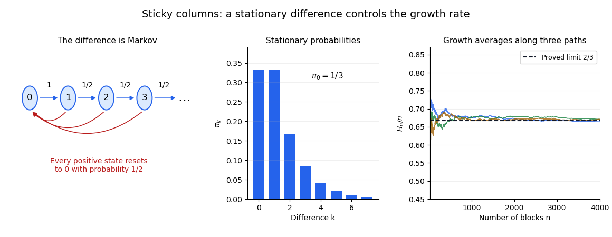

# Growth rate of two-column sticky deposition

↑ **Parent:** [Reset-or-increment Markov chain](reset-or-increment-markov-chain.md)

Suppose each new unit block independently selects one of two columns with equal probability. On the taller column it increases the maximum height; on the shorter column it sticks level with the other column, leaving the maximum unchanged. If the columns have equal height, the next block increases the maximum. Their absolute height difference $D_n$ is the [reset-or-increment Markov chain](reset-or-increment-markov-chain.md) with $p=1/2$.

For the maximum height $H_n$, each increment obeys $H_n-H_{n-1}=\mathbf1_{\{D_n>0\}}$. The [stationary distribution](stationary-distribution.md) has $\pi_0=1/3$. Applying the [countable-state Markov chain ergodic theorem](countable-state-markov-chain-ergodic-theorem.md) to the bounded [indicator function](indicator-function.md) of the positive states gives

$$
\frac{H_n}{n}=\frac{H_0}{n}+\frac1n\sum_{m=1}^n\mathbf1_{\{D_m>0\}}\longrightarrow1-\pi_0=\frac23
$$

[almost surely](almost-sure-convergence.md), from any fixed finite starting configuration. The reward average depends only on whether a reset occurred, even though the difference chain has infinitely many states.

**[Figure 4](#image-reset-or-increment-differences-determine-the-long-run-column-growth-rate). Reset-or-increment differences determine the long-run column growth rate**. Original calculations and simulations. The accompanying proof establishes the limiting result; finitely many simulated paths illustrate it.

## ↑ Ancestors (9)

1. [Reset-or-increment Markov chain](reset-or-increment-markov-chain.md)
2. [Discrete-time Markov chain](discrete-time-markov-chain.md)
3. [Markov chain](markov-chain-split.md)
4. [Markov process](markov-process-split.md)
5. [Probability theory](probability-theory-split.md)
6. [Probability and statistics](probability-and-statistics-split.md)
7. [Area of mathematics](area-of-mathematics.md)
8. [Mathematics](mathematics-split.md)
9. [Codex Wiki](split.md)

## ← Incoming links (2)

- [A function of a Markov chain need not be Markov](a-function-of-a-markov-chain-need-not-be-markov.md)
- [Solution](past-exam-of-the-probability-course-of-the-university-of-oxford/2017/3/b/ii/solution.md)
