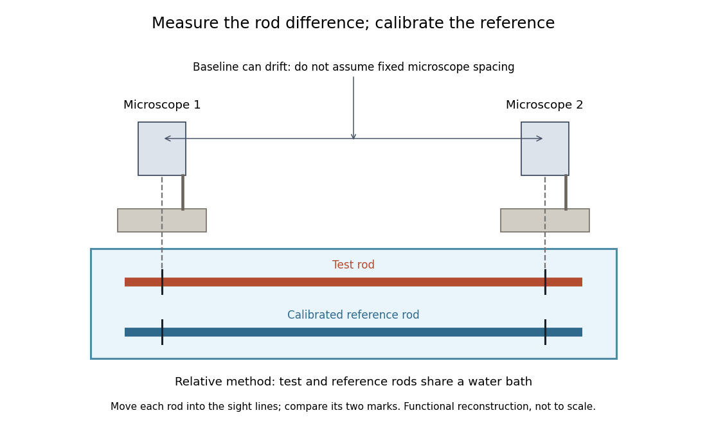

# Guillaume thermal expansion experiment

↑ **Parent:** [Dimensional metrology](dimensional-metrology.md)

[Charles-Édouard Guillaume](charles-edouard-guillaume.md) sought affordable, stable [length standards](length-standard.md). His 1920 lecture describes two micrometer [microscopes](microscope.md) on stone supports sighting marks on a rod immersed in water. Their separation was not fixed: one method alternated the sample with a reference in a second trough at nearly constant [temperature](temperature-split.md). His relative method compared sample and [platinum](platinum.md)–[iridium](iridium.md) reference in the same bath, adding the reference's known expansion to the measured difference. Composition and treatment affected the nickel–iron alloys; low expansion held over a limited [temperature](temperature-split.md) range.[Nobel Lectures, Physics 1901–1921; Invar and elinvar, lecture 11 December 1920, pp. 444–448: motivation and comparator; pp. 451–453: composition, treatment and temperature limits](nobel-lectures-physics-1901-1921/invar-and-elinvar-by-charles-edouard-guillaume.md)

**[Figure 3](#image-functional-reconstruction-of-the-water-bath-comparison-described-by-charles-edouard-guillaume-with-movable-rods-and-an-instrument-baseline-that-can-drift). Functional reconstruction of the water-bath comparison described by Charles-Édouard Guillaume, with movable rods and an instrument baseline that can drift**.

The [differential length comparator](differential-length-comparator.md) calculation explains why a calibrated reference is needed even when its expansion is larger than the sample's. Keeping both rods in the same bath targets one source of [systematic error](systematic-error.md); allowing for changes in the instrument baseline targets another. Discovering a low-expansion [alloy](alloy.md) and demonstrating its dimensional stability are connected experimental tasks.

## ↑ Ancestors (4)

1. [Dimensional metrology](dimensional-metrology.md)
2. [Metrology](metrology.md)
3. [Physics](physics-split.md)
4. [Codex Wiki](split.md)

## ← Incoming links (2)

- [Invar](invar.md)
- [Nobel Prize in Physics in 1920](nobel-prize-in-physics-in-1920.md)
