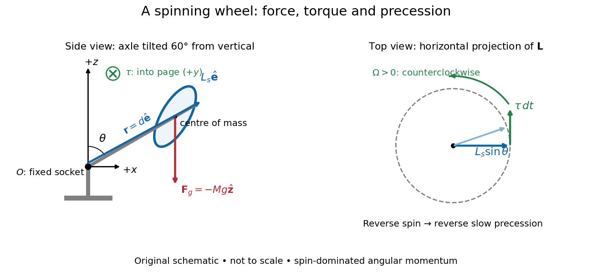

# Gyroscope vector geometry

↑ **Parent:** [Gyroscope](gyroscope.md)

Choose a fixed support point $O$ and nonrotating axes in an [inertial frame](inertial-frame.md). All [angular momenta](angular-momentum.md), [torques](torque.md), and [moments of inertia](moment-of-inertia.md) below refer to $O$. Let $\widehat{\mathbf e}$ point along the axle from $O$ toward the [centre of mass](center-of-mass.md), and let $\widehat{\mathbf z}$ point vertically upward. Write $\theta$ for their [angle](angle.md). For a rapidly spinning [symmetric top](symmetric-top.md), the dominant [angular momentum](angular-momentum.md) is $\mathbf L_O\simeq L_s\widehat{\mathbf e}$, where $L_s=I_3\omega_3$ is signed and $I_3$ is the axial [principal moment of inertia](principal-moment-of-inertia.md). The sign of the axial [angular velocity](angular-velocity.md) $\omega_3$ follows the [right-hand rule](right-hand-rule.md).

**[Figure 21](#image-a-fixed-wheel-support-separates-the-downward-gravitational-force-from-the-transverse-torque-and-sideways-precession). A fixed wheel support separates the downward gravitational force from the transverse torque and sideways precession**.

With [mass](mass.md) $M$, [centre of mass](center-of-mass.md) distance $d$, and constant [gravitational acceleration](gravitational-acceleration.md) $g$, the gravitational [force](force.md) and its [torque](torque.md) are

$$
\mathbf r=d\widehat{\mathbf e},\qquad \mathbf F_g=-Mg\widehat{\mathbf z},\qquad
\boldsymbol\tau_O=\mathbf r\times\mathbf F_g=Mgd\,\widehat{\mathbf z}\times\widehat{\mathbf e}.
$$

An ideal support applies a [force](force.md) at $O$, so its [lever arm](lever-arm.md) and [torque](torque.md) about $O$ vanish. At the instant the axle lies in the $xz$ plane with a positive $x$ component, the gravitational [torque](torque.md) points along $+y$. It adds $d\mathbf L_O=\boldsymbol\tau_O\,dt$ toward $+y$, rather than along the downward [force](force.md). The [dot product](dot-product.md) identity $d|\mathbf L_O|^2/dt=2\mathbf L_O\cdot\boldsymbol\tau_O$ shows why perpendicular [torque](torque.md) changes direction without instantly changing magnitude. This vector balance and the slow-turning relation $\boldsymbol\tau_O=\boldsymbol\Omega\times\mathbf L_O$ are developed in [Chapter 20: Rotation in space](the-feynman-lectures-on-physics-volume-i-by-richard-feynman-and-others/chapter-20-rotation-in-space.md) (sections 20-2 and 20-3, equations 20.13–20.15).

For steady [precession](precession.md) about the vertical, $\boldsymbol\Omega=\Omega\widehat{\mathbf z}$ and $d\widehat{\mathbf e}/dt=\Omega\widehat{\mathbf z}\times\widehat{\mathbf e}$. Equating the two [cross products](cross-product.md) gives

$$
\Omega\simeq\frac{Mgd}{L_s}=\frac{Mgd}{I_3\omega_3},\qquad
|\boldsymbol\tau_O|=Mgd\sin\theta.
$$

The [angular momentum](angular-momentum.md) tip traces a [circle](circle.md) of [radius](radius.md) $|L_s|\sin\theta$: its sideways [speed](speed.md) is $|\Omega L_s|\sin\theta$. Both that [radius](radius.md) and the gravitational [lever arm](lever-arm.md) contain $\sin\theta$, explaining its cancellation for $0<\theta<\pi$. Exactly vertical alignment has zero gravitational [torque](torque.md) and no distinguishable azimuthal [precession](precession.md) to infer by this cancellation. Positive $L_s$ gives positive [precession](precession.md), counterclockwise viewed from above; reversing the spin reverses the slow [precession](precession.md). [University Physics Volume 1, section 11.4, equation 11.12 and the torque and precession-circle derivation](university-physics-volume-1-by-william-moebs-and-others/11-4-precession-of-a-gyroscope.md)

## ↑ Ancestors (7)

1. [Gyroscope](gyroscope.md)
2. [Angular momentum](angular-momentum.md)
3. [Momentum](momentum.md)
4. [Classical mechanics](classical-mechanics-split.md)
5. [Branches of physics](branches-of-physics.md)
6. [Physics](physics-split.md)
7. [Codex Wiki](split.md)

## ← Incoming links (1)

- [Gyroscope](gyroscope.md)
