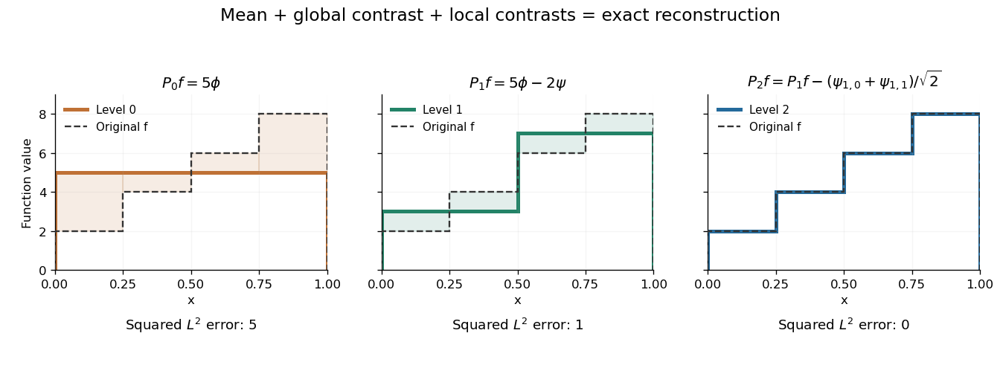

# Haar projection

↑ **Parent:** [Haar wavelet](haar-wavelet.md)

The [Haar projection](haar-projection.md) at level $J$ is the [orthogonal projection](orthogonal-projection.md) onto the [functions](function-split.md) constant on level-$J$ [dyadic intervals](dyadic-interval.md). On each cell it replaces $f$ by its [cell average](average-value-of-a-function.md). This is the closest cellwise-constant approximation in the [L2 norm](l2-norm.md), because choosing a constant $c$ on a cell minimizes $\int_I|f-c|^2$ at its [cell average](average-value-of-a-function.md).

On $[0,1]$, take the [step function](step-function.md) with values $2,4,6,8$ on successive quarter-intervals. At level zero, its [Haar projection](haar-projection.md) is the constant $5$. At level one, it has values $3$ and $7$ on the two halves. At level two, it recovers the four original values exactly. With normalized [Haar wavelets](haar-wavelet.md), these approximations are

$$
P_0f=5\phi,\qquad
P_1f=5\phi-2\psi,\qquad
P_2f=5\phi-2\psi-\frac1{\sqrt2}\psi_{1,0}-\frac1{\sqrt2}\psi_{1,1}.
$$

The coefficients are [L2 inner products](l2-inner-product.md), so they differ from the discrete vector coefficients by the factor $1/\sqrt4=1/2$. Their squared sum also has a direct meaning:

$$
\|f\|_2^2=\frac{2^2+4^2+6^2+8^2}{4}
=30=5^2+(-2)^2+\left(-\frac1{\sqrt2}\right)^2+\left(-\frac1{\sqrt2}\right)^2.
$$

The approximation errors in squared [L2 norm](l2-norm.md) of $P_0f,P_1f,P_2f$ are respectively $5,1,0$: each added detail removes exactly its own squared coefficient from the error.

**[Figure 6](#image-coarse-mean-half-interval-contrasts-and-quarter-interval-details-reconstruct-the-same-four-step-function). Coarse mean, half-interval contrasts and quarter-interval details reconstruct the same four-step function**.

The [Haar projection](haar-projection.md) can be expressed using level-$J$ [Haar scaling functions](haar-scaling-function.md), or through a coarse scaling family and the [Haar wavelets](haar-wavelet.md) at intermediate levels. On $[0,1]$ with lowest level zero, that coarse family is the single constant function $\phi$. On the whole [real line](real-line.md), use the integer translates of a coarse [Haar scaling function](haar-scaling-function.md) instead; one global constant is not [square-integrable](square-integrable-function.md). Refinement improves the representation while retaining the earlier coefficients.

**Table of contents**

- [Haar projection error for a Lipschitz function](haar-projection-error-for-a-lipschitz-function.md)
- [Haar approximation error for a function of bounded variation](haar-approximation-error-for-a-function-of-bounded-variation.md)
- [Haar projection estimator in Gaussian white noise](haar-projection-estimator-in-gaussian-white-noise.md)
  - [Supremum norm risk of a Haar projection estimator](supremum-norm-risk-of-a-haar-projection-estimator.md)

## ↑ Ancestors (8)

1. [Haar wavelet](haar-wavelet.md)
2. [Orthonormal wavelet](orthonormal-wavelet.md)
3. [Wavelet](wavelet.md)
4. [Fourier analysis](fourier-analysis-split.md)
5. [Analysis](analysis-split.md)
6. [Area of mathematics](area-of-mathematics.md)
7. [Mathematics](mathematics-split.md)
8. [Codex Wiki](split.md)

## ← Incoming links (10)

- [Average value of a function](average-value-of-a-function.md)
- [Discrete wavelet transform](discrete-wavelet-transform.md)
- [Haar density estimator](haar-density-estimator.md)
- [Haar projection](haar-projection.md)
- [Haar projection error for a Lipschitz function](haar-projection-error-for-a-lipschitz-function.md)
- [Haar projection estimator in Gaussian white noise](haar-projection-estimator-in-gaussian-white-noise.md)
- [Multiresolution analysis](multiresolution-analysis.md)
- [Solution](past-exam-of-the-mathematics-course-of-the-university-of-cambridge/2006/iii/paper-7/4/ii/solution.md)
- [Solution](past-exam-of-the-mathematics-course-of-the-university-of-cambridge/2009/iii/paper-33/3/solution.md)
- [Solution](past-exam-of-the-mathematics-course-of-the-university-of-cambridge/2015/iii/paper-36/2/solution.md)
