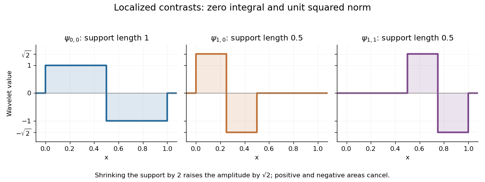

# Haar wavelet

↑ **Parent:** [Orthonormal wavelet](orthonormal-wavelet.md)  
ⓦ [Wiki](https://en.wikipedia.org/wiki/Haar_wavelet)

The Haar wavelet is a signed contrast between two adjacent half-intervals:

$$
\psi(x)=
\begin{cases}
1,&0\leq x<1/2,\\
-1,&1/2\leq x<1,\\
0,&\text{otherwise}.
\end{cases}
$$

It has [compact support](compact-support.md), zero [integral](integral.md), and unit [L2 norm](l2-norm.md): $\int\psi=1/2-1/2=0$ and $\int|\psi|^2=1$. The zero integral is its one [vanishing moment](vanishing-moment.md). Its [Haar scaling function](haar-scaling-function.md) is $\phi=\mathbf1_{[0,1)}$, which records a coarse value rather than a contrast. Endpoint conventions do not alter the [L2 inner products](l2-inner-product.md).

The normalized copies $\psi_{j,k}(x)=2^{j/2}\psi(2^jx-k)$ compare the halves of the [dyadic interval](dyadic-interval.md) $[k2^{-j},(k+1)2^{-j})$. Narrower copies are taller so that their [L2 norms](l2-norm.md) stay one. Thus a coefficient identifies both a location, through $k$, and a scale, through $j$.

**[Figure 5](#image-the-haar-wavelet-and-two-finer-localized-contrasts-have-zero-integral-and-unit-l2-norm). The Haar wavelet and two finer localized contrasts have zero integral and unit L2 norm**.

For a simple [step function](step-function.md) $f$ equal to $2$ on $[0,1/2)$ and $6$ on $[1/2,1)$, its coarse coefficient is $\langle f,\phi\rangle=4$, while its first contrast is $\langle f,\psi\rangle=-2$. Thus **$f=4\phi-2\psi$**. The negative coefficient raises the second half and lowers the first. Finer contrasts vanish because $f$ is constant on each half. A jump aligned with this [dyadic interval](dyadic-interval.md) boundary therefore needs only two nonzero coefficients; jumps at other positions can require details at many scales.

Its [jump discontinuities](jump-discontinuity.md) make the [Haar wavelet](haar-wavelet.md) particularly transparent for changes between neighbouring regions, while limiting approximation of smooth variation. A [Daubechies wavelet](daubechies-wavelet.md) uses a more elaborate pattern to obtain additional [vanishing moments](vanishing-moment.md) and, at sufficiently high order, smoother basis functions. The elementary [Haar refinement identity](haar-refinement-identity.md) has coefficients $h_0=h_1=1/\sqrt2$ and explains how the coarse and fine descriptions fit together.

The historical source is Alfred Haar's [Zur Theorie der orthogonalen Funktionensysteme, Mathematische Annalen 69 (1910), pp. 331–371](https://history-of-approximation-theory.com/fpapers/haar1910.pdf). Chapter III, beginning on page 361, constructs the constant function and these localized piecewise-constant orthogonal functions. Its original endpoint assignments differ from the half-open convention used here, without changing [L2 inner products](l2-inner-product.md).

**Table of contents**

- [Uniform hard-threshold convergence of normalized Haar expansions](uniform-hard-threshold-convergence-of-normalized-haar-expansions.md)
  - [Geometric bound for omitted Haar details](geometric-bound-for-omitted-haar-details.md)
- [Haar refinement identity](haar-refinement-identity.md)
- [Haar projection](haar-projection.md)
  - [Haar projection error for a Lipschitz function](haar-projection-error-for-a-lipschitz-function.md)
  - [Haar approximation error for a function of bounded variation](haar-approximation-error-for-a-function-of-bounded-variation.md)
  - [Haar projection estimator in Gaussian white noise](haar-projection-estimator-in-gaussian-white-noise.md)
    - [Supremum norm risk of a Haar projection estimator](supremum-norm-risk-of-a-haar-projection-estimator.md)
- [Haar scaling function](haar-scaling-function.md)

## ↑ Ancestors (7)

1. [Orthonormal wavelet](orthonormal-wavelet.md)
2. [Wavelet](wavelet.md)
3. [Fourier analysis](fourier-analysis-split.md)
4. [Analysis](analysis-split.md)
5. [Area of mathematics](area-of-mathematics.md)
6. [Mathematics](mathematics-split.md)
7. [Codex Wiki](split.md)

## ← Incoming links (19)

- [Discrete wavelet transform](discrete-wavelet-transform.md)
- [Dyadic partition](dyadic-partition.md)
- [Geometric bound for omitted Haar details](geometric-bound-for-omitted-haar-details.md)
- [Haar projection](haar-projection.md)
- [Haar wavelet](haar-wavelet.md)
- [Jump response of a localized analyzing function](jump-response-of-a-localized-analyzing-function.md)
- [Multiresolution analysis](multiresolution-analysis.md)
- [Orthonormal wavelet](orthonormal-wavelet.md)
- [Solution](past-exam-of-the-mathematics-course-of-the-university-of-cambridge/2006/iii/paper-7/4/ii/solution.md)
- [Solution](past-exam-of-the-mathematics-course-of-the-university-of-cambridge/2008/iii/paper-45/4/c/solution.md)
- [Solution](past-exam-of-the-mathematics-course-of-the-university-of-cambridge/2009/iii/paper-33/3/solution.md)
- [Solution](past-exam-of-the-mathematics-course-of-the-university-of-cambridge/2010/iii/paper-31/3/solution.md)
- [Solution](past-exam-of-the-mathematics-course-of-the-university-of-cambridge/2013/iii/paper-33/3/solution.md)
- [Solution](past-exam-of-the-mathematics-course-of-the-university-of-cambridge/2015/iii/paper-36/2/solution.md)
- [Solution](past-exam-of-the-mathematics-course-of-the-university-of-cambridge/2018/iii/paper-340/1/d/solution.md)
- [Solution](past-exam-of-the-mathematics-course-of-the-university-of-cambridge/2018/iii/paper-340/1/e/solution.md)
- [Second-difference analyzing function](second-difference-analyzing-function.md)
- [Wavelet](wavelet.md)
- [Wavelet regression estimator](wavelet-regression-estimator.md)
