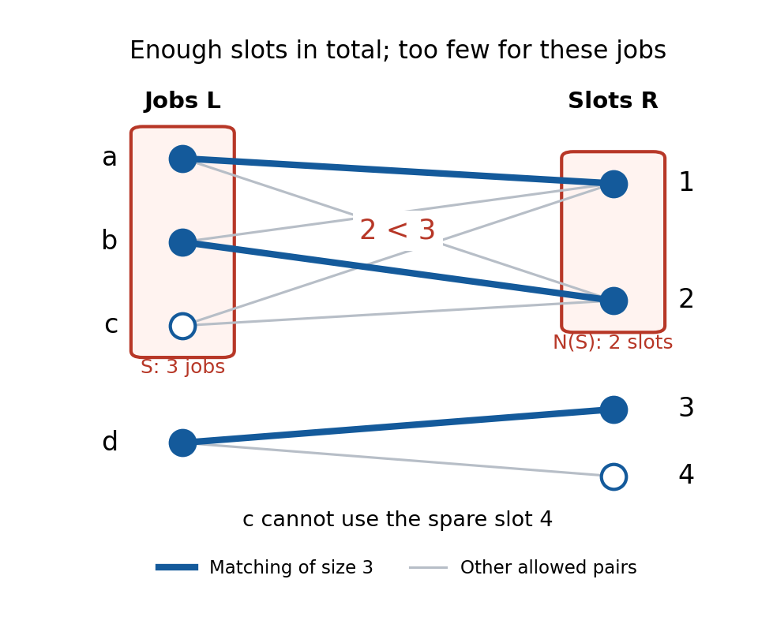

# Hall obstruction

↑ **Parent:** [Hall condition](hall-condition.md)

A [Hall obstruction](hall-obstruction.md) is a left [subset](subset.md) $S$ with fewer distinct [neighbours](neighbour-of-a-vertex.md) than [vertices](vertex-graph-theory.md). At most $|N(S)|$ members of $S$ can be matched, so at least $|S|-|N(S)|$ must remain unmatched. The [pigeonhole principle](pigeonhole-principle.md) proves failure without enumerating every proposed assignment.

For a stronger counterexample than an [isolated vertex](isolated-vertex.md), take $L=\{a,b,c,d\}$ and $R=\{1,2,3,4\}$ with

$$
N(a)=N(b)=N(c)=\{1,2\},\qquad N(d)=\{3,4\}.
$$

Every [vertex](vertex-graph-theory.md) has positive [degree of a vertex](degree-graph-theory.md), the sides have equal [cardinality](cardinality.md), and $|N(L)|=|L|=4$. Every two-[vertex](vertex-graph-theory.md) left [subset](subset.md) also passes the [Hall condition](hall-condition.md). Nevertheless $S=\{a,b,c\}$ has only $N(S)=\{1,2\}$, so $2<3$ rules out [matching saturation](matching-saturation.md) of $L$.

**[Figure 7](#image-a-three-vertex-hall-obstruction-has-only-two-neighbours-despite-enough-slots-in-total). A three-vertex Hall obstruction has only two neighbours, despite enough slots in total**. Red boundaries identify $S=\{a,b,c\}$ and $N(S)=\{1,2\}$. Thick blue [edges](edge-of-a-graph.md) give the maximum-size [matching in a graph](matching-graph-theory-split.md) $\{a1,b2,d3\}$; $c$ and slot $4$ are unmatched.

All sixteen left [subsets](subset.md) can be checked by writing $k=|S\cap\{a,b,c\}|$ and $\varepsilon=1$ if $d\in S$, otherwise $0$. Then

$$
|S|=k+\varepsilon,\qquad |N(S)|=2\mathbf1_{\{k>0\}}+2\varepsilon.
$$

Only $k=3,\varepsilon=0$ violates the [Hall condition](hall-condition.md). Every [matching in a graph](matching-graph-theory-split.md) uses at most two [edges](edge-of-a-graph.md) incident to $\{a,b,c\}$ and at most one incident to $d$, so the [matching number](matching-number.md) is three. There are exactly twelve size-three [matchings in a graph](matching-graph-theory-split.md): choose two of $a,b,c$ in three ways, assign them to $1,2$ in two ways, and choose $3$ or $4$ for $d$. Thus the obstruction identifies the bottleneck: adding availability only for $d$ cannot help; allowing $c$ to use slot $3$ permits $\{a1,b2,c3,d4\}$, a [perfect matching](perfect-matching.md).

## ↑ Ancestors (8)

1. [Hall condition](hall-condition.md)
2. [Hall's marriage theorem](hall-s-marriage-theorem.md)
3. [Matching (graph theory)](matching-graph-theory-split.md)
4. [Graph theory](graph-theory-split.md)
5. [Foundations of mathematics](foundations-of-mathematics-split.md)
6. [Area of mathematics](area-of-mathematics.md)
7. [Mathematics](mathematics-split.md)
8. [Codex Wiki](split.md)

## ← Incoming links (3)

- [Hall allocation model](hall-allocation-model.md)
- [Hall obstruction](hall-obstruction.md)
- [Hall's marriage theorem](hall-s-marriage-theorem.md)
