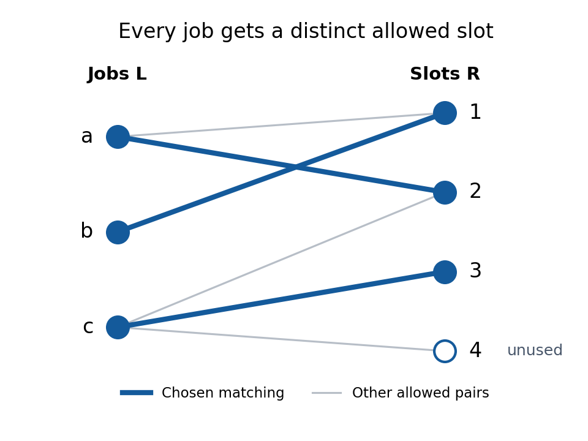

<h1 id="hall-s-marriage-theorem">Hall's marriage theorem</h1>

↑ **Parent:** [Matching (graph theory)](matching-graph-theory-split.md)  
ⓦ [Wiki](https://en.wikipedia.org/wiki/Hall's_marriage_theorem)

For a finite [bipartite graph](bipartite-graph-split.md) $G=(L\cup R,E)$ with disjoint left and right [vertex sets](vertex-set.md), [Hall's marriage theorem](hall-s-marriage-theorem.md) characterizes when distinct allowed partners can be chosen for every left [vertex](vertex-graph-theory.md). A [matching in a graph](matching-graph-theory-split.md) with [matching saturation](matching-saturation.md) of $L$ exists **if and only if** every [subset](subset.md) $S\subseteq L$ satisfies

$$
|N_G(S)|\geq |S|,\qquad N_G(S)=\{r\in R:\text{some }s\in S\text{ has }sr\in E\}.
$$

The [graph neighbourhood](graph-neighbourhood.md) counts distinct right [vertices](vertex-graph-theory.md), rather than [edges](edge-of-a-graph.md) or repeated choices. This is the [Hall condition](hall-condition.md). Its failure supplies a concrete [Hall obstruction](hall-obstruction.md). Necessity follows because the chosen partners of $S$ are distinct members of $N_G(S)$; sufficiency is the surprising assertion that these collective counts rule out every obstacle.[Matching, Covering and Packing, 4th electronic edition 2010, corrected reprint 2012, §2.1, printed pp. 3–4, Theorem 2.1.2: matching of the specified part](graph-theory-by-reinhard-diestel.md)

The right side may be larger: [matching saturation](matching-saturation.md) of $L$ leaves $|R|-|L|$ right [vertices](vertex-graph-theory.md) unmatched. Only when $|L|=|R|$ does a [matching in a graph](matching-graph-theory-split.md) saturating $L$ automatically become a [perfect matching](perfect-matching.md). For a specified [subset](subset.md) $X\subseteq L$, apply the same criterion only to $S\subseteq X$, using the [induced subgraph](induced-subgraph.md) on $X\cup R$. The remaining left [vertices](vertex-graph-theory.md) need not be matched. The empty [set](set-split.md) gives $0\geq0$; if $X$ is empty, the empty [matching in a graph](matching-graph-theory-split.md) suffices.

Consider a [scheduling](scheduling.md) model with three unit-duration jobs $a,b,c$ and four available slots $1,2,3,4$ on one machine. Each job needs exactly one slot, each slot accepts at most one job, and the allowed slots are

$$
N(a)=\{1,2\},\qquad N(b)=\{1\},\qquad N(c)=\{2,3,4\}.
$$

The [bipartite graph](bipartite-graph-split.md) below admits $M=\{a2,b1,c3\}$, a [matching in a graph](matching-graph-theory-split.md) saturating all jobs while leaving slot $4$ unused. It is not a [perfect matching](perfect-matching.md) of the seven-[vertex](vertex-graph-theory.md) [graph](graph-split.md). A greedy choice $a1$ initially blocks $b$, but the [augmenting path in a matching](augmenting-path-in-a-matching.md) $b,1,a,2$ replaces $a1$ by $b1,a2$; subsequent assignment of $c3$ succeeds. A bad partial choice is not an impossibility certificate.

**[Figure 6](#image-a-matching-in-a-graph-saturates-all-three-jobs-and-leaves-one-of-four-slots-unused). A matching in a graph saturates all three jobs and leaves one of four slots unused**. Thick blue [edges](edge-of-a-graph.md) are $a2,b1,c3$; thin grey [edges](edge-of-a-graph.md) are other allowed assignments. Crossings are not [vertices](vertex-graph-theory.md).

There are eight [subsets](subset.md) of $L=\{a,b,c\}$. Listing each [graph neighbourhood](graph-neighbourhood.md) makes the all-[subset](subset.md) requirement explicit:

| $S$ | $N(S)$ | $|S|$ | $|N(S)|$ |
| --- | --- | --- | --- |
| $\varnothing$ | $\varnothing$ | 0 | 0 |
| $\{a\}$ | $\{1,2\}$ | 1 | 2 |
| $\{b\}$ | $\{1\}$ | 1 | 1 |
| $\{c\}$ | $\{2,3,4\}$ | 1 | 3 |
| $\{a,b\}$ | $\{1,2\}$ | 2 | 2 |
| $\{a,c\}$ | $\{1,2,3,4\}$ | 2 | 4 |
| $\{b,c\}$ | $\{1,2,3,4\}$ | 2 | 4 |
| $\{a,b,c\}$ | $\{1,2,3,4\}$ | 3 | 4 |

There are exactly two [matchings in a graph](matching-graph-theory-split.md) saturating $L$: $\{a2,b1,c3\}$ and $\{a2,b1,c4\}$. Job $b$ forces slot $1$, then job $a$ forces slot $2$, leaving two choices for $c$.

**Table of contents**

- [Hall condition](hall-condition.md)
  - [Hall obstruction](hall-obstruction.md)
- [Hall allocation model](hall-allocation-model.md)
- [System of distinct representatives](system-of-distinct-representatives.md)
- [Hall theorem proof outline](hall-theorem-proof-outline.md)
- [Random bipartite matching from empty-rectangle exclusion](random-bipartite-matching-from-empty-rectangle-exclusion.md)
- [Hall matching of maximal separated sets](hall-matching-of-maximal-separated-sets.md)
- [Degree-weighted Hall condition](degree-weighted-hall-condition.md)
- [Measurable Hall theorem](measurable-hall-theorem.md)
- [Hall induction through a tight set](hall-induction-through-a-tight-set.md)
- [Regular bipartite graph has a perfect matching](regular-bipartite-graph-has-a-perfect-matching.md)

## ↑ Ancestors (6)

1. [Matching (graph theory)](matching-graph-theory-split.md)
2. [Graph theory](graph-theory-split.md)
3. [Foundations of mathematics](foundations-of-mathematics-split.md)
4. [Area of mathematics](area-of-mathematics.md)
5. [Mathematics](mathematics-split.md)
6. [Codex Wiki](split.md)

## ← Incoming links (12)

- [Bipartite graph](bipartite-graph-split.md)
- [Hall allocation model](hall-allocation-model.md)
- [Hall's marriage theorem](hall-s-marriage-theorem.md)
- [Matching minimal covering nets of a compact group](matching-minimal-covering-nets-of-a-compact-group.md)
- [Matching saturation](matching-saturation.md)
- [Solution](past-exam-of-the-mathematics-course-of-the-university-of-cambridge/2002/iii/paper-11/3/i/solution.md)
- [Solution](past-exam-of-the-mathematics-course-of-the-university-of-cambridge/2005/ii/paper-3/17f/solution.md)
- [Solution](past-exam-of-the-mathematics-course-of-the-university-of-cambridge/2009/ii/paper-1/17f/i/solution.md)
- [Solution](past-exam-of-the-mathematics-course-of-the-university-of-cambridge/2009/ii/paper-1/17f/ii/solution.md)
- [Solution](past-exam-of-the-mathematics-course-of-the-university-of-cambridge/2010/iii/paper-6/3/solution.md)
- [Random bipartite matching from empty-rectangle exclusion](random-bipartite-matching-from-empty-rectangle-exclusion.md)
- [System of distinct representatives](system-of-distinct-representatives.md)
