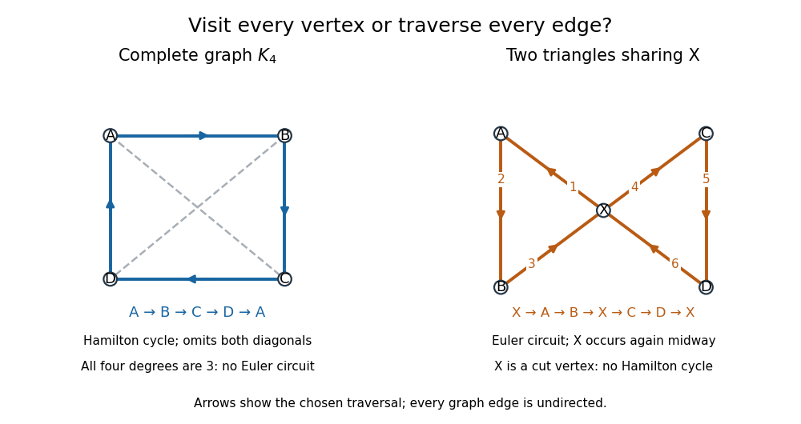

# Hamilton cycle

↑ **Parent:** [Cycle graph](cycle-graph.md)

A [Hamilton cycle](hamilton-cycle.md), also called a [Hamiltonian cycle](hamilton-cycle.md), is a [cycle in a graph](cycle-in-a-graph.md) containing every [vertex](vertex-graph-theory.md) of the [graph](graph-split.md). Here the convention is a finite [simple graph](simple-graph.md) whose [edges](edge-of-a-graph.md) are undirected, with $n=|V|\geq3$. A traversal is a [sequence](sequence.md)

$$
v_0,v_1,\ldots,v_{n-1},v_n=v_0,
$$

where $v_0,\ldots,v_{n-1}$ are all the distinct [vertices](vertex-graph-theory.md) and $\{v_i,v_{i+1}\}\in E$ for $0\leq i<n$. Thus "once" means once before the closing return: the start appears again at the end, and there are exactly $n$ traversed [edges](edge-of-a-graph.md). The [graph](graph-split.md) may contain additional unused [edges](edge-of-a-graph.md).[Diestel, Graph Theory, Chapter 10, opening paragraph, printed p. 323: Hamilton cycles, Hamilton paths, and the contrast with Euler tours](graph-theory-by-reinhard-diestel/hamilton-cycles.md)

A [Hamiltonian path](hamiltonian-path.md) visits all [vertices](vertex-graph-theory.md) once without requiring a return. Removing an [edge](edge-of-a-graph.md) from a [Hamilton cycle](hamilton-cycle.md) gives a [Hamiltonian path](hamiltonian-path.md); a particular [Hamiltonian path](hamiltonian-path.md) closes only if its endpoints are adjacent. An [Euler circuit](euler-circuit.md) instead traverses every [edge](edge-of-a-graph.md) exactly once and can revisit [vertices](vertex-graph-theory.md) midway. The two requirements are independent, as these original labelled examples show.

**[Figure 22](#hamilton-euler-vertex-edge-comparison). Two graphs separate Hamilton cycle vertex coverage from Euler circuit edge coverage; arrows mark traversal order, not directed edges**.

For the [complete graph](complete-graph.md) $K_4$, use $V=\{A,B,C,D\}$ and $E=\{AB,AC,AD,BC,BD,CD\}$, where $AB$ abbreviates the unordered pair $\{A,B\}$. The route $A,B,C,D,A$ is a [Hamilton cycle](hamilton-cycle.md): it visits every [vertex](vertex-graph-theory.md) and uses four of the six [edges](edge-of-a-graph.md), omitting $AC$ and $BD$. It is not an [Euler circuit](euler-circuit.md), and the [graph](graph-split.md) admits no [Euler circuit](euler-circuit.md) at all: every [vertex degree](degree-graph-theory.md) is three, contradicting the [Euler circuit criterion](euler-circuit-criterion.md). The crossing of the drawn diagonals is not another [vertex](vertex-graph-theory.md).

Conversely, take two [triangles in a graph](triangle-in-a-graph.md) sharing only $X$, with $V=\{X,A,B,C,D\}$ and $E=\{XA,AB,BX,XC,CD,DX\}$. The route $X,A,B,X,C,D,X$ is an [Euler circuit](euler-circuit.md), using all six [edges](edge-of-a-graph.md) once; the [vertex degrees](degree-graph-theory.md) are $4,2,2,2,2$. It cannot be a [Hamilton cycle](hamilton-cycle.md), since $X$ occurs midway as well as at the start and end. More strongly, no [Hamilton cycle](hamilton-cycle.md) exists: $X$ is a [cut vertex](cut-vertex.md), and deleting it leaves the two separate [edges](edge-of-a-graph.md) $AB$ and $CD$. Nevertheless, $A,B,X,C,D$ is a [Hamiltonian path](hamiltonian-path.md), whose endpoints are not adjacent.

**Table of contents**

- [Hamiltonian graph](hamiltonian-graph.md)
- [Necessary conditions for a Hamilton cycle](necessary-conditions-for-a-hamilton-cycle.md)
- [Weighted Hamilton cycle](weighted-hamilton-cycle.md)
- [Icosian game](icosian-game.md)

## ↑ Ancestors (8)

1. [Cycle graph](cycle-graph.md)
2. [Cycle in a graph](cycle-in-a-graph.md)
3. [Path in a graph](path-in-a-graph.md)
4. [Graph theory](graph-theory-split.md)
5. [Foundations of mathematics](foundations-of-mathematics-split.md)
6. [Area of mathematics](area-of-mathematics.md)
7. [Mathematics](mathematics-split.md)
8. [Codex Wiki](split.md)

## ← Incoming links (12)

- [Cut vertex](cut-vertex.md)
- [Hamilton cycle](hamilton-cycle.md)
- [Hamiltonian graph](hamiltonian-graph.md)
- [Hamiltonian path](hamiltonian-path.md)
- [Hamiltonicity-to-pancyclicity sprinkling principle](hamiltonicity-to-pancyclicity-sprinkling-principle.md)
- [Icosian game](icosian-game.md)
- [Necessary conditions for a Hamilton cycle](necessary-conditions-for-a-hamilton-cycle.md)
- [Solution](past-exam-of-the-mathematics-course-of-the-university-of-cambridge/2015/ii/paper-3/14i/a/solution.md)
- [Solution](past-exam-of-the-mathematics-course-of-the-university-of-cambridge/2017/ii/paper-1/16h/solution.md)
- [Solution](past-exam-of-the-mathematics-course-of-the-university-of-cambridge/2023/iii/paper-122/3/d/solution.md)
- [Solution](past-exam-of-the-mathematics-course-of-the-university-of-cambridge/2026/iii/paper-122/1/c/solution.md)
- [Weighted Hamilton cycle](weighted-hamilton-cycle.md)
