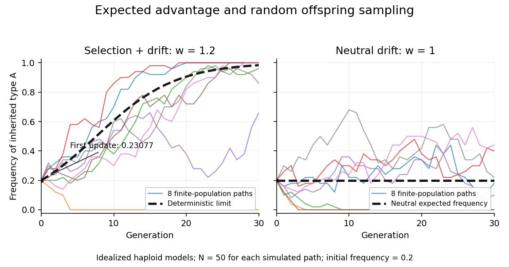

# Haploid selection recurrence

↑ **Parent:** [Natural selection](natural-selection.md)

Consider an explicitly idealized [haploid](haploid.md) population with two inherited types $A,B$, one [allele](allele.md) per individual at the tracked [genetic locus](genetic-locus.md), and discrete, nonoverlapping generations. Assume faithful type transmission, no [mutation](mutation.md) or [gene flow](gene-flow.md), a constant environment, and reproductive contributions independent of type frequency. Let the [expected values](expected-value.md) of offspring surviving to the next census be $m_A,m_B>0$, with relative [genotype fitness](genotype-fitness.md) $w=m_A/m_B$.

For $A$ frequency $p$, expected offspring contributions are proportional to $pm_A$ and $(1-p)m_B$. Normalizing gives the deterministic large-population [mathematical model](mathematical-model.md)

$$
p'=\frac{pm_A}{pm_A+(1-p)m_B}=\frac{wp}{wp+(1-p)}.
$$

The denominator is mean relative [genotype fitness](genotype-fitness.md). For $w=1.2$ and $p_0=0.2$, $p_1=0.24/1.04=3/13\approx0.23077$. Equivalently, 200 $A$ and 800 $B$ parents with $m_A=1.2,m_B=1$ contribute expected counts 240 and 800. Fractional per-parent [expected values](expected-value.md) are averages, not literal fractional offspring. The ratio of these expectations is a deterministic approximation, not generally the expectation of a random ratio.

The odds multiply particularly simply:

$$
\frac{p_{t+1}}{1-p_{t+1}}=w\frac{p_t}{1-p_t},\qquad p_t=\frac{w^tp_0}{1-p_0+w^tp_0}.
$$

Thus $p_{10}\approx0.60753$: repeated modest advantage can substantially change composition. For $w>1$ and $0<p<1$, $p'-p=(w-1)p(1-p)/(1+(w-1)p)>0$. The deterministic boundary $p=0$ remains unchanged: [natural selection](natural-selection.md) needs existing variation.

**[Figure 78](#image-deterministic-selection-and-stochastic-sampling-in-a-finite-population). Deterministic selection and stochastic sampling in a finite population**. Both panels start at $p_0=0.2$. The left compares the deterministic [haploid selection recurrence](haploid-selection-recurrence.md) with eight simulated finite-population paths at $w=1.2$; the right shows eight neutral [genetic drift](genetic-drift.md) paths at $w=1$. Each simulation samples $N=50$ offspring independently per generation. These are illustrative [mathematical models](mathematical-model.md), not experimental measurements.

A distinct stochastic extension fixes $N$ offspring and samples their types independently using a [binomial distribution](binomial-distribution.md): $K\sim\operatorname{Binomial}(N,q)$, where $q=wp/(wp+1-p)$, then $p'=K/N$. Its conditional [expected value](expected-value.md) is $q$ and conditional [variance](variance-split.md) is $q(1-q)/N$. With $w=1$, the conditional [expected value](expected-value.md) remains $p$, yet realized frequencies wander through [genetic drift](genetic-drift.md). With $w>1$, [genetic drift](genetic-drift.md) can still lower $p$ or lose $A$ entirely. Over several generations, the deterministic curve need not equal the mean stochastic trajectory, because the recurrence is nonlinear.

## ↑ Ancestors (4)

1. [Natural selection](natural-selection.md)
2. [Evolution](evolution.md)
3. [Biology](biology-split.md)
4. [Codex Wiki](split.md)

## ← Incoming links (1)

- [Haploid selection recurrence](haploid-selection-recurrence.md)
