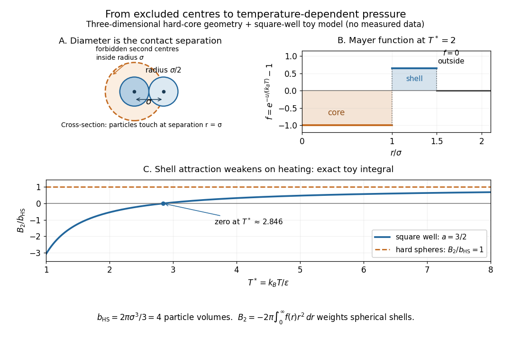

# Hard-sphere gas

↑ **Parent:** [Pair potential](pair-potential.md)

A [hard-sphere gas](hard-sphere-gas.md) is a classical model of identical impenetrable [spheres](sphere.md), each of diameter $\sigma$ and radius $\sigma/2$. Its [pair potential](pair-potential.md) is $u(r)=+\infty$ for centre separation $r<\sigma$ and $u(r)=0$ for $r\ge\sigma$; the convention at exact contact has no effect on the [integral](integral-split.md). It isolates the effect of particle size without an attractive [potential energy](potential-energy.md).

**[Figure 13](#image-hard-sphere-centre-exclusion-the-square-well-mayer-f-function-and-the-exact-temperature-dependence-of-the-toy-second-virial-coefficient). Hard-sphere centre exclusion, the square-well Mayer f-function, and the exact temperature dependence of the toy second virial coefficient**.

The upper-left panel is a cross-section of a three-dimensional forbidden region: the second centre cannot enter a [sphere](sphere.md) of radius $\sigma$ around the first centre. The particles themselves have radius $\sigma/2$. Consequently, with particle [volume](volume.md) $v_{\mathrm s}$ and pair [excluded volume](excluded-volume.md) $v_{\mathrm{ex}}$,

$$
v_{\mathrm s}=\frac{4\pi}{3}\left(\frac\sigma2\right)^3
=\frac{\pi\sigma^3}{6},\qquad
v_{\mathrm{ex}}=\frac{4\pi\sigma^3}{3}=8v_{\mathrm s},
\qquad B_2=\frac12v_{\mathrm{ex}}=4v_{\mathrm s}=\frac{2\pi\sigma^3}{3}.
$$

The last equality follows directly from the [Mayer f-function](mayer-f-function.md): $f=-1$ throughout the forbidden [volume](volume.md) and zero outside it. Confusing particle radius with contact separation changes the answer by a factor of eight; omitting the unordered-pair factor changes it by a further factor of two.

Define the [packing fraction](packing-fraction.md) $\eta=nv_{\mathrm s}$, where $n$ is [number density](number-density.md). Then the [virial expansion](virial-expansion.md) begins

$$
\frac{p}{nk_BT}=1+4\eta+O(\eta^2).
$$

For example, at the toy value $\eta=0.01$, the leading correction predicts $Z\approx1.04$; the omitted terms still matter if accuracy beyond this approximation is needed. The classical [second virial coefficient](second-virial-coefficient.md) is independent of [temperature](temperature-split.md) because the geometry of forbidden configurations does not change when the [gas](gas.md) is warmed. The [pressure](pressure-split.md) itself still scales with [temperature](temperature-split.md) at fixed [number density](number-density.md).

This model makes the positive correction particularly clear: eliminating overlapping configurations changes the dependence of the available configuration space on [volume](volume-thermodynamics.md), even though the allowed configurations all have zero interaction [energy](energy-split.md). The figure's other panels add a toy attractive shell and show how its [Boltzmann factor](boltzmann-factor.md) competes with that geometry. The [hard-sphere gas](hard-sphere-gas.md) is a useful reference model, while a low-order [virial expansion](virial-expansion.md) remains a dilute-gas approximation rather than a dense [sphere packing](sphere-packing.md) formula.

**Table of contents**

- [Excluded volume](excluded-volume.md)
  - [Excluded-volume ideal gas](excluded-volume-ideal-gas.md)

## ↑ Ancestors (5)

1. [Pair potential](pair-potential.md)
2. [Statistical physics](statistical-physics-split.md)
3. [Branches of physics](branches-of-physics.md)
4. [Physics](physics-split.md)
5. [Codex Wiki](split.md)

## ← Incoming links (7)

- [Hard-sphere gas](hard-sphere-gas.md)
- [Knudsen number](knudsen-number.md)
- [Mayer f-function](mayer-f-function.md)
- [Solution](past-exam-of-the-mathematics-course-of-the-university-of-cambridge/2012/iii/paper-7/4/solution.md)
- [Solution](past-exam-of-the-mathematics-course-of-the-university-of-cambridge/2020/ii/paper-4/35a/iii/solution.md)
- [Solution](past-exam-of-the-physics-b-course-of-the-university-of-cambridge/2017/paper-2/section-c/c13/solution.md)
- [Second virial coefficient](second-virial-coefficient.md)
