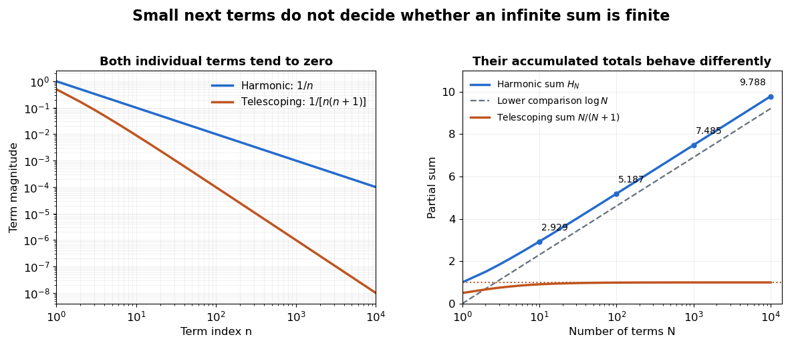

# Harmonic series

↑ **Parent:** [Series (mathematics)](series-mathematics.md)  
ⓦ [Wiki](https://en.wikipedia.org/wiki/Harmonic_series)

The [harmonic series](harmonic-series.md) is the positive [series](series-mathematics.md)

$$
1+\frac12+\frac13+\frac14+\cdots=\sum_{n=1}^{\infty}\frac1n.
$$

Its [partial sums](partial-sum.md) are the [harmonic numbers](harmonic-number.md) $H_N$. Although the individual terms tend to zero, $H_N$ grows without bound, so the [harmonic series](harmonic-series.md) is not a [convergent series](convergent-series.md). This is a basic warning against using the size of one term as a bound on all the terms still to come.

The growth is slow enough to be visually deceptive. The [partial sums](partial-sum.md) at $N=10,100,1000,10000$ are approximately $2.92896825,5.18737752,7.48547086,9.78760604$. Adding ten times as many terms increases the accumulated total by roughly $\log10\approx2.30258509$, rather than multiplying the total by ten. The [telescoping series](telescoping-series.md) $\sum1/[n(n+1)]$ has similarly vanishing terms but approaches the finite sum one.

**[Figure 23](#image-small-terms-can-accumulate-without-bound-or-approach-a-finite-sum). Small terms can accumulate without bound or approach a finite sum**. The left panel compares the positive terms $1/n$ and $1/[n(n+1)]$ on [logarithmic scales](logarithmic-scale.md). The right panel compares their [partial sums](partial-sum.md) against the number of terms on a logarithmic horizontal axis. The dashed curve is $\log N$, a lower comparison for $H_N$; the horizontal line is the finite sum one of the [telescoping series](telescoping-series.md).

A short block argument proves the divergence without trusting a finite plot. For each [integer](integer.md) $k\geq0$, the block from $2^k+1$ through $2^{k+1}$ contains $2^k$ terms, each at least $1/2^{k+1}$. Therefore

$$
\sum_{n=2^k+1}^{2^{k+1}}\frac1n\geq\frac12,\qquad
H_{2^m}\geq1+\frac m2.
$$

Every doubling supplies at least another half, and arbitrarily many doublings are possible. A collection of tiny terms can still have a substantial combined contribution. See [Jiří Lebl, Basic Analysis I, Example 2.5.11](https://www.jirka.org/ra/html/sec_series.html) for this grouping proof.

[Integral comparison](integral-comparison-for-a-nonincreasing-nonnegative-function.md) sharpens the growth estimate. Here $\log$ denotes the [natural logarithm](natural-logarithm.md). Since $1/x$ is a [strictly decreasing function](strictly-decreasing-function.md) for positive $x$, comparison of rectangles with the [integral](integral.md) gives

$$
\log(N+1)\leq H_N\leq1+\log N.
$$

Thus the divergence is logarithmic. The finer difference $H_N-\log N$ tends to the [Euler--Mascheroni constant](euler-s-constant.md), approximately $0.57721566$; the [harmonic number](harmonic-number.md) expansion supplies higher-order corrections. This turns the counterexample into a usable quantitative estimate of accumulated reciprocal contributions.

Euler's _De progressionibus harmonicis observationes_, written in 1734 and published in 1740, studies these sums beyond the yes-or-no question of convergence. Sections 2–3 compare long blocks to show continued growth, and later sections compare the sums with [logarithms](logarithm.md) and calculate the constant offset. The [Euler Archive record, E43](https://scholarlycommons.pacific.edu/euler-works/43/) identifies the dates and original publication; [Alexander Aycock's translation of Euler's original paper](https://download.uni-mainz.de/mathematik/Algebraische%20Geometrie/Euler-Kreis%20Mainz/E43.pdf) makes the calculations accessible. This is not a claim that Euler first discovered divergence: the paper's interest includes measuring how slowly a divergent sum grows.

**Table of contents**

- [Alternating harmonic series](alternating-harmonic-series.md)

## ↑ Ancestors (7)

1. [Series (mathematics)](series-mathematics.md)
2. [Sequence and series](sequence-and-series.md)
3. [Real analysis](real-analysis-split.md)
4. [Analysis](analysis-split.md)
5. [Area of mathematics](area-of-mathematics.md)
6. [Mathematics](mathematics-split.md)
7. [Codex Wiki](split.md)

## ← Incoming links (36)

- [Alternating harmonic series](alternating-harmonic-series.md)
- [Boundary convergence of a power series](boundary-convergence-of-a-power-series.md)
- [Euler proof that the sum of reciprocals of primes diverges](euler-proof-that-the-sum-of-reciprocals-of-primes-diverges.md)
- [Harmonic series](harmonic-series.md)
- [Partial sum](partial-sum.md)
- [Solution](past-exam-of-the-mathematics-course-of-the-university-of-cambridge/2001/ia/paper-1/9d/iii/solution.md)
- [Solution](past-exam-of-the-mathematics-course-of-the-university-of-cambridge/2002/ia/paper-1/9c/i/solution.md)
- [Solution](past-exam-of-the-mathematics-course-of-the-university-of-cambridge/2002/iii/paper-6/1/solution.md)
- [Solution](past-exam-of-the-mathematics-course-of-the-university-of-cambridge/2004/ia/paper-1/12f/iii/solution.md)
- [Solution](past-exam-of-the-mathematics-course-of-the-university-of-cambridge/2005/ia/paper-1/9f/iii/solution.md)
- [Solution](past-exam-of-the-mathematics-course-of-the-university-of-cambridge/2006/ii/paper-4/1h/solution.md)
- [Solution](past-exam-of-the-mathematics-course-of-the-university-of-cambridge/2007/ia/paper-1/4d/solution.md)
- [Solution](past-exam-of-the-mathematics-course-of-the-university-of-cambridge/2007/ia/paper-4/7e/solution.md)
- [Solution](past-exam-of-the-mathematics-course-of-the-university-of-cambridge/2008/ia/paper-1/3f/solution.md)
- [Solution](past-exam-of-the-mathematics-course-of-the-university-of-cambridge/2009/ia/paper-1/4e/solution.md)
- [Solution](past-exam-of-the-mathematics-course-of-the-university-of-cambridge/2009/ia/paper-1/9f/a/solution.md)
- [Solution](past-exam-of-the-mathematics-course-of-the-university-of-cambridge/2010/ia/paper-1/9e/b/solution.md)
- [Solution](past-exam-of-the-mathematics-course-of-the-university-of-cambridge/2010/ia/paper-1/9e/c/solution.md)
- [Solution](past-exam-of-the-mathematics-course-of-the-university-of-cambridge/2010/ia/paper-1/9e/d/solution.md)
- [Solution](past-exam-of-the-mathematics-course-of-the-university-of-cambridge/2011/ia/paper-1/9f/a/solution.md)
- [Solution](past-exam-of-the-mathematics-course-of-the-university-of-cambridge/2013/ia/paper-1/4f/b/solution.md)
- [Solution](past-exam-of-the-mathematics-course-of-the-university-of-cambridge/2013/ia/paper-4/2e/solution.md)
- [Solution](past-exam-of-the-mathematics-course-of-the-university-of-cambridge/2013/ib/paper-2/20h/ii/solution.md)
- [Solution](past-exam-of-the-mathematics-course-of-the-university-of-cambridge/2014/ia/paper-4/5e/solution.md)
- [Solution](past-exam-of-the-mathematics-course-of-the-university-of-cambridge/2016/ia/paper-1/11d/b/solution.md)
- [Solution](past-exam-of-the-mathematics-course-of-the-university-of-cambridge/2017/ia/paper-1/4e/solution.md)
- [Solution](past-exam-of-the-mathematics-course-of-the-university-of-cambridge/2017/ia/paper-4/8d/a/solution.md)
- [Solution](past-exam-of-the-mathematics-course-of-the-university-of-cambridge/2019/ii/paper-4/1i/solution.md)
- [Solution](past-exam-of-the-mathematics-course-of-the-university-of-cambridge/2024/iii/paper-318/1/c/solution.md)
- [Solution](past-exam-of-the-mathematics-course-of-the-university-of-cambridge/2026/iii/paper-202/3/d/solution.md)
- [Pólya–Vinogradov inequality](polya-vinogradov-inequality.md)
- [Rationalization of a square-root difference](rationalization-of-a-square-root-difference.md)
- [Series (mathematics)](series-mathematics.md)
- [Shared-uniform counterexample to the second Borel-Cantelli lemma](shared-uniform-counterexample-to-the-second-borel-cantelli-lemma.md)
- [Summable and harmonic event probabilities](summable-and-harmonic-event-probabilities.md)
- [Term test for divergence](term-test-for-divergence.md)
