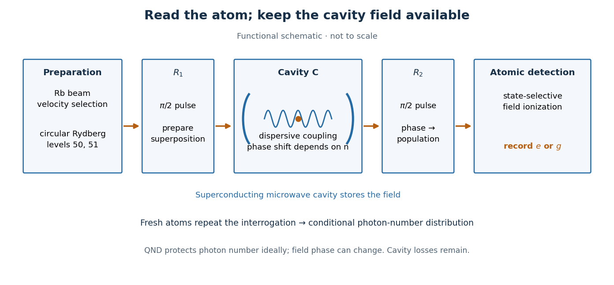

# Haroche cavity photon nondemolition experiment

↑ **Parent:** [Quantum nondemolition measurement](quantum-nondemolition-measurement.md)

In the 2007 [cavity quantum electrodynamics](cavity-quantum-electrodynamics.md) experiment of [Christine Guerlin](christine-guerlin.md) and collaborators, including [Sébastien Gleyzes](sebastien-gleyzes.md), [Michel Brune](michel-brune.md), [Jean-Michel Raimond](jean-michel-raimond.md) and [Serge Haroche](serge-haroche.md), an injected [coherent state](coherent-state.md) occupied a 51.1 GHz [microwave](microwave.md) cavity with [niobium](niobium.md)-coated mirrors exhibiting [superconductivity](superconductivity-split.md). Velocity-selected [rubidium](rubidium.md) [chemical atoms](atom-physics.md) were prepared as circular [Rydberg atoms](rydberg-atom.md) in levels with [principal quantum numbers](principal-quantum-number.md) 50 and 51. Repeated atomic readouts progressively narrowed the inferred [photon number](photon-number.md) to a [Fock state](fock-state.md); later records revealed jumps. The cavity damping time was $T_c=0.130\,\mathrm{s}$. Empty-cavity [Ramsey interferometry](ramsey-interferometry.md) scans fixed the analysis-phase origin; weak injected fields refined the response calibration. Finite fringe contrast required calibrated [likelihoods](likelihood-function.md); photon losses could interrupt convergence.[Progressive field-state collapse and quantum non-demolition photon counting, PDF pp. 2–6, Eqs. (1)–(2), Figs. 2–4 and Methods](progressive-field-state-collapse-and-quantum-non-demolition-photon-counting-by-christine-guerlin-and-others.md)

The functional sequence is preparation, first [Ramsey interferometry](ramsey-interferometry.md) zone $R_1$, dispersive cavity $C$, second zone $R_2$, and state-selective detection. The first $\pi/2$ [microwave](microwave.md) pulse prepares an atomic [quantum superposition](quantum-superposition.md); [dispersive atom-cavity coupling](dispersive-atom-cavity-coupling.md) adds a [photon number](photon-number.md)-dependent relative [quantum phase](quantum-phase.md) while suppressing energy exchange. The second pulse converts that [quantum phase](quantum-phase.md) into atomic populations; [state-selective field ionization](state-selective-field-ionization.md) reads $e$ or $g$. Successive [chemical atoms](atom-physics.md) carry the meter records away while the same field remains available.[Controlling Photons in a Box and Exploring the Quantum to Classical Boundary, discussion of Fig. 10 (apparatus) and Fig. 11 (repeated atomic detection)](controlling-photons-in-a-box-and-exploring-the-quantum-to-classical-boundary-by-serge-haroche.md)

**[Figure 2](#image-atoms-carry-photon-number-information-from-the-cavity-to-a-detector). Atoms carry photon-number information from the cavity to a detector**. Original functional schematic, not a scaled apparatus drawing. The atom is the meter; the final detector reads the atom.

This arrangement makes [quantum nondemolition measurement](quantum-nondemolition-measurement.md) useful for following a field repeatedly and preparing a [Fock state](fock-state.md) by conditioning. The [photon number](photon-number.md) is inferred from a sequence of physical records; it is not a directly visible label attached to a photon. Each atomic probe makes a weak, partial [measurement in quantum mechanics](quantum-measurement-split.md) of [photon number](photon-number.md), and the accumulated records can approach a resolved count. A single binary meter need not identify one among many possible [Fock states](fock-state.md), as [perfect discrimination of pure states requires orthogonality](perfect-discrimination-of-pure-states-requires-orthogonality.md).

**Table of contents**

- [Sequential Bayesian photon counting](sequential-bayesian-photon-counting.md)
- [Photon-number measurement backaction](photon-number-measurement-backaction.md)

## ↑ Ancestors (6)

1. [Quantum nondemolition measurement](quantum-nondemolition-measurement.md)
2. [Measurement in quantum mechanics](quantum-measurement-split.md)
3. [Quantum theory](quantum-theory-split.md)
4. [Branches of physics](branches-of-physics.md)
5. [Physics](physics-split.md)
6. [Codex Wiki](split.md)

## ← Incoming links (1)

- [Quantum nondemolition measurement](quantum-nondemolition-measurement.md)
