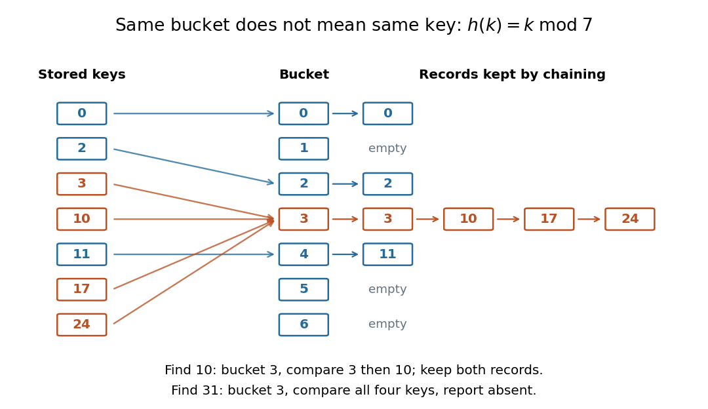

# Hash function

↑ **Parent:** [Computer science](computer-science-split.md)  
ⓦ [Wiki](https://en.wikipedia.org/wiki/Hash_function)

A [hash function](hash-function.md) is a [function](function-split.md) assigning each key in an [input](input-computer-science.md) [set](set-split.md) $U$ a value in an [output](output-computing.md) [set](set-split.md) $B$. Usually $B$ is much smaller: a long name or large [integer](integer-split.md) becomes a small bucket index. Equal keys must receive equal values from the same [hash function](hash-function.md); different keys may also receive equal values. Such a [hash collision](hash-collision.md) means "look in the same place", and does not establish key equality. If $|U|>|B|$, the [pigeonhole principle](pigeonhole-principle.md) makes some collisions unavoidable.

For example, [modular arithmetic](modular-arithmetic-split.md) gives the [hash function](hash-function.md) $h(k)=k\bmod7$, with seven bucket indices $0,\ldots,6$. Store the seven keys $0,2,3,10,11,17,24$: their values are respectively $0,2,3,3,4,3,3$. In particular, $h(3)=h(10)=3$ although $3\ne10$. A [hash table](hash-table.md) is a [data structure](data-structure-split.md) that uses these indices to locate records. With [separate chaining](separate-chaining.md), each bucket holds a [linked list](linked-list.md) of records, so bucket $3$ retains all four keys $3,10,17,24$. Inserting $10$ must not overwrite $3$ merely because their [hash function](hash-function.md) values agree.

**[Figure 17](#image-seven-keys-stored-in-seven-buckets-using-the-hash-function-h-k-k-mod-7). Seven keys stored in seven buckets using the hash function h(k) = k mod 7**. Orange arrows identify four colliding keys. Bucket 3 keeps all four records in a linked list; equality is checked on the stored keys.

Searching for $10$ computes bucket $3$, then compares the actual keys until it reaches $10$. Searching for absent key $31$ reaches that same bucket and must reject every stored key. This [data structure](data-structure-split.md) trades a search through all records for a search through one short chain, provided the [hash function](hash-function.md) distributes keys adequately. A fixed [hash function](hash-function.md) can perform poorly on patterned keys: $3,10,17,24$ already demonstrate the problem. A [universal hash family](universal-hash-family.md) introduces controlled randomness to limit the [expected value](expected-value-split.md) of this extra work. Neither indexing nor a small collision [probability](probability.md) inherently supplies [encryption](encryption.md) or [message authentication](message-authentication.md); a [cryptographic hash function](cryptographic-hash-function.md) has additional requirements such as [collision resistance](collision-resistance.md).

**Table of contents**

- [Hash collision](hash-collision.md)
  - [Birthday probability for hash outputs](birthday-probability-for-hash-outputs.md)
- [Almost strongly universal hash family](almost-strongly-universal-hash-family.md)
  - [Polynomial almost strongly universal hashing](polynomial-almost-strongly-universal-hashing.md)
- [Universal hash family](universal-hash-family.md)
  - [Strongly universal hash family](strongly-universal-hash-family.md)

## ↑ Ancestors (2)

1. [Computer science](computer-science-split.md)
2. [Codex Wiki](split.md)

## ← Incoming links (19)

- [Birthday probability for hash outputs](birthday-probability-for-hash-outputs.md)
- [Birthday problem](birthday-problem.md)
- [Hash bucket](hash-bucket.md)
- [Hash collision](hash-collision.md)
- [Hash function](hash-function.md)
- [Hash table](hash-table.md)
- [Hash table key](hash-table-key.md)
- [Hash table resizing](hash-table-resizing.md)
- [Key equality](key-equality.md)
- [Linear probing](linear-probing.md)
- [Linear probing cluster](linear-probing-cluster.md)
- [Load factor of a hash table](load-factor-of-a-hash-table.md)
- [Memoization key](memoization-key.md)
- [Open addressing](open-addressing.md)
- [Pairing function](pairing-function.md)
- [Separate chaining](separate-chaining.md)
- [Simple uniform hashing](simple-uniform-hashing.md)
- [Strongly universal hash family](strongly-universal-hash-family.md)
- [Universal hash family](universal-hash-family.md)
