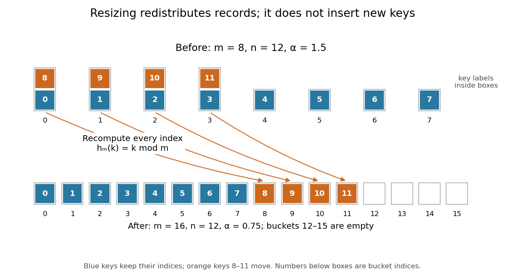

# Hash table resizing

↑ **Parent:** [Hash table](hash-table.md)

Changing the number of [hash buckets](hash-bucket.md) and reassigning stored records using the new bucket-index [hash function](hash-function.md). [Amortized analysis](amortized-analysis.md) of rebuilding and [expected value](expected-value-split.md) bounds for subsequent lookup address different costs.

Rebuild the balanced example from [load factor of a hash table](load-factor-of-a-hash-table.md) with $m'=16$ while keeping exactly the same twelve records. Under $h_m(k)=k\bmod m$, keys $0,\ldots,7$ retain their indices, whereas keys $8,9,10,11$ move from [hash buckets](hash-bucket.md) $0,1,2,3$ to [hash buckets](hash-bucket.md) $8,9,10,11$. The new chain lengths are twelve ones followed by four zeros; $\alpha'=12/16=3/4$. Copying the old eight chain heads and adding eight empty heads would leave those four moved keys unreachable by the new lookup rule.

**[Figure 10](#image-hash-table-resizing-from-eight-to-sixteen-hash-buckets-redistributes-existing-records). Hash table resizing from eight to sixteen hash buckets redistributes existing records**. Original [modular arithmetic](modular-arithmetic-split.md) example for keys $0,\ldots,11$. Blue keys keep their indices; orange keys move because $h_{16}(k)$ differs from $h_8(k)$. The record count stays twelve, and empty [hash buckets](hash-bucket.md) still count towards capacity.

For a short [algorithm correctness](algorithm-correctness.md) outline, allocate the new [array](array-data-structure.md), visit every old record once, compute its new bucket index, and link it into that [hash bucket](hash-bucket.md). At every step, each transferred record is stored exactly once at the index prescribed by the new [hash function](hash-function.md). Finishing the visit therefore preserves every key-value association and makes the new lookup rule valid. Direct transfer can skip duplicate searches because the old one-value-per-key map already established distinct [equivalence classes](equivalence-class.md); rebuilding is not twelve new user insertions.

Under constant-cost hashing, linking and slot initialization, [separate chaining](separate-chaining.md) rebuilding takes $O(n+m+m')$ [time complexity](time-complexity.md): initialize $m'$ new heads, examine $m$ old heads, and transfer $n$ records. For doubling, $m'=2m$, this is $O(n+m)$ in [Big O notation](big-o-notation.md). It is $O(n)$ when the resize policy makes $m$ proportional to $n$, but an enormous mostly empty old [array](array-data-structure.md) can make scanning its heads dominate. Growing capacity can lower $\alpha$ without shortening a particular chain: the concentrated keys $0,16,\ldots,176$ all remain in [hash bucket](hash-bucket.md) $0$ after growth from eight to sixteen.

For an insertion-only [sequence](sequence.md) starting empty, choose initial capacity $m_0=8$ and double before a genuinely new key would make $n>m$. The first three growths occur before inserting records $9,17,33$ and transfer $8,16,32$ existing records. If $N=33$ distinct records are inserted, the transfer count is $8+16+32=56$. More generally, the transferred old capacities form a [geometric series](geometric-series.md); if the last is $M<N$, their sum is $2M-m_0<2N$. Initializing and scanning these geometrically growing [arrays](array-data-structure.md) also costs $O(N)$ in total, giving $O(1)$ amortized rebuilding overhead per insertion. A triggering insertion still pays for its whole rebuild.[6.006 Introduction to Algorithms, Fall 2011 by Massachusetts Institute of Technology, 6.006 course staff; p. 2, Rehashing, How fast to grow?, and Amortized Analysis](6-006-introduction-to-algorithms-fall-2011-by-massachusetts-institute-of-technology-6-006-course-staff/lecture-9-hashing-ii.md)

The illustrative twelve-record resize above is an explicitly requested rebuild, not a growth triggered by this threshold policy. Checking for an equal key before growing also prevents a value replacement from triggering unnecessary growth. To combine resizing overhead with expected constant insertion [time complexity](time-complexity.md), separately impose the collision and constant-cost assumptions in [load factor of a hash table](load-factor-of-a-hash-table.md). [Amortized analysis](amortized-analysis.md) distributes rebuilding costs over operations; it does not randomize a poor [hash function](hash-function.md) or bound a single operation's latency. With deletions, separate the grow and shrink thresholds; for example, growing when full and halving at one-quarter live occupancy leaves room for many operations between opposite rebuilds.[6.006 Introduction to Algorithms, Fall 2011 by Massachusetts Institute of Technology, 6.006 course staff; p. 3, Back to Hashing and Delete: halving when n reaches m/4](6-006-introduction-to-algorithms-fall-2011-by-massachusetts-institute-of-technology-6-006-course-staff/lecture-9-hashing-ii.md)

// Target: computer-science.bigb

## ↑ Ancestors (4)

1. [Hash table](hash-table.md)
2. [Data structure](data-structure-split.md)
3. [Computer science](computer-science-split.md)
4. [Codex Wiki](split.md)

## ← Incoming links (3)

- [Hash table](hash-table.md)
- [Hash table resizing](hash-table-resizing.md)
- [Linear probing cluster](linear-probing-cluster.md)
