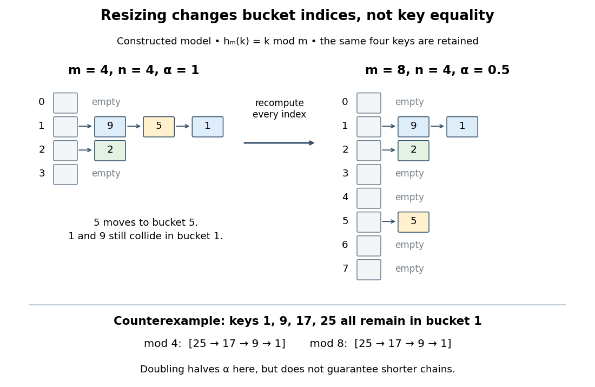

# Hash table

↑ **Parent:** [Data structure](data-structure-split.md)  
ⓦ [Wiki](https://en.wikipedia.org/wiki/Hash_table)

A [hash table](hash-table.md) stores records by key: for example, a product number can select its current stock count without scanning every product. A [hash function](hash-function.md) selects a [hash bucket](hash-bucket.md) in an [array](array-data-structure.md), and a collision-handling method such as [separate chaining](separate-chaining.md) retains distinct keys assigned to the same [hash bucket](hash-bucket.md). The useful idea is to narrow the search to one small collection, while [key equality](key-equality.md) decides which record actually matches.

Use a map interface with one value per key: `get(k)` returns the associated value or an explicit absent result; `put(k,v)` replaces the value if an equal key is present, otherwise inserts a new record; `delete(k)` removes the matching record if present. The absent result must be distinguishable from every permitted stored value. Replacing a value does not increase the record count $n$. A [hash collision](hash-collision.md) between unequal keys must never cause one record to replace the other.[6.006 Introduction to Algorithms, Fall 2011 by Massachusetts Institute of Technology, 6.006 course staff; p. 1, dictionary operations and replacement of an existing key](6-006-introduction-to-algorithms-fall-2011-by-massachusetts-institute-of-technology-6-006-course-staff/lecture-8-hashing-i.md)

Let $x\sim y$ denote the chosen [key equality](key-equality.md), an [equivalence relation](equivalence-relation.md), and let $h_m$ be the bucket-index [hash function](hash-function.md) for $m>0$ [hash buckets](hash-bucket.md). Correctness requires

$$
x\sim y\ \Longrightarrow\ h_m(x)=h_m(y),\qquad h_m(x)\in\{0,\ldots,m-1\}.
$$

The converse is false: equal bucket indices merely identify candidates for a [key equality](key-equality.md) comparison. If an implementation first computes a full hash value $H(k)$ and then reduces it to a bucket index, equal keys must have equal $H$ values too. Keep both [key equality](key-equality.md) and the [hash function](hash-function.md) stable while a key is stored; changing the key so it selects another [hash bucket](hash-bucket.md) can make its record unreachable. This distinction is explicit in the published `hashCode`/`equals` contract.[Object (Java SE 25 & JDK 25)](java-platform-standard-edition-25-api-specification-by-oracle/object-java-se-25-and-jdk-25.md)

For a constructed [integer](integer-split.md) example, use [modular arithmetic](modular-arithmetic-split.md) to define $h_m(k)=k\bmod m$ and store keys $1,5,9,2$ with values $A,B,C,D$. At $m=4$, three records share [hash bucket](hash-bucket.md) $1$ and one occupies [hash bucket](hash-bucket.md) $2$. The [hash table load factor](load-factor-of-a-hash-table.md) is

$$
\alpha=\frac{n}{m}=\frac44=1.
$$

It is the mean number of records per [hash bucket](hash-bucket.md), including empty [hash buckets](hash-bucket.md), not a bound on the longest chain. With [separate chaining](separate-chaining.md), $\alpha$ may exceed $1$ because records live in the chains rather than one record being confined to each [array](array-data-structure.md) slot.

Growing this example to $m=8$ changes the bucket-index [hash function](hash-function.md): key $5$ now belongs to [hash bucket](hash-bucket.md) $5$, while keys $1,9$ still share [hash bucket](hash-bucket.md) $1$. Every record must be assigned using the new bucket-index [hash function](hash-function.md); copying the old [array](array-data-structure.md) of chain heads unchanged is insufficient. The [hash table load factor](load-factor-of-a-hash-table.md) becomes $4/8=1/2$.

**[Figure 5](#hash-table-resizing-buckets). Hash table resizing recomputes indices but does not guarantee fewer hash collisions**. Original deterministic model using $h_m(k)=k\bmod m$, not a measured implementation. The upper panels retain keys $1,5,9,2$ in four and eight [hash buckets](hash-bucket.md); chain order is illustrative. The lower counterexample retains all four keys $1,9,17,25$ in [hash bucket](hash-bucket.md) $1$ even after doubling.

For an insertion-only [sequence](sequence.md) starting empty with constant initial capacity, one policy doubles $m$ before inserting a new key that would make $n>m$. A rebuild for [separate chaining](separate-chaining.md) allocates the new [array](array-data-structure.md) and transfers each existing record directly into its new chain. Since keys are already distinct, transfer needs no duplicate search. With constant-cost hashing and linking, this takes $O(n+m)$ [time complexity](time-complexity.md), hence $O(n)$ at a growth threshold. [Amortized analysis](amortized-analysis.md) charges the occasional rebuild across many insertions: the old capacities $1,2,4,\ldots,2^r$ form a [geometric series](geometric-series.md) with sum $2^{r+1}-1$, so total rebuilding work over $N$ insertions is $O(N)$. This gives $O(1)$ amortized resizing overhead; an insertion that triggers a rebuild can still take $O(n)$.[6.006 Introduction to Algorithms, Fall 2011 by Massachusetts Institute of Technology, 6.006 course staff; p. 2, rebuilding cost and geometric table doubling](6-006-introduction-to-algorithms-fall-2011-by-massachusetts-institute-of-technology-6-006-course-staff/lecture-9-hashing-ii.md)

The search to check for an existing key is additional work. Bounded [hash table load factor](load-factor-of-a-hash-table.md) together with the probabilistic assumptions in [separate chaining](separate-chaining.md) gives expected amortized $O(1)$ insertion, not worst-case $O(1)$. Rehashing alone gives no distribution guarantee: the diagram's keys $1,9,17,25$ all collide modulo both $4$ and $8$. Even a low [hash table load factor](load-factor-of-a-hash-table.md) permits a long chain. If supporting shrinkage too, leave a gap between growth and shrink thresholds to avoid repeated rebuilding when insertions and deletions alternate near one threshold.[6.006 Introduction to Algorithms, Fall 2011 by Massachusetts Institute of Technology, 6.006 course staff; p. 3, expected bounds and shrinking at one-quarter occupancy](6-006-introduction-to-algorithms-fall-2011-by-massachusetts-institute-of-technology-6-006-course-staff/lecture-9-hashing-ii.md)

**Table of contents**

- [Hash set](hash-set.md)
- [Hash map](hash-map.md)
- [Separate chaining](separate-chaining.md)
  - [Simple uniform hashing](simple-uniform-hashing.md)
- [Open addressing](open-addressing.md)
  - [Linear probing](linear-probing.md)
    - [Linear probing cluster](linear-probing-cluster.md)
      - [Primary clustering](primary-clustering.md)
  - [Tombstone in open addressing](tombstone-in-open-addressing.md)
  - [Hash table probe](hash-table-probe.md)
- [Hash bucket](hash-bucket.md)
- [Key equality](key-equality.md)
- [Load factor of a hash table](load-factor-of-a-hash-table.md)
- [Hash table resizing](hash-table-resizing.md)
- [Hash table key](hash-table-key.md)
- [Hash table record](hash-table-record.md)

## ↑ Ancestors (3)

1. [Data structure](data-structure-split.md)
2. [Computer science](computer-science-split.md)
3. [Codex Wiki](split.md)

## ← Incoming links (15)

- [Adjacency list storage and query costs](adjacency-list-storage-and-query-costs.md)
- [Data structure](data-structure-split.md)
- [Hash collision](hash-collision.md)
- [Hash function](hash-function.md)
- [Hash map](hash-map.md)
- [Hash set](hash-set.md)
- [Hash table](hash-table.md)
- [Hash table record](hash-table-record.md)
- [Key equality](key-equality.md)
- [Memoization arithmetic and stack costs](memoization-arithmetic-and-stack-costs.md)
- [Memoization key](memoization-key.md)
- [Memoized Fibonacci evaluation](memoized-fibonacci-evaluation.md)
- [Open addressing](open-addressing.md)
- [Separate chaining](separate-chaining.md)
- [Tombstone in open addressing](tombstone-in-open-addressing.md)
