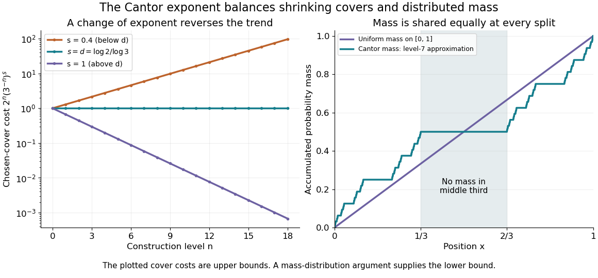

# Hausdorff dimension of the Cantor set

↑ **Parent:** [Hausdorff dimension](hausdorff-dimension.md)

The middle-third [Cantor set](cantor-set.md) has [Hausdorff dimension](hausdorff-dimension.md)

$$
d=\frac{\log2}{\log3}\approx0.63093.
$$

Its [Lebesgue measure](lebesgue-measure.md) is zero, yet $0<\mathcal H^d(C)<\infty$. These assertions measure different aspects of size: interval [length](length.md) is too coarse to distinguish this set from a [null set](null-set.md), while the critical fractional measuring rule captures its remaining structure.

At level $n$, the construction [covers](cover-topology.md) $C$ by $2^n$ intervals of [diameter](diameter.md) $3^{-n}$. Their total $s$-cost is

$$
2^n(3^{-n})^s=(2\,3^{-s})^n.
$$

For $s>d$ it tends to zero, proving the upper dimension bound. At $s=d$ it equals one, giving $\mathcal H^d(C)\leq1$. For $s<d$ this particular [cover](cover-topology.md)'s cost grows, but that alone would not prove a lower bound on [Hausdorff measure](hausdorff-measure.md).

**[Figure 1](#image-cantor-cover-costs-change-trend-at-the-critical-exponent-and-distributed-mass-supplies-the-lower-bound). Cantor cover costs change trend at the critical exponent, and distributed mass supplies the lower bound**.

For the matching lower bound, use the [Cantor distribution](cantor-distribution.md), which assigns mass $2^{-n}$ to each level-$n$ [Cantor cylinder](cantor-cylinder.md). An interval of length $r$ with $3^{-(n+1)}<r\leq3^{-n}$ meets at most two level-$n$ construction intervals, since their gaps are at least $3^{-n}$. Its mass is therefore at most

$$
2\,2^{-n}=2(3^{-n})^d<2\,3^d r^d=4r^d.
$$

Every covering [set](set-split.md) of [diameter](diameter.md) $r$ in the line lies in an interval of length $r$, so any small [cover](cover-topology.md) must have total $d$-cost at least $1/4$. This is the [mass distribution principle](mass-distribution-principle.md) in its interval form: $1/4\leq\mathcal H^d(C)\leq1$, sufficient to prove the claimed dimension. The constants are convenient bounds, rather than an assertion of the exact critical [Hausdorff measure](hausdorff-measure.md). In the diagram, the right panel is a finite-stage approximation to the [Cantor function](cantor-function.md), showing how probability is shared while the middle third receives none.

The reusable pattern is to obtain an upper bound by constructing [covers](cover-topology.md) and a lower bound by distributing mass. The same strategy underlies [Cartesian powers of the Cantor set](cartesian-powers-of-the-cantor-set.md) and the dimension formula for a [finite similarity iterated function system](finite-similarity-iterated-function-system.md) satisfying the [open set condition](open-set-condition.md).

## ↑ Ancestors (9)

1. [Hausdorff dimension](hausdorff-dimension.md)
2. [Hausdorff measure](hausdorff-measure.md)
3. [Geometric measure theory](geometric-measure-theory.md)
4. [Measure theory](measure-theory-split.md)
5. [Real analysis](real-analysis-split.md)
6. [Analysis](analysis-split.md)
7. [Area of mathematics](area-of-mathematics.md)
8. [Mathematics](mathematics-split.md)
9. [Codex Wiki](split.md)

## ← Incoming links (5)

- [Cantor set](cantor-set.md)
- [Geometric measure theory](geometric-measure-theory.md)
- [Hausdorff dimension](hausdorff-dimension.md)
- [Hausdorff measure](hausdorff-measure.md)
- [Mass distribution principle](mass-distribution-principle.md)
