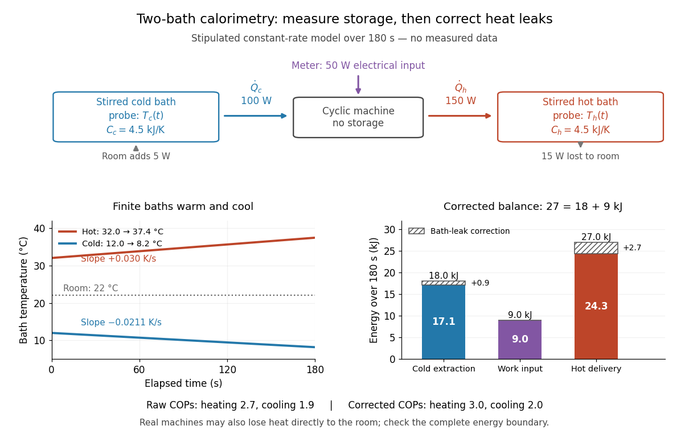

# Heat-pump calorimetry

↑ **Parent:** [Heat pump](heat-pump.md)

A motivating bench experiment asks whether a hot bath receives more [heat](heat.md) than the electrical [work](work.md) supplied to a [heat pump](heat-pump.md). PHYWE's authored operating instructions, section 4, describe a sealed [vapor-compression refrigeration](vapor-compression-refrigeration.md) apparatus with its cold and hot coils immersed in separate [water](water.md) vessels. The quantitative procedure calls for insulated vessels, stirring to reduce [temperature](temperature.md) gradients, timed [temperature](temperature.md) readings, and a wattmeter for the input. It waits about five minutes for operating conditions to settle before measurements and explicitly includes the glass vessel and immersed copper pipe when calculating the heated body's [heat capacity](heat-capacity.md). One bath cooling while the other warms makes the origin of the delivered [energy](energy.md) observable. [PHYWE Systeme, Heat pump, compression principle 04373-93, operating instructions, §4, p. 2](https://phywe-itemservice.s3.eu-central-1.amazonaws.com/sites/DMS-Phywe/PROD/de-DE/item/phy_operatingmanuals/04/04373-93/0437393e.pdf)

The following analysis extends that procedure to simultaneous measurements of both finite baths. Weigh the [water](water.md) in each vessel; determine the effective [heat capacities](heat-capacity.md) $C_c$ and $C_h$, including immersed hardware, by a separate known electrical-input calibration over the working [temperature](temperature.md) range. A matched pair of calibrated [thermometers](thermometer.md) placed in stirred [water](water.md) measures bulk $T_c(t)$ and $T_h(t)$; keeping probes away from the coils avoids mistaking a local contact [temperature](temperature.md) for the whole bath. Record the room [temperature](temperature.md) and synchronise the electrical meter and thermometry. Use short intervals after startup, with no boiling or freezing and small enough [temperature](temperature.md) changes that constant effective [heat capacities](heat-capacity.md) are a reasonable approximation. These are proposed measurement controls, rather than reported results from the manual.

Over a common interval $[t_0,t_1]$, the uncorrected bath estimates and measured electrical input are

$$
Q_{h,\rm raw}=C_h[T_h(t_1)-T_h(t_0)],\qquad
Q_{c,\rm raw}=-C_c[T_c(t_1)-T_c(t_0)],\qquad
W_{\rm el}=\int_{t_0}^{t_1}P_{\rm el}(t)\,dt.
$$

Here the wattmeter records real electrical [power](power.md) $P_{\rm el}$. The [integral](integral.md) handles changing input, and the signs make both estimated useful [heat](heat.md) quantities positive during heating and cooling. The effective [heat capacity](heat-capacity.md) includes [water](water.md) [mass](mass.md) times its [specific heat capacity](specific-heat-capacity.md) plus the response of the vessel and immersed hardware. Without that correction, equal [temperature](temperature.md) changes need not imply equal [heat](heat.md) transfers.

Insulation reduces heat leaks but does not establish an [isolated system](isolated-system.md). A warmer bath can lose [heat](heat.md) to the room while a colder bath gains it. As a proposed control, measure pump-off drift at matched bath and room [temperatures](temperature.md), with the same stirring and insulation. Writing $L_h>0$ for outward hot-bath leak [power](power.md) and $L_c>0$ for inward cold-bath leak [power](power.md), the bath balances give

$$
\dot Q_h=C_h\frac{dT_h}{dt}+L_h,\qquad
\dot Q_c=-C_c\frac{dT_c}{dt}+L_c.
$$

Integrate these rates over the same interval before dividing by $W_{\rm el}$. For example, in a pump-off hot-bath control, $L_h=-C_h\,dT_h/dt$; in the cold-bath control, $L_c=C_c\,dT_c/dt$. Check that a stopped machine does not create a different leak path from the running one; otherwise use an independent bath calibration and keep that discrepancy as an uncertainty. Repeat at the same starting [temperatures](temperature.md) to distinguish drift from a change in [COP](coefficient-of-performance.md) as the baths separate.

**[Figure 8](#image-heat-pump-calorimetry-bath-temperature-slopes-electrical-work-and-heat-leak-corrections). Heat-pump calorimetry: bath temperature slopes, electrical work, and heat-leak corrections**. Original apparatus schematic and stipulated constant-rate calculation, not measured data and not a performance claim for the cited apparatus. Each finite bath has effective [heat capacity](heat-capacity.md) $4.5\,\mathrm{kJ\,K^{-1}}$. The hypothetical machine takes $50\,\mathrm W$, extracts $100\,\mathrm W$, and delivers $150\,\mathrm W$; hot-bath loss is $15\,\mathrm W$ and cold-bath gain is $5\,\mathrm W$. Over $180\,\mathrm s$ the hot bath warms by $5.4\,\mathrm K$ and the cold bath cools by $3.8\,\mathrm K$. Correcting the two bath estimates restores the machine's $3$ heating [COP](coefficient-of-performance.md) and $2$ cooling [COP](coefficient-of-performance.md).

In the illustrated toy model, $C_h=C_c=4500\,\mathrm{J\,K^{-1}}$, $P_{\rm el}=50\,\mathrm W$, $\dot Q_h=150\,\mathrm W$, $\dot Q_c=100\,\mathrm W$, $L_h=15\,\mathrm W$, and $L_c=5\,\mathrm W$ are stipulated constants for $180\,\mathrm s$. The slopes are $dT_h/dt=0.030\,\mathrm{K\,s^{-1}}$ and $dT_c/dt=-19/900\,\mathrm{K\,s^{-1}}$. Consequently,

$$
\begin{aligned}
W_{\rm el}&=9.0\,\mathrm{kJ},\\
Q_{h,\rm raw}&=24.3\,\mathrm{kJ},&Q_h&=24.3+2.7=27.0\,\mathrm{kJ},\\
Q_{c,\rm raw}&=17.1\,\mathrm{kJ},&Q_c&=17.1+0.9=18.0\,\mathrm{kJ}.
\end{aligned}
$$

The raw heating and cooling ratios are $2.7$ and $1.9$, whose difference is $0.8$. Correcting the bath leaks gives $3$ and $2$, whose difference is one. The apparent failure of $Q_h=Q_c+W$ was incomplete measurement of [heat](heat.md), not a violation of the [first law of thermodynamics](first-law-of-thermodynamics.md).

Real apparatus can also release motor [heat](heat.md) and pipe [heat](heat.md) directly to the room, and store [internal energy](internal-energy.md) during startup. For a machine boundary that receives electrical [work](work.md), an additional outward [heat](heat.md) transfer $Q_{\rm room}$ gives $Q_h+Q_{\rm room}=Q_c+W_{\rm el}-\Delta U_{\rm machine}$. The residual $Q_h-Q_c-W_{\rm el}$ therefore tests the boundary and corrections; do not force it to zero. Include any auxiliary electrical [work](work.md) in the input if quoting whole-apparatus [COP](coefficient-of-performance.md), and account separately for stirring [work](work.md) deposited in a bath. Ignoring vessel [heat capacity](heat-capacity.md), sensor lag or room leaks can bias the inferred result. These limitations follow from extending the measured [energy](energy.md) budget, and the manual's explicit hardware correction illustrates why such boundaries matter.

Finally, these vessels are finite bodies whose [temperatures](temperature.md) change; they are not fixed [thermal reservoirs](heat-bath.md). Their ratio of integrated useful [heat](heat.md) to integrated input [work](work.md) is an interval [COP](coefficient-of-performance.md). A [Carnot's theorem](carnot-s-theorem.md) comparison using simultaneous bath [temperatures](temperature.md) is a local approximation only when the machine settles much faster than the baths change. An exact reversible comparison for changing bath [temperatures](temperature.md) instead uses the bath [entropy](entropy.md) changes, for example $C_h\ln(T_{h,1}/T_{h,0})+C_c\ln(T_{c,1}/T_{c,0})$ for constant [heat capacities](heat-capacity.md), negligible net machine [entropy](entropy.md) change and no room leaks. The experiment's beauty is that two [thermometers](thermometer.md), known [heat capacities](heat-capacity.md) and an electrical-energy measurement expose both [conservation of energy](conservation-of-energy.md) and the practical gap from reversibility.

## ↑ Ancestors (6)

1. [Heat pump](heat-pump.md)
2. [Thermodynamics](thermodynamics-split.md)
3. [Statistical physics](statistical-physics-split.md)
4. [Branches of physics](branches-of-physics.md)
5. [Physics](physics-split.md)
6. [Codex Wiki](split.md)

## ← Incoming links (3)

- [Calorimetry](calorimetry.md)
- [Heat pump](heat-pump.md)
- [Heat-pump calorimetry](heat-pump-calorimetry.md)
