# Heat

↑ **Parent:** [Thermodynamics](thermodynamics.md)  
ⓦ [Wiki](https://en.wikipedia.org/wiki/Heat)

Heat is [energy](energy.md) transferred across a [thermodynamic system](thermodynamics.md#thermodynamic-system)'s boundary because of a [temperature](temperature.md) difference. It is measured in [joules](physics.md#joule), like [work](energy.md#work) and [internal energy](internal-energy.md). A hot cup transfers [heat](heat.md) to cooler surroundings; its [temperature](temperature.md) describes its state, while the transferred [heat](heat.md) describes a process. The cup stores [internal energy](internal-energy.md), rather than a substance called [heat](heat.md). [Ling, Moebs and Sanny, OpenStax, University Physics Volume 2, section 1.4: heat and internal energy](https://openstax.org/books/university-physics-volume-2/pages/1-4-heat-transfer-specific-heat-and-calorimetry)

For a [closed system](thermodynamics.md#closed-system) with unchanged bulk [kinetic energy](energy.md#kinetic-energy) and [potential energy](energy.md#potential-energy), choose $Q>0$ for [heat](heat.md) entering and $W>0$ for [work](energy.md#work) done by the system. The [first law of thermodynamics](first-law-of-thermodynamics.md) gives

$$
\Delta U=Q-W,\qquad dU=\delta Q-\delta W.
$$

Here $U$ is the stored [internal energy](internal-energy.md). For example, a sealed piston cylinder receiving $20\,\mathrm{kJ}$ of [heat](heat.md) and delivering $5\,\mathrm{kJ}$ of [work](energy.md#work) gains $15\,\mathrm{kJ}$ of [internal energy](internal-energy.md). A [closed system](thermodynamics.md#closed-system) retains its matter while exchanging [energy](energy.md); it need not be an [isolated system](thermodynamics.md#isolated-system). [Ling, Moebs and Sanny, OpenStax, First law of thermodynamics and sign conventions](https://openstax.org/books/university-physics-volume-2/pages/3-3-first-law-of-thermodynamics)

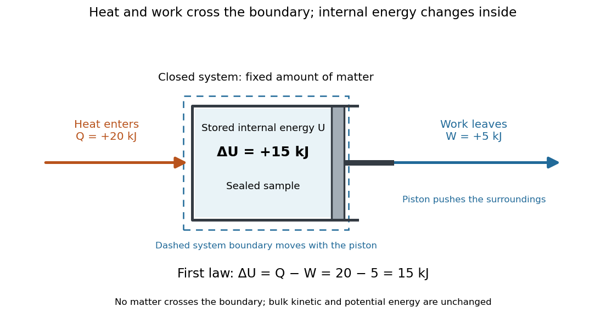

**[Figure 1](#image-heat-input-and-work-output-determine-the-internal-energy-increase). Heat input and work output determine the internal energy increase**. The dashed boundary encloses a [closed system](thermodynamics.md#closed-system) in a sealed piston cylinder. The incoming arrow carries $Q=20\,\mathrm{kJ}$ of [heat](heat.md); the outgoing arrow carries $W=5\,\mathrm{kJ}$ of [work](energy.md#work) done by the system. With unchanged bulk [kinetic energy](energy.md#kinetic-energy) and [potential energy](energy.md#potential-energy), $\Delta U=15\,\mathrm{kJ}$. No matter crosses the boundary.

Unlike [internal energy](internal-energy.md), [heat](heat.md) is not a [state function](thermodynamics.md#state-function): different paths between the same equilibrium states can transfer different $Q$, with compensating differences in [work](energy.md#work). The symbol $\delta Q$ records this dependence on the path; there is no stored quantity whose difference is always $Q$. The two paths in [first law of thermodynamics](first-law-of-thermodynamics.md) illustrate this directly. Supplied [heat](heat.md) can raise [temperature](temperature.md) as [sensible heat](#sensible-heat), change a [phase fraction](thermodynamics.md#phase-fraction) through [latent heat](thermodynamic-potential.md#latent-heat), or help supply expansion [work](energy.md#work). Measuring [temperature](temperature.md) alone therefore does not determine transferred [heat](heat.md).

For a [reversible thermodynamic process](second-law-of-thermodynamics.md#reversible-thermodynamic-process), $\delta Q_{\rm rev}=T\,dS$, where $T$ is absolute [temperature](temperature.md) and $S$ is [entropy](entropy.md). This identification requires reversibility: an irreversible [adiabatic process](first-law-of-thermodynamics.md#adiabatic-process) has $Q=0$ and can nevertheless increase [entropy](entropy.md). Likewise $Q=\Delta H$, with [enthalpy](enthalpy.md) $H$, requires the particular fixed-[pressure](pressure.md) conditions in [enthalpy](enthalpy.md). These distinctions make [heat](heat.md) useful as a precise boundary-transfer quantity in [heat engines](thermodynamics.md#heat-engine), [refrigerators](thermodynamics.md#refrigerator) and heating calculations.

Historically, James Prescott Joule's paddle experiments showed that stirring [water](chemical-substance.md#water) with input [work](energy.md#work) could raise its [temperature](temperature.md), helping establish [conservation of energy](mathematical-physics.md#conservation-of-energy). The lesson is still useful: a [temperature](temperature.md) rise can result from [work](energy.md#work) even without incoming [heat](heat.md). [Ling, Moebs and Sanny, OpenStax, section 1.4: Joule's paddle experiment](https://openstax.org/books/university-physics-volume-2/pages/1-4-heat-transfer-specific-heat-and-calorimetry)

**Table of contents**

- [Lumped thermal model](#lumped-thermal-model)
- [Heat generation rate](#heat-generation-rate)
  - [Volumetric heat generation rate](#volumetric-heat-generation-rate)
- [Sensible heat](#sensible-heat)
- [Heat transfer](#heat-transfer)
  - [Thermal insulation](#thermal-insulation)
    - [Thermal shield](#thermal-shield)
  - [First-order thermal isolation](#first-order-thermal-isolation)
    - [Thermal time constant](#thermal-time-constant)
  - [Heat current](#heat-current)
    - [Heat-current relaxation time](#heat-current-relaxation-time)
  - [Heat sink](#heat-sink)
  - [Heat exchanger](#heat-exchanger)
    - [Counterflow heat exchanger](#counterflow-heat-exchanger)
  - [Nusselt number](#nusselt-number)
  - [Thermal inertia](#thermal-inertia)
  - [Radiative cooling](#radiative-cooling)
    - [Compton cooling by the cosmic microwave background](#compton-cooling-by-the-cosmic-microwave-background)
    - [Dust thermal emission](#dust-thermal-emission)
    - [Inverse Compton cooling](#inverse-compton-cooling)
    - [Astrophysical cooling function](#astrophysical-cooling-function)
      - [Electron-hydrogen normalization of the cooling function](#electron-hydrogen-normalization-of-the-cooling-function)
      - [Molecular line cooling](#molecular-line-cooling)
      - [Cooling suppression by photoionization](#cooling-suppression-by-photoionization)
      - [Optically thin gas cooling time](#optically-thin-gas-cooling-time)
        - [Cooling-to-free-fall equality curve](#cooling-to-free-fall-equality-curve)
      - [Primordial atomic cooling curve](#primordial-atomic-cooling-curve)
      - [Atomic line cooling](#atomic-line-cooling)
        - [Metal-line cooling](#metal-line-cooling)
- [Heat flux density](#heat-flux-density)
- [Thermal conduction](#thermal-conduction)
  - [Slab conduction with exponentially decaying heat generation](#slab-conduction-with-exponentially-decaying-heat-generation)
  - [Heat switch](#heat-switch)
  - [Thermal resistance](#thermal-resistance)
    - [Thermal conductance](#thermal-conductance)
  - [Temperature dipole around an insulating sphere](#temperature-dipole-around-an-insulating-sphere)
  - [Isobaric conductive cooling in mass coordinates](#isobaric-conductive-cooling-in-mass-coordinates)
    - [Error-function isobaric cooling front](#error-function-isobaric-cooling-front)
  - [Temperature gradient](#temperature-gradient)
  - [Fourier's law](#fourier-s-law)
    - [Thermal conductivity](#thermal-conductivity)
      - [Kinetic thermal-conductivity approximation](#kinetic-thermal-conductivity-approximation)
      - [Wiedemann-Franz law](#wiedemann-franz-law)
        - [Thermal and electrical relaxation times in metals](#thermal-and-electrical-relaxation-times-in-metals)
        - [Lorenz number](#lorenz-number)
      - [Thermal conductivity tensor](#thermal-conductivity-tensor)
  - [Thermal diffusivity](#thermal-diffusivity)
    - [Ångström periodic heating method](#angstrom-periodic-heating-method)
      - [Steady periodic thermal state](#steady-periodic-thermal-state)
      - [Thermal diffusion wave](#thermal-diffusion-wave)
        - [Thermal penetration depth](#thermal-penetration-depth)
      - [Ångström method with linear heat loss](#angstrom-method-with-linear-heat-loss)
      - [Ångström method worked example](#angstrom-method-worked-example)
      - [Finite-end correction for periodic rod heating](#finite-end-correction-for-periodic-rod-heating)
    - [Prandtl number](#prandtl-number)
    - [Thermal diffusion time](#thermal-diffusion-time)
      - [Thermal diffusion rate of a Fourier mode](#thermal-diffusion-rate-of-a-fourier-mode)
      - [Thermal diffusion length](#thermal-diffusion-length)
    - [Laser flash analysis](#laser-flash-analysis)
- [Stefan–Boltzmann law](#stefan-boltzmann-law)
  - [Net radiative heat exchange](#net-radiative-heat-exchange)
    - [View factor](#view-factor)
  - [Stefan-Boltzmann constant](#stefan-boltzmann-constant)
  - [Emissivity](#emissivity)
    - [Total hemispherical emissivity](#total-hemispherical-emissivity)
    - [Spectral emissivity](#spectral-emissivity)
    - [Directional emissivity](#directional-emissivity)
    - [Grey body](#grey-body)
    - [Diffuse thermal emitter](#diffuse-thermal-emitter)
    - [Comparing surface emission at equal temperature](#comparing-surface-emission-at-equal-temperature)
  - [Radiative equilibrium](#radiative-equilibrium)
- [Heat capacity](#heat-capacity)
  - [Heat capacity of a diatomic gas](#heat-capacity-of-a-diatomic-gas)
  - [Equilibrium heat capacity of interconverting states](#equilibrium-heat-capacity-of-interconverting-states)
  - [Low-temperature heat capacity measurement](#low-temperature-heat-capacity-measurement)
    - [Calorimeter addenda](#calorimeter-addenda)
  - [Debye T-cubed test](#debye-t-cubed-test)
  - [Electronic heat capacity](#electronic-heat-capacity)
    - [Constant-pressure gas versus electronic metal heat capacity](#constant-pressure-gas-versus-electronic-metal-heat-capacity)
      - [Lattice qualification of an electron-only heat-capacity ratio](#lattice-qualification-of-an-electron-only-heat-capacity-ratio)
    - [Electronic heat capacity coefficient](#electronic-heat-capacity-coefficient)
      - [Molar Fermi-liquid heat-capacity mass scaling](#molar-fermi-liquid-heat-capacity-mass-scaling)
      - [Fermi-edge heat-capacity counting](#fermi-edge-heat-capacity-counting)
    - [Thermal-shell estimate of electronic heat capacity](#thermal-shell-estimate-of-electronic-heat-capacity)
  - [Schottky anomaly](#schottky-anomaly)
    - [Schottky anomaly with unequal degeneracies](#schottky-anomaly-with-unequal-degeneracies)
  - [Molar heat capacity](#molar-heat-capacity)
  - [Heating curve](#heating-curve)
  - [Entropy from heat capacity](#entropy-from-heat-capacity)
  - [Entropy concavity and positive heat capacity](#entropy-concavity-and-positive-heat-capacity)
  - [Specific heat capacity](#specific-heat-capacity)
    - [Volumetric heat capacity](#volumetric-heat-capacity)
    - [Specific heat capacity at constant volume](#specific-heat-capacity-at-constant-volume)
    - [Specific heat capacity at constant pressure](#specific-heat-capacity-at-constant-pressure)
      - [Pure-radiation constant-pressure heat-capacity singularity](#pure-radiation-constant-pressure-heat-capacity-singularity)
  - [Heat capacity at constant volume](#heat-capacity-at-constant-volume)
    - [Temperature-linear pressure and volume-independent heat capacity](#temperature-linear-pressure-and-volume-independent-heat-capacity)
    - [Dulong-Petit law](#dulong-petit-law)
      - [Einstein solid](#einstein-solid)
  - [Heat capacity at constant area](#heat-capacity-at-constant-area)
  - [Electron heat capacity](#electron-heat-capacity)

## Lumped thermal model

↑ **Parent:** [Heat](heat.md)

A finite-dimensional energy-balance model assigning one representative [temperature](temperature.md) and [heat capacity](#heat-capacity) to each region. [Thermal resistances](#thermal-resistance) represent the energy exchange between regions; internal spatial gradients are not resolved.

## Heat generation rate

↑ **Parent:** [Heat](heat.md)

Thermal energy generated per unit time, often specified per volume as $q'''$ in $\mathrm{W\,m^{-3}}$. Integrating a volumetric source over a region gives its total thermal power.

### Volumetric heat generation rate

↑ **Parent:** [Heat generation rate](#heat-generation-rate)

Thermal power generated per unit volume. Its [integral](integral.md) over a region is the region's total [heat generation rate](#heat-generation-rate).

## Sensible heat

↑ **Parent:** [Heat](heat.md)  
ⓦ [Wiki](https://en.wikipedia.org/wiki/Sensible_heat)

Sensible heat is transferred [heat](heat.md) associated with a [temperature](temperature.md) change within a single [thermodynamic phase](thermodynamics.md#thermodynamic-phase). By contrast, [latent heat](thermodynamic-potential.md#latent-heat) can change the [phase fraction](thermodynamics.md#phase-fraction) while the [temperature](temperature.md) stays fixed during equilibrium [phase coexistence](critical-phenomenon.md#phase-coexistence). Neither name denotes an additional stored substance: both describe how transferred [heat](heat.md) participates in a process.

For fixed [mass](classical-mechanics.md#mass) $m$ and composition, use the [heat capacity](#heat-capacity) appropriate to the heating constraint. Under the [quasistatic process](thermodynamics.md#quasistatic-process) assumptions in [heat capacity](#heat-capacity), with only [pressure](pressure.md)-[volume](thermodynamics.md#volume-thermodynamics) [work](energy.md#work) and unchanged bulk [kinetic energy](energy.md#kinetic-energy) and [potential energy](energy.md#potential-energy), fixed-[pressure](pressure.md) heating gives

$$
Q_{\rm sens}=m\int_{T_1}^{T_2}c_p(T)\,dT,
\qquad Q_{\rm sens}=mc_p(T_2-T_1)\quad\text{if }c_p\text{ is constant}.
$$

Here $c_p$ is [specific heat capacity at constant pressure](#specific-heat-capacity-at-constant-pressure); fixed-[volume](thermodynamics.md#volume-thermodynamics) heating instead uses [specific heat capacity at constant volume](#specific-heat-capacity-at-constant-volume) $c_V$. A cooling step has negative $Q_{\rm sens}$ with the sign convention in [heat](heat.md). A [temperature](temperature.md) difference has the same numerical value in units of the [kelvin](temperature.md#kelvin) or [degree Celsius](temperature.md#degree-celsius). The [integral](integral.md) follows by adding the small transfers $\delta Q=mc_p(T)\,dT$, rather than assuming a constant [heat capacity](#heat-capacity).

As a stylized [ice](chemical-substance.md#ice)-to-[water](chemical-substance.md#water) example for a fixed-composition [closed system](thermodynamics.md#closed-system) at fixed [pressure](pressure.md) $1\,\mathrm{atm}$, take $m=0.5\,\mathrm{kg}$, an initial [temperature](temperature.md) of $-10\,{}^\circ\mathrm C$, [melting](critical-phenomenon.md#melting) at $0\,{}^\circ\mathrm C$, and a final [temperature](temperature.md) of $20\,{}^\circ\mathrm C$. Assume constant [specific heat capacity at constant pressure](#specific-heat-capacity-at-constant-pressure) values $c_{\rm ice}=2.1\,\mathrm{kJ\,kg^{-1}\,K^{-1}}$ and $c_{\rm water}=4.18\,\mathrm{kJ\,kg^{-1}\,K^{-1}}$, and [latent heat of fusion](statistical-physics.md#latent-heat-of-fusion) $L_f=334\,\mathrm{kJ\,kg^{-1}}$. These are stipulated, rounded model values; ignore the container and [heat](heat.md) losses, retain all the material, and assume only [pressure](pressure.md)-[volume](thermodynamics.md#volume-thermodynamics) [work](energy.md#work) under the [quasistatic process](thermodynamics.md#quasistatic-process) conditions above. The three steps are

$$
\begin{aligned}
Q_{\rm ice}&=0.5\times2.1\times10=10.5\,\mathrm{kJ},\\
Q_{\rm melt}&=0.5\times334=167\,\mathrm{kJ},\\
Q_{\rm water}&=0.5\times4.18\times20=41.8\,\mathrm{kJ},\\
Q_{\rm total}&=10.5+167+41.8=219.3\,\mathrm{kJ}.
\end{aligned}
$$

Only the first and third terms are [sensible heat](#sensible-heat); the middle term is [latent heat](thermodynamic-potential.md#latent-heat). The plateau begins after $10.5\,\mathrm{kJ}$ and ends after $177.5\,\mathrm{kJ}$ of total supplied [heat](heat.md). At $94\,\mathrm{kJ}$ total input, half the [mass](classical-mechanics.md#mass) is [liquid](thermodynamics.md#liquid) [water](chemical-substance.md#water) and the [temperature](temperature.md) remains $0\,{}^\circ\mathrm C$. The equilibrium [phase transition](critical-phenomenon.md#phase-transition) [temperature](temperature.md) depends on [pressure](pressure.md); this example stipulates a single fixed [pressure](pressure.md). [1.5 Phase Changes](physics-bibliography.md#university-physics-volume-2-by-samuel-j-ling-and-others/1-5-phase-changes)

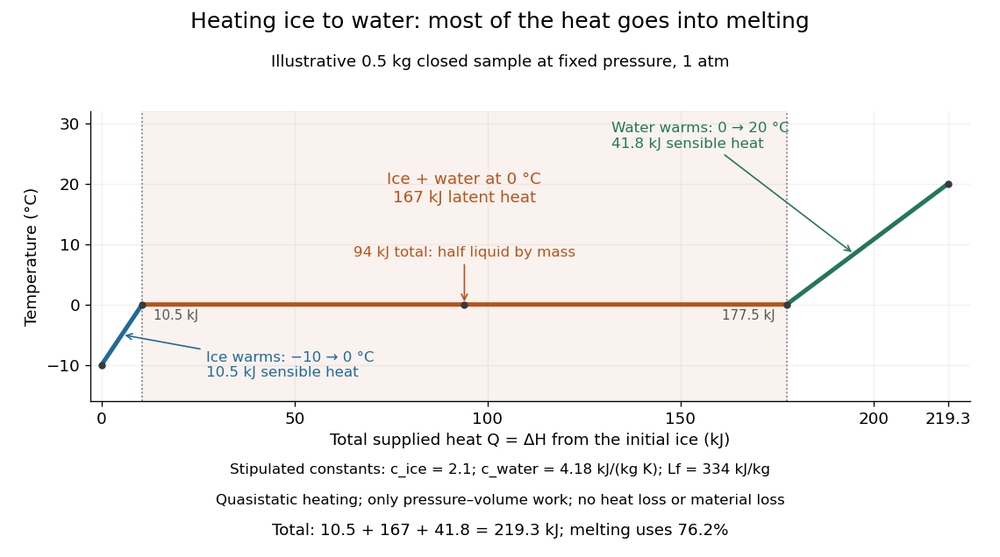

**[Figure 2](#image-heating-0-5-mathrm-kg-of-ice-to-water-sensible-heat-and-latent-heat). Heating $0.5\,\mathrm{kg}$ of ice to water: sensible heat and latent heat**. Illustrative fixed-[pressure](pressure.md) [heating curve](#heating-curve) using the constant parameters above. The sloping portions raise [temperature](temperature.md); the long $0\,{}^\circ\mathrm C$ plateau changes the [phase fraction](thermodynamics.md#phase-fraction). Total supplied [heat](heat.md) is measured from the initial [ice](chemical-substance.md#ice) state and equals the [enthalpy](enthalpy.md) change under the stated assumptions.

This split makes heating budgets easy to interpret: [melting](critical-phenomenon.md#melting) consumes $167/219.3\approx76.2\%$ of the supplied [heat](heat.md) in this model despite causing no [temperature](temperature.md) rise. Within either single [thermodynamic phase](thermodynamics.md#thermodynamic-phase), the [heating curve](#heating-curve) slope is $dT/dQ=1/(mc_p)$; a larger [heat capacity](#heat-capacity) makes the slope shallower. A flat interval represents changing [phase fraction](thermodynamics.md#phase-fraction), so it cannot be modeled by applying $Q=mc_p\Delta T$ across the [phase transition](critical-phenomenon.md#phase-transition). The complementary constructed example in [latent heat](thermodynamic-potential.md#latent-heat) tracks that [phase fraction](thermodynamics.md#phase-fraction) explicitly.

## Heat transfer

↑ **Parent:** [Heat](heat.md)  
ⓦ [Wiki](https://en.wikipedia.org/wiki/Heat_transfer)

[Heat transfer](#heat-transfer) asks how quickly [heat](heat.md) crosses a boundary and how the [temperature](temperature.md) varies along its path. Its principal mechanisms are [thermal conduction](#thermal-conduction), [convection](convection.md) and [thermal radiation](electromagnetic-radiation.md#thermal-radiation). A warm wall can conduct [heat](heat.md) through its interior while exchanging [heat](heat.md) with moving air and emitting [thermal radiation](electromagnetic-radiation.md#thermal-radiation) at its surfaces. Identifying these paths lets us estimate heating requirements and cooling times.

Distinguish the accumulated [heat](heat.md) $Q$ from its rate $\dot Q=dQ/dt$, a [power](energy.md#power) measured in $\mathrm W$. The [heat flux](#heat-flux-density) $q$ is the rate per unit [area](differential-geometry.md#surface-area), measured in $\mathrm{W\,m^{-2}}$: a uniform normal [heat flux](#heat-flux-density) across [area](differential-geometry.md#surface-area) $A$ gives $\dot Q=Aq$. The steady bar in [thermal conduction](#thermal-conduction) carries $q=400\,\mathrm{W\,m^{-2}}$ through $A=0.01\,\mathrm{m^2}$, hence $\dot Q=4\,\mathrm W$; maintained for $60\,\mathrm s$, it transfers $Q=240\,\mathrm J$. This distinction makes a surface's intensity and a whole object's heating load easy to compare.

### Thermal insulation

↑ **Parent:** [Heat transfer](#heat-transfer)

[thermal insulation](#thermal-insulation) reduces unwanted heat exchange. Conduction through supports, [convection](convection.md) in gas and [thermal radiation](electromagnetic-radiation.md#thermal-radiation) require different treatments. [vacuum](physics.md#vacuum) suppresses gas transport but leaves solid conduction and radiation; lowering [thermal conductance](#thermal-conductance) also increases the [temperature](temperature.md) rise caused by a fixed internal heat load.

#### Thermal shield

↑ **Parent:** [Thermal insulation](#thermal-insulation)

A [thermal shield](#thermal-shield) reduces coupling to unwanted environmental [temperature](temperature.md) changes. Low-conductance supports and [thermal insulation](#thermal-insulation) reduce heat transport, low-emissivity surfaces reduce [thermal radiation](electromagnetic-radiation.md#thermal-radiation), and a conducting inner enclosure can reduce [temperature](temperature.md) gradients. Combined with [heat capacity](#heat-capacity) these give a thermal low-pass response. Passive shielding cannot indefinitely reject a slow change in the entire environment and may increase the temperature rise from internal dissipation; active regulation addresses a different [frequency](wave.md#frequency) range.

### First-order thermal isolation

↑ **Parent:** [Heat transfer](#heat-transfer)

A lumped sample of [heat capacity](#heat-capacity) $C$ coupled by [thermal conductance](#thermal-conductance) $G$ to a bath has the displayed linearized [energy](energy.md) balance. For constant internal power, the bath-to-sample [temperature](temperature.md) response is $1/(1+i\omega C/G)$. Insulation and [heat capacity](#heat-capacity) suppress rapid bath fluctuations but have unity static bath-to-sample gain. A steady power change shifts the sample by $\delta P/G$, so improved isolation increases self-heating sensitivity and equilibration time. The lumped approximation requires internal equilibration faster than the variations being modeled.

#### Thermal time constant

↑ **Parent:** [First-order thermal isolation](#first-order-thermal-isolation)

A first-order lumped thermal system relaxes exponentially with time constant $C/G$ after a small bath-temperature or heating change. More complex systems have multiple thermal modes and need not have a single relaxation time.

### Heat current

↑ **Parent:** [Heat transfer](#heat-transfer)

A [heat current](#heat-current) is a rate of [heat transfer](#heat-transfer) across a specified boundary. Its sign requires a chosen direction; unlike [heat flux](#heat-flux-density), it is not a rate per unit [area](differential-geometry.md#surface-area).

#### Heat-current relaxation time

↑ **Parent:** [Heat current](#heat-current)

A [heat-current relaxation time](#heat-current-relaxation-time) measures the decay of a departure from equilibrium carrying heat. It need not equal the [momentum relaxation time](electric-charge.md#momentum-relaxation-time) or the time between arbitrary scattering events. In an isotropic degenerate-electron estimate, $K_e=c_ev_F^2\tau_Q/3$. Small-angle inelastic [electron-phonon scattering](quantum-ideal-gas-statistics.md#electron-phonon-scattering) can remove an excitation energy of order $k_BT$ while barely changing the electron's velocity direction, thus relaxing heat more efficiently than charge flow.

### Heat sink

↑ **Parent:** [Heat transfer](#heat-transfer)

### Heat exchanger

↑ **Parent:** [Heat transfer](#heat-transfer)  
ⓦ [Wiki](https://en.wikipedia.org/wiki/Heat_exchanger)

A [heat exchanger](#heat-exchanger) transfers [heat](heat.md) between a [fluid](fluid-mechanics.md#fluid) and another [fluid](fluid-mechanics.md#fluid) or its surroundings. In [measuring the Joule-Thomson effect with a porous plug](enthalpy.md#measuring-the-joule-thomson-effect-with-a-porous-plug), an upstream coil restores the inlet [temperature](temperature.md) before the measurement throttle; it belongs outside the approximately insulated measurement [control volume](fluid-mechanics.md#control-volume).

#### Counterflow heat exchanger

↑ **Parent:** [Heat exchanger](#heat-exchanger)

A [heat exchanger](#heat-exchanger) in which the two streams move in opposite directions. Returning cold [helium](chemical-substance.md#helium) can cool incoming compressed [helium](chemical-substance.md#helium) before its expansion in [helium liquefaction](temperature.md#helium-liquefaction).

### Nusselt number

↑ **Parent:** [Heat transfer](#heat-transfer)  
ⓦ [Wiki](https://en.wikipedia.org/wiki/Nusselt_number)

The [Nusselt number](#nusselt-number) is the ratio of total [heat transfer](#heat-transfer) to conductive [heat transfer](#heat-transfer) across the same length scale: $\mathrm{Nu}=qh/(k_T\Delta T)$, where $q$ is heat flux and $k_T$ is [thermal conductivity](#thermal-conductivity).

### Thermal inertia

↑ **Parent:** [Heat transfer](#heat-transfer)

For a homogeneous material, thermal inertia is $\Gamma=\sqrt{k\rho c_p}$, where $k$ is [thermal conductivity](#thermal-conductivity), $\rho$ is density and $c_p$ is specific [heat capacity](#heat-capacity). It measures the resistance of the surface temperature to periodic heating and controls the phase lag relevant to the [Yarkovsky effect](planetary-science.md#yarkovsky-effect).

### Radiative cooling

↑ **Parent:** [Heat transfer](#heat-transfer)  
ⓦ [Wiki](https://en.wikipedia.org/wiki/Radiative_cooling)

A body loses [internal energy](internal-energy.md) by emitting [thermal radiation](electromagnetic-radiation.md#thermal-radiation) faster than it absorbs radiation or receives other heating. In a gravitating gas this can remove pressure support and allow further contraction.

#### Compton cooling by the cosmic microwave background

↑ **Parent:** [Radiative cooling](#radiative-cooling)

Hot electrons can transfer energy to [cosmic microwave background](cosmic-microwave-background.md) photons through [Compton scattering](mathematical-physics.md#compton-scattering). For a fixed electron fraction $x_e$ and electron temperature well above the radiation temperature, the [optically thin gas cooling time](#optically-thin-gas-cooling-time) scales approximately as $(1+z)^{-4}/x_e$. Its volume loss scales with electron density, not with $n_H^2$, because the radiation density is independent of local gas density. The process tends toward the radiation temperature; it heats rather than cools electrons colder than that radiation.

#### Dust thermal emission

↑ **Parent:** [Radiative cooling](#radiative-cooling)

Dust grains emit thermal radiation after absorbing energy from radiation or collisions. Collisions can transfer thermal energy from dense gas to grains, whose radiation then cools the gas. This channel requires dust and does not operate in strictly pristine hydrogen-helium material without prior enrichment.

#### Inverse Compton cooling

↑ **Parent:** [Radiative cooling](#radiative-cooling)

Thermal electrons can transfer energy to lower-energy radiation photons through [Compton scattering](mathematical-physics.md#compton-scattering). In the nonrelativistic Thomson regime, the net cooling power per electron is $4\sigma_TcU_\gamma k_B(T_e-T_\gamma)/(m_ec^2)$ for a blackbody photon bath. A sufficiently hot electron population therefore loses energy; a colder population is heated instead. The [cosmic microwave background](cosmic-microwave-background.md) radiation energy density grows as $(1+z)^4$, making this channel more important for high-redshift diffuse ionized gas.

#### Astrophysical cooling function

↑ **Parent:** [Radiative cooling](#radiative-cooling)

An [astrophysical cooling function](#astrophysical-cooling-function) packages radiative losses of a plasma into a temperature-dependent coefficient. In the hydrogen-density-squared convention, the volume energy loss is $n_H^2\Lambda(T)$, so the coefficient has units $\mathrm{erg\,cm^3\,s^{-1}}$. Its dependence on [ionization](atomic-physics.md#ionization) state, chemical abundances and radiation field must be specified; a low-density collisional-equilibrium curve is not universal.

##### Electron-hydrogen normalization of the cooling function

↑ **Parent:** [Astrophysical cooling function](#astrophysical-cooling-function)

In an [optically thin](astrophysics.md#optically-thin-medium) [plasma](physics.md#plasma-physics), one convention defines the [radiative cooling](#radiative-cooling) power per volume by $\mathcal C=n_en_H\Lambda_{eH}(T)$, where $n_H$ counts [hydrogen](chemical-substance.md#hydrogen) nuclei. A convention $\mathcal C=n_H^2\Lambda_{HH}$ instead has $\Lambda_{HH}=(n_e/n_H)\Lambda_{eH}$. Thus the tabulated functions differ even for the same [gas](thermodynamics.md#gas). With total particle [density](fluid-mechanics.md#density) $n$, a monatomic-gas [radiative gas cooling time](#optically-thin-gas-cooling-time) is $3nk_BT/(2\mathcal C)$ when heating is negligible.[§8: emission-measure normalization and cooling time](physics-bibliography.md#thermal-radiation-processes-by-jelle-s-kaastra-and-others)

##### Molecular line cooling

↑ **Parent:** [Astrophysical cooling function](#astrophysical-cooling-function)

Radiation from rotational and vibrational transitions of molecules removes gas thermal energy. In primordial gas below the atomic threshold, [molecular hydrogen](chemical-substance.md#molecular-hydrogen) is a principal coolant; [hydrogen deuteride](chemical-substance.md#hydrogen-deuteride) can matter in suitable chemical conditions. Molecular formation, photodissociation, optical depth and density-dependent level populations control the rate. This allows some small systems below the atomic [virial temperature](classical-mechanics.md#virial-temperature) threshold to form stars.

##### Cooling suppression by photoionization

↑ **Parent:** [Astrophysical cooling function](#astrophysical-cooling-function)

[Photoionization](atomic-physics.md#photoionization) changes the ion population, often removing bound-state coolants at temperatures where collisional equilibrium would retain them. It can therefore suppress primordial line-cooling peaks. It also supplies [photoionization heating](atomic-physics.md#photoionization-heating). The net loss is cooling minus heating and depends on radiation spectrum, intensity, shielding and gas density. A universal density-independent function of temperature alone is not generally sufficient for irradiated gas.

##### Optically thin gas cooling time

↑ **Parent:** [Astrophysical cooling function](#astrophysical-cooling-function)

For a nonrelativistic ideal gas with $n_{\rm tot}$ thermal particles per volume, divide its thermal energy $3n_{\rm tot}k_BT/2$ by the optically thin volume radiation loss. In the $n_H^2$ cooling convention this becomes $3\chi k_BT/(2n_H\Lambda)$, where $\chi=n_{\rm tot}/n_H$. Density scaling and ionization-dependent particle count must be kept consistent.

###### Cooling-to-free-fall equality curve

↑ **Parent:** [Optically thin gas cooling time](#optically-thin-gas-cooling-time)

Equating the optically thin cooling time to the uniform-sphere free-fall time gives a critical gas density proportional to $T^2/\Lambda^2$. With [hydrogen mass fraction](stellar-astrophysics.md#hydrogen-mass-fraction) $X$, particle ratio $\chi$ and gravitating gas fraction $f_g$, it is $[32Gm_p/(3\pi Xf_g)][3\chi k_BT/(2\Lambda)]^2$. At fixed temperature, gas above this density cools faster than free fall. A smaller gravitating gas fraction moves the boundary upward because gravity is faster at a fixed gas density.

##### Primordial atomic cooling curve

↑ **Parent:** [Astrophysical cooling function](#astrophysical-cooling-function)

The [primordial atomic cooling curve](#primordial-atomic-cooling-curve) describes hydrogen-helium gas without heavy elements. Near the [hydrogen](chemical-substance.md#hydrogen) excitation threshold it rises sharply, then shows [hydrogen](chemical-substance.md#hydrogen) and [helium](chemical-substance.md#helium) excitation/[ionization](atomic-physics.md#ionization) features. Bound-state losses weaken when both elements become highly ionized. At sufficiently high temperatures [thermal bremsstrahlung](astrophysics.md#thermal-bremsstrahlung) gives a slowly rising tail. Composition, density convention and [ionization](atomic-physics.md#ionization) assumptions fix the numerical normalization.

##### Atomic line cooling

↑ **Parent:** [Astrophysical cooling function](#astrophysical-cooling-function)

[Atomic line cooling](#atomic-line-cooling) removes gas kinetic energy by [collisional excitation](atomic-physics.md#collisional-excitation) followed by photon escape. It is strongest where atoms or ions have bound [electrons](physics.md#electron) and thermally accessible transitions. If photons are trapped, or if the relevant atoms are fully ionized, the simple optically thin line-cooling rate no longer gives the same loss.

###### Metal-line cooling

↑ **Parent:** [Atomic line cooling](#atomic-line-cooling)

Heavy elements provide many ionic transitions at temperatures where [hydrogen](chemical-substance.md#hydrogen) and [helium](chemical-substance.md#helium) have lost their most effective line emitters. [Metal-line cooling](#metal-line-cooling) can therefore increase the plasma cooling function substantially and broaden its temperature features. Low-energy fine-structure transitions also permit cooling below the [hydrogen](chemical-substance.md#hydrogen) atomic threshold when the relevant ions and [electrons](physics.md#electron) are present.

## Heat flux density

↑ **Parent:** [Heat](heat.md)

[Heat flux density](#heat-flux-density) is a [vector](vector-space.md#vector) $\mathbf q$ describing the rate of [heat transfer](#heat-transfer) per unit [area](differential-geometry.md#surface-area), measured in $\mathrm{W\,m^{-2}}$. Through a planar face of [area](differential-geometry.md#surface-area) $A$ with uniform normal component $q$, the signed rate is $\dot Q=Aq$ in $\mathrm W$; positive $q$ means [heat](heat.md) travels in the chosen positive normal direction. [Fourier's law](#fourier-s-law) determines the conductive contribution. In a bar with a constant cross-sectional [area](differential-geometry.md#surface-area), steady [thermal conduction](#thermal-conduction) without internal sources or side losses makes both $q$ and $\dot Q$ constant along the bar. Constant $\dot Q$ need not mean constant $q$ when the cross-sectional [area](differential-geometry.md#surface-area) varies.

## Thermal conduction

↑ **Parent:** [Heat](heat.md)  
ⓦ [Wiki](https://en.wikipedia.org/wiki/Thermal_conduction)

[Thermal conduction](#thermal-conduction) transfers [heat](heat.md) through microscopic interactions without bulk transport of matter. To predict the heating load through a bar, combine [Fourier's law](#fourier-s-law) with [conservation of energy](mathematical-physics.md#conservation-of-energy) and the imposed end [temperatures](temperature.md). In the [isotropic](continuum-mechanics.md#isotropy) model with positive [thermal conductivity](#thermal-conductivity) $k$, the conductive [heat flux](#heat-flux-density) points from high to low [temperature](temperature.md), opposite to the [temperature gradient](#temperature-gradient). A spoon warming along its handle and [heat](heat.md) escaping through a wall are familiar examples.

Consider a bar of [length](physics.md#length) $L=0.10\,\mathrm m$, constant cross-sectional [area](differential-geometry.md#surface-area) $A=0.010\,\mathrm{m^2}$ and constant [thermal conductivity](#thermal-conductivity) $k=2\,\mathrm{W\,m^{-1}\,K^{-1}}$. Maintain its ends at $T_h=40\,{}^\circ\mathrm C$ and $T_c=20\,{}^\circ\mathrm C$, with $x$ increasing toward the colder end. Assume a [steady state](dynamical-systems.md#steady-state), one-dimensional [thermal conduction](#thermal-conduction), no internal sources and no [heat transfer](#heat-transfer) through the sides. The [temperature](temperature.md) falls by $20\,\mathrm K$ over $0.10\,\mathrm m$, giving

$$
\frac{dT}{dx}=-200\,\mathrm{K\,m^{-1}},\qquad
q=-k\frac{dT}{dx}=400\,\mathrm{W\,m^{-2}},\qquad
\dot Q=Aq=4\,\mathrm W.
$$

The difference between the two readings in [degree Celsius](temperature.md#degree-celsius) units is the same $20$-[kelvin](temperature.md#kelvin) difference. The positive [heat flux](#heat-flux-density) carries [heat](heat.md) toward increasing $x$.

**[Figure 3](#image-steady-thermal-conduction-through-a-bar-declining-temperature-constant-heat-flux). Steady thermal conduction through a bar: declining temperature, constant heat flux**. An [isotropic](continuum-mechanics.md#isotropy) bar with stipulated constant [thermal conductivity](#thermal-conductivity) $k=2\,\mathrm{W\,m^{-1}\,K^{-1}}$, [length](physics.md#length) $0.10\,\mathrm m$ and cross-sectional [area](differential-geometry.md#surface-area) $0.010\,\mathrm{m^2}$. Its ends remain at $40$ and $20\,{}^\circ\mathrm C$, and its sides exchange no [heat](heat.md). The lower panel distinguishes $q=400\,\mathrm{W\,m^{-2}}$ from $\dot Q=4\,\mathrm W$.

The general solution under these assumptions is

$$
T(x)=T_h-\frac{T_h-T_c}{L}x,\qquad
q=\frac{k(T_h-T_c)}{L},\qquad
\dot Q=\frac{kA(T_h-T_c)}{L}.
$$

A proof outline is enough to explain the straight line: [conservation of energy](mathematical-physics.md#conservation-of-energy) in any small slice, with no accumulation, sources or side losses, gives $d\dot Q/dx=0$. Constant cross-sectional [area](differential-geometry.md#surface-area) gives $dq/dx=0$; constant [thermal conductivity](#thermal-conductivity) and [Fourier's law](#fourier-s-law) then give $d^2T/dx^2=0$. Two [integrations](integral.md) and the end [boundary conditions](differential-equation.md#boundary-condition) determine the displayed [affine function](vector-space.md#affine-function). This is why a visually simple [temperature](temperature.md) profile can encode a continuous flow of [energy](energy.md). [E. M. Greitzer, Z. S. Spakovszky and I. A. Waitz, MIT Thermodynamics and Propulsion, section 16.3: steady one-dimensional conduction](https://web.mit.edu/16.unified/www/FALL/thermodynamics/notes/node117.html)

Doubling the [length](physics.md#length) halves the rate, while doubling the cross-sectional [area](differential-geometry.md#surface-area) doubles it, at fixed end [temperatures](temperature.md) and [thermal conductivity](#thermal-conductivity). This explains why a long narrow support can limit unwanted [heat transfer](#heat-transfer), while a short broad path can help remove [heat](heat.md). Joining materials leads to [thermal resistance](#thermal-resistance) in series. During initial warming, [internal energy](internal-energy.md) can accumulate and the [temperature](temperature.md) profile need not be a straight line; the time dependence is described by the [heat equation](diffusion-equation.md#heat-equation) and [thermal diffusivity](#thermal-diffusivity).

Now join two layers, each of [length](physics.md#length) $L_1=L_2=0.10\,\mathrm m$, with constant cross-sectional [area](differential-geometry.md#surface-area) $A=0.010\,\mathrm{m^2}$ and stipulated constant [thermal conductivities](#thermal-conductivity) $k_1=1$ and $k_2=4\,\mathrm{W\,m^{-1}\,K^{-1}}$. Keep the outer ends at $40$ and $20\,{}^\circ\mathrm C$. Assume a [steady state](dynamical-systems.md#steady-state), one-dimensional [thermal conduction](#thermal-conduction), no internal sources or side losses, and perfect contact: the [temperature](temperature.md) is continuous at the interface, with no extra contact drop. For each layer, use the area-specific [thermal resistance](#thermal-resistance) $r_i=L_i/k_i$ and $R_i=r_i/A$. The series calculation gives

$$
\begin{aligned}
r_1+r_2=\frac{L_1}{k_1}+\frac{L_2}{k_2}
=0.100+0.025=0.125\,\mathrm{m^2\,K\,W^{-1}},\\
R_1+R_2=\frac{r_1+r_2}{A}=12.5\,\mathrm{K\,W^{-1}},\\
q=\frac{20\,\mathrm K}{0.125\,\mathrm{m^2\,K\,W^{-1}}}
=160\,\mathrm{W\,m^{-2}},\qquad \dot Q=Aq=1.6\,\mathrm W,\\
\Delta T_1=qr_1=16\,\mathrm K,\qquad
\Delta T_2=qr_2=4\,\mathrm K,\qquad
T_{\rm interface}=40\,{}^\circ\mathrm C-16\,\mathrm K=24\,{}^\circ\mathrm C.
\end{aligned}
$$

**[Figure 4](#image-two-layers-in-series-continuous-heat-flux-different-temperature-gradients). Two layers in series: continuous heat flux, different temperature gradients**. Each layer is $0.10\,\mathrm m$ long with the same cross-sectional [area](differential-geometry.md#surface-area) $0.010\,\mathrm{m^2}$ and perfect contact. Stipulated constant [thermal conductivities](#thermal-conductivity) are $1$ and $4\,\mathrm{W\,m^{-1}\,K^{-1}}$. The [temperature](temperature.md) drops by $16\,\mathrm K$ and $4\,\mathrm K$, reaching $24\,{}^\circ\mathrm C$ at the interface, while $q=160\,\mathrm{W\,m^{-2}}$ and $\dot Q=1.6\,\mathrm W$ throughout.

The [heat flux](#heat-flux-density) is continuous: otherwise [energy](energy.md) would accumulate at the interface. Yet [Fourier's law](#fourier-s-law) gives different [temperature gradients](#temperature-gradient), $dT/dx=-q/k_1=-160\,\mathrm{K\,m^{-1}}$ and $dT/dx=-q/k_2=-40\,\mathrm{K\,m^{-1}}$. Lower [thermal conductivity](#thermal-conductivity) requires a steeper [temperature gradient](#temperature-gradient) to carry the same [heat flux](#heat-flux-density); equal [lengths](physics.md#length) therefore give drops in the ratio $4:1$. A kink in the [temperature](temperature.md) profile records the change of material while perfect contact keeps the [temperature](temperature.md) itself continuous.

### Slab conduction with exponentially decaying heat generation

↑ **Parent:** [Thermal conduction](#thermal-conduction)

A one-dimensional [thermal conduction](#thermal-conduction) model with constant [thermal conductivity](#thermal-conductivity), source $q'''(x)=q_0e^{-\mu x}$ and prescribed face [temperatures](temperature.md) $T(0)=T(a)=T_0$. Its [steady state](dynamical-systems.md#steady-state) solution is

$$
T-T_0=\frac{q_0}{k\mu^2}\left[1-e^{-\mu x}-(1-e^{-\mu a})\frac{x}{a}\right].
$$

Positive internal heating makes the profile concave. Its maximum lies toward the more strongly heated face, at $x_m=\mu^{-1}\ln[\mu a/(1-e^{-\mu a})]$. The uniform-source limit is $T-T_0=q_0x(a-x)/(2k)$.

### Heat switch

↑ **Parent:** [Thermal conduction](#thermal-conduction)

A controlled thermal link: high [thermal conductance](#thermal-conductance) lets a cold stage equilibrate with a [heat bath](thermal-equilibrium.md#heat-bath); low [thermal conductance](#thermal-conductance) suppresses [heat transfer](#heat-transfer) during [adiabatic demagnetization](temperature.md#adiabatic-demagnetization).

### Thermal resistance

↑ **Parent:** [Thermal conduction](#thermal-conduction)

[Thermal resistance](#thermal-resistance) measures the [temperature](temperature.md) drop required to drive a given rate of [heat transfer](#heat-transfer). For the steady one-dimensional bar model in [thermal conduction](#thermal-conduction),

$$
R_{\rm th}=\frac{T_h-T_c}{\dot Q}=\frac{L}{kA}
\quad[\mathrm{K\,W^{-1}}],\qquad
r=AR_{\rm th}=\frac{L}{k}
\quad[\mathrm{m^2\,K\,W^{-1}}],\qquad
q=\frac{T_h-T_c}{r}.
$$

Here $r$ relates the [temperature](temperature.md) drop to [heat flux](#heat-flux-density), while $R_{\rm th}$ relates it to the rate of [heat transfer](#heat-transfer). The single bar above has $r=0.050\,\mathrm{m^2\,K\,W^{-1}}$ and $R_{\rm th}=5\,\mathrm{K\,W^{-1}}$, so its $20\,\mathrm K$ drop drives $4\,\mathrm W$.

To see why series [thermal resistances](#thermal-resistance) add, apply [Fourier's law](#fourier-s-law) in each layer to obtain $\Delta T_i=\dot Q R_i$. With no accumulation or side losses the rate of [heat transfer](#heat-transfer) is the same through both, so adding the drops gives $T_h-T_c=\dot Q(R_1+R_2)$. This lets us size layered walls without solving a new [differential equation](differential-equation.md) for every layer. The structure matches [Ohm's law](electric-charge.md#ohm-s-law): [temperature](temperature.md) difference plays the role of [electric potential difference](electric-field.md#electric-potential-difference), the rate of [heat transfer](#heat-transfer) plays the role of [electric current](electric-charge.md#electric-current), and [thermal resistance](#thermal-resistance) plays the role of [electrical resistance](electric-charge.md#electrical-resistance). [E. M. Greitzer, Z. S. Spakovszky and I. A. Waitz, MIT Thermodynamics and Propulsion, section 16.4: series thermal resistances and the electrical analogy](https://web.mit.edu/16.unified/www/FALL/thermodynamics/notes/node118.html)

#### Thermal conductance

↑ **Parent:** [Thermal resistance](#thermal-resistance)

[Thermal conductance](#thermal-conductance) is the [heat transfer](#heat-transfer) rate divided by the driving [temperature](temperature.md) difference in a linear contact model. It is the reciprocal of [thermal resistance](#thermal-resistance), with units $\mathrm{W\,K^{-1}}$; thus $\dot Q=G(T_1-T_2)$ for [heat](heat.md) transferred from body 1 to body 2.

### Temperature dipole around an insulating sphere

↑ **Parent:** [Thermal conduction](#thermal-conduction)

In the absence of heat advection, an insulating [sphere](euclidean-geometry.md#sphere) of radius $a$ in a uniform remote [temperature](temperature.md) gradient $\mathbf H$ has the displayed exterior [harmonic function](partial-differential-equation.md#harmonic-function) as its temperature field. The reflected dipole term makes $\partial_rT=0$ at $r=a$. The surface temperature is $T_0+(3/2)a\mathbf H\cdot\mathbf n$, so the tangential gradient is amplified by $3/2$. If the sphere has [thermal conductivity](#thermal-conductivity) ratio $K$ relative to its surroundings, temperature and heat-flux continuity instead give surface gradient factor $3/(2+K)$.

### Isobaric conductive cooling in mass coordinates

↑ **Parent:** [Thermal conduction](#thermal-conduction)

With fixed [pressure](pressure.md) $p$, let $A=\mu p/\mathcal R$, so $\rho=A/T$. A material mass coordinate has $\partial_x=\rho\partial_m$ and the material time derivative becomes $\partial_t|_m$. The energy and continuity equations then give the displayed equation with $\tau=Ct$ and $C=(\gamma-1)(\mu/\mathcal R)^2p/\gamma$. A mass integral from a fixed origin is material only when the [mass flux](mathematical-physics.md#mass-flux) there vanishes; otherwise subtract its time-integrated flux to label parcels. Uniform [pressure](pressure.md) is a low-Mach approximation when sound crossing is faster than thermal evolution.

#### Error-function isobaric cooling front

↑ **Parent:** [Isobaric conductive cooling in mass coordinates](#isobaric-conductive-cooling-in-mass-coordinates)

For conductivity $\lambda=\lambda_0T$, no cooling in the hot phase and a zero-[temperature](temperature.md) boundary at $m=0$, the mass-coordinate equation is linear diffusion. Its similarity profile solves $f''+\xi f'/2=0$, $f(0)=0$, $f(\infty)=1$, giving the displayed [error function](integral.md#error-function). The thermal layer broadens as the square root of time. Conducted energy enters the cold radiating reservoir at rate per area $L=\lambda_0A T_m(0)=A T_0\sqrt{\lambda_0}/\sqrt{\pi\tau}$, hence $L\propto t^{-1/2}$.

### Temperature gradient

↑ **Parent:** [Thermal conduction](#thermal-conduction)

The temperature gradient is the [gradient](multivariable-calculus.md#gradient) $\nabla T$ of the [temperature](temperature.md) field. It points in the direction of fastest temperature increase.

<h3 id="fourier-s-law">Fourier's law</h3>

↑ **Parent:** [Thermal conduction](#thermal-conduction)  
ⓦ [Wiki](https://en.wikipedia.org/wiki/Fourier's_law)

[Fourier's law](#fourier-s-law) predicts the local conductive [heat flux](#heat-flux-density) from the local [temperature gradient](#temperature-gradient). In a [continuum approximation](continuum-mechanics.md#continuum-approximation) with [isotropic](continuum-mechanics.md#isotropy) [thermal conductivity](#thermal-conductivity) $k>0$, its [vector](vector-space.md#vector) form and one-dimensional form are

$$
\mathbf q=-k\nabla T,\qquad
q=-k\frac{dT}{dx},\qquad
\dot Q=Aq\quad\text{for uniform normal flux over area }A.
$$

The [heat flux](#heat-flux-density) $q$ has units $\mathrm{W\,m^{-2}}$, the [temperature gradient](#temperature-gradient) has units $\mathrm{K\,m^{-1}}$ and the [thermal conductivity](#thermal-conductivity) has units $\mathrm{W\,m^{-1}\,K^{-1}}$. The rate of [heat transfer](#heat-transfer) $\dot Q$ has units $\mathrm W$. These units distinguish a local material response from the total [power](energy.md#power) crossing a surface.

The minus sign makes [heat](heat.md) flow toward lower [temperature](temperature.md): for $k>0$, $\mathbf q\cdot\nabla T=-k|\nabla T|^2\leq0$. In the worked bar in [thermal conduction](#thermal-conduction), $dT/dx=-200\,\mathrm{K\,m^{-1}}$ therefore gives $q=+400\,\mathrm{W\,m^{-2}}$. Reversing the end [temperatures](temperature.md) reverses the [heat flux](#heat-flux-density). A zero [temperature gradient](#temperature-gradient) gives zero conductive [heat flux](#heat-flux-density) in this model.

[Fourier's law](#fourier-s-law) is a constitutive relation expressing measured material behavior; it is not a consequence of [conservation of energy](mathematical-physics.md#conservation-of-energy) alone. It applies locally and does not require a [steady state](dynamical-systems.md#steady-state). The straight-line bar solution additionally assumes constant [thermal conductivity](#thermal-conductivity), constant cross-sectional [area](differential-geometry.md#surface-area), no sources or side losses, and fixed end [temperatures](temperature.md). [Anisotropic](continuum-mechanics.md#anisotropy) materials require the directional response described by the [thermal conductivity tensor](#thermal-conductivity-tensor). The [scalar](vector-space.md#scalar) $k$ used in the examples expresses the stated [isotropy](continuum-mechanics.md#isotropy) assumption. [E. M. Greitzer, Z. S. Spakovszky and I. A. Waitz, MIT Thermodynamics and Propulsion, section 16.2: Fourier's law and thermal conductivity](https://web.mit.edu/16.unified/www/FALL/thermodynamics/notes/node116.html)

Historically, [Joseph Fourier](mathematics.md#joseph-fourier)'s _Théorie analytique de la chaleur_ was published in 1822. In Chapter II, article 112, he writes the [heat](heat.md) crossing a spherical surface as the product of [thermal conductivity](#thermal-conductivity), elapsed time, surface [area](differential-geometry.md#surface-area) and the negative radial [temperature gradient](#temperature-gradient); article 113 balances the incoming and outgoing [heat](heat.md) to obtain the [heat equation](diffusion-equation.md#heat-equation) for a [sphere](euclidean-geometry.md#sphere). The enduring idea is this connection between a local flow rule and a global prediction of changing [temperature](temperature.md). [Joseph Fourier, Théorie analytique de la chaleur, Firmin Didot, 1822](https://fr.wikisource.org/wiki/Théorie_analytique_de_la_chaleur) [Fourier, 1822, Chapter II, articles 112–113](https://fr.wikisource.org/wiki/Théorie_analytique_de_la_chaleur/Chapitre_2)

#### Thermal conductivity

↑ **Parent:** [Fourier's law](#fourier-s-law)  
ⓦ [Wiki](https://en.wikipedia.org/wiki/Thermal_conductivity)

[Thermal conductivity](#thermal-conductivity) is the material response coefficient in [Fourier's law](#fourier-s-law). For an [isotropic](continuum-mechanics.md#isotropy) material it is a [scalar](vector-space.md#scalar) $k$, with units $\mathrm{W\,m^{-1}\,K^{-1}}$; larger positive $k$ means a larger conductive [heat flux](#heat-flux-density) for the same [temperature gradient](#temperature-gradient). It can depend on [temperature](temperature.md) and composition. Direction-dependent response in an [anisotropic](continuum-mechanics.md#anisotropy) material is described by a [thermal conductivity tensor](#thermal-conductivity-tensor). The two worked examples use stipulated positive constants, rather than measured values for named materials.

[Thermal conductivity](#thermal-conductivity) describes material response, whereas [thermal resistance](#thermal-resistance) also includes geometry: for the steady bar, $R_{\rm th}=L/(kA)$. Doubling $k$ at fixed [length](physics.md#length), cross-sectional [area](differential-geometry.md#surface-area) and end [temperatures](temperature.md) halves [thermal resistance](#thermal-resistance) and doubles the rate of [heat transfer](#heat-transfer). Doubling [length](physics.md#length) changes [thermal resistance](#thermal-resistance) without changing the material's [thermal conductivity](#thermal-conductivity). This distinction lets a designer improve cooling either by choosing a higher [thermal conductivity](#thermal-conductivity) or by shortening and widening the path. It also explains why the less conductive layer in [thermal resistance](#thermal-resistance) takes the greater [temperature](temperature.md) drop.

[Thermal diffusivity](#thermal-diffusivity) answers a different question: how rapidly a [temperature](temperature.md) disturbance spreads. Its usual model $\kappa=k/(\rho c_p)$ also involves [mass density](fluid-mechanics.md#density) $\rho$ and [specific heat capacity](#specific-heat-capacity) $c_p$, so equal [thermal conductivities](#thermal-conductivity) need not imply equal rates of warming.

##### Kinetic thermal-conductivity approximation

↑ **Parent:** [Thermal conductivity](#thermal-conductivity)

In an isotropic near-equilibrium quasiparticle transport picture, an angular average of squared velocity components supplies the factor1/3. Mode-resolved heat capacities times $v_g^2\tau$ then sum to thermal conductivity. Replacing them by $C\langle v\rangle\ell/3$ is a characteristic-scale approximation, not an exact product of separately chosen averages. A solid can use this kinetic structure because mobile phonon and electron excitations transport energy even when the constituent atoms remain localized.

##### Wiedemann-Franz law

↑ **Parent:** [Thermal conductivity](#thermal-conductivity)  
ⓦ [Wiki](https://en.wikipedia.org/wiki/Wiedemann–Franz_law)

The [Wiedemann-Franz law](#wiedemann-franz-law) relates the electronic [thermal conductivity](#thermal-conductivity) of a normal degenerate [metal](chemical-substance.md#metal) to its [electrical conductivity](electric-charge.md#electrical-conductivity):

$$
K_e=L_0\sigma T,\qquad L_0=\frac{\pi^2k_B^2}{3e^2}.
$$

An isotropic [kinetic theory](kinetic-theory.md) estimate gives $K_e=c_ev_F^2\tau_Q/3$. With [electronic heat capacity](#electronic-heat-capacity) density $c_e=\pi^2nk_B^2T/(2E_F)$, $v_F^2=2E_F/m^*$ and $\sigma=ne^2\tau_\sigma/m^*$, the ratio is $L_0\tau_Q/\tau_\sigma$. Approximately elastic scattering with a smooth energy dependence gives equal heat and charge relaxation times. Inelastic [electron-phonon scattering](quantum-ideal-gas-statistics.md#electron-phonon-scattering) can make them different; the law also concerns the electronic contribution, not additional lattice heat conduction.[Abstract: acoustic-phonon violations at finite temperature and restoration when impurity scattering dominates](https://arxiv.org/abs/1810.05646)

###### Thermal and electrical relaxation times in metals

↑ **Parent:** [Wiedemann-Franz law](#wiedemann-franz-law)

For a degenerate isotropic parabolic electron band, [electrical conductivity](electric-charge.md#electrical-conductivity) is $\sigma=ne^2\tau_\sigma/m$ and electronic [thermal conductivity](#thermal-conductivity) is $\kappa_e=\pi^2nk_B^2T\tau_\kappa/(3m)$. Their ratio is $\kappa_e/(\sigma T)=L_0\tau_\kappa/\tau_\sigma$, where $L_0=(\pi^2/3)(k_B/e)^2$ is the [Lorenz number](#lorenz-number). Nearly elastic scattering that relaxes charge and heat currents similarly gives $\tau_\kappa\simeq\tau_\sigma$ and the [Wiedemann-Franz law](#wiedemann-franz-law). Inelastic scattering can relax [heat current](#heat-current) and directed [momentum](momentum.md) differently, invalidating the simplest identification even in a good [metal](chemical-substance.md#metal).

###### Lorenz number

↑ **Parent:** [Wiedemann-Franz law](#wiedemann-franz-law)

The [Lorenz number](#lorenz-number) is the ratio $L=K_e/(\sigma T)$. The Sommerfeld value $L_0=(\pi^2/3)(k_B/e)^2\simeq2.44\times10^{-8}\,\mathrm{W\,\Omega\,K^{-2}}$ applies under the assumptions of the [Wiedemann-Franz law](#wiedemann-franz-law). The ratio must use electronic [thermal conductivity](#thermal-conductivity) if lattice heat flow is appreciable.

##### Thermal conductivity tensor

↑ **Parent:** [Thermal conductivity](#thermal-conductivity)

The thermal conductivity tensor maps a temperature gradient to the negative heat-flux density. In passive reciprocal conduction it is symmetric positive definite. This permits direction-dependent transport while ensuring positive dissipated energy.

### Thermal diffusivity

↑ **Parent:** [Thermal conduction](#thermal-conduction)  
ⓦ [Wiki](https://en.wikipedia.org/wiki/Thermal_diffusivity)

[Thermal diffusivity](#thermal-diffusivity) measures how rapidly [thermal conduction](#thermal-conduction) smooths a [temperature](temperature.md) difference inside a material. [Thermal conductivity](#thermal-conductivity) measures the [heat flux](#heat-flux-density) driven by a specified [temperature gradient](#temperature-gradient); [thermal diffusivity](#thermal-diffusivity) also accounts for the [heat capacity](#heat-capacity) that must be warmed. A material can carry substantial [heat](heat.md) yet change [temperature](temperature.md) slowly because it stores substantial [internal energy](internal-energy.md) per [kelvin](temperature.md#kelvin).

Write $\alpha=\kappa$ for [thermal diffusivity](#thermal-diffusivity), reserving $k$ for [thermal conductivity](#thermal-conductivity). In a homogeneous [isotropic](continuum-mechanics.md#isotropy) material,

$$
\alpha=\frac{k}{\rho c}=\frac{k}{C_{\mathrm{vol}}},\qquad
[\alpha]=\frac{\mathrm{W\,m^{-1}\,K^{-1}}}{\mathrm{J\,m^{-3}\,K^{-1}}}
=\mathrm{m^2\,s^{-1}}.
$$

Here $\rho$ is [mass density](fluid-mechanics.md#density), $c$ is [specific heat capacity](#specific-heat-capacity) for the relevant mechanical constraint, and $C_{\mathrm{vol}}=\rho c$ is [volumetric heat capacity](#volumetric-heat-capacity). The familiar $k/(\rho c_p)$ uses [specific heat capacity at constant pressure](#specific-heat-capacity-at-constant-pressure). For ordinary [solids](thermodynamics.md#solid) with negligible thermal expansion, the difference between the two constrained [specific heat capacities](#specific-heat-capacity) is often neglected. A rigid fixed-[volume](thermodynamics.md#volume-thermodynamics) model instead uses [specific heat capacity at constant volume](#specific-heat-capacity-at-constant-volume); a compressible moving [fluid](fluid-mechanics.md#fluid) requires the accompanying [work](energy.md#work) and transport terms. Thus the constraint is part of the approximation, not a choice made solely from the units. [NETZSCH, Principle of the LFA Method: conductivity equals diffusivity times specific heat capacity times density](physics-bibliography.md#light-and-laser-flash-analyzers-by-netzsch-analyzing-and-testing)

Assume a stationary material in the [continuum approximation](continuum-mechanics.md#continuum-approximation), local thermal equilibration on times shorter than those resolved, no internal heating, no [phase transition](critical-phenomenon.md#phase-transition), and negligible [convection](convection.md) and mechanical [work](energy.md#work). Combining [conservation of energy](mathematical-physics.md#conservation-of-energy) with [Fourier's law](#fourier-s-law) gives the one-dimensional balance

$$
\rho c\frac{\partial T}{\partial t}=-\frac{\partial q}{\partial x}
=\frac{\partial}{\partial x}\left(k\frac{\partial T}{\partial x}\right).
$$

If $k,\rho,c$ are constant over the region and [temperature](temperature.md) excursion, this becomes the [heat equation](diffusion-equation.md#heat-equation) $\partial_tT=\alpha\partial_x^2T$. If $k$ varies, retain the differentiated product; replacing it with $k\partial_x^2T$ loses a term. [Anisotropic](continuum-mechanics.md#anisotropy) materials need a [thermal conductivity tensor](#thermal-conductivity-tensor). The scalar constant-$\alpha$ examples below deliberately exclude these complications. [Carr, section 1: homogeneous isotropic constant-property assumptions; section 2, equations (1)–(3): insulated one-dimensional heat equation](physics-bibliography.md#rear-surface-integral-method-for-calculating-thermal-diffusivity-from-laser-flash-experiments-by-elliot-j-carr)

For an original comparison, stipulate two model materials with equal [thermal conductivity](#thermal-conductivity) $k=2\,\mathrm{W\,m^{-1}\,K^{-1}}$ and equal [mass density](fluid-mechanics.md#density) $\rho=1000\,\mathrm{kg\,m^{-3}}$, but [specific heat capacities](#specific-heat-capacity) $c_A=1000$ and $c_B=4000\,\mathrm{J\,kg^{-1}\,K^{-1}}$. Then

$$
\alpha_A=2\times10^{-6}\,\mathrm{m^2\,s^{-1}},\qquad
\alpha_B=5\times10^{-7}\,\mathrm{m^2\,s^{-1}}.
$$

At the same [temperature gradient](#temperature-gradient), both have the same instantaneous [heat flux](#heat-flux-density) by [Fourier's law](#fourier-s-law). At the same initial [temperature](temperature.md) profile and [boundary conditions](differential-equation.md#boundary-condition), material B takes four times as long to smooth a given spatial pattern. With fixed end [temperatures](temperature.md), identical geometry and no sources, both eventually have the same steady profile and [heat flux](#heat-flux-density). The larger [heat capacity](#heat-capacity) changes the transient, not this [steady state](dynamical-systems.md#steady-state). These are stipulated parameters, not measurements of named substances.

<h4 id="angstrom-periodic-heating-method">Ångström periodic heating method</h4>

↑ **Parent:** [Thermal diffusivity](#thermal-diffusivity)

The [Ångström periodic heating method](#angstrom-periodic-heating-method) measures [thermal diffusivity](#thermal-diffusivity) by periodically heating one end of a rod and comparing the resulting [temperature](temperature.md) oscillations at two separated [thermometers](temperature.md#thermometer). The farther signal has a smaller [amplitude](wave.md#wave-amplitude) and a later [wave phase](wave.md#phase-waves). Their combination measures how quickly the material redistributes [heat](heat.md), without requiring the absolute heater [power](energy.md#power). The method bears the name of [Anders Jonas Ångström](physicist.md#anders-jonas-angstrom), the [physicist](physicist.md) who became a professor at Uppsala in 1858.[Uppsala University, Anders Ångström: appointment to professor of physics in 1858](physics-bibliography.md#anders-angstrom-by-uppsala-university)

An actual teaching apparatus is PASCO's TD-8513: four metal bars share a heater/cooler using the [thermoelectric effect](thermoelectric-effect.md), and each has two embedded [thermistors](temperature.md#thermistor) about $3\,\mathrm{cm}$ apart. Foam covers reduce environmental [heat transfer](#heat-transfer). Its manual instructs students to measure sensor spacing and connect the [thermistors](temperature.md#thermistor) through a temperature interface to a computer. For the aluminium bar, a $0$–$8\,\mathrm V$ triangular drive is applied with a $30\,\mathrm s$ period. Recording begins after the [amplitudes](wave.md#wave-amplitude) stabilize; two cycles provide [amplitudes](wave.md#wave-amplitude) and the delay between corresponding peaks. Repeated runs at $40$ and $50\,\mathrm s$ test consistency. The manual converts the inferred [thermal diffusivity](#thermal-diffusivity) to [thermal conductivity](#thermal-conductivity) using [mass density](fluid-mechanics.md#density) and [specific heat capacity](#specific-heat-capacity).[PASCO scientific, Heat Conduction Apparatus TD-8513 Instruction Manual, p. 3 Introduction; pp. 9–11 Experiment 2: apparatus, amplitude/phase inference and aluminium procedure](physics-bibliography.md#heat-conduction-apparatus-td-8513-instruction-manual-by-pasco-scientific)

For a general rod experiment, attach small [thermocouples](thermoelectric-effect.md#thermocouple), [thermistors](temperature.md#thermistor) or other [thermometers](temperature.md#thermometer) at measured positions $x_1<x_2$, record both against the same clock, and establish a [steady periodic thermal state](#steady-periodic-thermal-state). A [sinusoid](geometry-and-topology.md#sinusoid) is especially convenient. For a switched or triangular drive, isolate the same [Fourier series](fourier-series.md) component at both sensors: unrelated peaks in distorted waveforms need not measure that component's [phase difference](wave.md#phase-difference). Subtract each sensor's mean [temperature](temperature.md); a steady spatial background does not belong in the oscillating [amplitude](wave.md#wave-amplitude) ratio. Small excursions help keep [thermal conductivity](#thermal-conductivity), [mass density](fluid-mechanics.md#density) and [specific heat capacity](#specific-heat-capacity) constant.

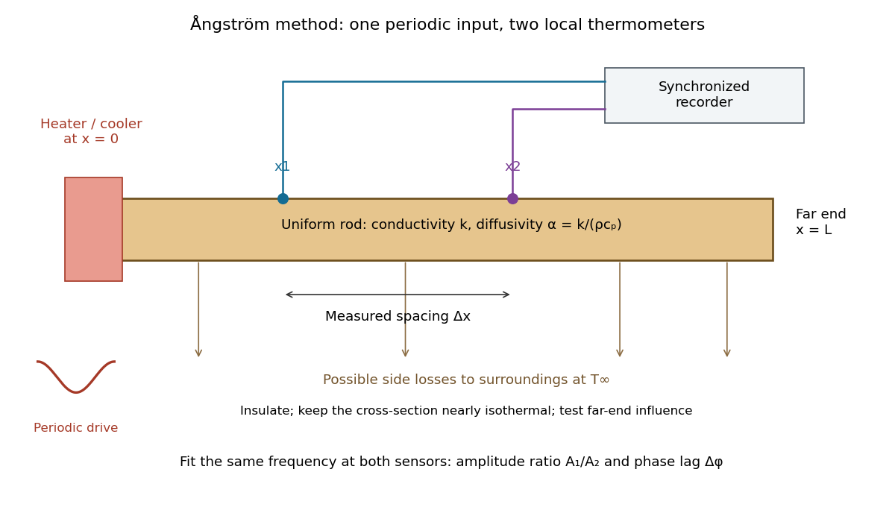

**[Figure 5](#image-angstrom-periodic-heating-method-geometry-spaced-thermometers-and-possible-side-losses). Ångström periodic heating method: geometry, spaced thermometers and possible side losses**. Original idealized rod geometry, rather than a scale reconstruction of the PASCO apparatus. Either a heater/cooler or a heater modulated about a mean input establishes the oscillating [temperature](temperature.md). Sensor spacing fixes the [length](physics.md#length) used in the inference. The two channels must measure the same [angular frequency](lagrangian-mechanics.md#angular-frequency) with calibrated relative [amplitude](wave.md#wave-amplitude) and [wave phase](wave.md#phase-waves).

The appeal is that the rod supplies two complementary clocks: decreasing [amplitude](wave.md#wave-amplitude) measures spatial damping, while increasing [wave phase](wave.md#phase-waves) lag measures delay. Unlike [laser flash analysis](#laser-flash-analysis), which follows a transient after one pulse, this method repeatedly samples a [steady periodic thermal state](#steady-periodic-thermal-state). The timing determines [thermal diffusivity](#thermal-diffusivity) $\alpha$ in $\mathrm{m^2\,s^{-1}}$. To infer [thermal conductivity](#thermal-conductivity) $k$ in $\mathrm{W\,m^{-1}\,K^{-1}}$, also measure or otherwise justify the [mass density](fluid-mechanics.md#density) $\rho$ and [specific heat capacity at constant pressure](#specific-heat-capacity-at-constant-pressure) $c_p$:

$$
k=\rho c_p\alpha.
$$

Here the stationary-solid approximation neglects thermal expansion and mechanical [work](energy.md#work), as in [thermal diffusivity](#thermal-diffusivity). A timing measurement alone cannot distinguish two materials with the same $\alpha$ and different [volumetric heat capacities](#volumetric-heat-capacity).

##### Steady periodic thermal state

↑ **Parent:** [Ångström periodic heating method](#angstrom-periodic-heating-method)

A [steady periodic thermal state](#steady-periodic-thermal-state) repeats each drive period $P$ after the startup transient has decayed. It is time dependent, unlike a time-independent [steady state](dynamical-systems.md#steady-state). For [angular frequency](lagrangian-mechanics.md#angular-frequency) $\omega=2\pi/P$, its single-frequency part has the [phasor](wave.md#phasor) representation $\theta(x,t)=\operatorname{Re}\{\widehat\theta(x)e^{i\omega t}\}$. Here $\theta$ is the oscillating [temperature](temperature.md) about the mean profile. Repeating the fitted [amplitudes](wave.md#wave-amplitude) and [wave phases](wave.md#phase-waves) over successive cycles checks that startup drift is small; merely completing one drive cycle is insufficient.

##### Thermal diffusion wave

↑ **Parent:** [Ångström periodic heating method](#angstrom-periodic-heating-method)

A [thermal diffusion wave](#thermal-diffusion-wave) is a periodically forced solution of the [heat equation](diffusion-equation.md#heat-equation), with spatially decreasing [amplitude](wave.md#wave-amplitude) and varying [wave phase](wave.md#phase-waves). In a semi-infinite rod $x\geq0$, assume constant [thermal diffusivity](#thermal-diffusivity), negligible side losses, a nearly uniform [temperature](temperature.md) across each cross-section, and the [boundary conditions](differential-equation.md#boundary-condition) $\theta(0,t)=\Theta_0\cos\omega t$ and $\theta(x,t)\to0$ as $x\to\infty$. A [steady periodic thermal state](#steady-periodic-thermal-state) then satisfies

$$
\partial_t\theta=\alpha\partial_x^2\theta,\qquad
\widehat\theta(x)=\Theta_0e^{-\gamma x},\qquad
\gamma^2=\frac{i\omega}{\alpha},\qquad
\gamma=a+ib=(1+i)\sqrt{\frac{\omega}{2\alpha}}.
$$

Choose the [square root](algebra.md#square-root) in the [complex numbers](complex-analysis.md#complex-number) with $a>0$ so that the [amplitude](wave.md#wave-amplitude) decays into the rod. Substitution of the [phasor](wave.md#phasor) into the [heat equation](diffusion-equation.md#heat-equation) proves the formula: $i\omega\widehat\theta=\alpha\widehat\theta''$. Taking the real part gives the displayed [cosine](geometry-and-topology.md#cosine). In this convention $a$ is the spatial attenuation slope and $b$ is the spatial lag slope, both in $\mathrm{m^{-1}}$; $\gamma$ combines them into one [complex number](complex-analysis.md#complex-number). If a [complex wavenumber](wave-equation.md#complex-wavenumber) $K$ is defined by $e^{i\omega t-iKx}$ instead, $K=b-ia$.

With $\Delta x=x_2-x_1>0$, let $A_j=|\widehat\theta(x_j)|$ and define a positive downstream lag $\Delta\phi$. Then

$$
D=\log\frac{A_1}{A_2}=a\Delta x,\qquad
\Delta\phi=b\Delta x,\qquad
a=b\quad\text{without side losses},
$$

and either measurement determines [thermal diffusivity](#thermal-diffusivity):

$$
\alpha=\frac{\omega\Delta x^2}{2D^2}
=\frac{\omega\Delta x^2}{2(\Delta\phi)^2}.
$$

The [logarithm](calculus.md#logarithm) uses an [amplitude](wave.md#wave-amplitude) ratio, not a ratio of squared [amplitudes](wave.md#wave-amplitude). The lag is in [radians](geometry-and-topology.md#radian) and must be tracked continuously across cycles: a measured [phase difference](wave.md#phase-difference) modulo $2\pi$ leaves an integer-cycle ambiguity. Use closer sensor spacings or vary [frequency](wave.md#frequency) continuously to resolve that ambiguity. Equal attenuation and lag slopes provide a useful diagnostic of the no-side-loss model.

The apparent [phase velocity](dispersion-relation.md#phase-velocity) is $\omega/b=\sqrt{2\alpha\omega}$, which depends on [frequency](wave.md#frequency). A [thermal diffusion wave](#thermal-diffusion-wave) therefore does not give a material-independent travel speed for [heat](heat.md); it is a forced pattern in a dissipative [diffusion equation](diffusion-equation.md). The ideal [heat equation](diffusion-equation.md#heat-equation) still has [infinite propagation speed](diffusion-equation.md#infinite-propagation-speed), and the observed lag is not the arrival time of a sharp front.

###### Thermal penetration depth

↑ **Parent:** [Thermal diffusion wave](#thermal-diffusion-wave)

For the no-side-loss [thermal diffusion wave](#thermal-diffusion-wave), the [thermal penetration depth](#thermal-penetration-depth) $\delta=1/a=\sqrt{2\alpha/\omega}=\sqrt{\alpha P/\pi}$ is the distance over which the [amplitude](wave.md#wave-amplitude) falls by $e^{-1}$ and the [wave phase](wave.md#phase-waves) lags by one [radian](geometry-and-topology.md#radian). It is a periodic counterpart of the [thermal diffusion length](#thermal-diffusion-length), with its numerical factor fixed by this definition. A shorter period probes a shallower region; a longer period increases sensitivity to the far-end [boundary condition](differential-equation.md#boundary-condition).

<h5 id="angstrom-method-with-linear-heat-loss">Ångström method with linear heat loss</h5>

↑ **Parent:** [Ångström periodic heating method](#angstrom-periodic-heating-method)

Side losses need not destroy the method. Let $\theta$ be the small [temperature](temperature.md) disturbance about a steady background in surroundings at fixed [temperature](temperature.md). For a rod of cross-sectional [area](differential-geometry.md#surface-area) $S$ and perimeter $\mathcal P$, a uniform real surface [heat transfer coefficient](linear-ordinary-differential-equation.md#heat-transfer-coefficient) $h_s$ produces a loss per unit [volume](geometry-and-topology.md#volume) of $H\theta$, with $H=h_s\mathcal P/S$. Assume constant $k,\rho,c_p,H$, a cross-section nearly uniform in [temperature](temperature.md), and no distributed heat source. The balance becomes

$$
\rho c_p\partial_t\theta=k\partial_x^2\theta-H\theta,\qquad
\partial_t\theta=\alpha\partial_x^2\theta-\lambda\theta,\qquad
\lambda=\frac{H}{\rho c_p}\geq0.
$$

Here $H$ has units $\mathrm{W\,m^{-3}\,K^{-1}}$, while $\lambda$ has units $\mathrm{s^{-1}}$. This is a distributed version of [Newton's law of cooling](linear-ordinary-differential-equation.md#newton-s-law-of-cooling); a constant linearized contribution from [thermal radiation](electromagnetic-radiation.md#thermal-radiation) may be included over a small [temperature](temperature.md) range. It does not represent arbitrary time-dependent coupling to a surrounding material with its own thermal storage.

For the decaying exponential branch, the [phasor](wave.md#phasor) equation gives

$$
\gamma^2=\frac{\lambda+i\omega}{\alpha},\qquad
a^2-b^2=\frac{\lambda}{\alpha},\qquad
2ab=\frac{\omega}{\alpha},
$$

so that

$$
a=\sqrt{\frac{\sqrt{\lambda^2+\omega^2}+\lambda}{2\alpha}},\qquad
b=\sqrt{\frac{\sqrt{\lambda^2+\omega^2}-\lambda}{2\alpha}}.
$$

Real positive side loss increases $a$ and decreases $b$ at fixed [angular frequency](lagrangian-mechanics.md#angular-frequency) and [thermal diffusivity](#thermal-diffusivity). Their product eliminates $\lambda$, yielding the combined inference

$$
\boxed{\alpha=\frac{\omega}{2ab}
=\frac{\omega\Delta x^2}{2\log(A_1/A_2)\,\Delta\phi}
=\frac{\Delta x^2}{2\log(A_1/A_2)\,\Delta t}},\qquad
\Delta t=\frac{\Delta\phi}{\omega}.
$$

This result requires that attenuation and lag belong to the same exponential [complex wavenumber](wave-equation.md#complex-wavenumber) at the same [frequency](wave.md#frequency), and that the loss term is real. It does not generally survive a superposition caused by a nearby finite end, spatially varying coefficients, transverse [temperature gradients](#temperature-gradient), or unequal sensor delays. The inferred $\lambda=\alpha(a^2-b^2)$ supplies an additional model check; a negative value signals inconsistency with this passive-loss model rather than negative physical cooling.

<h5 id="angstrom-method-worked-example">Ångström method worked example</h5>

↑ **Parent:** [Ångström periodic heating method](#angstrom-periodic-heating-method)

Consider an original stipulated model, not measured material data: [thermal diffusivity](#thermal-diffusivity) $\alpha=10^{-4}\,\mathrm{m^2\,s^{-1}}$, period $P=100\,\mathrm s$, driven [temperature](temperature.md) [amplitude](wave.md#wave-amplitude) $\Theta_0=4\,\mathrm K$, and [thermometers](temperature.md#thermometer) at $x_1=0.020\,\mathrm m$ and $x_2=0.050\,\mathrm m$. Without side losses, $a=b=17.7245\,\mathrm{m^{-1}}$ and [thermal penetration depth](#thermal-penetration-depth) $\delta=0.05642\,\mathrm m$. Thus

$$
A_1=2.80612\,\mathrm K,\quad A_2=1.64883\,\mathrm K,\quad
D=\Delta\phi=0.531736,\quad\Delta t=8.46284\,\mathrm s.
$$

The two no-loss estimates and the combined estimate all return $10^{-4}\,\mathrm{m^2\,s^{-1}}$.

Now retain the same [thermal diffusivity](#thermal-diffusivity) and drive but introduce $\lambda=0.010\,\mathrm{s^{-1}}$. The exact [complex wavenumber](wave-equation.md#complex-wavenumber) gives $a=19.1863\,\mathrm{m^{-1}}$ and $b=16.3742\,\mathrm{m^{-1}}$, hence

$$
\begin{aligned}
A_1&=2.72527\,\mathrm K,& A_2&=1.53262\,\mathrm K,\\
D&=0.575588,&\Delta\phi&=0.491225\,\mathrm{rad},\\
\Delta t&=7.81809\,\mathrm s,&\alpha_{\rm combined}&=10^{-4}\,\mathrm{m^2\,s^{-1}}.
\end{aligned}
$$

Using attenuation alone with the no-loss formula would give $8.5343\times10^{-5}\,\mathrm{m^2\,s^{-1}}$; using lag alone would give $1.17174\times10^{-4}\,\mathrm{m^2\,s^{-1}}$. Their disagreement is informative. If an independent [volumetric heat capacity](#volumetric-heat-capacity) measurement gives $\rho c_p=2.0\times10^6\,\mathrm{J\,m^{-3}\,K^{-1}}$, the combined estimate implies [thermal conductivity](#thermal-conductivity) $k=200\,\mathrm{W\,m^{-1}\,K^{-1}}$ and $H=2.0\times10^4\,\mathrm{W\,m^{-3}\,K^{-1}}$.

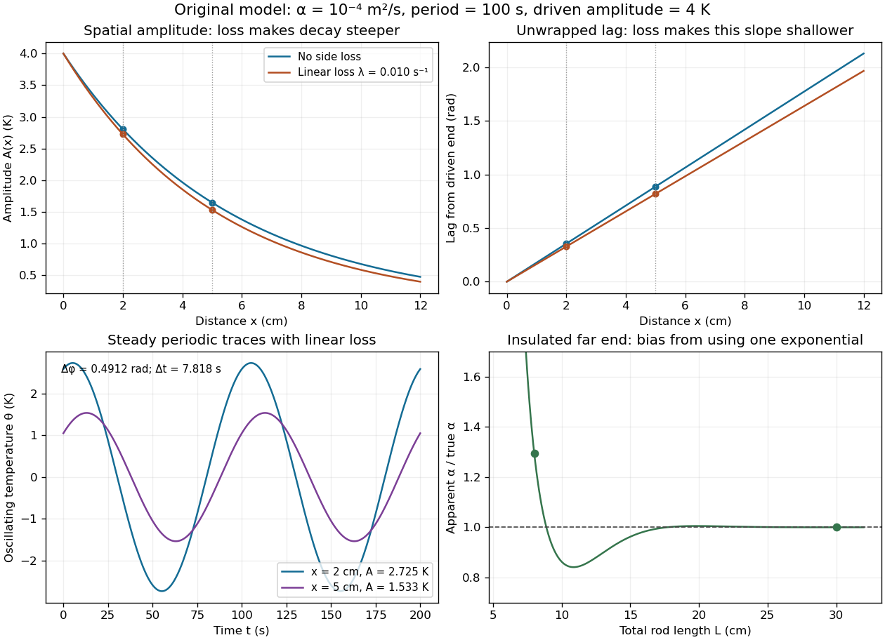

**[Figure 6](#image-solved-angstrom-method-example-spatial-amplitude-wave-phase-lag-time-traces-and-finite-end-bias). Solved Ångström method example: spatial amplitude, wave phase lag, time traces and finite-end bias**. Original analytical predictions using the stipulated parameters above. Dots in the upper panels independently solve the spatial [heat equation](diffusion-equation.md#heat-equation) with [finite differences](finite-difference.md). The lower-left traces show the linear-loss case at the two sensor positions. The lower-right curve applies the semi-infinite inference to an exact finite rod with an insulated far end: the resulting apparent [thermal diffusivity](#thermal-diffusivity) can lie above or below the true value. None of these curves are experimental data.

The exact [complex amplitudes](wave.md#complex-amplitude) can be checked independently by discretizing $\alpha\widehat\theta''-(\lambda+i\omega)\widehat\theta=0$ and solving the resulting [linear system](linear-algebra.md#system-of-linear-equations) with a [tridiagonal matrix](vector-space.md#tridiagonal-matrix). Halving the spatial step quarters the discrepancy, as expected for centered [finite differences](finite-difference.md). Separately fitting the real time traces to a constant plus [sine](geometry-and-topology.md#sine) and [cosine](geometry-and-topology.md#cosine) terms recovers both [amplitudes](wave.md#wave-amplitude) and their lag; this also checks the sign convention used in the combined estimate.

##### Finite-end correction for periodic rod heating

↑ **Parent:** [Ångström periodic heating method](#angstrom-periodic-heating-method)

A finite rod generally contains both exponential branches. With prescribed oscillating [temperature](temperature.md) at $x=0$ and an insulated far end, $\widehat\theta'(L)=0$, the exact solution is

$$
\widehat\theta(x)=\Theta_0\frac{\cosh[\gamma(L-x)]}{\cosh(\gamma L)}
=\Theta_0e^{-\gamma x}\frac{1+e^{-2\gamma(L-x)}}{1+e^{-2\gamma L}}.
$$

The correction near a sensor is controlled by $e^{-2a(L-x)}$. The important separation is between the farther sensor and the end, not merely between the heater and the end. For a far end clamped at the mean [temperature](temperature.md), $\widehat\theta(L)=0$, replace both [hyperbolic cosines](calculus.md#hyperbolic-cosine) by [hyperbolic sines](calculus.md#hyperbolic-sine); other end [boundary conditions](differential-equation.md#boundary-condition) require their corresponding solution.

In the lossy [Ångström method worked example](#angstrom-method-worked-example), an insulated rod of [length](physics.md#length) $L=0.080\,\mathrm m$ gives $D=0.354866$ and $\Delta\phi=0.615651\,\mathrm{rad}$. Incorrectly applying the semi-infinite formula returns $1.29418\times10^{-4}\,\mathrm{m^2\,s^{-1}}$, about $29.4\%$ high. At $L=0.300\,\mathrm m$, it returns $9.99877\times10^{-5}\,\mathrm{m^2\,s^{-1}}$, about $0.0123\%$ low. Side loss remains real in both cases; the error arises because the measured spatial response no longer has one exponential [complex wavenumber](wave-equation.md#complex-wavenumber).

Choose the period and sensor spacing so that the lag and attenuation are resolvable while the downstream signal remains larger than sensor noise. Keep transverse equilibration fast compared with the period; compare the transverse [thermal diffusion time](#thermal-diffusion-time) with $P$ and check that surface exchange does not create large transverse [temperature gradients](#temperature-gradient). A short period reduces far-end influence but can expose sensor response times; a long period increases penetration and finite-end bias. Calibrate both sensors together, exchange their positions to check channel bias, compare successive cycles, and repeat at several spacings and periods. In a valid single-exponential region, [linear regression](linear-regression.md) of $\log A$ against $x$ and unwrapped lag against $x$ should give consistent slopes. These are proposed diagnostic controls. If they fail, fit the finite-rod or coupled-sensor model rather than interpreting every delay as intrinsic [thermal diffusivity](#thermal-diffusivity).

#### Prandtl number

↑ **Parent:** [Thermal diffusivity](#thermal-diffusivity)  
ⓦ [Wiki](https://en.wikipedia.org/wiki/Prandtl_number)

The [Prandtl number](#prandtl-number) is the ratio of [kinematic viscosity](dynamic-viscosity.md#kinematic-viscosity) to [thermal diffusivity](#thermal-diffusivity). It compares the rates at which momentum and [temperature](temperature.md) variations diffuse. In thermal-diffusion units the [Boussinesq equations](geophysical-fluid-dynamics.md#boussinesq-equations) have momentum inertia multiplied by $\operatorname{Pr}^{-1}$; large, rather than small, [Prandtl number](#prandtl-number) supplies the usual instantaneous [Stokes flow](stokes-flow.md) limit.

#### Thermal diffusion time

↑ **Parent:** [Thermal diffusivity](#thermal-diffusivity)

The [thermal diffusion time](#thermal-diffusion-time) $t_D=L^2/\alpha$, with $\alpha=\kappa$ the [thermal diffusivity](#thermal-diffusivity), is a characteristic scale for smoothing a [temperature](temperature.md) variation over [length](physics.md#length) $L$. It is the thermal instance of the [diffusive time scale](diffusion-equation.md#diffusive-time-scale). Rescaling $x=L\widehat x$ and $t=(L^2/\alpha)\widehat t$ removes $L$ and $\alpha$ from the constant-coefficient [heat equation](diffusion-equation.md#heat-equation). Doubling [length](physics.md#length) therefore multiplies comparable internal equilibration times by four; increasing [thermal diffusivity](#thermal-diffusivity) by four divides them by four.

This scale is not a universal time of complete [thermal equilibrium](thermal-equilibrium.md). A nonzero [Fourier mode](fourier-analysis.md#fourier-mode) decays exponentially and never becomes exactly zero at finite time. The geometry, [boundary conditions](differential-equation.md#boundary-condition), initial pattern and accepted residual determine the numerical factor. For example, an insulated bar's slowest nonuniform [Fourier mode](fourier-analysis.md#fourier-mode) has decay time $L^2/(\pi^2\alpha)$, and reducing its amplitude to a fraction $\varepsilon$ requires

$$
t_\varepsilon=\frac{L^2}{\pi^2\alpha}\log\frac1\varepsilon,
\qquad 0<\varepsilon<1.
$$

External [heat transfer](#heat-transfer) can impose a longer cooling time even when internal [temperature](temperature.md) differences smooth quickly. [Thermal diffusivity](#thermal-diffusivity) alone does not determine cooling to the room's [temperature](temperature.md).

##### Thermal diffusion rate of a Fourier mode

↑ **Parent:** [Thermal diffusion time](#thermal-diffusion-time)

With [thermal diffusivity](#thermal-diffusivity) $\xi$, a [Fourier mode](fourier-analysis.md#fourier-mode) of angular [wavenumber](wave-equation.md#wavenumber) $k$ decays at rate $\beta=\xi k^2$. To avoid confusing this $k$ with [thermal conductivity](#thermal-conductivity), use $\alpha=\xi$ and angular [wavenumber](wave-equation.md#wavenumber) $K$ below: the same rate is $\beta=\alpha K^2$, with units $\mathrm{s^{-1}}$.

Consider an insulated bar $0\leq x\leq L$ with constant [thermal diffusivity](#thermal-diffusivity), no sources and no [heat flux](#heat-flux-density) through either end or the sides. An original initial [temperature](temperature.md) profile and its exact evolution are

$$
T(x,0)=\overline T+A_0\cos\frac{n\pi x}{L},\qquad
T(x,t)=\overline T+A_0e^{-\alpha K_n^2t}\cos\frac{n\pi x}{L},\qquad
K_n=\frac{n\pi}{L},\quad n=1,2,\ldots.
$$

The [cosine](geometry-and-topology.md#cosine) has zero [temperature gradient](#temperature-gradient) at both ends, satisfying the insulated [Neumann boundary conditions](differential-equation.md#neumann-boundary-condition). Its spatial mean is zero, so [conservation of energy](mathematical-physics.md#conservation-of-energy) leaves the mean [temperature](temperature.md) $\overline T$ unchanged while the nonuniform part disappears. A short derivation substitutes $T=\overline T+A(t)\cos(K_nx)$ into the [heat equation](diffusion-equation.md#heat-equation): the second spatial [derivative](calculus.md#derivative) supplies $-K_n^2$, hence $A'=-\alpha K_n^2A$. The [exponential decay](analysis.md#exponential-decay) time is $\tau_n=1/(\alpha K_n^2)$; doubling angular [wavenumber](wave-equation.md#wavenumber) quarters this time. If cycles-per-[length](physics.md#length) [spatial frequency](fourier-analysis.md#spatial-frequency) $f_x$ is used instead, $K=2\pi f_x$ and the rate is $4\pi^2\alpha f_x^2$.

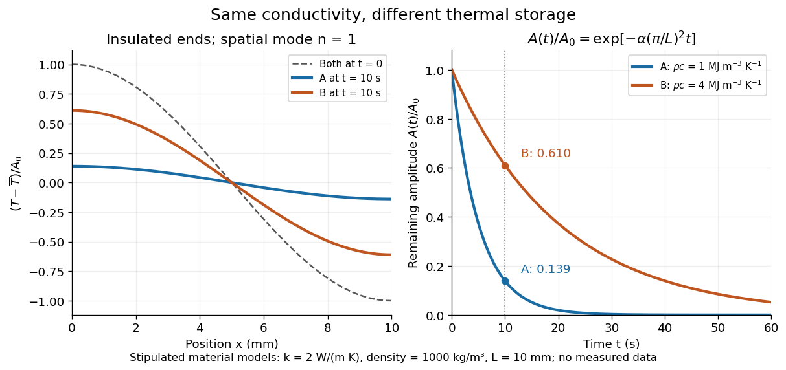

**[Figure 7](#image-insulated-bar-fourier-mode-decay-equal-thermal-conductivity-different-heat-capacities). Insulated-bar Fourier mode decay: equal thermal conductivity, different heat capacities**. Original constant-property model with $L=0.010\,\mathrm m$ and $n=1$. The normalized initial [temperature](temperature.md) profile is identical for both stipulated materials in [thermal diffusivity](#thermal-diffusivity). The larger [volumetric heat capacity](#volumetric-heat-capacity) gives a smaller [thermal diffusivity](#thermal-diffusivity) and four times the decay time. Profiles at $t=10\,\mathrm s$ and amplitude histories are analytical predictions, not measured records.

For the two model materials in [thermal diffusivity](#thermal-diffusivity) and $L=0.010\,\mathrm m$, $\tau_{1,A}\approx5.07\,\mathrm s$ and $\tau_{1,B}\approx20.3\,\mathrm s$. After $10\,\mathrm s$, the remaining amplitude fractions are approximately $0.139$ and $0.610$. A narrow hot-and-cold pattern disappears faster than a broad one because its [temperature](temperature.md) curvature, and hence the imbalance in conductive [heat flux](#heat-flux-density), is larger.

##### Thermal diffusion length

↑ **Parent:** [Thermal diffusion time](#thermal-diffusion-time)

The [thermal diffusion length](#thermal-diffusion-length) $\ell(t)=\sqrt{\alpha t}$ is the characteristic [length](physics.md#length) over which [thermal conduction](#thermal-conduction) changes a [temperature](temperature.md) distribution during time $t$ in the constant-[thermal diffusivity](#thermal-diffusivity) model. It is a scale, not a sharp front or distance travelled at a constant speed: the [heat equation](diffusion-equation.md#heat-equation) has [infinite propagation speed](diffusion-equation.md#infinite-propagation-speed) mathematically. Different definitions of penetration depth introduce numerical factors. In particular, the normalized one-dimensional [heat kernel](diffusion-equation.md#heat-kernel) has spatial [variance](variance.md) $2\alpha t$, so its root-mean-square width is $\sqrt{2\alpha t}$.

**[Figure 8](#image-thermal-diffusion-length-grows-as-the-square-root-of-time-thermal-diffusion-time-grows-as-length-squared). Thermal diffusion length grows as the square root of time; thermal diffusion time grows as length squared**. Original predictions for the two stipulated materials in [thermal diffusivity](#thermal-diffusivity). Left: $\ell=\sqrt{\alpha t}$, with four times the time needed to double [length](physics.md#length). Right: $t_D=L^2/\alpha$ on logarithmic axes. Equal [thermal conductivity](#thermal-conductivity) with four times the [volumetric heat capacity](#volumetric-heat-capacity) halves the reached [length](physics.md#length) at a given time and quadruples the time at a given [length](physics.md#length). The scale $t_D$ differs from the insulated-bar decay time by the factor $\pi^2$.

At $t=10\,\mathrm s$, the model materials have [thermal diffusion lengths](#thermal-diffusion-length) $4.47$ and $2.24\,\mathrm{mm}$. For $L=10\,\mathrm{mm}$ their [thermal diffusion times](#thermal-diffusion-time) are $50$ and $200\,\mathrm s$. These values describe the same [heat equation](diffusion-equation.md#heat-equation) as the [thermal diffusion rate of a Fourier mode](#thermal-diffusion-rate-of-a-fourier-mode); the different numerical factors come from the definition of the scale.

#### Laser flash analysis

↑ **Parent:** [Thermal diffusivity](#thermal-diffusivity)  
ⓦ [Wiki](https://en.wikipedia.org/wiki/Laser_flash_analysis)

[Laser flash analysis](#laser-flash-analysis) measures [thermal diffusivity](#thermal-diffusivity) by heating one face of a specimen briefly and recording the opposite face's [temperature](temperature.md) rise. The original 1961 experiment used a flash tube rather than a [laser](laser.md): a blackened thin metal specimen sat in an opaque ceramic holder, with [thermocouple](thermoelectric-effect.md#thermocouple) wires pressed against its rear face. An amplifier, oscilloscope and camera recorded the signal. Uniform front illumination and the black coating promoted uniform absorption; the opaque low-[thermal conductivity](#thermal-conductivity) holder blocked direct rear illumination and reduced edge losses. The delayed rear response reveals internal [thermal conduction](#thermal-conduction) rather than direct heating of the sensor. [Parker, Jenkins, Butler and Abbott, pp. 1682–1683, Experimental Procedure and figure 3: holder, flash, thermocouple and recording chain](physics-bibliography.md#flash-method-of-determining-thermal-diffusivity-heat-capacity-and-thermal-conductivity-by-w-j-parker-and-others)

A modern version uses a [laser](laser.md) or flash lamp, a specimen of measured thickness $L$, controlled initial [temperature](temperature.md), and a rear-facing [infrared](optics.md#infrared) detector with a synchronized recorder. The readout is a [temperature](temperature.md) rise versus time, starting from a pre-pulse baseline. [Thermal conductivity](#thermal-conductivity) additionally requires [mass density](fluid-mechanics.md#density) and [specific heat capacity](#specific-heat-capacity); it is not obtained from timing alone. [NETZSCH, Principle of the LFA Method: opposite-face infrared readout and conductivity product](physics-bibliography.md#light-and-laser-flash-analyzers-by-netzsch-analyzing-and-testing)

Under ideal one-dimensional, insulated, constant-property assumptions, instantaneous uniform absorption in a very thin front layer gives the normalized rear rise

$$
R(t)=\frac{T(L,t)-T_0}{T_\infty-T_0}
=1+2\sum_{n=1}^{\infty}(-1)^n
\exp\left(-\frac{n^2\pi^2\alpha t}{L^2}\right),\qquad t>0.
$$

Here $T_0$ is the initial uniform [temperature](temperature.md) and $T_\infty$ is the final uniform [temperature](temperature.md) in the insulated model. Fitting this curve estimates [thermal diffusivity](#thermal-diffusivity); each term has the same $\alpha K_n^2$ decay as the insulated-bar [Fourier modes](fourier-analysis.md#fourier-mode). Equivalently, the half-rise time $t_{1/2}$ solves $R(t_{1/2})=1/2$. Writing $s=\alpha t/L^2$, the series gives $s_{1/2}\approx0.13879$, hence

$$
\alpha\approx0.13879\frac{L^2}{t_{1/2}}.
$$

This coefficient comes from the stated ideal [heat equation](diffusion-equation.md#heat-equation) solution, not from an empirical sensor calibration. It has been independently checked by solving the series equation. Absolute absorbed pulse [energy](energy.md) cancels from the normalized curve; determining [heat capacity](#heat-capacity) from its absolute height needs additional information. [Carr, section 2, equations (4)–(7): rear-face series, half-rise time and corrected dimensionless constant 1.370](physics-bibliography.md#rear-surface-integral-method-for-calculating-thermal-diffusivity-from-laser-flash-experiments-by-elliot-j-carr)

Parker and colleagues identify finite flash duration, [heat](heat.md) loss, nonuniform illumination, recording bandwidth and electrical interference as practical limits. A specimen too thin responds during the pulse; one too thick allows losses before the rear rise finishes. They shielded the electrical chain and recorded a baseline; their reported tests were preliminary metal measurements near ambient and moderately elevated [temperatures](temperature.md). [Parker and colleagues, pp. 1682–1684: signal distortion, shielding, thickness tradeoff and Conclusions](physics-bibliography.md#flash-method-of-determining-thermal-diffusivity-heat-capacity-and-thermal-conductivity-by-w-j-parker-and-others)

Useful additional controls are to measure thickness at several points, verify the recorder's time scale and detector response independently, record a no-pulse baseline, and repeat at different pulse [energies](energy.md) while avoiding [phase transitions](critical-phenomenon.md#phase-transition). Compare different thicknesses of the same homogeneous material: ideal half-rise times scale as $L^2$. Failure of these checks can expose finite-pulse effects, sensor delay, optical transmission, coating storage or edge losses; a thickness error is especially consequential because the inferred [thermal diffusivity](#thermal-diffusivity) depends on $L^2$. These are proposed diagnostic controls, not invented measurements. When the pulse is not short or the sample exchanges appreciable [heat](heat.md) with its surroundings, fit a model that includes those effects instead of applying the ideal half-rise coefficient unchanged.

<h2 id="stefan-boltzmann-law">Stefan–Boltzmann law</h2>

↑ **Parent:** [Heat](heat.md)  
ⓦ [Wiki](https://en.wikipedia.org/wiki/Stefan–Boltzmann_law)

The [Stefan–Boltzmann law](#stefan-boltzmann-law) gives the total hemispherical [radiant exitance](radiometry.md#radiant-exitance) of an ideal [blackbody](astrophysics.md#blackbody) at absolute [temperature](temperature.md) $T$:

$$
M_b(T)=\sigma T^4,\qquad [M_b]=\mathrm{W\,m^{-2}}.
$$

Here $\sigma$ is the [Stefan-Boltzmann constant](#stefan-boltzmann-constant). Total means integrated over all [wavelengths](wave-equation.md#wavelength); hemispherical means integrated over all outward directions with the [projected area](radiometry.md#projected-area) weighting. Thus $M_b$ is emitted [power](energy.md#power) per actual emitting [area](differential-geometry.md#surface-area), rather than directional [radiance](radiometry.md#radiance) or [spectral radiance](radiometry.md#spectral-radiance). Absolute [temperature](temperature.md) must be in [kelvin](temperature.md#kelvin); raising a Celsius reading to the fourth power gives the wrong result. A uniform surface of [area](differential-geometry.md#surface-area) $A$ emits [radiant flux](radiometry.md#radiant-flux) $P_{\rm emit}=AM_b$. A real surface instead has $M=\epsilon(T)\sigma T^4$, where $\epsilon(T)$ is its [total hemispherical emissivity](#total-hemispherical-emissivity). The older symbol $F$ in the formula above denotes this emitted [radiant exitance](radiometry.md#radiant-exitance).[§19.1, Ideal Radiators: blackbody emitted power per area, units, spectrum and cavity](physics-bibliography.md#thermodynamics-and-propulsion)

For an ideal [blackbody](astrophysics.md#blackbody), doubling absolute [temperature](temperature.md) multiplies [radiant exitance](radiometry.md#radiant-exitance) by $16$. With the approximate [Stefan-Boltzmann constant](#stefan-boltzmann-constant) $5.670374419\times10^{-8}\,\mathrm{W\,m^{-2}\,K^{-4}}$, the [radiant exitances](radiometry.md#radiant-exitance) at $300\,\mathrm K$ and $600\,\mathrm K$ are approximately $459.300$ and $7348.805\,\mathrm{W\,m^{-2}}$. This steep response explains why [thermal radiation](electromagnetic-radiation.md#thermal-radiation) becomes so consequential at high [temperature](temperature.md). It also enables [heat transfer](#heat-transfer) through a [vacuum](physics.md#vacuum), where [thermal conduction](#thermal-conduction) through a gas and [convection](convection.md) are absent.

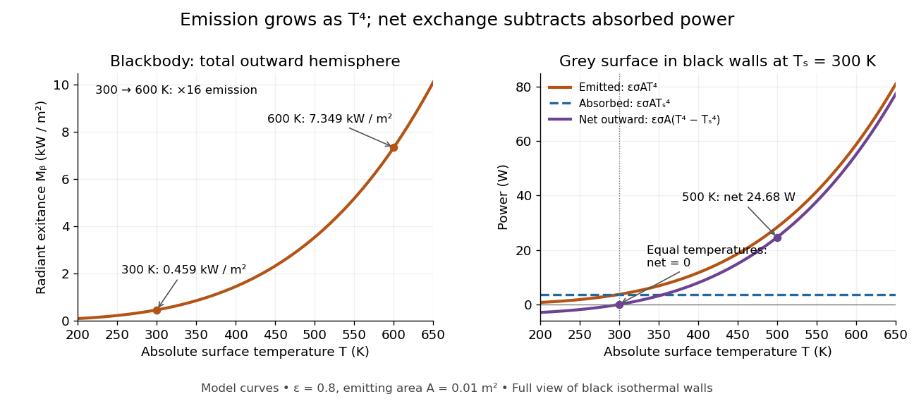

**[Figure 9](#image-the-fourth-power-rise-of-radiant-exitance-and-the-subtraction-needed-for-net-radiative-heat-exchange). The fourth-power rise of radiant exitance and the subtraction needed for net radiative heat exchange**. Original model curves. The left panel is total hemispherical [blackbody](astrophysics.md#blackbody) [radiant exitance](radiometry.md#radiant-exitance). The right panel uses [emissivity](#emissivity) $0.8$, emitting [area](differential-geometry.md#surface-area) $0.01\,\mathrm{m^2}$ and a black enclosure at $300\,\mathrm K$; gross emitted and absorbed [powers](energy.md#power) remain positive at equal [temperatures](temperature.md), while their difference vanishes. The point at $500\,\mathrm K$ is the stipulated example in [net radiative heat exchange](#net-radiative-heat-exchange), not a measurement.

A short derivation integrates [Planck's law](statistical-physics.md#planck-s-law) in its [frequency](wave.md#frequency) form. For a [blackbody](astrophysics.md#blackbody), direction-independent [spectral radiance](radiometry.md#spectral-radiance) is $B_\nu(T)=2h\nu^3/[c^2(e^{h\nu/(k_BT)}-1)]$, where $h$ is the [Planck constant](quantum-mechanics.md#planck-constant), $k_B$ the [Boltzmann constant](thermodynamics.md#boltzmann-constant) and $c$ the [speed of light](special-relativity.md#speed-of-light). The outward [hemisphere](euclidean-geometry.md#hemisphere) contributes $\int\cos\theta\,d\Omega=\pi$, so

$$
M_b=\pi\int_0^\infty B_\nu(T)\,d\nu
=\frac{2\pi k_B^4T^4}{h^3c^2}\int_0^\infty\frac{x^3}{e^x-1}\,dx,
\qquad x=\frac{h\nu}{k_BT}.
$$

Expanding $(e^x-1)^{-1}=\sum_{n=1}^\infty e^{-nx}$, nonnegative terms allow termwise [integration](integral.md). Repeated [integration by parts](calculus.md#integration-by-parts) gives $\int_0^\infty x^3e^{-nx}\,dx=6/n^4$; the [Riemann zeta function](analytic-number-theory.md#riemann-zeta-function) value $\zeta(4)=\pi^4/90$ gives the remaining [integral](integral.md) as $\pi^4/15$. Hence $M_b=\sigma T^4$ with the coefficient in [Stefan-Boltzmann constant](#stefan-boltzmann-constant). The angular [integral](integral.md) is essential: omitting it confuses [radiance](radiometry.md#radiance) with [radiant exitance](radiometry.md#radiant-exitance).

### Net radiative heat exchange

↑ **Parent:** [Stefan–Boltzmann law](#stefan-boltzmann-law)

For a small, uniform surface at [temperature](temperature.md) $T$, enclosed by much larger black walls all at [temperature](temperature.md) $T_s$, the outward net [heat transfer](#heat-transfer) by [thermal radiation](electromagnetic-radiation.md#thermal-radiation) is

$$
\dot Q_{\rm rad}=\epsilon\sigma A(T^4-T_s^4).
$$

Assume an opaque [grey body](#grey-body) that is a [diffuse thermal emitter](#diffuse-thermal-emitter), with the same [emissivity](#emissivity) $\epsilon$ and [radiometric absorptance](radiometry.md#radiometric-absorptance) at the surface's current [temperature](temperature.md). Its emitting [area](differential-geometry.md#surface-area) $A$ sees only the enclosure: the [view factor](#view-factor) to the walls is one, with no self-viewing surface, opening or intervening obstruction. The intervening medium must neither absorb nor emit appreciable [thermal radiation](electromagnetic-radiation.md#thermal-radiation); a [vacuum](physics.md#vacuum) supplies a useful idealization. The enclosure is maintained at uniform $T_s$. The small-body assumption makes that reservoir description physically reasonable; genuinely black isothermal walls supply the incoming [irradiance](radiometry.md#irradiance) even without an infinite area ratio. Positive $\dot Q_{\rm rad}$ means net loss by the surface; negative means net gain. This expression counts [thermal radiation](electromagnetic-radiation.md#thermal-radiation) alone, not all [heat transfer](#heat-transfer).[§19.1, cavity irradiance; §19.2, grey-body absorptance/emittance; §19.4, enclosed-body view factor one](physics-bibliography.md#thermodynamics-and-propulsion)

The reasoning is a two-way [energy](energy.md) balance. Black walls supply [irradiance](radiometry.md#irradiance) $E=\sigma T_s^4$, so the surface absorbs $P_{\rm abs}=\epsilon AE$ and emits $P_{\rm emit}=\epsilon A\sigma T^4$. Subtract these to obtain $\dot Q_{\rm rad}$. For an opaque surface the remaining fraction $1-\epsilon$ of incoming [radiant flux](radiometry.md#radiant-flux) is reflected; counting emitted plus reflected outgoing [radiant flux](radiometry.md#radiant-flux) minus total incoming [radiant flux](radiometry.md#radiant-flux) gives the same result. [Kirchhoff's law of thermal radiation](astrophysics.md#kirchhoff-s-law-of-thermal-radiation) justifies equal spectral absorption and emission factors; the [grey body](#grey-body) assumption lets one factor be taken outside both spectral [integrals](integral.md).

Choose $\epsilon=0.8$, $A=0.01\,\mathrm{m^2}$, $T=500\,\mathrm K$ and $T_s=300\,\mathrm K$. These are stipulated model inputs, not measured material properties. Using $\sigma\approx5.670374419\times10^{-8}\,\mathrm{W\,m^{-2}\,K^{-4}}$ gives

$$
P_{\rm emit}\approx28.3519\,\mathrm W,\qquad
P_{\rm abs}\approx3.6744\,\mathrm W,\qquad
\dot Q_{\rm rad}\approx24.6775\,\mathrm W.
$$

The incoming [irradiance](radiometry.md#irradiance) is $459.300\,\mathrm{W\,m^{-2}}$, corresponding to $4.5930\,\mathrm W$ incident on the surface; only $80\%$ is absorbed. At $T=T_s=300\,\mathrm K$, emitted and absorbed [powers](energy.md#power) are both $3.6744\,\mathrm W$, so [radiative equilibrium](#radiative-equilibrium) has zero net exchange despite continuing emission. Changing only [emissivity](#emissivity) to $0.2$ reduces both one-way [powers](energy.md#power) and the net loss by a factor of four, giving $6.1694\,\mathrm W$ net. A low-[emissivity](#emissivity) coating therefore suppresses both radiative cooling to colder walls and radiative heating from hotter walls.

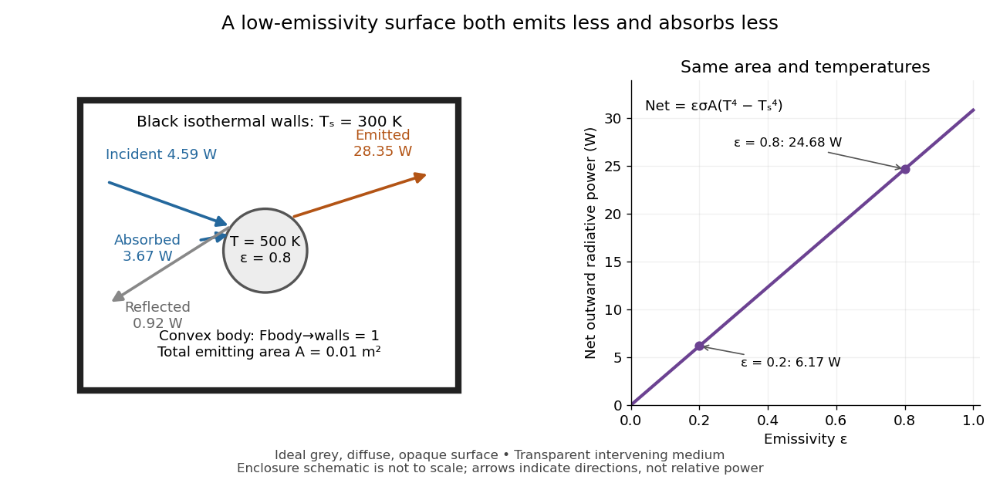

**[Figure 10](#image-two-way-exchange-in-a-black-enclosure-and-the-effect-of-emissivity). Two-way exchange in a black enclosure and the effect of emissivity**. Original schematic, not an experimental apparatus. The central convex body has total emitting [area](differential-geometry.md#surface-area) $0.01\,\mathrm{m^2}$, [temperature](temperature.md) $500\,\mathrm K$ and [view factor](#view-factor) one to black walls at $300\,\mathrm K$. Arrows show gross emission, absorbed enclosure radiation and reflected enclosure radiation for [emissivity](#emissivity) $0.8$; widths are illustrative. The graph compares stipulated [emissivities](#emissivity) under the same geometry and [temperatures](temperature.md).

Near equal [temperatures](temperature.md), write $T=T_s+\Delta T$. [Taylor's theorem](calculus.md#taylor-s-theorem) gives

$$
\dot Q_{\rm rad}=4\epsilon\sigma AT_s^3\Delta T+O((\Delta T)^2),
\qquad h_{\rm rad}=4\epsilon\sigma T_s^3.
$$

For constant [emissivity](#emissivity), the radiative [heat transfer coefficient](linear-ordinary-differential-equation.md#heat-transfer-coefficient) $h_{\rm rad}$ is approximately $4.8992\,\mathrm{W\,m^{-2}\,K^{-1}}$ at $T_s=300\,\mathrm K$ and $\epsilon=0.8$. This local linear approximation is useful for small [temperature](temperature.md) differences; the $200\,\mathrm K$ difference in the worked example needs the full fourth-power expression.

A cooling experiment requires a wider [first law of thermodynamics](first-law-of-thermodynamics.md) balance. In a uniform-[temperature](temperature.md) model without a heater,

$$
C(T)\frac{dT}{dt}=-\dot Q_{\rm rad}-\dot Q_{\rm conv}-\dot Q_{\rm cond},
$$

where $C(T)$ is the sample's [heat capacity](#heat-capacity) and the last two terms are signed outward [convection](convection.md) and [thermal conduction](#thermal-conduction) losses. A [vacuum](physics.md#vacuum) suppresses [convection](convection.md) but does not eliminate [thermal conduction](#thermal-conduction) through supports or sensor leads. A cooling slope therefore cannot establish [emissivity](#emissivity) unless these paths and [heat capacity](#heat-capacity) are independently constrained. Multiple wall [temperatures](temperature.md), incomplete [view factors](#view-factor), wavelength-selective materials or appreciable intervening absorption require a more complete [radiative transfer](astrophysics.md#radiative-transfer) calculation.

#### View factor

↑ **Parent:** [Net radiative heat exchange](#net-radiative-heat-exchange)  
ⓦ [Wiki](https://en.wikipedia.org/wiki/View_factor)

The [view factor](#view-factor) $F_{i\to j}$ is the fraction of uniformly distributed, diffuse outgoing [radiant flux](radiometry.md#radiant-flux) from surface $i$ that directly reaches surface $j$. It depends on geometry, including obstruction, rather than on [temperature](temperature.md) or [emissivity](#emissivity). All destinations in a closed enclosure have fractions summing to one. For a convex body fully enclosed by walls, $F_{\rm body\to walls}=1$; the reverse [view factor](#view-factor) is generally smaller. Reciprocity gives $A_iF_{i\to j}=A_jF_{j\to i}$. Two unobstructed spheres with outer [radius](topology.md#radius) ten times the inner [radius](topology.md#radius) have $F_{\rm inner\to outer}=1$ and $F_{\rm outer\to inner}=1/100$. Do not multiply both directions by an assumed identical [view factor](#view-factor).[§19.4, equations 19.4 and following reciprocity relation; §19.4.1, concentric spheres](physics-bibliography.md#thermodynamics-and-propulsion)

### Stefan-Boltzmann constant

↑ **Parent:** [Stefan–Boltzmann law](#stefan-boltzmann-law)

The [Stefan-Boltzmann constant](#stefan-boltzmann-constant) converts the fourth power of absolute [temperature](temperature.md) into [blackbody](astrophysics.md#blackbody) [radiant exitance](radiometry.md#radiant-exitance):

$$
\sigma=\frac{2\pi^5k_B^4}{15h^3c^2}
\approx5.670374419\times10^{-8}\,\mathrm{W\,m^{-2}\,K^{-4}}.
$$

Here $k_B$ is the [Boltzmann constant](thermodynamics.md#boltzmann-constant), $h$ the [Planck constant](quantum-mechanics.md#planck-constant) and $c$ the [speed of light](special-relativity.md#speed-of-light). In the current [International System of Units](physics.md#international-system-of-units), these three constants have exact defining values, so $\sigma$ is exact as an expression in them and $\pi$. The displayed finite decimal is an approximation, not an exact decimal or a measured uncertainty. The 2022 recommended-constants table lists an ellipsis and an exact uncertainty for $\sigma$.[2022 table, Stefan-Boltzmann constant row; Boltzmann constant, Planck constant and speed of light in vacuum rows](chemistry-bibliography.md#fundamental-physical-constants-complete-listing-by-national-institute-of-standards-and-technology-and-others)

A dimensional check uses $[k_B]=\mathrm{J\,K^{-1}}$, $[h]=\mathrm{J\,s}$ and $[c]=\mathrm{m\,s^{-1}}$. Consequently $[k_B^4/(h^3c^2)]=\mathrm{J\,s^{-1}\,m^{-2}\,K^{-4}}=\mathrm{W\,m^{-2}\,K^{-4}}$, exactly the units needed in the [Stefan–Boltzmann law](#stefan-boltzmann-law).

For an equilibrium [photon gas](statistical-physics.md#photon-gas), the [energy density](statistical-physics.md#energy-density) is $u=a_{\rm rad}T^4$ with [radiation constant](astrophysics.md#radiation-constant) $a_{\rm rad}=4\sigma/c$. The [radiation pressure](pressure.md#radiation-pressure) is $p_{\rm rad}=u/3=4\sigma T^4/(3c)$. These describe the radiation filling an equilibrium cavity; $u$ has units $\mathrm{J\,m^{-3}}$, whereas the outward [radiant exitance](radiometry.md#radiant-exitance) through a small opening is $cu/4$. The factor $1/4$ comes from averaging propagation directions and their [projected area](radiometry.md#projected-area) over a radiation field with [isotropy](continuum-mechanics.md#isotropy), not from reducing the opening's [emissivity](#emissivity).

### Emissivity

↑ **Parent:** [Stefan–Boltzmann law](#stefan-boltzmann-law)  
ⓦ [Wiki](https://en.wikipedia.org/wiki/Emissivity)

[Emissivity](#emissivity) compares thermal emission from a surface with emission from an ideal [blackbody](astrophysics.md#blackbody) at the same absolute [temperature](temperature.md), using the same [wavelength](wave-equation.md#wavelength) and angular averaging convention. For ordinary passive surfaces in the far field at local [thermal equilibrium](thermal-equilibrium.md), the ratio lies between zero and one. A [blackbody](astrophysics.md#blackbody) has [emissivity](#emissivity) one. Unless a spectral or directional qualification is given, the $\epsilon$ in $M=\epsilon\sigma T^4$ is [total hemispherical emissivity](#total-hemispherical-emissivity): a ratio of emitted [radiant exitances](radiometry.md#radiant-exitance), not of all outgoing [radiant flux](radiometry.md#radiant-flux) including reflected radiation.[§19.2, definition of emittance and equilibrium absorption/emission balance](physics-bibliography.md#thermodynamics-and-propulsion)

[Emissivity](#emissivity) belongs to a specified surface state, not just a bulk material name. Coating, oxidation and surface finish can change it; [wavelength](wave-equation.md#wavelength), viewing direction and [temperature](temperature.md) also matter. A surface that looks white in visible [light](optics.md#light) need not have low [infrared](optics.md#infrared) [emissivity](#emissivity). This distinction is useful when choosing a radiator coating or interpreting a radiation-based [temperature](temperature.md) measurement: a narrow-band detector needs the appropriate [spectral emissivity](#spectral-emissivity), and its signal can include reflected surrounding radiation. The [grey body](#grey-body) and [diffuse thermal emitter](#diffuse-thermal-emitter) assumptions are separate simplifications, addressing [wavelength](wave-equation.md#wavelength) and direction respectively.

#### Total hemispherical emissivity

↑ **Parent:** [Emissivity](#emissivity)

[Total hemispherical emissivity](#total-hemispherical-emissivity) integrates over all emitted [wavelengths](wave-equation.md#wavelength) and the outward [hemisphere](euclidean-geometry.md#hemisphere). If $\epsilon_{\lambda,\Omega}$ is [spectral emissivity](#spectral-emissivity) resolved by direction, and $B_\lambda(T)$ is [blackbody](astrophysics.md#blackbody) [spectral radiance](radiometry.md#spectral-radiance) from [Planck's law](statistical-physics.md#planck-s-law), then

$$
\epsilon(T)=\frac{\displaystyle\int_0^\infty\!\int_{\Omega_{\rm outward}}
\epsilon_{\lambda,\Omega}(T)B_\lambda(T)\cos\theta\,d\Omega\,d\lambda}{\sigma T^4}.
$$

It is a weighted average, not an unweighted mean of surface properties. Even if the wavelength-resolved material response stays unchanged, the [Planck's law](statistical-physics.md#planck-s-law) weighting changes with [temperature](temperature.md), so the total ratio can change. Likewise, total [radiometric absorptance](radiometry.md#radiometric-absorptance) averaged over radiation from hotter surroundings generally differs from this emission-weighted ratio. [Kirchhoff's law of thermal radiation](astrophysics.md#kirchhoff-s-law-of-thermal-radiation) equates matched spectral and directional quantities; it does not equate arbitrary broadband averages.

#### Spectral emissivity

↑ **Parent:** [Emissivity](#emissivity)

[Spectral emissivity](#spectral-emissivity) compares emission with an ideal [blackbody](astrophysics.md#blackbody) at the same [temperature](temperature.md) at a specified [wavelength](wave-equation.md#wavelength), or [frequency](wave.md#frequency) under a consistently transformed convention. A hemispherical [spectral emissivity](#spectral-emissivity) uses spectral [radiant exitance](radiometry.md#radiant-exitance); a directional [spectral emissivity](#spectral-emissivity) uses [spectral radiance](radiometry.md#spectral-radiance). Always state which angular convention applies. A wavelength-selective coating can emit strongly in one band while emitting weakly elsewhere, so one band measurement does not determine [total hemispherical emissivity](#total-hemispherical-emissivity).

#### Directional emissivity

↑ **Parent:** [Emissivity](#emissivity)

[Directional emissivity](#directional-emissivity) is the ratio of emitted [radiance](radiometry.md#radiance) to [blackbody](astrophysics.md#blackbody) [radiance](radiometry.md#radiance) at the same [temperature](temperature.md) in a specified outgoing direction. It can be total over [wavelength](wave-equation.md#wavelength) or additionally spectrally resolved. Normal-direction [emissivity](#emissivity) is not automatically [total hemispherical emissivity](#total-hemispherical-emissivity): the latter integrates all directions with the [projected area](radiometry.md#projected-area) weighting. A [diffuse thermal emitter](#diffuse-thermal-emitter) removes this directional dependence of emitted [radiance](radiometry.md#radiance).

#### Grey body

↑ **Parent:** [Emissivity](#emissivity)

A [grey body](#grey-body) has [spectral emissivity](#spectral-emissivity) independent of [wavelength](wave-equation.md#wavelength) over the range in which the approximation is used. Under [Kirchhoff's law of thermal radiation](astrophysics.md#kirchhoff-s-law-of-thermal-radiation), the corresponding [radiometric absorptance](radiometry.md#radiometric-absorptance) is also wavelength-independent. This allows the same factor to weight emission at $T$ and black-enclosure irradiation at a different $T_s$ in [net radiative heat exchange](#net-radiative-heat-exchange). The factor can still depend on [temperature](temperature.md); treating it as constant over a cooling curve is an additional assumption. Wavelength independence alone does not imply direction independence.[§19.2, final paragraph: wavelength-independent absorption and emission factors](physics-bibliography.md#thermodynamics-and-propulsion)

#### Diffuse thermal emitter

↑ **Parent:** [Emissivity](#emissivity)

A [diffuse thermal emitter](#diffuse-thermal-emitter) has emitted [radiance](radiometry.md#radiance) independent of outgoing direction over the outward [hemisphere](euclidean-geometry.md#hemisphere). Its emitted [radiant intensity](radiometry.md#radiant-intensity) from a planar patch still varies with viewing [angle](geometry-and-topology.md#angle) through [projected area](radiometry.md#projected-area), as described by [Lambert's cosine law](optics.md#lambert-s-cosine-law). Diffuse emission does not mean equal [power](energy.md#power) per [solid angle](euclidean-geometry.md#solid-angle) from the patch. This approximation does not by itself impose a [grey body](#grey-body) spectrum or specify how incident radiation is reflected.

#### Comparing surface emission at equal temperature

↑ **Parent:** [Emissivity](#emissivity)

Oberlin College's documented demonstration heats a cube internally with a bulb and compares polished [aluminium](chemical-substance.md#aluminium), dull [aluminium](chemical-substance.md#aluminium), black-painted and white-painted faces at the same [temperature](temperature.md). The apparatus includes a [thermopile](thermoelectric-effect.md#thermopile) and a digital meter. Its preparation specifies 20 minutes of preheating and heater setting 6; these are instructions, not measured outcomes. The [thermopile](thermoelectric-effect.md#thermopile) supplies the electrical readout for the relative [thermal radiation](electromagnetic-radiation.md#thermal-radiation) comparison. Cover it between readings: otherwise detector warming changes its reference [temperature](temperature.md). The account reports little difference between painted black and white faces and a larger contrast between shiny and painted faces. The comparison motivates a surface-dependent [emissivity](#emissivity) and shows why visible color alone is insufficient.[Oberlin College, Leslie Cube, apparatus list, Description and Notes: four finishes, common temperature, preheat and detector-cover control](physics-bibliography.md#leslie-cube-by-oberlin-college)

Equal source [temperature](temperature.md) is the principal control: it holds the [Stefan–Boltzmann law](#stefan-boltzmann-law) factor $\sigma T^4$ fixed. For a sharper comparison, also hold detector distance, viewing [angle](geometry-and-topology.md#angle), viewed [area](differential-geometry.md#surface-area) and surrounding [temperatures](temperature.md) fixed, and record a covered-detector baseline. These are additional diagnostic controls. Under those assumptions, a changed readout can reveal changed [directional emissivity](#directional-emissivity) averaged over the detector's wavelength response. The demonstration supplies neither an absolute calibration nor a scan over all directions and [wavelengths](wave-equation.md#wavelength); it therefore does not directly measure [total hemispherical emissivity](#total-hemispherical-emissivity) or establish the fourth-power law. Comparing cooling rates would additionally require separating [convection](convection.md), [thermal conduction](#thermal-conduction) and [heat capacity](#heat-capacity) effects, as in [net radiative heat exchange](#net-radiative-heat-exchange).

### Radiative equilibrium

↑ **Parent:** [Stefan–Boltzmann law](#stefan-boltzmann-law)  
ⓦ [Wiki](https://en.wikipedia.org/wiki/Radiative_equilibrium)

A body is in radiative equilibrium when absorbed radiative power equals emitted radiative power. A surface absorbing flux $F$ and emitting as a grey body has equilibrium temperature $T=(F/(\epsilon\sigma))^{1/4}$.

## Heat capacity

↑ **Parent:** [Heat](heat.md)  
ⓦ [Wiki](https://en.wikipedia.org/wiki/Heat_capacity)

Heat capacity measures the [heat](heat.md) supplied per small [temperature](temperature.md) increase along a specified process:

$$
C_X=\left(\frac{\delta Q}{dT}\right)_X.
$$

The subscript $X$ records the constraint, such as fixed [volume](thermodynamics.md#volume-thermodynamics) or fixed [pressure](pressure.md). The units are $\mathrm{J\,K^{-1}}$. The symbol $\delta Q$ emphasizes that [heat](heat.md) is a transfer along a path, rather than a [state function](thermodynamics.md#state-function) with a differential $dQ$. Consequently, an unspecified [heat capacity](#heat-capacity) does not determine the required [heat](heat.md).

For a [closed system](thermodynamics.md#closed-system) of fixed composition undergoing a [quasistatic process](thermodynamics.md#quasistatic-process), assume that only [pressure](pressure.md)-[volume](thermodynamics.md#volume-thermodynamics) [work](energy.md#work) occurs, with no [friction](newtonian-mechanics.md#friction) and no change in bulk [kinetic energy](energy.md#kinetic-energy) or [potential energy](energy.md#potential-energy). The [first law of thermodynamics](first-law-of-thermodynamics.md) and $H=U+pV$, where $U$ is [internal energy](internal-energy.md) and $H$ is [enthalpy](enthalpy.md), then give

$$
\delta Q=dU+p\,dV=dH-V\,dp,\qquad
C_V=\left(\frac{\partial U}{\partial T}\right)_V,\qquad
C_p=\left(\frac{\partial H}{\partial T}\right)_p.
$$

These [partial derivatives](multivariable-calculus.md#partial-derivative) define [heat capacity at constant volume](#heat-capacity-at-constant-volume) and [heat capacity at constant pressure](enthalpy.md#heat-capacity-at-constant-pressure), with the amount and composition also held fixed. Integrating along the selected constraint gives $Q=\int_{T_1}^{T_2}C_X(T)\,dT$ within a single [thermodynamic phase](thermodynamics.md#thermodynamic-phase); $Q=C_X\Delta T$ requires constant $C_X$. [4 Classical Thermodynamics](physics-bibliography.md#statistical-physics-by-david-tong/4-classical-thermodynamics)

For a computed example, take a [monatomic gas](ideal-gas.md#monatomic-gas) in the classical [ideal gas](ideal-gas.md) regime, with [amount of substance](physics.md#amount-of-substance) $n=1\,\mathrm{mol}$ and stipulated [molar gas constant](ideal-gas.md#molar-gas-constant) $R=8.314\,\mathrm{J\,mol^{-1}\,K^{-1}}$. The [equipartition theorem](canonical-ensemble.md#equipartition-theorem) gives $U=3nRT/2$, and the [ideal gas law](ideal-gas.md#ideal-gas-law) gives $pV=nRT$. Thus

$$
C_V=\frac32nR=12.471\,\mathrm{J\,K^{-1}},\qquad
C_p=\frac52nR=20.785\,\mathrm{J\,K^{-1}}.
$$

For the same [temperature](temperature.md) increase $\Delta T=10\,\mathrm K$, the two processes require

$$
Q_V=124.71\,\mathrm J,\qquad Q_p=207.85\,\mathrm J,\qquad
\Delta U_V=\Delta U_p=124.71\,\mathrm J,\qquad
W_V=0,\quad W_p=p\Delta V=nR\Delta T=83.14\,\mathrm J.
$$

Here [work](energy.md#work) done by the [gas](thermodynamics.md#gas) is positive. At fixed [pressure](pressure.md), the extra [heat](heat.md) supplies expansion [work](energy.md#work); the [internal energy](internal-energy.md) increase is the same because [internal energy of an ideal gas](ideal-gas.md#internal-energy-of-an-ideal-gas) depends only on [temperature](temperature.md). Their final [volume](thermodynamics.md#volume-thermodynamics) values differ. [OpenStax, Heat capacities of an ideal gas](https://openstax.org/books/university-physics-volume-2/pages/3-5-heat-capacities-of-an-ideal-gas)

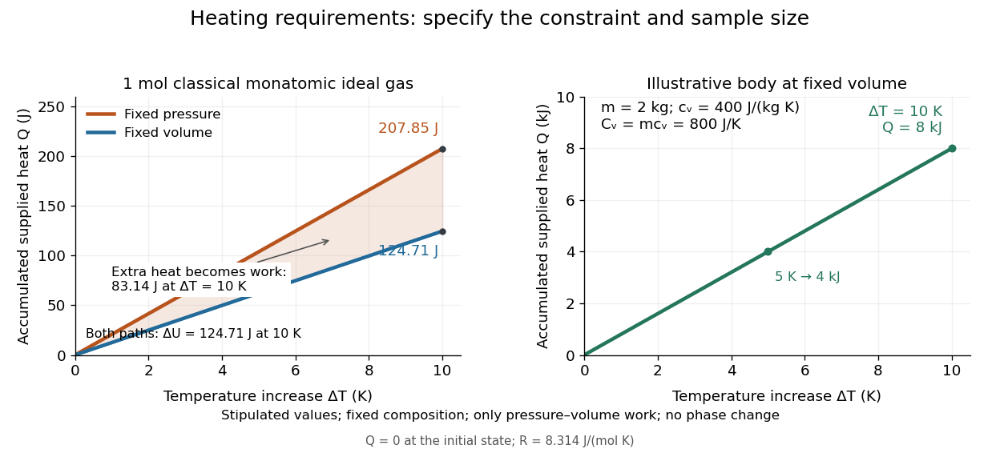

**[Figure 11](#image-required-heat-depends-on-the-constraint-and-the-amount-of-material). Required heat depends on the constraint and the amount of material**. Left: one [mole](physics.md#mole-unit) of classical [monatomic gas](ideal-gas.md#monatomic-gas) with the stipulated [molar gas constant](ideal-gas.md#molar-gas-constant) above; the shaded difference is expansion [work](energy.md#work) at fixed [pressure](pressure.md). Right: the illustrative fixed-[volume](thermodynamics.md#volume-thermodynamics) body from [specific heat capacity](#specific-heat-capacity), with [mass](classical-mechanics.md#mass) $2\,\mathrm{kg}$ and $c_V=400\,\mathrm{J\,kg^{-1}\,K^{-1}}$. Each curve starts at zero accumulated [heat](heat.md), rather than zero absolute [internal energy](internal-energy.md).

The practical value of [heat capacity](#heat-capacity) is that a measured [heat](heat.md) input and [temperature](temperature.md) response can determine it. Once its constraint and [temperature](temperature.md) dependence are known, it predicts heating requirements and supplies [entropy](entropy.md) changes through [entropy from heat capacity](#entropy-from-heat-capacity). [Tong, Statistical Physics, heat capacity as a measurable response](physics-bibliography.md#statistical-physics-by-david-tong/1-the-fundamentals-of-statistical-mechanics)

### Heat capacity of a diatomic gas

↑ **Parent:** [Heat capacity](#heat-capacity)

For an ideal diatomic gas with intact molecules and all translational, rotational and harmonic vibrational degrees of freedom active, the classical molar [heat capacity](#heat-capacity) is $7R/2$. Quantum freeze-out of vibrations and then rotations produces approximate $5R/2$ and $3R/2$ regimes. The model excludes dissociation, condensation and electronic excitation.

### Equilibrium heat capacity of interconverting states

↑ **Parent:** [Heat capacity](#heat-capacity)

For independent particles with interconverting state families $i$, the equilibrium [partition function](canonical-ensemble.md#canonical-partition-function) is a sum $q=\sum_iq_i$ and the family probabilities are $x_i=q_i/q$. Let $u_i$ be the conditional mean one-particle [energy](energy.md) in family $i$ and $c_i=du_i/dT$. The total [canonical energy variance](canonical-ensemble.md#canonical-energy-variance) separates into within-family and between-family contributions, giving

$$
C_V=N\sum_i x_ic_i+\frac{N}{k_{\rm B}T^2}\left[\sum_i x_iu_i^2-\left(\sum_i x_iu_i\right)^2\right].
$$

The final positive term is absent if family fractions are held fixed. A [frozen ortho-para mixture](molecule.md#frozen-ortho-para-mixture) and an equilibrating mixture can therefore have different [heat capacities](#heat-capacity) at the same instantaneous composition.

### Low-temperature heat capacity measurement

↑ **Parent:** [Heat capacity](#heat-capacity)

Low-temperature [calorimetry](calorimetry.md) measures a small sample's [heat capacity](#heat-capacity) by resolving a small [temperature](temperature.md) change after a known electrical [energy](energy.md) input. The experimental challenge is that the support, heater and [thermometer](temperature.md#thermometer) also warm up. Their [calorimeter addenda](#calorimeter-addenda) must be removed before interpreting the sample's [phonons](quantum-ideal-gas-statistics.md#phonon) or [electronic heat capacity](#electronic-heat-capacity). The [Debye T-cubed test](#debye-t-cubed-test) turns the corrected response into a test of the low-[temperature](temperature.md) vibrational spectrum.

[Manuel Brando](physicist.md#manuel-brando)'s 2009 experiment used a sapphire platform suspended by four alloyed platinum wires from a [copper](chemical-substance.md#copper) ring fixed to a cryostat stage. Grease attached the sample; a chip heater and ruthenium-oxide [resistance thermometer](temperature.md#resistance-thermometer) served platform PLS-2. A controller stabilized the bath; a lock-in amplifier supplied heating pulses and read the calibrated sensor. The steady rise calibrated [thermal conductance](#thermal-conductance) as $G=P/\Delta T$. A separate $59.1\,\mathrm{mg}$, $99.99\%$ pure [gold](chemical-substance.md#gold) sample, compared with reference [heat capacities](#heat-capacity), established the [calorimeter addenda](#calorimeter-addenda). Small pulses limited property variation; imperfect sample contact required a second relaxation time. The platform contribution rose below $1.5\,\mathrm K$, making simple extrapolation unsafe.[Brando, Development of a relaxation calorimeter for temperatures between 0.05 and 4 K, §§II–IV.B, Table I, Figs. 4, 5 and 8: construction, calibration, contact correction and low-temperature platform upturn](physics-bibliography.md#development-of-a-relaxation-calorimeter-for-temperatures-between-0-05-and-4-k-by-manuel-brando)

For an original idealization, assume sample and platform share one [temperature](temperature.md) $T$, the bath remains at $T_b$, and both the total [heat capacity](#heat-capacity) and the weak-link [thermal conductance](#thermal-conductance) $G$ are approximately constant across one small pulse. Ignore other [heat transfer](#heat-transfer) and any [phase transition](critical-phenomenon.md#phase-transition). The [first law of thermodynamics](first-law-of-thermodynamics.md) becomes

$$
(C_s+C_a)\frac{dT}{dt}=P(t)-G(T-T_b),\qquad
\tau=\frac{C_s+C_a}{G}.
$$

Here $C_s$ is sample [heat capacity](#heat-capacity), $C_a$ is [calorimeter addenda](#calorimeter-addenda), $P$ is deposited electrical [power](energy.md#power) from [Joule heating](electric-charge.md#joule-heating), and $\tau$ is a [time constant](analysis.md#time-constant). This is the same balance as [calorimeter heat-loss correction](calorimetry.md#calorimeter-heat-loss-correction), used here with a deliberately weak cryogenic link and a separately subtracted platform. For a constant pulse $P_0$ beginning at bath [temperature](temperature.md), then switched off at $t_h$,

$$
T(t)-T_b=\begin{cases}
\dfrac{P_0}{G}(1-e^{-t/\tau}),&0\le t\le t_h,\\
\dfrac{P_0}{G}(1-e^{-t_h/\tau})e^{-(t-t_h)/\tau},&t>t_h.
\end{cases}
$$

The cooling [exponential decay](analysis.md#exponential-decay) determines $\tau$, while the heating plateau determines $G=P_0/(T_\infty-T_b)$. Together with [calorimeter addenda](#calorimeter-addenda), they give $C_s=G\tau-C_a$. Cooling alone determines a ratio, not an absolute [heat capacity](#heat-capacity). With finite $t_h$, the observed end rise is smaller than the plateau; fit the full response or apply the displayed correction rather than identifying the two.

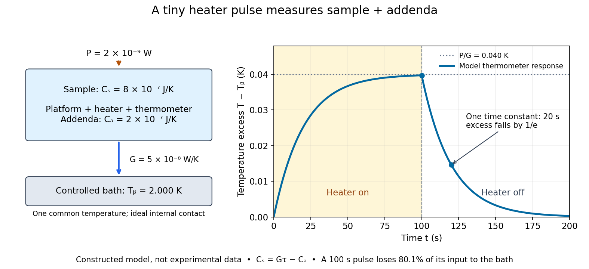

**[Figure 12](#image-a-cryogenic-pulse-probes-sample-plus-calorimeter-addenda-through-a-weak-thermal-link). A cryogenic pulse probes sample plus calorimeter addenda through a weak thermal link**. Original constructed one-[temperature](temperature.md) model, not a drawing of Brando's apparatus or measured data. The bath is fixed at $2.000\,\mathrm K$, the heater supplies $2\times10^{-9}\,\mathrm W$ for $100\,\mathrm s$, and the total [heat capacity](#heat-capacity) is $10^{-6}\,\mathrm{J\,K^{-1}}$. Internal sample-platform [thermal equilibrium](thermal-equilibrium.md) is assumed instantaneous; the actual experiment can require two relaxation times.

For the stipulated figure parameters, $G=5.00\times10^{-8}\,\mathrm{W\,K^{-1}}$, $\tau=20.0\,\mathrm s$, and $C_a=2.00\times10^{-7}\,\mathrm{J\,K^{-1}}$ give $C_s=8.00\times10^{-7}\,\mathrm{J\,K^{-1}}$. The asymptotic rise is $0.0400\,\mathrm K$, only $2\%$ of bath [temperature](temperature.md). At $100\,\mathrm s$, the rise is $0.0397305\,\mathrm K$. Of $2.00\times10^{-7}\,\mathrm J$ input, only $3.97305\times10^{-8}\,\mathrm J$ remains stored: the other $1.60270\times10^{-7}\,\mathrm J$ has flowed to the bath. Treating this long pulse as an isolated $Q/C$ experiment would overestimate total [heat capacity](#heat-capacity) by a factor of $5.034$.

Suppose independent [standard uncertainties](physics.md#standard-uncertainty) are $u(G)=0.05\times10^{-8}\,\mathrm{W\,K^{-1}}$, $u(\tau)=0.2\,\mathrm s$ and $u(C_a)=0.10\times10^{-7}\,\mathrm{J\,K^{-1}}$. First-order [propagation of uncertainty](wave-equation.md#propagation-of-uncertainty) gives

$$
u(C_s)^2=\tau^2u(G)^2+G^2u(\tau)^2+u(C_a)^2,
\qquad C_s=(8.00\pm0.17)\times10^{-7}\,\mathrm{J\,K^{-1}}.
$$

The uncertainty is one [standard deviation](variance.md#standard-deviation) under those assumptions, about $2.2\%$ of sample [heat capacity](#heat-capacity). Shared [thermometer calibration](temperature.md#thermometer-calibration) errors can correlate fitted $G$ and $\tau$; then their [covariance](variance.md#covariance) contributes too. Smaller samples amplify the relative influence of [calorimeter addenda](#calorimeter-addenda). Proposed checks include varying pulse amplitude, repeating with a reference sample, checking sensor self-heating, and comparing single- and two-time-constant fits. A drifting bath, slow internal equilibration or a transition invalidates this simple reduction even if a cooling curve looks smooth.

#### Calorimeter addenda

↑ **Parent:** [Low-temperature heat capacity measurement](#low-temperature-heat-capacity-measurement)

[Calorimeter addenda](#calorimeter-addenda) are the participating [heat capacity](#heat-capacity) of everything in the measured thermal assembly except the sample: platform, heater, [thermometer](temperature.md#thermometer), mounting material and the effective part of the leads. They depend on [temperature](temperature.md) and assembly details. [Calorimeter calibration](calorimetry.md#calorimeter-calibration) can determine them using an empty platform or a reference sample. Subtract $C_a(T)$ from the loaded assembly at matching [temperature](temperature.md) and applied [magnetic field](magnetic-field.md); replacing it with a constant can imitate a sample anomaly.

### Debye T-cubed test

↑ **Parent:** [Heat capacity](#heat-capacity)

The [Debye T-cubed test](#debye-t-cubed-test) asks whether a bulk three-dimensional [crystal](thermodynamics.md#crystal)'s lattice [molar heat capacity](#molar-heat-capacity) approaches a cubic law well below its [Debye temperature](quantum-ideal-gas-statistics.md#debye-temperature) $T_D$. It tests the low-[frequency](wave.md#frequency) [acoustic phonon branches](quantum-ideal-gas-statistics.md#acoustic-phonon-branch) in the [Debye model](quantum-ideal-gas-statistics.md#debye-model), rather than asserting that every contribution to a real sample's [heat capacity](#heat-capacity) is cubic. [Peter Debye](physicist.md#peter-debye)'s continuum description makes a striking connection: a thermal measurement can reveal the low-[frequency](wave.md#frequency) vibrational [density of states](quantum-ideal-gas-statistics.md#density-of-states) without resolving individual vibrations.[Statistical Physics by David Tong; §3.3.1, The Debye Model: low-temperature heat capacity](physics-bibliography.md#statistical-physics-by-david-tong/3-quantum-gases)

For a monatomic bulk model, the [Debye model](quantum-ideal-gas-statistics.md#debye-model) has vibrational [density of states](quantum-ideal-gas-statistics.md#density-of-states) $g(\omega)=9N\omega^2/\omega_D^3$ up to the [Debye frequency](quantum-ideal-gas-statistics.md#debye-frequency) $\omega_D$, containing $3N$ [normal modes](wave-equation.md#normal-mode). With $x=\hbar\omega/(k_BT)$, the thermal vibrational [internal energy](internal-energy.md) becomes

$$
U_{\rm lattice}=9Nk_BT\left(\frac{T}{T_D}\right)^3
\int_0^{T_D/T}\frac{x^3}{e^x-1}\,dx.
$$

The reduced [Planck constant](quantum-mechanics.md#planck-constant) is $\hbar$, the [Boltzmann constant](thermodynamics.md#boltzmann-constant) is $k_B$, and $N$ counts [chemical atoms](physics.md#atom-physics). For $T\ll T_D$, replace the upper limit by infinity. The [integral](integral.md) is $\pi^4/15$, as in the [Stefan–Boltzmann law](#stefan-boltzmann-law) derivation. Differentiating at fixed [volume](thermodynamics.md#volume-thermodynamics) gives, per [mole](physics.md#mole-unit) of [chemical atoms](physics.md#atom-physics),

$$
C_{V,\mathrm m}^{\rm lattice}\simeq\beta T^3,
\qquad \beta=\frac{12\pi^4R}{5T_D^3},
\qquad [\beta]=\mathrm{J\,mol^{-1}\,K^{-4}},
$$

where $R$ is the [molar gas constant](ideal-gas.md#molar-gas-constant). The cubic exponent comes from three-dimensional [acoustic phonon branches](quantum-ideal-gas-statistics.md#acoustic-phonon-branch) with linear low-[wavevector](elasticity-physics.md#wavevector) [dispersion relations](dispersion-relation.md). The coefficient encodes their propagation speeds. Formula-unit normalization in a compound requires its number of [chemical atoms](physics.md#atom-physics) per formula unit; do not silently substitute moles of formula units for moles of [chemical atoms](physics.md#atom-physics).

For a simple [metal](chemical-substance.md#metal) in its nonsuperconducting state, well below both [Debye temperature](quantum-ideal-gas-statistics.md#debye-temperature) and [electron Fermi temperature](quantum-ideal-gas-statistics.md#electron-fermi-temperature), include [electronic heat capacity](#electronic-heat-capacity):

$$
C_{p,\mathrm m}(T)\simeq\gamma T+\beta T^3,
\qquad \frac{C_{p,\mathrm m}}{T}\simeq\gamma+\beta T^2.
$$

This approximation also requires negligible [difference between constant-pressure and constant-volume heat capacities](enthalpy.md#difference-between-constant-pressure-and-constant-volume-heat-capacities) at the measurement precision, and no significant magnetic, nuclear or [Schottky anomaly](#schottky-anomaly) contribution in the fit interval. Thus [linear regression](linear-regression.md) of $C_{p,\mathrm m}/T$ against $T^2$ separates an electronic intercept from a lattice slope. For an insulating [crystal](thermodynamics.md#crystal) with no relevant low-[energy](energy.md) magnetic excitations, the electronic term can instead be negligible; a [superconductivity](superconductivity.md) transition changes the electronic response.[Statistical Physics by David Tong; §§3.3.1 and 3.6.3: phonon and electronic low-temperature contributions](physics-bibliography.md#statistical-physics-by-david-tong/3-quantum-gases)

After subtracting [calorimeter addenda](#calorimeter-addenda), Brando's second [gold](chemical-substance.md#gold) sample, $72.6\,\mathrm{mg}$, gave a linear $C_{p,\mathrm m}/T$ versus $T^2$ plot in the nonsuperconducting state. The reported electronic intercept was $7.0\times10^{-4}\,\mathrm{J\,mol^{-1}\,K^{-2}}$; deviations from reference [heat capacities](#heat-capacity) were below $2\%$.[§IV.B and Fig. 9: separate validation sample, molar electronic intercept and reference-comparison inset; plotted temperatures extend to about 3 K](physics-bibliography.md#development-of-a-relaxation-calorimeter-for-temperatures-between-0-05-and-4-k-by-manuel-brando) This supports the combined linear-plus-cubic description over the plotted interval. Because the platform subtraction used reference [gold](chemical-substance.md#gold), it is also an instrument validation with a shared material standard, rather than a wholly independent determination of the [Debye model](quantum-ideal-gas-statistics.md#debye-model) from an uncalibrated instrument.

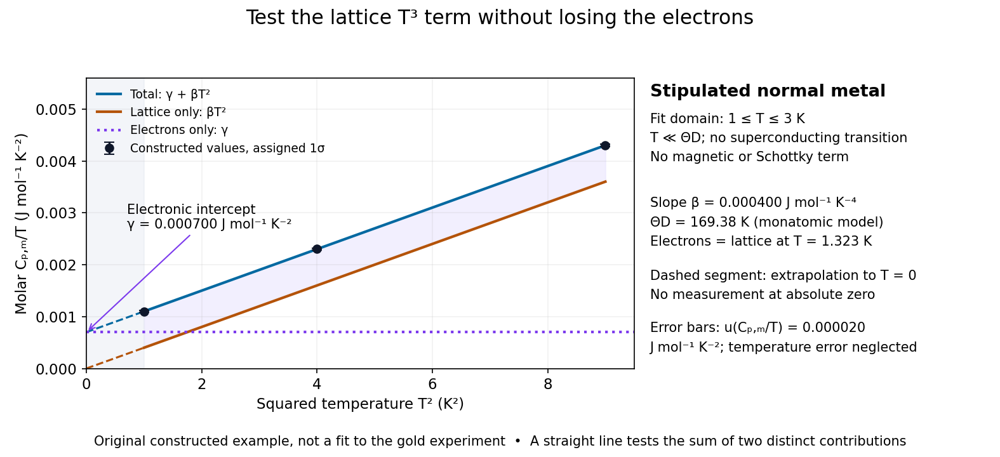

**[Figure 13](#image-the-debye-t-cubed-test-in-a-normal-metal-lattice-slope-and-electronic-intercept). The Debye T-cubed test in a normal metal: lattice slope and electronic intercept**. Original constructed model with $\gamma=7.00\times10^{-4}\,\mathrm{J\,mol^{-1}\,K^{-2}}$ and $\beta=4.00\times10^{-4}\,\mathrm{J\,mol^{-1}\,K^{-4}}$. It represents a stipulated monatomic normal [metal](chemical-substance.md#metal), not digitized [gold](chemical-substance.md#gold) measurements. Solid curves apply only over the chosen $1$–$3\,\mathrm K$ fit interval, with negligible other terms and $C_p-C_V$. Dashed portions illustrate extrapolation; error bars are assigned one-[standard deviation](variance.md#standard-deviation) uncertainties, not scatter measured in the experiment.

For a worked original inference, stipulate values of $y=C_{p,\mathrm m}/T$ equal to $(0.001100,0.002300,0.004300)\,\mathrm{J\,mol^{-1}\,K^{-2}}$ at $T=(1,2,3)\,\mathrm K$. Assign independent $u(y)=0.000020\,\mathrm{J\,mol^{-1}\,K^{-2}}$ and negligible [temperature](temperature.md) error. Equal-weight [linear regression](linear-regression.md) on $x=T^2$ gives

$$
\gamma=(7.00\pm0.20)\times10^{-4}\,\mathrm{J\,mol^{-1}\,K^{-2}},
\qquad \beta=(4.000\pm0.035)\times10^{-4}\,\mathrm{J\,mol^{-1}\,K^{-4}}.
$$

The points sit exactly on the stipulated line; these [standard uncertainties](physics.md#standard-uncertainty) come from the assigned input precision, not an estimate from zero residual scatter. With $R=8.314462618\,\mathrm{J\,mol^{-1}\,K^{-1}}$, inversion gives

$$
T_D=\left(\frac{12\pi^4R}{5\beta}\right)^{1/3}=169.38\,\mathrm K,
\qquad \frac{u(T_D)}{T_D}=\frac{u(\beta)}{3\beta},
\qquad T_D=(169.4\pm0.5)\,\mathrm K.
$$

At $2\,\mathrm K$, the electronic and lattice [molar heat capacities](#molar-heat-capacity) are respectively $0.0014$ and $0.0032\,\mathrm{J\,mol^{-1}\,K^{-1}}$. Their equality occurs at $\sqrt{\gamma/\beta}=1.323\,\mathrm K$: even in this clean model, the total [heat capacity](#heat-capacity) approaches a linear, rather than cubic, law as $T$ tends to zero in the normal state.

A straight line over a narrow interval is a useful diagnostic, not a universal proof. Inspect residuals and repeat the fit over several upper and lower [temperature](temperature.md) cutoffs; curvature can signal higher lattice terms, an unremoved [Schottky anomaly](#schottky-anomaly), or a faulty [calorimeter addenda](#calorimeter-addenda) subtraction. Correlated [thermometer calibration](temperature.md#thermometer-calibration) and sample-amount errors affect both axes and can dominate the illustrative [linear regression](linear-regression.md) uncertainty. Low-dimensional samples, additional low-[energy](energy.md) excitations and proximity to a [phase transition](critical-phenomenon.md#phase-transition) need other models. The test is valuable precisely because its failures can reveal physics beyond the bulk acoustic approximation.

### Electronic heat capacity

↑ **Parent:** [Heat capacity](#heat-capacity)

[Electronic heat capacity](#electronic-heat-capacity) is the contribution from electronic excitations to [heat capacity](#heat-capacity). A simple normal [metal](chemical-substance.md#metal) with a smooth [density of states](quantum-ideal-gas-statistics.md#density-of-states) near its [Fermi energy](quantum-ideal-gas-statistics.md#fermi-energy) has $C_{\mathrm m}^{\rm el}\simeq\gamma T$ well below its [electron Fermi temperature](quantum-ideal-gas-statistics.md#electron-fermi-temperature). Only a narrow [energy](energy.md) interval near the [Fermi energy](quantum-ideal-gas-statistics.md#fermi-energy) changes occupation on heating, explaining the small fraction of active [electrons](physics.md#electron). The [Debye T-cubed test](#debye-t-cubed-test) separates this contribution from lattice [phonons](quantum-ideal-gas-statistics.md#phonon). Interactions, a [superconductivity](superconductivity.md) transition or other electronic structure can invalidate a constant $\gamma$ description.

#### Constant-pressure gas versus electronic metal heat capacity

↑ **Parent:** [Electronic heat capacity](#electronic-heat-capacity)

For equal atom counts, a classical ideal monatomic gas has $C_p=5Nk_B/2$. A monovalent three-dimensional free-electron metal has electronic contribution $C_e=(\pi^2/2)Nk_Bk_BT/E_F$. Their ratio is the displayed expression. Replacing the gas's constant-pressure heat capacity with its $C_V=3Nk_B/2$ changes the ratio by3/5. Neither ratio includes the metal's lattice heat capacity or gas nonideality.

##### Lattice qualification of an electron-only heat-capacity ratio

↑ **Parent:** [Constant-pressure gas versus electronic metal heat capacity](#constant-pressure-gas-versus-electronic-metal-heat-capacity)

#### Electronic heat capacity coefficient

↑ **Parent:** [Electronic heat capacity](#electronic-heat-capacity)

For a [Fermi liquid](fermi-liquid.md), $C_{\rm el}=\gamma T+o(T)$ at low temperature. In a simple quasiparticle description, $\gamma=(\pi^2/3)k_B^2g(E_F)$, where the [density of states](quantum-ideal-gas-statistics.md#density-of-states) includes both spin states and uses the same per-volume or per-mole normalization as $\gamma$. A fit $C/T=\gamma+\beta T^2$ separates this contribution from a Debye lattice term over an appropriate low-temperature range. Magnetic or other low-energy excitations can require extra fit terms.

##### Molar Fermi-liquid heat-capacity mass scaling

↑ **Parent:** [Electronic heat capacity coefficient](#electronic-heat-capacity-coefficient)

For an isotropic three-dimensional liquid at fixed particles per mole, the molar coefficient scales as $\gamma_{\rm mol}\propto m^*V_{\rm mol}^{2/3}$. Density and mass renormalization both affect the slope; the slope ratio is not simply the effective-mass ratio.

##### Fermi-edge heat-capacity counting

↑ **Parent:** [Electronic heat capacity coefficient](#electronic-heat-capacity-coefficient)

Only single-particle states within order $k_BT$ of the [Fermi energy](quantum-ideal-gas-statistics.md#fermi-energy) can change occupation at low [temperature](temperature.md). Their number is order $g(E_F)k_BT$, and their excitation [energy](energy.md) is order $k_BT$, giving $U-U_0\propto T^2$ and electronic [heat capacity](#heat-capacity) proportional to $T$.

#### Thermal-shell estimate of electronic heat capacity

↑ **Parent:** [Electronic heat capacity](#electronic-heat-capacity)

For a three-dimensional [free electron model](physics.md#free-electron-model), the spin-summed [density of states](quantum-ideal-gas-statistics.md#density-of-states) at the [Fermi energy](quantum-ideal-gas-statistics.md#fermi-energy) is $g(E_F)=3N/(2E_F)$. A shell estimate treats $N_{\rm act}\sim g(E_F)k_BT$ electrons as thermally active and assigns each an excitation energy of order $k_BT$. For the illustrative choice $3k_BT/2$, $\Delta U\sim(9/4)Nk_B^2T^2/E_F$ and differentiation gives $C_V\sim(9/2)Nk_B T/T_F$. The numerical coefficient is heuristic: the controlled [Sommerfeld expansion](quantum-ideal-gas-statistics.md#sommerfeld-expansion) instead gives

$$
C_V=\frac{\pi^2}{2}Nk_B\frac{T}{T_F}+O\!\left(Nk_B(T/T_F)^3\right).
$$

Both estimates express [Pauli exclusion principle](tensor-product-of-quantum-systems.md#pauli-exclusion-principle) suppression of the classical [heat capacity](#heat-capacity) when $T\ll T_F$. A shell argument establishes scaling rather than a universal prefactor.

### Schottky anomaly

↑ **Parent:** [Heat capacity](#heat-capacity)  
ⓦ [Wiki](https://en.wikipedia.org/wiki/Schottky_anomaly)

A [Schottky anomaly](#schottky-anomaly) is a peak in [heat capacity](#heat-capacity) caused by thermal occupation of a small set of separated [energy levels](quantum-mechanics.md#energy-level). For $N$ independent two-level units with equal degeneracies and gap $\Delta>0$, write $x=\Delta/(k_BT)$; their [heat capacity](#heat-capacity) is $C=Nk_Bx^2e^{-x}/(1+e^{-x})^2$, with [Boltzmann constant](thermodynamics.md#boltzmann-constant) $k_B$. It vanishes at both low and high [temperature](temperature.md) and can spoil a lattice $T^3$ fit in between. Localized electronic or nuclear levels can contribute, including in [calorimeter addenda](#calorimeter-addenda); their presence must be checked rather than attributed automatically to [phonons](quantum-ideal-gas-statistics.md#phonon).

#### Schottky anomaly with unequal degeneracies

↑ **Parent:** [Schottky anomaly](#schottky-anomaly)

For independent units with lower and upper [energy levels](quantum-mechanics.md#energy-level) separated by $\Delta>0$, let their degeneracies be $g_0$ and $g_1$. Their shifted [partition function](canonical-ensemble.md#canonical-partition-function) is $q=g_0+g_1e^{-x}$, with $x=\Delta/(k_{\rm B}T)$. Differentiation gives

$$
\frac{C_V}{Nk_{\rm B}}=x^2\frac{g_0g_1e^{-x}}{(g_0+g_1e^{-x})^2}.
$$

The [heat capacity](#heat-capacity) vanishes at both low and high [temperature](temperature.md). Degeneracy changes both the maximum and its [temperature](temperature.md); the equal-degeneracy result is not universal. Independent lower-level degeneracy also leaves [residual entropy](entropy.md#residual-entropy) $Nk_{\rm B}\ln g_0$ in the ideal model.

### Molar heat capacity

↑ **Parent:** [Heat capacity](#heat-capacity)

Molar heat capacity is [heat capacity](#heat-capacity) divided by [amount of substance](physics.md#amount-of-substance) $n$, with units $\mathrm{J\,mol^{-1}\,K^{-1}}$. Its constraint must still be specified: $C_{V,\mathrm m}=C_V/n$ and $C_{p,\mathrm m}=C_p/n$. For the classical [monatomic gas](ideal-gas.md#monatomic-gas) example in [heat capacity](#heat-capacity), these are $3R/2$ and $5R/2$, where $R$ is the [molar gas constant](ideal-gas.md#molar-gas-constant). Some textbooks use $C_V$ and $C_p$ for these per-[mole](physics.md#mole-unit) quantities; the convention here reserves them for the whole sample.

### Heating curve

↑ **Parent:** [Heat capacity](#heat-capacity)

A heating curve records [temperature](temperature.md) against accumulated supplied [heat](heat.md) under a specified constraint. Within one [thermodynamic phase](thermodynamics.md#thermodynamic-phase), its slope is $dT/dQ=1/C_X$, where $C_X$ is the constrained [heat capacity](#heat-capacity). A [latent heat](thermodynamic-potential.md#latent-heat) plateau instead records changing [phase fraction](thermodynamics.md#phase-fraction) at the [phase coexistence](critical-phenomenon.md#phase-coexistence) [temperature](temperature.md). The [sensible heat](#sensible-heat) example combines two sloping intervals and a [melting](critical-phenomenon.md#melting) plateau in one heating budget.

### Entropy from heat capacity

↑ **Parent:** [Heat capacity](#heat-capacity)

Along a reversible path at fixed volume, $dS=C_V(T)dT/T$. Hence entropy differences can be measured macroscopically from

$$
S(T_2)-S(T_1)=\int_{T_1}^{T_2}\frac{C_V(T)}T\,dT,
$$

with an additional $L/T_c$ across a first-order transition of [latent heat](thermodynamic-potential.md#latent-heat) $L$ at $T_c$.

### Entropy concavity and positive heat capacity

↑ **Parent:** [Heat capacity](#heat-capacity)

For a thermodynamically stable system, the [entropy](entropy.md) is concave in energy, so

$$
\frac{\partial^2S}{\partial E^2}
=-\frac1{T^2}\frac{\partial T}{\partial E}<0.
$$

Consequently $\partial E/\partial T>0$: energy increases with [temperature](temperature.md), and the corresponding [heat capacity](#heat-capacity) is positive.

### Specific heat capacity

↑ **Parent:** [Heat capacity](#heat-capacity)  
ⓦ [Wiki](https://en.wikipedia.org/wiki/Specific_heat_capacity)

Specific heat capacity is [heat capacity](#heat-capacity) per unit [mass](classical-mechanics.md#mass):

$$
c=\frac Cm,\qquad c_V=\frac{C_V}{m},\qquad c_p=\frac{C_p}{m}.
$$

Its units are $\mathrm{J\,kg^{-1}\,K^{-1}}$, and the constraint remains part of the definition. In particular, [specific heat capacity at constant volume](#specific-heat-capacity-at-constant-volume) and [specific heat capacity at constant pressure](#specific-heat-capacity-at-constant-pressure) are different responses. For homogeneous material, doubling the [mass](classical-mechanics.md#mass) doubles its [heat capacity](#heat-capacity) while leaving its [specific heat capacity](#specific-heat-capacity) unchanged. [OpenStax, Specific heat and heating calculations](https://openstax.org/books/university-physics-volume-2/pages/1-4-heat-transfer-specific-heat-and-calorimetry)

As an illustrative material model, give a fixed-[volume](thermodynamics.md#volume-thermodynamics) body [mass](classical-mechanics.md#mass) $m=2\,\mathrm{kg}$ and constant [specific heat capacity at constant volume](#specific-heat-capacity-at-constant-volume) $c_V=400\,\mathrm{J\,kg^{-1}\,K^{-1}}$. With no [phase transition](critical-phenomenon.md#phase-transition) and no other [work](energy.md#work), increasing its uniform [temperature](temperature.md) by $10\,\mathrm K$ requires

$$
C_V=mc_V=800\,\mathrm{J\,K^{-1}},\qquad
Q=mc_V\Delta T=8000\,\mathrm J=\Delta U.
$$

These stipulated values describe no measured substance. The right panel of the diagram in [heat capacity](#heat-capacity) shows the straight line $Q=mc_V\Delta T$: a [temperature](temperature.md) increase of $5\,\mathrm K$ takes $4000\,\mathrm J$ of [heat](heat.md). If the [specific heat capacity at constant volume](#specific-heat-capacity-at-constant-volume) depends on [temperature](temperature.md), use $Q=m\int_{T_1}^{T_2}c_V(T)\,dT$ instead. The corresponding fixed-[pressure](pressure.md) calculation uses [specific heat capacity at constant pressure](#specific-heat-capacity-at-constant-pressure) and gives $Q=\Delta H$ under the assumptions in [heat capacity](#heat-capacity).

Choosing between [specific heat capacity](#specific-heat-capacity), [molar heat capacity](#molar-heat-capacity) and [volumetric heat capacity](#volumetric-heat-capacity) is choosing whether to compare equal [mass](classical-mechanics.md#mass), equal [amount of substance](physics.md#amount-of-substance) or equal [volume](thermodynamics.md#volume-thermodynamics). A small sample with large [specific heat capacity](#specific-heat-capacity) can still have less total [heat capacity](#heat-capacity) than a much larger sample.

#### Volumetric heat capacity

↑ **Parent:** [Specific heat capacity](#specific-heat-capacity)  
ⓦ [Wiki](https://en.wikipedia.org/wiki/Volumetric_heat_capacity)

Volumetric heat capacity is [heat capacity](#heat-capacity) per unit [volume](thermodynamics.md#volume-thermodynamics), with units $\mathrm{J\,m^{-3}\,K^{-1}}$. For homogeneous material of [mass density](fluid-mechanics.md#density) $\rho=m/V$, it equals $\rho c$, using [specific heat capacity](#specific-heat-capacity) $c$ for the same constraint. It measures the [heat](heat.md) required per small [temperature](temperature.md) increase for a chosen occupied [volume](thermodynamics.md#volume-thermodynamics). In a material model using [specific heat capacity at constant pressure](#specific-heat-capacity-at-constant-pressure), [thermal diffusivity](#thermal-diffusivity) is $\alpha=k/(\rho c_p)$, where $k$ is [thermal conductivity](#thermal-conductivity).

#### Specific heat capacity at constant volume

↑ **Parent:** [Specific heat capacity](#specific-heat-capacity)

The specific heat capacity at constant volume is the temperature derivative of [specific internal energy](internal-energy.md#specific-internal-energy) at fixed density and composition: $c_V=(\partial u/\partial T)_\rho$. It is the corresponding extensive [heat capacity at constant volume](#heat-capacity-at-constant-volume) divided by material mass.

#### Specific heat capacity at constant pressure

↑ **Parent:** [Specific heat capacity](#specific-heat-capacity)

The [specific heat capacity](#specific-heat-capacity) at fixed [pressure](pressure.md) and composition is $c_P=(\partial h/\partial T)_P$, where $h$ is [specific enthalpy](enthalpy.md#specific-enthalpy). Equivalently, it is [heat capacity at constant pressure](enthalpy.md#heat-capacity-at-constant-pressure) divided by [mass](classical-mechanics.md#mass). Under the process assumptions in [heat capacity](#heat-capacity), it includes expansion [work](energy.md#work) as well as the [internal energy](internal-energy.md) change. The [sensible heat](#sensible-heat) example uses this response separately for [ice](chemical-substance.md#ice) and [water](chemical-substance.md#water).

##### Pure-radiation constant-pressure heat-capacity singularity

↑ **Parent:** [Specific heat capacity at constant pressure](#specific-heat-capacity-at-constant-pressure)

For pure [blackbody radiation](statistical-physics.md#black-body-radiation), $P=aT^4/3$ depends only on [temperature](temperature.md). Constant pressure therefore fixes temperature, so a usual finite constant-pressure temperature derivative is unavailable. In the material gas-radiation limit the [specific-heat ratio](ideal-gas.md#heat-capacity-ratio) diverges, although all three [stellar adiabatic exponents](stellar-structure.md#stellar-adiabatic-exponent) approach $4/3$. The radiation index $4/3$ is an adiabatic pressure-volume response, not a finite heat-capacity ratio.

### Heat capacity at constant volume

↑ **Parent:** [Heat capacity](#heat-capacity)

For a fixed-composition [closed system](thermodynamics.md#closed-system), the [heat capacity](#heat-capacity) at fixed [volume](thermodynamics.md#volume-thermodynamics) is $C_V=(\partial U/\partial T)_V$, with [internal energy](internal-energy.md) $U$. Under the [quasistatic process](thermodynamics.md#quasistatic-process) assumptions in [heat capacity](#heat-capacity), only [pressure](pressure.md)-[volume](thermodynamics.md#volume-thermodynamics) [work](energy.md#work) is permitted, so $dV=0$ gives $\delta Q=dU=C_V\,dT$. A rigid vessel therefore needs $Q=\Delta U$, or $Q=C_V\Delta T$ when $C_V$ is constant. Its per-unit-[mass](classical-mechanics.md#mass) counterpart is [specific heat capacity at constant volume](#specific-heat-capacity-at-constant-volume).

#### Temperature-linear pressure and volume-independent heat capacity

↑ **Parent:** [Heat capacity at constant volume](#heat-capacity-at-constant-volume)

For a smooth simple compressible system, $C_V=T(\partial S/\partial T)_V$ and the [Maxwell relation](thermodynamics.md#maxwell-relations) $(\partial S/\partial V)_T=(\partial p/\partial T)_V$ give $(\partial C_V/\partial V)_T=T(\partial^2p/\partial T^2)_V$. Thus an [equation of state](pressure.md#equation-of-state) $p=a(V)T+b(V)$ implies that $C_V$ depends on [temperature](temperature.md) alone within a smooth [phase](wave.md#phase-waves). It does not require $C_V$ to be [temperature](temperature.md) [independent](random-variable.md#independent-random-variables).

#### Dulong-Petit law

↑ **Parent:** [Heat capacity at constant volume](#heat-capacity-at-constant-volume)  
ⓦ [Wiki](https://en.wikipedia.org/wiki/Dulong–Petit_law)

In the classical high-[temperature](temperature.md) limit, each independent [harmonic oscillator](classical-mechanics.md#simple-harmonic-motion) contributes $k_B$ to the [heat capacity at constant volume](#heat-capacity-at-constant-volume), where $k_B$ is the [Boltzmann constant](thermodynamics.md#boltzmann-constant). A three-dimensional crystalline [solid](thermodynamics.md#solid) with $N$ [chemical atoms](physics.md#atom-physics) has $3N$ vibrational [normal modes](wave-equation.md#normal-mode) in the bulk harmonic approximation. Its vibrational [internal energy](internal-energy.md) and [heat capacity at constant volume](#heat-capacity-at-constant-volume) therefore obey

$$
U_{\rm vib}=U_0+3Nk_BT,\qquad
C_V=\left(\frac{\partial U_{\rm vib}}{\partial T}\right)_{V,N}=3Nk_B.
$$

Here $U_0$ is independent of [temperature](temperature.md) at fixed [volume](thermodynamics.md#volume-thermodynamics). Thus the [Dulong-Petit law](#dulong-petit-law) predicts $C_V\simeq3Nk_B$ for a real [solid](thermodynamics.md#solid) in this regime. Per [mole](physics.md#mole-unit) of [chemical atoms](physics.md#atom-physics), rather than per [mole](physics.md#mole-unit) of a compound's formula units,

$$
C_{V,\rm mol}\longrightarrow3R\simeq24.9434\,\mathrm{J\,mol^{-1}\,K^{-1}},\qquad R=N_Ak_B,
$$

with [molar gas constant](ideal-gas.md#molar-gas-constant) $R$ and [Avogadro constant](physics.md#avogadro-constant) $N_A$. A formula unit containing $r$ [chemical atoms](physics.md#atom-physics) consequently has a classical vibrational prediction of $3rR$ per [mole](physics.md#mole-unit) of formula units.

For example, in this ideal classical model, one [mole](physics.md#mole-unit) of [chemical atoms](physics.md#atom-physics) heated at fixed [volume](thermodynamics.md#volume-thermodynamics) from $300$ to $600\,\mathrm K$ gains vibrational [internal energy](internal-energy.md)

$$
\Delta U_{\rm vib}=3R(600-300)\,\mathrm K\simeq7483.02\,\mathrm J.
$$

The [heat capacity at constant volume](#heat-capacity-at-constant-volume) stays the same even though the thermal part of the [internal energy](internal-energy.md) doubles. These [temperatures](temperature.md) illustrate the stipulated classical model; they do not assert that every real [solid](thermodynamics.md#solid) is classical at $300\,\mathrm K$.

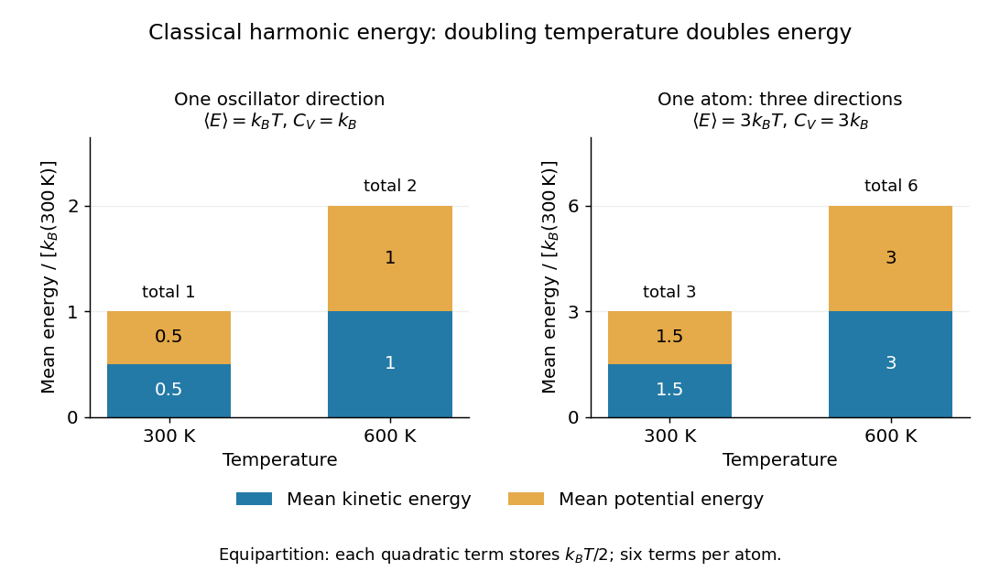

**[Figure 14](#image-classical-equipartition-theorem-one-harmonic-oscillator-stores-k-bt-one-chemical-atom-stores-3k-bt). Classical equipartition theorem: one harmonic oscillator stores $k_BT$, one chemical atom stores $3k_BT$**. Mean [kinetic energy](energy.md#kinetic-energy) and [potential energy](energy.md#potential-energy) at $300$ and $600\,\mathrm K$, in units of $k_B(300\,\mathrm K)$. Each independent quadratic term contributes $k_BT/2$. The three-direction model has three kinetic and three potential terms per [chemical atom](physics.md#atom-physics); doubling [temperature](temperature.md) doubles both contributions.

The proof outline is the [equipartition theorem](canonical-ensemble.md#equipartition-theorem): one classical [harmonic oscillator](classical-mechanics.md#simple-harmonic-motion) has a quadratic [kinetic energy](energy.md#kinetic-energy) and a quadratic [potential energy](energy.md#potential-energy), each with mean $k_BT/2$. Their sum is $k_BT$, whose [derivative](calculus.md#derivative) with respect to [temperature](temperature.md) is $k_B$. Summing over $3N$ [normal modes](wave-equation.md#normal-mode) gives $3Nk_B$. The classical result does not require equal [angular frequencies](lagrangian-mechanics.md#angular-frequency): each harmonic [normal mode](wave-equation.md#normal-mode) contributes the same amount once it is classical. Overall rigid motions give only a finite-size correction to the bulk count. This independence from the individual [angular frequencies](lagrangian-mechanics.md#angular-frequency) makes the [Dulong-Petit law](#dulong-petit-law) useful as a quick estimate of a [solid](thermodynamics.md#solid)'s heating requirement.

Experiments on freely expanding [solids](thermodynamics.md#solid) often measure the [heat capacity at constant pressure](enthalpy.md#heat-capacity-at-constant-pressure) $C_P$, whereas the harmonic prediction is for the [heat capacity at constant volume](#heat-capacity-at-constant-volume) $C_V$. In a smooth single [thermodynamic phase](thermodynamics.md#thermodynamic-phase) of a simple compressible material, the [difference between constant-pressure and constant-volume heat capacities](enthalpy.md#difference-between-constant-pressure-and-constant-volume-heat-capacities) is

$$
C_P-C_V=\frac{TV\alpha^2}{\kappa_T},
$$

where $\alpha=V^{-1}(\partial V/\partial T)_P$ is the volumetric [coefficient of thermal expansion](thermodynamics.md#coefficient-of-thermal-expansion) and $\kappa_T=-V^{-1}(\partial V/\partial P)_T$ is the [isothermal compressibility](thermodynamics.md#isothermal-compressibility). Using measured $C_P$ as an approximation to $C_V$ requires this correction to be small compared with $C_V$. [David Tong, Statistical Physics, section 4.4.2: relation between the two heat capacities](https://davidtong.org/teaching/statistical-physics/statmechhtml/S4#S4.SS4.SSS2)

High [temperature](temperature.md) here means $k_BT\gg\hbar\omega$ for the relevant vibrational [normal modes](wave-equation.md#normal-mode), with reduced [Planck constant](quantum-mechanics.md#planck-constant) $\hbar$ and mode [angular frequency](lagrangian-mechanics.md#angular-frequency) $\omega$. At low [temperature](temperature.md), excitation across a quantum [energy](energy.md) spacing is suppressed: modes with $\hbar\omega\gg k_BT$ freeze out thermally, and the classical [equipartition theorem](canonical-ensemble.md#equipartition-theorem) fails. The [Einstein model of a solid](#einstein-solid) makes this loss of vibrational [heat capacity](#heat-capacity) explicit. The [Dulong-Petit law](#dulong-petit-law) is therefore an ideal high-[temperature](temperature.md) vibrational limit, not a statement that all [solids](thermodynamics.md#solid) have the same [heat capacity](#heat-capacity) at every [temperature](temperature.md). Other contributions and departures from the harmonic approximation can matter even at high [temperature](temperature.md). [David Tong, Statistical Physics, section 3.3: solid vibrations, the classical limit and quantum freeze-out](https://davidtong.org/teaching/statistical-physics/statmechhtml/S3#S3.SS3)

Historically, Petit and Dulong's 1819 experiments compared the [specific heat capacities](#specific-heat-capacity) of several elemental [solids](thermodynamics.md#solid) and found an approximately constant product with their relative atomic weights. Their original empirical regularity came before the classical harmonic explanation; it suggested that counting [chemical atoms](physics.md#atom-physics) reveals a simpler pattern than comparing equal [masses](classical-mechanics.md#mass). [Petit and Dulong, Recherches sur quelques points importants de la Théorie de la Chaleur, Annales de Chimie et de Physique 10, 395–413 (1819), contemporary English translation hosted by Carmen Giunta](https://webserver.lemoyne.edu/giunta/PETIT.html)

##### Einstein solid

↑ **Parent:** [Dulong-Petit law](#dulong-petit-law)  
ⓦ [Wiki](https://en.wikipedia.org/wiki/Einstein_solid)

The [Einstein model of a solid](#einstein-solid) represents the vibrations of $N$ [chemical atoms](physics.md#atom-physics) by $3N$ independent one-dimensional [quantum harmonic oscillators](quantum-harmonic-oscillator.md), all with the same positive [angular frequency](lagrangian-mechanics.md#angular-frequency) $\omega$. Equivalently, each [chemical atom](physics.md#atom-physics) has three independent oscillator directions. The common [angular frequency](lagrangian-mechanics.md#angular-frequency) is a simplifying model assumption, not a claim about every vibration of a real [solid](thermodynamics.md#solid). Hold the [volume](thermodynamics.md#volume-thermodynamics), $N$ and $\omega$ fixed. Define the characteristic [temperature](temperature.md) $\theta_E=\hbar\omega/k_B$ and the dimensionless ratio $x=\theta_E/T$. The vibrational [internal energy](internal-energy.md) is

$$
U=3N\hbar\omega\left[\frac12+\frac{1}{e^x-1}\right],\qquad
x=\frac{\hbar\omega}{k_BT}=\frac{\theta_E}{T}.
$$

The first term is the [zero-point energy](quantum-harmonic-oscillator.md#zero-point-energy) $3N\hbar\omega/2$. It is constant at fixed $\omega$, so it contributes no [heat capacity at constant volume](#heat-capacity-at-constant-volume). The [temperature](temperature.md)-dependent term gives

$$
\frac{C_V}{3Nk_B}=\frac{x^2e^x}{(e^x-1)^2}
=\frac{x^2e^{-x}}{(1-e^{-x})^2}.
$$

This is the vibrational [heat capacity at constant volume](#heat-capacity-at-constant-volume) of the model, with no expansion or other contributions included. [MIT 3.012, Lecture 22, pages 9–13: Einstein-solid partition function, energy and heat capacity](https://ocw.mit.edu/courses/3-012-fundamentals-of-materials-science-fall-2005/d3fa883afa8df7cf7aa0432fcaadde8f_lec22t.pdf)

For a worked comparison, choose the model parameter $\theta_E=300\,\mathrm K$. The normalized [heat capacity at constant volume](#heat-capacity-at-constant-volume) depends only on $T/\theta_E$:

| $T/\theta_E$ | [Temperature](temperature.md) $T$ in $\mathrm K$ | $C_V/(3Nk_B)$ |
| --- | --- | --- |
| $0.1$ | $30$ | $0.00454$ |
| $0.5$ | $150$ | $0.72406$ |
| $1$ | $300$ | $0.92067$ |
| $2$ | $600$ | $0.97942$ |

At $T=\theta_E$, one [mole](physics.md#mole-unit) of [chemical atoms](physics.md#atom-physics) therefore has vibrational [heat capacity at constant volume](#heat-capacity-at-constant-volume) $3R(0.92067)\simeq22.965\,\mathrm{J\,mol^{-1}\,K^{-1}}$, using the unrounded model value. Even at twice the characteristic [temperature](temperature.md), the model remains about $2.06\%$ below the [Dulong-Petit law](#dulong-petit-law) limit. These are calculations for the ideal [Einstein solid](#einstein-solid), not material measurements.

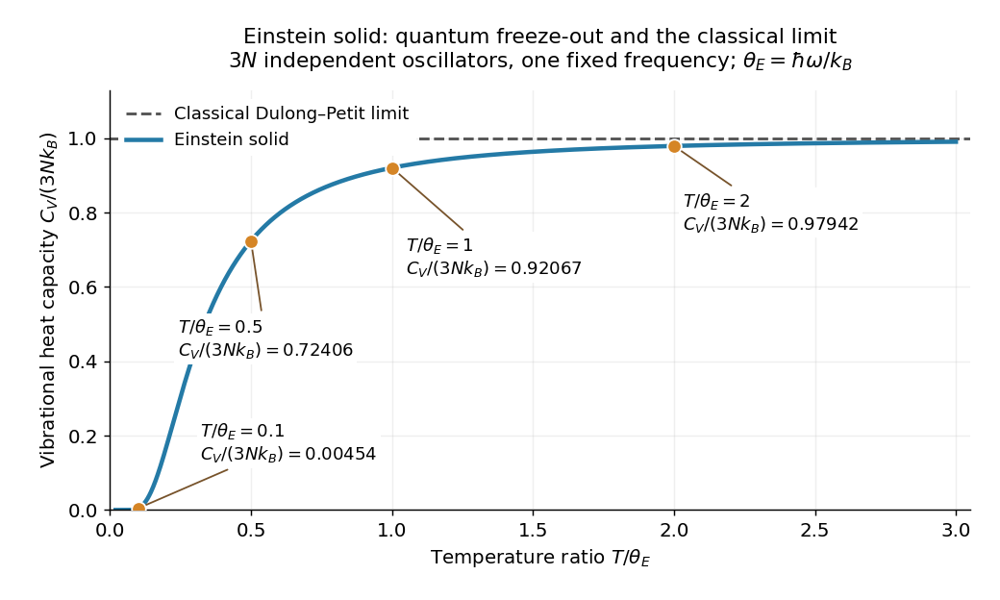

**[Figure 15](#image-einstein-solid-vibrational-heat-capacity-approaches-the-dulong-petit-law-limit). Einstein solid vibrational heat capacity approaches the Dulong-Petit law limit**. The model ratio $C_V/(3Nk_B)$ over $0.02\leq T/\theta_E\leq3$, with the four computed cases marked. The dashed classical line is $1$; quantum freeze-out suppresses the low-[temperature](temperature.md) response. All [quantum harmonic oscillators](quantum-harmonic-oscillator.md) have the same stipulated [angular frequency](lagrangian-mechanics.md#angular-frequency).

A short derivation uses the [thermal partition function of a quantum harmonic oscillator](quantum-harmonic-oscillator.md#thermal-partition-function-of-a-quantum-harmonic-oscillator). The [energy eigenvalues](energy-eigenvalue.md) $E_n=\hbar\omega(n+1/2)$ and their [Boltzmann factors](canonical-ensemble.md#boltzmann-factor) form a [geometric series](sequence-and-series.md#geometric-series), giving the one-oscillator [canonical partition function](canonical-ensemble.md#canonical-partition-function) $z=e^{-x/2}/(1-e^{-x})$. The mean occupation is $1/(e^x-1)$, hence the displayed $U$ after summing over $3N$ independent [quantum harmonic oscillators](quantum-harmonic-oscillator.md). Taking its [derivative](calculus.md#derivative) with $dx/dT=-x/T$ gives the displayed [heat capacity at constant volume](#heat-capacity-at-constant-volume). [David Tong, Statistical Physics, Example Sheet 1 (January 2012), problem 5: oscillator energy, the Einstein model and its limits](https://davidtong.org/pdfs/teaching/statistical-physics/omg1.pdf)

The two limits explain the shape. At high [temperature](temperature.md), a [Taylor series](calculus.md#taylor-series) in small $x$ gives

$$
\frac{C_V}{3Nk_B}=1-\frac{x^2}{12}+O(x^4)\longrightarrow1
\qquad(T\gg\theta_E).
$$

At low [temperature](temperature.md), $1-e^{-x}\to1$, so

$$
\frac{C_V}{3Nk_B}\sim x^2e^{-x}\longrightarrow0
\qquad(T\ll\theta_E).
$$

The [zero-point energy](quantum-harmonic-oscillator.md#zero-point-energy) remains even when the thermal response is tiny: freeze-out means that changing [temperature](temperature.md) scarcely changes the occupations, not that the [chemical atoms](physics.md#atom-physics) have zero [energy](energy.md). This is the useful lesson of the [Einstein model of a solid](#einstein-solid): the classical counting rule reappears when many levels are accessible, while discrete excitation spacings explain its failure upon cooling.

The exponential low-[temperature](temperature.md) decay is also the model's limitation. Real three-dimensional crystalline [solids](thermodynamics.md#solid) have [acoustic phonon branches](quantum-ideal-gas-statistics.md#acoustic-phonon-branch) with arbitrarily small [angular frequencies](lagrangian-mechanics.md#angular-frequency) in the bulk limit. The [Debye model](quantum-ideal-gas-statistics.md#debye-model) includes these collective [normal modes](wave-equation.md#normal-mode) and predicts a low-[temperature](temperature.md) vibrational contribution $C_V\propto T^3$, which the single-frequency [Einstein solid](#einstein-solid) cannot reproduce. This qualification concerns the vibrational contribution; additional excitations can change a material's total [heat capacity](#heat-capacity). [David Tong, Statistical Physics, section 3.3: acoustic phonons and the Debye low-temperature law](https://davidtong.org/teaching/statistical-physics/statmechhtml/S3#S3.SS3)

Einstein introduced the quantum treatment of [solid](thermodynamics.md#solid) vibrations in his 1907 paper _Die Plancksche Theorie der Strahlung und die Theorie der spezifischen Wärme_. Its historical importance is that quantum excitation energies explained why the classical [Dulong-Petit law](#dulong-petit-law) could fail; the modern [quantum harmonic oscillator](quantum-harmonic-oscillator.md) formulation above includes the [zero-point energy](quantum-harmonic-oscillator.md#zero-point-energy) explicitly. [A. Einstein, Annalen der Physik 327, 180–190 (1907), original-paper publication metadata](https://onlinelibrary.wiley.com/doi/10.1002/andp.19063270110)

### Heat capacity at constant area

↑ **Parent:** [Heat capacity](#heat-capacity)

For a two-dimensional system of fixed area $A$, the heat capacity at constant area is $C_A=(\partial E/\partial T)_{N,A}$ when the particle number and other conserved quantities are also fixed. It is the two-dimensional analogue of [heat capacity at constant volume](#heat-capacity-at-constant-volume).

### Electron heat capacity

↑ **Parent:** [Heat capacity](#heat-capacity)

The contribution of [electrons](physics.md#electron) to [heat capacity](#heat-capacity). For a uniform noninteracting three-dimensional [Fermi gas](quantum-ideal-gas-statistics.md#fermi-gas) at fixed [particle number](physics.md#particle-number) and [volume](geometry-and-topology.md#volume), its low-[temperature](temperature.md) value is $C_V\simeq(\pi^2/2)Nk_B T/T_F$; only states near the [Fermi surface](fermi-liquid.md#fermi-surface) can change occupation readily.

## ↑ Ancestors (5)

1. [Thermodynamics](thermodynamics.md)
2. [Statistical physics](statistical-physics.md)
3. [Branches of physics](physics.md#branches-of-physics)
4. [Physics](physics.md)
5. [Codex Wiki](README.md)

## ← Incoming links (302)

- [Adiabatic compression](first-law-of-thermodynamics.md#adiabatic-compression)
- [Adiabatic demagnetization](temperature.md#adiabatic-demagnetization)
- [Adiabatic expansion](first-law-of-thermodynamics.md#adiabatic-expansion)
- [Adiabatic process](first-law-of-thermodynamics.md#adiabatic-process)
- [Ångström periodic heating method](#angstrom-periodic-heating-method)
- [Atkinson cycle](thermodynamics.md#atkinson-cycle)
- [Atkinson efficiency advantage from extended expansion](thermodynamics.md#atkinson-efficiency-advantage-from-extended-expansion)
- [Battery load power and efficiency](electrical-circuit.md#battery-load-power-and-efficiency)
- [Biased-step entropy production model](stochastic-thermodynamics.md#biased-step-entropy-production-model)
- [Brayton-Carnot efficiency comparison](thermodynamics.md#brayton-carnot-efficiency-comparison)
- [Brayton cycle](thermodynamics.md#brayton-cycle)
- [Bubble-chamber nucleation model](particle-detection.md#bubble-chamber-nucleation-model)
- [Caloric theory](thermodynamics.md#caloric-theory)
- [Calorimeter](calorimetry.md#calorimeter)
- [Calorimeter calibration](calorimetry.md#calorimeter-calibration)
- [Calorimeter heat-loss correction](calorimetry.md#calorimeter-heat-loss-correction)
- [Calorimetry](calorimetry.md)
- [Carnot cycle](second-law-of-thermodynamics.md#carnot-cycle)
- [Carnot's theorem](second-law-of-thermodynamics.md#carnot-s-theorem)
- [Chemical potential](chemical-potential.md)
- [Clausius statement of the second law](second-law-of-thermodynamics.md#clausius-statement-of-the-second-law)
- [Closed system](thermodynamics.md#closed-system)
- [Cloud-chamber expansion model](particle-detection.md#cloud-chamber-expansion-model)
- [Coefficient of performance](thermodynamics.md#coefficient-of-performance)
- [Coefficient of thermal expansion](thermodynamics.md#coefficient-of-thermal-expansion)
- [Constant-entropy magnetic cooling example](temperature.md#constant-entropy-magnetic-cooling-example)
- [Continuous double heterostructure laser experiment](semiconductor.md#continuous-double-heterostructure-laser-experiment)
- [Coolant](engineering.md#coolant)
- [Cryogenics](temperature.md#cryogenics)
- [Daniell cell](electrochemistry.md#daniell-cell)
- [Diffusion limit of the damped heat-transmission equation](wave-equation.md#diffusion-limit-of-the-damped-heat-transmission-equation)
- [Distillation material balance](chemistry.md#distillation-material-balance)
- [Dragged-bead fluctuation theorem experiment](stochastic-thermodynamics.md#dragged-bead-fluctuation-theorem-experiment)
- [Ectothermy](physiology.md#ectothermy)
- [Eddy current](electromagnetism.md#eddy-current)
- [Electrical calorimetry of a resistor](electric-charge.md#electrical-calorimetry-of-a-resistor)
- [Electrical substitution heat balance](radiometry.md#electrical-substitution-heat-balance)
- [Energy flow (ecology)](ecology.md#energy-flow-ecology)
- [Enthalpy](enthalpy.md)
- [Entropy](entropy.md)
- [Entropy balance of a thermostatted resistor](electric-charge.md#entropy-balance-of-a-thermostatted-resistor)
- [Entropy change in free expansion](thermodynamics.md#entropy-change-in-free-expansion)
- [Entropy density of a photon gas](statistical-physics.md#entropy-density-of-a-photon-gas)
- [Entropy gain from impact and thermal equilibration](stochastic-thermodynamics.md#entropy-gain-from-impact-and-thermal-equilibration)
- [Entropy generation in finite-temperature heat transfer](second-law-of-thermodynamics.md#entropy-generation-in-finite-temperature-heat-transfer)
- [Entropy maximization under thermal contact](thermal-equilibrium.md#entropy-maximization-under-thermal-contact)
- [Finite heat bath](thermal-equilibrium.md#finite-heat-bath)
- [Finite trajectory entropy production](stochastic-thermodynamics.md#finite-trajectory-entropy-production)
- [First law of thermodynamics](first-law-of-thermodynamics.md)
- [Fluid total-energy equation](compressible-flow.md#fluid-total-energy-equation)
- [Fourier's law](#fourier-s-law)
- [Fourier series](fourier-series.md)
- [Fourth-power thermal boundary model](temperature.md#fourth-power-thermal-boundary-model)
- [Free expansion](thermodynamics.md#free-expansion)
- [Gas-syringe measurement of Boyle's law](second-law-of-thermodynamics.md#gas-syringe-measurement-of-boyle-s-law)
- [Giauque-MacDougall magnetic cooling experiment](temperature.md#giauque-macdougall-magnetic-cooling-experiment)
- [Heat](heat.md)
- [Heat balance with volumetric heat generation](diffusion-equation.md#heat-balance-with-volumetric-heat-generation)
- [Heat bath](thermal-equilibrium.md#heat-bath)
- [Heat capacity](#heat-capacity)
- [Heat capacity at constant pressure](enthalpy.md#heat-capacity-at-constant-pressure)
- [Heat capacity ratio](ideal-gas.md#heat-capacity-ratio)
- [Heat engine](thermodynamics.md#heat-engine)
- [Heat-engine calorimetry](thermodynamics.md#heat-engine-calorimetry)
- [Heat exchanger](#heat-exchanger)
- [Heat-flow reversal along a thermodynamic path](first-law-of-thermodynamics.md#heat-flow-reversal-along-a-thermodynamic-path)
- [Heat flux density](#heat-flux-density)
- [Heat input to a cycle](thermodynamics.md#heat-input-to-a-cycle)
- [Heat pump](thermodynamics.md#heat-pump)
- [Heat-pump calorimetry](thermodynamics.md#heat-pump-calorimetry)
- [Heat released by hydrogen spin conversion](molecule.md#heat-released-by-hydrogen-spin-conversion)
- [Heat transfer](#heat-transfer)
- [Heating curve](#heating-curve)
- [Helium slit-flow experiment](statistical-physics.md#helium-slit-flow-experiment)
- [Hess's law calorimetry experiment](chemistry.md#hess-s-law-calorimetry-experiment)
- [Homeothermy](physiology.md#homeothermy)
- [Ice-melting calorimetry](statistical-physics.md#ice-melting-calorimetry)
- [Ideal gas](ideal-gas.md)
- [Ideal gas law](ideal-gas.md#ideal-gas-law)
- [Infrared](optics.md#infrared)
- [Internal energy](internal-energy.md)
- [Internal energy of an ideal gas](ideal-gas.md#internal-energy-of-an-ideal-gas)
- [Isobaric-isochoric-adiabatic heat engine](thermodynamics.md#isobaric-isochoric-adiabatic-heat-engine)
- [Isolated system](thermodynamics.md#isolated-system)
- [Isothermal compressibility](thermodynamics.md#isothermal-compressibility)
- [Isothermal compression](second-law-of-thermodynamics.md#isothermal-compression)
- [Isothermal expansion](second-law-of-thermodynamics.md#isothermal-expansion)
- [Isothermal gas syringe experiment](second-law-of-thermodynamics.md#isothermal-gas-syringe-experiment)
- [Isothermal process](second-law-of-thermodynamics.md#isothermal-process)
- [Isothermal shock](compressible-flow.md#isothermal-shock)
- [James Prescott Joule](physicist.md#james-prescott-joule)
- [Joule](physics.md#joule)
- [Joule-heated cylindrical wire](electric-charge.md#joule-heated-cylindrical-wire)
- [Joule's free-expansion experiment](thermodynamics.md#joule-s-free-expansion-experiment)
- [Joule's paddle-wheel experiment](internal-energy.md#joule-s-paddle-wheel-experiment)
- [Kamerlingh Onnes's 1908 helium liquefaction experiment](temperature.md#kamerlingh-onnes-s-1908-helium-liquefaction-experiment)
- [Kelvin-Planck statement of the second law](second-law-of-thermodynamics.md#kelvin-planck-statement-of-the-second-law)
- [Kelvin thermoelectric relation](thermoelectric-effect.md#kelvin-thermoelectric-relation)
- [Laboratory condenser](chemistry.md#laboratory-condenser)
- [Laser flash analysis](#laser-flash-analysis)
- [Latent heat](thermodynamic-potential.md#latent-heat)
- [Latent heat of fusion](statistical-physics.md#latent-heat-of-fusion)
- [Lattice enthalpy from solution calorimetry](ionic-bonding.md#lattice-enthalpy-from-solution-calorimetry)
- [Limits of adiabatic demagnetization](temperature.md#limits-of-adiabatic-demagnetization)
- [Liquefaction enthalpy budget](temperature.md#liquefaction-enthalpy-budget)
- [Liquefaction yield with separate warm-gas and liquid outlets](temperature.md#liquefaction-yield-with-separate-warm-gas-and-liquid-outlets)
- [Magnetic braking](electromagnetism.md#magnetic-braking)
- [Manganese dioxide peroxide contact demonstration](chemical-kinetics.md#manganese-dioxide-peroxide-contact-demonstration)
- [Maximum work from two finite heat reservoirs](second-law-of-thermodynamics.md#maximum-work-from-two-finite-heat-reservoirs)
- [Maxwell relations](thermodynamics.md#maxwell-relations)
- [Mayer's relation](ideal-gas.md#mayer-s-relation)
- [Measuring the Joule-Thomson effect with a porous plug](enthalpy.md#measuring-the-joule-thomson-effect-with-a-porous-plug)
- [Mechanical input and thermal storage in a calorimeter](thermodynamics.md#mechanical-input-and-thermal-storage-in-a-calorimeter)
- [Melting pressure inferred from flotation and latent heats](thermodynamic-potential.md#melting-pressure-inferred-from-flotation-and-latent-heats)
- [Mixing calorimetry](calorimetry.md#mixing-calorimetry)
- [Newton cooling of a Joule-heated wire](electric-charge.md#newton-cooling-of-a-joule-heated-wire)
- [Non-shivering thermogenesis](physiology.md#non-shivering-thermogenesis)
- [Ocean heat content](geophysics.md#ocean-heat-content)
- [Oceanic thermal subsidence](geophysics.md#oceanic-thermal-subsidence)
- [Optical-electrical heating non-equivalence](radiometry.md#optical-electrical-heating-non-equivalence)
- [Ortho-para conversion heat](molecule.md#ortho-para-conversion-heat)
- [Paddle-wheel calorimetry energy balance](internal-energy.md#paddle-wheel-calorimetry-energy-balance)
- [Solution](past-exam-of-the-astrophysical-fluid-dynamics-course-of-the-university-of-cambridge/2013/paper-1.md#4/solution)
- [Solution](past-exam-of-the-astrophysical-fluid-dynamics-course-of-the-university-of-cambridge/2014/paper-1.md#2/b/solution)
- [Solution](past-exam-of-the-astrophysical-fluid-dynamics-course-of-the-university-of-cambridge/2014/paper-1.md#4/solution)
- [Solution](past-exam-of-the-chemistry-course-of-the-year-1-of-the-natural-sciences-course-of-the-university-of-cambridge/2022/paper-1.md#4/a/iv/solution)
- [Solution](past-exam-of-the-chemistry-course-of-the-year-1-of-the-natural-sciences-course-of-the-university-of-cambridge/2022/paper-1.md#4/b/ii/solution)
- [Solution](past-exam-of-the-chemistry-course-of-the-year-1-of-the-natural-sciences-course-of-the-university-of-cambridge/2023/paper-1.md#5/c/v/solution)
- [Solution](past-exam-of-the-chemistry-course-of-the-year-1-of-the-natural-sciences-course-of-the-university-of-cambridge/2023/paper-1.md#6/e/solution)
- [Solution](past-exam-of-the-chemistry-course-of-the-year-3-of-the-natural-sciences-course-of-the-university-of-cambridge/2022/paper-1.md#6/solution)
- [Solution](past-exam-of-the-materials-science-course-of-the-university-of-cambridge/2019/paper-1.md#6/a/i/solution)
- [Solution](past-exam-of-the-materials-science-course-of-the-university-of-cambridge/2019/paper-1.md#6/a/ii/solution)
- [Solution](past-exam-of-the-materials-science-course-of-the-university-of-cambridge/2019/paper-1.md#6/a/iii/solution)
- [Solution](past-exam-of-the-materials-science-course-of-the-university-of-cambridge/2019/paper-1.md#6/a/iv/solution)
- [Solution](past-exam-of-the-mathematics-course-of-the-university-of-cambridge/2001/iii/paper-43.md#4/d/solution)
- [Solution](past-exam-of-the-mathematics-course-of-the-university-of-cambridge/2002/iii/paper-52.md#2/solution)
- [Solution](past-exam-of-the-mathematics-course-of-the-university-of-cambridge/2010/iii/paper-65.md#2/solution)
- [Solution](past-exam-of-the-mathematics-course-of-the-university-of-cambridge/2013/iii/paper-69.md#5/solution)
- [Solution](past-exam-of-the-mathematics-course-of-the-university-of-cambridge/2013/iii/paper-72.md#2/a/solution)
- [Solution](past-exam-of-the-mathematics-course-of-the-university-of-cambridge/2013/iii/paper-72.md#4/a/solution)
- [Solution](past-exam-of-the-mathematics-course-of-the-university-of-cambridge/2013/iii/paper-72.md#4/b/i/solution)
- [Solution](past-exam-of-the-mathematics-course-of-the-university-of-cambridge/2016/iii/paper-314.md#2/solution)
- [Solution](past-exam-of-the-mathematics-course-of-the-university-of-cambridge/2017/ii/paper-3.md#34d/a/solution)
- [Solution](past-exam-of-the-mathematics-course-of-the-university-of-cambridge/2017/ii/paper-3.md#34d/b/ii/solution)
- [Solution](past-exam-of-the-mathematics-course-of-the-university-of-cambridge/2017/ii/paper-3.md#34d/b/iii/solution)
- [Solution](past-exam-of-the-mathematics-course-of-the-university-of-cambridge/2017/ii/paper-3.md#34d/b/iv/solution)
- [Solution](past-exam-of-the-mathematics-course-of-the-university-of-cambridge/2017/iii/paper-315.md#2/b/i/solution)
- [Solution](past-exam-of-the-mathematics-course-of-the-university-of-cambridge/2019/ii/paper-1.md#35d/a/solution)
- [Solution](past-exam-of-the-mathematics-course-of-the-university-of-cambridge/2024/iii/paper-332.md#2/iv/solution)
- [Solution](past-exam-of-the-mathematics-course-of-the-year-1-of-the-natural-sciences-course-of-the-university-of-cambridge/2003/paper-1.md#6/solution)
- [Solution](past-exam-of-the-mathematics-course-of-the-year-2-of-the-natural-sciences-course-of-the-university-of-cambridge/2002/paper-1.md#2/solution)
- [Solution](past-exam-of-the-mphil-in-micro-and-nanotechnology-enterprise-course-of-the-university-of-cambridge/2017/paper-1.md#section-a-iii/7/solution)
- [Solution](past-exam-of-the-mphil-in-nuclear-energy-course-of-the-university-of-cambridge/2020/paper-ne2.md#1/c/solution)
- [Solution](past-exam-of-the-mphil-in-nuclear-energy-course-of-the-university-of-cambridge/2021/paper-ne1.md#1/d/ii/solution)
- [Solution](past-exam-of-the-mphil-in-nuclear-energy-course-of-the-university-of-cambridge/2021/paper-ne1.md#1/e/solution)
- [Solution](past-exam-of-the-physics-a-course-of-the-university-of-cambridge/2015/paper-1.md#section-b/b9/solution)
- [Solution](past-exam-of-the-physics-b-course-of-the-university-of-cambridge/2010/paper-1.md#section-a/3/solution)
- [Solution](past-exam-of-the-physics-b-course-of-the-university-of-cambridge/2010/paper-1.md#section-c/c10/solution)
- [Solution](past-exam-of-the-physics-b-course-of-the-university-of-cambridge/2010/paper-1.md#section-c/c11/solution)
- [Solution](past-exam-of-the-physics-b-course-of-the-university-of-cambridge/2010/paper-1.md#section-c/c13/solution)
- [Solution](past-exam-of-the-physics-b-course-of-the-university-of-cambridge/2011/paper-1.md#section-b/b9/solution)
- [Solution](past-exam-of-the-physics-b-course-of-the-university-of-cambridge/2011/paper-1.md#section-c/c10/solution)
- [Solution](past-exam-of-the-physics-b-course-of-the-university-of-cambridge/2011/paper-1.md#section-c/c12/solution)
- [Solution](past-exam-of-the-physics-b-course-of-the-university-of-cambridge/2011/paper-2.md#section-a/a1/solution)
- [Solution](past-exam-of-the-physics-b-course-of-the-university-of-cambridge/2012/paper-1.md#section-a/a4/solution)
- [Solution](past-exam-of-the-physics-b-course-of-the-university-of-cambridge/2012/paper-2.md#section-c/c10/solution)
- [Solution](past-exam-of-the-physics-b-course-of-the-university-of-cambridge/2012/paper-2.md#section-c/c11/solution)
- [Solution](past-exam-of-the-physics-b-course-of-the-university-of-cambridge/2012/paper-2.md#section-c/c12/solution)
- [Solution](past-exam-of-the-physics-b-course-of-the-university-of-cambridge/2012/paper-2.md#section-c/c13/solution)
- [Solution](past-exam-of-the-physics-b-course-of-the-university-of-cambridge/2013/paper-1.md#section-a/a3/solution)
- [Solution](past-exam-of-the-physics-b-course-of-the-university-of-cambridge/2013/paper-2.md#section-c/c10/solution)
- [Solution](past-exam-of-the-physics-b-course-of-the-university-of-cambridge/2013/paper-2.md#section-c/c11/solution)
- [Solution](past-exam-of-the-physics-b-course-of-the-university-of-cambridge/2013/paper-2.md#section-c/c12/i/solution)
- [Solution](past-exam-of-the-physics-b-course-of-the-university-of-cambridge/2013/paper-2.md#section-c/c12/solution)
- [Solution](past-exam-of-the-physics-b-course-of-the-university-of-cambridge/2014/paper-2.md#section-b/b8/d/solution)
- [Solution](past-exam-of-the-physics-b-course-of-the-university-of-cambridge/2014/paper-2.md#section-c/c10/a/solution)
- [Solution](past-exam-of-the-physics-b-course-of-the-university-of-cambridge/2014/paper-2.md#section-c/c10/solution)
- [Solution (cycle calculations)](past-exam-of-the-physics-b-course-of-the-university-of-cambridge/2014/paper-2.md#section-c/c10/solution-cycle-calculations)
- [Solution (film calculations)](past-exam-of-the-physics-b-course-of-the-university-of-cambridge/2014/paper-2.md#section-c/c11/solution-film-calculations)
- [Solution](past-exam-of-the-physics-b-course-of-the-university-of-cambridge/2015/paper-2.md#section-a/a1/solution)
- [Solution](past-exam-of-the-physics-b-course-of-the-university-of-cambridge/2015/paper-2.md#section-c/c12/solution)
- [Solution](past-exam-of-the-physics-b-course-of-the-university-of-cambridge/2015/paper-2.md#section-c/c13/solution)
- [Solution](past-exam-of-the-physics-b-course-of-the-university-of-cambridge/2016/paper-1.md#section-a/a4/solution)
- [Solution](past-exam-of-the-physics-b-course-of-the-university-of-cambridge/2016/paper-1.md#section-b/b7/solution)
- [Solution](past-exam-of-the-physics-b-course-of-the-university-of-cambridge/2016/paper-1.md#section-b/b9/solution)
- [Solution](past-exam-of-the-physics-b-course-of-the-university-of-cambridge/2016/paper-2.md#section-c/c10/solution)
- [Solution](past-exam-of-the-physics-b-course-of-the-university-of-cambridge/2016/paper-2.md#section-c/c12/solution)
- [Solution](past-exam-of-the-physics-b-course-of-the-university-of-cambridge/2017/paper-2.md#section-a/a2/solution)
- [Solution](past-exam-of-the-physics-b-course-of-the-university-of-cambridge/2017/paper-2.md#section-b/b9/solution)
- [Solution](past-exam-of-the-physics-b-course-of-the-university-of-cambridge/2017/paper-2.md#section-c/c10/heat-exchanges-and-efficiency/solution)
- [Solution](past-exam-of-the-physics-b-course-of-the-university-of-cambridge/2017/paper-2.md#section-c/c10/limit-of-vanishing-heat-addition/solution)
- [Solution](past-exam-of-the-physics-b-course-of-the-university-of-cambridge/2017/paper-2.md#section-c/c10/solution)
- [Solution](past-exam-of-the-physics-b-course-of-the-university-of-cambridge/2017/paper-2.md#section-c/c11/c/solution)
- [Solution](past-exam-of-the-physics-b-course-of-the-university-of-cambridge/2017/paper-2.md#section-c/c13/solution)
- [Solution](past-exam-of-the-physics-b-course-of-the-university-of-cambridge/2018/paper-2.md#section-a/a2/solution)
- [Solution](past-exam-of-the-physics-b-course-of-the-university-of-cambridge/2018/paper-2.md#section-c/c10/a/solution)
- [Solution](past-exam-of-the-physics-b-course-of-the-university-of-cambridge/2018/paper-2.md#section-c/c10/adiabatic-temperature-and-energy-changes/solution)
- [Solution](past-exam-of-the-physics-b-course-of-the-university-of-cambridge/2018/paper-2.md#section-c/c10/c/solution)
- [Solution](past-exam-of-the-physics-b-course-of-the-university-of-cambridge/2018/paper-2.md#section-c/c10/isothermal-work-and-heat/solution)
- [Solution](past-exam-of-the-physics-b-course-of-the-university-of-cambridge/2018/paper-2.md#section-c/c12/diffusion-with-a-heat-source/solution)
- [Solution](past-exam-of-the-physics-b-course-of-the-university-of-cambridge/2018/paper-2.md#section-c/c13/solution)
- [Solution](past-exam-of-the-physics-b-course-of-the-university-of-cambridge/2019/paper-2.md#section-c/c11/solution)
- [Solution](past-exam-of-the-physics-b-course-of-the-university-of-cambridge/2019/paper-2.md#section-c/c13/solution)
- [Solution](past-exam-of-the-physics-b-course-of-the-university-of-cambridge/2021/paper-2.md#section-a/a2/solution)
- [Solution](past-exam-of-the-physics-b-course-of-the-university-of-cambridge/2022/paper-2.md#section-a/a3/solution)
- [Solution](past-exam-of-the-physics-b-course-of-the-university-of-cambridge/2022/paper-2.md#section-c/c8/a/solution)
- [Solution](past-exam-of-the-physics-b-course-of-the-university-of-cambridge/2022/paper-2.md#section-c/c8/b/solution)
- [Solution](past-exam-of-the-physics-b-course-of-the-university-of-cambridge/2022/paper-2.md#section-c/c8/c/solution)
- [Solution](past-exam-of-the-physics-b-course-of-the-university-of-cambridge/2022/paper-2.md#section-c/c8/e/solution)
- [Solution](past-exam-of-the-physics-b-course-of-the-university-of-cambridge/2022/paper-2.md#section-c/c8/f/solution)
- [Solution](past-exam-of-the-physics-b-course-of-the-university-of-cambridge/2022/paper-2.md#section-c/c9/d/solution)
- [Solution](past-exam-of-the-physics-of-the-earth-as-a-planet-course-of-the-university-of-cambridge/2012/paper-1.md#1/a/solution)
- [Solution](past-exam-of-the-physics-of-the-earth-as-a-planet-course-of-the-university-of-cambridge/2012/paper-1.md#1/c/solution)
- [Solution](past-exam-of-the-physics-of-the-earth-as-a-planet-course-of-the-university-of-cambridge/2012/paper-1.md#1/d/solution)
- [Solution](past-exam-of-the-physics-of-the-earth-as-a-planet-course-of-the-university-of-cambridge/2013/paper-1.md#1/a/ii/solution)
- [Solution](past-exam-of-the-physics-of-the-earth-as-a-planet-course-of-the-university-of-cambridge/2013/paper-1.md#1/a/iii/solution)
- [Solution](past-exam-of-the-physics-of-the-earth-as-a-planet-course-of-the-university-of-cambridge/2013/paper-1.md#1/a/iv/solution)
- [Solution](past-exam-of-the-physics-of-the-earth-as-a-planet-course-of-the-university-of-cambridge/2013/paper-1.md#1/b/solution)
- [Solution](past-exam-of-the-physics-of-the-earth-as-a-planet-course-of-the-university-of-cambridge/2013/paper-1.md#2/a/solution)
- [Solution](past-exam-of-the-physics-of-the-earth-as-a-planet-course-of-the-university-of-cambridge/2013/paper-1.md#2/b/solution)
- [Solution](past-exam-of-the-physics-of-the-earth-as-a-planet-course-of-the-university-of-cambridge/2014/paper-1.md#3/b/solution)
- [Solution](past-exam-of-the-quantum-condensed-matter-course-of-the-university-of-cambridge/2004.md#section-b/b7/a/solution)
- [Solution](past-exam-of-the-quantum-condensed-matter-course-of-the-university-of-cambridge/2004.md#section-b/b7/b/solution)
- [Solution](past-exam-of-the-quantum-condensed-matter-course-of-the-university-of-cambridge/2004.md#section-b/b8/solution)
- [Solution](past-exam-of-the-thermal-and-statistical-physics-course-of-the-university-of-cambridge/2018.md#section-b/b4/solution)
- [Solution](past-exam-of-the-zoology-course-of-the-university-of-cambridge/2024/paper-zl1.md#2/solution)
- [Peltier coefficient](thermoelectric-effect.md#peltier-coefficient)
- [Peltier current-reversal experiment](thermoelectric-effect.md#peltier-current-reversal-experiment)
- [Peltier effect](thermoelectric-effect.md#peltier-effect)
- [Phase diagram](thermodynamic-potential.md#phase-diagram)
- [Photodetachment threshold](electronegativity.md#photodetachment-threshold)
- [Photosynthesis](biology.md#photosynthesis)
- [Physical oceanography](physics.md#physical-oceanography)
- [Pomeranchuk cooling](statistical-physics.md#pomeranchuk-cooling)
- [Pomeranchuk entropy-balance model](statistical-physics.md#pomeranchuk-entropy-balance-model)
- [Poynting flux into lossy coaxial conductors](electrical-engineering.md#poynting-flux-into-lossy-coaxial-conductors)
- [Quasistatic process](thermodynamics.md#quasistatic-process)
- [Radiation pressure](pressure.md#radiation-pressure)
- [Radiometric absorptance](radiometry.md#radiometric-absorptance)
- [Rayleigh scattering by a small sphere](electromagnetic-radiation.md#rayleigh-scattering-by-a-small-sphere)
- [Recovery of summer sea ice](geophysics.md#recovery-of-summer-sea-ice)
- [Reference-bath thermometer comparison](thermodynamics.md#reference-bath-thermometer-comparison)
- [Refrigerator](thermodynamics.md#refrigerator)
- [Relative volatility](chemistry.md#relative-volatility)
- [Resistance thermometer immersion test](temperature.md#resistance-thermometer-immersion-test)
- [Respiration and ATP coupling](biology.md#respiration-and-atp-coupling)
- [Reversible isothermal expansion of a photon gas](statistical-physics.md#reversible-isothermal-expansion-of-a-photon-gas)
- [Rüchardt experiment](ideal-gas.md#ruchardt-experiment)
- [Seasonal source depth for a reversible heat pump](thermodynamics.md#seasonal-source-depth-for-a-reversible-heat-pump)
- [Second law of thermodynamics](second-law-of-thermodynamics.md)
- [Secular tidal torque](planetary-science.md#secular-tidal-torque)
- [Sensible heat](#sensible-heat)
- [Shivering thermogenesis](physiology.md#shivering-thermogenesis)
- [Specific heat capacity](#specific-heat-capacity)
- [Specific internal energy](internal-energy.md#specific-internal-energy)
- [State function](thermodynamics.md#state-function)
- [Steady-flow energy balance](enthalpy.md#steady-flow-energy-balance)
- [Steady-state asymptotic fluctuation theorem](stochastic-thermodynamics.md#steady-state-asymptotic-fluctuation-theorem)
- [Stellar thermal equilibrium](stellar-structure.md#stellar-thermal-equilibrium)
- [Stirling engine](thermodynamics.md#stirling-engine)
- [Sun valve](engineering.md#sun-valve)
- [Temperature](temperature.md)
- [Temperature sensitivity of a free-expansion experiment](thermodynamics.md#temperature-sensitivity-of-a-free-expansion-experiment)
- [Thermal boundary resistance](temperature.md#thermal-boundary-resistance)
- [Thermal conductance](#thermal-conductance)
- [Thermal conductance of an animal](physiology.md#thermal-conductance-of-an-animal)
- [Thermal conduction](#thermal-conduction)
- [Thermal convection](convection.md#thermal-convection)
- [Thermal diffusion wave](#thermal-diffusion-wave)
- [Thermal diffusivity](#thermal-diffusivity)
- [Thermal equilibrium](thermal-equilibrium.md)
- [Thermodynamic equilibrium](thermodynamics.md#thermodynamic-equilibrium)
- [Thermodynamic free energy](thermodynamic-potential.md#thermodynamic-free-energy)
- [Thermodynamic process](thermodynamics.md#thermodynamic-process)
- [Thermodynamic system](thermodynamics.md#thermodynamic-system)
- [Thermodynamics](thermodynamics.md)
- [Thermoelectric cooler energy balance](thermoelectric-effect.md#thermoelectric-cooler-energy-balance)
- [Thermoelectric cooling](thermoelectric-effect.md#thermoelectric-cooling)
- [Thermoelectric cooling current limit](thermoelectric-effect.md#thermoelectric-cooling-current-limit)
- [Thermoelectric effect](thermoelectric-effect.md)
- [Thermogenesis](physiology.md#thermogenesis)
- [Thermomechanical effect](statistical-physics.md#thermomechanical-effect)
- [Thermometer](temperature.md#thermometer)
- [Thermopile](thermoelectric-effect.md#thermopile)
- [Thermopile absorber](thermoelectric-effect.md#thermopile-absorber)
- [Thermopile series voltage](thermoelectric-effect.md#thermopile-series-voltage)
- [Tidal dissipation](planetary-science.md#tidal-dissipation)
- [Tidal heating](planetary-science.md#tidal-heating)
- [Two-fluid model of superfluidity](statistical-physics.md#two-fluid-model-of-superfluidity)
- [Two reversible ideal-gas paths between the same states](thermodynamics.md#two-reversible-ideal-gas-paths-between-the-same-states)
- [Two-vessel effusive mixing](kinetic-theory.md#two-vessel-effusive-mixing)
- [Van der Waals throttling model](enthalpy.md#van-der-waals-throttling-model)
- [Vanishing-cutoff limit of the Diesel cycle](thermodynamics.md#vanishing-cutoff-limit-of-the-diesel-cycle)
- [Vapor-compression refrigeration](thermodynamics.md#vapor-compression-refrigeration)
- [Ventilation after a heating reduction](fluid-mechanics.md#ventilation-after-a-heating-reduction)
- [Ventilation switching under wind and heating changes](fluid-mechanics.md#ventilation-switching-under-wind-and-heating-changes)
- [Volumetric heat capacity](#volumetric-heat-capacity)
- [Wave absorption](wave.md#wave-absorption)
- [Wave attenuation in sea ice](geophysics.md#wave-attenuation-in-sea-ice)
- [Well-mixed ventilation temperature balance](fluid-mechanics.md#well-mixed-ventilation-temperature-balance)
- [Wet-ice bias in fusion calorimetry](statistical-physics.md#wet-ice-bias-in-fusion-calorimetry)
- [Zeroth law of thermodynamics](thermodynamics.md#zeroth-law-of-thermodynamics)
