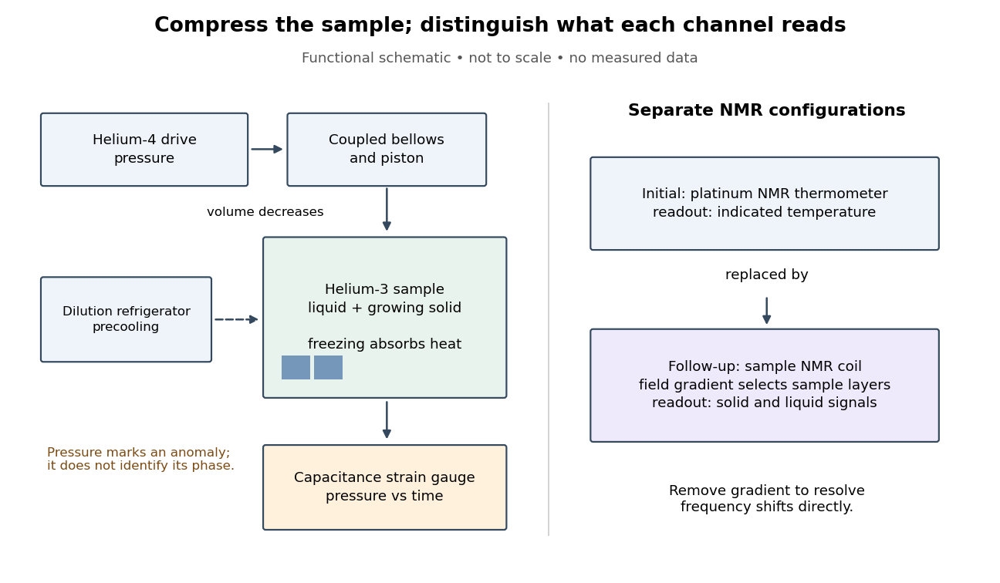

# Helium-3 superfluid discovery experiment

↑ **Parent:** [Helium-3 superfluidity](helium-3-superfluidity.md)

[David Morris Lee](david-morris-lee.md), [Douglas Dean Osheroff](douglas-dean-osheroff.md) and [Robert Coleman Richardson](robert-coleman-richardson.md) compressed coexisting [liquid](liquid.md) and [solid](solid.md) [helium-3](helium-3.md) in a cell precooled by a [dilution refrigerator](dilution-refrigerator.md). [Helium-4](helium-4.md) [pressure](pressure-split.md) drove coupled bellows and a piston; a [capacitance diaphragm gauge](capacitance-diaphragm-gauge.md) read [pressure](pressure-split.md) and platinum [nuclear magnetic resonance](nuclear-magnetic-resonance-split.md) supplied thermometry. Uniform compression revealed a slope break A and a small [pressure](pressure-split.md) drop B; decompression and varied [solid](solid.md) fraction checked reproducibility. Their April 1972 paper, Evidence for a New Phase of Solid He3, interpreted a new [solid](solid.md) phase, without establishing liquid [superfluidity](superfluidity.md). [1972, pp.885–888, Figs.1–3](evidence-for-a-new-phase-of-solid-he3-by-douglas-dean-osheroff-and-others.md)

The October follow-up replaced the thermometer assembly with a sample [nuclear magnetic resonance](nuclear-magnetic-resonance-split.md) coil. An applied [magnetic field](magnetic-field-split.md) [gradient](gradient.md) selected different sample layers, separating strong [solid](solid.md) signals from the [liquid](liquid.md) background. At A the [liquid](liquid.md) resonance shifted; at B its shift disappeared and its [magnetic susceptibility](magnetic-susceptibility.md) fell. Removing the [gradient](gradient.md) resolved the frequency shift directly. Independence from [solid](solid.md) fraction and distinct relaxation times supported the [liquid](liquid.md) assignment. Thus the reinterpretation rested on phase-selective evidence, rather than relabeling the first paper's title. These magnetic observations identify changed [liquid](liquid.md) phases; they do not directly measure frictionless flow. [1972, pp.920–923, Figs.1–3](new-magnetic-phenomena-in-liquid-he3-below-3-mk-by-douglas-dean-osheroff-and-others.md)

[Douglas Dean Osheroff](douglas-dean-osheroff.md) recalls the subsequent p-wave interpretation. [1996 lecture, p.73](superfluidity-in-3he-discovery-and-understanding-by-douglas-dean-osheroff.md)

**[Figure 7](#image-compression-and-independent-readout-channels-in-the-helium-3-superfluid-discovery-experiment). Compression and independent readout channels in the helium-3 superfluid discovery experiment**. Original functional diagram, not a reconstruction to scale. Left: drive, sample and [pressure](pressure-split.md) channel. Right: separate thermometer and sample [nuclear magnetic resonance](nuclear-magnetic-resonance-split.md) configurations; the latter replaces the former in the follow-up. Connections indicate function, not historical wiring.

The inference has a useful limit. A [pressure](pressure-split.md) anomaly in two coexisting phases cannot, by itself, identify which phase changed: both contribute to the common [phase coexistence curve](phase-coexistence-curve.md). Thermometer lag, a [temperature](temperature-split.md) [gradient](gradient.md) or slow equilibration can also separate indicated [temperature](temperature-split.md) from the sample state. Correlating another response with the anomaly provides information that repeating the same [pressure](pressure-split.md) trace cannot supply. Conversely, a shifted magnetic resonance alone does not measure a frictionless flow rate.

## ↑ Ancestors (6)

1. [Helium-3 superfluidity](helium-3-superfluidity.md)
2. [Superfluidity](superfluidity.md)
3. [Statistical physics](statistical-physics-split.md)
4. [Branches of physics](branches-of-physics.md)
5. [Physics](physics-split.md)
6. [Codex Wiki](split.md)

## ← Incoming links (3)

- [Helium-3 superfluid discovery experiment](helium-3-superfluid-discovery-experiment.md)
- [Helium-3 superfluidity](helium-3-superfluidity.md)
- [Nuclear magnetic resonance fingerprint of superfluid helium-3](nuclear-magnetic-resonance-fingerprint-of-superfluid-helium-3.md)
