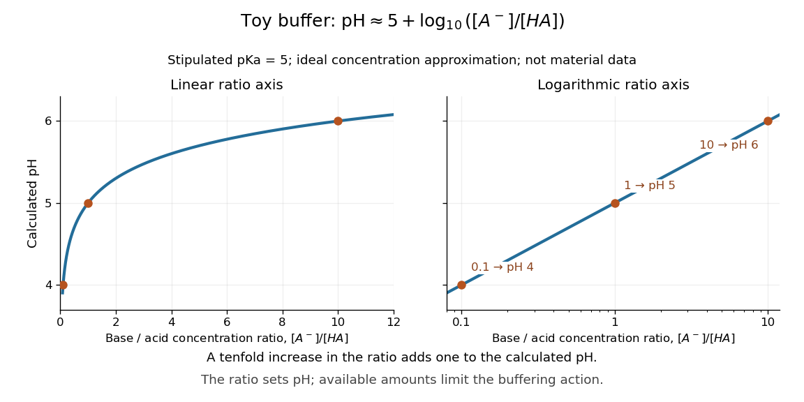

# Henderson-Hasselbalch equation

↑ **Parent:** [Buffer solution](buffer-solution.md)  
ⓦ [Wiki](https://en.wikipedia.org/wiki/Henderson–Hasselbalch_equation)

The [Henderson-Hasselbalch equation](henderson-hasselbalch-equation.md) estimates [buffer solution](buffer-solution.md) [pH](ph.md) using a [weak acid](weak-acid.md)'s [acid dissociation constant](acid-dissociation-constant.md) and the [conjugate base](conjugate-base.md) to [weak acid](weak-acid.md) [concentration](concentration.md) ratio.

Its activity form is an exact rearrangement of the chosen [chemical equilibrium](chemical-equilibrium.md) relation. Write the acid dissociation step as $\mathrm{HA}\rightleftharpoons\mathrm H^++\mathrm A^-$, with hydrated [hydrogen ions](hydrogen-ion.md) understood in [water](water.md) and the [solvent](solvent.md) convention incorporated into the [acid dissociation constant](acid-dissociation-constant.md). For consistent [standard states](standard-state.md),

$$
K_a=\frac{a_{\mathrm H^+}a_{\mathrm A^-}}{a_{\mathrm{HA}}},\qquad
\mathrm pK_a=-\log_{10}K_a,\qquad
\mathrm{pH}=\mathrm pK_a+\log_{10}\!\left(\frac{a_{\mathrm A^-}}{a_{\mathrm{HA}}}\right).
$$

Here each $a_i$ is a [dimensionless](dimensionless-quantity.md) [thermodynamic activity](thermodynamic-activity.md) at [chemical equilibrium](chemical-equilibrium.md). Exactness refers to this specified [acid dissociation constant](acid-dissociation-constant.md) relation and the chosen single-[ion](ion.md) [thermodynamic activity](thermodynamic-activity.md) convention, not to identifying the ratio with quantities initially mixed. If [water](water.md) is instead written explicitly as a [reactant](reactant.md), its [thermodynamic activity](thermodynamic-activity.md) must be treated consistently. See [Hippler and Metcalfe, Using activities to correct the Henderson-Hasselbalch equation (2020), equations 3–4](https://eprints.whiterose.ac.uk/id/eprint/167121/1/BM_5_2020_Unterricht_Hippler_Metcalfe.pdf).

For a toy [weak acid](weak-acid.md) with stipulated [pKa](pka.md) $5$, use the ideal dilute [concentration](concentration.md) approximation and put $r=[\mathrm A^-]/[\mathrm{HA}]$. The [Henderson-Hasselbalch equation](henderson-hasselbalch-equation.md) becomes $\mathrm{pH}\approx5+\log_{10}r$:

$$
r=0.1\ \Rightarrow\ \mathrm{pH}\approx4,\qquad
r=1\ \Rightarrow\ \mathrm{pH}\approx5,\qquad
r=10\ \Rightarrow\ \mathrm{pH}\approx6.
$$

More [conjugate base](conjugate-base.md) relative to [weak acid](weak-acid.md) means higher [pH](ph.md). Each tenfold increase in the ratio contributes exactly one to the calculated [pH](ph.md). The stipulated [pKa](pka.md) is not a tabulated value for an identified substance.

**[Figure 10](#image-toy-pka-5-ratios-0-1-1-and-10-give-calculated-ph-4-5-and-6). Toy pKa $5$: ratios $0.1$, $1$, and $10$ give calculated pH $4$, $5$, and $6$**. Both panels show the same [Henderson-Hasselbalch equation](henderson-hasselbalch-equation.md) in the ideal [concentration](concentration.md) approximation, with linear and [logarithmic scales](logarithmic-scale.md) for the [conjugate base](conjugate-base.md) to [weak acid](weak-acid.md) ratio. The [logarithmic scale](logarithmic-scale.md) turns the curve into a straight line. The plotted range is illustrative, rather than a guarantee of useful [buffer capacity](buffer-capacity.md).

The distinction between [thermodynamic activity](thermodynamic-activity.md) and [concentration](concentration.md) is explicit when $a_i=\gamma_i[i]/c^\circ$, where $\gamma_i$ is an [activity coefficient](activity-coefficient.md) and $c^\circ$ is the reference [concentration](concentration.md):

$$
\mathrm{pH}=\mathrm pK_a+\log_{10}\!\left(\frac{[\mathrm A^-]}{[\mathrm{HA}]}\right)+\log_{10}\!\left(\frac{\gamma_{\mathrm A^-}}{\gamma_{\mathrm{HA}}}\right).
$$

Neglecting the final term gives the usual approximate [Henderson-Hasselbalch equation](henderson-hasselbalch-equation.md). It is justified when the ratio of [activity coefficients](activity-coefficient.md) is sufficiently close to one, as in a suitable dilute ideal approximation. [Ionic strength](ionic-strength.md), including contributions from other dissolved [ions](ion.md), affects [activity coefficients](activity-coefficient.md); a nominally dilute [weak acid](weak-acid.md) alone does not establish that all corrections are small. The ratio must use [chemical equilibrium](chemical-equilibrium.md) [concentrations](concentration.md). Replacing these by prepared amounts or post-[neutralization](neutralization.md) inventories is a further approximation, suitable only when subsequent redistribution is small. See [Hippler and Metcalfe, concentration, activity, and analytical-concentration approximations](https://eprints.whiterose.ac.uk/id/eprint/167121/1/BM_5_2020_Unterricht_Hippler_Metcalfe.pdf).

The short derivation is to solve the [acid dissociation constant](acid-dissociation-constant.md) relation for $a_{\mathrm H^+}$, take a negative base-ten [logarithm](logarithm.md), and use the definitions of [pH](ph.md) and [pKa](pka.md). Its useful beauty is that a [chemical equilibrium](chemical-equilibrium.md) becomes a simple rule about a ratio: select a [weak acid](weak-acid.md) with [pKa](pka.md) near the desired [pH](ph.md), then adjust the partner ratio. Scaling both partner [concentrations](concentration.md) equally leaves the ideal [pH](ph.md) prediction unchanged, while changing [buffer capacity](buffer-capacity.md). In practical [buffer solutions](buffer-solution.md), [temperature](temperature-split.md), [ionic strength](ionic-strength.md), and the available inventories still matter.

## ↑ Ancestors (4)

1. [Buffer solution](buffer-solution.md)
2. [Acid-base chemistry](acid-base-chemistry-split.md)
3. [Chemistry](chemistry-split.md)
4. [Codex Wiki](split.md)

## ← Incoming links (6)

- [Buffer solution](buffer-solution.md)
- [Finite titrant response of a buffer](finite-titrant-response-of-a-buffer.md)
- [Glycine speciation model](glycine-speciation-model.md)
- [Henderson-Hasselbalch equation](henderson-hasselbalch-equation.md)
- [pKa](pka.md)
- [Weak acid dissociation measurement](weak-acid-dissociation-measurement.md)
