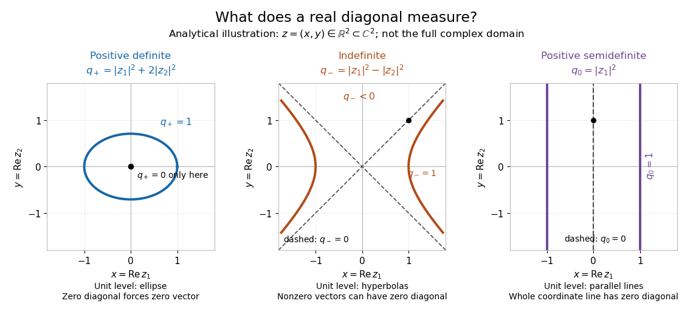

# Hermitian form

↑ **Parent:** [Sesquilinear form](sesquilinear-form.md)

A [Hermitian form](hermitian-form.md) is a [sesquilinear form](sesquilinear-form.md) on a [complex vector space](complex-vector-space.md) satisfying conjugate symmetry,

$$
H(w,v)=\overline{H(v,w)}.
$$

Hence $q(v)=H(v,v)$ is a [real number](real-number.md) for every [vector](vector.md). In a [basis](basis.md), the [matrix of a Hermitian form](matrix-of-a-hermitian-form.md) has $A_{ij}=H(e_i,e_j)$ and obeys $A_{ji}=\overline{A_{ij}}$, equivalently $A=A^*$: it is a [Hermitian matrix](hermitian-operator.md). The coordinate rule remains $H(x,y)=x^T A\overline y$. Conjugate symmetry does not imply positivity.[Burke, Linear Analysis, Lecture 4, Hermitian symmetry](https://sites.math.washington.edu/~burke/crs/554/lectures/b-lecture4.pdf)

The diagonal contains more information than might be expected. For any complex [sesquilinear form](sesquilinear-form.md) $B$, put $q(v)=B(v,v)$. Expanding four expressions gives the complex [polarization identity](polarization-identity.md) in the linear-first convention:

$$
B(u,v)=\frac14\bigl(q(u+v)-q(u-v)+i q(u+iv)-i q(u-iv)\bigr).
$$

This is an algebraic identity, with no positivity assumption. If every $q(v)$ is real, interchanging $u,v$ preserves the first difference and negates the second: use $q(\alpha v)=|\alpha|^2q(v)$ for $\alpha=-1,i$. The identity then gives $B(v,u)=\overline{B(u,v)}$. Thus a complex [sesquilinear form](sesquilinear-form.md) is a [Hermitian form](hermitian-form.md) if and only if all its diagonal values are real. Testing only the [basis vectors](basis-vector.md) is insufficient: the off-diagonal example in [sesquilinear form](sesquilinear-form.md) has zero diagonal entries in its [matrix](matrix.md) but a nonreal value at $(1,i)$.

Consider the [indefinite Hermitian form](indefinite-hermitian-form.md)

$$
H_-(z,w)=z_1\overline{w_1}-z_2\overline{w_2},\qquad q_-(z)=|z_1|^2-|z_2|^2.
$$

Its values at $e_1,e_2$ are $1,-1$. Moreover $u=(1,1)$ and $v=(1,-1)$ are nonzero [isotropic vectors](isotropic-vector.md): $q_-(u)=q_-(v)=0$, yet $H_-(u,v)=2$. These [vectors](vector.md) do not belong to the [radical of a Hermitian form](radical-of-a-hermitian-form.md), and the usual [Cauchy-Schwarz inequality](cauchy-schwarz-inequality.md) would incorrectly require $4\leq0$. An [indefinite Hermitian form](indefinite-hermitian-form.md) records signed geometry rather than defining a [norm](norm.md) by $\sqrt{H(v,v)}$.

There is a separate boundary case: $H_0(z,w)=z_1\overline{w_1}$ is a [positive semidefinite Hermitian form](positive-semidefinite-hermitian-form.md), since $H_0(z,z)=|z_1|^2\geq0$, but $H_0(e_2,e_2)=0$. Its [radical of a Hermitian form](radical-of-a-hermitian-form.md) is the entire second coordinate line. [Positive definiteness](positive-definiteness.md) is exactly the additional condition in a [Hermitian inner product](hermitian-inner-product.md). The three examples below show why these distinctions matter: on the real slice $z=(x,y)\in\mathbb R^2\subset\mathbb C^2$, $q_+(z)=|z_1|^2+2|z_2|^2$ has an [ellipse](ellipse.md) as its unit level, $q_-$ has [hyperbolas](hyperbola.md), and $q_0$ has two parallel lines. These are slices of the complex examples, not drawings of their full four-dimensional domains.

**[Figure 9](#image-analytical-illustration-real-slices-of-positive-definite-indefinite-and-positive-semidefinite-hermitian-forms). Analytical illustration: real slices of positive definite, indefinite, and positive semidefinite Hermitian forms**.

**Table of contents**

- [Hermitian inner product](hermitian-inner-product.md)
- [Hermitian form over a quadratic finite field](hermitian-form-over-a-quadratic-finite-field.md)
  - [Hermitian hyperbolic plane over a finite field](hermitian-hyperbolic-plane-over-a-finite-field.md)
  - [Orthonormalization of a finite-field Hermitian form](orthonormalization-of-a-finite-field-hermitian-form.md)
- [Monomial orthonormal basis on the unit torus](monomial-orthonormal-basis-on-the-unit-torus.md)
- [Radical of a Hermitian form](radical-of-a-hermitian-form.md)
- [Positive semidefinite Hermitian form](positive-semidefinite-hermitian-form.md)
- [Indefinite Hermitian form](indefinite-hermitian-form.md)
- [Matrix of a Hermitian form](matrix-of-a-hermitian-form.md)

## ↑ Ancestors (6)

1. [Sesquilinear form](sesquilinear-form.md)
2. [Linear algebra](linear-algebra-split.md)
3. [Algebra](algebra-split.md)
4. [Area of mathematics](area-of-mathematics.md)
5. [Mathematics](mathematics-split.md)
6. [Codex Wiki](split.md)

## ← Incoming links (54)

- [Anisotropic vector for a form](anisotropic-vector-for-a-form.md)
- [Bilinear form](bilinear-form.md)
- [Hermitian form](hermitian-form.md)
- [Hermitian inner product](hermitian-inner-product.md)
- [Hermitian manifold](hermitian-manifold.md)
- [Hermitian metric on a holomorphic vector bundle](hermitian-metric-on-a-holomorphic-vector-bundle.md)
- [Hermitian metric on a smooth complex vector bundle](hermitian-metric-on-a-smooth-complex-vector-bundle.md)
- [Hermitian operator](hermitian-operator.md)
- [Hermitian quadratic form](hermitian-quadratic-form.md)
- [Hermitian vector bundle](hermitian-vector-bundle.md)
- [Hyperbolic pair](hyperbolic-pair.md)
- [Indefinite Hermitian form](indefinite-hermitian-form.md)
- [Integral Hermitian forms on the square complex torus](integral-hermitian-forms-on-the-square-complex-torus.md)
- [Isometry of a space with a form](isometry-of-a-space-with-a-form.md)
- [Matrix of a Hermitian form](matrix-of-a-hermitian-form.md)
- [Metric compatibility as parallelism of a Hermitian tensor](metric-compatibility-as-parallelism-of-a-hermitian-tensor.md)
- [Monomial orthonormal basis on the unit torus](monomial-orthonormal-basis-on-the-unit-torus.md)
- [Orthogonal complement for a sesquilinear form](orthogonal-complement-for-a-sesquilinear-form.md)
- [Solution](past-exam-of-the-mathematics-course-of-the-university-of-cambridge/2001/ib/paper-3/9b/solution.md)
- [Solution](past-exam-of-the-mathematics-course-of-the-university-of-cambridge/2002/iii/paper-13/1/solution.md)
- [Solution](past-exam-of-the-mathematics-course-of-the-university-of-cambridge/2003/iii/paper-4/1/solution.md)
- [Solution](past-exam-of-the-mathematics-course-of-the-university-of-cambridge/2005/iii/paper-71/2/solution.md)
- [Solution](past-exam-of-the-mathematics-course-of-the-university-of-cambridge/2006/iii/paper-18/1/solution.md)
- [Solution](past-exam-of-the-mathematics-course-of-the-university-of-cambridge/2006/iii/paper-19/2/solution.md)
- [Solution](past-exam-of-the-mathematics-course-of-the-university-of-cambridge/2006/iii/paper-49/4/solution.md)
- [Solution](past-exam-of-the-mathematics-course-of-the-university-of-cambridge/2007/ib/paper-2/10g/i/solution.md)
- [Solution](past-exam-of-the-mathematics-course-of-the-university-of-cambridge/2007/ib/paper-2/10g/iii/solution.md)
- [Solution](past-exam-of-the-mathematics-course-of-the-university-of-cambridge/2009/iii/paper-17/1/a/solution.md)
- [Solution](past-exam-of-the-mathematics-course-of-the-university-of-cambridge/2010/iii/paper-4/5/solution.md)
- [Solution](past-exam-of-the-mathematics-course-of-the-university-of-cambridge/2012/iii/paper-18/2/i/solution.md)
- [Solution](past-exam-of-the-mathematics-course-of-the-university-of-cambridge/2012/iii/paper-18/2/iii/solution.md)
- [Solution](past-exam-of-the-mathematics-course-of-the-university-of-cambridge/2012/iii/paper-18/2/v/solution.md)
- [Solution](past-exam-of-the-mathematics-course-of-the-university-of-cambridge/2013/ib/paper-2/1e/solution.md)
- [Solution](past-exam-of-the-mathematics-course-of-the-university-of-cambridge/2014/iii/paper-17/5/solution.md)
- [Solution](past-exam-of-the-mathematics-course-of-the-university-of-cambridge/2016/iii/paper-118/2/d/solution.md)
- [Solution](past-exam-of-the-mathematics-course-of-the-university-of-cambridge/2016/iii/paper-302/4/solution.md)
- [Solution](past-exam-of-the-mathematics-course-of-the-university-of-cambridge/2017/iii/paper-203/2/c/solution.md)
- [Solution](past-exam-of-the-mathematics-course-of-the-university-of-cambridge/2018/iii/paper-302/4/solution.md)
- [Solution](past-exam-of-the-mathematics-course-of-the-university-of-cambridge/2018/iii/paper-311/4/i/solution.md)
- [Solution](past-exam-of-the-mathematics-course-of-the-university-of-cambridge/2019/iii/paper-138/2/c/solution.md)
- [Solution](past-exam-of-the-mathematics-course-of-the-university-of-cambridge/2021/ib/paper-4/8e/a/solution.md)
- [Solution](past-exam-of-the-mathematics-course-of-the-university-of-cambridge/2022/ib/paper-4/1f/solution.md)
- [Solution](past-exam-of-the-mathematics-course-of-the-university-of-cambridge/2023/iii/paper-126/1/i/solution.md)
- [Solution](past-exam-of-the-mathematics-course-of-the-university-of-cambridge/2025/iii/paper-118/1/solution.md)
- [Solution](past-exam-of-the-mathematics-course-of-the-university-of-cambridge/2025/iii/paper-118/4/solution.md)
- [Positive definiteness](positive-definiteness.md)
- [Positive semidefinite Hermitian form](positive-semidefinite-hermitian-form.md)
- [Radical of a Hermitian form](radical-of-a-hermitian-form.md)
- [Semicharacter of a complex lattice](semicharacter-of-a-complex-lattice.md)
- [Sesquilinear form](sesquilinear-form.md)
- [Twistor Hermitian form](twistor-hermitian-form.md)
- [Unitary transitions of the tautological line over the projective line](unitary-transitions-of-the-tautological-line-over-the-projective-line.md)
- [Witt's theorem](witt-s-theorem.md)
- [Yang-Mills theory coupled to an arbitrary scalar representation](yang-mills-theory-coupled-to-an-arbitrary-scalar-representation.md)
