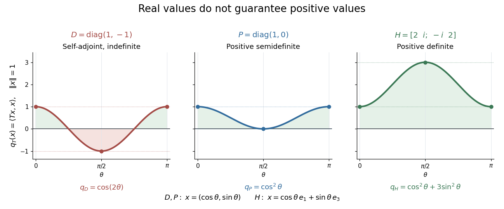

# Hermitian operator

↑ **Parent:** [Adjoint operator](adjoint-operator.md)

A [bounded operator](continuous-linear-operator.md) $T:H\to H$ on a real or complex [Hilbert space](hilbert-space-split.md) is Hermitian, or [self-adjoint](self-adjoint-operator.md), when $T=T^*$. Equivalently,

$$
\langle Tx,y\rangle=\langle x,Ty\rangle\qquad(x,y\in H).
$$

Its directional values $q_T(x)=\langle Tx,x\rangle$ are real, since this identity makes $q_T(x)$ equal its [complex conjugate](complex-conjugate.md). Reality allows either sign; a [positive operator](positive-operator.md) additionally requires nonnegative values in every direction.

**[Figure 4](#image-self-adjoint-directional-values-may-change-sign-touch-zero-or-stay-strictly-positive). Self-adjoint directional values may change sign, touch zero, or stay strictly positive**.

The diagram compares [Hermitian quadratic forms](hermitian-quadratic-form.md) along paths of [unit vectors](unit-vector.md). The [Hermitian matrix](hermitian-operator.md) $D=\operatorname{diag}(1,-1)$ takes the values $1$ and $-1$ on the standard [basis vectors](basis-vector.md); $P=\operatorname{diag}(1,0)$ takes the values $1$ and $0$; and

$$
H=\begin{pmatrix}2&i\\-i&2\end{pmatrix},\qquad e_1=\frac1{\sqrt2}\begin{pmatrix}1\\i\end{pmatrix},\qquad e_3=\frac1{\sqrt2}\begin{pmatrix}1\\-i\end{pmatrix}
$$

satisfies $He_1=e_1$ and $He_3=3e_3$. These [eigenvectors](eigenvector.md) form an [orthonormal basis](orthonormal-basis.md), and every $x=ae_1+be_3$ has $q_H(x)=|a|^2+3|b|^2$. Thus $H$ is a [positive operator](positive-operator.md), with [eigenvalues](eigenvalue.md) $1,3$ and [operator norm](operator-norm.md) $3$.

Three conditions describe different geometry. A [Hermitian operator](hermitian-operator.md) satisfies $T=T^*$; a [normal operator](normal-operator.md) satisfies $T^*T=TT^*$; a [unitary operator](unitary-operator.md) satisfies $T^*T=TT^*=I$, where $I$ is the [identity operator](identity-operator.md). Every [Hermitian operator](hermitian-operator.md) and every [unitary operator](unitary-operator.md) is a [normal operator](normal-operator.md). Concrete [matrices](matrix.md) separate the conditions:

- The [Hermitian matrix](hermitian-operator.md) $H$ above is a [normal operator](normal-operator.md) and a [positive operator](positive-operator.md), but not a [unitary matrix](unitary-matrix.md), because $\|He_3\|=3$.
- $U=\operatorname{diag}(i,1)$ is a [unitary matrix](unitary-matrix.md) and [normal matrix](normal-matrix.md), but not a [Hermitian matrix](hermitian-operator.md), since $U^*=\operatorname{diag}(-i,1)$.
- $N=\operatorname{diag}(2,i)$ is a [normal matrix](normal-matrix.md), but neither a [Hermitian matrix](hermitian-operator.md) nor a [unitary matrix](unitary-matrix.md): its first standard [basis vector](basis-vector.md) doubles in [norm](norm.md).
- $J=\begin{pmatrix}0&1\\0&0\end{pmatrix}$ is not a [normal matrix](normal-matrix.md), since $J^*J=\operatorname{diag}(0,1)$ and $JJ^*=\operatorname{diag}(1,0)$.

The [spectrum](spectrum-functional-analysis.md) of a bounded [Hermitian operator](hermitian-operator.md) is real. In finite [dimension](dimension-vector-space.md), the [spectral theorem](spectral-theorem.md) supplies an [orthonormal basis](orthonormal-basis.md) of [eigenvectors](eigenvector.md), turning its action into independent real scalings. This makes the geometry easy to interpret: each [eigenvalue](eigenvalue.md) records a signed response along an [orthogonal](orthogonal-vectors.md) direction. An arbitrary bounded [Hermitian operator](hermitian-operator.md) in infinite [dimension](dimension-vector-space.md) need not have any [eigenvectors](eigenvector.md); the general [spectral theorem](spectral-theorem.md) uses a [projection-valued measure](projection-valued-measure.md). MIT's lecture 21 develops the real [spectrum](spectrum-functional-analysis.md) and the [orthogonality](orthogonal-vectors.md) of [eigenspaces](eigenspace.md).[Rodriguez, notes by Andrew Lin, MIT 18.102, lecture 21, Theorems 223 and 227, 2021](https://ocw.mit.edu/courses/18-102-introduction-to-functional-analysis-spring-2021/345c4a5141559a4069aeb3105acd8ef3_MIT18_102s21_lec21.pdf)

A historical connection is the study of forms with conjugate variables. In his 1901 account of Charles Hermite's work, Camille Jordan describes these forms and emphasizes their role in reducing forms with real or complex [coefficients](coefficient.md). In today's notation, $x^*Hx$ is the diagonal value of a [Hermitian form](hermitian-form.md); the conjugate variables make a real-valued expression possible even with complex [coefficients](coefficient.md).[Jordan, Notice sur M. Ch. Hermite, Journal de mathématiques pures et appliquées 7, pp. 92 and 95, 1901](https://www.numdam.org/item/JMPA_1901_5_7__91_0.pdf)

For a [densely defined operator](densely-defined-operator.md) outside this bounded setting, the displayed pairing identity alone defines a [symmetric operator](symmetric-operator.md). A [self-adjoint operator](self-adjoint-operator.md) must also have the same [operator domain](operator-domain.md) as its [adjoint operator](adjoint-operator.md).

**Table of contents**

- [Hermitian quadratic form](hermitian-quadratic-form.md)
- [Hermitian part of a matrix](hermitian-part-of-a-matrix.md)
- [Determinant of Hermitian congruence](determinant-of-hermitian-congruence.md)
- [Positive operator](positive-operator.md)
  - [Positive definite symmetric operator](positive-definite-symmetric-operator.md)
    - [Quadratic variational principle for a symmetric positive operator](quadratic-variational-principle-for-a-symmetric-positive-operator.md)
      - [Symmetric part determines a real quadratic functional](symmetric-part-determines-a-real-quadratic-functional.md)
    - [Uniformly positive definite symmetric operator](uniformly-positive-definite-symmetric-operator.md)
  - [Positive contraction](positive-contraction.md)
  - [Support of a positive operator](support-of-a-positive-operator.md)
  - [Positive square root of an operator](positive-square-root-of-an-operator.md)
- [Positive-negative decomposition of a Hermitian operator](positive-negative-decomposition-of-a-hermitian-operator.md)
  - [Negative part of a Hermitian operator](negative-part-of-a-hermitian-operator.md)
  - [Positive part of a Hermitian operator](positive-part-of-a-hermitian-operator.md)
- [Löwner order](lowner-order.md)
  - [Operator monotonicity of the square root](operator-monotonicity-of-the-square-root.md)

## ↑ Ancestors (8)

1. [Adjoint operator](adjoint-operator.md)
2. [Riesz representation theorem](riesz-representation-theorem.md)
3. [Hilbert space](hilbert-space-split.md)
4. [Functional analysis](functional-analysis-split.md)
5. [Analysis](analysis-split.md)
6. [Area of mathematics](area-of-mathematics.md)
7. [Mathematics](mathematics-split.md)
8. [Codex Wiki](split.md)

## ← Incoming links (55)

- [Constant pulse-axis condition for removing time ordering](constant-pulse-axis-condition-for-removing-time-ordering.md)
- [CPT constraints on neutral-meson mixing](cpt-constraints-on-neutral-meson-mixing.md)
- [Diagonal absolute-sum bound for the trace norm](diagonal-absolute-sum-bound-for-the-trace-norm.md)
- [Diagonal logarithm concavity bound](diagonal-logarithm-concavity-bound.md)
- [Embedded two-level quantum rotation](embedded-two-level-quantum-rotation.md)
- [Entanglement witness](entanglement-witness.md)
- [Expectation value](expectation-value.md)
- [Hermitian effect variational principle](hermitian-effect-variational-principle.md)
- [Hermitian operator](hermitian-operator.md)
- [Hermitian quadratic form](hermitian-quadratic-form.md)
- [Involution exponential formula](involution-exponential-formula.md)
- [Löwner order](lowner-order.md)
- [Multiplicity-free complete dyadic spectrum](multiplicity-free-complete-dyadic-spectrum.md)
- [Negative part of a Hermitian operator](negative-part-of-a-hermitian-operator.md)
- [Operator convex function](operator-convex-function.md)
- [Operator monotonicity of logarithm](operator-monotonicity-of-logarithm.md)
- [Solution](past-exam-of-the-mathematics-course-of-the-university-of-cambridge/2002/ib/paper-2/17f/iv/solution.md)
- [Solution](past-exam-of-the-mathematics-course-of-the-university-of-cambridge/2003/ib/paper-2/9a/solution.md)
- [Solution](past-exam-of-the-mathematics-course-of-the-university-of-cambridge/2004/ib/paper-4/11e/i/solution.md)
- [Solution](past-exam-of-the-mathematics-course-of-the-university-of-cambridge/2004/ib/paper-4/11e/ii/solution.md)
- [Solution](past-exam-of-the-mathematics-course-of-the-university-of-cambridge/2004/ib/paper-4/11e/iii/solution.md)
- [Solution](past-exam-of-the-mathematics-course-of-the-university-of-cambridge/2008/ib/paper-4/6a/solution.md)
- [Solution](past-exam-of-the-mathematics-course-of-the-university-of-cambridge/2008/iii/paper-49/2/solution.md)
- [Solution](past-exam-of-the-mathematics-course-of-the-university-of-cambridge/2008/iii/paper-61/3/a/i/solution.md)
- [Solution](past-exam-of-the-mathematics-course-of-the-university-of-cambridge/2009/iii/paper-50/2/a/solution.md)
- [Solution](past-exam-of-the-mathematics-course-of-the-university-of-cambridge/2009/iii/paper-52/1/b/solution.md)
- [Solution](past-exam-of-the-mathematics-course-of-the-university-of-cambridge/2010/iii/paper-50/2/a/solution.md)
- [Solution](past-exam-of-the-mathematics-course-of-the-university-of-cambridge/2010/iii/paper-50/2/c/solution.md)
- [Solution](past-exam-of-the-mathematics-course-of-the-university-of-cambridge/2010/iii/paper-51/2/c/solution.md)
- [Solution](past-exam-of-the-mathematics-course-of-the-university-of-cambridge/2012/iii/paper-65/1/i/solution.md)
- [Solution](past-exam-of-the-mathematics-course-of-the-university-of-cambridge/2015/iii/paper-66/3/i/solution.md)
- [Solution](past-exam-of-the-mathematics-course-of-the-university-of-cambridge/2015/iii/paper-66/3/ii/solution.md)
- [Solution](past-exam-of-the-mathematics-course-of-the-university-of-cambridge/2015/iii/paper-66/3/iii/solution.md)
- [Solution](past-exam-of-the-mathematics-course-of-the-university-of-cambridge/2015/iii/paper-66/3/v/solution.md)
- [Solution](past-exam-of-the-mathematics-course-of-the-university-of-cambridge/2016/iii/paper-323/2/i/solution.md)
- [Solution](past-exam-of-the-mathematics-course-of-the-university-of-cambridge/2016/iii/paper-324/2/a/solution.md)
- [Solution](past-exam-of-the-mathematics-course-of-the-university-of-cambridge/2016/iii/paper-324/4/ii/solution.md)
- [Solution](past-exam-of-the-mathematics-course-of-the-university-of-cambridge/2017/iii/paper-314/3/solution.md)
- [Solution](past-exam-of-the-mathematics-course-of-the-university-of-cambridge/2017/iii/paper-324/3/b/ii/solution.md)
- [Solution](past-exam-of-the-mathematics-course-of-the-university-of-cambridge/2018/ib/paper-3/8b/solution.md)
- [Solution](past-exam-of-the-mathematics-course-of-the-university-of-cambridge/2018/iii/paper-305/1/d/solution.md)
- [Solution](past-exam-of-the-mathematics-course-of-the-university-of-cambridge/2019/ib/paper-3/8b/solution.md)
- [Solution](past-exam-of-the-mathematics-course-of-the-university-of-cambridge/2019/iii/paper-323/1/iii/solution.md)
- [Solution](past-exam-of-the-mathematics-course-of-the-university-of-cambridge/2023/iii/paper-312/1/i/solution.md)
- [Solution](past-exam-of-the-mathematics-course-of-the-university-of-cambridge/2024/ii/paper-1/34b/a/solution.md)
- [Solution](past-exam-of-the-mathematics-course-of-the-university-of-cambridge/2024/iii/paper-325/4/solution.md)
- [Solution](past-exam-of-the-mathematics-course-of-the-university-of-cambridge/2025/iii/paper-323/3/ii/a/solution.md)
- [Positive operator](positive-operator.md)
- [Positive part of a Hermitian operator](positive-part-of-a-hermitian-operator.md)
- [Quantum pulse area](quantum-pulse-area.md)
- [Quantum spectral filtering](quantum-spectral-filtering.md)
- [Relative weak phase condition for time reversal](relative-weak-phase-condition-for-time-reversal.md)
- [Stabilizer code](stabilizer-code.md)
- [Trace norm](trace-norm.md)
- [Trace-norm variational principle for Hermitian operators](trace-norm-variational-principle-for-hermitian-operators.md)
