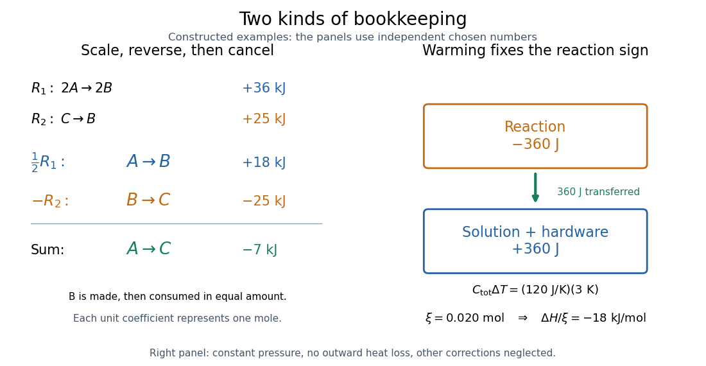

<h1 id="hess-s-law-calorimetry-experiment">Hess's law calorimetry experiment</h1>

↑ **Parent:** [Hess's law](hess-s-law.md)

A practical test compares three transformations involving [sodium hydroxide](sodium-hydroxide.md): [dissolution](dissolution.md) of the [solid](solid.md), [neutralization](neutralization.md) of its [chemical solution](solution-chemistry.md) by [hydrochloric acid](hydrochloric-acid.md), and reaction of the [solid](solid.md) directly with [hydrochloric acid](hydrochloric-acid.md). In the ideal compatible-state notation, the [hydrogen ion](hydrogen-ion.md) and [hydroxide](hydroxide.md) give

$$
\begin{aligned}
D:&\quad\mathrm{NaOH(s)\longrightarrow Na^+(aq)+OH^-(aq)},\\
N:&\quad\mathrm{H^+(aq)+OH^-(aq)\longrightarrow H_2O(l)},\\
D+N:&\quad\mathrm{NaOH(s)+H^+(aq)\longrightarrow Na^+(aq)+H_2O(l)}.
\end{aligned}
$$

The [hydroxide](hydroxide.md) cancels, whereas the newly formed [water](water.md) remains. [Sodium](sodium.md) and [chloride](chloride.md) [spectator ions](spectator-ion.md) must still be included in the full material inventory when matching actual [chemical solutions](solution-chemistry.md).

The teaching protocol [Calorimetry: Heat of Neutralization Reaction & Hess's Law](https://www.pc.maricopa.edu/chemistry/151LLWeb/caloimetry.htm), Procedure A–C, uses nested insulated cups, a cardboard lid and a [thermometer](thermometer.md). It mixes $75\,\mathrm{mL}$ each of $2.0\,\mathrm{mol\,L^{-1}}$ [hydrochloric acid](hydrochloric-acid.md) and [sodium hydroxide](sodium-hydroxide.md) [chemical solutions](solution-chemistry.md); separately it adds $6.00\,\mathrm g$ [solid](solid.md) [sodium hydroxide](sodium-hydroxide.md) to diluted [hydrochloric acid](hydrochloric-acid.md), or to $150\,\mathrm{mL}$ [water](water.md). It records initial [temperatures](temperature-split.md), stirs, reads [temperature](temperature-split.md) every $30\,\mathrm s$, repeats runs, and extrapolates cooling trends to mixing time. Rapid weighing limits moisture uptake. The Introduction neglects vessel [heat capacity](heat-capacity.md) and room losses; these are approximations, not a measured calibration. The readout tests whether the inferred [enthalpies](enthalpy-split.md) add, rather than directly measuring a [state function](state-function.md).[Introduction; Procedure A.1–8, B.1–5 and C.1–6; Additional Data Treatment: cup approximation, preparation, repeat runs and mixing-time extrapolation](calorimetry-heat-of-neutralization-reaction-and-hess-s-law-chemistry-151ll.md)

Matching the [chemical equations](chemical-equation.md) alone is insufficient. The direct-acid recipe uses $0.160\,\mathrm{mol}$ [hydrochloric acid](hydrochloric-acid.md), whereas the solution-mixing recipe uses $0.150\,\mathrm{mol}$. The [dissolution](dissolution.md) run also does not automatically reproduce the [water](water.md) inventory of the mixed-solution run. Exact closure requires matching initial and final [chemical solution](solution-chemistry.md) compositions and adding any necessary mixing or [dilution](dilution.md) [enthalpies](enthalpy-split.md). Agreement after approximate corrections is a limited test, rather than proof of exact cancellation for those recipes.

To improve the [calorimetry](calorimetry-split.md), use [calorimeter calibration](calorimeter-calibration.md) for the participating hardware, and estimate [calorimeter heat-loss correction](calorimeter-heat-loss-correction.md) under comparable conditions. With an approximately constant total receiving [heat capacity](heat-capacity.md) $C_{\rm tot}=mc_p+C_{\rm cal}$, common initial [temperature](temperature-split.md), constant external [pressure](pressure-split.md), only expansion [work](work.md), negligible escaping material and negligible bulk [kinetic energy](kinetic-energy.md) and [potential energy](potential-energy.md) changes, the balance is

$$
q_{\rm rxn}+C_{\rm tot}\Delta T+Q_{\rm loss,out}=0,\qquad
\Delta H_{\rm rxn}=q_{\rm rxn}.
$$

Here $m$ is the [chemical solution](solution-chemistry.md) [mass](mass.md), $c_p$ its [specific heat capacity at constant pressure](specific-heat-capacity-at-constant-pressure.md), $C_{\rm cal}$ the hardware [heat capacity](heat-capacity.md), and $Q_{\rm loss,out}$ the signed outward [heat](heat-split.md) loss. Different initial [temperatures](temperature-split.md) require separate warming terms. [Calorimeter calibration](calorimeter-calibration.md) and matching [chemical solution](solution-chemistry.md) compositions address different errors.

For an original constructed model, choose $C_{\rm tot}=120\,\mathrm{J\,K^{-1}}$ and $\Delta T=3\,\mathrm K$. Neglect outward [heat](heat-split.md) loss and other corrections. The receiving [chemical solution](solution-chemistry.md) and hardware gain $q_{\rm receiver}=360\,\mathrm J$, so $q_{\rm rxn}=-360\,\mathrm J$. If the completed [extent of reaction](extent-of-reaction.md) is $\xi=0.020\,\mathrm{mol}$ for a unit-coefficient [chemical equation](chemical-equation.md), the inferred reaction [enthalpy](enthalpy-split.md) per [mole](mole-unit.md) of that reaction is

$$
\frac{\Delta H_{\rm rxn}}{\xi}
=\frac{-360\,\mathrm J}{0.020\,\mathrm{mol}}
=-18\,\mathrm{kJ\,mol^{-1}}.
$$

These chosen numbers illustrate the signs and normalization; they are not measured [sodium hydroxide](sodium-hydroxide.md) data and are independent of the abstract $A,B,C$ example.

**[Figure 9](#image-hess-law-cancellation-and-calorimetry). Stoichiometry cancels intermediate states; calorimetry converts warming into signed reaction enthalpy**. Left: original abstract [chemical equations](chemical-equation.md) use $\tfrac12R_1-R_2$ to give $A\to C$ and $-7\,\mathrm{kJ}$ for one [mole](mole-unit.md). Right: an independent chosen [heat capacity](heat-capacity.md) model gives receiver gain $+360\,\mathrm J$ and reaction change $-360\,\mathrm J$. Neither panel reports experimental measurements.

A loss of [heat](heat-split.md) to the room makes the uncorrected warming underestimate the magnitude of a heat-releasing reaction. Incomplete [dissolution](dissolution.md), incomplete reaction, uncertain [amount of substance](amount-of-substance.md), or a slow [thermometer](thermometer.md) response can also spoil closure. A useful experimental residual is $r=\Delta H_{\rm direct}-(\Delta H_D+\Delta H_N)$ after all changes have been placed on the same amount and state basis. Compare $r$ with the [measurement uncertainty](measurement-uncertainty.md), accounting for shared calibration errors; averaging repeated runs reduces scatter without removing a common bias.

## ↑ Ancestors (4)

1. [Hess's law](hess-s-law.md)
2. [Thermochemistry](thermochemistry.md)
3. [Chemistry](chemistry-split.md)
4. [Codex Wiki](split.md)
