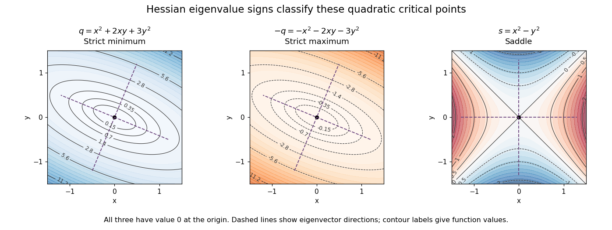

# Hessian matrix

↑ **Parent:** [Multivariable calculus](multivariable-calculus.md)  
ⓦ [Wiki](https://en.wikipedia.org/wiki/Hessian_matrix)

The [Hessian matrix](hessian-matrix.md) describes how the slope of a [function](function-split.md) changes in different directions. For a real-valued [function](function-split.md) $f$ with continuous second [partial derivatives](partial-derivative.md) on an [open subset](open-set.md) of $\mathbb R^n$, it is

$$
H_f(x)=\left(\frac{\partial^2 f}{\partial x_i\partial x_j}(x)\right)_{i,j=1}^n.
$$

The [symmetry of second derivatives](symmetry-of-second-derivatives.md) makes $H_f$ a [symmetric matrix](symmetric-matrix.md) under these hypotheses. It is also the [Jacobian matrix](jacobian-matrix.md) of the [gradient](gradient.md): near $x$, a small displacement $h$ changes $\nabla f$ by $H_f(x)h+o(\|h\|)$. Thus the [gradient](gradient.md) measures the current slope, while the [Hessian](hessian-matrix.md) measures its local variation. [MIT 18.S096 matrix calculus notes, §12.1: Hessian matrices of scalar-valued functions](https://ocw.mit.edu/courses/18-s096-matrix-calculus-for-machine-learning-and-beyond-january-iap-2023/mit18_s096iap23_lec12.pdf)

For example, take the [quadratic form](quadratic-form.md)

$$
q(x,y)=x^2+2xy+3y^2.
$$

Its [gradient](gradient.md) and [Hessian matrix](hessian-matrix.md) are

$$
\nabla q=(2x+2y,2x+6y)^T,
\qquad
H_q=\begin{pmatrix}2&2\\2&6\end{pmatrix}.
$$

The only [critical point](critical-point.md) is the origin. Completing the square gives $q=(x+y)^2+2y^2$, so the origin is a strict [global minimum](global-minimum.md). The [eigenvalues](eigenvalue.md) $4-2\sqrt2$ and $4+2\sqrt2$ are both positive, recovering the same conclusion from the [positive definiteness](positive-definiteness.md) of the [Hessian](hessian-matrix.md). Its [eigenvectors](eigenvector.md) identify the rotated directions in which the [quadratic form](quadratic-form.md) has its smallest and largest bending.

**[Figure 30](#image-positive-negative-and-mixed-hessian-eigenvalues-produce-different-critical-point-geometry). Positive, negative and mixed Hessian eigenvalues produce different critical-point geometry**. Contour plots of $q=x^2+2xy+3y^2$, $-q$, and $s=x^2-y^2$. All three have a [critical point](critical-point.md) at the origin; the first two have elliptical contours, while the last has positive and negative sectors meeting along its zero contours.

For a fixed [vector](vector.md) $v$, restriction to a [straight line](straight-line.md) gives the directional interpretation

$$
\left.\frac{d^2}{dt^2}f(x+tv)\right|_{t=0}=v^TH_f(x)v.
$$

This is the [quadratic form](quadratic-form.md) associated with the [Hessian matrix](hessian-matrix.md). For a unit [eigenvector](eigenvector.md) $v$, it equals the corresponding [eigenvalue](eigenvalue.md). Opposite signs therefore mean that some directions bend upwards and others downwards. The [second-derivative test](second-derivative-test.md) turns this information into a classification when the [gradient](gradient.md) vanishes.

The same object is useful for computation. [Newton's method in optimization](newton-s-method-in-optimization.md) chooses a displacement $h$ by solving $H_f(x)h=-\nabla f(x)$ when the [Hessian matrix](hessian-matrix.md) is an [invertible matrix](invertible-matrix.md); this makes the [gradient](gradient.md) of the local quadratic model vanish. For the displayed $q$, the equation gives $h=-(x,y)^T$, so one exact step reaches the minimum from any starting point. For a general [function](function-split.md), a [Hessian](hessian-matrix.md) with opposite-sign [eigenvalues](eigenvalue.md) or a large [condition number](condition-number.md) need not give a useful minimizing step, and the [local minimum](local-minimum.md) need not be a [global minimum](global-minimum.md).

The name honors Otto Hesse. [MIT World Web Math: the Hessian and its namesake](https://web.mit.edu/course/other/wwmath/vectorc/minmax/hessian.html) An older geometric use is the [Hessian criterion for flexes of a plane cubic](hessian-criterion-for-flexes-of-a-plane-cubic.md), connecting a [determinant](determinant.md) of second [partial derivatives](partial-derivative.md) with inflection points of an algebraic [curve](curve.md). Hesse's 1844 paper _Über die Wendepuncte der Curven dritter Ordnung_ is an early source on that geometric problem. [Hesse (1844), Journal für die reine und angewandte Mathematik 28, pp. 97–107: publisher's bibliographic record](https://www.degruyterbrill.com/document/doi/10.1515/crll.1844.28.97/html)

**Table of contents**

- [Quadratic growth from a bounded Hessian](quadratic-growth-from-a-bounded-hessian.md)
- [Higher-order test for separated extrema](higher-order-test-for-separated-extrema.md)
- [Negative semidefinite matrix](negative-semidefinite-matrix.md)
- [Second-derivative test](second-derivative-test.md)
  - [Critical points escaping to infinity in a Gaussian-weighted bilinear function](critical-points-escaping-to-infinity-in-a-gaussian-weighted-bilinear-function.md)
- [Nondegenerate critical point](nondegenerate-critical-point.md)

## ↑ Ancestors (7)

1. [Multivariable calculus](multivariable-calculus.md)
2. [Calculus](calculus-split.md)
3. [Real analysis](real-analysis-split.md)
4. [Analysis](analysis-split.md)
5. [Area of mathematics](area-of-mathematics.md)
6. [Mathematics](mathematics-split.md)
7. [Codex Wiki](split.md)

## ← Incoming links (158)

- [Accidental massless radial modes beyond Goldstone modes](accidental-massless-radial-modes-beyond-goldstone-modes.md)
- [Accidental massless scalar](accidental-massless-scalar.md)
- [Blow-up compactness proof of an interior Schauder estimate](blow-up-compactness-proof-of-an-interior-schauder-estimate.md)
- [Bradley-Terry likelihood Hessian](bradley-terry-likelihood-hessian.md)
- [Constrained electrostatic equilibrium](constrained-electrostatic-equilibrium.md)
- [Convex function](convex-function.md)
- [Convex optimization](convex-optimization-split.md)
- [Convexity domain of x cubed plus y cubed plus Axy](convexity-domain-of-x-cubed-plus-y-cubed-plus-axy.md)
- [Critical points escaping to infinity in a Gaussian-weighted bilinear function](critical-points-escaping-to-infinity-in-a-gaussian-weighted-bilinear-function.md)
- [Diagonal trace Morse function on a complex Grassmannian](diagonal-trace-morse-function-on-a-complex-grassmannian.md)
- [Direct spherical-shell H2 estimate](direct-spherical-shell-h2-estimate.md)
- [Euler theorem for homogeneous functions](euler-theorem-for-homogeneous-functions.md)
- [Flat direction of a scalar potential](flat-direction-of-a-scalar-potential.md)
- [Global characteristic flow for a Hamiltonian with bounded Hessian](global-characteristic-flow-for-a-hamiltonian-with-bounded-hessian.md)
- [Goldstone directions in the scalar mass matrix](goldstone-directions-in-the-scalar-mass-matrix.md)
- [Hessian criterion for a flex](hessian-criterion-for-a-flex.md)
- [Hessian criterion for flexes of a plane cubic](hessian-criterion-for-flexes-of-a-plane-cubic.md)
- [Hessian curve of a plane cubic](hessian-curve-of-a-plane-cubic.md)
- [Hessian matrix](hessian-matrix.md)
- [Higher-order saddle test](higher-order-saddle-test.md)
- [Higher-order test for separated extrema](higher-order-test-for-separated-extrema.md)
- [Incompressible magnetic displacement energy identity](incompressible-magnetic-displacement-energy-identity.md)
- [Integral first-order Taylor formula for a vector map](integral-first-order-taylor-formula-for-a-vector-map.md)
- [Interior gradient regularity for uniformly convex autonomous energies](interior-gradient-regularity-for-uniformly-convex-autonomous-energies.md)
- [Interior moment matching in a finite exponential family](interior-moment-matching-in-a-finite-exponential-family.md)
- [Inverse-variance weighted mean](inverse-variance-weighted-mean.md)
- [Laplace approximation](laplace-approximation.md)
- [Laplacian at a local maximum](laplacian-at-a-local-maximum.md)
- [Local maximum](local-maximum.md)
- [Local minimum](local-minimum.md)
- [Log-likelihood](log-likelihood.md)
- [Magnetocentrifugal launching criterion in a flattened power-law potential](magnetocentrifugal-launching-criterion-in-a-flattened-power-law-potential.md)
- [Maximum principle for subharmonic functions](maximum-principle-for-subharmonic-functions.md)
- [Mean-curvature comparison at tangential contact](mean-curvature-comparison-at-tangential-contact.md)
- [Minimal exponential family](minimal-exponential-family.md)
- [Morse-Bott critical manifold](morse-bott-critical-manifold.md)
- [Morse index](morse-index.md)
- [Necessity of Hölder forcing for Schauder estimates](necessity-of-holder-forcing-for-schauder-estimates.md)
- [No-scale identity from degree-one homogeneity](no-scale-identity-from-degree-one-homogeneity.md)
- [Nondegenerate critical point](nondegenerate-critical-point.md)
- [Nondegenerate stationary point of a phase](nondegenerate-stationary-point-of-a-phase.md)
- [Nondivergence-form elliptic operator](nondivergence-form-elliptic-operator.md)
- [Nonisolated stationary point](nonisolated-stationary-point.md)
- [Oscillatory integral phase](oscillatory-integral-phase.md)
- [Parabolic quartic critical-point classification](parabolic-quartic-critical-point-classification.md)
- [Solution](past-exam-of-the-mathematics-course-of-the-university-of-cambridge/2001/ia/paper-3/9c/solution.md)
- [Solution](past-exam-of-the-mathematics-course-of-the-university-of-cambridge/2001/iii/paper-32/2/solution.md)
- [Solution](past-exam-of-the-mathematics-course-of-the-university-of-cambridge/2001/iii/paper-32/6/i/solution.md)
- [Solution](past-exam-of-the-mathematics-course-of-the-university-of-cambridge/2001/iii/paper-52/1/solution.md)
- [Solution](past-exam-of-the-mathematics-course-of-the-university-of-cambridge/2001/iii/paper-63/1/solution.md)
- [Solution](past-exam-of-the-mathematics-course-of-the-university-of-cambridge/2002/ia/paper-3/9a/solution.md)
- [Solution](past-exam-of-the-mathematics-course-of-the-university-of-cambridge/2002/iii/paper-45/2/e/solution.md)
- [Solution](past-exam-of-the-mathematics-course-of-the-university-of-cambridge/2003/iii/paper-27/2/solution.md)
- [Solution](past-exam-of-the-mathematics-course-of-the-university-of-cambridge/2003/iii/paper-27/3/solution.md)
- [Solution](past-exam-of-the-mathematics-course-of-the-university-of-cambridge/2003/iii/paper-27/4/solution.md)
- [Solution](past-exam-of-the-mathematics-course-of-the-university-of-cambridge/2003/iii/paper-27/5/solution.md)
- [Solution](past-exam-of-the-mathematics-course-of-the-university-of-cambridge/2003/iii/paper-51/1/solution.md)
- [Solution](past-exam-of-the-mathematics-course-of-the-university-of-cambridge/2004/iii/paper-37/1/i/solution.md)
- [Solution](past-exam-of-the-mathematics-course-of-the-university-of-cambridge/2004/iii/paper-48/1/solution.md)
- [Solution](past-exam-of-the-mathematics-course-of-the-university-of-cambridge/2004/iii/paper-68/1/a/solution.md)
- [Solution](past-exam-of-the-mathematics-course-of-the-university-of-cambridge/2004/iii/paper-68/1/b/solution.md)
- [Solution](past-exam-of-the-mathematics-course-of-the-university-of-cambridge/2005/ia/paper-3/11a/solution.md)
- [Solution](past-exam-of-the-mathematics-course-of-the-university-of-cambridge/2005/iii/paper-25/1/solution.md)
- [Solution](past-exam-of-the-mathematics-course-of-the-university-of-cambridge/2005/iii/paper-25/2/solution.md)
- [Solution](past-exam-of-the-mathematics-course-of-the-university-of-cambridge/2005/iii/paper-41/2/solution.md)
- [Solution](past-exam-of-the-mathematics-course-of-the-university-of-cambridge/2005/iii/paper-41/3/i/solution.md)
- [Solution](past-exam-of-the-mathematics-course-of-the-university-of-cambridge/2005/iii/paper-71/2/solution.md)
- [Solution](past-exam-of-the-mathematics-course-of-the-university-of-cambridge/2006/iii/paper-42/4/i/solution.md)
- [Solution](past-exam-of-the-mathematics-course-of-the-university-of-cambridge/2008/ii/paper-1/5j/solution.md)
- [Solution](past-exam-of-the-mathematics-course-of-the-university-of-cambridge/2008/ii/paper-1/7a/i/solution.md)
- [Solution](past-exam-of-the-mathematics-course-of-the-university-of-cambridge/2008/iii/paper-13/1/c/solution.md)
- [Solution](past-exam-of-the-mathematics-course-of-the-university-of-cambridge/2008/iii/paper-25/5/c/solution.md)
- [Solution](past-exam-of-the-mathematics-course-of-the-university-of-cambridge/2008/iii/paper-28/2/i/solution.md)
- [Solution](past-exam-of-the-mathematics-course-of-the-university-of-cambridge/2008/iii/paper-42/5/solution.md)
- [Solution](past-exam-of-the-mathematics-course-of-the-university-of-cambridge/2008/iii/paper-56/3/solution.md)
- [Solution](past-exam-of-the-mathematics-course-of-the-university-of-cambridge/2009/ia/paper-4/12a/b/solution.md)
- [Solution](past-exam-of-the-mathematics-course-of-the-university-of-cambridge/2009/ib/paper-4/12g/solution.md)
- [Solution](past-exam-of-the-mathematics-course-of-the-university-of-cambridge/2009/iii/paper-12/1/ii/solution.md)
- [Solution](past-exam-of-the-mathematics-course-of-the-university-of-cambridge/2010/ia/paper-2/8a/a/solution.md)
- [Solution](past-exam-of-the-mathematics-course-of-the-university-of-cambridge/2010/ia/paper-2/8a/b/solution.md)
- [Solution](past-exam-of-the-mathematics-course-of-the-university-of-cambridge/2010/ia/paper-2/8a/c/solution.md)
- [Solution](past-exam-of-the-mathematics-course-of-the-university-of-cambridge/2010/iii/paper-32/3/solution.md)
- [Solution](past-exam-of-the-mathematics-course-of-the-university-of-cambridge/2011/ia/paper-2/6a/b/iii/solution.md)
- [Solution](past-exam-of-the-mathematics-course-of-the-university-of-cambridge/2012/ia/paper-2/6a/solution.md)
- [Solution](past-exam-of-the-mathematics-course-of-the-university-of-cambridge/2012/iii/paper-39/2/solution.md)
- [Solution](past-exam-of-the-mathematics-course-of-the-university-of-cambridge/2013/ia/paper-2/6a/solution.md)
- [Solution](past-exam-of-the-mathematics-course-of-the-university-of-cambridge/2013/iii/paper-38/1/a/solution.md)
- [Solution](past-exam-of-the-mathematics-course-of-the-university-of-cambridge/2013/iii/paper-45/1/a/solution.md)
- [Solution](past-exam-of-the-mathematics-course-of-the-university-of-cambridge/2014/iii/paper-16/1/b/solution.md)
- [Solution](past-exam-of-the-mathematics-course-of-the-university-of-cambridge/2014/iii/paper-30/1/solution.md)
- [Solution](past-exam-of-the-mathematics-course-of-the-university-of-cambridge/2014/iii/paper-43/3/d/solution.md)
- [Solution](past-exam-of-the-mathematics-course-of-the-university-of-cambridge/2015/iii/paper-10/3/2/solution.md)
- [Solution](past-exam-of-the-mathematics-course-of-the-university-of-cambridge/2015/iii/paper-72/2/b/solution.md)
- [Solution](past-exam-of-the-mathematics-course-of-the-university-of-cambridge/2015/iii/paper-9/2/a/solution.md)
- [Solution](past-exam-of-the-mathematics-course-of-the-university-of-cambridge/2015/iii/paper-9/4/a/solution.md)
- [Solution](past-exam-of-the-mathematics-course-of-the-university-of-cambridge/2016/ib/paper-1/4c/a/solution.md)
- [Solution](past-exam-of-the-mathematics-course-of-the-university-of-cambridge/2016/iii/paper-107/1/solution.md)
- [Solution](past-exam-of-the-mathematics-course-of-the-university-of-cambridge/2016/iii/paper-117/1/solution.md)
- [Solution](past-exam-of-the-mathematics-course-of-the-university-of-cambridge/2016/iii/paper-206/2/f/solution.md)
- [Solution](past-exam-of-the-mathematics-course-of-the-university-of-cambridge/2016/iii/paper-305/2/a/solution.md)
- [Solution](past-exam-of-the-mathematics-course-of-the-university-of-cambridge/2016/iii/paper-307/4/solution.md)
- [Solution](past-exam-of-the-mathematics-course-of-the-university-of-cambridge/2016/iii/paper-316/2/solution.md)
- [Solution](past-exam-of-the-mathematics-course-of-the-university-of-cambridge/2017/ia/paper-2/2c/solution.md)
- [Solution](past-exam-of-the-mathematics-course-of-the-university-of-cambridge/2017/ii/paper-4/27k/a/solution.md)
- [Solution](past-exam-of-the-mathematics-course-of-the-university-of-cambridge/2017/iii/paper-105/2/f/solution.md)
- [Solution](past-exam-of-the-mathematics-course-of-the-university-of-cambridge/2017/iii/paper-107/1/a/solution.md)
- [Solution](past-exam-of-the-mathematics-course-of-the-university-of-cambridge/2017/iii/paper-107/4/solution.md)
- [Solution](past-exam-of-the-mathematics-course-of-the-university-of-cambridge/2017/iii/paper-206/1/f/solution.md)
- [Solution](past-exam-of-the-mathematics-course-of-the-university-of-cambridge/2017/iii/paper-307/3/solution.md)
- [Solution](past-exam-of-the-mathematics-course-of-the-university-of-cambridge/2017/iii/paper-309/2/c/solution.md)
- [Solution](past-exam-of-the-mathematics-course-of-the-university-of-cambridge/2018/ii/paper-4/29k/c/solution.md)
- [Solution](past-exam-of-the-mathematics-course-of-the-university-of-cambridge/2018/iii/paper-107/2/a/solution.md)
- [Solution](past-exam-of-the-mathematics-course-of-the-university-of-cambridge/2018/iii/paper-107/4/solution.md)
- [Solution](past-exam-of-the-mathematics-course-of-the-university-of-cambridge/2018/iii/paper-219/1/iii/solution.md)
- [Solution](past-exam-of-the-mathematics-course-of-the-university-of-cambridge/2018/iii/paper-314/3/c/solution.md)
- [Solution](past-exam-of-the-mathematics-course-of-the-university-of-cambridge/2019/ii/paper-3/5j/a/solution.md)
- [Solution](past-exam-of-the-mathematics-course-of-the-university-of-cambridge/2019/iii/paper-107/2/ii/solution.md)
- [Solution](past-exam-of-the-mathematics-course-of-the-university-of-cambridge/2019/iii/paper-219/1/b/solution.md)
- [Solution](past-exam-of-the-mathematics-course-of-the-university-of-cambridge/2019/iii/paper-303/2/a/solution.md)
- [Solution](past-exam-of-the-mathematics-course-of-the-university-of-cambridge/2019/iii/paper-304/1/c/solution.md)
- [Solution](past-exam-of-the-mathematics-course-of-the-university-of-cambridge/2019/iii/paper-305/2/a/solution.md)
- [Solution](past-exam-of-the-mathematics-course-of-the-university-of-cambridge/2019/iii/paper-344/2/d/solution.md)
- [Solution](past-exam-of-the-mathematics-course-of-the-university-of-cambridge/2019/iii/paper-346/3/solution.md)
- [Solution](past-exam-of-the-mathematics-course-of-the-university-of-cambridge/2019/iii/paper-348/2/b/i/solution.md)
- [Solution](past-exam-of-the-mathematics-course-of-the-university-of-cambridge/2019/iii/paper-348/2/b/ii/solution.md)
- [Solution](past-exam-of-the-mathematics-course-of-the-university-of-cambridge/2021/ii/paper-2/2h/i/solution.md)
- [Solution](past-exam-of-the-mathematics-course-of-the-university-of-cambridge/2021/iii/paper-305/3/a/solution.md)
- [Solution](past-exam-of-the-mathematics-course-of-the-university-of-cambridge/2022/ia/paper-2/6a/a/solution.md)
- [Solution](past-exam-of-the-mathematics-course-of-the-university-of-cambridge/2022/ia/paper-2/6a/b/solution.md)
- [Solution](past-exam-of-the-mathematics-course-of-the-university-of-cambridge/2022/ia/paper-2/8b/b/solution.md)
- [Solution](past-exam-of-the-mathematics-course-of-the-university-of-cambridge/2022/ib/paper-1/7h/solution.md)
- [Solution](past-exam-of-the-mathematics-course-of-the-university-of-cambridge/2022/ii/paper-3/2g/i/solution.md)
- [Solution](past-exam-of-the-mathematics-course-of-the-university-of-cambridge/2023/ib/paper-3/4c/solution.md)
- [Solution](past-exam-of-the-mathematics-course-of-the-university-of-cambridge/2023/ii/paper-3/25g/c/solution.md)
- [Solution](past-exam-of-the-mathematics-course-of-the-university-of-cambridge/2023/iii/paper-339/1/c/solution.md)
- [Solution](past-exam-of-the-mathematics-course-of-the-university-of-cambridge/2023/iii/paper-339/1/d/solution.md)
- [Solution](past-exam-of-the-mathematics-course-of-the-university-of-cambridge/2025/iii/paper-107/3/a/solution.md)
- [Solution](past-exam-of-the-mathematics-course-of-the-university-of-cambridge/2026/ia/paper-2/6c/i/solution.md)
- [Solution](past-exam-of-the-mathematics-course-of-the-university-of-cambridge/2026/iii/paper-313/1/b/ii/solution.md)
- [Product of Morse functions](product-of-morse-functions.md)
- [Quadratic growth from a bounded Hessian](quadratic-growth-from-a-bounded-hessian.md)
- [Quadratically weighted inverse-radius Hessian integral](quadratically-weighted-inverse-radius-hessian-integral.md)
- [Radial and angular modes of an orthogonally invariant scalar potential](radial-and-angular-modes-of-an-orthogonally-invariant-scalar-potential.md)
- [Regular Lagrangian](regular-lagrangian.md)
- [Saddle point of a scalar function](saddle-point-of-a-scalar-function.md)
- [Scalar mass matrix](scalar-mass-matrix.md)
- [Second-derivative test](second-derivative-test.md)
- [Smooth completing-square proof of the Morse lemma](smooth-completing-square-proof-of-the-morse-lemma.md)
- [Special Lagrangian graph equation](special-lagrangian-graph-equation.md)
- [Stable equilibrium in Lagrangian mechanics](stable-equilibrium-in-lagrangian-mechanics.md)
- [Taylor normalization in elliptic blow-up arguments](taylor-normalization-in-elliptic-blow-up-arguments.md)
- [Tidal tensor](tidal-tensor.md)
- [Tidal torque theory](tidal-torque-theory.md)
- [Time-reversal invariance of a path Jacobian](time-reversal-invariance-of-a-path-jacobian.md)
- [Tree-level supertrace mass sum rule](tree-level-supertrace-mass-sum-rule.md)
- [Two-dimensional stationary-phase formula](two-dimensional-stationary-phase-formula.md)
- [Uniformly convex variational integrand](uniformly-convex-variational-integrand.md)
- [Unique smooth flex of a cuspidal cubic](unique-smooth-flex-of-a-cuspidal-cubic.md)
