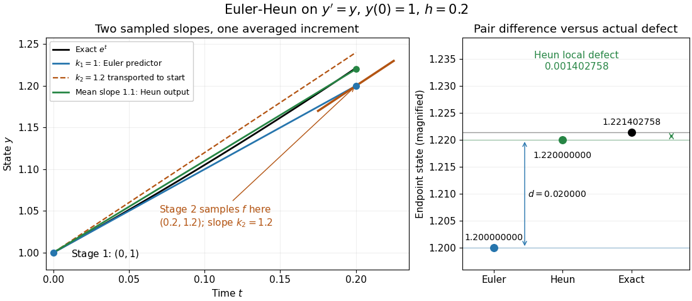

<h1 id="heun-s-method">Heun's method</h1>

↑ **Parent:** [Explicit Runge-Kutta method](explicit-runge-kutta-method.md)  
ⓦ [Wiki](https://en.wikipedia.org/wiki/Heun's_method)

Here Heun's method means the explicit endpoint-averaging [Runge-Kutta method](runge-kutta-method-split.md): take an Euler predictor $Y_2=y_n+hf(t_n,y_n)$, sample $k_2=f(t_n+h,Y_2)$ there, and average it with $k_1=f(t_n,y_n)$ for the output. The second [Runge-Kutta stage](runge-kutta-stage.md) is evaluated at the predictor, not at the corrected endpoint. In particular it requires no implicit solve as the ODE [trapezoidal rule](trapezoidal-rule.md) does. Naming conventions vary between books; the formulas specify the method unambiguously.[André Massing, Numerical solution of ordinary differential equations: One step methods, October 3, 2021, page 1, Example 1.1: Euler and Heun increment functions](numerical-solution-of-ordinary-differential-equations-one-step-methods-by-andre-jurgen-massing.md)

For smooth $f$, a [Taylor expansion](taylor-expansion.md) about $(t_n,y_n)$ gives $k_2=f+h(f_t+f_yf)+O(h^2)$, where $f_y$ is the state [Jacobian matrix](jacobian-matrix.md). Consequently the output is $y_n+hf+h^2(f_t+f_yf)/2+O(h^3)$, matching the exact solution through degree two by the [chain rule](chain-rule.md). This gives [local truncation error](local-truncation-error.md) $O(h^3)$ and, with the usual bounded smoothness and [Lipschitz continuity](lipschitz-continuity.md) hypotheses on a fixed finite interval, [global error](global-discretization-error.md) $O(h^2)$. The [Euler-Heun embedded pair](euler-heun-embedded-pair.md) compares this output with its Euler predictor.

**[Figure 1](#image-euler-heun-stage-geometry-for-y-prime-equals-y-sample-at-the-euler-predictor-then-average-slopes-for-the-corrected-endpoint). Euler-Heun stage geometry for y prime equals y: sample at the Euler predictor, then average slopes for the corrected endpoint**.

For $y'=y$, $y_n=1$ and $h=0.2$, the sampled slopes are $1$ and $1.2$. Transporting the second slope to the starting point would end at $1.24$; the average slope $1.1$ instead ends at $1.22$. The exact [exponential function](exponential-function.md) reaches $e^{0.2}\approx1.22140275816$. The magnified endpoint comparison separates the pair difference $0.02$ from the actual Heun local defect $0.00140275816$.

## ↑ Ancestors (7)

1. [Explicit Runge-Kutta method](explicit-runge-kutta-method.md)
2. [Runge-Kutta method](runge-kutta-method-split.md)
3. [Numerical analysis](numerical-analysis-split.md)
4. [Analysis](analysis-split.md)
5. [Area of mathematics](area-of-mathematics.md)
6. [Mathematics](mathematics-split.md)
7. [Codex Wiki](split.md)

## ← Incoming links (4)

- [Adaptive Euler-Heun integration of exponential growth](adaptive-euler-heun-integration-of-exponential-growth.md)
- [Euler-Heun embedded pair](euler-heun-embedded-pair.md)
- [Solution](past-exam-of-the-mathematics-course-of-the-year-2-of-the-natural-sciences-course-of-the-university-of-cambridge/2001/paper-1/11/solution.md)
- [Runge-Kutta method](runge-kutta-method-split.md)
