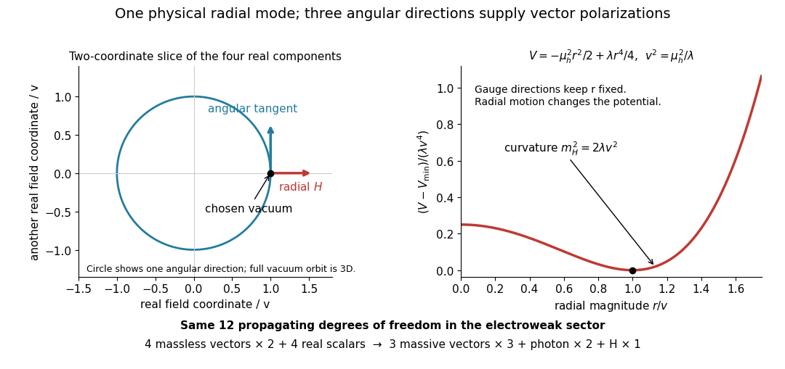

# Higgs field potential

↑ **Parent:** [Higgs field](higgs-field.md)

For $\mu_h^2>0$ and $\lambda>0$, the minimum has $\phi^\dagger\phi=v^2/2$ with $v^2=\mu_h^2/\lambda$. In [unitary gauge](unitary-gauge.md), $\phi=(0,v+H)^T/\sqrt2$ gives $V=\text{constant}+\lambda v^2H^2+\lambda vH^3+\lambda H^4/4$. The canonically normalized [Higgs boson](higgs-boson.md) therefore has $m_H^2=2\lambda v^2$. The angular modes produce the [Goldstone bosons](goldstone-boson.md) absorbed in the [Higgs mechanism](higgs-mechanism.md).

Set $r=\sqrt{2\phi^\dagger\phi}$. The same [Higgs potential](higgs-field-potential.md) becomes

$$
V(r)=-\frac{\mu_h^2r^2}{2}+\frac{\lambda r^4}{4},\qquad
V'(r)=r(-\mu_h^2+\lambda r^2),\qquad
V''(v)=2\lambda v^2.
$$

The origin has negative radial curvature, while $r=v$ minimizes the [scalar potential](scalar-potential.md). Changing the field's angular coordinates at fixed $r$ costs no potential [energy](energy-split.md); changing its radial magnitude does. This geometric distinction explains why the surviving physical [scalar field](scalar-field.md) has a mass even though the angular directions are flat in the [scalar potential](scalar-potential.md). Local angular variations still enter the [gauge-covariant kinetic term](gauge-covariant-kinetic-term.md).

**[Figure 7](#image-radial-curvature-angular-gauge-directions-and-conserved-degrees-of-freedom). Radial curvature, angular gauge directions and conserved degrees of freedom**. Original two-coordinate slice through the four real [Higgs doublet](higgs-field.md) components. The full vacuum orbit has three angular directions. Its points represent gauge-related descriptions; the radial [Higgs boson](higgs-boson.md) changes the field magnitude. The plotted [Higgs potential](higgs-field-potential.md) uses the normalization of this section.

For a chosen model, not fitted physical constants, take $v=240\,\mathrm{GeV}$ and $\lambda=1/8$ in units $\hbar=c=1$. Then $\mu_h^2=7200\,\mathrm{GeV}^2$ and $m_H=120\,\mathrm{GeV}$. Direct expansion gives a quadratic coefficient $7200\,\mathrm{GeV}^2$, cubic coefficient $30\,\mathrm{GeV}$ and quartic coefficient $1/32$. The quadratic coefficient is $m_H^2/2$, not $m_H^2$. Keeping the same named $\lambda$ in the [Higgs radial mass for a half-normalized quartic potential](higgs-radial-mass-for-a-half-normalized-quartic-potential.md) would instead give $m_H^2=7200\,\mathrm{GeV}^2$; these are different potentials. The [shifted quartic Higgs potential normalization](shifted-quartic-higgs-potential-normalization.md) agrees with this section when $\kappa=\lambda$.

**Table of contents**

- [Higgs radial mass for a half-normalized quartic potential](higgs-radial-mass-for-a-half-normalized-quartic-potential.md)
- [Shifted quartic Higgs potential normalization](shifted-quartic-higgs-potential-normalization.md)

## ↑ Ancestors (7)

1. [Higgs field](higgs-field.md)
2. [Electroweak interaction](electroweak-interaction.md)
3. [Standard Model](standard-model-split.md)
4. [Quantum field theory](quantum-field-theory-split.md)
5. [Branches of physics](branches-of-physics.md)
6. [Physics](physics-split.md)
7. [Codex Wiki](split.md)

## ← Incoming links (2)

- [Electroweak symmetry breaking](electroweak-symmetry-breaking.md)
- [Solution](past-exam-of-the-mathematics-course-of-the-university-of-cambridge/2004/iii/paper-48/1/solution.md)
